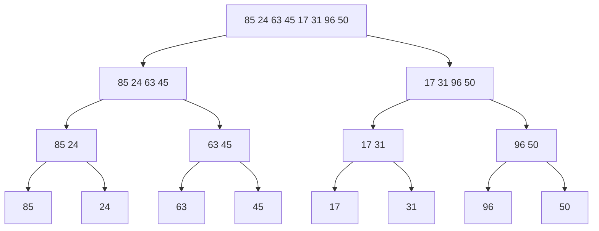

# Divide and conquer: merge-sort

Sorting is the most studied problem in computer science, and for good reason: sorted data enables
binary search, duplicate detection, grouping, range queries and countless greedy algorithms. So far
we have insertion-sort and selection-sort ($O(n^2)$) and heap-sort ($O(n \log n)$). This lesson
introduces the **divide-and-conquer** design pattern through **merge-sort**, a clean, stable,
guaranteed $O(n\log n)$ algorithm.

## 1. Divide-and-conquer

The pattern has three steps:

1. **Divide.** If the input is smaller than a threshold (one or two elements), solve it directly.
   Otherwise split it into two or more disjoint subproblems.
2. **Conquer.** Recursively solve the subproblems.
3. **Combine.** Merge the subproblem solutions into a solution for the original problem.

For merge-sort on a sequence $S$ of $n$ elements:

1. **Divide:** if $S$ has zero or one element, return (it is sorted). Otherwise put the first
   $\lfloor n/2 \rfloor$ elements in $S_1$ and the remaining $\lceil n/2 \rceil$ in $S_2$.
2. **Conquer:** recursively sort $S_1$ and $S_2$.
3. **Combine:** **merge** the sorted $S_1$ and $S_2$ back into $S$.

The execution is visualised by the **merge-sort tree**: each node is a recursive call; the root is
the whole sequence; leaves are single elements.



On the way back up, each node merges its children's sorted results:
`[24 85]`, `[45 63]` → `[24 45 63 85]`; `[17 31]`, `[50 96]` → `[17 31 50 96]`; finally
`[17 24 31 45 50 63 85 96]`.

> **Proposition.** The merge-sort tree for a sequence of size $n$ has height $\lceil \log n \rceil$.

Each level halves the sequence size, so there are about $\log n$ levels.

## 2. Merging two sorted sequences

Keep an index into each input. Repeatedly copy the smaller of the two front elements to the output
and advance that index. When one input is exhausted, copy the rest of the other.

```python
def merge(S1, S2, S):
    """Merge two sorted Python lists S1 and S2 into properly sized list S."""
    i = j = 0
    while i + j < len(S):
        if j == len(S2) or (i < len(S1) and S1[i] < S2[j]):
            S[i + j] = S1[i]        # copy ith element of S1 as next item of S
            i += 1
        else:
            S[i + j] = S2[j]        # copy jth element of S2 as next item of S
            j += 1
```

The index into the output is simply $i + j$. Each iteration copies one element, so merging takes
$O(n_1 + n_2)$ time.

### Dry run of merge

`S1 = [2, 5, 8, 11]`, `S2 = [3, 9, 10]`:

| i | j | compare | output so far |
|---|---|---|---|
| 0 | 0 | 2 < 3 | 2 |
| 1 | 0 | 5 vs 3 | 2 3 |
| 1 | 1 | 5 < 9 | 2 3 5 |
| 2 | 1 | 8 < 9 | 2 3 5 8 |
| 3 | 1 | 11 vs 9 | 2 3 5 8 9 |
| 3 | 2 | 11 vs 10 | 2 3 5 8 9 10 |
| 3 | 3 | S2 exhausted | 2 3 5 8 9 10 11 |

**Stability.** A sort is *stable* if elements with equal keys keep their original relative order.
The book's merge takes from `S2` on ties (`S1[i] < S2[j]` is strict), which is not stable as
written; taking from the **left** run on ties (`S1[i] <= S2[j]`) makes merge-sort stable. Stability
matters when sorting records by one field after another (sort by name, then stably by department).

## 3. Array-based merge-sort

```python-run
def merge(S1, S2, S):
    i = j = 0
    while i + j < len(S):
        if j == len(S2) or (i < len(S1) and S1[i] <= S2[j]):   # <= : stable
            S[i + j] = S1[i]; i += 1
        else:
            S[i + j] = S2[j]; j += 1

def merge_sort(S, depth=0):
    """Sort the elements of Python list S using the merge-sort algorithm."""
    n = len(S)
    if n < 2:
        return                       # list is already sorted
    # divide
    mid = n // 2
    S1 = S[0:mid]                    # copy of first half
    S2 = S[mid:n]                    # copy of second half
    # conquer (with recursion)
    merge_sort(S1, depth + 1)
    merge_sort(S2, depth + 1)
    # merge results
    merge(S1, S2, S)
    print("  " * depth + f"merged {S1} + {S2} -> {S}")

data = [85, 24, 63, 45, 17, 31, 96, 50]
merge_sort(data)
```

## 4. Running time

**Counting per level.** Consider the merge-sort tree. A node handling a subsequence of size $m$
spends $O(m)$ time on slicing and merging (excluding its recursive calls). At depth $i$ there are
$2^i$ nodes, each of size $n/2^i$, so **every level costs $O(n)$** in total. With
$\lceil \log n \rceil + 1$ levels:

> **Proposition.** Merge-sort sorts a sequence of size $n$ in $O(n \log n)$ time.

**Recurrence.** Let $t(n)$ be the worst-case time. Then

$$t(n) = \begin{cases} b & n \le 1 \\ 2\,t(n/2) + cn & \text{otherwise.} \end{cases}$$

Unrolling (assume $n$ is a power of 2):
$t(n) = 2(2t(n/4) + c\,n/2) + cn = 4t(n/4) + 2cn = \cdots = 2^i t(n/2^i) + i\,cn$. Setting
$i = \log n$: $t(n) = n\,b + cn\log n$, which is $O(n \log n)$.

The bound holds for **every** input — best, average and worst case are all $\Theta(n \log n)$ for the
basic algorithm. The cost is **space**: the temporary halves use $O(n)$ extra memory (merge-sort is
*not in place*).

```python-run
import random, time
def merge_sort(S):
    if len(S) < 2: return S
    mid = len(S) // 2
    a, b = merge_sort(S[:mid]), merge_sort(S[mid:])
    out, i, j = [], 0, 0
    while i < len(a) and j < len(b):
        if a[i] <= b[j]: out.append(a[i]); i += 1
        else: out.append(b[j]); j += 1
    out.extend(a[i:]); out.extend(b[j:])
    return out
def insertion_sort(A):
    for k in range(1, len(A)):
        cur, j = A[k], k
        while j > 0 and A[j - 1] > cur:
            A[j] = A[j - 1]; j -= 1
        A[j] = cur
for n in [1000, 2000, 4000]:
    data = [random.random() for _ in range(n)]
    t0 = time.perf_counter(); merge_sort(data); t1 = time.perf_counter()
    insertion_sort(data[:]); t2 = time.perf_counter()
    print(f"n={n}: merge-sort {1000*(t1-t0):6.1f} ms   insertion-sort {1000*(t2-t1):7.1f} ms")
```

## 5. Alternative implementations

### 5.1 Sorting linked lists

Merge-sort never needs random access — only sequential scans — so it works beautifully on linked
lists and queues: split by dequeuing the first half into one queue and the rest into another;
merge by repeatedly dequeuing the smaller front element. The book gives this version with
`LinkedQueue`. Each `first`, `dequeue`, `enqueue` is $O(1)$, so the bound stays $O(n\log n)$, and
merging linked nodes needs no extra arrays. This is why merge-sort is *the* sort for linked lists
(and for data on tape or disk — see external sorting in the last module).

### 5.2 Bottom-up (non-recursive) merge-sort

Instead of recursing, merge runs of length 1 into runs of length 2, then 2 into 4, and so on,
alternating between two arrays to avoid repeated allocation:

```python-run
import math
def merge(src, result, start, inc):
    """Merge src[start:start+inc] and src[start+inc:start+2*inc] into result."""
    end1 = start + inc                        # boundary for run 1
    end2 = min(start + 2 * inc, len(src))     # boundary for run 2
    x, y, z = start, start + inc, start       # index into run 1, run 2, result
    while x < end1 and y < end2:
        if src[x] <= src[y]:
            result[z] = src[x]; x += 1
        else:
            result[z] = src[y]; y += 1
        z += 1
    if x < end1:
        result[z:end2] = src[x:end1]          # copy remainder of run 1 to output
    elif y < end2:
        result[z:end2] = src[y:end2]          # copy remainder of run 2 to output

def merge_sort_bottom_up(S):
    n = len(S)
    logn = math.ceil(math.log(n, 2)) if n > 1 else 0
    src, dest = S, [None] * n                 # make temporary storage for dest
    for i in (2 ** k for k in range(logn)):   # pass i creates all runs of length 2i
        for j in range(0, n, 2 * i):          # each pass merges two length-i runs
            merge(src, dest, j, i)
        src, dest = dest, src                 # reverse roles of lists
        print(f"runs of {2 * i:2d}: {src}")
    if S is not src:
        S[0:n] = src[0:n]                     # additional copy to get results to S

data = [85, 24, 63, 45, 17, 31, 96, 50, 7]
merge_sort_bottom_up(data); print(data)
```

It runs in $O(n\log n)$ like the recursive version but is a bit faster in practice (no recursive
calls, one temporary array).

### 5.3 Natural merge-sort and Timsort

Real data often contains already-sorted stretches (**runs**). A *natural* merge-sort detects
existing runs and merges those rather than starting from runs of length 1 — taking only $O(n)$ on
sorted input. Python's built-in sort, **Timsort**, is an engineered natural merge-sort: it finds runs
(reversing descending ones), extends short runs with insertion sort, and merges with careful
balancing ("galloping"). It is stable, $O(n \log n)$ worst case and $O(n)$ on already-sorted data.

> [!INTERVIEW]
> Merge-sort facts to have ready: $\Theta(n\log n)$ in all cases; stable; $O(n)$ extra space for
> arrays ($O(\log n)$ stack + pointer rewiring for linked lists); the merge step alone solves "merge
> two sorted arrays/lists"; and the merge can **count inversions** — when an element is taken from
> the right run, it is smaller than all remaining elements of the left run, so add
> `len(left) - i` to the count.

```python-run
def sort_count(A):
    """Return (sorted list, number of inversions) in O(n log n)."""
    if len(A) < 2: return A, 0
    mid = len(A) // 2
    L, a = sort_count(A[:mid]); R, b = sort_count(A[mid:])
    out, i, j, inv = [], 0, 0, a + b
    while i < len(L) and j < len(R):
        if L[i] <= R[j]: out.append(L[i]); i += 1
        else:
            out.append(R[j]); j += 1
            inv += len(L) - i                 # R[j] jumps over all remaining left elements
    return out + L[i:] + R[j:], inv
print(sort_count([5, 2, 4, 6, 1, 3]))
```

## 6. Stability in action, and a merge-sort for linked lists

**Seeing stability.** Sort a list of (name, grade) records by grade. A stable sort keeps students
with the same grade in their original (here alphabetical) order; an unstable merge scrambles them.
The only difference between the two functions below is `<=` versus `<` in the merge.

```python-run
def merge_sort_by(records, key, take_left_on_ties=True):
    if len(records) < 2:
        return records
    mid = len(records) // 2
    L = merge_sort_by(records[:mid], key, take_left_on_ties)
    R = merge_sort_by(records[mid:], key, take_left_on_ties)
    out, i, j = [], 0, 0
    while i < len(L) and j < len(R):
        left_first = key(L[i]) <= key(R[j]) if take_left_on_ties else key(L[i]) < key(R[j])
        if left_first: out.append(L[i]); i += 1
        else: out.append(R[j]); j += 1
    return out + L[i:] + R[j:]

students = [("Ana", "B"), ("Ben", "A"), ("Cy", "B"), ("Dee", "A"), ("Eli", "B"), ("Fay", "A")]
grade = lambda s: s[1]
print("stable  :", merge_sort_by(students, grade, True))
print("unstable:", merge_sort_by(students, grade, False))
```

In the stable output the A-students appear as Ben, Dee, Fay and the B-students as Ana, Cy, Eli —
input order preserved within each grade. With the strict comparison, ties are resolved in favour of
the **right** run, so later records overtake earlier ones. Stability is what makes multi-key sorting
by successive passes work: sort by the secondary key, then stably by the primary key.

**Merge-sort on a linked list.** No random access is needed, so linked lists can be sorted without
any auxiliary array: split by walking with slow and fast pointers, sort both halves, and merge by
**relinking the existing nodes**.

```python-run
class Node:
    __slots__ = "val", "next"
    def __init__(self, val, next=None): self.val, self.next = val, next
def from_list(xs):
    head = None
    for x in reversed(xs): head = Node(x, head)
    return head
def to_list(h):
    out = []
    while h: out.append(h.val); h = h.next
    return out

def merge(a, b):
    dummy = tail = Node(None)              # dummy header: no special case for the first node
    while a and b:
        if a.val <= b.val: tail.next, a = a, a.next
        else: tail.next, b = b, b.next
        tail = tail.next
    tail.next = a or b                     # splice in whatever is left: O(1), no copying
    return dummy.next

def merge_sort_list(head):
    if head is None or head.next is None:
        return head
    slow, fast = head, head.next
    while fast and fast.next:              # slow stops at the end of the first half
        slow, fast = slow.next, fast.next.next
    second, slow.next = slow.next, None    # cut the list in two
    return merge(merge_sort_list(head), merge_sort_list(second))

print(to_list(merge_sort_list(from_list([85, 24, 63, 45, 17, 31, 96, 50, 7]))))
```

### Dry run of the split and merge on `85 → 24 → 63 → 45 → 17`

| step | detail |
|---|---|
| find the middle | (slow, fast) = (85, 24) → (24, 45) → (63, None-after-17): slow stops at 63 |
| cut | first half `85 → 24 → 63`, second half `45 → 17` |
| recurse | first half becomes `24 → 63 → 85`; second half becomes `17 → 45` |
| merge | compare 24/17 → take 17; 24/45 → 24; 63/45 → 45; second list empty → splice `63 → 85` |
| result | `17 → 24 → 45 → 63 → 85` |

**Cost.** Finding the middle and merging are both linear in the length of the list, so the
recurrence is still $T(n) = 2T(n/2) + cn$: $O(n \log n)$ time. But the merge allocates **no new
nodes** — it only rewrites `next` references — so the extra space is just the $O(\log n)$ recursion
stack, compared with $O(n)$ for arrays. The final splice `tail.next = a or b` also shows a small
advantage over the array version: the leftover run is attached in $O(1)$ instead of being copied
element by element.

## 7. Pitfalls

- Using `<` instead of `<=` for the left run breaks stability.
- Forgetting to copy the leftover tail of the non-exhausted run.
- Recursing on `n < 1` only: a one-element list would recurse forever (`mid = 0`).
- Allocating new lists at every level in a hot loop — prefer one auxiliary buffer.

## 8. Summary

- Divide-and-conquer: divide, conquer recursively, combine.
- Merge-sort: split in half, sort halves, merge in linear time — $O(n \log n)$ always, stable,
  $O(n)$ extra space, ideal for linked lists and external data.
- Recurrence $t(n) = 2t(n/2) + cn$ solves to $O(n\log n)$.

> **Source:** Goodrich, Tamassia & Goldwasser, *Data Structures and Algorithms in Python*, ch. 12.1–12.2.

## Check yourself

```quiz
[
  {"q": "What are the three steps of divide-and-conquer?",
   "options": ["Sort, search, merge", "Divide, conquer (recurse), combine", "Hash, probe, resize", "Push, pop, peek"], "answer": 1,
   "explain": "Split into subproblems, solve them recursively, combine the answers."},
  {"q": "Merging two sorted lists of sizes n1 and n2 takes...",
   "options": ["O(n1 * n2)", "O(n1 + n2)", "O(log(n1 + n2))", "O((n1 + n2) log(n1 + n2))"], "answer": 1,
   "explain": "Each step copies one element to the output."},
  {"q": "Why is merge-sort O(n log n)?",
   "options": ["Each of the about log n levels of the merge-sort tree does O(n) total work", "It makes n recursive calls each costing log n", "It uses a heap", "Because of amortisation"], "answer": 0,
   "explain": "2^i nodes of size n/2^i at depth i: O(n) per level, log n levels."},
  {"q": "Merge-sort's best-case running time (basic top-down version) is...",
   "options": ["O(n)", "O(n log n)", "O(n^2)", "O(log n)"], "answer": 1,
   "explain": "It always splits and merges fully, regardless of input order. Natural merge-sort/Timsort improve this to O(n) on sorted data."},
  {"q": "To keep merge-sort stable, on equal keys the merge should take the element from...",
   "options": ["the right run", "the left run", "either", "neither; equal keys are dropped"], "answer": 1,
   "explain": "Left-run elements came earlier in the original sequence."},
  {"q": "Why is merge-sort well suited to linked lists?",
   "options": ["It needs random access", "It only needs sequential access, and merging relinks nodes without extra arrays", "Linked lists are already sorted", "It is in place for arrays"], "answer": 1,
   "explain": "Splitting and merging are sequential scans; no indexing is required."},
  {"q": "How much auxiliary memory does array-based merge-sort use?",
   "options": ["O(1)", "O(log n)", "O(n)", "O(n log n)"], "answer": 2,
   "explain": "The merge needs a temporary buffer proportional to the data being merged."}
]
```
