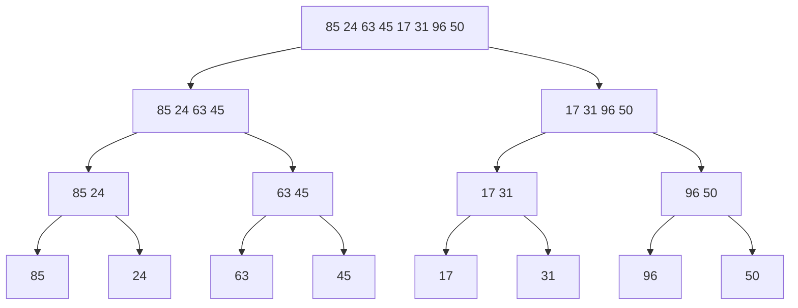

# Divide and conquer: merge-sort

> **Before this lesson:** You should be comfortable with recursion and recursion trees
> ([Thinking recursively](#/lesson/dsa-foundations/recursion-examples),
> [Analysing recursive algorithms](#/lesson/dsa-foundations/recursion-analysis)), know
> insertion sort and the words "stable" and "in place"
> ([Using arrays](#/lesson/dsa-foundations/using-arrays)), and know what a linked list is
> ([Singly and circularly linked lists](#/lesson/dsa-foundations/singly-circular)).

## In plain words

**Merge-sort** sorts a list by cutting it in half, sorting each half separately, and then
combining the two sorted halves into one. Each half is sorted the same way, by cutting it in
half again, until the pieces are single items, which need no sorting at all.

Imagine two teachers who must put a big pile of exam papers into alphabetical order. They split
the pile, each sorts their own half, and then they combine: both lay their sorted piles face
up, and they repeatedly take whichever of the two top papers comes first in the alphabet.
Combining two sorted piles this way is quick, because only the two top papers ever need
comparing. That combining step is called a **merge**, and it is the heart of the algorithm.

The general strategy (split a problem into parts, solve the parts, combine the answers) is
called **divide and conquer**, and it reappears throughout computer science.

Why it matters for a job: sorting is the most common preprocessing step there is, because
sorted data makes searching, removing duplicates and grouping easy. Merge-sort is the standard
example of an $O(n \log n)$ sort with a guarantee; Python's own built-in sort is a refined
merge-sort; and "merge two sorted lists" and "sort a linked list" are routine interview tasks
that are solved with exactly the code in this lesson.

## 1. Divide-and-conquer

So far this track has seen insertion-sort and selection-sort, both $O(n^2)$, and heap-sort,
$O(n \log n)$. Merge-sort reaches $O(n \log n)$ by a different route, the divide-and-conquer
pattern, which has three steps:

1. **Divide.** If the input is tiny (one or two items), solve it directly. Otherwise split it
   into two or more separate smaller problems.
2. **Conquer.** Solve the smaller problems recursively.
3. **Combine.** Put their solutions together into a solution of the original problem.

For merge-sort on a sequence $S$ of $n$ items:

1. **Divide:** if $S$ has zero or one item, it is already sorted; return. Otherwise put the
   first $\lfloor n/2 \rfloor$ items into $S_1$ and the remaining $\lceil n/2 \rceil$ into
   $S_2$.
2. **Conquer:** sort $S_1$ and $S_2$ recursively.
3. **Combine:** **merge** the sorted $S_1$ and $S_2$ back into $S$.

A run of the algorithm can be drawn as a **merge-sort tree**. Each node is one recursive call,
labelled with the sequence it was given; the root is the whole input and the leaves are single
items. Reading the picture downwards shows the dividing.



On the way back up, each node merges its children's sorted results:
`[24 85]`, `[45 63]` → `[24 45 63 85]`; `[17 31]`, `[50 96]` → `[17 31 50 96]`; finally
`[17 24 31 45 50 63 85 96]`.

> **Claim.** The merge-sort tree for a sequence of size $n$ has height $\lceil \log n \rceil$.

Each level halves the size of the sequences, and halving $n$ repeatedly reaches 1 after about
$\log n$ steps. For the eight items above there are three levels of splitting.

## 2. Merging two sorted sequences

All the real work happens in the merge. Keep one index into each sorted input, both starting at
the front. Repeatedly compare the two items the indices point at, copy the smaller one to the
output, and advance that index. When one input runs out, copy whatever remains of the other.
This works because each input is sorted: the smallest item not yet output must be at the front
of one of the two.

```python
def merge(S1, S2, S):
    """Merge two sorted Python lists S1 and S2 into properly sized list S."""
    i = j = 0
    while i + j < len(S):
        if j == len(S2) or (i < len(S1) and S1[i] < S2[j]):
            S[i + j] = S1[i]        # copy ith element of S1 as next item of S
            i += 1
        else:
            S[i + j] = S2[j]        # copy jth element of S2 as next item of S
            j += 1
```

**Reading this code.** `i` counts how many items have been taken from `S1` and `j` how many from
`S2`, so the next free cell of the output `S` is at index `i + j`. The condition decides
whether to take from `S1`: either `S2` is used up (`j == len(S2)`), or `S1` still has items and
its front item is the smaller. Python evaluates `or` and `and` from left to right and stops as
soon as the answer is known, which is why `S2[j]` is never read once `S2` is exhausted. Each
pass of the loop copies one item, so merging lists of lengths $n_1$ and $n_2$ takes
$O(n_1 + n_2)$ time.

### Dry run of merge

`S1 = [2, 5, 8, 11]`, `S2 = [3, 9, 10]`:

| i | j | compare | output so far |
|---|---|---|---|
| 0 | 0 | 2 < 3 | 2 |
| 1 | 0 | 5 vs 3 | 2 3 |
| 1 | 1 | 5 < 9 | 2 3 5 |
| 2 | 1 | 8 < 9 | 2 3 5 8 |
| 3 | 1 | 11 vs 9 | 2 3 5 8 9 |
| 3 | 2 | 11 vs 10 | 2 3 5 8 9 10 |
| 3 | 3 | S2 exhausted | 2 3 5 8 9 10 11 |

**Stability.** Recall that a sort is *stable* if items with equal keys keep their original
relative order. The merge above uses a strict comparison (`S1[i] < S2[j]`), so when the two
front items are equal it takes the one from `S2`, letting a later item overtake an earlier one:
not stable. Changing the test to `S1[i] <= S2[j]`, so that ties are taken from the **left**
input, makes merge-sort stable. Stability matters when records are sorted by one field after
another (by name first, then stably by department, leaves each department in name order).

## 3. Array-based merge-sort

The full algorithm for a Python list follows. It uses the stable merge, and prints each merge,
indented by the depth of the recursion, so that the output traces the tree from the bottom up.

```python-run
def merge(S1, S2, S):
    i = j = 0
    while i + j < len(S):
        if j == len(S2) or (i < len(S1) and S1[i] <= S2[j]):   # <= : stable
            S[i + j] = S1[i]; i += 1
        else:
            S[i + j] = S2[j]; j += 1

def merge_sort(S, depth=0):
    """Sort the elements of Python list S using the merge-sort algorithm."""
    n = len(S)
    if n < 2:
        return                       # list is already sorted
    # divide
    mid = n // 2
    S1 = S[0:mid]                    # copy of first half
    S2 = S[mid:n]                    # copy of second half
    # conquer (with recursion)
    merge_sort(S1, depth + 1)
    merge_sort(S2, depth + 1)
    # merge results
    merge(S1, S2, S)
    print("  " * depth + f"merged {S1} + {S2} -> {S}")

data = [85, 24, 63, 45, 17, 31, 96, 50]
merge_sort(data)
```

**Reading this code.** `S[0:mid]` and `S[mid:n]` are slices, so `S1` and `S2` are *copies* of
the two halves. The two recursive calls sort those copies. Then `merge(S1, S2, S)` writes the
merged result back over the original list `S`, which is why the function needs no `return`
value. The first lines of output are the deepest merges, `[85] + [24] -> [24, 85]` and
`[63] + [45] -> [45, 63]`, and the last line is the final merge of the two sorted halves into
`[17, 24, 31, 45, 50, 63, 85, 96]`.

## 4. Running time

**Counting level by level.** Look at the merge-sort tree. A call on a sequence of $m$ items
spends $O(m)$ time on its own work, slicing and merging, not counting its recursive calls. At
depth $i$ of the tree there are $2^i$ calls, each on $n/2^i$ items, so the calls at one depth
handle $n$ items between them: **every level costs $O(n)$ in total**. There are
$\lceil \log n \rceil + 1$ levels. Multiplying:

> **Claim.** Merge-sort sorts a sequence of size $n$ in $O(n \log n)$ time.

**By recurrence.** Let $t(n)$ be the worst-case time for $n$ items. A tiny input costs a
constant $b$; otherwise the cost is two half-sized sorts plus linear work $cn$:

$$t(n) = \begin{cases} b & n \le 1 \\ 2\,t(n/2) + cn & \text{otherwise.} \end{cases}$$

Unrolling, as in the recursion-analysis lesson, and assuming $n$ is a power of 2:
$t(n) = 2(2t(n/4) + c\,n/2) + cn = 4t(n/4) + 2cn = \cdots = 2^i t(n/2^i) + i\,cn$. When
$i = \log n$ the subproblems have size 1, giving $t(n) = n\,b + cn\log n$, which is
$O(n \log n)$.

The bound holds for **every** input. This basic merge-sort does the same splitting and merging
whatever the data looks like, so its best, average and worst cases are all $\Theta(n \log n)$.
The price is **space**: the temporary halves need $O(n)$ extra memory, so merge-sort is *not*
in place.

The demo times merge-sort against insertion-sort on random data. Doubling $n$ roughly doubles
the first and quadruples the second.

```python-run
import random, time
def merge_sort(S):
    if len(S) < 2: return S
    mid = len(S) // 2
    a, b = merge_sort(S[:mid]), merge_sort(S[mid:])
    out, i, j = [], 0, 0
    while i < len(a) and j < len(b):
        if a[i] <= b[j]: out.append(a[i]); i += 1
        else: out.append(b[j]); j += 1
    out.extend(a[i:]); out.extend(b[j:])
    return out
def insertion_sort(A):
    for k in range(1, len(A)):
        cur, j = A[k], k
        while j > 0 and A[j - 1] > cur:
            A[j] = A[j - 1]; j -= 1
        A[j] = cur
for n in [1000, 2000, 4000]:
    data = [random.random() for _ in range(n)]
    t0 = time.perf_counter(); merge_sort(data); t1 = time.perf_counter()
    insertion_sort(data[:]); t2 = time.perf_counter()
    print(f"n={n}: merge-sort {1000*(t1-t0):6.1f} ms   insertion-sort {1000*(t2-t1):7.1f} ms")
```

## 5. Alternative implementations

### 5.1 Sorting linked lists

Merge-sort never jumps to an arbitrary position (it never needs *random access*); it only reads
its inputs from front to back. So it suits linked lists and queues, where reading from the
front is all you can do cheaply. With a queue: split by dequeuing the first half of the items
into one queue and the rest into another; merge by repeatedly dequeuing the smaller of the two
front items. Each `first`, `dequeue` and `enqueue` is $O(1)$, so the bound is still
$O(n\log n)$. This is why merge-sort is the method of choice for linked lists, and for data too
large for memory that must be read from disk in order (external sorting, in the last module).
Section 6 gives a linked-list version.

### 5.2 Bottom-up (non-recursive) merge-sort

The recursion can be avoided by working upwards from the leaves of the merge-sort tree. A
sorted stretch of consecutive items is called a **run**. Treat every single item as a run of
length 1; merge neighbouring runs in pairs to get runs of length 2; merge those to get runs of
length 4; and so on until one run covers everything. Two arrays are used alternately as source
and destination, so that no new lists are created along the way:

```python-run
import math
def merge(src, result, start, inc):
    """Merge src[start:start+inc] and src[start+inc:start+2*inc] into result."""
    end1 = start + inc                        # boundary for run 1
    end2 = min(start + 2 * inc, len(src))     # boundary for run 2
    x, y, z = start, start + inc, start       # index into run 1, run 2, result
    while x < end1 and y < end2:
        if src[x] <= src[y]:
            result[z] = src[x]; x += 1
        else:
            result[z] = src[y]; y += 1
        z += 1
    if x < end1:
        result[z:end2] = src[x:end1]          # copy remainder of run 1 to output
    elif y < end2:
        result[z:end2] = src[y:end2]          # copy remainder of run 2 to output

def merge_sort_bottom_up(S):
    n = len(S)
    logn = math.ceil(math.log(n, 2)) if n > 1 else 0
    src, dest = S, [None] * n                 # make temporary storage for dest
    for i in (2 ** k for k in range(logn)):   # pass i creates all runs of length 2i
        for j in range(0, n, 2 * i):          # each pass merges two length-i runs
            merge(src, dest, j, i)
        src, dest = dest, src                 # reverse roles of lists
        print(f"runs of {2 * i:2d}: {src}")
    if S is not src:
        S[0:n] = src[0:n]                     # additional copy to get results to S

data = [85, 24, 63, 45, 17, 31, 96, 50, 7]
merge_sort_bottom_up(data); print(data)
```

The printed lines show the runs doubling: after the first pass the list consists of sorted
pairs, then sorted fours, then eights, and with nine items a fourth pass finishes the job. This
version runs in $O(n\log n)$ like the recursive one and is somewhat faster in practice, since
it makes no recursive calls and uses a single temporary array.

### 5.3 Natural merge-sort and Timsort

Real data often arrives with stretches that are already in order. A *natural* merge-sort looks
for those existing runs and merges them, instead of starting from runs of length 1. On input
that is already sorted it finds one run and finishes in $O(n)$. Python's built-in sort,
**Timsort** (named after its author, Tim Peters), is a carefully engineered natural merge-sort.
It finds runs, reversing any that are in descending order; lengthens short runs with insertion
sort; and merges with several refinements. It is stable, $O(n \log n)$ in the worst case, and
$O(n)$ on data that is already sorted.

> [!INTERVIEW]
> Merge-sort facts to have ready: $\Theta(n\log n)$ in every case; stable; $O(n)$ extra space
> for arrays (for linked lists, only the $O(\log n)$ recursion stack); the merge step by itself
> solves "merge two sorted arrays" and "merge two sorted lists". The merge can also **count
> inversions**, the out-of-order pairs from the insertion-sort lesson. Whenever an item is taken
> from the right half, it is smaller than every item still waiting in the left half, and each of
> those is one inversion, so add `len(left) - i` to the count. The demo below does this;
> `[5, 2, 4, 6, 1, 3]` has 9 inversions.

```python-run
def sort_count(A):
    """Return (sorted list, number of inversions) in O(n log n)."""
    if len(A) < 2: return A, 0
    mid = len(A) // 2
    L, a = sort_count(A[:mid]); R, b = sort_count(A[mid:])
    out, i, j, inv = [], 0, 0, a + b
    while i < len(L) and j < len(R):
        if L[i] <= R[j]: out.append(L[i]); i += 1
        else:
            out.append(R[j]); j += 1
            inv += len(L) - i                 # R[j] jumps over all remaining left elements
    return out + L[i:] + R[j:], inv
print(sort_count([5, 2, 4, 6, 1, 3]))
```

## 6. Stability in action, and a merge-sort for linked lists

**Seeing stability.** Sort a list of (name, grade) records by grade. A stable sort keeps students
with the same grade in their original (here alphabetical) order; an unstable merge scrambles them.
The only difference between the two functions below is `<=` versus `<` in the merge.

```python-run
def merge_sort_by(records, key, take_left_on_ties=True):
    if len(records) < 2:
        return records
    mid = len(records) // 2
    L = merge_sort_by(records[:mid], key, take_left_on_ties)
    R = merge_sort_by(records[mid:], key, take_left_on_ties)
    out, i, j = [], 0, 0
    while i < len(L) and j < len(R):
        left_first = key(L[i]) <= key(R[j]) if take_left_on_ties else key(L[i]) < key(R[j])
        if left_first: out.append(L[i]); i += 1
        else: out.append(R[j]); j += 1
    return out + L[i:] + R[j:]

students = [("Ana", "B"), ("Ben", "A"), ("Cy", "B"), ("Dee", "A"), ("Eli", "B"), ("Fay", "A")]
grade = lambda s: s[1]
print("stable  :", merge_sort_by(students, grade, True))
print("unstable:", merge_sort_by(students, grade, False))
```

In the stable output the A-students appear as Ben, Dee, Fay and the B-students as Ana, Cy, Eli —
input order preserved within each grade. With the strict comparison, ties are resolved in favour of
the **right** run, so later records overtake earlier ones. Stability is what makes multi-key sorting
by successive passes work: sort by the secondary key, then stably by the primary key.

**Merge-sort on a linked list.** Since no random access is needed, a linked list can be sorted
with no extra array at all. To split it, walk two references along the list, a slow one moving
one node at a time and a fast one moving two; when the fast one reaches the end, the slow one
is at the middle, and cutting the link there gives two halves. Sort both halves recursively,
then merge by **re-linking the existing nodes** in order. The `merge` function starts from a
dummy node, as in the linked-lists module, so that attaching the first node needs no special
case.

```python-run
class Node:
    __slots__ = "val", "next"
    def __init__(self, val, next=None): self.val, self.next = val, next
def from_list(xs):
    head = None
    for x in reversed(xs): head = Node(x, head)
    return head
def to_list(h):
    out = []
    while h: out.append(h.val); h = h.next
    return out

def merge(a, b):
    dummy = tail = Node(None)              # dummy header: no special case for the first node
    while a and b:
        if a.val <= b.val: tail.next, a = a, a.next
        else: tail.next, b = b, b.next
        tail = tail.next
    tail.next = a or b                     # splice in whatever is left: O(1), no copying
    return dummy.next

def merge_sort_list(head):
    if head is None or head.next is None:
        return head
    slow, fast = head, head.next
    while fast and fast.next:              # slow stops at the end of the first half
        slow, fast = slow.next, fast.next.next
    second, slow.next = slow.next, None    # cut the list in two
    return merge(merge_sort_list(head), merge_sort_list(second))

print(to_list(merge_sort_list(from_list([85, 24, 63, 45, 17, 31, 96, 50, 7]))))
```

### Dry run of the split and merge on `85 → 24 → 63 → 45 → 17`

| step | detail |
|---|---|
| find the middle | (slow, fast) = (85, 24) → (24, 45) → (63, None-after-17): slow stops at 63 |
| cut | first half `85 → 24 → 63`, second half `45 → 17` |
| recurse | first half becomes `24 → 63 → 85`; second half becomes `17 → 45` |
| merge | compare 24/17 → take 17; 24/45 → 24; 63/45 → 45; second list empty → splice `63 → 85` |
| result | `17 → 24 → 45 → 63 → 85` |

**Cost.** Finding the middle and merging are both linear in the length of the list, so the
recurrence is still $T(n) = 2T(n/2) + cn$: $O(n \log n)$ time. But the merge allocates **no new
nodes** (it only rewrites `next` references), so the extra space is only the $O(\log n)$
recursion stack, compared with $O(n)$ for arrays. The final splice `tail.next = a or b` also shows a small
advantage over the array version: the leftover run is attached in $O(1)$ instead of being copied
element by element.

## 7. Pitfalls

- **Breaking stability.** Using `<` instead of `<=` when comparing the left item with the right
  one takes ties from the right and loses stability.
- **Dropping the leftovers.** When one input runs out, the rest of the other still has to be
  copied to the output.
- **A base case that is too small.** Stopping only when `n < 1` lets a one-item list recurse
  for ever, because `mid` is 0 and the "second half" is the same one-item list again. Stop when
  `n < 2`.
- **Creating new lists at every level** in code where speed matters. Prefer one extra buffer,
  as in the bottom-up version.
- **Calling merge-sort "in place".** On arrays it needs $O(n)$ extra memory.

## 8. Summary

- Divide and conquer: divide the problem, solve the parts recursively, combine the results.
- Merge-sort splits the list in half, sorts each half, and merges them in linear time. It takes
  $O(n \log n)$ on every input, is stable, uses $O(n)$ extra space on arrays, and is ideal for
  linked lists and for data read sequentially from disk.
- The recurrence $t(n) = 2t(n/2) + cn$ solves to $O(n\log n)$: $\log n$ levels, each costing
  $O(n)$.
- Python's built-in sort, Timsort, is a merge-sort that exploits runs already present in the
  data.

> **Source:** Goodrich, Tamassia & Goldwasser, *Data Structures and Algorithms in Python*, ch. 12.1–12.2.

## Glossary

- **Divide and conquer**: solving a problem by splitting it, solving the parts recursively and
  combining the answers.
- **Merge**: combining two sorted sequences into one sorted sequence in linear time.
- **Merge-sort**: sorting by recursively sorting two halves and merging them.
- **Merge-sort tree**: the tree of recursive calls made by merge-sort.
- **Stable sort**: a sort that keeps items with equal keys in their original order.
- **In place**: using only a constant amount of extra memory; array merge-sort is not.
- **Random access**: reaching any position directly, as in an array.
- **Run**: a stretch of consecutive items that is already sorted.
- **Bottom-up merge-sort**: a non-recursive merge-sort that merges runs of doubling length.
- **Natural merge-sort**: a merge-sort that starts from the runs already in the data.
- **Timsort**: Python's built-in sorting algorithm, a refined natural merge-sort.
- **Inversion**: a pair of items that are out of order relative to each other.

## Check yourself

```quiz
[
  {"q": "What are the three steps of divide-and-conquer?",
   "options": ["Sort, search, merge", "Divide, conquer (recurse), combine", "Hash, probe, resize", "Push, pop, peek"], "answer": 1,
   "explain": "Split into subproblems, solve them recursively, combine the answers."},
  {"q": "Merging two sorted lists of sizes n1 and n2 takes...",
   "options": ["O(n1 * n2)", "O(n1 + n2)", "O(log(n1 + n2))", "O((n1 + n2) log(n1 + n2))"], "answer": 1,
   "explain": "Each step copies one element to the output."},
  {"q": "Why is merge-sort O(n log n)?",
   "options": ["Each of the about log n levels of the merge-sort tree does O(n) total work", "It makes n recursive calls each costing log n", "It uses a heap", "Because of amortisation"], "answer": 0,
   "explain": "2^i nodes of size n/2^i at depth i: O(n) per level, log n levels."},
  {"q": "Merge-sort's best-case running time (basic top-down version) is...",
   "options": ["O(n)", "O(n log n)", "O(n^2)", "O(log n)"], "answer": 1,
   "explain": "It always splits and merges fully, regardless of input order. Natural merge-sort/Timsort improve this to O(n) on sorted data."},
  {"q": "To keep merge-sort stable, on equal keys the merge should take the element from...",
   "options": ["the right run", "the left run", "either", "neither; equal keys are dropped"], "answer": 1,
   "explain": "Left-run elements came earlier in the original sequence."},
  {"q": "Why is merge-sort well suited to linked lists?",
   "options": ["It needs random access", "It only needs sequential access, and merging relinks nodes without extra arrays", "Linked lists are already sorted", "It is in place for arrays"], "answer": 1,
   "explain": "Splitting and merging are sequential scans; no indexing is required."},
  {"q": "How much auxiliary memory does array-based merge-sort use?",
   "options": ["O(1)", "O(log n)", "O(n)", "O(n log n)"], "answer": 2,
   "explain": "The merge needs a temporary buffer proportional to the data being merged."}
]
```
