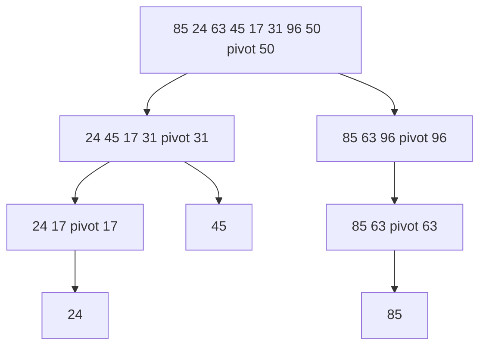

# Quick-sort and randomisation

Like merge-sort, **quick-sort** is divide-and-conquer — but it puts the hard work **before** the
recursive calls rather than after. Merge-sort divides trivially and combines carefully; quick-sort
divides carefully (partitioning around a pivot) and combines trivially. The result is an algorithm
that sorts **in place**, runs very fast in practice, and — with a dash of randomness — takes
$O(n \log n)$ expected time on every input.

## 1. The algorithm

For a sequence $S$:

1. **Divide.** If $S$ has at least two elements, select an element $x$ called the **pivot**
   (classically, the *last* element). Remove all elements from $S$ and put them into three
   sequences: $L$ (elements less than $x$), $E$ (equal to $x$), $G$ (greater than $x$).
2. **Conquer.** Recursively sort $L$ and $G$.
3. **Combine.** Put the elements back into $S$ in order: $L$, then $E$, then $G$.



The execution is drawn as a **quick-sort tree**. Unlike the merge-sort tree, its shape depends on the
pivots: a pivot near the median gives two children of about half size; an extreme pivot gives one
child nearly as large as the parent.

```python-run
def quick_sort_simple(S, depth=0):
    """Three-way quick-sort that builds new lists (clear, but not in place)."""
    if len(S) < 2:
        return S
    p = S[-1]                                   # using the last element as arbitrary pivot
    L = [x for x in S if x < p]
    E = [x for x in S if x == p]
    G = [x for x in S if x > p]
    print("  " * depth + f"pivot {p}: L={L} E={E} G={G}")
    return quick_sort_simple(L, depth + 1) + E + quick_sort_simple(G, depth + 1)

print(quick_sort_simple([85, 24, 63, 45, 17, 31, 96, 50]))
```

## 2. Running time

At each node of the quick-sort tree, the divide step takes time proportional to the size of the
node's input. Let $s_i$ be the total size of all inputs at depth $i$: $s_0 = n$, $s_1 \le n - 1$
(the pivot is excluded), and in general $s_i \le n - i$. The running time is
$O\!\left(\sum_{i=0}^{h} s_i\right) \le O(n \cdot h)$ where $h$ is the height of the tree.

- **Best case.** Pivots split evenly: $h = O(\log n)$, time $O(n \log n)$.
- **Worst case.** Every pivot is the minimum or maximum of its subsequence: one of $L$, $G$ is empty
  and the other has size $n - 1$. Then $h = n - 1$ and the time is
  $n + (n-1) + \cdots + 1 = \Theta(n^2)$.

The cruel irony: with "last element as pivot", the worst case is an **already sorted** input —
the easiest instance of all, and one that occurs frequently in practice.

## 3. Randomised quick-sort

Rather than hoping the input is "random", inject randomness into the algorithm: **pick the pivot
uniformly at random** from the subsequence. Then no particular input is bad; the bound holds in
expectation over the algorithm's own coin flips.

> **Proposition.** The expected running time of randomised quick-sort on a sequence of size $n$ is
> $O(n\log n)$.

*Justification (the book's argument).* Call a recursive call on a sequence of size $m$ **good** if
both $L$ and $G$ have size at most $3m/4$, and **bad** otherwise. A call is good whenever the pivot
lands in the middle half of the sorted order — there are $m/2$ such pivots — so each call is good
with probability $1/2$.

- A good call shrinks the problem to at most $3/4$ of its size, so along any root-to-leaf path there
  can be at most $\log_{4/3} n$ good calls.
- Since each call is good with probability $1/2$, the expected number of calls on a path before
  accumulating $\log_{4/3} n$ good ones is $2\log_{4/3} n$. So the expected height is $O(\log n)$.
- Each level does $O(n)$ work. Total expected time $O(n\log n)$. ∎

A sharper analysis shows the expected number of comparisons is about $2n\ln n \approx 1.39\,n\log_2
n$, and that the running time is $O(n\log n)$ **with high probability** — the chance of hitting
quadratic behaviour on a large input is astronomically small.

```python-run
import random, sys
sys.setrecursionlimit(20000)
def comparisons(S, choose):
    if len(S) < 2: return 0
    p = choose(S)
    L = [x for x in S if x < p]; G = [x for x in S if x > p]
    return len(S) - 1 + comparisons(L, choose) + comparisons(G, choose)
n = 3000
sorted_input = list(range(n))
print("last-element pivot on sorted input:", comparisons(sorted_input, lambda S: S[-1]), "comparisons (n^2/2 =", n*n//2, ")")
print("random pivot on sorted input:      ", comparisons(sorted_input, random.choice), "comparisons (1.39 n log2 n =", int(1.39*n*11.55), ")")
```

## 4. In-place quick-sort

The version above uses auxiliary lists. Quick-sort's real strength is that the partition can be done
**in place**, using only swaps within the array. A subsequence is described by two indices
$a$ (leftmost) and $b$ (rightmost).

**Partition (the book's two-pointer scheme).** Take `pivot = S[b]`. Use `left = a` and
`right = b - 1`:

1. Advance `left` rightwards while `S[left] < pivot`.
2. Move `right` leftwards while `pivot < S[right]`.
3. If the scans have not strictly crossed, swap `S[left]` and `S[right]`, and shrink both.
4. Repeat until `left > right`. Finally swap the pivot `S[b]` with `S[left]`: the pivot is now in
   its **final sorted position**.

Everything left of `left` is $\le$ pivot; everything right of it is $\ge$ pivot.

```python-run
def inplace_quick_sort(S, a, b, depth=0):
    """Sort the list from S[a] to S[b] inclusive using the quick-sort algorithm."""
    if a >= b:
        return                                          # range is trivially sorted
    pivot = S[b]                                        # last element of range is pivot
    left = a                                            # will scan rightward
    right = b - 1                                       # will scan leftward
    while left <= right:
        while left <= right and S[left] < pivot:        # scan until reaching value >= pivot
            left += 1
        while left <= right and pivot < S[right]:       # scan until reaching value <= pivot
            right -= 1
        if left <= right:                               # scans did not strictly cross
            S[left], S[right] = S[right], S[left]       # swap values
            left, right = left + 1, right - 1           # shrink range
    S[left], S[b] = S[b], S[left]                       # put pivot into its final place
    print("  " * depth + f"pivot {pivot} placed at index {left}: {S}")
    inplace_quick_sort(S, a, left - 1, depth + 1)
    inplace_quick_sort(S, left + 1, b, depth + 1)

data = [85, 24, 63, 45, 17, 31, 96, 50]
inplace_quick_sort(data, 0, len(data) - 1)
```

### Dry run of the first partition

`[85, 24, 63, 45, 17, 31, 96, 50]`, pivot 50, `left = 0`, `right = 6`:

| step | action | array |
|---|---|---|
| 1 | `left` stops at 85 (index 0); `right` skips 96, stops at 31 (index 5); swap | 31 24 63 45 17 85 96 50 |
| 2 | `left` skips 24, stops at 63 (index 2); `right` stops at 17 (index 4); swap | 31 24 17 45 63 85 96 50 |
| 3 | `left` skips 45, stops at 63 (index 4); `right` moves to 45 (index 3): crossed | |
| 4 | swap pivot with `S[left]` | 31 24 17 45 **50** 85 96 63 |

### Other partition schemes

- **Lomuto**: a single left-to-right scan keeping a boundary index `i`; simple to code, but does
  more swaps and degrades to $O(n^2)$ when all keys are equal.
- **Hoare**: two pointers from the ends (the book's is of this family); fewer swaps.
- **Three-way (Dutch national flag)**: partitions into `<`, `==`, `>` regions; essential when there
  are **many duplicate keys** — otherwise an array of equal keys can trigger quadratic behaviour.

### Space

In-place quick-sort uses no auxiliary arrays, but the recursion stack has depth equal to the tree
height: $O(\log n)$ expected, $O(n)$ worst case. A standard trick guarantees $O(\log n)$ stack:
recurse on the **smaller** part and loop on the larger (tail-call elimination).

## 5. Additional optimisations

- **Median-of-three pivot:** take the median of the first, middle and last elements. Cheap, avoids
  the sorted-input disaster, and gives a slightly better split than a random element.
- **Cutoff to insertion-sort:** for subarrays below about 50 elements (the book's suggestion; many
  libraries use 10–20), insertion-sort is faster because of its low overhead.
- **Introsort:** monitor the recursion depth and switch to heap-sort if it exceeds about
  $2\log n$ — $O(n \log n)$ worst case guaranteed. C++ `std::sort` does this.

```python-run
import random
def quick_sort(S):
    """Practical in-place quick-sort: random pivot, 3-way partition, insertion-sort cutoff."""
    def insertion(a, b):
        for k in range(a + 1, b + 1):
            cur, j = S[k], k
            while j > a and S[j - 1] > cur:
                S[j] = S[j - 1]; j -= 1
            S[j] = cur
    def sort(a, b):
        while b - a >= 16:
            p = S[random.randint(a, b)]
            lt, i, gt = a, a, b                    # S[a:lt] < p, S[lt:i] == p, S[gt+1:b+1] > p
            while i <= gt:
                if S[i] < p: S[lt], S[i] = S[i], S[lt]; lt += 1; i += 1
                elif S[i] > p: S[i], S[gt] = S[gt], S[i]; gt -= 1
                else: i += 1
            if lt - a < b - gt:                    # recurse on the smaller side, loop on the larger
                sort(a, lt - 1); a = gt + 1
            else:
                sort(gt + 1, b); b = lt - 1
        insertion(a, b)
    sort(0, len(S) - 1)
    return S
data = [random.randint(0, 50) for _ in range(2000)]
print(quick_sort(data[:]) == sorted(data), quick_sort(list(range(5000))) == list(range(5000)))
```

## 6. Quick-sort versus merge-sort

| | Quick-sort | Merge-sort |
|---|---|---|
| Worst case | $O(n^2)$ (rare with randomisation) | $O(n\log n)$ |
| Expected / typical | $O(n \log n)$, small constants | $O(n\log n)$ |
| Extra space | $O(\log n)$ stack | $O(n)$ |
| Stable | no | yes |
| Access pattern | in place, cache-friendly | sequential (good for lists, files) |

> [!INTERVIEW]
> Be ready to: write a partition from memory (state your invariant!); explain the worst case and how
> random or median-of-three pivots avoid it; handle duplicates with three-way partitioning; and
> explain why quick-sort is not stable (long-distance swaps). The partition routine is reused by
> quick-select (finding the $k$-th smallest, last lesson of this module).

## 7. Pitfalls

- Fixed pivot (first/last) on sorted or reverse-sorted input: $\Theta(n^2)$ time **and** recursion
  depth $n$ — a `RecursionError` in Python.
- Off-by-one errors in the scan conditions (`left <= right` vs `<`) leading to infinite loops.
- Recursing on ranges that include the pivot's final position — no progress.
- Assuming stability.

## 8. Summary

- Quick-sort: pick a pivot, partition into less/equal/greater, recurse on the outer parts.
- $O(n^2)$ worst case, $O(n\log n)$ expected with random pivots; in place with $O(\log n)$ expected
  stack.
- Practical versions add median-of-three, three-way partitioning, small-array cutoffs and a
  heap-sort fallback.

> **Source:** Goodrich, Tamassia & Goldwasser, *Data Structures and Algorithms in Python*, ch. 12.3.

## Check yourself

```quiz
[
  {"q": "Where does quick-sort do most of its work, compared with merge-sort?",
   "options": ["After the recursive calls (combine)", "Before the recursive calls (divide/partition)", "In a heap", "In a hash table"], "answer": 1,
   "explain": "Partitioning is the O(n) step; combining is trivial concatenation (or nothing, in place)."},
  {"q": "With the last element as pivot, which input causes the Theta(n^2) worst case?",
   "options": ["Random input", "Already sorted input", "Input with n/2 duplicates only", "No input"], "answer": 1,
   "explain": "The pivot is always the maximum, so G is empty and L has n - 1 elements at every level."},
  {"q": "In the book's analysis, a recursive call is 'good' when...",
   "options": ["the pivot is the exact median", "both L and G have size at most 3/4 of the input", "L is empty", "it makes no swaps"], "answer": 1,
   "explain": "This happens with probability 1/2, giving expected height O(log n)."},
  {"q": "After a partition step, the pivot is...",
   "options": ["at index 0", "in its final sorted position", "at the middle index", "removed from the array"], "answer": 1,
   "explain": "Everything to its left is <= pivot and everything to its right is >= pivot."},
  {"q": "Why use three-way partitioning?",
   "options": ["To make quick-sort stable", "To handle many duplicate keys efficiently", "To reduce memory to O(1)", "To avoid recursion"], "answer": 1,
   "explain": "All keys equal to the pivot are placed at once and excluded from both recursive calls."},
  {"q": "Expected extra space of in-place randomised quick-sort?",
   "options": ["O(1)", "O(log n) for the recursion stack", "O(n)", "O(n log n)"], "answer": 1,
   "explain": "No auxiliary arrays, but the stack depth equals the tree height: O(log n) expected."},
  {"q": "Is quick-sort stable?",
   "options": ["Yes", "No", "Only with random pivots", "Only in place"], "answer": 1,
   "explain": "Partition swaps move elements across long distances, changing the order of equal keys."}
]
```
