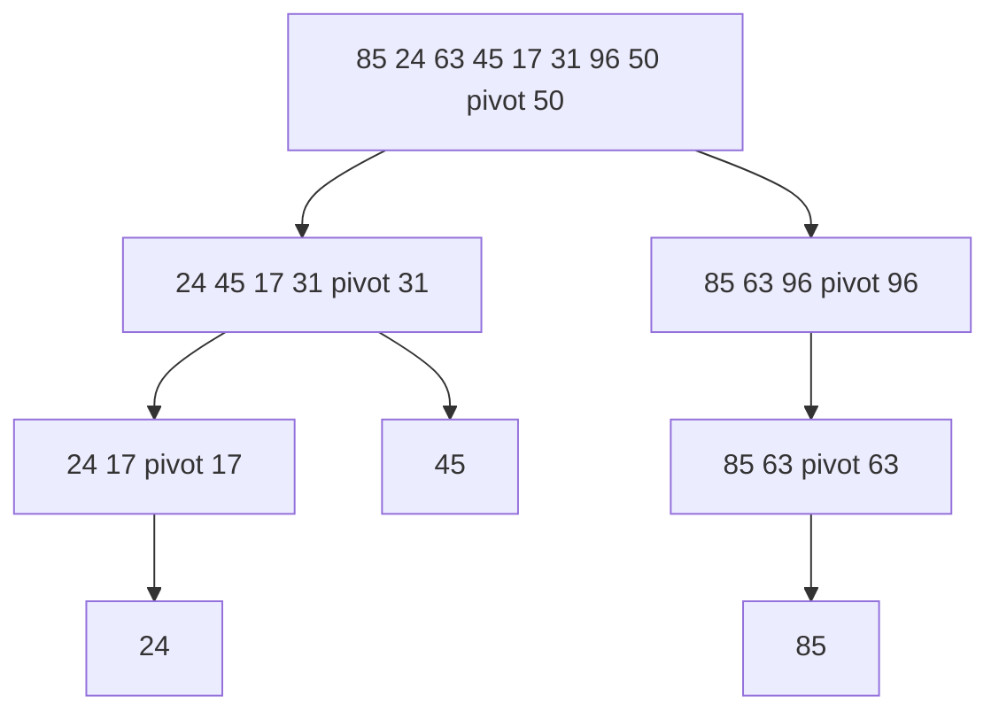

# Quick-sort and randomisation

> **Before this lesson:** You should know divide and conquer, merge-sort and its recurrence
> ([Divide and conquer: merge-sort](#/lesson/dsa-foundations/merge-sort)), recursion trees
> ([Analysing recursive algorithms](#/lesson/dsa-foundations/recursion-analysis)), and the
> meaning of "in place" and "stable" ([Using arrays](#/lesson/dsa-foundations/using-arrays)).

## In plain words

**Quick-sort** sorts a list by picking one item, called the **pivot**, and dividing the others
into two groups: those smaller than the pivot and those larger. The pivot now stands exactly
where it belongs in the final order, with the smaller items somewhere to its left and the
larger ones somewhere to its right. Each group is then sorted the same way.

Picture a teacher lining up a class by height. She picks one child and says: "everyone shorter
than Sam, stand on his left; everyone taller, on his right." Sam is now in his final place. She
then does the same within the left group and within the right group, and continues until every
group is a single child.

Compare this with merge-sort. Merge-sort splits without thinking (down the middle) and does
its real work when combining. Quick-sort does its real work when splitting, and combining
costs nothing: once both groups are sorted, the whole list is.

Why it matters for a job: quick-sort is the sorting algorithm behind many standard libraries,
because it rearranges the data inside the original array and is very fast on real hardware.
Interviewers like it for three reasons: the dividing step is a small, self-contained coding
exercise; its worst case is a classic trap; and the cure, choosing the pivot at random, is the
best-known example of randomness making an algorithm reliable.

## 1. The algorithm

For a sequence $S$:

1. **Divide.** If $S$ has at least two items, choose one of them, $x$, as the **pivot**
   (traditionally the *last* item). Distribute all the items into three sequences: $L$, the
   items less than $x$; $E$, the items equal to $x$; and $G$, the items greater than $x$. This
   three-way split is called **partitioning**.
2. **Conquer.** Sort $L$ and $G$ recursively. ($E$ needs no sorting; its items are all equal.)
3. **Combine.** Write the items back in the order $L$, then $E$, then $G$.



A run can be drawn as a **quick-sort tree**, one node per recursive call. Unlike the merge-sort
tree, its shape is not fixed in advance; it depends on the pivots. A pivot near the **median**
(the middle value of the sorted order) gives two children of about half the size. A pivot near
either extreme gives one child almost as large as its parent and one that is nearly empty.

The first implementation follows the description literally, building new lists with list
comprehensions. It is clear but uses extra memory; section 4 gives the in-place version.

```python-run
def quick_sort_simple(S, depth=0):
    """Three-way quick-sort that builds new lists (clear, but not in place)."""
    if len(S) < 2:
        return S
    p = S[-1]                                   # using the last element as arbitrary pivot
    L = [x for x in S if x < p]
    E = [x for x in S if x == p]
    G = [x for x in S if x > p]
    print("  " * depth + f"pivot {p}: L={L} E={E} G={G}")
    return quick_sort_simple(L, depth + 1) + E + quick_sort_simple(G, depth + 1)

print(quick_sort_simple([85, 24, 63, 45, 17, 31, 96, 50]))
```

The first line of output is `pivot 50: L=[24, 45, 17, 31] E=[50] G=[85, 63, 96]`. The deeper
lines show `L` and `G` being split in turn, and the last line is the sorted list.

## 2. Running time

At each node of the quick-sort tree, partitioning takes time proportional to the number of
items the node was given. Add this up one level at a time. Let $s_i$ be the total number of
items in all the nodes at depth $i$. At the top, $s_0 = n$. At depth 1 the pivot has been set
aside, so $s_1 \le n - 1$, and in general $s_i \le n - i$: each level handles at most $n$ items.
The total running time is therefore $O\!\left(\sum_{i=0}^{h} s_i\right)$, which is at most
$O(n \cdot h)$, where $h$ is the height of the tree. Everything depends on $h$.

- **Best case.** Every pivot splits its items evenly, the sizes halve at each level, and
  $h = O(\log n)$: the time is $O(n \log n)$.
- **Worst case.** Every pivot is the smallest or largest item of its group. Then one of $L$ and
  $G$ is empty and the other has all the remaining items, the size shrinks by only one per
  level, $h = n - 1$, and the time is $n + (n-1) + \cdots + 1 = \Theta(n^2)$.

And here is the trap. With "last item as pivot", the input that triggers the worst case is one
that is **already sorted**: the last item is always the largest. The easiest input of all, and
a very common one in practice, is the one this version handles worst.

## 3. Randomised quick-sort

We could hope that inputs arrive in random order, but hoping is not engineering. A better idea
is to put the randomness inside the algorithm: **choose the pivot at random**, with every item
of the group equally likely. Now no particular input is bad. An already-sorted list is as
harmless as any other, and the running time depends only on the algorithm's own random choices,
which nobody can predict or arrange.

> **Claim.** The expected running time of randomised quick-sort on $n$ items is $O(n\log n)$.

*Why.* Call a recursive call on $m$ items **good** if both $L$ and $G$ end up with at most
$3m/4$ items, and **bad** otherwise. A call is good whenever the pivot comes from the middle
half of the sorted order (not among the smallest quarter, not among the largest quarter). Half
of the possible pivots are in that middle half, so each call is good with probability $1/2$.

- A good call shrinks the problem to at most three quarters of its size. Starting from $n$, the
  size can be multiplied by $3/4$ only $\log_{4/3} n$ times before reaching 1. So any path from
  the root to a leaf contains at most $\log_{4/3} n$ good calls.
- Each call is good with probability $1/2$, like tossing a coin. To collect $k$ heads you need
  $2k$ tosses on average. So the expected length of a path is at most $2\log_{4/3} n$, which is
  $O(\log n)$.
- Each level of the tree does $O(n)$ work. The expected total is $O(n\log n)$. ∎

A sharper analysis shows that the expected number of comparisons is about
$2n\ln n \approx 1.39\,n\log_2 n$, and that the running time is $O(n\log n)$ **with high
probability**: on a large input, the chance of ever seeing quadratic behaviour is
astronomically small.

The demo counts comparisons on a sorted list of 900 numbers, first with the last item as pivot
and then with a random pivot.

```python-run
import random
def comparisons(S, choose):
    if len(S) < 2: return 0
    p = choose(S)
    L = [x for x in S if x < p]; G = [x for x in S if x > p]
    return len(S) - 1 + comparisons(L, choose) + comparisons(G, choose)
n = 900                      # recursion depth reaches n with the bad pivot rule
sorted_input = list(range(n))
print("last-element pivot on sorted input:", comparisons(sorted_input, lambda S: S[-1]), "comparisons (n^2/2 =", n*n//2, ")")
print("random pivot on sorted input:      ", comparisons(sorted_input, random.choice), "comparisons (1.39 n log2 n =", int(1.39 * n * 9.8), ")")
```

The fixed rule makes 404,550 comparisons, which is $n(n-1)/2$: the full quadratic cost. The
random rule makes roughly 9,000 to 11,000, varying from run to run, the same order of size as
$1.39\,n\log_2 n \approx 12{,}000$ and about forty times fewer.

## 4. In-place quick-sort

The versions so far build new lists. Quick-sort's real strength is that the partitioning can be
done **in place**, by swapping items inside the one array. A part of the array is described by
two indices, $a$ for its leftmost cell and $b$ for its rightmost.

**Partition with two scanning indices.** Take the last item as the pivot, `pivot = S[b]`, and
start two indices at the ends of the rest: `left = a` and `right = b - 1`. The idea is to find
a large item sitting on the left and a small item sitting on the right, and swap them.

1. Move `left` rightwards while `S[left] < pivot`. It stops at an item that is too large to be
   on the left side.
2. Move `right` leftwards while `pivot < S[right]`. It stops at an item that is too small to be
   on the right side.
3. If the two indices have not passed each other, swap `S[left]` and `S[right]` and move both
   one step inwards.
4. Repeat until `left > right`. Finally swap the pivot `S[b]` with `S[left]`. The pivot is now
   in its **final sorted position**.

Afterwards everything to the left of the pivot is $\le$ the pivot and everything to its right
is $\ge$ the pivot, and the two sides are sorted recursively. The function prints the array
after each partition.

```python-run
def inplace_quick_sort(S, a, b, depth=0):
    """Sort the list from S[a] to S[b] inclusive using the quick-sort algorithm."""
    if a >= b:
        return                                          # range is trivially sorted
    pivot = S[b]                                        # last element of range is pivot
    left = a                                            # will scan rightward
    right = b - 1                                       # will scan leftward
    while left <= right:
        while left <= right and S[left] < pivot:        # scan until reaching value >= pivot
            left += 1
        while left <= right and pivot < S[right]:       # scan until reaching value <= pivot
            right -= 1
        if left <= right:                               # scans did not strictly cross
            S[left], S[right] = S[right], S[left]       # swap values
            left, right = left + 1, right - 1           # shrink range
    S[left], S[b] = S[b], S[left]                       # put pivot into its final place
    print("  " * depth + f"pivot {pivot} placed at index {left}: {S}")
    inplace_quick_sort(S, a, left - 1, depth + 1)
    inplace_quick_sort(S, left + 1, b, depth + 1)

data = [85, 24, 63, 45, 17, 31, 96, 50]
inplace_quick_sort(data, 0, len(data) - 1)
```

### Dry run of the first partition

`[85, 24, 63, 45, 17, 31, 96, 50]`, pivot 50, `left = 0`, `right = 6`:

| step | action | array |
|---|---|---|
| 1 | `left` stops at 85 (index 0); `right` skips 96, stops at 31 (index 5); swap | 31 24 63 45 17 85 96 50 |
| 2 | `left` skips 24, stops at 63 (index 2); `right` stops at 17 (index 4); swap | 31 24 17 45 63 85 96 50 |
| 3 | `left` skips 45, stops at 63 (index 4); `right` moves to 45 (index 3): crossed | |
| 4 | swap pivot with `S[left]` | 31 24 17 45 **50** 85 96 63 |

### Other partition schemes

There are several standard ways to partition, each named after its inventor or its picture.
Section 7 compares them in detail.

- **Lomuto's scheme**: one scan from left to right, keeping a boundary index `i` between the
  small items and the rest. It is the shortest to write, but it makes more swaps and slows to
  $O(n^2)$ when all keys are equal.
- **Hoare's scheme**: two indices moving inwards from the ends, as above. Fewer swaps.
- **Three-way partitioning** (also called the *Dutch national flag* method, after the flag's
  three stripes): divides the array into "less than", "equal to" and "greater than" regions. It
  is essential when there are **many duplicate keys**, because the whole block of items equal
  to the pivot is finished at once.

### Space

In-place quick-sort uses no extra arrays, but its recursion needs stack space equal to the
height of the quick-sort tree: $O(\log n)$ expected, $O(n)$ in the worst case. A standard trick
guarantees $O(\log n)$: make the recursive call only on the **smaller** of the two parts, and
handle the larger part by looping (the tail-recursion elimination of the recursion module).
Since the smaller part has at most half the items, the recursion can nest at most $\log n$
deep.

## 5. Additional optimisations

- **Median-of-three pivot.** Look at the first, middle and last items and use the one whose
  value is in the middle. It is cheap, it avoids the sorted-input disaster, and it tends to
  split a little more evenly than a single random item.
- **Switching to insertion-sort for small parts.** Below some small size (libraries typically
  use 10 to 20 items, and values up to about 50 are reasonable), insertion-sort is faster
  because it has so little overhead.
- **Introsort.** Keep count of the recursion depth and switch to heap-sort if it goes beyond
  about $2\log n$, which guarantees $O(n \log n)$ in the worst case. The C++ standard library's
  `std::sort` works this way.

The function below combines a random pivot, three-way partitioning, recursion on the smaller
side only, and insertion-sort for parts shorter than 16. In the partition loop, `lt` and `gt`
mark the edges of the "less than" and "greater than" regions and `i` scans the unknown middle.

```python-run
import random
def quick_sort(S):
    """Practical in-place quick-sort: random pivot, 3-way partition, insertion-sort cutoff."""
    def insertion(a, b):
        for k in range(a + 1, b + 1):
            cur, j = S[k], k
            while j > a and S[j - 1] > cur:
                S[j] = S[j - 1]; j -= 1
            S[j] = cur
    def sort(a, b):
        while b - a >= 16:
            p = S[random.randint(a, b)]
            lt, i, gt = a, a, b                    # S[a:lt] < p, S[lt:i] == p, S[gt+1:b+1] > p
            while i <= gt:
                if S[i] < p: S[lt], S[i] = S[i], S[lt]; lt += 1; i += 1
                elif S[i] > p: S[i], S[gt] = S[gt], S[i]; gt -= 1
                else: i += 1
            if lt - a < b - gt:                    # recurse on the smaller side, loop on the larger
                sort(a, lt - 1); a = gt + 1
            else:
                sort(gt + 1, b); b = lt - 1
        insertion(a, b)
    sort(0, len(S) - 1)
    return S
data = [random.randint(0, 50) for _ in range(2000)]
print(quick_sort(data[:]) == sorted(data), quick_sort(list(range(5000))) == list(range(5000)))
```

## 6. Quick-sort versus merge-sort

| | Quick-sort | Merge-sort |
|---|---|---|
| Worst case | $O(n^2)$ (rare with randomisation) | $O(n\log n)$ |
| Expected / typical | $O(n \log n)$, small constants | $O(n\log n)$ |
| Extra space | $O(\log n)$ stack | $O(n)$ |
| Stable | no | yes |
| Access pattern | in place, cache-friendly | sequential (good for lists, files) |

> [!INTERVIEW]
> Be ready to: write a partition from memory, stating the invariant you are maintaining; explain
> the worst case and how a random or median-of-three pivot avoids it; handle duplicates with
> three-way partitioning; and explain why quick-sort is not stable (its swaps carry items long
> distances past equal items). The partition routine is reused by quick-select, which finds the
> $k$-th smallest item and is covered in the last lesson of this module.

## 7. Partition schemes compared: Lomuto, two-pointer and three-way

Section 4 scanned from both ends. The scheme seen most often in interviews is **Lomuto's**,
which makes a single scan from left to right with one boundary index `i`. Everything before
`i` is known to be smaller than the pivot; the scan index `j` looks at each item in turn, and
whenever it finds a small one, swaps it to position `i` and moves the boundary along:

```
lomuto_partition(S, a, b):            # pivot = S[b]
    i = a                             # invariant: S[a..i-1] < pivot,  S[i..j-1] >= pivot
    for j from a to b - 1:
        if S[j] < pivot:
            swap S[i], S[j];  i += 1
    swap S[i], S[b]                   # pivot into its final position
    return i
```

### Dry run of Lomuto on `[85, 24, 63, 45, 17, 31, 96, 50]` (pivot 50)

| j | S[j] | action | array | i |
|---|---|---|---|---|
| 0 | 85 | ≥ pivot: nothing | 85 24 63 45 17 31 96 50 | 0 |
| 1 | 24 | swap with S[0] | 24 85 63 45 17 31 96 50 | 1 |
| 2 | 63 | nothing | 24 85 63 45 17 31 96 50 | 1 |
| 3 | 45 | swap with S[1] | 24 45 63 85 17 31 96 50 | 2 |
| 4 | 17 | swap with S[2] | 24 45 17 85 63 31 96 50 | 3 |
| 5 | 31 | swap with S[3] | 24 45 17 31 63 85 96 50 | 4 |
| 6 | 96 | nothing | 24 45 17 31 63 85 96 50 | 4 |
| end | | swap pivot with S[4] | 24 45 17 31 **50** 85 96 63 | 4 |

Same final position for the pivot (index 4) as the two-pointer scheme, with four swaps instead of
two. The cell below counts element swaps and measures recursion depth for the three schemes on
three kinds of input.

```python-run
import random

def qs_lomuto(S, stats):
    def sort(a, b, depth):
        stats["depth"] = max(stats["depth"], depth)
        if a >= b: return
        r = random.randint(a, b); S[r], S[b] = S[b], S[r]
        pivot, i = S[b], a
        for j in range(a, b):
            if S[j] < pivot:
                S[i], S[j] = S[j], S[i]; stats["swaps"] += 1; i += 1
        S[i], S[b] = S[b], S[i]
        sort(a, i - 1, depth + 1); sort(i + 1, b, depth + 1)
    sort(0, len(S) - 1, 1)

def qs_two_pointer(S, stats):
    def sort(a, b, depth):
        stats["depth"] = max(stats["depth"], depth)
        if a >= b: return
        r = random.randint(a, b); S[r], S[b] = S[b], S[r]
        pivot, left, right = S[b], a, b - 1
        while left <= right:
            while left <= right and S[left] < pivot: left += 1
            while left <= right and pivot < S[right]: right -= 1
            if left <= right:
                S[left], S[right] = S[right], S[left]; stats["swaps"] += 1
                left, right = left + 1, right - 1
        S[left], S[b] = S[b], S[left]
        sort(a, left - 1, depth + 1); sort(left + 1, b, depth + 1)
    sort(0, len(S) - 1, 1)

def qs_three_way(S, stats):
    def sort(a, b, depth):
        stats["depth"] = max(stats["depth"], depth)
        if a >= b: return
        pivot = S[random.randint(a, b)]
        lt, i, gt = a, a, b
        while i <= gt:
            if S[i] < pivot: S[lt], S[i] = S[i], S[lt]; stats["swaps"] += 1; lt += 1; i += 1
            elif S[i] > pivot: S[i], S[gt] = S[gt], S[i]; stats["swaps"] += 1; gt -= 1
            else: i += 1
        sort(a, lt - 1, depth + 1); sort(gt + 1, b, depth + 1)
    sort(0, len(S) - 1, 1)

n = 600
inputs = {"random distinct": random.sample(range(10 * n), n),
          "few distinct (0-9)": [random.randint(0, 9) for _ in range(n)],
          "all equal": [7] * n}
print(f"{'input':20s} {'scheme':12s} {'swaps':>9} {'max depth':>10}")
for name, data in inputs.items():
    for label, f in [("Lomuto", qs_lomuto), ("two-pointer", qs_two_pointer), ("three-way", qs_three_way)]:
        S, stats = data[:], {"swaps": 0, "depth": 0}
        f(S, stats)
        assert S == sorted(data)
        print(f"{name:20s} {label:12s} {stats['swaps']:>9} {stats['depth']:>10}")
```

### What the numbers show

- **Random distinct keys.** All three reach depth of a few dozen ($\approx 2$–$3 \log_2 n$). The
  two-pointer scheme uses roughly a third as many swaps as Lomuto: it swaps only pairs that are
  *both* on the wrong side, whereas Lomuto swaps every element smaller than the pivot. Three-way partitioning performs the
  most swaps of all on distinct keys — the price of its generality.
- **All keys equal.** Lomuto's comparison `S[j] < pivot` is never true, so the pivot ends at the
  **left end** of every range: sizes $n - 1, n - 2, \ldots$ — depth $n$ and $\Theta(n^2)$ time
  *even with a random pivot*. The two-pointer scheme stops both scans on equal keys and swaps them,
  which balances the split (depth $\approx \log n$) at the price of many pointless swaps. Three-way
  partitioning finishes in a **single pass**: every key equals the pivot, so nothing is left to
  recurse on.
- **Few distinct keys.** Three-way partitioning recurses at most once per distinct value (depth
  about 10 or less here), and runs in $O(n \cdot d)$ for $d$ distinct keys — linear when $d$ is a
  constant.

The practical conclusions: randomising the pivot protects against bad *orderings*, but not against
bad *duplicates*; duplicates need a partition scheme that handles equal keys deliberately. This is
why production quick-sorts use three-way ("fat") partitioning or a closely related dual-pivot
scheme.

## 8. Pitfalls

- **A fixed pivot on sorted input.** Using the first or last item as pivot on sorted or
  reverse-sorted data costs $\Theta(n^2)$ time **and** makes the recursion $n$ levels deep,
  which in Python ends in a `RecursionError`.
- **Off-by-one errors in the scanning conditions.** Writing `left < right` where
  `left <= right` is needed (or the reverse) produces wrong partitions or loops that never end.
- **Including the pivot in a recursive call.** The pivot is already in its final place; a call
  whose range still contains it may make no progress.
- **Assuming stability.** Quick-sort is not stable.
- **Forgetting duplicates.** A random pivot protects against bad orderings, not against many
  equal keys; those need three-way partitioning.

## 9. Summary

- Quick-sort picks a pivot, partitions the items into smaller, equal and larger, and recurses
  on the two outer groups.
- It is $O(n^2)$ in the worst case and $O(n\log n)$ expected with random pivots, and it sorts in
  place using $O(\log n)$ expected stack space.
- Practical versions add median-of-three pivots, three-way partitioning, insertion-sort for
  small parts, and a fall-back to heap-sort.
- Compared with merge-sort it uses less memory and is usually faster, but it is not stable and
  has no worst-case guarantee of its own.

> **Source:** Goodrich, Tamassia & Goldwasser, *Data Structures and Algorithms in Python*, ch. 12.3.

## Glossary

- **Quick-sort**: sorting by partitioning around a pivot and recursing on the two sides.
- **Pivot**: the item against which all the others are compared in one partitioning step.
- **Partition**: rearranging items so that smaller ones come before the pivot and larger ones
  after it.
- **Quick-sort tree**: the tree of recursive calls; its height determines the running time.
- **Median**: the middle value of a collection in sorted order.
- **Randomised algorithm**: an algorithm that makes random choices as it runs.
- **Expected running time**: the running time averaged over the algorithm's random choices.
- **Lomuto / Hoare partition**: the single-scan / two-index in-place partitioning schemes.
- **Three-way partition (Dutch national flag)**: partitioning into less than, equal to and
  greater than the pivot.
- **Median-of-three**: choosing as pivot the middle value of the first, middle and last items.
- **Introsort**: quick-sort that switches to heap-sort when the recursion gets too deep.

## Check yourself

```quiz
[
  {"q": "Where does quick-sort do most of its work, compared with merge-sort?",
   "options": ["After the recursive calls (combine)", "Before the recursive calls (divide/partition)", "In a heap", "In a hash table"], "answer": 1,
   "explain": "Partitioning is the O(n) step; combining is trivial concatenation (or nothing, in place)."},
  {"q": "With the last element as pivot, which input causes the Theta(n^2) worst case?",
   "options": ["Random input", "Already sorted input", "Input with n/2 duplicates only", "No input"], "answer": 1,
   "explain": "The pivot is always the maximum, so G is empty and L has n - 1 elements at every level."},
  {"q": "In the book's analysis, a recursive call is 'good' when...",
   "options": ["the pivot is the exact median", "both L and G have size at most 3/4 of the input", "L is empty", "it makes no swaps"], "answer": 1,
   "explain": "This happens with probability 1/2, giving expected height O(log n)."},
  {"q": "After a partition step, the pivot is...",
   "options": ["at index 0", "in its final sorted position", "at the middle index", "removed from the array"], "answer": 1,
   "explain": "Everything to its left is <= pivot and everything to its right is >= pivot."},
  {"q": "Why use three-way partitioning?",
   "options": ["To make quick-sort stable", "To handle many duplicate keys efficiently", "To reduce memory to O(1)", "To avoid recursion"], "answer": 1,
   "explain": "All keys equal to the pivot are placed at once and excluded from both recursive calls."},
  {"q": "Expected extra space of in-place randomised quick-sort?",
   "options": ["O(1)", "O(log n) for the recursion stack", "O(n)", "O(n log n)"], "answer": 1,
   "explain": "No auxiliary arrays, but the stack depth equals the tree height: O(log n) expected."},
  {"q": "Is quick-sort stable?",
   "options": ["Yes", "No", "Only with random pivots", "Only in place"], "answer": 1,
   "explain": "Partition swaps move elements across long distances, changing the order of equal keys."}
]
```
