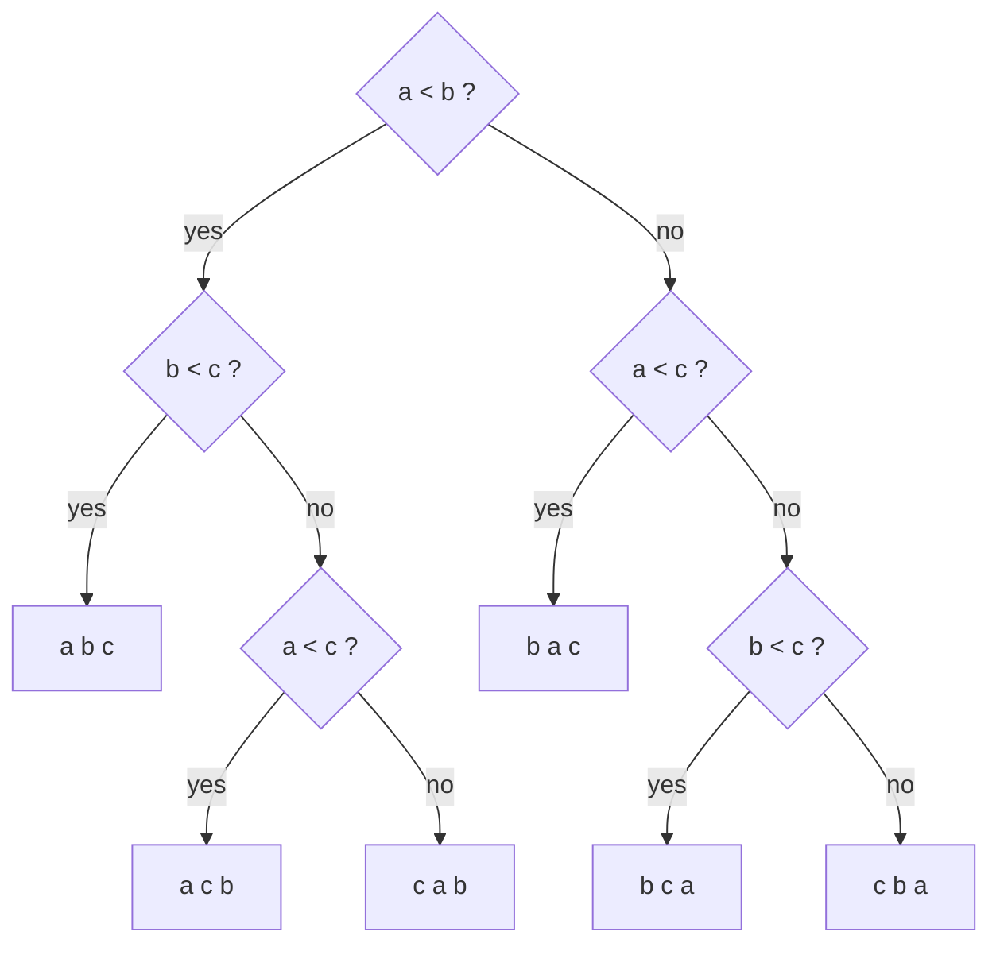

# The sorting lower bound and linear-time sorts

> **Before this lesson:** You should know merge-sort and quick-sort
> ([Divide and conquer: merge-sort](#/lesson/dsa-foundations/merge-sort),
> [Quick-sort and randomisation](#/lesson/dsa-foundations/quick-sort)), the meaning of $\Omega$
> ([Big-O, Big-Omega and Big-Theta](#/lesson/dsa-foundations/asymptotic-notation)), the height
> bounds for binary trees ([Tree terminology](#/lesson/dsa-foundations/tree-basics)), and what a
> stable sort is ([Using arrays](#/lesson/dsa-foundations/using-arrays)).

## In plain words

Every good sorting algorithm so far has taken about $n \log n$ steps. This lesson asks whether
that is the best anyone can do, and gives two answers.

The first answer is yes, as long as the only thing you are allowed to do with two items is ask
"which is smaller?". It is the game of twenty questions. If you must identify one of a million
possible objects using yes-or-no questions, no strategy, however clever, can always manage it
in fewer than 20 questions, because 19 answers can tell apart at most $2^{19}$ possibilities,
which is about half a million. Sorting by comparisons is a game of that kind: the "object" to
identify is the order the input arrived in.

The second answer is no, if you are allowed to *look inside* the items. A postal worker
sorting letters by postcode does not compare letters with each other at all. They drop each
letter into the pigeonhole for its first digit, then deal with each pigeonhole. That is a
different kind of algorithm, and it can sort in time proportional to $n$.

Why it matters for a job: "can you sort faster than $n \log n$?" is a classic interview
question whose full answer is this lesson. And counting sort and radix sort are practical
tools: when keys are small whole numbers, they are the fastest way to sort large amounts of
data.

## 1. A lower bound for comparison-based sorting

A **lower bound** for a problem is a statement that *no* algorithm, known or yet to be
invented, can solve it in fewer than some number of steps. It is a claim about the problem
itself, which makes it a stronger kind of statement than analysing one algorithm.

A sort is **comparison-based** if the only way it learns anything about the items is by asking
questions of the form "is $x_i < x_j$?". It may not look at digits, use a key as an array
index, or do anything else with the keys. Insertion-sort, selection-sort, heap-sort, merge-sort
and quick-sort are all comparison-based.

Assume the $n$ input items $x_0, \ldots, x_{n-1}$ are all different. We count only
comparisons; since each comparison takes at least one step, a lower bound on comparisons is
also a lower bound on running time.

### 1.1 The decision tree

Each comparison has two possible outcomes, yes or no, and what the algorithm does next can
depend on which it was. So everything the algorithm could possibly do on inputs of size $n$
can be laid out as a binary tree, called a **decision tree**. Each internal node is a
comparison; its two children are what happens after a "yes" and after a "no"; and each leaf is
a point where the algorithm stops and announces the sorted order. Running the algorithm on one
particular input means following one path from the root to a leaf.



The picture is the decision tree of one way to sort three items $a$, $b$, $c$. It has 6
leaves, one for each possible ordering, and its height is 3: in the worst case, three
comparisons are needed. For example, if $a < b$ and $b < c$ the answer is known after two
questions, but if $a < b$ and not $b < c$, a third question ($a < c$?) is needed to place $c$.

### 1.2 Counting leaves

**Claim: two different input orders can never end at the same leaf.** An ordering of the input
is called a *permutation*. Suppose two different permutations $P_1$ and $P_2$ of the same items
did end at the same leaf. Because they differ, there are two items $x_i$ and $x_j$ such that
$x_i$ comes before $x_j$ in one and after it in the other. But reaching the same leaf means the
algorithm made the same comparisons with the same answers on both, so it performs the same
rearrangement on both. That rearrangement puts $x_i$ and $x_j$ in the right order for one input
and therefore in the wrong order for the other. A correct algorithm cannot do that.

There are $n!$ permutations of $n$ different items ($n$ choices for the first, $n - 1$ for the
second, and so on), so the decision tree must have **at least $n!$ leaves**. The trees module
showed that a binary tree of height $h$ has at most $2^h$ leaves, so a tree with $n!$ leaves
has height at least $\log_2(n!)$. And the height is the number of comparisons on the longest
path from the root to a leaf, which is the worst case of the algorithm.

### 1.3 Bounding $\log(n!)$

How big is $\log(n!)$? Write out $n! = n \times (n-1) \times \cdots \times 1$. At least half of
those $n$ factors are $n/2$ or larger, so $n!$ is at least $n/2$ multiplied by itself $n/2$
times:

$$\log(n!) \ge \log\left(\left(\frac{n}{2}\right)^{n/2}\right) = \frac{n}{2}\log\frac{n}{2},$$

which is $\Omega(n \log n)$.

> **Theorem.** Any comparison-based sorting algorithm needs $\Omega(n\log n)$ comparisons in the
> worst case to sort $n$ items.

So merge-sort and heap-sort are **asymptotically optimal** among comparison sorts: no
comparison sort can beat them by more than a constant factor. (The same bound holds for the
average case and for randomised algorithms.) The demo computes the exact minimum,
$\lceil \log_2(n!) \rceil$, for a few sizes; `math.lgamma(n + 1)` is a library function that
returns the natural logarithm of $n!$ without computing the huge number itself. For three
items the minimum is 3, as in the picture.

```python-run
import math
for n in [3, 10, 100, 1000]:
    exact = math.lgamma(n + 1) / math.log(2)          # log2(n!)
    print(f"n={n:5d}: any comparison sort needs >= {math.ceil(exact):6d} comparisons in the worst case; "
          f"n log2 n = {n * math.log2(n):8.0f}")
```

> [!INTERVIEW]
> "Can you sort faster than $O(n \log n)$?" — not with comparisons alone (decision tree with $n!$
> leaves has height $\Omega(n\log n)$). But if the keys have structure — small integers,
> fixed-length strings — counting/bucket/radix sorts run in linear time because they use keys as
> **array indices**, an operation outside the comparison model.

## 2. Bucket-sort

The lower bound has an escape hatch: it applies only when comparing is the *only* operation.
Suppose every one of the $n$ entries carries a key that is a **whole number between $0$ and
$N-1$**. Then the key can be used directly as an index into an array, and the entries can be
sorted without a single comparison between keys. Keep an array $B$ of $N$ **buckets**, one per
possible key value, each a list:

```
bucketSort(S):
    let B be an array of N sequences, each initially empty
    for each entry e in S with key k:
        remove e from S and insert it at the END of bucket B[k]
    for i = 0 to N - 1:
        for each entry e in B[i]:
            remove e from B[i] and insert it at the end of S
```

Phase 1 drops each entry into the bucket numbered by its key: $O(n)$. Phase 2 walks through
the buckets from 0 to $N-1$ and collects their contents: $O(n + N)$, because every bucket must
be visited even if it is empty. For example, sorting the keys 3, 1, 3, 0 with $N = 4$: bucket 0
gets one entry, bucket 1 one entry, bucket 2 none, bucket 3 two; reading the buckets in order
gives 0, 1, 3, 3.

> Bucket-sort costs **$O(n + N)$** in both time and memory.

If $N$ is $O(n)$, that is **linear** time. The method is efficient when the range of keys is
small compared with the number of entries. With 32-bit keys, $N = 2^{32}$ is about four
billion, and the bucket array alone would be enormous.

### 2.1 Stability

Recall that a sort is **stable** if entries with equal keys come out in the same relative
order they went in. Bucket-sort as described is stable, *provided* each bucket behaves as a
queue: entries are added at the end and collected from the front. Stability is exactly what
the next algorithm, radix-sort, depends on.

### 2.2 Counting sort

A leaner variant avoids the lists altogether. First **count** how many entries have each key.
From the counts, work out where each key's block of entries must start in the output: the
block for key $k$ starts right after all entries with smaller keys, so its starting position is
the number of entries with key less than $k$ (a running total of the counts, also called a
*prefix sum*). Then go through the input from left to right, placing each entry at the next
free position of its key's block. This is **counting sort**, and going left to right keeps it
stable.

```python-run
def counting_sort(items, key, N):
    """Stable sort of items by key(item) in range(N): O(n + N)."""
    count = [0] * N
    for it in items:
        count[key(it)] += 1
    start, total = [0] * N, 0
    for k in range(N):                   # start[k] = number of items with key < k
        start[k], total = total, total + count[k]
    out = [None] * len(items)
    for it in items:                     # left-to-right scan keeps equal keys in order: stable
        out[start[key(it)]] = it
        start[key(it)] += 1
    return out

people = [("ann", 3), ("bob", 1), ("cy", 3), ("di", 0), ("ed", 1), ("flo", 3)]
print(counting_sort(people, key=lambda p: p[1], N=4))
```

**Reading the demo.** The six people have keys 3, 1, 3, 0, 1, 3. The counts are
`[1, 2, 0, 3]` (one 0, two 1s, no 2s, three 3s), so the blocks start at positions
`[0, 1, 3, 3]`. The output is di; then bob and ed; then ann, cy and flo. Within each key the
names are in their original order, which shows the stability.

## 3. Radix-sort

Bucket-sort handles one small key. What if the key is too large for that, but is made of
several small parts? A three-digit number is three digits from 0 to 9; a date is a year, a
month and a day; a fixed-length word is a sequence of letters. Such keys are ordered
**lexicographically**, the way a dictionary orders words: compare the first parts; if they tie,
compare the second parts; and so on. For pairs, $(k_1, l_1) < (k_2, l_2)$ if $k_1 < k_2$, or if
$k_1 = k_2$ and $l_1 < l_2$.

**Radix-sort** sorts such keys by running a **stable** bucket-sort once for each part. (*Radix*
is another word for the base of a number system; the algorithm works digit by digit.) The only
question is the order in which to take the parts: most important first, or last?

Try $S = ((2,1), (3,4), (1,4), (3,1), (1,2), (2,4), (2,2), (1,1))$.

- **First component, then second:**
  a stable pass on the first component gives $(1,4), (1,2), (1,1), (2,1), (2,4), (2,2), (3,4), (3,1)$;
  a second pass on the second component then gives
  $(1,1), (2,1), (3,1), (1,2), (2,2), (1,4), (2,4), (3,4)$ — sorted by the *second* component, which
  is **not** lexicographic order.
- **Second component, then first:**
  the pass on the second component gives $(2,1), (3,1), (1,1), (1,2), (2,2), (3,4), (1,4), (2,4)$;
  the stable pass on the first component then gives
  $(1,1), (1,2), (1,4), (2,1), (2,2), (2,4), (3,1), (3,4)$ — **correct**. Inside each group of equal
  first components, the stable pass left the entries in the order the earlier pass had produced,
  which was already increasing in the second component.

The rule, surprising at first: sort by the **least important part first**, and finish with the
most important. The final pass puts the most important part in order. Among entries that tie
on it, stability keeps them in the order the earlier passes left them in, and that order is
already correct for the less important parts. This is called **LSD radix-sort**, for "least
significant digit" first.

> **Claim.** Take $n$ entries whose keys have $d$ parts $(k_1, \ldots, k_d)$, each part a whole
> number in $[0, N-1]$. Radix-sort puts them in lexicographic order in **$O(d(n + N))$** time.

That is $d$ passes of bucket-sort. Two examples of what it buys. To sort $n$ whole numbers
smaller than $n^c$ for a fixed $c$, write each number in base $n$: it then has $c$ digits, each
from 0 to $n - 1$, so $d = c$ and $N = n$, for a total of $O(c \cdot n) = O(n)$. To sort
32-bit numbers, treat each of the four bytes as a digit: 4 passes with $N = 256$.

The demo sorts ordinary decimal numbers. In the code, `(x // place) % base` extracts one digit
of `x`: with `place = 10` and `base = 10`, the number 802 gives `80 % 10 = 0`, its tens digit.

```python-run
def radix_sort(nums, base=10):
    """LSD radix sort for non-negative integers: O(d (n + base))."""
    if not nums: return nums
    place, biggest = 1, max(nums)
    while biggest // place > 0:
        buckets = [[] for _ in range(base)]
        for x in nums:                               # stable distribution by current digit
            buckets[(x // place) % base].append(x)
        nums = [x for b in buckets for x in b]       # collect in bucket order
        print(f"after place {place:>4}: {nums}")
        place *= base
    return nums

radix_sort([170, 45, 75, 90, 802, 24, 2, 66])
```

### Dry run

| pass | by digit | result |
|---|---|---|
| start | | 170 45 75 90 802 24 2 66 |
| 1 | ones | 170 90 802 2 24 45 75 66 |
| 2 | tens | 802 2 24 45 66 170 75 90 |
| 3 | hundreds | 2 24 45 66 75 90 170 802 |

In pass 2, 802 and 2 both have tens digit 0 and keep their pass-1 order (802 before 2); pass 3 then
separates them. That only works because each pass is stable.

### 3.1 Variations

- **MSD radix-sort** ("most significant digit" first) starts with the most important digit and
  then sorts each bucket separately on the next digit, recursively. It is the natural choice
  for strings of different lengths, and it can stop early once a bucket holds a single item.
  This is the postal worker's method from the start of the lesson.
- **Negative numbers** can be handled by adding a fixed offset to make every key non-negative,
  or by treating the sign as one more, most important, "digit".
- **Bucket-sort for real numbers** spread evenly over $[0, 1)$: put $x$ in bucket
  $\lfloor nx \rfloor$ and sort each small bucket with insertion-sort. Section 5 analyses it.

## 4. Do these break the lower bound?

No. The $\Omega(n\log n)$ bound was proved only for comparison-based algorithms, and these are
not comparison-based: bucket-sort and radix-sort never compare two keys. They use digits of a
key as array indices. One comparison yields one yes-or-no answer, a single bit of information;
one indexing step chooses among $N$ buckets and so yields $\log N$ bits at once. The price is
generality: these methods need keys that are whole numbers, or made of a bounded number of
small parts, and they need extra space.

| Algorithm | Time | Assumption |
|---|---|---|
| comparison sorts | $\Omega(n\log n)$ worst case | only `<` available |
| bucket / counting sort | $O(n + N)$ | integer keys in $[0, N-1]$ |
| radix sort | $O(d(n + N))$ | $d$-digit keys, digits in $[0, N-1]$ |

## 5. Bucket-sort for real numbers: expected linear time

Bucket-sort as presented needs integer keys in a small range. The same idea handles **real numbers
drawn uniformly at random** from an interval, say $[0, 1)$ — with buckets that represent
*sub-intervals* instead of single key values.

**Algorithm.** For $n$ keys, create $n$ buckets, bucket $i$ covering $[i/n, (i+1)/n)$. Put key $x$
in bucket $\lfloor n x \rfloor$. Sort each bucket (insertion-sort is ideal: the buckets are tiny) and
concatenate the buckets in order.

**Correctness.** The mapping $x \mapsto \lfloor nx \rfloor$ is monotone: a smaller key never lands
in a later bucket. So concatenating the individually sorted buckets yields a sorted sequence.

**Analysis.** Let $n_i$ be the number of keys in bucket $i$. Distribution and concatenation cost
$O(n)$; sorting bucket $i$ with insertion-sort costs $O(n_i^2)$. So the time is
$O(n) + \sum_i O(n_i^2)$, and everything depends on $\sum_i n_i^2$.

If the keys are spread evenly, each key lands in bucket $i$ with probability $1/n$,
independently of the others. A bucket therefore holds 1 key on average. What the analysis
needs, though, is the average of $n_i^2$, and a short probability calculation gives it. (Here
$E[\cdot]$ denotes the expected, or long-run average, value, and the variance
$\operatorname{Var}$ measures how widely a quantity is spread around its average; for this
bucket count the variance is $1 - 1/n$.)

$$E[n_i^2] = \operatorname{Var}(n_i) + E[n_i]^2 = \left(1 - \tfrac1n\right) + 1 = 2 - \tfrac1n.$$

Adding over the $n$ buckets, $E\!\left[\sum_i n_i^2\right] = 2n - 1$. So the **expected**
running time is $O(n)$. If the probability step is unfamiliar, the conclusion is the thing to
keep: with evenly spread keys the buckets stay so small that sorting all of them costs about
$2n$ steps in total, and the demo below confirms the figure by measurement.

The guarantee is only as good as the assumption. If the keys are clustered — all in $[0, 0.001)$,
say — they pile into a few buckets and the cost degrades toward the $O(n^2)$ of insertion-sort on
one bucket (or $O(n\log n)$ if each bucket is sorted with merge-sort instead). Notice the contrast
with randomised quick-sort, whose $O(n \log n)$ expectation holds for **every** input because the
randomness is in the algorithm, not assumed of the data.

```python-run
import random, time

def bucket_sort_reals(values):
    """Sort floats in [0, 1): expected O(n) when the values are uniformly distributed."""
    n = len(values)
    if n == 0: return [], 0
    buckets = [[] for _ in range(n)]
    for x in values:
        buckets[int(n * x)].append(x)
    out, work = [], 0
    for b in buckets:
        for k in range(1, len(b)):                 # insertion-sort inside the bucket
            cur, j = b[k], k
            while j > 0 and b[j - 1] > cur:
                b[j] = b[j - 1]; j -= 1
            b[j] = cur
        work += len(b) ** 2                        # the quantity the analysis bounds
        out.extend(b)
    return out, work

random.seed(5)
for n in [1000, 10000, 100000]:
    uniform = [random.random() for _ in range(n)]
    out, work = bucket_sort_reals(uniform)
    print(f"uniform   n={n:6d}: sorted={out == sorted(uniform)}  sum of n_i^2 = {work:8d}  (theory: about 2n = {2 * n})")
n = 4000
clustered = [random.random() ** 8 for _ in range(n)]        # heavily skewed toward 0
out, work = bucket_sort_reals(clustered)
print(f"clustered n={n:6d}: sorted={out == sorted(clustered)}  sum of n_i^2 = {work:8d}  (about {work // n} times n)")
print("keys that landed in bucket 0 alone:", sum(int(n * x) == 0 for x in clustered), "of", n)
```

On uniform data the measured $\sum n_i^2$ sits right at $2n$, for every $n$ — linear time. On the
skewed data the same code is still **correct**, but roughly a third of all keys land in the very first bucket, so
the work is far above $2n$ — the quadratic cost of insertion-sorting one large bucket.

### Choosing among the linear-time sorts

| Situation | Method | Cost |
|---|---|---|
| integer keys in $[0, N-1]$ with $N = O(n)$ | counting / bucket-sort | $O(n + N)$ |
| integers up to $n^c$, fixed-length strings, dates | LSD radix-sort (stable counting sort per digit) | $O(d(n + N))$ |
| variable-length strings | MSD radix-sort | proportional to the characters actually examined |
| reals known to be roughly uniform | interval bucket-sort | $O(n)$ expected |
| anything else, or unknown distribution | a comparison sort | $O(n\log n)$ |

A practical remark: linear-time sorts read and write memory in scattered patterns (one bucket per
key value), so for moderate $n$ a well-tuned comparison sort is often equally fast. They pay off for
very large $n$, small digit alphabets and keys that are cheap to decompose — which is why radix-sort
is the method of choice for sorting hundreds of millions of fixed-width integers or records by
integer key.

## 6. Pitfalls

- **An unstable sort inside radix-sort.** If the per-digit pass does not preserve the order of
  ties, the work of the earlier passes is destroyed and the result is wrong.
- **Whole-list passes starting from the most important digit.** With LSD-style passes over the
  entire list, the least important digit must come first.
- **Bucket-sort when $N$ is far larger than $n$.** The $O(N)$ term then dominates both time and
  memory.
- **Forgetting special inputs.** Negative numbers need an offset, and an empty list makes
  `max([])` raise an error.
- **Overstating the lower bound.** It says comparison sorts need $\Omega(n \log n)$ in the worst
  case. It does not say that sorting always needs that much.

## 7. Summary

- A comparison sort is a decision tree with at least $n!$ leaves, so its height, the worst-case
  number of comparisons, is at least $\log(n!) = \Omega(n \log n)$.
- Bucket-sort and counting sort take $O(n + N)$ for whole-number keys in $[0, N-1]$, and are
  stable when entries with equal keys are kept in arrival order.
- Radix-sort applies a stable bucket-sort to each digit, least significant first, for
  $O(d(n + N))$.
- These methods do not contradict the lower bound, because they index by keys instead of
  comparing them.

> **Source:** Goodrich, Tamassia & Goldwasser, *Data Structures and Algorithms in Python*, ch. 12.4.

## Glossary

- **Lower bound**: a proof that no algorithm can solve a problem in fewer than some number of
  steps.
- **Comparison-based sort**: a sort that learns about its input only by comparing pairs of
  items.
- **Decision tree**: a binary tree of all the comparisons an algorithm might make, with one
  leaf per outcome.
- **Permutation**: one of the $n!$ possible orderings of $n$ items.
- **Asymptotically optimal**: matching the lower bound up to a constant factor.
- **Bucket-sort**: sorting by dropping each entry into the bucket numbered by its key.
- **Counting sort**: bucket-sort that counts keys and computes output positions from the
  counts.
- **Prefix sum**: a running total; here, the number of entries with a smaller key.
- **Lexicographic order**: dictionary order: compare first parts, then second parts on ties.
- **Radix-sort**: sorting multi-part keys by one stable pass per part.
- **LSD / MSD**: least / most significant digit first.
- **Uniform distribution**: values spread evenly over a range.

## Check yourself

```quiz
[
  {"q": "Why must the decision tree of a comparison sort on n distinct elements have at least n! leaves?",
   "options": ["Each comparison has n outcomes", "Each input permutation must end at a different leaf", "The tree is complete", "There are n! comparisons"], "answer": 1,
   "explain": "Two permutations reaching the same leaf would receive the same rearrangement, which is wrong for one of them."},
  {"q": "log2(n!) is...",
   "options": ["Theta(n)", "Theta(n log n)", "Theta(n^2)", "Theta(log n)"], "answer": 1,
   "explain": "n! >= (n/2)^(n/2) gives Omega(n log n); n! <= n^n gives O(n log n)."},
  {"q": "Bucket-sort on n entries with integer keys in [0, N-1] takes...",
   "options": ["O(n log n)", "O(n + N)", "O(nN)", "O(N log N)"], "answer": 1,
   "explain": "O(n) to distribute and O(n + N) to scan all buckets."},
  {"q": "In LSD radix-sort, which digit is processed first?",
   "options": ["Most significant", "Least significant", "The median digit", "Any order works"], "answer": 1,
   "explain": "Later (more significant) stable passes preserve the order set by earlier ones among ties."},
  {"q": "What property must the per-digit sort have in radix-sort?",
   "options": ["In place", "Stable", "Comparison-based", "Recursive"], "answer": 1,
   "explain": "Without stability the order established by previous digits would be destroyed."},
  {"q": "Does radix-sort contradict the Omega(n log n) lower bound?",
   "options": ["Yes", "No: the bound only applies to comparison-based sorting", "Only for strings", "Only when n is small"], "answer": 1,
   "explain": "Radix-sort indexes arrays by key digits instead of comparing keys."},
  {"q": "Sorting n integers in the range [0, n^2 - 1] with radix-sort in base n takes...",
   "options": ["O(n)", "O(n log n)", "O(n^2)", "O(n^3)"], "answer": 0,
   "explain": "Two base-n digits: d = 2, N = n, so O(2(n + n)) = O(n)."}
]
```
