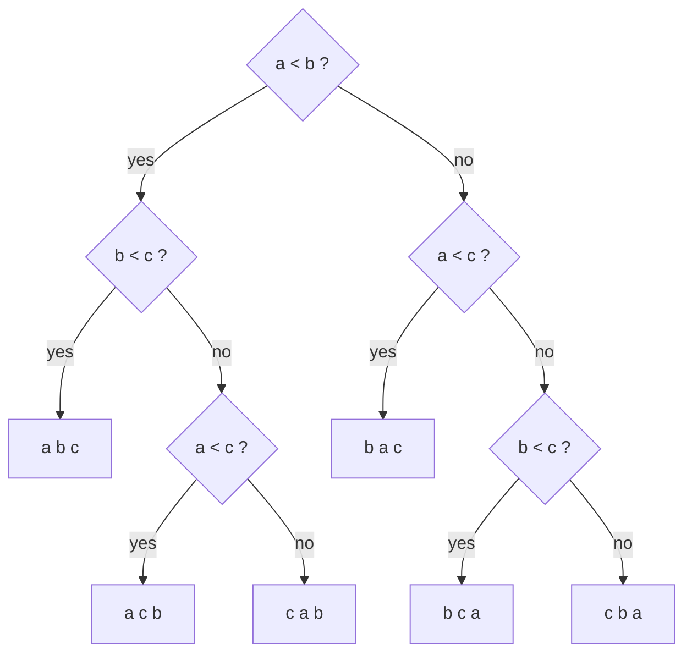

# The sorting lower bound and linear-time sorts

Heap-sort, merge-sort and (expected) quick-sort all take $O(n\log n)$. Is that a coincidence, or is
$n \log n$ a fundamental barrier? This lesson proves that **any sorting algorithm based on
comparisons needs $\Omega(n\log n)$ time in the worst case** — and then shows how to beat the barrier
with algorithms that do not compare keys at all: **bucket-sort** and **radix-sort**.

## 1. A lower bound for comparison-based sorting

A **comparison-based** sort learns about the input only by asking questions of the form
"is $x_i < x_j$?". It may not inspect digits, use keys as array indices, etc. Insertion, selection,
heap, merge and quick-sort are all comparison-based.

Assume the $n$ input elements $x_0, \ldots, x_{n-1}$ are distinct. We count only comparisons — a
lower bound on comparisons is a lower bound on running time.

### 1.1 The decision tree

Each comparison has two outcomes, "yes" or "no". The behaviour of a (deterministic) algorithm on all
inputs of size $n$ can be drawn as a **decision tree** $T$: each internal node is a comparison, its
two children are the continuations for the two outcomes, and each leaf (external node) is where the
algorithm stops with its output.



(Decision tree for sorting three elements: 6 leaves, height 3.)

### 1.2 Counting leaves

**Claim: each leaf can be reached by at most one input permutation.** Suppose two different
permutations $P_1$ and $P_2$ of the input ended at the same leaf. They differ, so there are elements
$x_i$, $x_j$ with $x_i$ before $x_j$ in one and after it in the other. The algorithm performs the
same comparisons with the same outcomes on both, and outputs the same rearrangement — which puts
$x_i$ and $x_j$ in the wrong relative order for one of them. So a correct algorithm cannot send two
permutations to the same leaf.

There are $n!$ permutations of $n$ distinct elements, so the decision tree has **at least $n!$
leaves**. A binary tree with $n!$ leaves has height at least $\log_2(n!)$. The height is the number
of comparisons on the longest root-to-leaf path — the worst case.

### 1.3 Bounding $\log(n!)$

At least $n/2$ of the factors in $n! = n(n-1)\cdots 1$ are $\ge n/2$, so

$$\log(n!) \ge \log\left(\left(\frac{n}{2}\right)^{n/2}\right) = \frac{n}{2}\log\frac{n}{2},$$

which is $\Omega(n \log n)$.

> **Proposition.** The running time of any comparison-based algorithm for sorting an $n$-element
> sequence is $\Omega(n\log n)$ in the worst case.

So merge-sort and heap-sort are **asymptotically optimal** among comparison sorts. (The bound also
holds for the average case and for randomised algorithms.)

```python-run
import math
for n in [3, 10, 100, 1000]:
    exact = math.lgamma(n + 1) / math.log(2)          # log2(n!)
    print(f"n={n:5d}: any comparison sort needs >= {math.ceil(exact):6d} comparisons in the worst case; "
          f"n log2 n = {n * math.log2(n):8.0f}")
```

> [!INTERVIEW]
> "Can you sort faster than $O(n \log n)$?" — not with comparisons alone (decision tree with $n!$
> leaves has height $\Omega(n\log n)$). But if the keys have structure — small integers,
> fixed-length strings — counting/bucket/radix sorts run in linear time because they use keys as
> **array indices**, an operation outside the comparison model.

## 2. Bucket-sort

Suppose the $n$ entries have **integer keys in the range $[0, N-1]$**. Then we can sort without a
single comparison between keys:

```
bucketSort(S):
    let B be an array of N sequences, each initially empty
    for each entry e in S with key k:
        remove e from S and insert it at the END of bucket B[k]
    for i = 0 to N - 1:
        for each entry e in B[i]:
            remove e from B[i] and insert it at the end of S
```

Phase 1 distributes entries into buckets using the key as an index: $O(n)$. Phase 2 collects the
buckets in order: $O(n + N)$.

> Bucket-sort runs in **$O(n + N)$** time and uses $O(n + N)$ space.

If $N$ is $O(n)$, that is **linear** time. It is efficient when the key range is small relative to
$n$; with 32-bit keys ($N = 2^{32}$) the bucket array alone would be enormous.

### 2.1 Stability

A sorting algorithm is **stable** if any two entries with equal keys appear in the output in the
same relative order as in the input. Bucket-sort as described is stable, *provided* buckets behave
as queues: entries are appended at the end of a bucket and removed from the front. Stability is
exactly what radix-sort needs.

### 2.2 Counting sort

When there are only keys (or the records are reconstructed from the keys), we do not need lists as
buckets — just a **count** per key. The stable version for records uses prefix sums of the counts
to compute each key's starting output position:

```python-run
def counting_sort(items, key, N):
    """Stable sort of items by key(item) in range(N): O(n + N)."""
    count = [0] * N
    for it in items:
        count[key(it)] += 1
    start, total = [0] * N, 0
    for k in range(N):                   # start[k] = number of items with key < k
        start[k], total = total, total + count[k]
    out = [None] * len(items)
    for it in items:                     # left-to-right scan keeps equal keys in order: stable
        out[start[key(it)]] = it
        start[key(it)] += 1
    return out

people = [("ann", 3), ("bob", 1), ("cy", 3), ("di", 0), ("ed", 1), ("flo", 3)]
print(counting_sort(people, key=lambda p: p[1], N=4))
```

## 3. Radix-sort

Bucket-sort handles a single small key. What about **pairs** $(k, l)$ — or, more generally,
$d$-tuples such as multi-digit numbers and fixed-length strings — ordered
**lexicographically**: $(k_1, l_1) < (k_2, l_2)$ if $k_1 < k_2$, or $k_1 = k_2$ and $l_1 < l_2$?

**Radix-sort** sorts by applying a **stable** bucket-sort once per component. The question is the
order: first component first, or last?

Try $S = ((3,3), (1,5), (2,5), (1,2), (2,3), (1,7), (3,2), (2,2))$.

- **First component, then second:**
  after sorting by first: $(1,5), (1,2), (1,7), (2,5), (2,3), (2,2), (3,3), (3,2)$;
  then by second: $(1,2), (2,2), (3,2), (2,3), (3,3), (1,5), (2,5), (1,7)$ — **not** lexicographic.
- **Second component, then first:**
  after sorting by second: $(1,2), (3,2), (2,2), (3,3), (2,3), (1,5), (2,5), (1,7)$;
  then stably by first: $(1,2), (1,5), (1,7), (2,2), (2,3), (2,5), (3,2), (3,3)$ — **correct**. (Within each group of equal first components, the stable sort kept the order produced by the first pass, which was already sorted by second component.)

The rule: sort by the **least significant** component first, and finish with the most significant.
The final pass puts the most significant component in order; among entries that tie on it,
stability preserves the order established by the earlier passes. This is **LSD (least significant
digit) radix-sort**.

> **Proposition.** Let $S$ be a sequence of $n$ key–value pairs whose keys are $d$-tuples
> $(k_1, \ldots, k_d)$ with each $k_i$ an integer in $[0, N-1]$. Radix-sort sorts $S$
> lexicographically in **$O(d(n + N))$** time.

For $n$ integers below $n^c$ (constant $c$), write them in base $n$: $d = c$ digits, $N = n$, total
$O(c \cdot n) = O(n)$. For 32-bit integers with byte digits: 4 passes with $N = 256$.

```python-run
def radix_sort(nums, base=10):
    """LSD radix sort for non-negative integers: O(d (n + base))."""
    if not nums: return nums
    place, biggest = 1, max(nums)
    while biggest // place > 0:
        buckets = [[] for _ in range(base)]
        for x in nums:                               # stable distribution by current digit
            buckets[(x // place) % base].append(x)
        nums = [x for b in buckets for x in b]       # collect in bucket order
        print(f"after place {place:>4}: {nums}")
        place *= base
    return nums

radix_sort([170, 45, 75, 90, 802, 24, 2, 66])
```

### Dry run

| pass | by digit | result |
|---|---|---|
| start | | 170 45 75 90 802 24 2 66 |
| 1 | ones | 170 90 802 2 24 45 75 66 |
| 2 | tens | 802 2 24 45 66 170 75 90 |
| 3 | hundreds | 2 24 45 66 75 90 170 802 |

In pass 2, 802 and 2 both have tens digit 0 and keep their pass-1 order (802 before 2); pass 3 then
separates them. That only works because each pass is stable.

### 3.1 Variations

- **MSD radix-sort** starts with the most significant digit and recurses into each bucket — natural
  for variable-length strings, and can stop early.
- **Negative numbers**: sort by adding an offset, or handle the sign as a final most-significant
  "digit".
- **Bucket sort for real numbers** (uniform in $[0, 1)$): place $x$ in bucket $\lfloor nx \rfloor$,
  sort each bucket with insertion-sort; expected $O(n)$ under the uniformity assumption.

## 4. Do these break the lower bound?

No — the $\Omega(n\log n)$ bound applies only to comparison-based algorithms. Bucket and radix sort
never compare two keys; they use key digits as indices, extracting $\log N$ bits of information per
operation instead of 1 bit per comparison. The price is generality: they need integer-like keys of
bounded length, and extra space.

| Algorithm | Time | Assumption |
|---|---|---|
| comparison sorts | $\Omega(n\log n)$ worst case | only `<` available |
| bucket / counting sort | $O(n + N)$ | integer keys in $[0, N-1]$ |
| radix sort | $O(d(n + N))$ | $d$-digit keys, digits in $[0, N-1]$ |

## 5. Pitfalls

- Radix-sort with an **unstable** per-digit sort gives wrong results.
- Sorting most-significant digit first with LSD-style full passes.
- Using bucket-sort when $N \gg n$ (the $O(N)$ term dominates time and memory).
- Forgetting negative numbers / the empty input (`max([])` raises).

## 6. Summary

- Decision-tree argument: $n!$ leaves ⇒ height ≥ $\log(n!)$ = $\Omega(n \log n)$ comparisons.
- Bucket-sort: $O(n + N)$ for integer keys in $[0, N-1]$; stable if buckets are queues.
- Radix-sort: stable bucket-sort per digit, least significant first: $O(d(n + N))$.

> **Source:** Goodrich, Tamassia & Goldwasser, *Data Structures and Algorithms in Python*, ch. 12.4.

## Check yourself

```quiz
[
  {"q": "Why must the decision tree of a comparison sort on n distinct elements have at least n! leaves?",
   "options": ["Each comparison has n outcomes", "Each input permutation must end at a different leaf", "The tree is complete", "There are n! comparisons"], "answer": 1,
   "explain": "Two permutations reaching the same leaf would receive the same rearrangement, which is wrong for one of them."},
  {"q": "log2(n!) is...",
   "options": ["Theta(n)", "Theta(n log n)", "Theta(n^2)", "Theta(log n)"], "answer": 1,
   "explain": "n! >= (n/2)^(n/2) gives Omega(n log n); n! <= n^n gives O(n log n)."},
  {"q": "Bucket-sort on n entries with integer keys in [0, N-1] takes...",
   "options": ["O(n log n)", "O(n + N)", "O(nN)", "O(N log N)"], "answer": 1,
   "explain": "O(n) to distribute and O(n + N) to scan all buckets."},
  {"q": "In LSD radix-sort, which digit is processed first?",
   "options": ["Most significant", "Least significant", "The median digit", "Any order works"], "answer": 1,
   "explain": "Later (more significant) stable passes preserve the order set by earlier ones among ties."},
  {"q": "What property must the per-digit sort have in radix-sort?",
   "options": ["In place", "Stable", "Comparison-based", "Recursive"], "answer": 1,
   "explain": "Without stability the order established by previous digits would be destroyed."},
  {"q": "Does radix-sort contradict the Omega(n log n) lower bound?",
   "options": ["Yes", "No: the bound only applies to comparison-based sorting", "Only for strings", "Only when n is small"], "answer": 1,
   "explain": "Radix-sort indexes arrays by key digits instead of comparing keys."},
  {"q": "Sorting n integers in the range [0, n^2 - 1] with radix-sort in base n takes...",
   "options": ["O(n)", "O(n log n)", "O(n^2)", "O(n^3)"], "answer": 0,
   "explain": "Two base-n digits: d = 2, N = n, so O(2(n + n)) = O(n)."}
]
```
