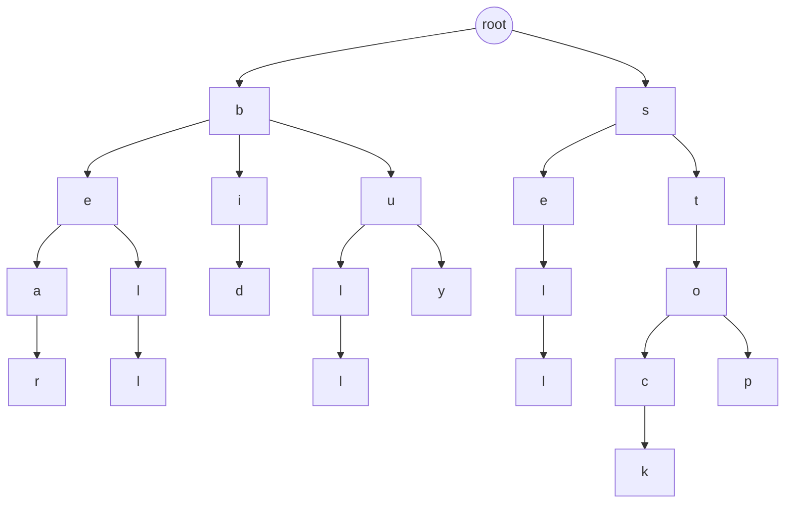

# Greedy compression and tries

This lesson closes the text-processing module with two ideas. **Huffman coding** compresses text by
giving frequent characters short codes; it is the textbook example of the **greedy method**.
**Tries** are trees that index strings character by character, supporting pattern and prefix
queries in time proportional to the *pattern* length, independent of how much text is indexed.

## 1. Text compression

Standard encodings such as ASCII use a **fixed-length** code: every character takes 7 or 8 bits.
But characters are not equally frequent — in English, `e` and space are common, `z` and `q` rare.
A **variable-length** code that assigns short codewords to frequent characters and long ones to rare
characters uses fewer bits overall.

### 1.1 Prefix codes

With variable lengths there are no fixed boundaries between codewords, so decoding must be
unambiguous. We require a **prefix code**: **no codeword is a prefix of another**. Then a decoder
reading bits left to right knows exactly when a codeword ends.

A prefix code corresponds to a **binary tree**: each leaf is a character; the path from the root to
a leaf spells its codeword (left = `0`, right = `1`). Because characters live only at leaves, no
codeword can be a prefix of another.

### 1.2 The Huffman coding algorithm

Starting from the text $X$ that is to be compressed, **Huffman's algorithm** builds an
optimal prefix-code tree:

```
Huffman(X):
    compute the frequency f(c) of each character c of X
    initialise a priority queue Q
    for each character c in X:
        create a single-node binary tree T storing c
        insert T into Q with key f(c)
    while len(Q) > 1:
        (f1, T1) = Q.remove_min()
        (f2, T2) = Q.remove_min()
        create a new binary tree T with left subtree T1 and right subtree T2
        insert T into Q with key f1 + f2
    (f, T) = Q.remove_min()
    return tree T
```

At every step it merges the **two least frequent** trees. Rare characters are merged early, so they
end up deep in the tree (long codes); frequent characters join late (short codes).

**Example.** $X = $ `"she sells sea shells by the sea shore"` (37 characters, 11 of them distinct). The
frequencies are:

| char | space | a | b | e | h | l | o | r | s | t | y |
|---|---|---|---|---|---|---|---|---|---|---|---|
| freq | 7 | 2 | 1 | 7 | 4 | 4 | 1 | 1 | 8 | 1 | 1 |

```python-run
import heapq
from collections import Counter

def huffman(text):
    """Return (tree, codes). A tree is either a character (leaf) or a (left, right) pair."""
    freq = Counter(text)
    # heap entries: (frequency, tie_breaker, tree); the tie breaker avoids comparing trees
    heap = [(f, i, c) for i, (c, f) in enumerate(sorted(freq.items()))]
    heapq.heapify(heap)
    counter = len(heap)
    while len(heap) > 1:
        f1, _, t1 = heapq.heappop(heap)          # two least frequent trees
        f2, _, t2 = heapq.heappop(heap)
        heapq.heappush(heap, (f1 + f2, counter, (t1, t2)))
        counter += 1
    tree = heap[0][2]
    codes = {}
    def walk(t, prefix):
        if isinstance(t, str):
            codes[t] = prefix or "0"              # single-character text: give it one bit
        else:
            walk(t[0], prefix + "0"); walk(t[1], prefix + "1")
    walk(tree, "")
    return tree, codes

def decode(bits, tree):
    out, node = [], tree
    for b in bits:
        node = node[int(b)]
        if isinstance(node, str):                 # reached a leaf: emit and restart at the root
            out.append(node); node = tree
    return "".join(out)

X = "she sells sea shells by the sea shore"
tree, codes = huffman(X)
for c, code in sorted(codes.items(), key=lambda kv: (len(kv[1]), kv[0])):
    print(repr(c), X.count(c), code)
encoded = "".join(codes[c] for c in X)
print(len(X) * 8, "bits in 8-bit ASCII ->", len(encoded), "bits with Huffman")
print(decode(encoded, tree) == X)
```

The most frequent symbols (`s`, `e` and the space) receive the shortest codes, while letters that
occur only once sit deepest in the tree and receive the longest.
The total encoded length is $\sum_c f(c) \cdot \text{depth}(c)$ — the *weighted external path
length* of the tree. A handy fact: this total equals the **sum of the keys of all internal nodes**
created during the algorithm, since each merge adds one bit to every character beneath it.

**Running time.** With a heap-based priority queue, each of the $d - 1$ iterations does two
`remove_min` and one `add` at $O(\log d)$: $O(d \log d)$, plus $O(n)$ to count frequencies. Total
**$O(n + d\log d)$**.

> **Proposition.** For a text of $n$ characters, $d$ of them distinct, Huffman's method builds a
> best-possible prefix code in $O(n + d\log d)$ time.

*Why it is optimal (sketch).* (1) In some optimal tree, the two least frequent characters are
siblings at the deepest level — if not, swapping them with whatever is deepest cannot increase the
cost (*exchange argument*). (2) Merging them into one "super-character" with the summed frequency
gives a smaller problem whose optimal tree extends to an optimal tree for the original. Induction
on $d$ finishes the proof.

## 2. The greedy method

Huffman's algorithm is an instance of the **greedy method**: build a solution through a sequence of
choices, at each step making the choice that looks **best right now**, never reconsidering.

Greedy algorithms are simple and fast, but they are only *correct* for problems with the
**greedy-choice property**: a chain of choices that each look best locally is guaranteed to end at
a globally best solution. Proving this property (usually by an exchange
argument) is the real work.

| Problem | Greedy choice | Correct? |
|---|---|---|
| Huffman coding | merge the two least frequent trees | yes |
| Fractional knapsack | take items in order of value/weight | yes |
| Interval/task scheduling | pick the activity that finishes first | yes |
| Minimum spanning tree | cheapest safe edge (Prim, Kruskal) | yes |
| Shortest paths, non-negative weights | closest unsettled vertex (Dijkstra) | yes |
| 0/1 knapsack | value/weight order | **no** — needs DP |
| Coin change with arbitrary denominations | largest coin first | **no** in general |
| Matrix chain-product | cheapest multiplication first | **no** — needs DP |

> [!INTERVIEW]
> When you propose a greedy algorithm, the interviewer's next question is "why is that optimal?".
> Have the exchange argument ready: "take any optimal solution that differs from the greedy one at
> the first choice; swap in the greedy choice; the solution is no worse". If you cannot make that
> argument, look for a counterexample — you probably need DP.

## 3. Tries

The pattern-matching algorithms of the previous lessons preprocess the **pattern**. If instead the
**text is fixed** and we will run many queries against it (a dictionary, an index of a website, a
genome), it pays to preprocess the text. A **trie** (from re*trie*val, pronounced "try") is a
tree-based structure for storing strings that supports fast pattern matching and, especially,
**prefix matching**: given a string $X$, find all strings in the collection that have $X$ as a
prefix.

### 3.1 Standard tries

Suppose we have $s$ strings over an alphabet $\Sigma$, none of which is a prefix of another
(we can guarantee this by appending a terminator `$` to each string — or, in practice, by marking
nodes as "end of word"). Their **standard trie** is an ordered tree in which:

- each node other than the root is labelled with a character of $\Sigma$;
- the children of an internal node have distinct labels (kept in alphabetical order);
- there are $s$ leaves, one per string: concatenating the labels on the path from the root to a leaf
  yields that string.

Trie for $S = \{$bear, bell, bid, bull, buy, sell, stock, stop$\}$:



Common prefixes are stored **once**: `be`, `bu`, `sto` are shared.

**Properties** (with $n$ = total length of the strings, $s$ = number of strings):

- every internal node has at most $|\Sigma|$ children;
- the trie has $s$ leaves;
- its height equals the length of the longest string;
- the number of nodes is at most $n + 1$.

**Search.** To look up $X$ (length $m$): start at the root and follow the child labelled with each
successive character. If a required child is missing, $X$ is absent. With children stored in an
array indexed by character or a hash map, each step is $O(1)$, so a search costs
**$O(m)$** — independent of the number of stored strings. (With children in a sorted list and
binary search: $O(m \log|\Sigma|)$; the book states $O(m \cdot |\Sigma|)$ for a simple scan.)

**Insertion** follows the same path, creating missing nodes: $O(m)$. Building the whole trie:
$O(n)$ (times the per-node child lookup cost).

```python-run
class Trie:
    class _Node:
        __slots__ = "children", "is_word", "count"
        def __init__(self):
            self.children, self.is_word, self.count = {}, False, 0   # count = words below this node

    def __init__(self): self._root = self._Node()

    def insert(self, word):
        node = self._root
        node.count += 1
        for ch in word:
            node = node.children.setdefault(ch, self._Node())
            node.count += 1
        node.is_word = True

    def _walk(self, s):
        node = self._root
        for ch in s:
            node = node.children.get(ch)
            if node is None: return None
        return node

    def search(self, word):
        node = self._walk(word)
        return node is not None and node.is_word
    def starts_with(self, prefix):
        return self._walk(prefix) is not None
    def count_prefix(self, prefix):
        node = self._walk(prefix)
        return node.count if node else 0
    def complete(self, prefix):
        """All stored words with the given prefix, in alphabetical order."""
        out, node = [], self._walk(prefix)
        def dfs(n, acc):
            if n.is_word: out.append(prefix + acc)
            for ch in sorted(n.children): dfs(n.children[ch], acc + ch)
        if node: dfs(node, "")
        return out

T = Trie()
for w in ["bear", "bell", "bid", "bull", "buy", "sell", "stock", "stop", "be"]:
    T.insert(w)
print(T.search("bell"), T.search("bel"), T.starts_with("bel"), T.count_prefix("b"), T.complete("st"), T.complete("be"))
```

The `is_word` flag plays the role of the `$` terminator, allowing `be` and `bear` to coexist.

### 3.2 Compressed tries

A standard trie can waste space on long chains of **redundant** nodes — nodes with exactly one child
(and which are not word ends). A **compressed trie** (also *Patricia trie* or *radix tree*) merges
each such chain into a single edge labelled with a **substring**, so that every internal node has at
least two children.

For the example set, the chains `e-l-l` under `s` and `l-l` under `bu` collapse:
`b → {e → {ar, ll}, id, u → {ll, y}}`, `s → {ell, to → {ck, p}}`.

> **Proposition.** A compressed trie storing $s$ strings has $s$ leaves, every internal node has at
> least two children, and therefore it has **$O(s)$ nodes** — instead of $O(n)$.

The node count now depends on the number of strings, not their total length. To make the *storage*
$O(s)$ as well, a node stores not the substring itself but a triple of integers $(i, j, k)$ meaning
"characters $j..k$ of string $S[i]$" — constant space per node, with the strings kept in an
auxiliary array. Radix trees are used in IP routing tables (longest-prefix match), in-memory
databases, and file systems.

### 3.3 Suffix tries

To support arbitrary **substring** queries on a text $X$ of length $n$, store **all suffixes** of $X$
in a compressed trie: the **suffix trie** (or **suffix tree**). $P$ occurs in $X$ exactly when $P$ is
a prefix of some suffix of $X$ — i.e. when $P$ traces a path from the root.

- A standard trie of all suffixes could have $\Theta(n^2)$ nodes (total suffix length
  $n(n+1)/2$); the **compressed** version has $O(n)$ nodes, and with the $(j, k)$ index
  representation of labels uses **$O(n)$ space**.
- It can be built in $O(n)$ time by specialised algorithms (Ukkonen, McCreight) — the simple
  incremental construction takes $O(n^2)$.
- A pattern query takes **$O(m)$** time, for alphabet of constant size — regardless of $n$.

```python-run
def build_suffix_trie(text):
    """Naive (uncompressed) suffix trie as nested dicts: O(n^2) nodes - fine for a demo."""
    text += "$"
    root = {}
    for i in range(len(text)):
        node = root
        for ch in text[i:]:
            node = node.setdefault(ch, {})
        node["#start"] = i                       # leaf records where this suffix begins
    return root
def occurrences(root, pattern):
    node = root
    for ch in pattern:
        if ch not in node: return []
        node = node[ch]
    out, stack = [], [node]
    while stack:                                 # every leaf below = one occurrence
        n = stack.pop()
        for key, child in n.items():
            if key == "#start": out.append(child)
            else: stack.append(child)
    return sorted(out)
st = build_suffix_trie("minimize")
print(occurrences(st, "mi"), occurrences(st, "i"), occurrences(st, "nim"), occurrences(st, "zz"))
```

### 3.4 Search engine indexing

The core of a search engine is an **inverted index** (inverted file): a dictionary mapping each
**index term** (word) to its **occurrence list** — the documents (pages) containing it. Implementing
the dictionary as a compressed trie, with each leaf pointing to the occurrence list (stored on disk),
lets a keyword query run in time proportional to the keyword length. Multi-keyword queries
intersect occurrence lists (kept sorted so that intersection is a merge). **Ranking** the results —
the famous hard part — is a separate problem.

## 4. Pitfalls

- Huffman with one distinct character: the tree is a single leaf with an empty code — assign one bit.
- Tie-breaking in the heap changes the *codes* but never the optimal total *length*.
- Pushing trees into `heapq` without a tie-breaker crashes when frequencies tie (tuples compare the
  next field).
- Tries: forgetting the end-of-word marker (`"be"` would be "found" merely because `"bear"` exists).
- Array-of-26 children per node wastes memory on sparse tries; dicts are slower per step but
  compact.

## 5. Summary

- Huffman: repeatedly merge the two least frequent trees with a priority queue; optimal prefix code
  in $O(n + d\log d)$.
- Greedy method: locally best choices; correct only with the greedy-choice property.
- Standard trie: $O(n)$ nodes, $O(m)$ search; compressed trie: $O(s)$ nodes; suffix trie: all
  substrings of a text searchable in $O(m)$ with $O(n)$ space.

> **Source:** Goodrich, Tamassia & Goldwasser, *Data Structures and Algorithms in Python*, ch. 13.4–13.5.

## Check yourself

```quiz
[
  {"q": "What is a prefix code?",
   "options": ["A code where all codewords have the same length", "A code in which no codeword is a prefix of another", "A code sorted alphabetically", "A code that starts with 0"], "answer": 1,
   "explain": "This makes decoding unambiguous without separators."},
  {"q": "At each step, Huffman's algorithm...",
   "options": ["merges the two most frequent trees", "merges the two least frequent trees", "splits the largest tree", "sorts all characters"], "answer": 1,
   "explain": "Rare symbols are merged first and end up deepest, receiving the longest codes."},
  {"q": "Huffman's running time for a text of length n with d distinct characters, using a heap?",
   "options": ["O(n + d log d)", "O(n^2)", "O(d^2 n)", "O(n log n) always"], "answer": 0,
   "explain": "O(n) to count frequencies, d - 1 merges at O(log d) each."},
  {"q": "For which problem does the greedy method NOT give an optimal solution in general?",
   "options": ["Huffman coding", "Fractional knapsack", "0/1 knapsack", "Minimum spanning tree"], "answer": 2,
   "explain": "0/1 knapsack lacks the greedy-choice property; it needs dynamic programming."},
  {"q": "Searching for a string of length m in a standard trie (hash-map children) takes...",
   "options": ["O(m)", "O(n)", "O(s)", "O(m log n)"], "answer": 0,
   "explain": "One child lookup per character, independent of how many strings are stored."},
  {"q": "A compressed trie storing s strings has how many nodes?",
   "options": ["O(n), total length", "O(s)", "O(s^2)", "O(log s)"], "answer": 1,
   "explain": "s leaves and every internal node has at least two children, so fewer than s internal nodes."},
  {"q": "A pattern P occurs in text X exactly when P is...",
   "options": ["a suffix of X", "a prefix of some suffix of X", "a subsequence of X", "a leaf of the suffix trie"], "answer": 1,
   "explain": "That is why a trie of all suffixes answers substring queries."}
]
```
