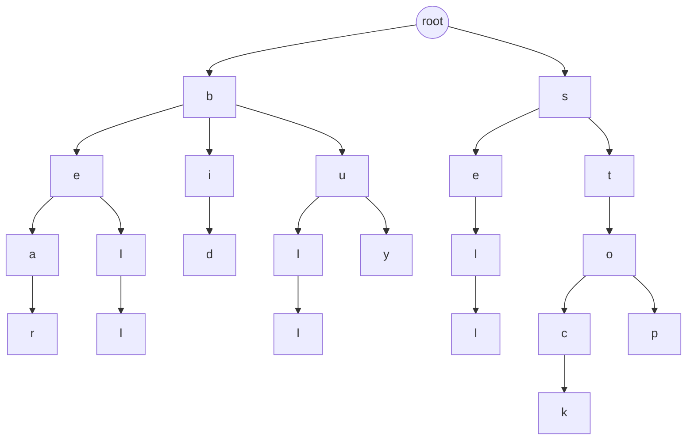

# Greedy compression and tries

> **Before this lesson:** You should know binary trees
> ([Tree terminology](#/lesson/dsa-foundations/tree-basics)), priority queues and `heapq`
> ([Priority queues and binary heaps](#/lesson/dsa-foundations/heaps)), prefixes, suffixes and
> pattern matching ([Pattern matching](#/lesson/dsa-foundations/pattern-matching)), and dynamic
> programming, for the contrast in section 2
> ([Dynamic programming](#/lesson/dsa-foundations/dynamic-programming)).

## In plain words

This lesson has two separate ideas about text.

The first is **compression**: storing text in fewer bits. Morse code already knew the trick.
The commonest letter in English, E, is a single dot, while the rare Q is dash-dash-dot-dash.
Give short codes to frequent symbols and long codes to rare ones, and messages get shorter on
average. **Huffman coding** is the method that works out the best possible set of such codes
for a given text. It does so by a strategy called the **greedy method**: at every step, make
the choice that looks best right now.

The second idea is the **trie**, a tree for storing a collection of words so that words
beginning with the same letters share the same path. It is what makes a phone suggest
"hello", "help" and "helmet" the instant you have typed "hel": the phone walks down the path
h, e, l and reads off everything below it.

Why it matters for a job: Huffman coding is inside ZIP files, JPEG images and MP3 audio.
Tries power autocomplete, spell-checkers and the routing tables of the internet. In
interviews, "implement a trie" is a standard design exercise, and Huffman coding is the
standard example used to ask "why is your greedy algorithm correct?".

## 1. Text compression

Standard character encodings such as ASCII use a **fixed-length** code: every character takes
the same number of bits, 7 or 8. But characters are not equally common. In English, `e` and
the space are frequent, `z` and `q` rare. A **variable-length** code, which gives short
**codewords** (bit strings) to frequent characters and long ones to rare characters, uses
fewer bits overall.

### 1.1 Prefix codes

Variable lengths create a difficulty: with no fixed boundaries, how does the reader know where
one codeword ends and the next begins? Suppose `a` were `0`, `b` were `1` and `c` were `01`.
The bits `01` could mean `ab` or `c`, and there is no way to tell. The cure is to require a
**prefix code**: **no codeword is the beginning (a prefix) of another codeword**. Then a
decoder reading bits from left to right knows a codeword has ended the moment the bits read so
far form one, because nothing longer could start that way.

A prefix code can be drawn as a **binary tree**. Each leaf holds a character, and the path
from the root to a leaf spells out that character's codeword: going left writes a `0`, going
right writes a `1`. Because characters sit only at leaves, never at inner nodes, no codeword
can be the beginning of another. To decode, start at the root, follow the bits down, and each
time a leaf is reached, output its character and return to the root.

### 1.2 The Huffman coding algorithm

Given the text $X$ to be compressed, **Huffman's algorithm** builds the best possible
prefix-code tree for it. It starts with one tiny tree per distinct character and repeatedly
joins trees together, using a priority queue keyed by frequency (how many times the
characters in a tree occur in $X$):

```
Huffman(X):
    compute the frequency f(c) of each character c of X
    initialise a priority queue Q
    for each character c in X:
        create a single-node binary tree T storing c
        insert T into Q with key f(c)
    while len(Q) > 1:
        (f1, T1) = Q.remove_min()
        (f2, T2) = Q.remove_min()
        create a new binary tree T with left subtree T1 and right subtree T2
        insert T into Q with key f1 + f2
    (f, T) = Q.remove_min()
    return tree T
```

At every step it merges the **two least frequent** trees into one, whose frequency is the sum
of theirs. Rare characters are merged early, so they end up deep in the final tree, with long
codewords. Frequent characters are merged late and end up near the root, with short codewords.

**A tiny example first.** Take four characters with frequencies a:5, b:2, c:1, d:1. The two
rarest are c and d; merge them into a tree of frequency 2. Now the queue holds a:5, b:2 and
(c,d):2. The two rarest are b and (c,d); merge them into a tree of frequency 4. Now a:5 and
(b,(c,d)):4 remain; merge them into the final tree of frequency 9. Reading off the paths, `a`
gets a 1-bit codeword, `b` a 2-bit one, and `c` and `d` 3-bit ones. The total is
$5 \cdot 1 + 2 \cdot 2 + 1 \cdot 3 + 1 \cdot 3 = 15$ bits, against 18 bits for a fixed 2-bit
code.

**A larger example.** $X = $ `"she sells sea shells by the sea shore"` (37 characters, 11
of them distinct). The frequencies are:

| char | space | a | b | e | h | l | o | r | s | t | y |
|---|---|---|---|---|---|---|---|---|---|---|---|
| freq | 7 | 2 | 1 | 7 | 4 | 4 | 1 | 1 | 8 | 1 | 1 |

```python-run
import heapq
from collections import Counter

def huffman(text):
    """Return (tree, codes). A tree is either a character (leaf) or a (left, right) pair."""
    freq = Counter(text)
    # heap entries: (frequency, tie_breaker, tree); the tie breaker avoids comparing trees
    heap = [(f, i, c) for i, (c, f) in enumerate(sorted(freq.items()))]
    heapq.heapify(heap)
    counter = len(heap)
    while len(heap) > 1:
        f1, _, t1 = heapq.heappop(heap)          # two least frequent trees
        f2, _, t2 = heapq.heappop(heap)
        heapq.heappush(heap, (f1 + f2, counter, (t1, t2)))
        counter += 1
    tree = heap[0][2]
    codes = {}
    def walk(t, prefix):
        if isinstance(t, str):
            codes[t] = prefix or "0"              # single-character text: give it one bit
        else:
            walk(t[0], prefix + "0"); walk(t[1], prefix + "1")
    walk(tree, "")
    return tree, codes

def decode(bits, tree):
    out, node = [], tree
    for b in bits:
        node = node[int(b)]
        if isinstance(node, str):                 # reached a leaf: emit and restart at the root
            out.append(node); node = tree
    return "".join(out)

X = "she sells sea shells by the sea shore"
tree, codes = huffman(X)
for c, code in sorted(codes.items(), key=lambda kv: (len(kv[1]), kv[0])):
    print(repr(c), X.count(c), code)
encoded = "".join(codes[c] for c in X)
print(len(X) * 8, "bits in 8-bit ASCII ->", len(encoded), "bits with Huffman")
print(decode(encoded, tree) == X)
```

**Reading the code.** `Counter(text)` counts how often each character occurs. A tree is
represented as either a single character (a leaf) or a pair `(left, right)`. Each heap entry
is a tuple `(frequency, tie_breaker, tree)`; the middle number is there only so that Python
never has to compare two trees when frequencies are equal (the technique from the heaps
lesson). The loop pops the two least frequent trees and pushes their combination. `walk` then
visits the finished tree, extending the codeword by `0` on the way left and `1` on the way
right. `decode` follows the bits down from the root and restarts at the root after each leaf.

In the output, the most frequent symbols (`s`, `e` and the space) receive the shortest
codewords, and the letters that occur once sit deepest in the tree with the longest. The 37
characters take 296 bits at 8 bits each and 114 bits with the Huffman code, and decoding gives
back the original text.

The length of the encoded text is $\sum_c f(c) \cdot \text{depth}(c)$: for each character, its
frequency times the length of its codeword. A handy fact: this total equals the **sum of the
frequencies of all the merged trees** created along the way, because each merge adds one bit
to the codeword of every character underneath it.

**Running time.** With a heap as the priority queue and $d$ distinct characters, there are
$d - 1$ merges, each doing two removals and one insertion at $O(\log d)$: $O(d \log d)$.
Counting the frequencies takes $O(n)$. The total is **$O(n + d\log d)$**.

> **Theorem.** For a text of $n$ characters, $d$ of them distinct, Huffman's algorithm builds a
> best-possible prefix code in $O(n + d\log d)$ time.

*Why the result is the best possible (outline).* (1) There is always a best tree in which the
two rarest characters are siblings at the deepest level. If some best tree had other
characters down there, swap them with the two rarest: moving rare characters deeper and
commoner ones higher cannot increase the total. An argument of this shape, "swap in my choice
and nothing gets worse", is called an **exchange argument**. (2) Treat those two siblings as a
single combined character with their summed frequency. That is a smaller problem of the same
kind, and a best tree for it expands into a best tree for the original. Induction on the
number of characters completes the proof.

## 2. The greedy method

Huffman's algorithm is an example of the **greedy method**: build a solution through a
sequence of choices, at each step taking the option that looks **best at that moment**, and
never going back to reconsider.

Greedy algorithms are short and fast. But they give correct answers only for problems with
the **greedy-choice property**: a series of choices that each look best locally is guaranteed
to end at a solution that is best overall. Many problems lack it. The standard illustration
is giving change with as few coins as possible. With coins of 1, 5, 10 and 25, always taking
the largest coin that fits is optimal. With coins of 1, 3 and 4, it is not: for 6, greedy
takes 4 + 1 + 1, three coins, when 3 + 3 uses two. Proving that a problem has the
greedy-choice property, usually with an exchange argument, is the real work. The table lists
some problems from this track and elsewhere; "knapsack" problems ask which items to pack
into a bag of limited capacity to maximise their total value.

| Problem | Greedy choice | Correct? |
|---|---|---|
| Huffman coding | merge the two least frequent trees | yes |
| Fractional knapsack | take items in order of value/weight | yes |
| Interval/task scheduling | pick the activity that finishes first | yes |
| Minimum spanning tree | cheapest safe edge (Prim, Kruskal) | yes |
| Shortest paths, non-negative weights | closest unsettled vertex (Dijkstra) | yes |
| 0/1 knapsack | value/weight order | **no** — needs DP |
| Coin change with arbitrary denominations | largest coin first | **no** in general |
| Matrix chain-product | cheapest multiplication first | **no** — needs DP |

> [!INTERVIEW]
> When you propose a greedy algorithm, the interviewer's next question is "why is that optimal?".
> Have the exchange argument ready: "take any optimal solution that differs from the greedy one at
> the first choice; swap in the greedy choice; the solution is no worse". If you cannot make that
> argument, look for a counterexample — you probably need DP.

## 3. Tries

The pattern-matching algorithms of the earlier lesson prepare the **pattern** in advance. If
instead the **text is fixed** and many different searches will be run against it (a
dictionary, the index of a website, a genome), it pays to prepare the text. A **trie** (the
name comes from re*trie*val and is usually pronounced "try") is a tree for storing a set of
strings that supports fast lookup and, above all, **prefix matching**: given a string $X$,
find all the stored strings that begin with $X$.

### 3.1 Standard tries

Suppose we have $s$ strings over an alphabet $\Sigma$. Assume for now that none of them is the
beginning of another; this can always be arranged by adding a special end marker such as `$`
to every string, or, as the code below does, by flagging the nodes where a word ends. The
**standard trie** of the strings is an ordered tree in which:

- every node except the root is labelled with one character;
- the children of a node all have different labels;
- there are $s$ leaves, one per string, and reading the labels along the path from the root
  to a leaf spells that string.

Trie for $S = \{$bear, bell, bid, bull, buy, sell, stock, stop$\}$:



Common prefixes are stored **once**: `be`, `bu`, `sto` are shared.

**Properties** (with $n$ = total length of the strings, $s$ = number of strings):

- every internal node has at most $|\Sigma|$ children;
- the trie has $s$ leaves;
- its height equals the length of the longest string;
- the number of nodes is at most $n + 1$.

**Search.** To look up a string $X$ of length $m$, start at the root and, for each character
of $X$ in turn, move to the child with that label. If the needed child does not exist, $X$ is
not in the set. If each node keeps its children in a dictionary (or an array indexed by
character), each step takes $O(1)$, and a search costs **$O(m)$**. Note what is absent from
that bound: the number of stored strings. Looking up a word among ten thousand or ten million
takes the same time. (If a node's children are kept in a plain list and scanned, each step
costs up to $|\Sigma|$, for $O(m \cdot |\Sigma|)$ overall; a sorted list with binary search
gives $O(m \log|\Sigma|)$.)

**Insertion** follows the same path and creates any nodes that are missing: $O(m)$. Building
the whole trie costs $O(n)$, where $n$ is the total length of all the strings.

The class below uses a dictionary of children at each node. Besides the end-of-word flag, each
node keeps a `count` of how many stored words pass through it, which answers "how many words
start with this prefix?" in $O(m)$.

```python-run
class Trie:
    class _Node:
        __slots__ = "children", "is_word", "count"
        def __init__(self):
            self.children, self.is_word, self.count = {}, False, 0   # count = words below this node

    def __init__(self): self._root = self._Node()

    def insert(self, word):
        node = self._root
        node.count += 1
        for ch in word:
            node = node.children.setdefault(ch, self._Node())
            node.count += 1
        node.is_word = True

    def _walk(self, s):
        node = self._root
        for ch in s:
            node = node.children.get(ch)
            if node is None: return None
        return node

    def search(self, word):
        node = self._walk(word)
        return node is not None and node.is_word
    def starts_with(self, prefix):
        return self._walk(prefix) is not None
    def count_prefix(self, prefix):
        node = self._walk(prefix)
        return node.count if node else 0
    def complete(self, prefix):
        """All stored words with the given prefix, in alphabetical order."""
        out, node = [], self._walk(prefix)
        def dfs(n, acc):
            if n.is_word: out.append(prefix + acc)
            for ch in sorted(n.children): dfs(n.children[ch], acc + ch)
        if node: dfs(node, "")
        return out

T = Trie()
for w in ["bear", "bell", "bid", "bull", "buy", "sell", "stock", "stop", "be"]:
    T.insert(w)
print(T.search("bell"), T.search("bel"), T.starts_with("bel"), T.count_prefix("b"), T.complete("st"), T.complete("be"))
```

**Reading the code.** `insert` walks down from the root; `setdefault(ch, self._Node())` returns
the child for `ch`, creating it first if it does not exist. `_walk(s)` follows the characters
of `s` and returns the node reached, or `None` if the path breaks off. `search` requires the
walk to end on a node flagged as a word; `starts_with` only requires the walk to succeed.
`complete` collects every word below the prefix's node by a depth-first traversal. The output
is `True False True 6 ['stock', 'stop'] ['be', 'bear', 'bell']`: `bell` is a word; `bel` is
not, although it is a prefix of one; six words start with `b`.

The `is_word` flag plays the part of the `$` end marker, and lets `be` and `bear` both be
stored even though one is a prefix of the other.

### 3.2 Compressed tries

A standard trie can waste space on long chains of nodes that each have exactly one child (and
are not word ends); such nodes make no decisions. A **compressed trie** (also called a
*Patricia trie* or *radix tree*) merges each such chain into a single edge labelled with a
whole **substring**, so that every internal node has at least two children.

For the example set, the chains `e-l-l` under `s` and `l-l` under `bu` collapse:
`b → {e → {ar, ll}, id, u → {ll, y}}`, `s → {ell, to → {ck, p}}`.

> **Proposition.** A compressed trie storing $s$ strings has $s$ leaves, every internal node has at
> least two children, and therefore it has **$O(s)$ nodes** — instead of $O(n)$.

The node count now depends on the number of strings, not their total length. To make the *storage*
$O(s)$ as well, a node stores not the substring itself but a triple of integers $(i, j, k)$ meaning
"characters $j..k$ of string $S[i]$" — constant space per node, with the strings kept in an
auxiliary array. Radix trees are used in IP routing tables (longest-prefix match), in-memory
databases, and file systems.

### 3.3 Suffix tries

A trie finds strings by their *beginnings*. To find a pattern *anywhere* inside a text $X$ of
length $n$, use one observation: every substring of $X$ is the beginning of some suffix of
$X$. (The substring `nim` of `minimize` is the start of the suffix `nimize`.) So store **all
the suffixes** of $X$ in a compressed trie. This is called the **suffix trie** or **suffix
tree** of $X$. A pattern $P$ occurs in $X$ exactly when $P$ can be traced along a path from
the root.

- A standard trie of all suffixes could have $\Theta(n^2)$ nodes (total suffix length
  $n(n+1)/2$); the **compressed** version has $O(n)$ nodes, and with the $(j, k)$ index
  representation of labels uses **$O(n)$ space**.
- It can be built in $O(n)$ time by specialised algorithms (Ukkonen, McCreight) — the simple
  incremental construction takes $O(n^2)$.
- A pattern query takes **$O(m)$** time, for alphabet of constant size — regardless of $n$.

```python-run
def build_suffix_trie(text):
    """Naive (uncompressed) suffix trie as nested dicts: O(n^2) nodes - fine for a demo."""
    text += "$"
    root = {}
    for i in range(len(text)):
        node = root
        for ch in text[i:]:
            node = node.setdefault(ch, {})
        node["#start"] = i                       # leaf records where this suffix begins
    return root
def occurrences(root, pattern):
    node = root
    for ch in pattern:
        if ch not in node: return []
        node = node[ch]
    out, stack = [], [node]
    while stack:                                 # every leaf below = one occurrence
        n = stack.pop()
        for key, child in n.items():
            if key == "#start": out.append(child)
            else: stack.append(child)
    return sorted(out)
st = build_suffix_trie("minimize")
print(occurrences(st, "mi"), occurrences(st, "i"), occurrences(st, "nim"), occurrences(st, "zz"))
```

### 3.4 Search engine indexing

The core of a search engine is an **inverted index** (inverted file): a dictionary mapping each
**index term** (word) to its **occurrence list** — the documents (pages) containing it. Implementing
the dictionary as a compressed trie, with each leaf pointing to the occurrence list (stored on disk),
lets a keyword query run in time proportional to the keyword length. Multi-keyword queries
intersect occurrence lists (kept sorted so that intersection is a merge). **Ranking** the results —
the famous hard part — is a separate problem.

## 4. Pitfalls

- **A text with one distinct character.** The Huffman tree is then a single leaf whose
  codeword would be empty; give it one bit.
- **Worrying about ties.** How ties between equal frequencies are broken changes the
  *codewords* but never the total *length*, which is always the minimum.
- **Pushing trees into `heapq` without a tie-breaker.** When two frequencies are equal, Python
  compares the next field of the tuple, and comparing two trees raises an error.
- **Forgetting the end-of-word marker in a trie.** Without it, `"be"` would be reported as
  stored merely because `"bear"` is.
- **Assuming greedy works.** A greedy algorithm needs a proof (or at least a serious hunt for
  a counterexample) before it can be trusted.
- **Wasting memory on child arrays.** An array of 26 slots in every node is fast but mostly
  empty in a sparse trie; a dictionary per node is a little slower and far more compact.

## 5. Summary

- Huffman coding repeatedly merges the two least frequent trees, using a priority queue, and
  produces a best-possible prefix code in $O(n + d\log d)$.
- The greedy method makes the locally best choice at each step; it is correct only for
  problems with the greedy-choice property, usually proved by an exchange argument.
- A standard trie has $O(n)$ nodes and answers a lookup or prefix query in $O(m)$,
  independently of how many strings it stores.
- A compressed trie has $O(s)$ nodes; a suffix tree makes every substring of a text
  searchable in $O(m)$ time using $O(n)$ space.

> **Source:** Goodrich, Tamassia & Goldwasser, *Data Structures and Algorithms in Python*, ch. 13.4–13.5.

## Glossary

- **Compression**: representing data in fewer bits.
- **Fixed-length / variable-length code**: every character uses the same / a different number
  of bits.
- **Codeword**: the bit string assigned to a character.
- **Prefix code**: a code in which no codeword is the beginning of another.
- **Huffman coding**: the algorithm that builds a best-possible prefix code from character
  frequencies.
- **Greedy method**: building a solution by always taking the choice that looks best at the
  moment.
- **Greedy-choice property**: the guarantee that locally best choices lead to a best overall
  solution.
- **Exchange argument**: a proof that swapping the greedy choice into any best solution does
  not make it worse.
- **Trie**: a tree that stores strings character by character, sharing common prefixes.
- **Prefix matching**: finding all stored strings that begin with a given string.
- **Compressed trie (radix tree)**: a trie in which chains of single-child nodes are merged
  into one edge.
- **Suffix tree**: a compressed trie of all the suffixes of a text.
- **Inverted index**: a map from each word to the list of documents that contain it.

## Check yourself

```quiz
[
  {"q": "What is a prefix code?",
   "options": ["A code where all codewords have the same length", "A code in which no codeword is a prefix of another", "A code sorted alphabetically", "A code that starts with 0"], "answer": 1,
   "explain": "This makes decoding unambiguous without separators."},
  {"q": "At each step, Huffman's algorithm...",
   "options": ["merges the two most frequent trees", "merges the two least frequent trees", "splits the largest tree", "sorts all characters"], "answer": 1,
   "explain": "Rare symbols are merged first and end up deepest, receiving the longest codes."},
  {"q": "Huffman's running time for a text of length n with d distinct characters, using a heap?",
   "options": ["O(n + d log d)", "O(n^2)", "O(d^2 n)", "O(n log n) always"], "answer": 0,
   "explain": "O(n) to count frequencies, d - 1 merges at O(log d) each."},
  {"q": "For which problem does the greedy method NOT give an optimal solution in general?",
   "options": ["Huffman coding", "Fractional knapsack", "0/1 knapsack", "Minimum spanning tree"], "answer": 2,
   "explain": "0/1 knapsack lacks the greedy-choice property; it needs dynamic programming."},
  {"q": "Searching for a string of length m in a standard trie (hash-map children) takes...",
   "options": ["O(m)", "O(n)", "O(s)", "O(m log n)"], "answer": 0,
   "explain": "One child lookup per character, independent of how many strings are stored."},
  {"q": "A compressed trie storing s strings has how many nodes?",
   "options": ["O(n), total length", "O(s)", "O(s^2)", "O(log s)"], "answer": 1,
   "explain": "s leaves and every internal node has at least two children, so fewer than s internal nodes."},
  {"q": "A pattern P occurs in text X exactly when P is...",
   "options": ["a suffix of X", "a prefix of some suffix of X", "a subsequence of X", "a leaf of the suffix trie"], "answer": 1,
   "explain": "That is why a trie of all suffixes answers substring queries."}
]
```
