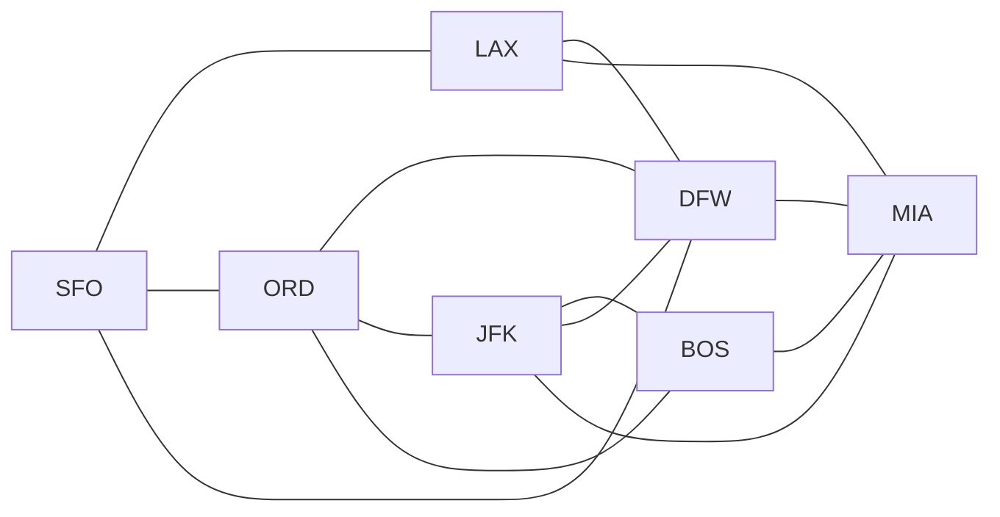

# Graphs and their representations

A **graph** models pairwise connections: a collection of things, plus the links between some of them. Road maps,
flight networks, the web, social networks, course prerequisites, electrical circuits, dependencies
between software packages — all are graphs. This lesson introduces the vocabulary, the basic
counting facts, the graph ADT and the four classic data structures for storing a graph, with their
trade-offs.

## 1. Definitions

A graph $G$ is a set $V$ of **vertices** (nodes) together with a collection $E$ of pairs of vertices
called **edges** (arcs).

- An edge $(u, v)$ is **directed** if the pair is ordered ($u$ precedes $v$), and **undirected**
  otherwise. A graph whose edges are all undirected is an **undirected graph**; all directed, a
  **directed graph** or **digraph**; otherwise a **mixed graph**.
- An edge's two vertices are called its **endpoints** (or end vertices). For a directed edge, the
  first is its **origin** and the second its **destination**.
- Two vertices are **adjacent** if an edge joins them. A vertex and an edge are **incident** when the
  edge touches that vertex.
- The **outgoing edges** of $v$ are the directed edges whose origin is $v$; the **incoming edges**
  have $v$ as destination. The **degree** $\deg(v)$ counts the edges touching $v$; the
  **in-degree** and **out-degree** count incoming and outgoing edges.
- $E$ is a *collection*, not a set: **parallel edges** (multiple edges) join the same pair of
  vertices; a **self-loop** joins a vertex to itself. A graph with neither is **simple** — the usual
  assumption.



Examples: a co-authorship graph is undirected (if A wrote with B, B wrote with A); a class
inheritance graph or a flight network is directed; a city map with one-way and two-way streets is
mixed.

### 1.1 Paths, cycles, connectivity

- A **path** is a walk through the graph — vertex, edge, vertex, edge, …, vertex — in which every
  edge joins the two vertices written on either side of it. A **cycle** is a path of one or more
  edges that returns to where it began. **Simple** paths/cycles do not repeat vertices
  (except the endpoint of a cycle). A **directed path/cycle** respects edge directions.
- A digraph with no directed cycle anywhere is called **acyclic** (a **DAG**).
- $u$ **reaches** $v$ (and $v$ is **reachable** from $u$) if some (directed) path leads from $u$ to
  $v$. Without edge directions, reachability is symmetric.
- A graph is **connected** if there is a path between every pair of vertices. A digraph is
  **strongly connected** if for every pair $u, v$: $u$ reaches $v$ **and** $v$ reaches $u$.
- A **subgraph** of $G$ uses subsets of its vertices and edges; a **spanning subgraph** contains all
  vertices. The maximal connected subgraphs are the **connected components**.
- A cycle-free graph is a **forest**, and a forest in one connected piece is a **tree** (a *free*
  tree: nobody is the root). A **spanning tree** is a tree that reaches every vertex of the graph.

### 1.2 Counting facts

Let $n = |V|$ and $m = |E|$.

> **Proposition 1.** In a graph with $m$ edges, $\sum_{v \in V} \deg(v) = 2m$.

Each edge is counted twice, once at each endpoint (the *handshake lemma*).

> **Proposition 2.** In a directed graph, $\sum_v \text{indeg}(v) = \sum_v \text{outdeg}(v) = m$.

> **Proposition 3.** A simple graph with $n$ vertices has $m \le n(n-1)/2$ edges if undirected and
> $m \le n(n-1)$ if directed.

So $m$ is $O(n^2)$. A graph is called **dense** if $m$ is close to $n^2$ and **sparse** if $m$ is
closer to $n$ — most real-world graphs (roads, social networks, the web) are sparse.

> **Proposition 4.** Let $G$ be an undirected graph. Connected graphs have $m \ge n - 1$; trees have exactly
> $m = n - 1$; forests have $m \le n - 1$.

## 2. The graph ADT

The book models a graph with three types: `Vertex` (with `element()`), `Edge` (with `element()`,
`endpoints()` returning `(u, v)`, and `opposite(v)`), and `Graph`:

| Method | Meaning |
|---|---|
| `vertex_count()`, `edge_count()` | $n$ and $m$ |
| `vertices()`, `edges()` | iterations of all vertices / edges |
| `get_edge(u, v)` | look up the edge joining $u$ to $v$ (`None` when absent) |
| `degree(v, out=True)` | (out-)degree; `out=False` for in-degree |
| `incident_edges(v, out=True)` | iteration of edges incident to $v$ (outgoing by default) |
| `insert_vertex(x=None)` | add a vertex holding `x`; the new vertex is handed back |
| `insert_edge(u, v, x=None)` | add an edge $u$–$v$ holding `x`; the new edge is handed back |
| `remove_vertex(v)` | remove $v$ and all its incident edges |
| `remove_edge(e)` | remove edge $e$ |

## 3. Four data structures for graphs

All four keep a collection of vertices; they differ in how edges are organised.

### 3.1 Edge list

An unordered list $V$ of vertex objects and an unordered list $E$ of edge objects, each edge
referencing its two endpoints. Simplest, compact ($O(n + m)$ space), but locating a particular edge
$(u, v)$ or all edges incident to $v$ requires scanning the **whole** edge list: $O(m)$.
Good as an input format and for algorithms that process edges in bulk (Kruskal sorts the edges).

### 3.2 Adjacency list

For each vertex $v$, a separate list $I(v)$ of its incident edges (the **incidence collection**).
Each edge appears in the lists of both endpoints (for a digraph, separate outgoing and incoming
lists). Space $O(n + m)$, since $\sum_v \deg(v) = 2m$.

- `incident_edges(v)`: $O(\deg(v))$ — optimal;
- `get_edge(u, v)`: scan the shorter of the two lists: $O(\min(\deg(u), \deg(v)))$;
- `remove_vertex(v)`: $O(\deg(v))$.

### 3.3 Adjacency map

Like an adjacency list, but each $I(v)$ is a **hash map** keyed by the opposite endpoint. Then
`get_edge(u, v)` is **expected $O(1)$**, while all the adjacency-list bounds are preserved
(expected). This is the book's implementation of choice, and in Python it is simply a
**dict of dicts**: `adj[u][v] = edge`.

### 3.4 Adjacency matrix

Number the vertices $0..n-1$ and keep an $n \times n$ array $A$ where $A[i][j]$ holds the edge from
vertex $i$ to vertex $j$ (or `None`/0). For an undirected graph the matrix is symmetric.

- `get_edge(u, v)`: **worst-case $O(1)$**;
- `incident_edges(v)`: must scan a whole row: $O(n)$, even if $v$ has few neighbours;
- space **$O(n^2)$** regardless of $m$; adding or removing a vertex means rebuilding: $O(n^2)$.

Worth it only for dense graphs or when the matrix itself is the algorithm's workspace
(Floyd-Warshall).

### 3.5 Comparison

Read each row as one data structure ($d_v$ is the degree of $v$):

| Structure | Memory | `get_edge(u, v)` | `degree(v)` | `incident_edges(v)` | add or remove an edge | add a vertex | `remove_vertex(v)` |
|---|---|---|---|---|---|---|---|
| Edge list | $O(n+m)$ | $O(m)$ | $O(m)$ | $O(m)$ | $O(1)$ | $O(1)$ | $O(m)$ |
| Adjacency list | $O(n+m)$ | $O(\min(d_u, d_v))$ | $O(1)$ | $O(d_v)$ | $O(1)$ | $O(1)$ | $O(d_v)$ |
| Adjacency map | $O(n+m)$ | $O(1)$ expected | $O(1)$ | $O(d_v)$ | $O(1)$ expected | $O(1)$ | $O(d_v)$ |
| Adjacency matrix | $O(n^2)$ | $O(1)$ worst case | $O(n)$ | $O(n)$ | $O(1)$ | $O(n^2)$ | $O(n^2)$ |

Three things are the same everywhere: asking for the number of vertices or edges takes constant
time (each structure keeps counters), listing every vertex takes $O(n)$, and listing every edge
takes $O(m)$ — except that a bare matrix must be scanned in $O(n^2)$ unless a separate collection
of edges is kept alongside it.

How to read the table when choosing: the edge list is hopeless for anything local to a vertex; the
matrix is hopeless for anything proportional to a vertex's neighbourhood and for memory; the two
adjacency structures are good at everything, and the map variant adds a fast test for whether two
given vertices are adjacent.

## 4. Python implementation: adjacency map

The book's `Graph` class keeps two dictionaries, `_outgoing` and `_incoming`, each mapping a vertex
to its incidence map `{opposite vertex: edge}`. For an undirected graph the two names alias the
**same** dictionary.

```python-run
class Graph:
    """Representation of a simple graph using an adjacency map."""
    class Vertex:
        __slots__ = '_element'
        def __init__(self, x): self._element = x
        def element(self): return self._element
        def __hash__(self): return hash(id(self))          # allow vertex to be a map/set key
        def __repr__(self): return str(self._element)

    class Edge:
        __slots__ = '_origin', '_destination', '_element'
        def __init__(self, u, v, x): self._origin, self._destination, self._element = u, v, x
        def endpoints(self): return (self._origin, self._destination)
        def opposite(self, v): return self._destination if v is self._origin else self._origin
        def element(self): return self._element
        def __hash__(self): return hash((self._origin, self._destination))
        def __repr__(self): return f"({self._origin},{self._destination},{self._element})"

    def __init__(self, directed=False):
        self._outgoing = {}
        # only create second map for directed graph; use alias for undirected
        self._incoming = {} if directed else self._outgoing

    def is_directed(self): return self._incoming is not self._outgoing
    def vertex_count(self): return len(self._outgoing)
    def vertices(self): return self._outgoing.keys()
    def edge_count(self):
        total = sum(len(self._outgoing[v]) for v in self._outgoing)
        return total if self.is_directed() else total // 2   # for undirected, avoid double-counting
    def edges(self):
        result = set()                                        # avoid double-reporting edges of undirected graph
        for secondary_map in self._outgoing.values():
            result.update(secondary_map.values())
        return result
    def get_edge(self, u, v): return self._outgoing[u].get(v)
    def degree(self, v, outgoing=True):
        adj = self._outgoing if outgoing else self._incoming
        return len(adj[v])
    def incident_edges(self, v, outgoing=True):
        adj = self._outgoing if outgoing else self._incoming
        for edge in adj[v].values():
            yield edge
    def insert_vertex(self, x=None):
        v = self.Vertex(x)
        self._outgoing[v] = {}
        if self.is_directed():
            self._incoming[v] = {}                            # need distinct map for incoming edges
        return v
    def insert_edge(self, u, v, x=None):
        e = self.Edge(u, v, x)
        self._outgoing[u][v] = e
        self._incoming[v][u] = e
        return e

g = Graph()
V = {name: g.insert_vertex(name) for name in ["SFO", "LAX", "ORD", "DFW", "JFK"]}
for a, b, miles in [("SFO", "LAX", 337), ("SFO", "ORD", 1846), ("LAX", "DFW", 1235),
                    ("ORD", "DFW", 802), ("ORD", "JFK", 740), ("DFW", "JFK", 1391)]:
    g.insert_edge(V[a], V[b], miles)
print(g.vertex_count(), "vertices,", g.edge_count(), "edges")
print("degree(ORD) =", g.degree(V["ORD"]), " neighbours:", [e.opposite(V["ORD"]) for e in g.incident_edges(V["ORD"])])
print("SFO-JFK edge:", g.get_edge(V["SFO"], V["JFK"]), " ORD-JFK edge:", g.get_edge(V["ORD"], V["JFK"]))
print("sum of degrees =", sum(g.degree(v) for v in g.vertices()), "= 2m")
```

### 4.1 Lightweight representations for everyday code

In interviews and scripts, vertices are usually integers $0..n-1$ or strings, and you build the
structure directly from an edge list:

```python-run
from collections import defaultdict
n = 5
edges = [(0, 1, 4), (0, 2, 1), (2, 1, 2), (1, 3, 5), (3, 4, 3)]     # (u, v, weight)

adj_list = [[] for _ in range(n)]                # adjacency list (undirected, weighted)
for u, v, w in edges:
    adj_list[u].append((v, w)); adj_list[v].append((u, w))

adj_map = defaultdict(dict)                      # adjacency map: O(1) edge lookup
for u, v, w in edges:
    adj_map[u][v] = w; adj_map[v][u] = w

INF = float("inf")
matrix = [[0 if i == j else INF for j in range(n)] for i in range(n)]   # adjacency matrix
for u, v, w in edges:
    matrix[u][v] = matrix[v][u] = w

print(adj_list[1]); print(dict(adj_map[1])); print(matrix[1])
print("edge (2,1)?", 1 in adj_map[2], " weight:", adj_map[2].get(1), " edge (0,4)?", 4 in adj_map[0])
```

> [!INTERVIEW]
> "How would you represent this graph?" — default to an **adjacency list** (or dict of
> lists/sets): $O(n + m)$ space and neighbours in $O(\deg)$, which is what BFS/DFS/Dijkstra need.
> Choose an adjacency **matrix** when the graph is dense, $n$ is small (≤ a few thousand), or you
> need $O(1)$ edge tests / all-pairs algorithms. Always ask: directed or undirected? weighted?
> can there be self-loops, parallel edges, disconnected parts?

## 5. Pitfalls

- For undirected graphs, forgetting to add the edge in **both** directions.
- Using an adjacency matrix for a sparse graph with $10^5$ vertices: $10^{10}$ cells.
- Double-counting undirected edges when iterating all adjacency lists.
- Using mutable or unhashable vertex objects as dict keys.
- Assuming the graph is connected: iterate over all vertices when traversing.

## 6. Summary

- Graph = vertices + edges; directed/undirected; degree sum = $2m$; simple graphs have $O(n^2)$ edges;
  trees have $n - 1$.
- Edge list (simple, slow lookups), adjacency list (the workhorse), adjacency map (plus $O(1)$
  `get_edge`), adjacency matrix ($O(1)$ lookups, $O(n^2)$ space).

> **Source:** Goodrich, Tamassia & Goldwasser, *Data Structures and Algorithms in Python*, ch. 14.1–14.2.

## Check yourself

```quiz
[
  {"q": "In an undirected graph with m edges, the sum of all vertex degrees is...",
   "options": ["m", "2m", "m^2", "n + m"], "answer": 1,
   "explain": "Each edge contributes 1 to the degree of each of its two endpoints."},
  {"q": "Maximum number of edges in a simple undirected graph with n vertices?",
   "options": ["n - 1", "n(n-1)/2", "n^2", "2^n"], "answer": 1,
   "explain": "One edge per unordered pair of distinct vertices."},
  {"q": "A connected undirected graph with n vertices and exactly n - 1 edges is...",
   "options": ["a complete graph", "a tree", "a cycle", "disconnected"], "answer": 1,
   "explain": "Connected with the minimum possible number of edges means no cycles: a tree."},
  {"q": "Which representation gives worst-case O(1) get_edge(u, v) but O(n^2) space?",
   "options": ["Edge list", "Adjacency list", "Adjacency map", "Adjacency matrix"], "answer": 3,
   "explain": "A[i][j] is a direct array lookup; the matrix has n^2 cells regardless of m."},
  {"q": "With an adjacency list, iterating over the edges incident to v costs...",
   "options": ["O(m)", "O(n)", "O(deg(v))", "O(1)"], "answer": 2,
   "explain": "Each vertex stores exactly its own incident edges."},
  {"q": "A digraph is strongly connected when...",
   "options": ["it has no cycles", "every vertex reaches every other vertex along directed paths", "every vertex has in-degree 1", "it is a tree"], "answer": 1,
   "explain": "Reachability must hold in both directions for every pair."},
  {"q": "In the book's adjacency-map Graph class for an UNDIRECTED graph, _incoming is...",
   "options": ["an empty dict", "an alias of the same dict as _outgoing", "a copy of _outgoing", "None"], "answer": 1,
   "explain": "Undirected edges are both incoming and outgoing, so one structure serves both roles."}
]
```
