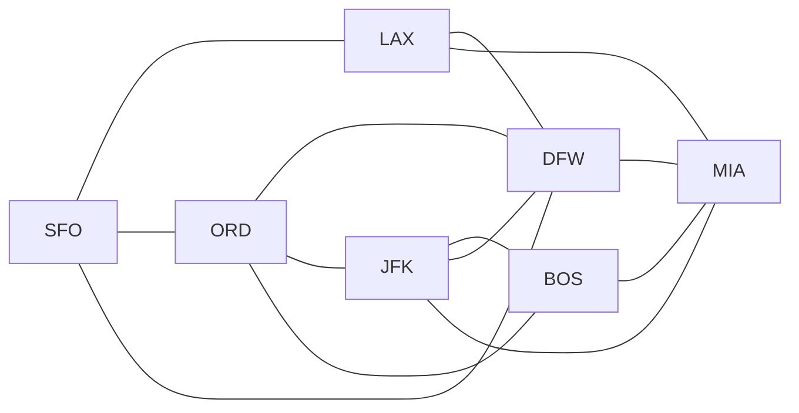

# Graphs and their representations

> **Before this lesson:** You should know trees and their vocabulary
> ([Tree terminology](#/lesson/dsa-foundations/tree-basics)), Python dictionaries and hash tables
> ([Maps and hash functions](#/lesson/dsa-foundations/maps-hash-functions)), lists of lists
> ([Using arrays](#/lesson/dsa-foundations/using-arrays)), and big-O notation. This is the first
> lesson of the graphs module.

## In plain words

A **graph** is a collection of things together with the connections between some pairs of
them. (This is a different meaning from "graph" as a chart with axes.) The things are called
**vertices** and the connections **edges**.

A map of an underground railway is a graph: the stations are the vertices and the stretches of
track between neighbouring stations are the edges. So is a social network (people, and who
knows whom), the web (pages, and links between them), and a set of courses with prerequisites
(courses, and "must be taken before"). A tree is a special, restricted kind of graph; a
general graph may contain loops, several separate pieces, and many routes between the same two
places.

Before any clever algorithm can run, a program has to *store* the graph. This lesson teaches
the vocabulary and then compares four ways of storing a graph, because the choice decides how
fast everything else will be.

Why it matters for a job: an enormous range of practical problems are graph problems in
disguise (route planning, dependency resolution in build tools, recommendation, network
analysis). In an interview the first question is nearly always "how will you represent the
graph?", and the right answer depends on the trade-offs in section 3.

## 1. Definitions

A graph $G$ consists of a set $V$ of **vertices** (also called nodes) and a collection $E$ of
**edges** (also called arcs), each edge joining a pair of vertices.

- An edge $(u, v)$ is **directed** if it has a direction, from $u$ to $v$, like a one-way
  street; it is **undirected** if it can be used both ways. A graph in which every edge is
  undirected is an **undirected graph**; if every edge is directed it is a **directed graph**,
  or **digraph**; a graph with both kinds is **mixed**.
- The two vertices an edge joins are its **endpoints**. For a directed edge, the first is its
  **origin** and the second its **destination**.
- Two vertices are **adjacent** (or *neighbours*) if an edge joins them. An edge is
  **incident** to a vertex if that vertex is one of its endpoints.
- The **outgoing edges** of a vertex $v$ are the directed edges that start at $v$; its
  **incoming edges** are those that end at $v$. The **degree** of $v$, written $\deg(v)$, is
  the number of edges incident to it. In a directed graph the **in-degree** and **out-degree**
  count incoming and outgoing edges separately.
- Edges form a *collection*, not a set, because in principle two different edges can join the
  same pair of vertices (**parallel edges**), and an edge can join a vertex to itself (a
  **self-loop**). A graph with neither is called **simple**, and unless stated otherwise the
  graphs in this track are simple.

The picture shows an undirected graph of seven airports. `ORD` and `JFK` are adjacent; `SFO`
and `JFK` are not. The degree of `BOS` is 3.



Whether edges are directed depends on what the graph models. "Has written a paper with" is
mutual, so a graph of co-authors is undirected. "Links to" and "depends on" are one-way, so
the web and a graph of software dependencies are directed. A city map with both one-way and
two-way streets is mixed.

### 1.1 Paths, cycles, connectivity

- A **path** is a route through the graph: a sequence of vertices in which each consecutive
  pair is joined by an edge. A **cycle** is a path with at least one edge that ends where it
  began. A path or cycle is **simple** if it does not visit any vertex twice (apart from a
  cycle's return to its start). In a directed graph, a **directed path** or **directed cycle**
  follows every edge in its proper direction.
- A directed graph with no directed cycle is called **acyclic**, and a *directed acyclic
  graph* is known by its initials as a **DAG**. Course prerequisites must form a DAG, or
  nobody could ever start.
- A vertex $u$ **reaches** $v$ (and $v$ is **reachable** from $u$) if there is a path from $u$
  to $v$. In an undirected graph, if $u$ reaches $v$ then $v$ reaches $u$; in a directed
  graph that need not be so.
- An undirected graph is **connected** if every vertex reaches every other. A directed graph
  is **strongly connected** if, for every pair $u$ and $v$, $u$ reaches $v$ **and** $v$
  reaches $u$.
- A **subgraph** of $G$ is a graph made from some of its vertices and some of its edges. A
  **spanning subgraph** keeps all the vertices. A graph that is not connected falls apart into
  **connected components**, its separate connected pieces.
- A graph with no cycles is a **forest**, and a connected forest is a **tree**. (This is a
  *free* tree: no vertex is singled out as the root.) A **spanning tree** of a graph is a
  subgraph that is a tree and includes every vertex.

### 1.2 Counting facts

From here on, $n$ is the number of vertices and $m$ the number of edges. (The notation $|V|$
means "the number of elements in $V$".) Running times of graph algorithms are stated in terms
of both.

> **Fact 1.** In an undirected graph with $m$ edges, the degrees add up to twice the number of
> edges: $\sum_{v \in V} \deg(v) = 2m$.

Each edge has two endpoints and adds 1 to the degree of each, so it is counted twice. In the
airport graph there are 13 edges and the degrees add up to 26.

> **Fact 2.** In a directed graph, the in-degrees add up to $m$, and so do the out-degrees.

> **Fact 3.** A simple graph with $n$ vertices has at most $n(n-1)/2$ edges if it is
> undirected, and at most $n(n-1)$ if it is directed.

There are $n(n-1)/2$ different pairs of vertices, and a simple graph has at most one edge per
pair. So $m$ is $O(n^2)$. A graph is called **dense** if $m$ is close to $n^2$ and **sparse**
if $m$ is closer to $n$. Most graphs from the real world (road networks, social networks, the
web) are sparse: a person may know a few hundred others, not most of the planet. This
matters, because an algorithm that takes $O(n + m)$ time is then far faster than one that
takes $O(n^2)$.

> **Fact 4.** In an undirected graph: a connected graph has $m \ge n - 1$; a tree has exactly
> $m = n - 1$; a forest has $m \le n - 1$.

## 2. The graph ADT

As an abstract data type, a graph involves three kinds of object. A `Vertex` stores an
element (a name, say), retrieved with `element()`. An `Edge` also stores an element (a
distance or a cost, perhaps) and offers `endpoints()`, returning the pair `(u, v)`, and
`opposite(v)`, returning the endpoint that is not `v`. The `Graph` itself offers:

| Method | Meaning |
|---|---|
| `vertex_count()`, `edge_count()` | $n$ and $m$ |
| `vertices()`, `edges()` | iterations of all vertices / edges |
| `get_edge(u, v)` | look up the edge joining $u$ to $v$ (`None` when absent) |
| `degree(v, out=True)` | (out-)degree; `out=False` for in-degree |
| `incident_edges(v, out=True)` | iteration of edges incident to $v$ (outgoing by default) |
| `insert_vertex(x=None)` | add a vertex holding `x`; the new vertex is handed back |
| `insert_edge(u, v, x=None)` | add an edge $u$–$v$ holding `x`; the new edge is handed back |
| `remove_vertex(v)` | remove $v$ and all its incident edges |
| `remove_edge(e)` | remove edge $e$ |

## 3. Four data structures for graphs

All four keep a collection of the vertices. They differ in how the edges are organised, and
therefore in which questions they answer quickly. Two questions matter most: "what are the
neighbours of $v$?" and "is there an edge between $u$ and $v$?". As a running example take the
small undirected graph with vertices A, B, C, D and edges A-B, A-C, B-C, C-D.

### 3.1 Edge list

Keep one unordered list of the vertices and one unordered list of the edges, each edge
recording its two endpoints. For the example: `[(A,B), (A,C), (B,C), (C,D)]`. This is the
most basic structure and is compact, $O(n + m)$ space. But to find a particular edge, or all
the edges at one vertex, the **whole** edge list must be scanned: $O(m)$. An edge list is fine
as an input format and for algorithms that handle all the edges in one sweep, such as
Kruskal's algorithm later in this module, which begins by sorting them.

### 3.2 Adjacency list

For each vertex, keep a separate list of the edges incident to it. For the example:
`A: [B, C]`, `B: [A, C]`, `C: [A, B, D]`, `D: [C]`. Every undirected edge appears twice, once
in the list of each endpoint. (A directed graph keeps separate lists of outgoing and incoming
edges.) The space is $O(n + m)$, because the lists have total length $2m$ by Fact 1.

- `incident_edges(v)` takes $O(\deg(v))$, which is the best possible: the answer has that
  many items.
- `get_edge(u, v)` scans the shorter of the two lists: $O(\min(\deg(u), \deg(v)))$.
- `remove_vertex(v)` takes $O(\deg(v))$.

### 3.3 Adjacency map

The same idea, except that each vertex's collection is a **hash map** (a dictionary) whose
keys are the neighbouring vertices. Then `get_edge(u, v)` is one dictionary lookup,
**expected $O(1)$**, and everything else is as fast as with an adjacency list (in the expected
sense). This is the best all-round choice, and in Python it is a **dictionary of
dictionaries**: `adj[u][v]` holds the edge between `u` and `v`.

### 3.4 Adjacency matrix

Number the vertices from 0 to $n - 1$ and keep an $n \times n$ grid $A$ in which $A[i][j]$
holds the edge from vertex $i$ to vertex $j$, or a blank (`None` or 0) if there is none. For
the example, with A, B, C, D numbered 0 to 3 and 1 meaning "edge present":

```
     A  B  C  D
A  [ 0, 1, 1, 0 ]
B  [ 1, 0, 1, 0 ]
C  [ 1, 1, 0, 1 ]
D  [ 0, 0, 1, 0 ]
```

For an undirected graph the grid is symmetric: row $i$, column $j$ equals row $j$, column $i$.

- `get_edge(u, v)` reads one cell: **$O(1)$ in the worst case**.
- `incident_edges(v)` must scan an entire row: $O(n)$, even if $v$ has only two neighbours.
- The space is **$O(n^2)$** however few edges there are, and adding or removing a vertex means
  rebuilding the grid: $O(n^2)$.

A matrix is worth its cost only for dense graphs, or when the grid itself is the working
space of the algorithm.

### 3.5 Comparison

Read each row as one data structure ($d_v$ is the degree of $v$):

| Structure | Memory | `get_edge(u, v)` | `degree(v)` | `incident_edges(v)` | add or remove an edge | add a vertex | `remove_vertex(v)` |
|---|---|---|---|---|---|---|---|
| Edge list | $O(n+m)$ | $O(m)$ | $O(m)$ | $O(m)$ | $O(1)$ | $O(1)$ | $O(m)$ |
| Adjacency list | $O(n+m)$ | $O(\min(d_u, d_v))$ | $O(1)$ | $O(d_v)$ | $O(1)$ | $O(1)$ | $O(d_v)$ |
| Adjacency map | $O(n+m)$ | $O(1)$ expected | $O(1)$ | $O(d_v)$ | $O(1)$ expected | $O(1)$ | $O(d_v)$ |
| Adjacency matrix | $O(n^2)$ | $O(1)$ worst case | $O(n)$ | $O(n)$ | $O(1)$ | $O(n^2)$ | $O(n^2)$ |

Three things are the same everywhere: asking for the number of vertices or edges takes constant
time (each structure keeps counters), listing every vertex takes $O(n)$, and listing every edge
takes $O(m)$ — except that a bare matrix must be scanned in $O(n^2)$ unless a separate collection
of edges is kept alongside it.

How to read the table when choosing: the edge list is hopeless for anything local to a vertex; the
matrix is hopeless for anything proportional to a vertex's neighbourhood and for memory; the two
adjacency structures are good at everything, and the map variant adds a fast test for whether two
given vertices are adjacent.

## 4. Python implementation: adjacency map

The `Graph` class below implements the ADT with an adjacency map. It keeps two dictionaries,
`_outgoing` and `_incoming`. Each maps a vertex to a second dictionary of the form
`{neighbouring vertex: edge}`. For a directed graph the two are separate. For an undirected
graph every edge is both outgoing and incoming, so the two names refer to the **same**
dictionary, and `insert_edge` then records the edge under both endpoints with its two
assignments.

Two details: `Vertex.__hash__` lets vertex objects be used as dictionary keys, and
`__repr__` controls how an object is shown when printed.

```python-run
class Graph:
    """Representation of a simple graph using an adjacency map."""
    class Vertex:
        __slots__ = '_element'
        def __init__(self, x): self._element = x
        def element(self): return self._element
        def __hash__(self): return hash(id(self))          # allow vertex to be a map/set key
        def __repr__(self): return str(self._element)

    class Edge:
        __slots__ = '_origin', '_destination', '_element'
        def __init__(self, u, v, x): self._origin, self._destination, self._element = u, v, x
        def endpoints(self): return (self._origin, self._destination)
        def opposite(self, v): return self._destination if v is self._origin else self._origin
        def element(self): return self._element
        def __hash__(self): return hash((self._origin, self._destination))
        def __repr__(self): return f"({self._origin},{self._destination},{self._element})"

    def __init__(self, directed=False):
        self._outgoing = {}
        # only create second map for directed graph; use alias for undirected
        self._incoming = {} if directed else self._outgoing

    def is_directed(self): return self._incoming is not self._outgoing
    def vertex_count(self): return len(self._outgoing)
    def vertices(self): return self._outgoing.keys()
    def edge_count(self):
        total = sum(len(self._outgoing[v]) for v in self._outgoing)
        return total if self.is_directed() else total // 2   # for undirected, avoid double-counting
    def edges(self):
        result = set()                                        # avoid double-reporting edges of undirected graph
        for secondary_map in self._outgoing.values():
            result.update(secondary_map.values())
        return result
    def get_edge(self, u, v): return self._outgoing[u].get(v)
    def degree(self, v, outgoing=True):
        adj = self._outgoing if outgoing else self._incoming
        return len(adj[v])
    def incident_edges(self, v, outgoing=True):
        adj = self._outgoing if outgoing else self._incoming
        for edge in adj[v].values():
            yield edge
    def insert_vertex(self, x=None):
        v = self.Vertex(x)
        self._outgoing[v] = {}
        if self.is_directed():
            self._incoming[v] = {}                            # need distinct map for incoming edges
        return v
    def insert_edge(self, u, v, x=None):
        e = self.Edge(u, v, x)
        self._outgoing[u][v] = e
        self._incoming[v][u] = e
        return e

g = Graph()
V = {name: g.insert_vertex(name) for name in ["SFO", "LAX", "ORD", "DFW", "JFK"]}
for a, b, miles in [("SFO", "LAX", 337), ("SFO", "ORD", 1846), ("LAX", "DFW", 1235),
                    ("ORD", "DFW", 802), ("ORD", "JFK", 740), ("DFW", "JFK", 1391)]:
    g.insert_edge(V[a], V[b], miles)
print(g.vertex_count(), "vertices,", g.edge_count(), "edges")
print("degree(ORD) =", g.degree(V["ORD"]), " neighbours:", [e.opposite(V["ORD"]) for e in g.incident_edges(V["ORD"])])
print("SFO-JFK edge:", g.get_edge(V["SFO"], V["JFK"]), " ORD-JFK edge:", g.get_edge(V["ORD"], V["JFK"]))
print("sum of degrees =", sum(g.degree(v) for v in g.vertices()), "= 2m")
```

The demo builds five airports and six routes labelled with distances in miles. It prints
`5 vertices, 6 edges`; the degree of ORD is 3, with neighbours SFO, DFW and JFK; there is no
SFO-JFK edge (`None`) but there is an ORD-JFK edge of 740 miles; and the degrees add up to 12,
twice the number of edges, as Fact 1 says.

### 4.1 Lightweight representations for everyday code

In interviews and in quick scripts nobody writes `Vertex` and `Edge` classes. Vertices are
whole numbers from 0 to $n - 1$, or strings, and the structure is built directly from a list
of edges. The demo builds all three useful forms from the same edge list. Each edge here
carries a number, its **weight** (a distance or cost), which the later lessons of this module
use. In the matrix, `INF` (infinity) marks "no edge", so that a missing edge reads as an
infinitely long one.

```python-run
from collections import defaultdict
n = 5
edges = [(0, 1, 4), (0, 2, 1), (2, 1, 2), (1, 3, 5), (3, 4, 3)]     # (u, v, weight)

adj_list = [[] for _ in range(n)]                # adjacency list (undirected, weighted)
for u, v, w in edges:
    adj_list[u].append((v, w)); adj_list[v].append((u, w))

adj_map = defaultdict(dict)                      # adjacency map: O(1) edge lookup
for u, v, w in edges:
    adj_map[u][v] = w; adj_map[v][u] = w

INF = float("inf")
matrix = [[0 if i == j else INF for j in range(n)] for i in range(n)]   # adjacency matrix
for u, v, w in edges:
    matrix[u][v] = matrix[v][u] = w

print(adj_list[1]); print(dict(adj_map[1])); print(matrix[1])
print("edge (2,1)?", 1 in adj_map[2], " weight:", adj_map[2].get(1), " edge (0,4)?", 4 in adj_map[0])
```

> [!INTERVIEW]
> "How would you represent this graph?" Default to an **adjacency list** (in Python, a
> dictionary or list of lists or sets): $O(n + m)$ space, and the neighbours of a vertex in
> time proportional to its degree, which is what the traversal and shortest-path algorithms of
> the next lessons need. Choose an adjacency **matrix** when the graph is dense, when $n$ is
> small (up to a few thousand), or when you need constant-time "is there an edge?" tests.
> Always ask the clarifying questions first: directed or undirected? weighted? can there be
> self-loops, parallel edges, or several disconnected pieces?

## 5. Pitfalls

- **Adding an undirected edge in one direction only.** It must be recorded under **both**
  endpoints.
- **An adjacency matrix for a large sparse graph.** With $10^5$ vertices the grid has
  $10^{10}$ cells, tens of gigabytes, to store perhaps a million edges.
- **Counting undirected edges twice** when looping over every adjacency list.
- **Using something unhashable as a vertex.** Dictionary keys must be hashable, so a list
  cannot be a vertex; use a tuple, a string or a number.
- **Assuming the graph is connected.** A traversal started at one vertex reaches only that
  vertex's component; loop over all vertices to cover everything.

## 6. Summary

- A graph is a set of vertices plus edges joining pairs of them; edges may be directed or
  undirected.
- The degrees add up to $2m$; a simple graph has $O(n^2)$ edges; a tree has exactly $n - 1$.
- Four representations: the edge list (basic, slow to query), the adjacency list (the usual
  choice), the adjacency map (the same plus expected $O(1)$ edge lookup), and the adjacency
  matrix ($O(1)$ edge lookup but $O(n^2)$ space).

> **Source:** Goodrich, Tamassia & Goldwasser, *Data Structures and Algorithms in Python*, ch. 14.1–14.2.

## Glossary

- **Graph**: a set of vertices together with edges joining pairs of them.
- **Vertex (node) / edge (arc)**: one of the things / one of the connections.
- **Directed / undirected edge**: an edge with / without a direction.
- **Digraph**: a directed graph.
- **Endpoints**: the two vertices an edge joins.
- **Adjacent**: joined by an edge. **Incident**: an edge touching a vertex.
- **Degree**: the number of edges at a vertex; in-degree and out-degree count incoming and
  outgoing edges.
- **Simple graph**: a graph with no parallel edges and no self-loops.
- **Path / cycle**: a route along edges / a path that returns to its start.
- **DAG**: a directed acyclic graph, a directed graph with no directed cycle.
- **Connected / strongly connected**: every vertex reaches every other (in a directed graph,
  in both directions).
- **Connected component**: one of the separate connected pieces of a graph.
- **Spanning tree**: a tree made of the graph's edges that includes every vertex.
- **Dense / sparse**: having close to $n^2$ edges / close to $n$ edges.
- **Edge list, adjacency list, adjacency map, adjacency matrix**: the four standard ways of
  storing a graph.
- **Weight**: a number attached to an edge, such as a distance or cost.

## Check yourself

```quiz
[
  {"q": "In an undirected graph with m edges, the sum of all vertex degrees is...",
   "options": ["m", "2m", "m^2", "n + m"], "answer": 1,
   "explain": "Each edge contributes 1 to the degree of each of its two endpoints."},
  {"q": "Maximum number of edges in a simple undirected graph with n vertices?",
   "options": ["n - 1", "n(n-1)/2", "n^2", "2^n"], "answer": 1,
   "explain": "One edge per unordered pair of distinct vertices."},
  {"q": "A connected undirected graph with n vertices and exactly n - 1 edges is...",
   "options": ["a complete graph", "a tree", "a cycle", "disconnected"], "answer": 1,
   "explain": "Connected with the minimum possible number of edges means no cycles: a tree."},
  {"q": "Which representation gives worst-case O(1) get_edge(u, v) but O(n^2) space?",
   "options": ["Edge list", "Adjacency list", "Adjacency map", "Adjacency matrix"], "answer": 3,
   "explain": "A[i][j] is a direct array lookup; the matrix has n^2 cells regardless of m."},
  {"q": "With an adjacency list, iterating over the edges incident to v costs...",
   "options": ["O(m)", "O(n)", "O(deg(v))", "O(1)"], "answer": 2,
   "explain": "Each vertex stores exactly its own incident edges."},
  {"q": "A digraph is strongly connected when...",
   "options": ["it has no cycles", "every vertex reaches every other vertex along directed paths", "every vertex has in-degree 1", "it is a tree"], "answer": 1,
   "explain": "Reachability must hold in both directions for every pair."},
  {"q": "In the book's adjacency-map Graph class for an UNDIRECTED graph, _incoming is...",
   "options": ["an empty dict", "an alias of the same dict as _outgoing", "a copy of _outgoing", "None"], "answer": 1,
   "explain": "Undirected edges are both incoming and outgoing, so one structure serves both roles."}
]
```
