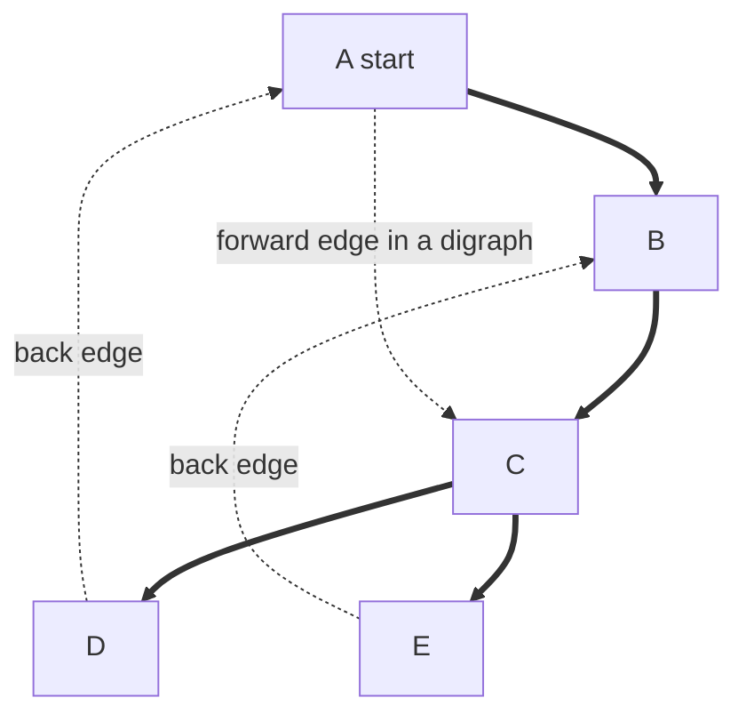

# DFS, BFS, transitive closure and DAGs

> **Before this lesson:** You should know graph vocabulary and the adjacency-list
> representation ([Graphs and their representations](#/lesson/dsa-foundations/graph-representations)),
> stacks and queues ([Stacks](#/lesson/dsa-foundations/stacks),
> [Queues, circular arrays and deques](#/lesson/dsa-foundations/queues-deques)), recursion
> ([Thinking recursively](#/lesson/dsa-foundations/recursion-examples)) and tree traversals
> ([Traversals](#/lesson/dsa-foundations/tree-traversals)).

## In plain words

To **traverse** a graph is to visit all of it methodically, so that nothing is missed and
nothing is done twice. There are two classic ways, and they differ in temperament.

Suppose you are exploring a cave system. **Depth-first search** is the bold explorer: follow
one tunnel as far as it goes, and only when it ends come back to the last junction and try the
next tunnel. **Breadth-first search** is the cautious one: first look at every chamber one
step from the entrance, then every chamber two steps away, and so on, spreading outwards like
ripples from a stone dropped in a pond.

Both visit every chamber. The cautious method has a bonus: because it works outwards by
distance, the first time it reaches a chamber it has found the shortest way there.

Why it matters for a job: these two traversals are the foundation of nearly every graph
algorithm, and they solve a great many interview problems directly. "Fewest moves", "number of
islands", "can all the courses be completed?", "is there a route from A to B?" are all one of
these two searches with a few lines added.

## 1. Depth-first search

A good traversal looks at every vertex and edge in time proportional to the size of the
graph, $O(n + m)$. Traversals answer **reachability** questions: is there a path from $u$ to
$v$? Is the graph connected? Does it contain a cycle?

**Depth-first search**, **DFS** for short, is like exploring a maze with a ball of string and
a pot of paint. Paint each junction as you reach it, so that you will recognise it. Always
take an unexplored corridor if there is one. When every corridor from the current junction
has been tried, follow the string back to the previous junction and continue from there. Going
back like this is called **backtracking**. In pseudocode, for a graph `G` and a vertex `u`:

```
DFS(G, u):                       # u has already been marked as visited
    for each outgoing edge e = (u, v) of u:
        if vertex v has not been visited:
            mark v as visited (via edge e)
            recursively call DFS(G, v)
```

The recursion does the backtracking for us: when a call has tried every edge of its vertex, it
returns, and the search resumes in the caller, at the previous vertex. Marking vertices as
visited is what stops the search from going round a cycle for ever.

### 1.1 Classifying edges

Every edge the search looks at falls into one of two groups. An edge that leads to a vertex
not seen before is a **discovery edge**, also called a tree edge. The discovery edges form a
tree rooted at the starting vertex, the **DFS tree**, which records how each vertex was first
reached. Every other edge is a **nontree edge**, and these are named by where they lead in
the DFS tree:

- a **back edge** leads from a vertex up to one of its *ancestors* in the DFS tree;
- a **forward edge** leads from a vertex down to a *descendant* that was already discovered by
  another route (directed graphs only);
- a **cross edge** leads to a vertex that is neither an ancestor nor a descendant (directed
  graphs only).

In an **undirected** graph every nontree edge is a back edge. The classification is useful
because of what it reveals: a back edge closes a loop, so "the graph has a cycle" and "DFS
finds a back edge" are the same thing.



### 1.2 Properties

> **Fact.** Run DFS from a vertex $s$ in an undirected graph. It visits every vertex in the
> connected component of $s$ and nothing outside it, and the discovery edges form a spanning
> tree of that component.

> **Fact.** In a directed graph, DFS from $s$ visits exactly the vertices **reachable** from
> $s$, and following discovery edges gives a directed path from $s$ to each of them.

*Why nothing reachable is missed.* Suppose some vertex $w$ reachable from $s$ were left
unvisited. Walk along a path from $s$ to $w$ and stop at the first unvisited vertex; the
vertex before it on the path, call it $u$, was visited. But when the search was at $u$ it
examined every edge leaving $u$, including this one, and would have visited that vertex. This
contradicts the assumption, so no such $w$ exists.

**Running time.** The recursive function is called at most once per vertex, because a vertex
is marked before the call. Each edge is examined at most twice in an undirected graph (once
from each end) and once in a directed graph. With an adjacency list or adjacency map, listing
the edges at a vertex costs time proportional to its degree, so the total is **$O(n + m)$**.
This assumes that marking a vertex and testing a mark take $O(1)$, which a set, a dictionary
or an array of true/false values provides.

### 1.3 Implementation and path reconstruction

In the code below a graph is a dictionary that maps each vertex to the list of its
neighbours. The search records, for every vertex it discovers, **the vertex it was discovered
from**, in a dictionary called `discovered`. That one dictionary serves two purposes: a vertex
is "visited" exactly when it appears as a key, and following the recorded values backwards
from any vertex leads to the start, which gives a path.

```python-run
def DFS(g, u, discovered):
    """Perform DFS of the undiscovered portion of graph g starting at vertex u.
    discovered maps each vertex to the vertex from which it was discovered (None for the root)."""
    for v in g[u]:                         # for every outgoing edge from u
        if v not in discovered:            # v is an unvisited vertex
            discovered[v] = u              # (u, v) is the tree edge that discovered v
            DFS(g, v, discovered)          # recursively explore from v

def construct_path(u, v, discovered):
    path = []
    if v in discovered:
        path.append(v)
        walk = v
        while walk != u:
            walk = discovered[walk]        # step back along the discovery edge
            path.append(walk)
        path.reverse()
    return path

def DFS_complete(g):
    """Perform DFS for the entire graph and return the forest as a dictionary."""
    forest = {}
    for u in g:
        if u not in forest:
            forest[u] = None               # u will be the root of a tree
            DFS(g, u, forest)
    return forest

g = {"A": ["B", "E"], "B": ["A", "C", "F"], "C": ["B", "D"], "D": ["C", "G"],
     "E": ["A", "F"], "F": ["B", "E", "G"], "G": ["D", "F"], "X": ["Y"], "Y": ["X"]}
disc = {"A": None}
DFS(g, "A", disc)
print("discovery tree:", disc)
print("path A -> G:", construct_path("A", "G", disc))
forest = DFS_complete(g)
print("connected components:", sum(1 for v in forest if forest[v] is None))
```

**Reading the output.** Starting from A, the search goes A, B, C, D, G, F, E: as deep as it
can before backing up. The printed dictionary shows each vertex with the one it was discovered
from, for example `'G': 'D'` and `'F': 'G'`. `construct_path` starts at G and steps backwards
(G, D, C, B, A), then reverses the list, giving the path `['A', 'B', 'C', 'D', 'G']`. Notice
that this is *a* path, not the shortest one (A, B, F, G is shorter); DFS makes no promise about
length. `DFS_complete` restarts the search from every vertex not yet discovered; here it
starts twice, once at A and once at X, so the graph has 2 connected components.

### 1.4 What DFS computes

With DFS as a building block, each of the following takes $O(n + m)$:

- **A path between two vertices**, or a report that there is none: follow the recorded
  discovery edges backwards, as above.
- **Connected components**: restart the search from every vertex that is still undiscovered
  (`DFS_complete`). The number of restarts is the number of components.
- **Cycle detection.** An undirected graph has a cycle exactly when DFS finds a back edge. A
  directed graph has a directed cycle exactly when DFS finds an edge to a vertex whose call is
  *still in progress*, that is, still on the recursion stack. (A common way to track this
  gives each vertex one of three states: not yet seen, in progress, finished.)
- **Strong connectivity** of a directed graph: run DFS from some vertex $s$ in the graph (does
  $s$ reach everything?), and again in the **reversed** graph, with every edge turned round
  (does everything reach $s$?). The graph is strongly connected exactly when both answers are
  yes. Two traversals, $O(n + m)$.

Deep recursion is a real limitation in Python: a graph that is one long chain of $10^5$
vertices makes the recursive version exceed the recursion limit. The fix is the one from the
recursion module, an explicit stack:

```python-run
def dfs_iterative(g, s):
    order, seen, stack = [], {s}, [s]
    while stack:
        u = stack.pop()
        order.append(u)
        for v in reversed(g[u]):           # reversed so neighbours are explored in listed order
            if v not in seen:
                seen.add(v); stack.append(v)
    return order
g = {i: [i + 1] for i in range(100000)}; g[100000] = []
print(len(dfs_iterative(g, 0)), "vertices visited without recursion")
```

## 2. Breadth-first search

**Breadth-first search**, **BFS**, explores in rounds, like a wave spreading outwards. Round 0
is the start vertex $s$ alone (level 0). Round 1 finds every vertex adjacent to $s$ (level 1).
Round 2 finds every not-yet-seen vertex adjacent to a level-1 vertex (level 2), and so on. The
version below keeps the current level in a list, builds the next level from it, and records
for every vertex both where it was discovered from and its level number.

```python-run
def BFS(g, s):
    """Return (discovered, level_of): discovered[v] = vertex from which v was first reached."""
    discovered, level_of = {s: None}, {s: 0}
    level = [s]                             # first level includes only s
    while len(level) > 0:
        next_level = []                     # prepare to gather newly found vertices
        for u in level:
            for v in g[u]:
                if v not in discovered:     # v is an unvisited vertex
                    discovered[v] = u
                    level_of[v] = level_of[u] + 1
                    next_level.append(v)    # v will be further considered in next pass
        level = next_level                  # relabel 'next' level to become current
    return discovered, level_of

g = {"A": ["B", "E"], "B": ["A", "C", "F"], "C": ["B", "D"], "D": ["C", "G"],
     "E": ["A", "F"], "F": ["B", "E", "G"], "G": ["D", "F"]}
disc, lvl = BFS(g, "A")
print("levels:", lvl)
path, v = [], "G"
while v is not None: path.append(v); v = disc[v]
print("a shortest path A -> G:", path[::-1])
```

On the same graph as before, the levels come out as A: 0; B and E: 1; C and F: 2; D and G: 3.
The path recovered for G is `['A', 'B', 'F', 'G']`, three edges long, where DFS found a path
of four.

(BFS is more often written with a first-in, first-out **queue**, as in the maze search of the
queues lesson: take a vertex from the front, add its undiscovered neighbours at the back. The
two formulations visit vertices in the same order.)

### 2.1 Properties

> **Fact.** After a BFS from $s$:
> - every vertex reachable from $s$ has been visited;
> - a vertex on level $i$ is joined to $s$ by a path of exactly $i$ discovery edges, and **no
>   path from $s$ to it has fewer edges**;
> - no edge skips a level: for any edge $(u, v)$, the level of $v$ is at most the level of $u$
>   plus 1.

The second point is the one to remember: **BFS finds shortest paths, measured in number of
edges.** (This is the right notion of "shortest" when all edges count the same; graphs whose
edges have different lengths are the subject of the next lesson.) The reason is the third
point: a vertex at distance $i$ from $s$ has a neighbour at distance $i - 1$, which is
processed in round $i - 1$ and discovers it then, if nothing discovered it sooner.

**Running time:** $O(n + m)$, by the same counting as for DFS.

### 2.2 DFS versus BFS

| | DFS | BFS |
|---|---|---|
| Data structure | stack (recursion) | queue |
| Tree shape | long, stringy | short, bushy |
| Shortest paths (unweighted) | no | **yes** |
| Cycle detection, topological sort, strong connectivity | natural | possible (Kahn) |
| Memory | $O(\text{depth})$ | $O(\text{width of a level})$ |

## 3. Transitive closure

One question "does $u$ reach $v$?" can be answered by one traversal in $O(n + m)$. If there
will be **many** such questions, it pays to work out all the answers in advance. The
**transitive closure** of a directed graph $G$ is another directed graph on the same vertices,
written $G^*$, which has an edge from $u$ to $v$ exactly when $u$ can reach $v$ in $G$. With it
stored as a matrix, any reachability question is answered by reading one cell.

**Option 1:** run a DFS or BFS from each of the $n$ vertices: $O(n(n + m))$ in total. This is
the better choice for sparse graphs.

**Option 2: the Floyd-Warshall algorithm.** Number the vertices $v_1, \ldots, v_n$. The idea is
to allow paths to pass through more and more of the vertices, one extra vertex per round.
Define a sequence of graphs $G_0 = G, G_1, \ldots, G_n$, where $G_k$ has an edge from $v_i$ to
$v_j$ exactly when $G$ has a path from $v_i$ to $v_j$ all of whose **intermediate vertices**
(those strictly between the two ends) are among $v_1, \ldots, v_k$.

Round $k$ builds $G_k$ from $G_{k-1}$: for every pair $i, j$, add the edge from $v_i$ to $v_j$
if $G_{k-1}$ has both an edge from $v_i$ to $v_k$ and an edge from $v_k$ to $v_j$. The
reasoning: a path that passes through $v_k$ consists of a path into $v_k$ followed by a path
out of $v_k$, and each of those uses only the earlier vertices in between. This is dynamic
programming, with "which vertices may be used as intermediates" as the growing subproblem.
After round $n$ every vertex is allowed, so $G_n = G^*$.

The algorithm is three nested loops, **$O(n^3)$**, given a constant-time edge test (an
adjacency matrix). For a dense graph that is no worse than repeated traversals, and the code
is extremely short. The same triple loop, with "minimum" and "plus" in place of "or" and
"and", computes the shortest distance between **every pair** of vertices in a weighted graph.

In the demo's output, row $i$ shows with an `x` every vertex that vertex $i$ can reach.
Vertices 0, 1 and 2 form a cycle, so each of them reaches all of 0, 1, 2 and also 3; vertex 3
reaches nothing; vertex 4 reaches only 3.

```python-run
def floyd_warshall_closure(n, edges):
    reach = [[False] * n for _ in range(n)]
    for u, v in edges:
        reach[u][v] = True
    for k in range(n):                     # allow vertex k as an intermediate
        for i in range(n):
            if reach[i][k]:                # only useful if i reaches k
                for j in range(n):
                    if reach[k][j]:
                        reach[i][j] = True
    return reach

R = floyd_warshall_closure(5, [(0, 1), (1, 2), (2, 0), (2, 3), (4, 3)])
for row in R: print(["x" if b else "." for b in row])
```

## 4. Directed acyclic graphs and topological ordering

A **DAG**, a directed acyclic graph, is a directed graph with no directed cycle. DAGs model
"this must come before that": prerequisites between courses, dependencies between software
packages or between the cells of a spreadsheet, the order of tasks in a project.

A **topological ordering** of a directed graph is a way of listing all its vertices in a row
so that every edge points from an earlier vertex to a later one. For a graph of course
prerequisites, it is an order in which the courses can be taken.

> **Fact.** A directed graph has a topological ordering exactly when it is **acyclic**.

*Why.* If the graph has a cycle, then wherever the cycle's vertices are placed in the row,
some edge of the cycle must point backwards, so no valid ordering exists. Conversely, a DAG
always has at least one vertex with **in-degree 0**, a vertex with no incoming edges: if every
vertex had an incoming edge, we could walk backwards along incoming edges for ever, and in a
finite graph that walk would have to revisit a vertex, which means a cycle. Put a vertex of
in-degree 0 first in the row. Remove it and its outgoing edges; what remains is still a DAG,
so repeat.

### 4.1 The algorithm (Kahn's algorithm)

That argument is already an algorithm, known as Kahn's algorithm. Count the incoming edges of
every vertex. Keep a list `ready` of the vertices whose count is 0, meaning nothing remains
that must come before them. Repeatedly take a vertex from `ready`, append it to the output,
and reduce the count of each vertex it points to, since one of their requirements has now
been met; any vertex whose count drops to 0 joins `ready`.

```python-run
def topological_sort(g):
    """Return a list of vertices of directed acyclic graph g in topological order.
    If graph g has a cycle, the result will be incomplete."""
    topo = []                                # a list of vertices placed in topological order
    ready = []                               # list of vertices that have no remaining constraints
    incount = {u: 0 for u in g}              # keep track of in-degree for each vertex
    for u in g:
        for v in g[u]:
            incount[v] += 1
    for u in g:
        if incount[u] == 0:                  # u has no incoming edges: free of constraints
            ready.append(u)
    while len(ready) > 0:
        u = ready.pop()                      # u is free of constraints
        topo.append(u)                       # add u to the topological order
        for v in g[u]:                       # consider all outgoing neighbours of u
            incount[v] -= 1                  # v has one less constraint without u
            if incount[v] == 0:
                ready.append(v)
    return topo

courses = {"calculus": ["linear algebra", "probability"], "programming": ["data structures"],
           "linear algebra": ["machine learning"], "probability": ["machine learning"],
           "data structures": ["algorithms"], "algorithms": ["machine learning"], "machine learning": []}
order = topological_sort(courses)
print(order)
cyclic = {"a": ["b"], "b": ["c"], "c": ["a"], "d": ["a"]}
t = topological_sort(cyclic)
print(t, "-> has a cycle" if len(t) < len(cyclic) else "-> DAG")
```

Each vertex is added to `ready` at most once and each edge is processed once: **$O(n + m)$** time,
$O(n)$ extra space. The algorithm also **detects cycles**: if the output contains fewer than $n$
vertices, the remaining ones are on or downstream of a directed cycle.

Topological orderings are generally **not unique** — any vertex in `ready` may be chosen next.

### 4.2 DFS-based topological sort

Alternatively, run DFS and output vertices in **reverse order of finishing time** (reverse
postorder): a vertex finishes only after everything reachable from it has finished, so it must
precede all of those in the order.

```python-run
def topo_dfs(g):
    seen, post = set(), []
    def visit(u):
        seen.add(u)
        for v in g[u]:
            if v not in seen: visit(v)
        post.append(u)                       # finished: all descendants are done
    for u in g:
        if u not in seen: visit(u)
    return post[::-1]
print(topo_dfs({"shirt": ["tie", "belt"], "tie": ["jacket"], "trousers": ["belt", "shoes"],
                "belt": ["jacket"], "socks": ["shoes"], "shoes": [], "jacket": []}))
```

> [!INTERVIEW]
> A quick guide to matching graph problems with tools. "Shortest path when every step costs
> the same" or "fewest moves": BFS. "Can all the courses be finished?" or "find a build
> order": topological sort, where a cycle means it is impossible. "Count the connected groups",
> "count the islands in a grid", "fill a region": DFS or BFS from each unvisited vertex.
> "Is there a cycle in a directed graph?": DFS tracking in-progress vertices, or Kahn's
> algorithm. State the running time as $O(V + E)$ (interviewers usually write $V$ and $E$ for
> the numbers of vertices and edges), and mention the recursion-depth risk of recursive DFS in
> Python.

## 5. Pitfalls

- **Marking a vertex as visited when it is dequeued** instead of when it is enqueued in BFS.
  The same vertex then enters the queue many times.
- **Using `list.pop(0)` as the BFS queue.** Each call is $O(n)$; use `collections.deque` or
  level lists.
- **Detecting directed cycles with a single "visited" flag.** Reaching a vertex that has
  already *finished* is not a cycle. Only reaching a vertex that is still in progress is.
- **Forgetting disconnected parts.** Loop over all vertices and start a search from each one
  not yet visited.
- **Assuming DFS finds shortest paths.** It finds some path; BFS finds a shortest one.

## 6. Summary

| Algorithm | Solves | Time |
|---|---|---|
| DFS | reachability, components, cycles, strong connectivity | $O(n + m)$ |
| BFS | the same, plus fewest-edge shortest paths | $O(n + m)$ |
| Floyd-Warshall | transitive closure (all-pairs reachability) | $O(n^3)$ |
| Topological sort | linear order of a DAG, cycle detection | $O(n + m)$ |

> **Source:** Goodrich, Tamassia & Goldwasser, *Data Structures and Algorithms in Python*, ch. 14.3–14.5.

## Glossary

- **Traversal**: a systematic visit of all the vertices and edges of a graph.
- **Reachability**: whether there is a path from one vertex to another.
- **Depth-first search (DFS)**: a traversal that goes as far as possible before backing up.
- **Backtracking**: returning to an earlier vertex to try another edge.
- **Discovery (tree) edge**: an edge that leads to a vertex not seen before.
- **DFS tree**: the tree formed by the discovery edges.
- **Back / forward / cross edge**: a nontree edge to an ancestor / to a descendant / to
  neither.
- **Breadth-first search (BFS)**: a traversal that visits vertices in order of their distance
  from the start.
- **Level**: in BFS, the number of edges on a shortest path from the start.
- **Transitive closure**: the graph that has an edge from $u$ to $v$ whenever $u$ reaches $v$.
- **Floyd-Warshall algorithm**: an $O(n^3)$ method for transitive closure and for shortest
  paths between all pairs.
- **DAG**: a directed acyclic graph.
- **Topological ordering**: a listing of the vertices in which every edge points forwards.
- **Kahn's algorithm**: topological sorting by repeatedly removing a vertex of in-degree 0.

## Check yourself

```quiz
[
  {"q": "In a DFS of an undirected graph, every nontree edge is a...",
   "options": ["forward edge", "cross edge", "back edge", "discovery edge"], "answer": 2,
   "explain": "It connects a vertex to an ancestor in the DFS tree; forward and cross edges arise only in directed graphs."},
  {"q": "Running time of DFS or BFS with an adjacency list?",
   "options": ["O(n^2)", "O(n + m)", "O(m log n)", "O(nm)"], "answer": 1,
   "explain": "Each vertex is visited once and each edge examined a constant number of times."},
  {"q": "Which traversal finds a path with the fewest edges from s to every reachable vertex?",
   "options": ["DFS", "BFS", "Both", "Neither"], "answer": 1,
   "explain": "BFS discovers vertices level by level; level i means distance i."},
  {"q": "How can you test whether a digraph is strongly connected in O(n + m)?",
   "options": ["Run DFS from every vertex", "Run one DFS from s in G and one from s in the reversed graph", "Sort the edges", "Check that m >= n"], "answer": 1,
   "explain": "s must reach all vertices and all vertices must reach s."},
  {"q": "Floyd-Warshall's round k adds edge (i, j) when...",
   "options": ["i < k < j", "edges (i, k) and (k, j) both exist so far", "k is adjacent to neither", "the graph is acyclic"], "answer": 1,
   "explain": "Paths through intermediate vertex k are concatenations of a path into k and a path out of k."},
  {"q": "A directed graph has a topological ordering exactly when...",
   "options": ["it is connected", "it is acyclic", "it has n - 1 edges", "every vertex has in-degree 1"], "answer": 1,
   "explain": "A cycle forces a backward edge; a DAG always has an in-degree-0 vertex to place first."},
  {"q": "In Kahn's algorithm, how is a cycle detected?",
   "options": ["A vertex is visited twice", "The output contains fewer than n vertices", "The ready list overflows", "An in-degree becomes negative"], "answer": 1,
   "explain": "Vertices on a cycle never reach in-degree 0, so they are never output."}
]
```
