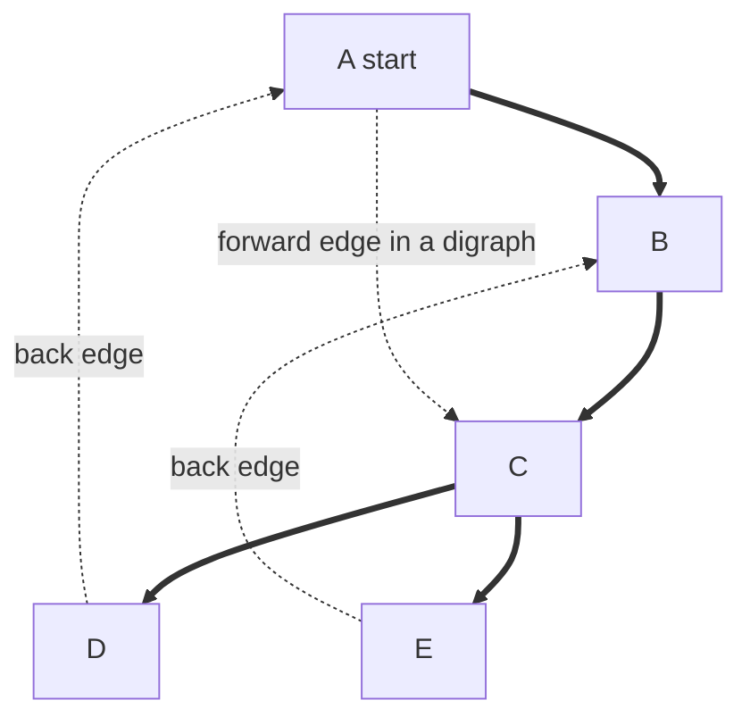

# DFS, BFS, transitive closure and DAGs

To **traverse** a graph is to walk over it methodically until every vertex and every edge has been
looked at. A good traversal manages this in time linear in the graph's size, $O(n + m)$. Traversals answer **reachability** questions — is there a path from $u$ to $v$? is the
graph connected? does it contain a cycle? — and are the skeleton of most graph algorithms. This
lesson covers depth-first search, breadth-first search, transitive closure (Floyd-Warshall) and
topological ordering of directed acyclic graphs.

## 1. Depth-first search

**DFS** is like exploring a maze with a ball of string and a can of paint: mark where you have
been, go as deep as you can along unexplored corridors, and when stuck, **backtrack** along the
string to the last junction with an unexplored corridor.

```
DFS(G, u):                       # u has already been marked as visited
    for each outgoing edge e = (u, v) of u:
        if vertex v has not been visited:
            mark v as visited (via edge e)
            recursively call DFS(G, v)
```

### 1.1 Classifying edges

The edges used to discover new vertices are **discovery edges** (tree edges); they form the **DFS
tree** rooted at the start vertex. Every other edge is a **nontree edge**:

- **back edge** — leads from a vertex up to one of its DFS-tree *ancestors*;
- **forward edge** — connects a vertex to a *descendant* (directed graphs only);
- **cross edge** — connects a vertex to one that is neither ancestor nor descendant (directed only).

In an **undirected** graph all nontree edges are back edges.



### 1.2 Properties

> **Proposition.** Run DFS from $s$ in an undirected graph. Every vertex of $s$'s connected
> component gets visited (and nothing outside it), and the discovery edges make up a spanning tree
> of that component.

> **Proposition.** In a digraph, DFS from $s$ visits exactly the vertices **reachable** from $s$, and
> following tree edges gives a directed route from $s$ to each one.

*Why:* suppose some reachable vertex $w$ were unvisited; take the first unvisited vertex on a path
from $s$ to $w$ and its predecessor $u$ (visited). When DFS processed $u$ it examined that edge and
would have visited the vertex — contradiction.

**Running time.** DFS is called at most once per vertex, and each edge is examined at most twice
(once from each end) for undirected graphs, once for directed. With an adjacency list/map,
`incident_edges(v)` costs $O(\deg(v))$, so the total is **$O(n_s + m_s)$** for the part of the graph
reachable from $s$ — $O(n + m)$ overall. This requires $O(1)$ marking (a set/dict or boolean array).

### 1.3 Implementation and path reconstruction

The book's implementation records, for each discovered vertex, **the edge used to discover it** in a
dictionary — this doubles as the visited set and lets us reconstruct paths.

```python-run
def DFS(g, u, discovered):
    """Perform DFS of the undiscovered portion of graph g starting at vertex u.
    discovered maps each vertex to the vertex from which it was discovered (None for the root)."""
    for v in g[u]:                         # for every outgoing edge from u
        if v not in discovered:            # v is an unvisited vertex
            discovered[v] = u              # (u, v) is the tree edge that discovered v
            DFS(g, v, discovered)          # recursively explore from v

def construct_path(u, v, discovered):
    path = []
    if v in discovered:
        path.append(v)
        walk = v
        while walk != u:
            walk = discovered[walk]        # step back along the discovery edge
            path.append(walk)
        path.reverse()
    return path

def DFS_complete(g):
    """Perform DFS for the entire graph and return the forest as a dictionary."""
    forest = {}
    for u in g:
        if u not in forest:
            forest[u] = None               # u will be the root of a tree
            DFS(g, u, forest)
    return forest

g = {"A": ["B", "E"], "B": ["A", "C", "F"], "C": ["B", "D"], "D": ["C", "G"],
     "E": ["A", "F"], "F": ["B", "E", "G"], "G": ["D", "F"], "X": ["Y"], "Y": ["X"]}
disc = {"A": None}
DFS(g, "A", disc)
print("discovery tree:", disc)
print("path A -> G:", construct_path("A", "G", disc))
forest = DFS_complete(g)
print("connected components:", sum(1 for v in forest if forest[v] is None))
```

### 1.4 What DFS computes

Using DFS as a building block, all in $O(n + m)$:

- **Path between two vertices** (or report none): follow the discovery edges back, as above.
- **Connectivity / connected components**: restart DFS from every still-undiscovered vertex
  (`DFS_complete`); the number of restarts is the number of components.
- **Cycle detection**: an undirected graph has a cycle iff DFS finds a back edge. A directed graph
  has a directed cycle iff DFS finds an edge to a vertex that is still **on the recursion stack**
  ("grey" in the three-colour scheme).
- **Strong connectivity** of a digraph: run DFS from $s$ in $G$ (does $s$ reach everything?) and in
  the **reverse** graph (does everything reach $s$?). Both yes ⇔ strongly connected. Two traversals,
  $O(n + m)$.

Deep recursion is a real issue in Python — a path-shaped graph with $10^5$ vertices overflows the
stack. The iterative version uses an explicit stack:

```python-run
def dfs_iterative(g, s):
    order, seen, stack = [], {s}, [s]
    while stack:
        u = stack.pop()
        order.append(u)
        for v in reversed(g[u]):           # reversed so neighbours are explored in listed order
            if v not in seen:
                seen.add(v); stack.append(v)
    return order
g = {i: [i + 1] for i in range(100000)}; g[100000] = []
print(len(dfs_iterative(g, 0)), "vertices visited without recursion")
```

## 2. Breadth-first search

**BFS** explores in rounds, like a wave spreading out: first the start vertex $s$ (level 0), then all
vertices adjacent to $s$ (level 1), then all new vertices adjacent to level 1 (level 2), and so on.

```python-run
def BFS(g, s):
    """Return (discovered, level_of): discovered[v] = vertex from which v was first reached."""
    discovered, level_of = {s: None}, {s: 0}
    level = [s]                             # first level includes only s
    while len(level) > 0:
        next_level = []                     # prepare to gather newly found vertices
        for u in level:
            for v in g[u]:
                if v not in discovered:     # v is an unvisited vertex
                    discovered[v] = u
                    level_of[v] = level_of[u] + 1
                    next_level.append(v)    # v will be further considered in next pass
        level = next_level                  # relabel 'next' level to become current
    return discovered, level_of

g = {"A": ["B", "E"], "B": ["A", "C", "F"], "C": ["B", "D"], "D": ["C", "G"],
     "E": ["A", "F"], "F": ["B", "E", "G"], "G": ["D", "F"]}
disc, lvl = BFS(g, "A")
print("levels:", lvl)
path, v = [], "G"
while v is not None: path.append(v); v = disc[v]
print("a shortest path A -> G:", path[::-1])
```

(The classic formulation uses a FIFO **queue** instead of explicit level lists — the two are
equivalent.)

### 2.1 Properties

> **Proposition.** After a BFS from $s$:
> - every vertex that $s$ can reach has been visited;
> - a vertex placed on level $i$ is joined to $s$ by a tree path of exactly $i$ edges, and **no
>   route between the two is shorter**;
> - a nontree edge $(u, v)$ never skips a level: level($v$) $\le$ level($u$) + 1.

So **BFS finds shortest paths in terms of the number of edges** (unweighted shortest paths). In an
undirected graph every nontree edge is a **cross edge** between vertices on the same or adjacent
levels; in a directed graph nontree edges are back or cross edges (never forward).

**Running time:** $O(n + m)$, same accounting as DFS.

### 2.2 DFS versus BFS

| | DFS | BFS |
|---|---|---|
| Data structure | stack (recursion) | queue |
| Tree shape | long, stringy | short, bushy |
| Shortest paths (unweighted) | no | **yes** |
| Cycle detection, topological sort, strong connectivity | natural | possible (Kahn) |
| Memory | $O(\text{depth})$ | $O(\text{width of a level})$ |

## 3. Transitive closure

Reachability queries "does $u$ reach $v$?" can be answered by a traversal in $O(n + m)$ each. If
there will be **many** queries, precompute the **transitive closure** $G^*$ of the digraph $G$: the
digraph on the same vertices containing the edge $(u, v)$ exactly when $u$ can reach $v$ in $G$.

**Option 1:** run a DFS/BFS from each of the $n$ vertices: $O(n(n + m))$. Best for sparse graphs.

**Option 2: the Floyd-Warshall algorithm.** Number the vertices $v_1, \ldots, v_n$ and compute a
series of graphs $G_0 = G, G_1, \ldots, G_n$ where $G_k$ has an edge $(v_i, v_j)$ iff $G$ has a
directed path from $v_i$ to $v_j$ whose **intermediate vertices** are all in $\{v_1, \ldots, v_k\}$.

Round $k$: for every pair $i, j$, add edge $(v_i, v_j)$ if $G_{k-1}$ contains both $(v_i, v_k)$ and
$(v_k, v_j)$ — a path through $v_k$ is a path to $v_k$ followed by a path from $v_k$, each using only
earlier intermediates. This is dynamic programming over the set of allowed intermediate vertices.
$G_n = G^*$.

Three nested loops: **$O(n^3)$** with an $O(1)$ `get_edge` (adjacency matrix or map). It is
asymptotically no better than repeated DFS when the graph is dense ($m \approx n^2$), but far
simpler, with tiny constants. The same triple loop with $\min$ and $+$ computes **all-pairs shortest
paths**.

```python-run
def floyd_warshall_closure(n, edges):
    reach = [[False] * n for _ in range(n)]
    for u, v in edges:
        reach[u][v] = True
    for k in range(n):                     # allow vertex k as an intermediate
        for i in range(n):
            if reach[i][k]:                # only useful if i reaches k
                for j in range(n):
                    if reach[k][j]:
                        reach[i][j] = True
    return reach

R = floyd_warshall_closure(5, [(0, 1), (1, 2), (2, 0), (2, 3), (4, 3)])
for row in R: print(["x" if b else "." for b in row])
```

## 4. Directed acyclic graphs and topological ordering

A **DAG** is a directed graph with no directed cycles. DAGs model **precedence constraints**:
prerequisites between courses, inheritance between classes, dependencies between build targets or
spreadsheet cells, scheduling constraints between tasks of a project.

A **topological ordering** of a digraph is an ordering $v_1, \ldots, v_n$ of its vertices such that
for every edge $(v_i, v_j)$, $i < j$ — every edge points "forward". A valid order in which to take
the courses.

> **Proposition.** Topological orderings exist for precisely those digraphs that are **acyclic**.

*Why:* (⇒) on a cycle, some edge would have to point backward. (⇐) A DAG must have a vertex with
**in-degree 0** — otherwise, walking backwards along incoming edges forever would revisit a vertex,
giving a cycle. Number that vertex first, remove it (the rest is still a DAG), and repeat.

### 4.1 The algorithm (Kahn's algorithm)

```python-run
def topological_sort(g):
    """Return a list of vertices of directed acyclic graph g in topological order.
    If graph g has a cycle, the result will be incomplete."""
    topo = []                                # a list of vertices placed in topological order
    ready = []                               # list of vertices that have no remaining constraints
    incount = {u: 0 for u in g}              # keep track of in-degree for each vertex
    for u in g:
        for v in g[u]:
            incount[v] += 1
    for u in g:
        if incount[u] == 0:                  # u has no incoming edges: free of constraints
            ready.append(u)
    while len(ready) > 0:
        u = ready.pop()                      # u is free of constraints
        topo.append(u)                       # add u to the topological order
        for v in g[u]:                       # consider all outgoing neighbours of u
            incount[v] -= 1                  # v has one less constraint without u
            if incount[v] == 0:
                ready.append(v)
    return topo

courses = {"calculus": ["linear algebra", "probability"], "programming": ["data structures"],
           "linear algebra": ["machine learning"], "probability": ["machine learning"],
           "data structures": ["algorithms"], "algorithms": ["machine learning"], "machine learning": []}
order = topological_sort(courses)
print(order)
cyclic = {"a": ["b"], "b": ["c"], "c": ["a"], "d": ["a"]}
t = topological_sort(cyclic)
print(t, "-> has a cycle" if len(t) < len(cyclic) else "-> DAG")
```

Each vertex is added to `ready` at most once and each edge is processed once: **$O(n + m)$** time,
$O(n)$ extra space. The algorithm also **detects cycles**: if the output contains fewer than $n$
vertices, the remaining ones are on or downstream of a directed cycle.

Topological orderings are generally **not unique** — any vertex in `ready` may be chosen next.

### 4.2 DFS-based topological sort

Alternatively, run DFS and output vertices in **reverse order of finishing time** (reverse
postorder): a vertex finishes only after everything reachable from it has finished, so it must
precede all of those in the order.

```python-run
def topo_dfs(g):
    seen, post = set(), []
    def visit(u):
        seen.add(u)
        for v in g[u]:
            if v not in seen: visit(v)
        post.append(u)                       # finished: all descendants are done
    for u in g:
        if u not in seen: visit(u)
    return post[::-1]
print(topo_dfs({"shirt": ["tie", "belt"], "tie": ["jacket"], "trousers": ["belt", "shoes"],
                "belt": ["jacket"], "socks": ["shoes"], "shoes": [], "jacket": []}))
```

> [!INTERVIEW]
> Graph-problem triage: **shortest path in an unweighted graph / fewest steps** → BFS.
> **"Can we finish all courses?" / build order** → topological sort (cycle ⇔ impossible).
> **Connected components / islands / flood fill** → DFS or BFS (or union-find).
> **Cycle in a directed graph** → DFS with three colours, or Kahn's algorithm.
> State the complexity $O(V + E)$ and mention the recursion-depth risk of recursive DFS in Python.

## 5. Pitfalls

- Marking vertices as visited when they are **dequeued** rather than when **enqueued** in BFS: the
  same vertex gets queued many times.
- Using `list.pop(0)` as the BFS queue ($O(n)$ each) — use `collections.deque` or level lists.
- Detecting directed cycles with a single "visited" flag: reaching an already *finished* vertex is
  not a cycle; only reaching a vertex still on the stack is.
- Forgetting disconnected parts: loop over all vertices.
- Assuming DFS finds shortest paths.

## 6. Summary

| Algorithm | Solves | Time |
|---|---|---|
| DFS | reachability, components, cycles, strong connectivity | $O(n + m)$ |
| BFS | the same, plus fewest-edge shortest paths | $O(n + m)$ |
| Floyd-Warshall | transitive closure (all-pairs reachability) | $O(n^3)$ |
| Topological sort | linear order of a DAG, cycle detection | $O(n + m)$ |

> **Source:** Goodrich, Tamassia & Goldwasser, *Data Structures and Algorithms in Python*, ch. 14.3–14.5.

## Check yourself

```quiz
[
  {"q": "In a DFS of an undirected graph, every nontree edge is a...",
   "options": ["forward edge", "cross edge", "back edge", "discovery edge"], "answer": 2,
   "explain": "It connects a vertex to an ancestor in the DFS tree; forward and cross edges arise only in directed graphs."},
  {"q": "Running time of DFS or BFS with an adjacency list?",
   "options": ["O(n^2)", "O(n + m)", "O(m log n)", "O(nm)"], "answer": 1,
   "explain": "Each vertex is visited once and each edge examined a constant number of times."},
  {"q": "Which traversal finds a path with the fewest edges from s to every reachable vertex?",
   "options": ["DFS", "BFS", "Both", "Neither"], "answer": 1,
   "explain": "BFS discovers vertices level by level; level i means distance i."},
  {"q": "How can you test whether a digraph is strongly connected in O(n + m)?",
   "options": ["Run DFS from every vertex", "Run one DFS from s in G and one from s in the reversed graph", "Sort the edges", "Check that m >= n"], "answer": 1,
   "explain": "s must reach all vertices and all vertices must reach s."},
  {"q": "Floyd-Warshall's round k adds edge (i, j) when...",
   "options": ["i < k < j", "edges (i, k) and (k, j) both exist so far", "k is adjacent to neither", "the graph is acyclic"], "answer": 1,
   "explain": "Paths through intermediate vertex k are concatenations of a path into k and a path out of k."},
  {"q": "A directed graph has a topological ordering exactly when...",
   "options": ["it is connected", "it is acyclic", "it has n - 1 edges", "every vertex has in-degree 1"], "answer": 1,
   "explain": "A cycle forces a backward edge; a DAG always has an in-degree-0 vertex to place first."},
  {"q": "In Kahn's algorithm, how is a cycle detected?",
   "options": ["A vertex is visited twice", "The output contains fewer than n vertices", "The ready list overflows", "An in-degree becomes negative"], "answer": 1,
   "explain": "Vertices on a cycle never reach in-degree 0, so they are never output."}
]
```
