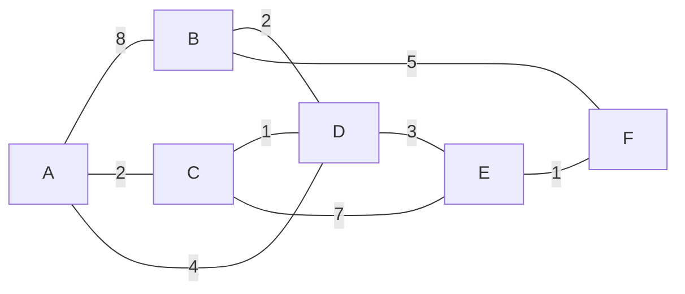

# Weighted graphs and Dijkstra's algorithm

> **Before this lesson:** You should know graph vocabulary and adjacency lists
> ([Graphs and their representations](#/lesson/dsa-foundations/graph-representations)),
> breadth-first search ([DFS, BFS, transitive closure and DAGs](#/lesson/dsa-foundations/graph-traversals)),
> priority queues, `heapq` and lazy deletion
> ([Priority queues and binary heaps](#/lesson/dsa-foundations/heaps),
> [PQ sorting, heap-sort and adaptable priority queues](#/lesson/dsa-foundations/heap-sort-adaptable)),
> and the greedy method ([Greedy compression and tries](#/lesson/dsa-foundations/huffman-tries)).

## In plain words

Breadth-first search finds the route with the fewest steps. That is the best route only if
every step costs the same. On a real map it does not: one road is 2 kilometres, another 80. A
route with five short roads can beat a route with one long road. This lesson is about finding
the **cheapest** route when every connection has its own cost.

The method is **Dijkstra's algorithm** (pronounced "DYKE-stra", after the Dutch computer
scientist Edsger Dijkstra). Picture water flooding outwards from your starting town along all
the roads at once, at a steady speed. The water reaches the nearest town first, then the next
nearest, and so on. The moment it arrives at a town, the time elapsed *is* the shortest
distance to that town, because water coming by any other route is still on its way. Dijkstra's
algorithm simulates that flood: it settles towns one at a time, always the nearest unsettled
one next.

Why it matters for a job: this is the algorithm behind route planners and behind the routing
of data across the internet. It is also the most frequently asked graph algorithm in
interviews after BFS and DFS, usually in its short `heapq` form, which section 4 teaches.

## 1. Weighted graphs and shortest paths

A **weighted graph** is a graph in which every edge $e$ carries a number $w(e)$, its
**weight**: a length, a price, a travel time. The **length** of a path is the sum of the
weights of its edges. For a path $P$ made of edges $e_0, e_1, \ldots, e_{k-1}$:

$$w(P) = \sum_{i=0}^{k-1} w(e_i).$$

The **distance** from $u$ to $v$, written $d(u, v)$, is the length of a path of smallest
length from $u$ to $v$; such a path is a **shortest path**. If there is no path at all, the
distance is taken to be infinite, $d(u, v) = \infty$; and $d(u, u) = 0$.



In the picture, the fewest edges and the lowest cost disagree. From A to B the direct edge
costs 8, while the three-edge route A, C, D, B costs $2 + 1 + 2 = 5$. BFS would report the
direct edge; we want the route of length 5.

**Negative weights.** A weight may in principle be negative (a road that pays you to drive
it). If some cycle has a negative total, "shortest" stops making sense, because going round
the cycle once more always makes the path cheaper. Dijkstra's algorithm requires that **every
edge weight is non-negative**, zero or more, and section 2.2 shows exactly where that is
needed.

**The problem.** Given a starting vertex $s$, the **source**, find the distance $d(s, v)$ to
every vertex $v$. This is called the *single-source shortest-paths* problem.

## 2. Dijkstra's algorithm

The idea is a weighted version of BFS. Grow a set of settled vertices around $s$, traditionally
called the **cloud**, adding vertices in order of their distance from $s$. It is an
application of the greedy method: at each step, add the vertex outside the cloud that is
closest to $s$.

For each vertex $v$ keep a label $D[v]$: the length of the best path from $s$ to $v$ **found
so far**. It is a tentative distance, never smaller than the true one, and it can only go
down. At the start $D[s] = 0$ and every other label is $\infty$, meaning "no path found yet".

Then repeat. Take the vertex $u$ outside the cloud with the smallest label and move it into
the cloud. For each edge from $u$ to a vertex $v$ still outside the cloud, ask whether
reaching $v$ by way of $u$ beats the best route to $v$ known so far, and if so, lower $v$'s
label. This test-and-update step is called **relaxing** the edge:

$$\text{if } D[u] + w(u, v) < D[v]: \quad D[v] \leftarrow D[u] + w(u, v).$$

(The arrow means "is replaced by".) The vertex with the smallest label is found with a
priority queue keyed by the labels:

```
ShortestPath(G, s):
    D[s] = 0;  D[v] = infinity for each v != s
    let priority queue Q contain all vertices, using the D labels as keys
    while Q is not empty:
        u = Q.remove_min()                 # pull a new vertex u into the cloud
        for each edge (u, v) with v still in Q:
            if D[u] + w(u, v) < D[v]:      # relaxation
                D[v] = D[u] + w(u, v)
                change the key of v in Q to D[v]
    return D
```

### 2.1 Dry run

On the graph above with source A:

| step | pulled into cloud | D[A] | D[B] | D[C] | D[D] | D[E] | D[F] |
|---|---|---|---|---|---|---|---|
| init | – | 0 | ∞ | ∞ | ∞ | ∞ | ∞ |
| 1 | A (0) | 0 | 8 | 2 | 4 | ∞ | ∞ |
| 2 | C (2) | 0 | 8 | 2 | **3** | 9 | ∞ |
| 3 | D (3) | 0 | **5** | 2 | 3 | **6** | ∞ |
| 4 | B (5) | 0 | 5 | 2 | 3 | 6 | 10 |
| 5 | E (6) | 0 | 5 | 2 | 3 | 6 | **7** |
| 6 | F (7) | 0 | 5 | 2 | 3 | 6 | 7 |

Read the table row by row. In step 1, A enters the cloud and its three edges are relaxed,
giving tentative labels 8, 2 and 4. In step 2 the smallest label outside the cloud is C's, 2;
C enters, and its edge to D improves D's label from 4 to 3 (the route A, C, D beats the direct
edge), while E gets its first label, $2 + 7 = 9$. In step 3, D enters with label 3 and
improves B to 5 and E to 6. Bold figures mark improvements. A label becomes final at the moment
its vertex enters the cloud.

### 2.2 Why it works

> **Claim.** At the moment Dijkstra's algorithm moves a vertex $v$ into the cloud, its label is
> exact: $D[v] = d(s, v)$.

The flood picture makes this plausible; here is the proof, by contradiction. Suppose the claim
fails, and let $z$ be the **first** vertex to enter the cloud with a label that is too large,
$D[z] > d(s, z)$. Take a true shortest path $P$ from $s$ to $z$. It starts inside the cloud (at
$s$) and ends at $z$, which is about to enter; so somewhere it leaves the cloud. Let $y$ be
the first vertex on $P$ that is *not* in the cloud at this moment (it may be $z$ itself), and
let $x$ be the vertex before it on $P$, which is in the cloud. Since $z$ is the first mistake,
$x$'s label was exact when it entered, and at that time the edge from $x$ to $y$ was relaxed,
so

$$D[y] \le D[x] + w(x, y) = d(s, x) + w(x, y) = d(s, y).$$

(The last equality holds because the first part of a shortest path is itself a shortest
path.) Now, the algorithm chose $z$ and not $y$, so $z$ had the smaller label:
$D[z] \le D[y]$. And $y$ comes before $z$ on the path $P$; since **no weight is negative**, the
rest of the path from $y$ to $z$ adds zero or more, so $d(s, y) \le d(s, z)$. Putting the three
together: $D[z] \le D[y] \le d(s, y) \le d(s, z)$. That contradicts $D[z] > d(s, z)$. ∎

Non-negativity was used in exactly one place, the step $d(s, y) \le d(s, z)$. With a negative
edge, a path could leave the cloud, wander off, and come back cheaper than anything known when
a vertex was settled, and the greedy choice would be wrong. The demo shows this happening on a
three-vertex graph.

```python-run
import heapq
def dijkstra_naive_on_negative():
    # A->B costs 4, A->C costs 2, B->C costs -3: true d(A, C) = 1 via B
    g = {"A": [("B", 4), ("C", 2)], "B": [("C", -3)], "C": []}
    D, done, heap = {"A": 0}, set(), [(0, "A")]
    while heap:
        d, u = heapq.heappop(heap)
        if u in done: continue
        done.add(u)
        for v, w in g[u]:
            if v not in done and d + w < D.get(v, float("inf")):
                D[v] = d + w; heapq.heappush(heap, (d + w, v))
    return D
print(dijkstra_naive_on_negative(), "<- C was finalised at 2, but the true distance is 1")
```

## 3. Running time

Let $n$ and $m$ be the numbers of vertices and edges. The algorithm does $n$ insertions, $n$
`remove_min` calls and at most $m$ key updates (one per relaxation that succeeds), plus
$O(n + m)$ for scanning adjacency lists.

The total depends on how the priority queue is built:

- **A heap with locators** (the adaptable priority queue of the heaps module, which can find
  and update a vertex's entry): every operation is $O(\log n)$, so the total is
  **$O((n + m)\log n)$**.
- **An unsorted list**: finding the minimum costs $O(n)$ and an update costs $O(1)$, for a
  total of **$O(n^2)$**.

Which is better depends on how dense the graph is. The heap wins when $m$ is well below
$n^2/\log n$, which covers sparse graphs and so almost every practical case. The unsorted
list wins for dense graphs with $m$ close to $n^2$. (A more elaborate structure called a
Fibonacci heap improves the bound to $O(m + n\log n)$; it is mainly of theoretical interest.)

## 4. Python implementation

Python's `heapq` cannot change the key of an entry already in the heap. The standard
workaround is the **lazy deletion** from the heaps module: whenever a label improves, push a
*new* `(distance, vertex)` entry, leave the old one where it is, and when an entry is popped
for a vertex that is already in the cloud, discard it as stale. The heap may then hold up to
$m$ entries, so the bound is $O((n + m)\log m)$, which is the same as $O((n+m)\log n)$ because
$\log m \le 2 \log n$.

In the code, a graph maps each vertex to a list of `(neighbour, weight)` pairs. The function
returns two dictionaries: `d`, the distances, and `parent`, which records for each vertex the
vertex before it on its shortest path, so that paths can be rebuilt by walking backwards.

```python-run
import heapq

def shortest_path_lengths(g, src):
    """Compute shortest-path distances from src to reachable vertices of g.
    g maps each vertex to a list of (neighbour, weight) pairs with non-negative weights.
    Return (d, parent): distances and the shortest-path tree."""
    d = {src: 0}
    parent = {src: None}
    cloud = set()
    pq = [(0, src)]
    while pq:
        dist, u = heapq.heappop(pq)
        if u in cloud:
            continue                          # stale entry: u was already finalised
        cloud.add(u)
        for v, w in g[u]:
            if v not in cloud and dist + w < d.get(v, float("inf")):
                d[v] = dist + w               # relaxation step
                parent[v] = u
                heapq.heappush(pq, (d[v], v))
    return d, parent

def path_to(parent, v):
    out = []
    while v is not None:
        out.append(v); v = parent[v]
    return out[::-1]

edges = [("A", "B", 8), ("A", "C", 2), ("A", "D", 4), ("C", "D", 1), ("B", "D", 2),
         ("C", "E", 7), ("D", "E", 3), ("B", "F", 5), ("E", "F", 1)]
g = {v: [] for v in "ABCDEFG"}                # G is isolated: unreachable
for u, v, w in edges:
    g[u].append((v, w)); g[v].append((u, w))
d, parent = shortest_path_lengths(g, "A")
print(d)
print("A -> F:", path_to(parent, "F"), "length", d["F"])
print("G reachable?", "G" in d)
```

The output gives the distances `{'A': 0, 'B': 5, 'C': 2, 'D': 3, 'E': 6, 'F': 7}`, the same as
the last row of the dry-run table; the shortest path from A to F is A, C, D, E, F with length
7; and the isolated vertex G never receives a distance, which is how "unreachable" shows up.

### 4.1 Reconstructing the shortest-path tree

Put together, the shortest paths from $s$ to all the other vertices form a tree rooted at $s$,
the **shortest-path tree**. The code above recorded it in `parent` while relaxing. It can also
be recovered afterwards from the distances alone: for each vertex $v$ other than $s$, look for
an incoming edge from some $u$ with $d[u] + w(u, v) = d[v]$; that edge is the last edge of a
shortest path to $v$. This takes $O(n + m)$.

## 5. Variations and relatives

Dijkstra's algorithm is one of a family. The table says which member fits which situation;
the names are worth recognising even where this track does not cover the algorithm.

| Situation | Algorithm | Time |
|---|---|---|
| unweighted | BFS | $O(n + m)$ |
| non-negative weights | **Dijkstra** | $O((n+m)\log n)$ |
| weights 0/1 | 0-1 BFS (deque) | $O(n + m)$ |
| DAG (any weights) | relax edges in topological order | $O(n + m)$ |
| negative weights, no negative cycle | Bellman-Ford | $O(nm)$ |
| all pairs | Floyd-Warshall, or Dijkstra from every vertex | $O(n^3)$ / $O(n(n+m)\log n)$ |
| single target with a good heuristic | A* | depends on the heuristic |

**Stopping early.** If only the distance to one target $t$ is wanted, stop as soon as $t$
enters the cloud; its label is final at that moment.

> [!INTERVIEW]
> Know the template by heart: start with `heap = [(0, src)]`; pop the smallest entry; skip it
> if its vertex is already settled; relax the edges to its neighbours and push every
> improvement. State the running time, $O((V + E)\log V)$; the requirement that weights are
> **non-negative**; and what you would use if they were not (the Bellman-Ford algorithm). A
> classic follow-up is "what if the route may have at most $k$ stops?": then the thing being
> settled is no longer a vertex but a pair (vertex, stops used so far).

## 6. Dry run with the heap: watching lazy deletion

The table in section 2.1 showed the labels. The `heapq` implementation carries one more piece of
state — the heap itself, including **stale entries**. Trace the same graph from A (heap contents
shown in sorted order):

| pop | action | heap afterwards |
|---|---|---|
| (0, A) | finalise A; push (8, B), (2, C), (4, D) | (2,C) (4,D) (8,B) |
| (2, C) | finalise C; D improves 4 → 3: push (3, D); push (9, E) | (3,D) (4,D) (8,B) (9,E) |
| (3, D) | finalise D; B improves 8 → 5: push (5, B); E improves 9 → 6: push (6, E) | (4,D) (5,B) (6,E) (8,B) (9,E) |
| (4, D) | **stale** — D is already in the cloud: skip | (5,B) (6,E) (8,B) (9,E) |
| (5, B) | finalise B; push (10, F) | (6,E) (8,B) (9,E) (10,F) |
| (6, E) | finalise E; F improves 10 → 7: push (7, F) | (7,F) (8,B) (9,E) (10,F) |
| (7, F) | finalise F | (8,B) (9,E) (10,F) |
| (8, B), (9, E), (10, F) | all stale: skipped | empty |

Ten entries were pushed for six vertices; four were stale. In general each successful relaxation
pushes one entry, so the heap never holds more than $m$ entries and the total work is
$O(m\log m) = O(m \log n)$ — the same bound as the adaptable-priority-queue version, with a simpler
data structure.

The next cell instruments the algorithm to print exactly this trace, then compares the two
priority-queue choices of section 3 on a sparse and a dense graph.

```python-run
import heapq, random, time

def dijkstra_trace(g, src):
    d, cloud, pq = {src: 0}, set(), [(0, src)]
    pushed = stale = 0
    while pq:
        dist, u = heapq.heappop(pq)
        if u in cloud:
            stale += 1; print(f"pop ({dist},{u})  stale, skipped"); continue
        cloud.add(u)
        notes = []
        for v, w in g[u]:
            if v not in cloud and dist + w < d.get(v, float("inf")):
                d[v] = dist + w
                heapq.heappush(pq, (d[v], v)); pushed += 1
                notes.append(f"{v}={d[v]}")
        print(f"pop ({dist},{u})  finalised; relaxed: {', '.join(notes) or 'nothing'}")
    print("pushed", pushed + 1, "entries;", stale, "were stale")
    return d

edges = [("A","B",8),("A","C",2),("A","D",4),("C","D",1),("B","D",2),("C","E",7),("D","E",3),("B","F",5),("E","F",1)]
g = {v: [] for v in "ABCDEF"}
for u, v, w in edges:
    g[u].append((v, w)); g[v].append((u, w))
dijkstra_trace(g, "A")

def dijkstra_heap(adj, s):
    n = len(adj); d = [float("inf")] * n; d[s] = 0; done = [False] * n; pq = [(0, s)]
    while pq:
        du, u = heapq.heappop(pq)
        if done[u]: continue
        done[u] = True
        for v, w in adj[u]:
            if du + w < d[v]: d[v] = du + w; heapq.heappush(pq, (d[v], v))
    return d
def dijkstra_array(adj, s):
    """Unsorted-sequence PQ: remove_min is a linear scan. O(n^2 + m)."""
    n = len(adj); d = [float("inf")] * n; d[s] = 0; done = [False] * n
    for _ in range(n):
        u = min((v for v in range(n) if not done[v]), key=d.__getitem__, default=None)
        if u is None or d[u] == float("inf"): break
        done[u] = True
        for v, w in adj[u]:
            if d[u] + w < d[v]: d[v] = d[u] + w
    return d
def random_graph(n, m):
    adj = [[] for _ in range(n)]
    for _ in range(m):
        a, b = random.randrange(n), random.randrange(n)
        w = random.randint(1, 100)
        adj[a].append((b, w)); adj[b].append((a, w))
    return adj
for label, n, m in [("sparse", 3000, 9000), ("dense", 500, 120000)]:
    adj = random_graph(n, m)
    t0 = time.perf_counter(); a = dijkstra_heap(adj, 0); t1 = time.perf_counter()
    b = dijkstra_array(adj, 0); t2 = time.perf_counter()
    print(f"{label:6s} n={n:5d} m={m:6d}: heap {1000*(t1-t0):6.1f} ms   array {1000*(t2-t1):7.1f} ms   same answer: {a == b}")
```

On the sparse graph the heap version wins easily: $(n + m)\log n$ is tiny next to $n^2$. On the
dense graph the two are comparable — $m \log n$ against $n^2 + m$ — matching the analysis: the
unsorted-array priority queue is competitive only when $m$ approaches $n^2$.

## 7. Pitfalls

- **Using Dijkstra with negative edge weights.** It can settle a vertex too early and return
  wrong distances.
- **Settling a vertex when it is pushed** instead of when it is popped. A cheaper path found
  later would then be ignored.
- **Not skipping stale heap entries.** The answer stays correct only if stale entries are
  recognised (by the cloud test, or by checking `dist > d[u]`); without any check the same
  vertex is processed again and again and the work can blow up.
- **Pushing `(dist, vertex)` when vertices cannot be compared.** If two distances are equal,
  Python compares the second field, and for objects with no ordering it raises `TypeError`.
  Add a tie-breaking counter as the middle field.
- **Forgetting the second direction** of each edge in an undirected graph.
- **Using BFS on a weighted graph.** BFS minimises the number of edges, not the total weight.

## 8. Summary

- In a weighted graph, the length of a path is the sum of its edge weights, and the distance
  between two vertices is the length of a shortest path.
- Dijkstra's algorithm grows a cloud from the source, always adding the closest outside vertex
  and relaxing its edges. It is a greedy algorithm, and its correctness needs non-negative
  weights.
- It runs in $O((n + m)\log n)$ with a heap, or $O(n^2)$ with an unsorted list, which is the
  better choice for dense graphs.
- Recording each vertex's parent during relaxation gives the shortest-path tree.

> **Source:** Goodrich, Tamassia & Goldwasser, *Data Structures and Algorithms in Python*, ch. 14.6.

## Glossary

- **Weighted graph**: a graph whose edges carry numbers (weights).
- **Path length**: the sum of the weights along a path.
- **Distance $d(u, v)$**: the length of a shortest path from $u$ to $v$.
- **Source**: the starting vertex of a shortest-path computation.
- **Single-source shortest paths**: finding the distance from one source to every vertex.
- **Dijkstra's algorithm**: the greedy algorithm that settles vertices in order of distance.
- **Cloud**: the set of vertices whose distances are final.
- **Label $D[v]$**: the best distance to $v$ found so far.
- **Relaxation**: lowering a vertex's label when a path through a newly settled neighbour is
  shorter.
- **Stale entry**: a heap entry that has been superseded by a better one.
- **Shortest-path tree**: the tree formed by the shortest paths from the source.
- **Bellman-Ford algorithm**: a slower shortest-path algorithm that allows negative weights.

## Check yourself

```quiz
[
  {"q": "Dijkstra's algorithm requires that...",
   "options": ["the graph is acyclic", "all edge weights are non-negative", "the graph is undirected", "all weights are distinct"], "answer": 1,
   "explain": "The proof uses d(s, y) <= d(s, z) for y on the path to z, which fails with negative weights."},
  {"q": "What is edge relaxation?",
   "options": ["Removing an edge", "If D[u] + w(u, v) < D[v], set D[v] = D[u] + w(u, v)", "Sorting edges by weight", "Reversing an edge"], "answer": 1,
   "explain": "It tests whether the best known path to v improves by going through u."},
  {"q": "When is the label D[v] guaranteed to equal the true distance?",
   "options": ["As soon as it becomes finite", "When v is removed from the priority queue (pulled into the cloud)", "Only when the algorithm ends", "Never"], "answer": 1,
   "explain": "At that moment no outside vertex can offer a shorter route, because weights are non-negative."},
  {"q": "Running time of Dijkstra with a binary-heap priority queue?",
   "options": ["O(n + m)", "O((n + m) log n)", "O(n^3)", "O(nm)"], "answer": 1,
   "explain": "n removals and up to m key updates (or lazy pushes), each O(log n)."},
  {"q": "For a very dense graph (m about n^2), which PQ gives the better bound?",
   "options": ["Binary heap: O(n^2 log n)", "Unsorted list: O(n^2)", "They are equal", "Neither works"], "answer": 1,
   "explain": "O(n) remove_min times n plus O(1) per relaxation beats m log n when m is about n^2."},
  {"q": "In the heapq version, why do we skip a popped vertex that is already in the cloud?",
   "options": ["It indicates a negative cycle", "It is a stale entry left over from an earlier, worse label (lazy deletion)", "To save memory", "Because heapq is a max-heap"], "answer": 1,
   "explain": "Without decrease-key, improved labels are pushed as new entries; old ones are ignored when they surface."},
  {"q": "In the lesson's example graph, d(A, B) is...",
   "options": ["8", "5", "6", "3"], "answer": 1,
   "explain": "A-C (2), C-D (1), D-B (2): total 5, cheaper than the direct edge of 8."}
]
```
