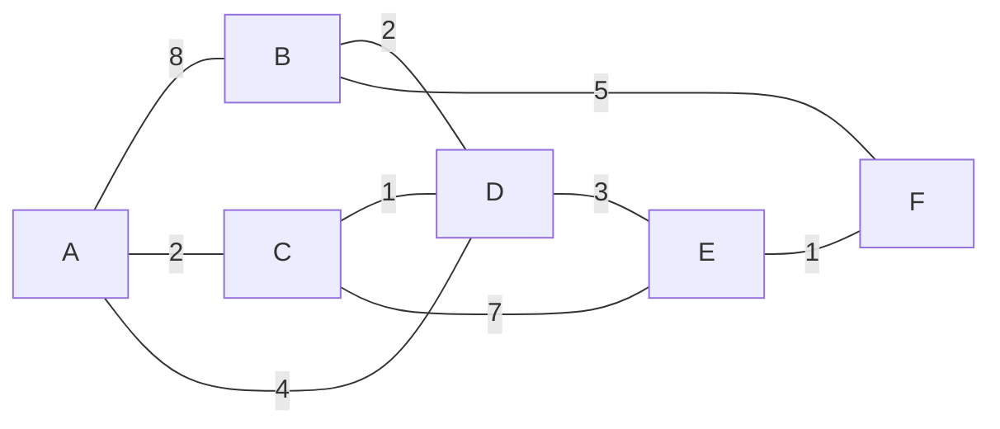

# Weighted graphs and Dijkstra's algorithm

BFS finds paths with the fewest edges. But edges are rarely equal: roads have lengths, flights have
prices, network links have latencies. In a **weighted graph** each edge carries a number, and the
natural question becomes: what is the **cheapest** path? This lesson covers the single-source
shortest path problem and its classic greedy solution, **Dijkstra's algorithm**.

## 1. Weighted graphs and shortest paths

A **weighted graph** has a numeric label $w(e)$, the **weight**, on each edge $e$. The **length**
(or weight) of a path $P = (e_0, e_1, \ldots, e_{k-1})$ is

$$w(P) = \sum_{i=0}^{k-1} w(e_i).$$

The **distance** $d(u, v)$ from $u$ to $v$ is the length of a minimum-length path (a **shortest
path**) from $u$ to $v$, if one exists; by convention $d(u, v) = \infty$ if there is no path, and
$d(u, u) = 0$.



Fewest edges ≠ cheapest: from A to B the direct edge costs 8, while A → C → D → B costs
$2 + 1 + 2 = 5$.

**Negative weights.** If some cycle has negative total weight, distances are not well defined —
going around the cycle again always makes the path cheaper. Dijkstra's algorithm requires **all edge
weights to be non-negative**.

**Single-source shortest paths (SSSP):** given a source vertex $s$, find $d(s, v)$ for every vertex
$v$.

## 2. Dijkstra's algorithm

The idea is a "weighted BFS": grow a **cloud** $C$ of vertices around $s$, adding vertices in order
of their distance from $s$. It is an application of the **greedy method**: at each step, add the
vertex outside the cloud that is closest to $s$.

Maintain for each vertex $v$ a label $D[v]$: the length of the best path from $s$ to $v$ **found so
far** (an upper bound on $d(s, v)$). Initially $D[s] = 0$ and $D[v] = \infty$ otherwise.

Repeat: pull into the cloud the vertex $u \notin C$ with the smallest $D[u]$; then, for each edge
$(u, v)$ with $v \notin C$, check whether going through $u$ gives a better path to $v$ — this is
**edge relaxation**:

$$\text{if } D[u] + w(u, v) < D[v]: \quad D[v] \leftarrow D[u] + w(u, v).$$

```
ShortestPath(G, s):
    D[s] = 0;  D[v] = infinity for each v != s
    let priority queue Q contain all vertices, using the D labels as keys
    while Q is not empty:
        u = Q.remove_min()                 # pull a new vertex u into the cloud
        for each edge (u, v) with v still in Q:
            if D[u] + w(u, v) < D[v]:      # relaxation
                D[v] = D[u] + w(u, v)
                change the key of v in Q to D[v]
    return D
```

### 2.1 Dry run

On the graph above with source A:

| step | pulled into cloud | D[A] | D[B] | D[C] | D[D] | D[E] | D[F] |
|---|---|---|---|---|---|---|---|
| init | – | 0 | ∞ | ∞ | ∞ | ∞ | ∞ |
| 1 | A (0) | 0 | 8 | 2 | 4 | ∞ | ∞ |
| 2 | C (2) | 0 | 8 | 2 | **3** | 9 | ∞ |
| 3 | D (3) | 0 | **5** | 2 | 3 | **6** | ∞ |
| 4 | B (5) | 0 | 5 | 2 | 3 | 6 | 10 |
| 5 | E (6) | 0 | 5 | 2 | 3 | 6 | **7** |
| 6 | F (7) | 0 | 5 | 2 | 3 | 6 | 7 |

Each label is finalised at the moment its vertex is pulled into the cloud.

### 2.2 Why it works

> **Proposition.** At the moment Dijkstra's algorithm moves a vertex $v$ into the cloud, its label
> is already exact: $D[v] = d(s, v)$.

*Why (by contradiction).* Suppose $z$ is the **first** vertex pulled into the cloud with
$D[z] > d(s, z)$. Consider a true shortest path $P$ from $s$ to $z$. Let $y$ be the first vertex on
$P$ that is *not* in the cloud at that moment (possibly $y = z$), and $x$ its predecessor on $P$
(in the cloud; possibly $x = s$). Since $x$ was pulled in correctly, $D[x] = d(s, x)$, and when $x$
entered the cloud we relaxed edge $(x, y)$, so

$$D[y] \le D[x] + w(x, y) = d(s, x) + w(x, y) = d(s, y),$$

the last step because a prefix of a shortest path is a shortest path. But the algorithm chose $z$,
not $y$, so $D[z] \le D[y]$. And since $y$ lies on the shortest path to $z$ and **weights are
non-negative**, $d(s, y) \le d(s, z)$. Chaining:
$D[z] \le D[y] \le d(s, y) \le d(s, z)$ — contradicting $D[z] > d(s, z)$. ∎

The non-negativity is used exactly once, in $d(s, y) \le d(s, z)$: with negative edges, a path that
leaves the cloud could come back cheaper, and the greedy choice fails.

```python-run
import heapq
def dijkstra_naive_on_negative():
    # A->B costs 4, A->C costs 2, B->C costs -3: true d(A, C) = 1 via B
    g = {"A": [("B", 4), ("C", 2)], "B": [("C", -3)], "C": []}
    D, done, heap = {"A": 0}, set(), [(0, "A")]
    while heap:
        d, u = heapq.heappop(heap)
        if u in done: continue
        done.add(u)
        for v, w in g[u]:
            if v not in done and d + w < D.get(v, float("inf")):
                D[v] = d + w; heapq.heappush(heap, (d + w, v))
    return D
print(dijkstra_naive_on_negative(), "<- C was finalised at 2, but the true distance is 1")
```

## 3. Running time

Let $n$ and $m$ be the numbers of vertices and edges. The algorithm does $n$ insertions, $n$
`remove_min` calls and at most $m$ key updates (one per relaxation that succeeds), plus
$O(n + m)$ for scanning adjacency lists.

- **Adaptable heap PQ** (locators let us find and update a vertex's entry): every operation is
  $O(\log n)$, so the total is **$O((n + m)\log n)$**.
- **Unsorted sequence PQ**: `remove_min` costs $O(n)$, updates cost $O(1)$: total **$O(n^2)$**.

Which is better depends on density: the heap wins when $m < n^2/\log n$ (sparse graphs — almost
all practical cases); the unsorted list wins for dense graphs where $m \approx n^2$. (With a
Fibonacci heap the bound improves to $O(m + n\log n)$, mostly of theoretical interest.)

## 4. Python implementation

The book's implementation uses its `AdaptableHeapPriorityQueue`, updating a vertex's key through its
locator. Python's `heapq` has no decrease-key, so the idiomatic version uses **lazy deletion**: push
a new `(distance, vertex)` entry whenever a label improves, and ignore stale entries when popped.
The heap may hold up to $m$ entries, so the bound is $O((n + m)\log m) = O((n+m)\log n)$.

```python-run
import heapq

def shortest_path_lengths(g, src):
    """Compute shortest-path distances from src to reachable vertices of g.
    g maps each vertex to a list of (neighbour, weight) pairs with non-negative weights.
    Return (d, parent): distances and the shortest-path tree."""
    d = {src: 0}
    parent = {src: None}
    cloud = set()
    pq = [(0, src)]
    while pq:
        dist, u = heapq.heappop(pq)
        if u in cloud:
            continue                          # stale entry: u was already finalised
        cloud.add(u)
        for v, w in g[u]:
            if v not in cloud and dist + w < d.get(v, float("inf")):
                d[v] = dist + w               # relaxation step
                parent[v] = u
                heapq.heappush(pq, (d[v], v))
    return d, parent

def path_to(parent, v):
    out = []
    while v is not None:
        out.append(v); v = parent[v]
    return out[::-1]

edges = [("A", "B", 8), ("A", "C", 2), ("A", "D", 4), ("C", "D", 1), ("B", "D", 2),
         ("C", "E", 7), ("D", "E", 3), ("B", "F", 5), ("E", "F", 1)]
g = {v: [] for v in "ABCDEFG"}                # G is isolated: unreachable
for u, v, w in edges:
    g[u].append((v, w)); g[v].append((u, w))
d, parent = shortest_path_lengths(g, "A")
print(d)
print("A -> F:", path_to(parent, "F"), "length", d["F"])
print("G reachable?", "G" in d)
```

### 4.1 Reconstructing the shortest-path tree

The union of shortest paths from $s$ forms a tree rooted at $s$, the **shortest-path tree**. Above we
recorded `parent[v]` during relaxation. Alternatively (as the book does) it can be recovered
afterwards from the distances alone: for each vertex $v \ne s$, find an incoming edge $(u, v)$ with
$d[u] + w(u, v) = d[v]$ — that edge is the last edge of a shortest path to $v$. This takes
$O(n + m)$.

## 5. Variations and relatives

| Situation | Algorithm | Time |
|---|---|---|
| unweighted | BFS | $O(n + m)$ |
| non-negative weights | **Dijkstra** | $O((n+m)\log n)$ |
| weights 0/1 | 0-1 BFS (deque) | $O(n + m)$ |
| DAG (any weights) | relax edges in topological order | $O(n + m)$ |
| negative weights, no negative cycle | Bellman-Ford | $O(nm)$ |
| all pairs | Floyd-Warshall, or Dijkstra from every vertex | $O(n^3)$ / $O(n(n+m)\log n)$ |
| single target with a good heuristic | A* | depends on the heuristic |

**Stopping early.** If only $d(s, t)$ is needed, stop when $t$ is pulled into the cloud — its label
is final at that moment.

> [!INTERVIEW]
> Know the template by heart: `heap = [(0, src)]`, pop the minimum, skip it if already finalised (or
> if `dist > best[u]`), relax neighbours, push improvements. State the complexity
> $O((V + E)\log V)$, the **non-negative weights** precondition, and what you would use otherwise
> (Bellman-Ford). A classic follow-up: "what if there are at most $k$ stops?" — the state becomes
> (vertex, stops used).

## 6. Dry run with the heap: watching lazy deletion

The table in section 2.1 showed the labels. The `heapq` implementation carries one more piece of
state — the heap itself, including **stale entries**. Trace the same graph from A (heap contents
shown in sorted order):

| pop | action | heap afterwards |
|---|---|---|
| (0, A) | finalise A; push (8, B), (2, C), (4, D) | (2,C) (4,D) (8,B) |
| (2, C) | finalise C; D improves 4 → 3: push (3, D); push (9, E) | (3,D) (4,D) (8,B) (9,E) |
| (3, D) | finalise D; B improves 8 → 5: push (5, B); E improves 9 → 6: push (6, E) | (4,D) (5,B) (6,E) (8,B) (9,E) |
| (4, D) | **stale** — D is already in the cloud: skip | (5,B) (6,E) (8,B) (9,E) |
| (5, B) | finalise B; push (10, F) | (6,E) (8,B) (9,E) (10,F) |
| (6, E) | finalise E; F improves 10 → 7: push (7, F) | (7,F) (8,B) (9,E) (10,F) |
| (7, F) | finalise F | (8,B) (9,E) (10,F) |
| (8, B), (9, E), (10, F) | all stale: skipped | empty |

Ten entries were pushed for six vertices; four were stale. In general each successful relaxation
pushes one entry, so the heap never holds more than $m$ entries and the total work is
$O(m\log m) = O(m \log n)$ — the same bound as the adaptable-priority-queue version, with a simpler
data structure.

The next cell instruments the algorithm to print exactly this trace, then compares the two
priority-queue choices of section 3 on a sparse and a dense graph.

```python-run
import heapq, random, time

def dijkstra_trace(g, src):
    d, cloud, pq = {src: 0}, set(), [(0, src)]
    pushed = stale = 0
    while pq:
        dist, u = heapq.heappop(pq)
        if u in cloud:
            stale += 1; print(f"pop ({dist},{u})  stale, skipped"); continue
        cloud.add(u)
        notes = []
        for v, w in g[u]:
            if v not in cloud and dist + w < d.get(v, float("inf")):
                d[v] = dist + w
                heapq.heappush(pq, (d[v], v)); pushed += 1
                notes.append(f"{v}={d[v]}")
        print(f"pop ({dist},{u})  finalised; relaxed: {', '.join(notes) or 'nothing'}")
    print("pushed", pushed + 1, "entries;", stale, "were stale")
    return d

edges = [("A","B",8),("A","C",2),("A","D",4),("C","D",1),("B","D",2),("C","E",7),("D","E",3),("B","F",5),("E","F",1)]
g = {v: [] for v in "ABCDEF"}
for u, v, w in edges:
    g[u].append((v, w)); g[v].append((u, w))
dijkstra_trace(g, "A")

def dijkstra_heap(adj, s):
    n = len(adj); d = [float("inf")] * n; d[s] = 0; done = [False] * n; pq = [(0, s)]
    while pq:
        du, u = heapq.heappop(pq)
        if done[u]: continue
        done[u] = True
        for v, w in adj[u]:
            if du + w < d[v]: d[v] = du + w; heapq.heappush(pq, (d[v], v))
    return d
def dijkstra_array(adj, s):
    """Unsorted-sequence PQ: remove_min is a linear scan. O(n^2 + m)."""
    n = len(adj); d = [float("inf")] * n; d[s] = 0; done = [False] * n
    for _ in range(n):
        u = min((v for v in range(n) if not done[v]), key=d.__getitem__, default=None)
        if u is None or d[u] == float("inf"): break
        done[u] = True
        for v, w in adj[u]:
            if d[u] + w < d[v]: d[v] = d[u] + w
    return d
def random_graph(n, m):
    adj = [[] for _ in range(n)]
    for _ in range(m):
        a, b = random.randrange(n), random.randrange(n)
        w = random.randint(1, 100)
        adj[a].append((b, w)); adj[b].append((a, w))
    return adj
for label, n, m in [("sparse", 3000, 9000), ("dense", 500, 120000)]:
    adj = random_graph(n, m)
    t0 = time.perf_counter(); a = dijkstra_heap(adj, 0); t1 = time.perf_counter()
    b = dijkstra_array(adj, 0); t2 = time.perf_counter()
    print(f"{label:6s} n={n:5d} m={m:6d}: heap {1000*(t1-t0):6.1f} ms   array {1000*(t2-t1):7.1f} ms   same answer: {a == b}")
```

On the sparse graph the heap version wins easily: $(n + m)\log n$ is tiny next to $n^2$. On the
dense graph the two are comparable — $m \log n$ against $n^2 + m$ — matching the analysis: the
unsorted-array priority queue is competitive only when $m$ approaches $n^2$.

## 7. Pitfalls

- Using Dijkstra with negative edge weights.
- Marking a vertex as final when it is *pushed* rather than when it is *popped* — a later, cheaper
  path would be ignored.
- Not skipping stale heap entries: still correct with a `dist > d[u]` check, but without any check
  the work can blow up.
- Pushing `(dist, vertex_object)` where vertices are not comparable: on equal distances Python
  compares the second field and raises `TypeError` — add a tie-breaking counter.
- Forgetting both directions for undirected graphs.

## 8. Summary

- Dijkstra grows a cloud from the source, always adding the closest outside vertex and relaxing its
  edges; correctness needs non-negative weights.
- $O((n + m)\log n)$ with a heap; $O(n^2)$ with an unsorted list (better for dense graphs).
- Record parents (or re-derive them) to obtain the shortest-path tree.

> **Source:** Goodrich, Tamassia & Goldwasser, *Data Structures and Algorithms in Python*, ch. 14.6.

## Check yourself

```quiz
[
  {"q": "Dijkstra's algorithm requires that...",
   "options": ["the graph is acyclic", "all edge weights are non-negative", "the graph is undirected", "all weights are distinct"], "answer": 1,
   "explain": "The proof uses d(s, y) <= d(s, z) for y on the path to z, which fails with negative weights."},
  {"q": "What is edge relaxation?",
   "options": ["Removing an edge", "If D[u] + w(u, v) < D[v], set D[v] = D[u] + w(u, v)", "Sorting edges by weight", "Reversing an edge"], "answer": 1,
   "explain": "It tests whether the best known path to v improves by going through u."},
  {"q": "When is the label D[v] guaranteed to equal the true distance?",
   "options": ["As soon as it becomes finite", "When v is removed from the priority queue (pulled into the cloud)", "Only when the algorithm ends", "Never"], "answer": 1,
   "explain": "At that moment no outside vertex can offer a shorter route, because weights are non-negative."},
  {"q": "Running time of Dijkstra with a binary-heap priority queue?",
   "options": ["O(n + m)", "O((n + m) log n)", "O(n^3)", "O(nm)"], "answer": 1,
   "explain": "n removals and up to m key updates (or lazy pushes), each O(log n)."},
  {"q": "For a very dense graph (m about n^2), which PQ gives the better bound?",
   "options": ["Binary heap: O(n^2 log n)", "Unsorted list: O(n^2)", "They are equal", "Neither works"], "answer": 1,
   "explain": "O(n) remove_min times n plus O(1) per relaxation beats m log n when m is about n^2."},
  {"q": "In the heapq version, why do we skip a popped vertex that is already in the cloud?",
   "options": ["It indicates a negative cycle", "It is a stale entry left over from an earlier, worse label (lazy deletion)", "To save memory", "Because heapq is a max-heap"], "answer": 1,
   "explain": "Without decrease-key, improved labels are pushed as new entries; old ones are ignored when they surface."},
  {"q": "In the lesson's example graph, d(A, B) is...",
   "options": ["8", "5", "6", "3"], "answer": 1,
   "explain": "A-C (2), C-D (1), D-B (2): total 5, cheaper than the direct edge of 8."}
]
```
