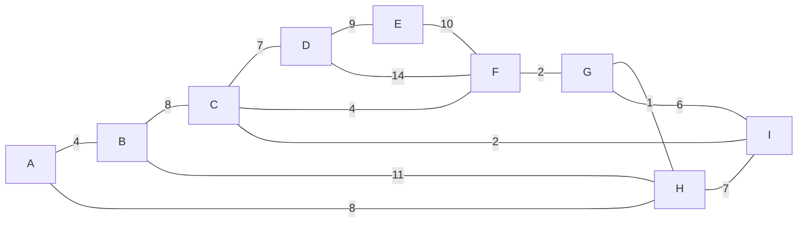
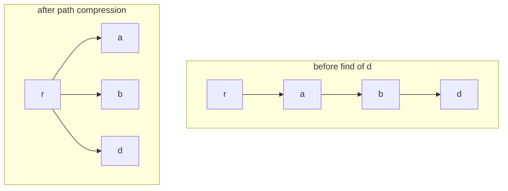

# Minimum spanning trees and union-find

Suppose we must connect all the computers in a building with the least amount of cable, or link a
set of cities with the cheapest possible road, pipeline or fibre network. We do not need shortest
paths between particular pairs — we need a cheapest set of edges that keeps **everything
connected**. That is the **minimum spanning tree (MST)** problem. This lesson covers its key
structural fact (the cut property), two greedy algorithms — **Prim-Jarník** and **Kruskal** — and
the **union-find** data structure that makes Kruskal fast.

## 1. The problem

Given an undirected, connected, weighted graph $G$, find a **spanning tree** $T$ — a tree containing
every vertex of $G$ — that minimises the total weight

$$w(T) = \sum_{(u,v) \in T} w(u, v).$$

A spanning tree of an $n$-vertex graph has exactly $n - 1$ edges. The MST need not be unique (ties in
weights), but its total weight is.



(For this graph the MST weight is 37.)

## 2. The crucial fact: the cut property

> **Proposition.** Let $G$ be a weighted connected graph, and let $V_1$ and $V_2$ be a partition of
> its vertices into two disjoint non-empty sets. Let $e$ be an edge of **minimum weight** among those
> with one endpoint in $V_1$ and the other in $V_2$. Then there is a minimum spanning tree that has
> $e$ as one of its edges.

*Justification (exchange argument).* Let $T$ be an MST. If $T$ contains $e$ we are done. Otherwise,
adding $e$ to $T$ creates a cycle. That cycle crosses between $V_1$ and $V_2$ via $e$, so it must
cross back via some other edge $f$ with one endpoint on each side. By the choice of $e$,
$w(e) \le w(f)$. Remove $f$: the result is again a spanning tree, of weight no greater than $T$'s —
so it is also an MST, and it contains $e$. ∎

If all weights are distinct, the MST is unique and *must* contain $e$. Both algorithms below are
just different strategies for choosing the cut.

## 3. The Prim-Jarník algorithm

Grow a single tree from an arbitrary root $s$, like Dijkstra's cloud. At each step, the cut is
(cloud, rest): add the **minimum-weight edge connecting a cloud vertex to an outside vertex**.

Keep for each outside vertex $v$ a label $D[v]$ = the weight of the cheapest edge joining $v$ to the
cloud (not a path length — that is the *only* difference from Dijkstra's update rule), and the edge
that achieves it.

```
PrimJarnik(G):
    pick any vertex s;  D[s] = 0;  D[v] = infinity for v != s
    T = empty;  Q = priority queue of all vertices keyed by D
    while Q is not empty:
        (u, e) = Q.remove_min()
        connect u to T using edge e (if u != s)
        for each edge e' = (u, v) with v in Q:
            if w(u, v) < D[v]:             # compare the EDGE weight alone
                D[v] = w(u, v);  remember e' as v's connecting edge;  update v's key
    return T
```

**Running time:** identical bookkeeping to Dijkstra — $O((n + m)\log n)$ with a heap-based adaptable
priority queue, i.e. **$O(m \log n)$** for a connected graph; $O(n^2)$ with an unsorted list.

```python-run
import heapq
def mst_prim(n, edges):
    """Return (total weight, tree edges) using Prim-Jarnik with a lazy heap."""
    adj = [[] for _ in range(n)]
    for u, v, w in edges:
        adj[u].append((w, v, u)); adj[v].append((w, u, v))
    in_tree, tree, total = [False] * n, [], 0
    heap = [(0, 0, -1)]                         # (edge weight, vertex, parent)
    while heap and len(tree) < n - 1:
        w, u, p = heapq.heappop(heap)
        if in_tree[u]: continue                 # stale entry
        in_tree[u] = True
        if p >= 0:
            tree.append((p, u, w)); total += w
        for w2, v, _ in adj[u]:
            if not in_tree[v]:
                heapq.heappush(heap, (w2, v, u))
    return total, tree

names = "ABCDEFGHI"
E = [("A","B",4),("A","H",8),("B","C",8),("B","H",11),("C","D",7),("C","F",4),("C","I",2),
     ("D","E",9),("D","F",14),("E","F",10),("F","G",2),("G","H",1),("G","I",6),("H","I",7)]
edges = [(names.index(u), names.index(v), w) for u, v, w in E]
total, tree = mst_prim(9, edges)
print(total, [(names[u], names[v], w) for u, v, w in tree])
```

## 4. Kruskal's algorithm

Kruskal's algorithm grows a **forest**. Initially each vertex is its own cluster. Consider the edges
in **nondecreasing order of weight**; if an edge connects two **different clusters**, add it to the
tree and merge the clusters; if both endpoints are already in the same cluster, discard it (it would
create a cycle).

```
Kruskal(G):
    for each vertex v: define an elementary cluster C(v) = {v}
    Q = priority queue of all edges keyed by weight (or sort the edges)
    T = empty
    while T has fewer than n - 1 edges:
        (u, v) = Q.remove_min()
        if C(u) != C(v):
            add edge (u, v) to T
            merge C(u) and C(v) into one cluster
    return T
```

**Correctness** follows from the cut property: when edge $(u, v)$ is accepted, take $V_1 = C(u)$ and
$V_2$ = everything else. Every lighter edge crossing that cut would have been examined earlier and
accepted (it joins different clusters), so $(u, v)$ is a minimum-weight crossing edge.

### Dry run on the example

Sorted edges: G–H 1, C–I 2, F–G 2, A–B 4, C–F 4, G–I 6, C–D 7, H–I 7, A–H 8, B–C 8, D–E 9, …

| edge | weight | decision | clusters after |
|---|---|---|---|
| G–H | 1 | accept | {G,H} |
| C–I | 2 | accept | {G,H} {C,I} |
| F–G | 2 | accept | {F,G,H} {C,I} |
| A–B | 4 | accept | {A,B} {F,G,H} {C,I} |
| C–F | 4 | accept | {A,B} {C,F,G,H,I} |
| G–I | 6 | reject (same cluster) | |
| C–D | 7 | accept | {A,B} {C,D,F,G,H,I} |
| H–I | 7 | reject | |
| A–H | 8 | accept | {A,B,C,D,F,G,H,I} |
| B–C | 8 | reject | |
| D–E | 9 | accept | all — done (8 edges) |

Total $1 + 2 + 2 + 4 + 4 + 7 + 8 + 9 = 37$.

**Running time.** Sorting the edges: $O(m\log m) = O(m \log n)$ (since $m \le n^2$). Then at most
$m$ iterations each doing two *find* operations and at most one *union*. With the union-find
structure below, all of those together cost $O(m\,\alpha(n))$ or $O(m \log^* n)$ — negligible next to
the sort. Total **$O(m\log n)$**.

## 5. Disjoint partitions and union-find

Kruskal needs a data structure for a **partition** of the vertices into disjoint groups:

| Operation | Meaning |
|---|---|
| `make_group(x)` | create a singleton group containing new element `x` |
| `find(p)` | return the **leader** (representative) of the group containing `p` |
| `union(p, q)` | merge the groups containing `p` and `q` |

Two elements are in the same group iff they have the same leader.

### 5.1 Sequence-based implementation

Each group is a list; each element stores a reference to its group. `find` is $O(1)$. `union` moves
every element of the **smaller** group into the larger and updates their references. A single union
can cost $O(n)$, but each time an element is moved, its group at least **doubles** in size, so an
element is moved at most $\log n$ times. Hence $k$ operations starting from $n$ singletons take
$O(k + n\log n)$ — an amortised $O(\log n)$ per union.

### 5.2 Tree-based implementation

Represent each group as a **tree** in which every element points to its **parent**; the root is the
leader (and points to itself).

- `find(p)`: follow parent pointers up to the root.
- `union(p, q)`: find both roots; make one root the child of the other.

Naively this can build tall, list-like trees with $O(n)$ finds. Two heuristics fix it:

- **Union-by-size** (or by rank): make the root of the **smaller** tree a child of the root of the
  larger. A node's depth increases only when its tree is merged into a tree at least as big, which
  at least doubles the size — so heights are $O(\log n)$.
- **Path compression:** during `find(p)`, after locating the root, **re-point every node on the
  path directly to the root**. Later finds on those nodes are $O(1)$.



(Arrows drawn from parent to child; the stored pointers go the other way.)

> **Proposition.** With union-by-size and path compression, a series of $k$ `make_group`, `union`
> and `find` operations on an initially empty partition takes **$O(k \log^* n)$** time.

$\log^* n$ — the *iterated logarithm* — is the number of times you must apply $\log_2$ to get down
to 1 or below; it is at most 5 for any $n$ up to $2^{65536}$. (The tight bound is $O(k\,\alpha(n))$
with the even slower-growing inverse Ackermann function.) For all practical purposes, each operation
is **constant time**.

```python-run
class Partition:
    """Union-find structure for maintaining disjoint sets."""
    def __init__(self, n):
        self._parent = list(range(n))        # each element starts as its own leader
        self._size = [1] * n
        self.groups = n

    def find(self, p):
        root = p
        while self._parent[root] != root:    # walk up to the root
            root = self._parent[root]
        while self._parent[p] != root:       # path compression: second pass re-points to the root
            self._parent[p], p = root, self._parent[p]
        return root

    def union(self, p, q):
        a, b = self.find(p), self.find(q)
        if a == b:
            return False                     # already in the same group
        if self._size[a] < self._size[b]:
            a, b = b, a                      # a is the larger tree
        self._parent[b] = a                  # smaller tree becomes subtree of the larger
        self._size[a] += self._size[b]
        self.groups -= 1
        return True

def mst_kruskal(n, edges):
    forest, tree, total = Partition(n), [], 0
    for w, u, v in sorted((w, u, v) for u, v, w in edges):     # nondecreasing weight
        if forest.union(u, v):                                  # different clusters: accept
            tree.append((u, v, w)); total += w
            if len(tree) == n - 1: break
    return total, tree

names = "ABCDEFGHI"
E = [("A","B",4),("A","H",8),("B","C",8),("B","H",11),("C","D",7),("C","F",4),("C","I",2),
     ("D","E",9),("D","F",14),("E","F",10),("F","G",2),("G","H",1),("G","I",6),("H","I",7)]
edges = [(names.index(u), names.index(v), w) for u, v, w in E]
total, tree = mst_kruskal(9, edges)
print(total, [(names[u], names[v], w) for u, v, w in tree])
```

## 6. Prim-Jarník versus Kruskal

| | Prim-Jarník | Kruskal |
|---|---|---|
| Grows | one tree from a root | a forest, merging clusters |
| Main structure | priority queue of vertices | sorted edges + union-find |
| Time | $O(m\log n)$ heap; $O(n^2)$ array | $O(m\log n)$ |
| Best for | dense graphs (array version), adjacency structure at hand | sparse graphs, edge lists, pre-sorted edges |
| Disconnected input | spans only the root's component | naturally yields a minimum spanning **forest** |

A third classic, **Borůvka's algorithm**, lets every cluster pick its cheapest outgoing edge
simultaneously — attractive for parallel computation.

### Union-find beyond MSTs

Dynamic connectivity ("are $u$ and $v$ connected yet?" as edges arrive), cycle detection in
undirected graphs (an edge whose endpoints already share a leader closes a cycle), counting
connected components, image segmentation, percolation, equivalence classes (unifying types or
accounts), and offline lowest-common-ancestor queries.

> [!INTERVIEW]
> Union-find template: `parent = list(range(n))`; `find` with path compression; `union` by size or
> rank returning whether a merge happened. Typical uses: number of connected components, redundant
> connection (first edge that closes a cycle), accounts merge, Kruskal. Quote near-constant amortised
> time ($\alpha(n)$). And know the difference from Dijkstra's update: Prim compares the **edge
> weight** $w(u,v)$, Dijkstra compares the **path length** $D[u] + w(u, v)$.

## 7. Pitfalls

- Prim with Dijkstra's relaxation (`D[u] + w`) — produces a shortest-path tree, not an MST.
- Kruskal without union-find, checking connectivity by DFS for every edge: $O(nm)$.
- Union that links *elements* rather than *roots* (`parent[p] = q`) — corrupts the trees.
- Forgetting to check that $n - 1$ edges were accepted: otherwise the graph is disconnected and no
  spanning tree exists.
- Recursive `find` on long chains before compression — recursion depth; the iterative two-pass
  version is safer in Python.

## 8. Summary

- Cut property: the lightest edge across any cut belongs to some MST — the basis of all MST
  algorithms.
- Prim-Jarník: grow one tree with a priority queue. Kruskal: scan edges by weight, joining clusters.
  Both $O(m\log n)$.
- Union-find with union-by-size and path compression: $O(\log^* n)$ amortised per operation.

> **Source:** Goodrich, Tamassia & Goldwasser, *Data Structures and Algorithms in Python*, ch. 14.7.

## Check yourself

```quiz
[
  {"q": "How many edges does a spanning tree of a connected graph with n vertices have?",
   "options": ["n", "n - 1", "m - n", "n(n-1)/2"], "answer": 1,
   "explain": "A tree on n vertices always has exactly n - 1 edges."},
  {"q": "The cut property says that for any partition of the vertices into two sides...",
   "options": ["the heaviest crossing edge is in every MST", "a minimum-weight crossing edge is in some MST", "no crossing edge is in the MST", "all crossing edges are in the MST"], "answer": 1,
   "explain": "Proved by an exchange argument: swap it for the crossing edge on the cycle it creates."},
  {"q": "How does Prim-Jarnik's label update differ from Dijkstra's?",
   "options": ["It uses D[v] = w(u, v) instead of D[u] + w(u, v)", "It uses a stack", "It sorts all edges first", "There is no difference"], "answer": 0,
   "explain": "Prim cares about the cheapest single edge into the tree, not the path length from the source."},
  {"q": "Kruskal's algorithm rejects an edge when...",
   "options": ["its weight is too large", "its endpoints are already in the same cluster", "it touches the root", "it is the first edge"], "answer": 1,
   "explain": "Such an edge would close a cycle."},
  {"q": "What dominates Kruskal's running time?",
   "options": ["Union-find operations", "Sorting the edges, O(m log n)", "Building the adjacency matrix", "Path compression"], "answer": 1,
   "explain": "The union-find work is nearly linear; sorting costs O(m log m) = O(m log n)."},
  {"q": "Path compression means that during find(p)...",
   "options": ["the smaller tree is attached to the larger", "every node on the path from p to the root is re-pointed directly to the root", "the tree is rebalanced with rotations", "p is deleted"], "answer": 1,
   "explain": "Subsequent finds on those nodes take O(1)."},
  {"q": "With union-by-size and path compression, k operations take...",
   "options": ["O(k log n)", "O(k log* n), effectively linear", "O(k n)", "O(k^2)"], "answer": 1,
   "explain": "The iterated logarithm is at most 5 for any conceivable n."}
]
```
