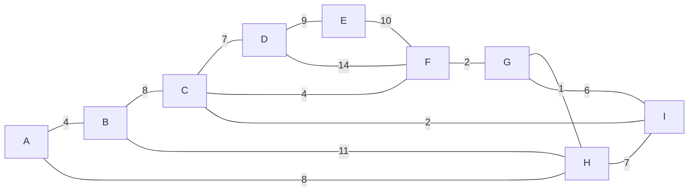
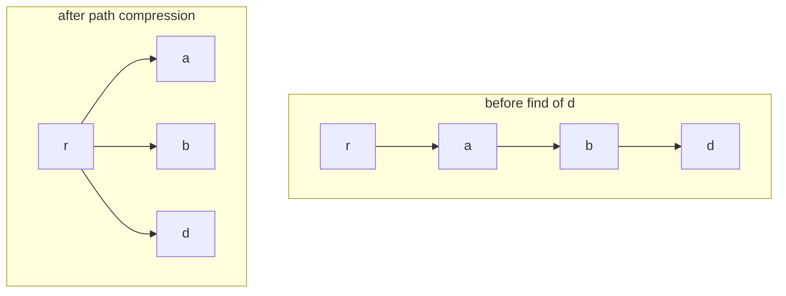

# Minimum spanning trees and union-find

> **Before this lesson:** You should know weighted graphs, Dijkstra's algorithm and its "cloud"
> ([Weighted graphs and Dijkstra's algorithm](#/lesson/dsa-foundations/shortest-paths)),
> spanning trees and connected components
> ([Graphs and their representations](#/lesson/dsa-foundations/graph-representations)), the
> greedy method and exchange arguments
> ([Greedy compression and tries](#/lesson/dsa-foundations/huffman-tries)), and `heapq`
> ([Priority queues and binary heaps](#/lesson/dsa-foundations/heaps)).

## In plain words

Suppose a company must lay cable so that every office in a building is connected to the
network, and each possible cable run between two offices has a known cost. The goal is not the
shortest route between any particular pair of offices. It is the cheapest set of cable runs
that leaves **every office connected to every other**, directly or through other offices.

The answer never contains a loop: if three offices were wired in a triangle, one side of the
triangle could be removed and everything would still be connected, for less money. A
connected network with no loops is a tree, and since it reaches (spans) every office it is
called a spanning tree. The cheapest one is the **minimum spanning tree**, or **MST**.

The lesson gives two greedy ways to find it. One grows a single network outwards from a
starting office, always adding the cheapest cable that reaches a new office. The other
considers all cables from cheapest to dearest and takes each one unless it would close a loop.
The second needs a quick way to answer "are these two offices already connected?", and that
is a small, clever data structure called **union-find**.

Why it matters for a job: MSTs are used to design networks of every kind and to group similar
data in machine learning. Union-find is short to write and remarkably fast, and it solves a
whole family of interview problems about "which things are connected to which".

## 1. The problem

Given an undirected, connected, weighted graph $G$, find a **spanning tree** $T$, a set of
edges that forms a tree and includes every vertex of $G$, whose total weight is as small as
possible:

$$w(T) = \sum_{(u,v) \in T} w(u, v).$$

A spanning tree of a graph with $n$ vertices always has exactly $n - 1$ edges. When several
edges have equal weights there may be more than one minimum spanning tree, but they all have
the same total weight.



(For this graph the MST weight is 37.)

## 2. The crucial fact: the cut property

Both algorithms rest on one fact. Divide the vertices into two non-empty groups in any way you
like; such a division is called a **cut**. Some edges have one endpoint in each group; they
are said to *cross* the cut.

> **Cut property.** Let $G$ be a connected weighted graph, and split its vertices into two
> non-empty groups $V_1$ and $V_2$. Let $e$ be an edge of **smallest weight** among the edges
> that cross from $V_1$ to $V_2$. Then some minimum spanning tree contains $e$.

In cable terms: if the offices are on two floors, the cheapest cable run between the floors
can safely be part of the final network.

*Why (an exchange argument).* Take any minimum spanning tree $T$. If it contains $e$, there is
nothing to prove. Otherwise, add $e$ to $T$. A tree plus one extra edge contains exactly one
cycle, and $e$ is on it. The cycle crosses from $V_1$ to $V_2$ along $e$, so to get back it
must cross the cut again along some other edge $f$. Because $e$ is a cheapest crossing edge,
$w(e) \le w(f)$. Now remove $f$. The cycle is broken, everything is still connected, so we
have a spanning tree again, and its weight is no more than that of $T$. So it too is a minimum
spanning tree, and it contains $e$. ∎

If all the weights are different, the minimum spanning tree is unique and *must* contain $e$.
The two algorithms below differ only in which cut they apply the property to at each step.

## 3. The Prim-Jarník algorithm

Grow a single tree from an arbitrary starting vertex $s$, in the manner of Dijkstra's cloud.
At each step the cut is "the cloud" against "everything else", and the cut property says it is
safe to add the **cheapest edge that joins a cloud vertex to a vertex outside**. (The
algorithm is named after Robert Prim and Vojtěch Jarník, who found it independently; it is
often called Prim's algorithm.)

For each vertex $v$ outside the cloud keep a label $D[v]$: the weight of the cheapest single
edge joining $v$ to the cloud, together with a note of which edge that is. This is the *only*
difference from Dijkstra's algorithm, and it is easy to get wrong: Dijkstra's label is the
length of a whole path from the source, while this label is the weight of one edge.

```
PrimJarnik(G):
    pick any vertex s;  D[s] = 0;  D[v] = infinity for v != s
    T = empty;  Q = priority queue of all vertices keyed by D
    while Q is not empty:
        (u, e) = Q.remove_min()
        connect u to T using edge e (if u != s)
        for each edge e' = (u, v) with v in Q:
            if w(u, v) < D[v]:             # compare the EDGE weight alone
                D[v] = w(u, v);  remember e' as v's connecting edge;  update v's key
    return T
```

**Running time.** The bookkeeping is the same as Dijkstra's: $O((n + m)\log n)$ with a heap,
which is **$O(m \log n)$** for a connected graph (where $m \ge n - 1$), or $O(n^2)$ with an
unsorted list.

The Python version below uses `heapq` with lazy deletion, as the Dijkstra code did. Heap
entries are `(edge weight, vertex, parent)`; an entry popped for a vertex already in the tree
is stale and is skipped. Started from A on the graph above, it prints the total weight 37 and
the eight tree edges in the order they were added.

```python-run
import heapq
def mst_prim(n, edges):
    """Return (total weight, tree edges) using Prim-Jarnik with a lazy heap."""
    adj = [[] for _ in range(n)]
    for u, v, w in edges:
        adj[u].append((w, v, u)); adj[v].append((w, u, v))
    in_tree, tree, total = [False] * n, [], 0
    heap = [(0, 0, -1)]                         # (edge weight, vertex, parent)
    while heap and len(tree) < n - 1:
        w, u, p = heapq.heappop(heap)
        if in_tree[u]: continue                 # stale entry
        in_tree[u] = True
        if p >= 0:
            tree.append((p, u, w)); total += w
        for w2, v, _ in adj[u]:
            if not in_tree[v]:
                heapq.heappush(heap, (w2, v, u))
    return total, tree

names = "ABCDEFGHI"
E = [("A","B",4),("A","H",8),("B","C",8),("B","H",11),("C","D",7),("C","F",4),("C","I",2),
     ("D","E",9),("D","F",14),("E","F",10),("F","G",2),("G","H",1),("G","I",6),("H","I",7)]
edges = [(names.index(u), names.index(v), w) for u, v, w in E]
total, tree = mst_prim(9, edges)
print(total, [(names[u], names[v], w) for u, v, w in tree])
```

## 4. Kruskal's algorithm

Kruskal's algorithm grows many small trees at once, a **forest**, and joins them up. At the
start every vertex is a tree on its own; call each such group of connected vertices a
**cluster**. Go through the edges **from the lightest to the heaviest**. If an edge joins two
**different clusters**, add it to the result and merge the two clusters into one. If both its
endpoints are already in the same cluster, discard it, because those two vertices are already
connected and the edge would close a cycle.

```
Kruskal(G):
    for each vertex v: define an elementary cluster C(v) = {v}
    Q = priority queue of all edges keyed by weight (or sort the edges)
    T = empty
    while T has fewer than n - 1 edges:
        (u, v) = Q.remove_min()
        if C(u) != C(v):
            add edge (u, v) to T
            merge C(u) and C(v) into one cluster
    return T
```

**Why it is correct.** Apply the cut property at the moment an edge from $u$ to $v$ is
accepted. Let $V_1$ be the cluster of $u$ and $V_2$ everything else. Could a lighter edge
cross this cut? If one did, it would have been examined earlier (edges are taken in order of
weight), and since it joins two different clusters it would have been accepted, merging $u$'s
cluster with another, so it would no longer cross. Hence the accepted edge is a cheapest edge
across the cut, and belongs to a minimum spanning tree.

### Dry run on the example

Sorted edges: G–H 1, C–I 2, F–G 2, A–B 4, C–F 4, G–I 6, C–D 7, H–I 7, A–H 8, B–C 8, D–E 9, …

| edge | weight | decision | clusters after |
|---|---|---|---|
| G–H | 1 | accept | {G,H} |
| C–I | 2 | accept | {G,H} {C,I} |
| F–G | 2 | accept | {F,G,H} {C,I} |
| A–B | 4 | accept | {A,B} {F,G,H} {C,I} |
| C–F | 4 | accept | {A,B} {C,F,G,H,I} |
| G–I | 6 | reject (same cluster) | |
| C–D | 7 | accept | {A,B} {C,D,F,G,H,I} |
| H–I | 7 | reject | |
| A–H | 8 | accept | {A,B,C,D,F,G,H,I} |
| B–C | 8 | reject | |
| D–E | 9 | accept | all — done (8 edges) |

Total $1 + 2 + 2 + 4 + 4 + 7 + 8 + 9 = 37$.

**Running time.** Sorting the edges takes $O(m\log m)$, which equals $O(m \log n)$ because
$m \le n^2$ and so $\log m \le 2\log n$. Then there are at most $m$ rounds, each asking "which
cluster is this vertex in?" twice and merging at most once. With the union-find structure
described next, all of those questions and merges together cost very nearly $O(m)$, which is
negligible beside the sort. The total is **$O(m\log n)$**.

## 5. Disjoint partitions and union-find

Kruskal's algorithm needs to keep track of a **partition**: a division of a set of elements
into groups such that every element is in exactly one group (the groups are *disjoint*, having
nothing in common). Three operations are required:

| Operation | Meaning |
|---|---|
| `make_group(x)` | create a new group containing only the new element `x` |
| `find(p)` | return the **leader** of the group containing `p`: one member chosen to stand for the whole group |
| `union(p, q)` | merge the group containing `p` with the group containing `q` |

Two elements are in the same group exactly when `find` gives the same leader for both. The
structure is named **union-find** after its two main operations.

### 5.1 Sequence-based implementation

A first design: keep each group as a list, and let every element hold a reference to its
group. Then `find` is $O(1)$. `union` moves every element of the **smaller** group into the
larger one and updates their references. A single union can cost $O(n)$. But consider one
element: each time it is moved, it ends up in a group at least **twice** as large as the one it
left, and a group cannot double more than $\log n$ times. So each element is moved at most
$\log n$ times in total, and $k$ operations starting from $n$ single-element groups take
$O(k + n\log n)$, an amortised $O(\log n)$ per union.

### 5.2 Tree-based implementation

A better design represents each group as a **tree** in which every element stores a reference
to its **parent**. The root of the tree is the group's leader, and is its own parent. These
are not search trees; the only thing that matters about their shape is how far each element is
from the root.

- `find(p)`: follow parent references upwards until the root is reached.
- `union(p, q)`: find the two roots, and make one root a child of the other.

Done carelessly, this can build tall, chain-like trees in which a `find` takes $O(n)$. Two
simple rules prevent that:

- **Union by size** (a variant is called union by rank): always make the root of the
  **smaller** tree a child of the root of the larger. An element gets one step further from
  its root only when its tree is absorbed into a tree at least as large, which at least
  doubles the size of its tree; so no element is ever more than $\log n$ steps from its root.
- **Path compression:** during `find(p)`, once the root has been found, go back and **make
  every element on the path point directly at the root**. The next `find` on any of them takes
  one step.



(Arrows drawn from parent to child; the stored pointers go the other way.)

> **Theorem.** With union by size and path compression, a sequence of $k$ `make_group`, `union`
> and `find` operations starting from an empty partition takes **$O(k \log^* n)$** time.

The function $\log^* n$, read "log star", is the *iterated logarithm*: the number of times
$\log_2$ must be applied to $n$ to bring it down to 1 or less. It grows unimaginably slowly.
$\log^* 16 = 3$ (16, 4, 2, 1), $\log^* 65536 = 4$, and it is at most 5 for every $n$ up to
$2^{65536}$, a number with nearly twenty thousand digits. (The exact bound involves an even
slower-growing function, the inverse Ackermann function, written $\alpha(n)$.) For every
practical purpose, each union-find operation takes **constant time**.

A small trace. Start with five elements, each its own group: parents `[0, 1, 2, 3, 4]`.
`union(0, 1)` makes 1 a child of 0. `union(2, 3)` makes 3 a child of 2. `union(1, 3)` finds the
roots 0 and 2, which have equal size, and makes 2 a child of 0: parents `[0, 0, 0, 2, 4]`.
Element 3 is now two steps from its root. `find(3)` walks 3, 2, 0, returns 0, and on the way
re-points 3 directly at 0: parents `[0, 0, 0, 0, 4]`. There are two groups left, with leaders
0 and 4.

The class below stores the parents in a list, as in that trace, and uses it to implement
Kruskal's algorithm. `union` returns `True` if it merged two groups and `False` if the two
elements were already together, which is exactly the accept-or-reject decision Kruskal needs.

```python-run
class Partition:
    """Union-find structure for maintaining disjoint sets."""
    def __init__(self, n):
        self._parent = list(range(n))        # each element starts as its own leader
        self._size = [1] * n
        self.groups = n

    def find(self, p):
        root = p
        while self._parent[root] != root:    # walk up to the root
            root = self._parent[root]
        while self._parent[p] != root:       # path compression: second pass re-points to the root
            self._parent[p], p = root, self._parent[p]
        return root

    def union(self, p, q):
        a, b = self.find(p), self.find(q)
        if a == b:
            return False                     # already in the same group
        if self._size[a] < self._size[b]:
            a, b = b, a                      # a is the larger tree
        self._parent[b] = a                  # smaller tree becomes subtree of the larger
        self._size[a] += self._size[b]
        self.groups -= 1
        return True

def mst_kruskal(n, edges):
    forest, tree, total = Partition(n), [], 0
    for w, u, v in sorted((w, u, v) for u, v, w in edges):     # nondecreasing weight
        if forest.union(u, v):                                  # different clusters: accept
            tree.append((u, v, w)); total += w
            if len(tree) == n - 1: break
    return total, tree

names = "ABCDEFGHI"
E = [("A","B",4),("A","H",8),("B","C",8),("B","H",11),("C","D",7),("C","F",4),("C","I",2),
     ("D","E",9),("D","F",14),("E","F",10),("F","G",2),("G","H",1),("G","I",6),("H","I",7)]
edges = [(names.index(u), names.index(v), w) for u, v, w in E]
total, tree = mst_kruskal(9, edges)
print(total, [(names[u], names[v], w) for u, v, w in tree])
```

## 6. Prim-Jarník versus Kruskal

| | Prim-Jarník | Kruskal |
|---|---|---|
| Grows | one tree from a root | a forest, merging clusters |
| Main structure | priority queue of vertices | sorted edges + union-find |
| Time | $O(m\log n)$ heap; $O(n^2)$ array | $O(m\log n)$ |
| Best for | dense graphs (array version), adjacency structure at hand | sparse graphs, edge lists, pre-sorted edges |
| Disconnected input | spans only the root's component | naturally yields a minimum spanning **forest** |

A third classic method, **Borůvka's algorithm**, lets every cluster choose its cheapest
outgoing edge at the same time, which suits computation on many processors at once.

### Union-find beyond MSTs

Union-find is useful wherever groups only ever merge. It answers "are $u$ and $v$ connected
yet?" as edges arrive one at a time. It detects a cycle in an undirected graph: an edge whose
two endpoints already have the same leader closes a cycle. It counts connected components
(the number of groups left). And it merges records known to refer to the same thing, such as
user accounts that share an email address.

> [!INTERVIEW]
> The union-find template is worth memorising: `parent = list(range(n))`; a `find` with path
> compression; a `union` by size that returns whether a merge took place. Typical uses: the
> number of connected components, finding the first edge that closes a cycle, merging
> accounts, and Kruskal's algorithm. Describe its cost as "amortised near-constant time". And
> be ready to state the difference between the two cloud-growing algorithms: Prim compares the
> weight of one **edge**, $w(u,v)$; Dijkstra compares the length of a whole **path**,
> $D[u] + w(u, v)$.

## 7. Pitfalls

- **Running Prim with Dijkstra's update rule** (`D[u] + w`). The result is a shortest-path
  tree, which is generally not a minimum spanning tree.
- **Kruskal without union-find.** Checking with a fresh DFS whether each edge's endpoints are
  already connected costs $O(nm)$ overall.
- **Linking elements instead of roots** in `union` (`parent[p] = q`). The roots must be found
  first and one root attached to the other, or the trees are corrupted.
- **Not checking that $n - 1$ edges were accepted.** If fewer were, the graph is not
  connected and has no spanning tree.
- **A recursive `find` on a long chain.** It can exceed Python's recursion limit; the
  two-pass loop above is safer.

## 8. Summary

- A minimum spanning tree connects all the vertices of a weighted graph with the smallest
  possible total edge weight.
- The cut property (the lightest edge across any cut belongs to some minimum spanning tree)
  is the basis of every MST algorithm.
- Prim-Jarník grows one tree using a priority queue; Kruskal goes through the edges in order
  of weight and joins clusters. Both take $O(m\log n)$.
- Union-find with union by size and path compression costs $O(\log^* n)$ amortised per
  operation, effectively constant.

> **Source:** Goodrich, Tamassia & Goldwasser, *Data Structures and Algorithms in Python*, ch. 14.7.

## Glossary

- **Spanning tree**: a tree made of a graph's edges that includes every vertex.
- **Minimum spanning tree (MST)**: a spanning tree of the smallest total weight.
- **Cut**: a division of the vertices into two non-empty groups.
- **Crossing edge**: an edge with one endpoint on each side of a cut.
- **Cut property**: a lightest edge crossing any cut belongs to some minimum spanning tree.
- **Prim-Jarník algorithm**: growing one tree by repeatedly adding the cheapest edge that
  leaves it.
- **Kruskal's algorithm**: taking edges in order of weight, skipping those that would close a
  cycle.
- **Cluster**: a group of vertices already connected by accepted edges.
- **Partition**: a division of a set into disjoint groups.
- **Union-find**: a data structure for a partition, supporting `find` and `union`.
- **Leader (representative)**: the element that identifies a group; the root of its tree.
- **Union by size**: attaching the smaller tree beneath the root of the larger.
- **Path compression**: re-pointing every element met during a `find` directly at the root.
- **Iterated logarithm ($\log^* n$)**: how many times $\log_2$ must be applied to reach 1.

## Check yourself

```quiz
[
  {"q": "How many edges does a spanning tree of a connected graph with n vertices have?",
   "options": ["n", "n - 1", "m - n", "n(n-1)/2"], "answer": 1,
   "explain": "A tree on n vertices always has exactly n - 1 edges."},
  {"q": "The cut property says that for any partition of the vertices into two sides...",
   "options": ["the heaviest crossing edge is in every MST", "a minimum-weight crossing edge is in some MST", "no crossing edge is in the MST", "all crossing edges are in the MST"], "answer": 1,
   "explain": "Proved by an exchange argument: swap it for the crossing edge on the cycle it creates."},
  {"q": "How does Prim-Jarnik's label update differ from Dijkstra's?",
   "options": ["It uses D[v] = w(u, v) instead of D[u] + w(u, v)", "It uses a stack", "It sorts all edges first", "There is no difference"], "answer": 0,
   "explain": "Prim cares about the cheapest single edge into the tree, not the path length from the source."},
  {"q": "Kruskal's algorithm rejects an edge when...",
   "options": ["its weight is too large", "its endpoints are already in the same cluster", "it touches the root", "it is the first edge"], "answer": 1,
   "explain": "Such an edge would close a cycle."},
  {"q": "What dominates Kruskal's running time?",
   "options": ["Union-find operations", "Sorting the edges, O(m log n)", "Building the adjacency matrix", "Path compression"], "answer": 1,
   "explain": "The union-find work is nearly linear; sorting costs O(m log m) = O(m log n)."},
  {"q": "Path compression means that during find(p)...",
   "options": ["the smaller tree is attached to the larger", "every node on the path from p to the root is re-pointed directly to the root", "the tree is rebalanced with rotations", "p is deleted"], "answer": 1,
   "explain": "Subsequent finds on those nodes take O(1)."},
  {"q": "With union-by-size and path compression, k operations take...",
   "options": ["O(k log n)", "O(k log* n), effectively linear", "O(k n)", "O(k^2)"], "answer": 1,
   "explain": "The iterated logarithm is at most 5 for any conceivable n."}
]
```
