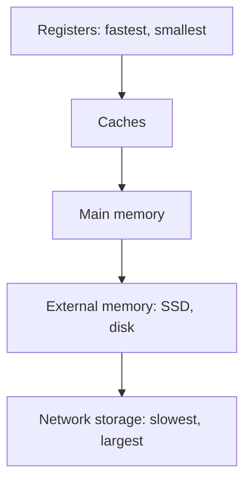

# Memory allocation, garbage collection and caching

Every analysis so far assumed that memory is a uniform array of cells, each reachable in $O(1)$
time, and that objects simply "exist" when we create them. Real computers are messier: memory must
be **allocated** and **reclaimed**, and it is organised as a **hierarchy** of levels whose speeds
differ by factors of a million. This lesson looks under the hood — the memory heap, garbage
collection, the call stack, memory hierarchies and caching policies — and explains why these
details change which data structures are best. The next lesson uses them to motivate B-trees.

## 1. Memory allocation

When a Python program executes `w = Widget()`, the interpreter must find space for the new object.
Objects are stored in a pool of memory known as the **memory heap** (also *Python heap*, *free
store*) — not to be confused with the heap data structure of the priority-queue module.

The storage in the memory heap is divided into contiguous **blocks**, which may be of variable or
standard sizes. The system must quickly find a free block for each new object and keep track of the
"holes" of unused memory. A common method is to keep the free blocks in a linked list, the **free
list**.

### 1.1 Fragmentation

As blocks are allocated and deallocated, the free list changes and unused memory gets separated into
disjoint holes between allocated blocks. This is **fragmentation**. Two kinds:

- **Internal fragmentation:** part of an *allocated* block is unused. A dynamic array with capacity
  for 16 references that currently holds 9 elements has 7 cells of internal fragmentation.
- **External fragmentation:** unused memory lies *between* allocated blocks, in pieces that may be
  individually too small to satisfy a request even though their total is large enough.

A good allocation policy keeps external fragmentation low so that large requests can still be
served.

### 1.2 Allocation heuristics

Given a request for $b$ bytes, which hole should we use?

| Policy | Rule | Behaviour |
|---|---|---|
| **Best-fit** | search the entire free list for the hole whose size is **closest** to the request | leaves tiny, useless slivers; tends to produce the *worst* external fragmentation, and is slow |
| **First-fit** | scan from the beginning; take the **first** hole large enough | fast; fragments the front of the heap, slowing later searches |
| **Next-fit** | like first-fit, but start where the previous search stopped, wrapping around (a circular list) | spreads fragmentation evenly; search times stay low; large blocks become hard to find |
| **Worst-fit** | take the **largest** hole | keeps contiguous leftover space large; costly unless the free list is a priority queue |

In every policy, the chosen hole is split: the requested amount is used and the remainder is returned
to the free list as a smaller hole. When a block is freed, adjacent free blocks should be
**coalesced** into one.

```python-run
def simulate(policy, holes, requests):
    """holes: list of free block sizes (in address order). Return (holes left, failed requests)."""
    holes, failed, last = list(holes), [], 0
    for r in requests:
        candidates = [i for i, h in enumerate(holes) if h >= r]
        if not candidates:
            failed.append(r); continue
        if policy == "first":   i = candidates[0]
        elif policy == "best":  i = min(candidates, key=lambda j: holes[j])
        elif policy == "worst": i = max(candidates, key=lambda j: holes[j])
        elif policy == "next":
            after = [j for j in candidates if j >= last]
            i = after[0] if after else candidates[0]
            last = i
        holes[i] -= r                        # split the hole: remainder stays free
    return holes, failed

holes = [100, 500, 200, 300, 600]
requests = [212, 417, 112, 426]
for policy in ["first", "next", "best", "worst"]:
    left, failed = simulate(policy, holes, requests)
    print(f"{policy:5s}-fit: holes left {left}  could not allocate {failed}")
```

Run it: on this classic workload, first-fit, next-fit and worst-fit all fail to place the last
request (426) although enough total memory is free — external fragmentation in action — while
best-fit succeeds.
On other workloads the ranking changes; there is no universally best policy.

Real allocators are more elaborate: CPython's `pymalloc` serves small objects (up to 512 bytes) from
pools of **fixed-size** blocks grouped by size class, which makes allocation $O(1)$ and eliminates
external fragmentation within a pool at the cost of some internal fragmentation.

## 2. Garbage collection

In C you must free memory explicitly; forget and you **leak**, free twice and you corrupt the heap.
Python, like Java, automates reclamation: **garbage collection** is the process of detecting
objects that can no longer be used by the program and reclaiming their space.

Which objects are still needed? Define:

- **Root objects:** objects directly referenced by an identifier in an active namespace — global
  variables, and the locals of every function call currently on the stack.
- **Live objects:** root objects, and any object **reachable** from a root by following references
  (elements of a live list, attributes of a live instance, …).

Everything else is **garbage**. Note that this is a *graph reachability* question: objects are
vertices, references are directed edges.

### 2.1 Reference counting

Each object carries a **reference count**: the number of references to it. Assigning a reference
increments it; removing or reassigning one decrements it. When the count reaches **zero**, the object
is unreachable and is reclaimed immediately (which may in turn decrement the counts of objects it
referenced — a cascade).

CPython uses reference counting as its primary mechanism. It is simple and prompt: memory is
released the moment the last reference disappears.

```python-run
import sys, gc, weakref
class Node:
    def __init__(self, name): self.name, self.other = name, None

a = Node("a")
print("refcount of a:", sys.getrefcount(a) - 1)      # getrefcount itself holds one temporary reference
b = a
print("after b = a:  ", sys.getrefcount(a) - 1)
del b
print("after del b:  ", sys.getrefcount(a) - 1)

# A reference cycle: x <-> y. After del, both counts stay at 1 although nothing can reach them.
x, y = Node("x"), Node("y")
x.other, y.other = y, x
probe = weakref.ref(x)                                # lets us observe x without keeping it alive
del x, y
print("cycle still in memory after del?", probe() is not None)
print("objects found unreachable by the cycle collector:", gc.collect())
print("cycle still in memory after gc.collect()?", probe() is not None)
```

**The weakness: cycles.** If two objects reference each other (or a longer cycle exists), their
counts never drop to zero even when the whole group is unreachable from any root. Pure reference
counting leaks cyclic garbage. (Self-referential structures are common: doubly linked lists, trees
with parent pointers, graphs.)

### 2.2 Cycle detection and mark-sweep

To reclaim cycles, CPython periodically runs a **cycle detector** over container objects, organised
into three **generations**: new objects start in generation 0 and are promoted when they survive a
collection. Young generations are scanned often and old ones rarely, on the empirical "generational
hypothesis" that most objects die young.

The classic general algorithm for garbage collection is **mark-sweep**:

1. **Mark phase.** Associate a "mark" bit with each object. Suspend the program, clear all marks,
   then mark every root object as live, and perform a **depth-first search** on the directed graph
   of references starting from the roots, marking every object reached.
2. **Sweep phase.** Scan through the entire memory heap; reclaim the space of every object that is
   **not** marked. Optionally **coalesce**/compact the surviving objects to eliminate external
   fragmentation.

Mark-sweep correctly reclaims cyclic garbage — an unreachable cycle is simply never marked. Its mark
phase takes time proportional to the number of live objects and their references; the sweep phase
is proportional to the heap size.

```python-run
def mark_sweep(heap, roots):
    """heap: {object id: list of referenced ids}. Return (live, garbage) as sorted lists."""
    marked, stack = set(), list(roots)
    while stack:                                  # mark phase: iterative DFS from the roots
        obj = stack.pop()
        if obj not in marked:
            marked.add(obj)
            stack.extend(heap[obj])
    garbage = [obj for obj in heap if obj not in marked]      # sweep phase
    return sorted(marked), sorted(garbage)

heap = {"A": ["B", "C"], "B": ["D"], "C": [], "D": ["B"],     # B <-> D cycle, but reachable
        "E": ["F"], "F": ["E"],                               # unreachable cycle: garbage
        "G": ["A"]}                                           # points INTO live data, but nothing points to G
print(mark_sweep(heap, roots=["A"]))
```

### 2.3 Performing DFS in place

There is a subtle problem: garbage collection typically runs **because memory is scarce**, yet the
DFS of the mark phase needs a stack — recursion or an explicit one — whose size can be proportional
to the number of live objects. The elegant solution (Deutsch–Schorr–Waite) performs the DFS **in
place**: as the traversal moves from object $v$ to object $w$, it temporarily **reverses the
reference** it just followed so that it points back to $v$. The path from the current object back to
the root is thus stored in the objects themselves. When the traversal backtracks, each reference is
restored to its original value. Only a constant amount of extra memory is needed.

### 2.4 Other collectors (context)

- **Copying collectors** divide the heap into two semi-spaces and copy live objects from one to the
  other, compacting as they go; cost is proportional to live data only.
- **Generational collectors** (JVM, .NET, CPython's cycle detector) collect young objects more
  frequently.
- **Concurrent/incremental collectors** bound pause times by interleaving with the program.

## 3. Additional memory used by the Python interpreter

Besides the memory heap, a running program uses the **call stack** (also *Python interpreter
stack*). Each function call pushes an **activation record** (frame) holding the call's namespace —
parameters and local variables (references to heap objects) — and the point in the caller to return
to. Returning pops the frame.

- This is exactly the stack ADT: the running call is on top; suspended callers lie below.
- It is what makes **recursion** work: each recursive call has its own frame, so its own copies of
  parameters and locals.
- It is why deep recursion costs memory — $O(\text{depth})$ frames — and why Python caps the depth
  (`sys.getrecursionlimit()`, typically 1000).

The **operand stack** is a related idea: the interpreter evaluates an expression such as
`((a + b) * (c + d)) / e` by pushing operands and applying operators to the top entries — the
postfix evaluation of the stacks lesson, performed on bytecode.

```python-run
import dis
def f(a, b, c, d, e):
    return ((a + b) * (c + d)) / e
dis.dis(f)        # LOAD pushes operands; BINARY_* pops two and pushes the result
```

## 4. Memory hierarchies

Computers have several kinds of memory, trading **speed** against **capacity and cost**:

| Level | Typical size | Typical access time |
|---|---|---|
| CPU registers | hundreds of bytes | < 1 ns |
| Caches (L1, L2, L3) | KB to tens of MB | 1–20 ns |
| Internal (main) memory, RAM | GB | ~100 ns |
| External memory: SSD / disk | hundreds of GB to TB | 0.1 ms (SSD) – 10 ms (disk seek) |
| Network / archival storage | effectively unbounded | ms to seconds |

The gaps are enormous. If a RAM access took one second, a disk seek would take about a day. So an
algorithm that looks fine in the uniform-cost model can be disastrous when its data lives on a
slower level.



### 4.1 Caching and blocking

Two mechanisms make the hierarchy work, both justified by **locality of reference**:

- **Temporal locality:** if a program accesses a location, it is likely to access it again soon.
  → **Caching**: keep recently used data in the faster level, hoping it will be needed again. In
  the processor this is the *cache*; between RAM and disk it is **virtual memory**.
- **Spatial locality:** if a program accesses a location, it is likely to access nearby locations
  soon. → **Blocking**: when one location is needed from the slower level, bring over a whole
  contiguous **block** around it. Blocks between cache and RAM are called **cache lines**; between
  RAM and disk, **pages**.

Consequences for data structures: **arrays** (contiguous) enjoy spatial locality — a sequential scan
touches each cache line once; **linked structures** scatter nodes across memory and may incur a
cache miss per node. This is why, in practice, arrays beat linked lists and sorted arrays beat
binary search trees for read-mostly workloads, despite equal big-O.

```python-run
import time, random
n = 300000
data = list(range(n))
in_order = list(range(n))
shuffled = in_order[:]; random.shuffle(shuffled)
for name, order in [("sequential", in_order), ("random", shuffled)]:
    t0 = time.perf_counter()
    total = 0
    for i in order:
        total += data[i]
    print(f"{name:10s} access order: {1000 * (time.perf_counter() - t0):6.1f} ms")
```

(In Python the interpreter overhead hides most of the effect; in C or NumPy the random order can be
several times slower. In the browser the difference may be small — the principle stands.)

## 5. Caching strategies

When a block is requested and the fast level is full, some block must be **evicted** to make room.
A fetch from the slower level is a **cache miss** (for virtual memory, a **page fault**); the
question is which page to throw out. The book's setting: a cache of $m$ pages, a sequence of $n$
page requests.

| Policy | Evicts | Implementation | Notes |
|---|---|---|---|
| **Random** | a page chosen at random | pseudo-random generator: $O(1)$ | no bookkeeping; ignores locality |
| **FIFO** (first-in, first-out) | the page that has been in the cache **longest** | queue: $O(1)$ | simple; ignores how recently a page was *used* |
| **LRU** (least recently used) | the page whose **last access** is oldest | adaptable priority queue $O(\log m)$, or hash map + doubly linked list $O(1)$ | exploits temporal locality; best in practice |

LRU's rationale: by temporal locality, a page used recently will probably be used again soon, so the
one unused for the longest time is the best candidate to drop.

```python-run
from collections import OrderedDict, deque
import random

def simulate(policy, capacity, requests, seed=0):
    rnd, misses = random.Random(seed), 0
    if policy == "LRU":
        cache = OrderedDict()
        for p in requests:
            if p in cache: cache.move_to_end(p)               # refresh recency
            else:
                misses += 1
                if len(cache) == capacity: cache.popitem(last=False)   # evict least recently used
                cache[p] = True
    elif policy == "FIFO":
        cache, order = set(), deque()
        for p in requests:
            if p not in cache:
                misses += 1
                if len(cache) == capacity: cache.discard(order.popleft())
                cache.add(p); order.append(p)
    else:                                                      # Random
        cache = []
        for p in requests:
            if p not in cache:
                misses += 1
                if len(cache) == capacity: cache.pop(rnd.randrange(capacity))
                cache.append(p)
    return misses

rnd = random.Random(42)
# workload with locality: 85% of requests go to a slowly drifting "hot" set of 8 pages
requests, hot = [], list(range(8))
for t in range(20000):
    if t % 500 == 0: hot[rnd.randrange(8)] = rnd.randrange(1000)
    requests.append(rnd.choice(hot) if rnd.random() < 0.85 else rnd.randrange(1000))
for policy in ["Random", "FIFO", "LRU"]:
    print(f"{policy:6s}: {simulate(policy, 16, requests)} misses out of {len(requests)}")

worst = [i % 17 for i in range(20000)]              # cycle through capacity + 1 pages
print("adversarial cycle of 17 pages, capacity 16 -> LRU misses:", simulate("LRU", 16, worst),
      " Random misses:", simulate("Random", 16, worst))
```

### 5.1 How good can a policy be?

All three policies have bad worst cases. Cycle repeatedly through $m + 1$ pages: LRU and FIFO evict
exactly the page that is needed next and miss on **every** request. Competitive analysis shows FIFO
and LRU are **$m$-competitive** (at most $m$ times as many misses as the optimal offline policy that
knows the future — Belady's "evict the page needed farthest in the future"), and no deterministic
online policy can do better. Randomised policies can achieve $O(\log m)$-competitiveness in
expectation. In practice, on real workloads with locality, LRU (or cheap approximations such as
CLOCK) is the method of choice.

> [!INTERVIEW]
> "Design an LRU cache with $O(1)$ `get` and `put`" is among the most common design questions:
> a **hash map** from key to node plus a **doubly linked list** ordered by recency. `get` moves the
> node to the front; `put` inserts at the front and evicts from the back when over capacity. In
> Python: `collections.OrderedDict` with `move_to_end` and `popitem(last=False)`, or
> `functools.lru_cache` for memoising functions.

## 6. Pitfalls

- Confusing the *memory heap* with the *heap data structure*, or the *call stack* with a stack you
  create.
- Assuming reference counting reclaims everything: cycles need the cycle collector
  (`gc.collect()`), and objects kept alive by a forgotten global list or cache are a "leak" even in
  a garbage-collected language.
- Assuming `del x` frees an object: it removes one reference.
- Ignoring locality: two $O(n)$ loops can differ several-fold in speed depending on memory layout.
- Believing LRU is optimal: it is a heuristic with an adversarial worst case.

## 7. Summary

- Objects live in the memory heap, managed with a free list; allocation policies (best, first, next,
  worst fit) trade speed against fragmentation.
- Garbage = objects unreachable from the roots. Reference counting is prompt but misses cycles;
  mark-sweep does a DFS from the roots and reclaims everything unmarked.
- Function calls use frames on the interpreter stack.
- Memory is a hierarchy; caching (temporal locality) and blocking (spatial locality) hide its slow
  levels; eviction policies — Random, FIFO, LRU — decide what to drop.

> **Source:** Goodrich, Tamassia & Goldwasser, *Data Structures and Algorithms in Python*, ch. 15.1–15.2.

## Check yourself

```quiz
[
  {"q": "External fragmentation means...",
   "options": ["unused space inside an allocated block", "free memory split into holes between allocated blocks, possibly too small individually to be useful", "memory on an external disk", "garbage that has not been collected"], "answer": 1,
   "explain": "Internal fragmentation is waste inside a block; external is waste between blocks."},
  {"q": "Which allocation policy chooses the smallest hole that is large enough?",
   "options": ["First-fit", "Best-fit", "Worst-fit", "Next-fit"], "answer": 1,
   "explain": "Best-fit minimises the leftover sliver for each request, which tends to create many tiny useless holes."},
  {"q": "Why can pure reference counting fail to reclaim some garbage?",
   "options": ["Counts overflow", "Objects in a reference cycle keep each other's counts above zero", "It is too slow", "It cannot handle integers"], "answer": 1,
   "explain": "An unreachable cycle has non-zero counts, so a separate cycle detector or mark-sweep is needed."},
  {"q": "The mark phase of mark-sweep is essentially...",
   "options": ["a sort of the heap", "a DFS from the root objects over the graph of references", "a hash table rebuild", "a binary search"], "answer": 1,
   "explain": "Everything reachable from the roots is marked live; the rest is swept."},
  {"q": "Blocking (fetching a whole page or cache line) is justified by...",
   "options": ["temporal locality", "spatial locality", "amortisation", "randomisation"], "answer": 1,
   "explain": "Nearby locations are likely to be accessed soon after one of them."},
  {"q": "LRU evicts...",
   "options": ["the page loaded earliest", "the page whose most recent use is oldest", "a random page", "the largest page"], "answer": 1,
   "explain": "By temporal locality, the page unused for the longest time is least likely to be needed soon."},
  {"q": "A request sequence cycling through m + 1 distinct pages with a cache of m pages makes LRU...",
   "options": ["never miss", "miss on every request", "miss half the time", "equal to the optimal policy"], "answer": 1,
   "explain": "The page just evicted is always the next one requested: the adversarial worst case."}
]
```
