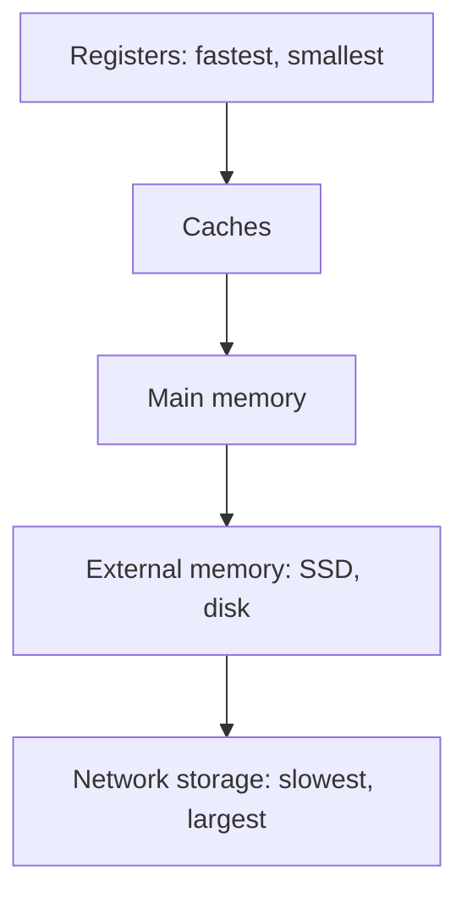

# Memory allocation, garbage collection and caching

> **Before this lesson:** You should know memory addresses, arrays and references
> ([Low-level arrays](#/lesson/dsa-foundations/low-level-arrays)), linked lists
> ([Singly and circularly linked lists](#/lesson/dsa-foundations/singly-circular)), the call
> stack ([Thinking recursively](#/lesson/dsa-foundations/recursion-examples)), depth-first
> search ([DFS, BFS, transitive closure and DAGs](#/lesson/dsa-foundations/graph-traversals)),
> and the LRU cache ([Doubly linked lists and positional lists](#/lesson/dsa-foundations/doubly-positional)).

## In plain words

Every lesson so far has treated the computer's memory as a perfect, endless whiteboard: any
spot can be read or written instantly, and new objects appear whenever we ask. Real memory is
neither endless nor uniform. This lesson looks at three things that happen behind the scenes.

First, **finding room**. When a program creates an object, something has to find free space
for it, like a car park attendant finding a gap big enough for each arriving vehicle. Second,
**cleaning up**. Space used by objects that the program can no longer reach has to be
recovered, or memory would run out; Python does this automatically, and how it does so
explains some otherwise puzzling behaviour. Third, **speed is not uniform**. A computer has
several kinds of storage, from tiny and extremely fast to huge and slow, and a program's
real-world speed depends heavily on how often it must go to the slow kinds. Think of the
papers on your desk, the filing cabinet across the room, and the archive in another building.

Why it matters for a job: this is where "memory leak", "garbage collection pause" and "cache
miss" come from, terms you will meet as soon as a program has to run fast or for a long time.
It also explains why two programs with the same big-O can differ tenfold in speed, and it
prepares the ground for the next lesson on how databases organise data on disk.

## 1. Memory allocation

When a Python program runs `w = Widget()`, the interpreter must find space for the new object.
Reserving space is called **allocation**, and giving it back is **deallocation**. Objects are
kept in a large pool of memory called the **memory heap**. (This has nothing to do with the
heap data structure of the priority-queue module; the same word is used for two unrelated
things.)

The memory heap is divided into **blocks**, stretches of consecutive bytes, some in use and
some free. The system has to find a free block quickly for each new object, and keep track of
the "holes" of unused memory. A common way is to link all the free blocks together in a linked
list called the **free list**.

### 1.1 Fragmentation

As blocks are allocated and freed in no particular order, the free memory gets chopped into
separate holes scattered among the blocks in use. This is **fragmentation**, and there are two
kinds:

- **Internal fragmentation:** part of an *allocated* block is unused. A dynamic array with capacity
  for 16 references that currently holds 9 elements has 7 cells of internal fragmentation.
- **External fragmentation:** unused memory lies *between* allocated blocks, in pieces that may be
  individually too small to satisfy a request even though their total is large enough.

A car park shows the second kind well: there may be ten free metres of kerb in total, but if
they are five gaps of two metres each, no car can park. A good allocation policy keeps
external fragmentation low so that large requests can still be met.

### 1.2 Allocation heuristics

Given a request for $b$ bytes and several holes that are large enough, which hole should be
used? Four standard policies:

| Policy | Rule | Behaviour |
|---|---|---|
| **Best-fit** | search the entire free list for the hole whose size is **closest** to the request | leaves tiny, useless slivers; tends to produce the *worst* external fragmentation, and is slow |
| **First-fit** | scan from the beginning; take the **first** hole large enough | fast; fragments the front of the heap, slowing later searches |
| **Next-fit** | like first-fit, but start where the previous search stopped, wrapping around (a circular list) | spreads fragmentation evenly; search times stay low; large blocks become hard to find |
| **Worst-fit** | take the **largest** hole | keeps contiguous leftover space large; costly unless the free list is a priority queue |

Under every policy the chosen hole is split: the requested amount is used and whatever is left
over goes back on the free list as a smaller hole. And when a block is freed, any free blocks
next to it should be merged with it into one larger block, which is called **coalescing**.

The simulation below starts with five holes of sizes 100, 500, 200, 300 and 600 and serves
four requests under each policy. For example, with first-fit the request for 212 takes the
first hole that is big enough, the 500, leaving a hole of 288.

```python-run
def simulate(policy, holes, requests):
    """holes: list of free block sizes (in address order). Return (holes left, failed requests)."""
    holes, failed, last = list(holes), [], 0
    for r in requests:
        candidates = [i for i, h in enumerate(holes) if h >= r]
        if not candidates:
            failed.append(r); continue
        if policy == "first":   i = candidates[0]
        elif policy == "best":  i = min(candidates, key=lambda j: holes[j])
        elif policy == "worst": i = max(candidates, key=lambda j: holes[j])
        elif policy == "next":
            after = [j for j in candidates if j >= last]
            i = after[0] if after else candidates[0]
            last = i
        holes[i] -= r                        # split the hole: remainder stays free
    return holes, failed

holes = [100, 500, 200, 300, 600]
requests = [212, 417, 112, 426]
for policy in ["first", "next", "best", "worst"]:
    left, failed = simulate(policy, holes, requests)
    print(f"{policy:5s}-fit: holes left {left}  could not allocate {failed}")
```

On this workload, first-fit, next-fit and worst-fit all fail to place the last request (426),
although far more than 426 bytes are free in total: external fragmentation in action. Best-fit
succeeds. On other workloads the ranking is different; no policy is best everywhere.

Real allocators are more elaborate. CPython's own allocator serves small objects (up to 512
bytes) from pools of **equal-sized** blocks, one pool for each size class. That makes
allocation $O(1)$ and avoids external fragmentation inside a pool, at the price of a little
internal fragmentation when an object does not fill its block.

## 2. Garbage collection

In a language such as C, the programmer must give memory back explicitly. Forget to, and the
program **leaks** memory, using more and more until it fails; give the same block back twice,
and the heap is corrupted. Python, like Java, does the job automatically. **Garbage
collection** is the process of detecting objects that the program can no longer use and
reclaiming their space.

How can the system tell which objects are still needed? Two definitions:

- **Root objects** are the objects that a variable currently in scope refers to directly:
  global variables, and the local variables of every function call now on the call stack.
- **Live objects** are the root objects, plus every object **reachable** from a root by
  following references (the items of a live list, the fields of a live object, and so on).

Everything else is **garbage**: no chain of references leads to it, so the program could never
touch it again. This is the reachability question of the graphs module, with objects as the
vertices and references as the directed edges.

### 2.1 Reference counting

The first technique gives every object a **reference count**: the number of references that
currently point to it. Creating a new reference to the object adds one; removing a reference
or pointing it elsewhere subtracts one. When the count reaches **zero**, nothing refers to the
object, so it is reclaimed at once. (Reclaiming it removes the references *it* held, which may
bring other counts to zero in a chain reaction.)

CPython uses reference counting as its main mechanism. It is uncomplicated and prompt: memory
is released the instant the last reference goes away.

In the demo, `sys.getrefcount` reports an object's count (the code subtracts the one extra
reference that the call itself holds), and a `weakref` is a special reference that does not
count, used here to check whether an object still exists without keeping it alive.

```python-run
import sys, gc, weakref
class Node:
    def __init__(self, name): self.name, self.other = name, None

a = Node("a")
print("refcount of a:", sys.getrefcount(a) - 1)      # getrefcount itself holds one temporary reference
b = a
print("after b = a:  ", sys.getrefcount(a) - 1)
del b
print("after del b:  ", sys.getrefcount(a) - 1)

# A reference cycle: x <-> y. After del, both counts stay at 1 although nothing can reach them.
x, y = Node("x"), Node("y")
x.other, y.other = y, x
probe = weakref.ref(x)                                # lets us observe x without keeping it alive
del x, y
print("cycle still in memory after del?", probe() is not None)
print("objects found unreachable by the cycle collector:", gc.collect())
print("cycle still in memory after gc.collect()?", probe() is not None)
```

The first three lines show the count going 1, 2, 1 as a second name `b` is attached to the
object and then removed. The second half builds two objects that refer to each other and then
deletes both names.

**The weakness: cycles.** If two objects refer to each other (or a longer loop of references
exists), each keeps the other's count above zero for ever, even when no root can reach either
of them. Reference counting by itself never reclaims such garbage. And structures that refer
back to themselves are common: doubly linked lists, trees whose nodes store their parent,
graphs. The demo shows the pair surviving `del x, y`, and being reclaimed only when
`gc.collect()` runs the mechanism described next.

### 2.2 Cycle detection and mark-sweep

To reclaim cycles, CPython runs a second mechanism from time to time, a **cycle detector**. It
sorts objects into three **generations** by age: new objects start in the youngest generation
and are promoted each time they survive a collection. Young generations are examined often and
old ones rarely, on the observation that most objects have short lives.

The classic general-purpose garbage collection algorithm is **mark-sweep**, which works in two
phases:

1. **Mark.** Give every object a one-bit "mark". Pause the program and clear all the marks.
   Mark every root object, then run a **depth-first search** over the graph of references
   starting from the roots, marking every object reached.
2. **Sweep.** Walk through the whole memory heap and reclaim every object that is **not**
   marked. Optionally slide the surviving objects together to remove the gaps between them.

Mark-sweep handles cycles correctly: an unreachable cycle is never marked, so it is swept. The
mark phase takes time proportional to the number of live objects and references; the sweep
phase takes time proportional to the size of the heap.

The demo runs mark-sweep on a toy heap of seven objects, given as a dictionary from each
object's name to the names it refers to. With A as the only root, the live objects come out as
A, B, C and D, and the garbage as E, F and G. Note two things: B and D form a cycle but are
live, because A reaches them; and G refers *to* A but is garbage, because nothing refers to G.
What matters is whether an object can be reached, not what it points at.

```python-run
def mark_sweep(heap, roots):
    """heap: {object id: list of referenced ids}. Return (live, garbage) as sorted lists."""
    marked, stack = set(), list(roots)
    while stack:                                  # mark phase: iterative DFS from the roots
        obj = stack.pop()
        if obj not in marked:
            marked.add(obj)
            stack.extend(heap[obj])
    garbage = [obj for obj in heap if obj not in marked]      # sweep phase
    return sorted(marked), sorted(garbage)

heap = {"A": ["B", "C"], "B": ["D"], "C": [], "D": ["B"],     # B <-> D cycle, but reachable
        "E": ["F"], "F": ["E"],                               # unreachable cycle: garbage
        "G": ["A"]}                                           # points INTO live data, but nothing points to G
print(mark_sweep(heap, roots=["A"]))
```

### 2.3 Performing DFS in place

There is an awkward catch. Garbage collection usually runs **because memory is short**, yet
the depth-first search of the mark phase needs a stack, whether through recursion or an
explicit one, and that stack can grow as large as the number of live objects. A neat solution
(known as the Deutsch-Schorr-Waite algorithm) performs the search **in place**, using no
stack at all. As the search steps from object $v$ to object $w$, it temporarily **turns round
the reference it followed**, so that it points back to $v$. The trail from the current object
back to the root is then stored inside the objects themselves. When the search backs up, it
restores each reference to its original value. Only a constant amount of extra memory is
needed.

### 2.4 Other collectors (context)

Other designs are worth recognising by name:

- A **copying collector** divides the heap into two halves and copies the live objects from
  one half to the other, packing them together as it goes; its cost depends only on the amount
  of live data.
- A **generational collector** (used by Java, .NET and CPython's cycle detector) collects
  young objects more often than old ones.
- A **concurrent** or **incremental collector** does its work in small steps interleaved with
  the program, to keep each pause short.

## 3. Additional memory used by the Python interpreter

Besides the memory heap, a running program uses the **call stack** met in the recursion
module. Each function call pushes a frame (an activation record) holding that call's
parameters and local variables, which are references to objects in the heap, together with a
note of where in the caller to resume. Returning pops the frame.

- This is the stack ADT at work: the call that is running is on top, and the callers waiting
  for it lie underneath.
- It is what makes **recursion** work: each recursive call has its own frame, and so its own
  copies of the parameters and local variables.
- It is why deep recursion costs memory, one frame per level, and why Python caps the depth
  (`sys.getrecursionlimit()`, usually 1000).

A related structure is the **operand stack**. Python does not run your source text directly;
it first translates it into simple instructions called **bytecode**. To evaluate an
expression such as `((a + b) * (c + d)) / e`, the bytecode pushes operands on a stack and
applies each operator to the top two entries. This is the postfix evaluation of the stacks
lesson. The `dis` module prints the bytecode of a function, so you can see it: instructions
whose names begin with `LOAD` push a value, and those beginning with `BINARY` pop two values
and push the result.

```python-run
import dis
def f(a, b, c, d, e):
    return ((a + b) * (c + d)) / e
dis.dis(f)        # LOAD pushes operands; BINARY_* pops two and pushes the result
```

## 4. Memory hierarchies

Computers have several kinds of memory, which trade **speed** against **capacity and cost**:
the faster a kind of memory is, the more it costs per byte, so there is less of it. In the
table, a nanosecond (ns) is a billionth of a second and a millisecond (ms) a thousandth; KB,
MB, GB and TB are roughly a thousand, a million, a billion and a trillion bytes.

| Level | Typical size | Typical access time |
|---|---|---|
| CPU registers | hundreds of bytes | < 1 ns |
| Caches (L1, L2, L3) | KB to tens of MB | 1–20 ns |
| Internal (main) memory, RAM | GB | ~100 ns |
| External memory: SSD / disk | hundreds of GB to TB | 0.1 ms (SSD) – 10 ms (disk seek) |
| Network / archival storage | effectively unbounded | ms to seconds |

The gaps are enormous. Scale everything up so that one access to main memory takes a second:
then fetching something from a spinning disk takes about a day. So an algorithm that looks
fine when every access is assumed to cost the same can be disastrous when its data lives on a
slower level.



### 4.1 Caching and blocking

Two mechanisms make the hierarchy usable, and both rely on **locality of reference**, the
tendency of programs to keep working with the same data and with neighbouring data.

- **Temporal locality** (locality in time): a location that has been accessed is likely to be
  accessed again soon. The response is **caching**: keep recently used data in the faster
  level, expecting it to be wanted again. Inside the processor the fast level is called the
  *cache*; between main memory and disk the same idea is called **virtual memory**.
- **Spatial locality** (locality in space): when a location is accessed, nearby locations are
  likely to be accessed soon. The response is **blocking**: when one location has to be
  fetched from the slower level, fetch a whole **block** of neighbouring data along with it. A
  block moved between cache and main memory is a **cache line**; a block moved between main
  memory and disk is a **page**.

This has consequences for data structures. An **array** is stored in consecutive memory, so
scanning it benefits fully from blocking: each cache line is fetched once and then used many
times. The nodes of a **linked structure** are scattered across memory, and following each
link may require a fresh fetch from the slower level. This is why, in practice, arrays beat
linked lists and sorted arrays beat binary search trees for data that is mostly read, even
where the big-O bounds are the same.

The demo adds up the same 300,000 numbers twice, once visiting them in order and once in a
shuffled order.

```python-run
import time, random
n = 300000
data = list(range(n))
in_order = list(range(n))
shuffled = in_order[:]; random.shuffle(shuffled)
for name, order in [("sequential", in_order), ("random", shuffled)]:
    t0 = time.perf_counter()
    total = 0
    for i in order:
        total += data[i]
    print(f"{name:10s} access order: {1000 * (time.perf_counter() - t0):6.1f} ms")
```

(In Python the interpreter overhead hides most of the effect; in C or NumPy the random order can be
several times slower. In the browser the difference may be small — the principle stands.)

## 5. Caching strategies

When a block is needed and the fast level is already full, some block must be thrown out, or
**evicted**, to make room. Having to fetch from the slower level is a **cache miss** (for
virtual memory it is called a **page fault**), and it is expensive, so the question is which
page to evict so as to cause as few future misses as possible. The setting for the analysis:
a cache with room for $m$ pages, and a sequence of $n$ requests for pages.

| Policy | Evicts | Implementation | Notes |
|---|---|---|---|
| **Random** | a page chosen at random | pseudo-random generator: $O(1)$ | no bookkeeping; ignores locality |
| **FIFO** (first-in, first-out) | the page that has been in the cache **longest** | queue: $O(1)$ | simple; ignores how recently a page was *used* |
| **LRU** (least recently used) | the page whose **last access** is oldest | adaptable priority queue $O(\log m)$, or hash map + doubly linked list $O(1)$ | exploits temporal locality; best in practice |

LRU's rationale: by temporal locality, a page used recently will probably be used again soon, so the
one unused for the longest time is the best candidate to drop.

```python-run
from collections import OrderedDict, deque
import random

def simulate(policy, capacity, requests, seed=0):
    rnd, misses = random.Random(seed), 0
    if policy == "LRU":
        cache = OrderedDict()
        for p in requests:
            if p in cache: cache.move_to_end(p)               # refresh recency
            else:
                misses += 1
                if len(cache) == capacity: cache.popitem(last=False)   # evict least recently used
                cache[p] = True
    elif policy == "FIFO":
        cache, order = set(), deque()
        for p in requests:
            if p not in cache:
                misses += 1
                if len(cache) == capacity: cache.discard(order.popleft())
                cache.add(p); order.append(p)
    else:                                                      # Random
        cache = []
        for p in requests:
            if p not in cache:
                misses += 1
                if len(cache) == capacity: cache.pop(rnd.randrange(capacity))
                cache.append(p)
    return misses

rnd = random.Random(42)
# workload with locality: 85% of requests go to a slowly drifting "hot" set of 8 pages
requests, hot = [], list(range(8))
for t in range(20000):
    if t % 500 == 0: hot[rnd.randrange(8)] = rnd.randrange(1000)
    requests.append(rnd.choice(hot) if rnd.random() < 0.85 else rnd.randrange(1000))
for policy in ["Random", "FIFO", "LRU"]:
    print(f"{policy:6s}: {simulate(policy, 16, requests)} misses out of {len(requests)}")

worst = [i % 17 for i in range(20000)]              # cycle through capacity + 1 pages
print("adversarial cycle of 17 pages, capacity 16 -> LRU misses:", simulate("LRU", 16, worst),
      " Random misses:", simulate("Random", 16, worst))
```

### 5.1 How good can a policy be?

All three policies have bad worst cases. Request $m + 1$ different pages over and over in a
cycle: LRU and FIFO each evict exactly the page that will be asked for next, and miss on
**every** request. How bad is that compared with the best that could be done? The best
conceivable policy would know the future and evict the page whose next use is farthest away.
The theory of competitive analysis (met with move-to-front lists) shows that FIFO and LRU are
**$m$-competitive**: they never incur more than $m$ times as many misses as that
all-knowing policy, and no policy that lacks knowledge of the future and makes no random
choices can guarantee better. Policies that use randomness can do better on average. In
practice, on real workloads with locality, LRU, or a cheap approximation of it, is the method
of choice, as the first part of the demo shows.

> [!INTERVIEW]
> "Design an LRU cache with $O(1)$ `get` and `put`" is among the most common design questions:
> a **hash map** from key to node plus a **doubly linked list** ordered by recency. `get` moves the
> node to the front; `put` inserts at the front and evicts from the back when over capacity. In
> Python: `collections.OrderedDict` with `move_to_end` and `popitem(last=False)`, or
> `functools.lru_cache` for memoising functions.

## 6. Pitfalls

- **Mixing up names.** The *memory heap* is not the *heap data structure*, and the *call
  stack* is not a stack object that you create.
- **Assuming reference counting reclaims everything.** Cycles need the cycle collector. And
  objects kept reachable by a forgotten global list or an ever-growing cache are a "leak" even
  in a garbage-collected language: the collector cannot free what the program can still reach.
- **Assuming `del x` frees an object.** It removes one reference. The object is freed only if
  that was the last one.
- **Ignoring locality.** Two $O(n)$ loops can differ several-fold in speed depending on how
  their data is laid out in memory.
- **Believing LRU is optimal.** It is a heuristic that suits typical workloads, and it has a
  worst case.

## 7. Summary

- Objects live in the memory heap, whose free blocks are tracked in a free list. Allocation
  policies (first-fit, next-fit, best-fit, worst-fit) trade speed against fragmentation.
- Garbage is whatever cannot be reached from the roots. Reference counting reclaims promptly
  but misses cycles; mark-sweep runs a depth-first search from the roots and reclaims
  everything left unmarked.
- Each function call uses a frame on the call stack.
- Memory is a hierarchy of levels. Caching (which exploits temporal locality) and blocking
  (which exploits spatial locality) hide the slow levels, and eviction policies (random,
  FIFO, LRU) decide what to drop when the fast level is full.

> **Source:** Goodrich, Tamassia & Goldwasser, *Data Structures and Algorithms in Python*, ch. 15.1–15.2.

## Glossary

- **Allocation / deallocation**: reserving memory for an object / giving it back.
- **Memory heap**: the pool of memory from which objects are allocated.
- **Free list**: a linked list of the free blocks of memory.
- **Internal / external fragmentation**: wasted space inside an allocated block / free space
  split into holes too small to use.
- **First-fit, next-fit, best-fit, worst-fit**: policies for choosing which hole to allocate
  from.
- **Coalescing**: merging neighbouring free blocks into one.
- **Garbage collection**: automatically reclaiming objects the program can no longer reach.
- **Root object / live object**: an object referred to directly by a variable in scope / an
  object reachable from a root.
- **Reference count**: the number of references pointing to an object.
- **Reference cycle**: objects that refer to one another in a loop.
- **Mark-sweep**: marking everything reachable from the roots, then reclaiming the rest.
- **Memory leak**: memory that is never given back although it is no longer needed.
- **Bytecode**: the simple instructions into which Python translates a program before running
  it.
- **Memory hierarchy**: the levels of storage, from small and fast to large and slow.
- **Temporal / spatial locality**: the tendency to reuse the same data soon / to use
  neighbouring data soon.
- **Cache line / page**: the block moved between cache and main memory / between main memory
  and disk.
- **Cache miss / page fault**: a request for data that is not in the fast level.
- **Eviction policy**: the rule choosing what to remove from a full cache (random, FIFO,
  LRU).

## Check yourself

```quiz
[
  {"q": "External fragmentation means...",
   "options": ["unused space inside an allocated block", "free memory split into holes between allocated blocks, possibly too small individually to be useful", "memory on an external disk", "garbage that has not been collected"], "answer": 1,
   "explain": "Internal fragmentation is waste inside a block; external is waste between blocks."},
  {"q": "Which allocation policy chooses the smallest hole that is large enough?",
   "options": ["First-fit", "Best-fit", "Worst-fit", "Next-fit"], "answer": 1,
   "explain": "Best-fit minimises the leftover sliver for each request, which tends to create many tiny useless holes."},
  {"q": "Why can pure reference counting fail to reclaim some garbage?",
   "options": ["Counts overflow", "Objects in a reference cycle keep each other's counts above zero", "It is too slow", "It cannot handle integers"], "answer": 1,
   "explain": "An unreachable cycle has non-zero counts, so a separate cycle detector or mark-sweep is needed."},
  {"q": "The mark phase of mark-sweep is essentially...",
   "options": ["a sort of the heap", "a DFS from the root objects over the graph of references", "a hash table rebuild", "a binary search"], "answer": 1,
   "explain": "Everything reachable from the roots is marked live; the rest is swept."},
  {"q": "Blocking (fetching a whole page or cache line) is justified by...",
   "options": ["temporal locality", "spatial locality", "amortisation", "randomisation"], "answer": 1,
   "explain": "Nearby locations are likely to be accessed soon after one of them."},
  {"q": "LRU evicts...",
   "options": ["the page loaded earliest", "the page whose most recent use is oldest", "a random page", "the largest page"], "answer": 1,
   "explain": "By temporal locality, the page unused for the longest time is least likely to be needed soon."},
  {"q": "A request sequence cycling through m + 1 distinct pages with a cache of m pages makes LRU...",
   "options": ["never miss", "miss on every request", "miss half the time", "equal to the optimal policy"], "answer": 1,
   "explain": "The page evicted most recently is always the next one requested: the adversarial worst case."}
]
```
