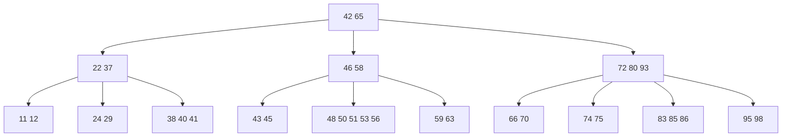

# External searching: (a,b) trees and B-trees

> **Before this lesson:** You should know the memory hierarchy, blocks and pages
> ([Memory allocation, garbage collection and caching](#/lesson/dsa-foundations/memory-management)),
> multiway search trees and (2,4) trees with their splits, transfers and fusions
> ([(2,4) trees and red-black trees](#/lesson/dsa-foundations/two-four-red-black)), binary
> search trees ([Binary search trees](#/lesson/dsa-foundations/bst)), merge-sort
> ([Divide and conquer: merge-sort](#/lesson/dsa-foundations/merge-sort)) and `heapq`
> ([Priority queues and binary heaps](#/lesson/dsa-foundations/heaps)).

## In plain words

When data is too big for the computer's fast working memory, it lives on disk, and fetching
anything from disk is enormously slower than working on data already in memory. This lesson
is about organising such data so that as few fetches as possible are needed.

Picture a huge library whose books are kept in a warehouse across town. Finding a book by
opening boxes one at a time would take for ever, because each box means a van trip. A balanced
binary tree is not much better: it asks one question per trip ("is your key before or after
this one?"), so a billion books would need about thirty trips. The fix is to bring back, on
each trip, a whole index sheet listing hundreds of dividing points, so that one trip narrows
the search hundreds of times over. Three or four trips then reach any of a billion books. That
index-sheet tree is a **B-tree**.

Why it matters for a job: every relational database you will use (PostgreSQL, MySQL, SQLite)
and most file systems keep their indexes in B-trees. "Why do databases use B-trees?" is a
standard interview question, and understanding the answer tells you why adding an index makes
a slow query fast. The lesson closes with how to sort data that does not fit in memory, which
is how databases sort large tables.

## 1. The external-memory model

Assume the data is too large for main memory (internal memory) and is stored on an external
device, a disk or SSD, divided into **blocks** (also called pages), each able to hold $B$
items. Reading or writing one block is one **disk transfer**, also called an I/O (input/output)
operation. In this setting we measure an algorithm by its **I/O complexity**, the number of
disk transfers it performs, and treat computation on blocks already in memory as free. That is
a simplification, but a reasonable one: a transfer can cost a hundred thousand times as much
as a step in memory, so counting comparisons would measure the wrong thing.

For a sense of scale: with a page of 4 or 16 kilobytes and entries of 16 bytes each, $B$ is in
the hundreds or thousands.

### 1.1 How do our existing structures fare?

Consider a map with $n$ items stored externally.

- **Unsorted or sorted linked list:** a search may follow $n$ links, each to a different block:
  $O(n)$ transfers. (An array-based sorted table with a sequential scan needs $O(n/B)$ transfers,
  since $B$ consecutive items share a block; binary search on it needs
  $O(\log(n/B)) = O(\log n - \log B)$ transfers.)
- **Balanced binary search trees** (AVL, red-black) and **skip lists:** a search visits
  $O(\log_2 n)$ nodes. But the nodes on a root-to-leaf path are, in general, scattered over
  **different blocks**, so each step costs a transfer: $O(\log_2 n)$ I/Os. For $n = 10^9$ that is
  about 30 disk transfers per search — at 5–10 ms each for a spinning disk, a quarter of a second
  per lookup.

Can we do better than $\log_2 n$? Yes: make the tree **much shallower** by giving every node
**many children**, sized so that one node fills exactly one block. Reading a node is then one
transfer, and searching inside the node, which happens in memory, is free in this model. The
number of children a node has is called its **fan-out**. A tree in which every node has a
fan-out of about $B$ has height about $\log_B n$, and by the change-of-base rule

$$\log_B n = \frac{\log_2 n}{\log_2 B}.$$

For $n = 10^9$ and $B = 1000$: $\log_2 n \approx 30$ and $\log_2 B \approx 10$, so the height
is **3**. Three transfers instead of thirty. The demo prints the height for several fan-outs.

```python-run
import math
n = 10**9
print(f"{'fan-out B':>10} {'height ~ log_B n':>18}")
for B in [2, 4, 16, 100, 256, 1000, 4096]:
    print(f"{B:>10} {math.ceil(math.log(n, B)):>18}")
```

## 2. (a,b) trees

The (2,4) tree of the search-trees module had nodes with 2 to 4 children. An **(a,b) tree** is
the same idea with the limits turned into parameters: every node has between $a$ and $b$
children. Formally, it is a multiway search tree with whole-number parameters
$2 \le a \le (b+1)/2$, such that:

- **Size property:** an internal node never has more than $b$ children and never fewer than
  $a$, with one exception: the root may have as few as 2.
- **Depth property:** all external nodes are at the same depth.

A (2,4) tree is the case $a = 2$, $b = 4$. With large $a$ and $b$, each node is a big sorted
index sheet and the tree is very shallow.

> **Claim.** The height of an (a,b) tree with $n$ entries is at least proportional to
> $\log n / \log b$ and at most proportional to $\log n / \log a$.

*Why.* Let $h$ be the height. A tree with $n$ entries has $n + 1$ external nodes. Count the
nodes level by level. The root has at least 2 children, so level 1 has at least 2 nodes; each
of those has at least $a$ children, so level 2 has at least $2a$; and level $h$ has at least
$2a^{h-1}$. In the other direction, no node has more than $b$ children, so level $h$ has at
most $b^h$ nodes. Therefore

$$2a^{h-1} \le n + 1 \le b^h,$$

and taking logarithms gives
$\frac{1}{\log b}\log(n+1) \le h \le \frac{1}{\log a}\log\frac{n+1}{2} + 1$. ∎

### 2.1 Search

Exactly as in any multiway search tree: at each node, find the child whose key range contains $k$
(binary search among up to $b - 1$ keys), and descend. Visiting a node costs $O(\log b)$ time in
memory with a sorted array of keys, so the total time is $O(\log b \cdot \log n / \log a)$ — which
is $O(\log n)$ when $a$ and $b$ are constants — and, with one node per block, the number of
**transfers** is $O(\log n / \log a) = O(\log_a n)$.

### 2.2 Insertion: overflow and split

As in a (2,4) tree: insert the new entry into the appropriate node $w$ at the lowest level. If $w$
now has $b + 1$ children (an **overflow**), **split** it into two nodes with
$\lceil (b+1)/2 \rceil$ and $\lfloor (b+1)/2 \rfloor$ children and move the median key up into the
parent — which may overflow in turn, up to the root (where a new root is created and the height
grows by one).

The condition $a \le (b+1)/2$ is precisely what guarantees the two halves are **legal** nodes: each
has at least $\lfloor (b+1)/2 \rfloor \ge a$ children.

### 2.3 Deletion: underflow, transfer, fusion

Remove the entry (after swapping it down to a bottom-level node if necessary). If a non-root node
$w$ is left with $a - 1$ children (an **underflow**):

- **Transfer:** if an adjacent sibling has **more than $a$** children, move one child (and rotate
  one key through the parent) to $w$.
- **Fusion:** otherwise the sibling has exactly $a$ children; merge $w$ and the sibling with the
  separating key from the parent into a single node with $2a - 1$ children. Since $a \le (b+1)/2$,
  $2a - 1 \le b$: the merged node is legal. The parent loses a child and may underflow in turn.

Each of these operations touches $O(1)$ nodes; an update performs them along one root-to-leaf path.

## 3. B-trees

> A **B-tree of order $d$** is an (a,b) tree with $a = \lceil d/2 \rceil$ and $b = d$.

So every internal node except the root has between $\lceil d/2 \rceil$ and $d$ children: it is
always **at least half full**. And all leaves are at the same depth. The (2,4) tree is the
B-tree of order 4. The limits were chosen to be as tight as the rules allow: a node may hold
as many children as fit, and when it overflows and splits, the two halves are each (about)
half full, which is exactly the minimum.



(A B-tree of order 6: internal nodes have 3 to 6 children — 2 to 5 keys; the root may have fewer.)

**Choosing $d$.** Pick the order so that one node, with its $d$ child references and $d - 1$
keys, **exactly fills one disk block**. Then $d$ is proportional to the block size $B$, so
both $a = \lceil d/2 \rceil$ and $b = d$ are $\Theta(B)$, and the height is

$$O\!\left(\frac{\log n}{\log \lceil d/2 \rceil}\right) = O(\log_B n).$$

> **Theorem.** With blocks of size $B$, a B-tree of $n$ entries occupies $O(n/B)$ blocks, and
> each search, insertion or deletion performs $O(\log_B n)$ block transfers.

*Why updates are as cheap as searches.* A search reads one node per level. An insertion may
split one node per level on the way back up, and a deletion may fuse one node per level; each
split or fusion reads and writes a constant number of blocks. The space bound holds because
every node except the root is at least half full, so no more than about twice the minimum
number of blocks is ever used.

### 3.1 Searching within a node

Inside a block the keys are kept in sorted order, so the child to follow is found by binary
search. In the external-memory model this is free; in reality it takes a few dozen
nanoseconds, against milliseconds for the transfer. A point that is often misunderstood: the
total number of *comparisons* is still about $\log_2 n$ (there are $\log_B n$ levels, with
about $\log_2 B$ comparisons at each). A B-tree does not reduce the number of comparisons. It
**packs them into far fewer blocks**.

### 3.2 A working B-tree (insert and search)

The implementation below uses a common variant of insertion that makes a single pass from the
root downwards: on the way down, any full node it is about to enter is split *first*, so that
there is always room when the bottom is reached and nothing has to be repaired on the way
back up. It is parameterised by the **minimum degree** $t$: every node except the root has
between $t - 1$ and $2t - 1$ keys, that is, between $t$ and $2t$ children, which makes it a
B-tree of order $d = 2t$. Each node keeps a sorted list of keys and a list of children (empty
for a leaf), and `bisect_left` does the binary search inside a node. The class counts node
visits in `transfers`, as a stand-in for disk transfers.

```python-run
import bisect, math, random

class BTreeNode:
    __slots__ = "keys", "children"
    def __init__(self):
        self.keys, self.children = [], []
    @property
    def leaf(self): return not self.children

class BTree:
    def __init__(self, t=3):
        self.t, self.root, self.transfers = t, BTreeNode(), 0

    def search(self, k):
        """Return True if k is present; counts one transfer per node visited."""
        node = self.root
        while True:
            self.transfers += 1
            i = bisect.bisect_left(node.keys, k)          # binary search inside the block
            if i < len(node.keys) and node.keys[i] == k: return True
            if node.leaf: return False
            node = node.children[i]

    def _split_child(self, parent, i):
        """Split the full child parent.children[i]; its median key moves up into parent."""
        t, full = self.t, parent.children[i]
        right = BTreeNode()
        median = full.keys[t - 1]
        right.keys, full.keys = full.keys[t:], full.keys[:t - 1]
        if not full.leaf:
            right.children, full.children = full.children[t:], full.children[:t]
        parent.keys.insert(i, median)
        parent.children.insert(i + 1, right)

    def insert(self, k):
        if len(self.root.keys) == 2 * self.t - 1:         # full root: the tree grows at the top
            new_root = BTreeNode()
            new_root.children.append(self.root)
            self._split_child(new_root, 0)
            self.root = new_root
        node = self.root
        while not node.leaf:
            i = bisect.bisect_left(node.keys, k)
            if i < len(node.keys) and node.keys[i] == k: return
            if len(node.children[i].keys) == 2 * self.t - 1:
                self._split_child(node, i)                # split before descending
                if k == node.keys[i]: return
                if k > node.keys[i]: i += 1
            node = node.children[i]
        i = bisect.bisect_left(node.keys, k)
        if i == len(node.keys) or node.keys[i] != k:
            node.keys.insert(i, k)

    def height(self):
        h, node = 1, self.root
        while not node.leaf: node = node.children[0]; h += 1
        return h
    def show(self, node=None, depth=0):
        node = node or self.root
        print("    " * depth + str(node.keys))
        for c in node.children: self.show(c, depth + 1)

T = BTree(t=2)                                            # order 4: a (2,4) tree
for k in [4, 6, 12, 15, 3, 5, 10, 8, 1, 20, 17, 9]:
    T.insert(k)
T.show()

big = BTree(t=50)                                         # up to 99 keys / 100 children per node
keys = random.sample(range(10**7), 200000)
for k in keys: big.insert(k)
big.transfers = 0
for k in keys[:1000]: big.search(k)
print(f"n = 200,000, order 100: height {big.height()}, avg nodes read per search "
      f"{big.transfers / 1000:.2f}  (a balanced binary tree: ~{math.log2(200000):.0f})")
```

**Reading the output.** The first part builds a small tree of order 4 from twelve keys and
prints it with each level indented: the root's keys on the first line, its children beneath.
The second part inserts 200,000 random keys into a tree whose nodes hold up to 99 keys. Its
height comes out as 3 or 4 levels, and a search reads about that many nodes, where a balanced
binary tree would visit about 18.

### 3.3 Dry run: inserting into a small B-tree

Take a B-tree of order 4 (a (2,4) tree: at most 3 keys per node, split when a 4th arrives), and
insert 10, 20, 30, 40, 50, 60, 70 using the overflow-then-split rule of section 2.2:

| insert | event | tree (root → children) |
|---|---|---|
| 10, 20, 30 | fit in the root | `[10 20 30]` |
| 40 | overflow `[10 20 30 40]` → split, 30 moves up | `[30]` → `[10 20]`, `[40]` |
| 50, 60 | fit in the right leaf | `[30]` → `[10 20]`, `[40 50 60]` |
| 70 | overflow `[40 50 60 70]` → split, 60 moves up | `[30 60]` → `[10 20]`, `[40 50]`, `[70]` |

Sorted insertions — the worst case for a plain BST — produce a perfectly balanced tree here: B-trees
grow **upward from the root**, so all leaves always remain at the same depth.

### 3.4 B+ trees and practice

Real systems almost always use a variant called the **B+ tree**. In a B+ tree all the records
(or references to them) live in the **leaves**; the internal nodes hold only separator keys,
which makes them smaller and their fan-out even larger; and the leaves are linked to one
another in a chain. A **range query** ("all orders between 1 March and 31 March") then finds
the first matching leaf by a normal search and walks along the chain. The indexes of
PostgreSQL, MySQL, SQLite and Oracle are built this way, and so are file systems such as
NTFS and ext4. Because nodes are at least half full (about 69% full on average when keys
arrive in random order), little space is wasted. Systems that must absorb very many writes
(such as the storage engines LevelDB and RocksDB) often prefer a different structure, the
LSM tree, which turns scattered writes into sequential ones using the merge-sort idea of the
next section.

> [!INTERVIEW]
> "Why do databases use B-trees and not binary search trees or hash tables?" Three points.
> (1) **Fan-out**: with one node per disk page the height is $\log_B n$, which means 3 or 4
> page reads for billions of rows, against about 30 for a binary tree. (2) **Order**: range
> queries, prefix matches and sorted output come naturally, which a hash index cannot offer.
> (3) **Guaranteed balance**, with nodes at least half full. Mention B+ trees with linked
> leaves for range scans.

## 4. External-memory sorting

The second problem of this lesson is sorting $n$ items that do not fit in memory. Say main
memory holds $M$ items and a block holds $B$. The sorting algorithms designed for memory are a
poor fit: quick-sort and heap-sort jump around in the data, and here nearly every jump would
be a disk transfer. **Merge-sort** adapts perfectly, because it reads its inputs and writes
its output strictly in order, one block after another.

An ordinary merge-sort, merging two runs at a time, would make $\log_2(n/M)$ passes over the
data, each pass costing $O(n/B)$ transfers. The number of passes can be cut sharply by merging
**many runs at once**.

### 4.1 Multiway merge-sort

Let $d = M/B - 1$: the number of input blocks that fit in memory at once while leaving room
for one block of output.

1. **Run formation.** Read the input in chunks of $M$ items, as much as memory holds. Sort
   each chunk in memory and write it back out as a sorted **run**. This produces $n/M$ runs and
   costs $O(n/B)$ transfers.
2. **$d$-way merging.** Repeatedly merge $d$ runs into one longer run. Keep one block of each
   of the $d$ runs in memory. Repeatedly output the smallest item among the fronts of those
   blocks, found with a small priority queue of size $d$. When an input block has been used
   up, read the next block of that run; when the output block is full, write it out. Each
   merging pass over all the data costs $O(n/B)$ transfers.

Each pass divides the number of runs by $d$, so the number of passes is $\log_d(n/M)$, and the
total I/O complexity is

$$O\!\left(\frac{n}{B}\,\log_{M/B}\frac{n}{B}\right).$$

This is known as the sorting bound of external-memory computation, and it has been proved to
be the best possible.

### 4.2 Multiway merging with a heap

The code simulates the whole process in memory. `k_way_merge` keeps a heap with one entry per
run, `(value, run index, position)`: the smallest value is popped and sent to the output, and
the next value from the *same run* is pushed in its place. With $k$ runs the heap has at most
$k$ entries, so merging $n$ items costs $O(n \log k)$. `external_sort` forms runs of `M` items
and then merges them `d` at a time, counting the passes.

```python-run
import heapq, random
def k_way_merge(runs):
    """Merge sorted runs using a heap of (value, run index, position): O(n log k)."""
    heap = [(run[0], i, 0) for i, run in enumerate(runs) if run]
    heapq.heapify(heap)
    out = []
    while heap:
        value, i, j = heapq.heappop(heap)
        out.append(value)
        if j + 1 < len(runs[i]):                              # refill from the same run
            heapq.heappush(heap, (runs[i][j + 1], i, j + 1))
    return out

def external_sort(data, M=1000, d=8):
    """Simulated external merge-sort: memory holds M items; merges d runs per pass."""
    runs = [sorted(data[i:i + M]) for i in range(0, len(data), M)]     # run formation
    passes = 0
    while len(runs) > 1:
        runs = [k_way_merge(runs[i:i + d]) for i in range(0, len(runs), d)]
        passes += 1
    return (runs[0] if runs else []), passes

data = [random.randrange(10**6) for _ in range(100000)]
for d in [2, 8, 64]:
    out, passes = external_sort(data, M=1000, d=d)
    print(f"d = {d:2d}-way merging: {passes} merge passes over the data, correct = {out == sorted(data)}")
```

With 100 initial runs, 2-way merging needs 7 passes, 8-way needs 3, and 64-way needs 2 — each pass
being a full read and write of the entire data set. Python's `heapq.merge` implements the same
$k$-way merge lazily, over iterators, and is what you would use to merge sorted files.

## 5. Putting it together

| Structure / algorithm | Internal cost | External cost (transfers) |
|---|---|---|
| Sorted array, binary search | $O(\log n)$ | $O(\log(n/B))$ |
| Balanced BST / skip list | $O(\log n)$ | $O(\log_2 n)$ |
| **B-tree** search / insert / delete | $O(\log n)$ | $O(\log_B n)$ |
| Linear scan | $O(n)$ | $O(n/B)$ |
| 2-way merge-sort | $O(n\log n)$ | $O((n/B)\log_2(n/B))$ |
| **Multiway merge-sort** | $O(n \log n)$ | $O((n/B)\log_{M/B}(n/B))$ |

The same reasoning applies well beyond disks. It holds between the processor's cache and main
memory too, which is why in-memory structures designed with blocks in mind (B-trees whose
nodes are a few cache lines long, sorted arrays, radix trees) often outperform binary trees
built from scattered nodes.

## 6. Pitfalls

- **Counting comparisons for an external algorithm.** Count block transfers.
- **Believing a B-tree makes fewer comparisons than a binary tree.** It makes about the same
  number, in far fewer blocks.
- **Forgetting the root's exemption.** The root may have as few as 2 children; every other
  internal node needs at least $a$.
- **Splitting unevenly.** Both halves must have at least $a$ children, which is the reason for
  the condition $a \le (b+1)/2$.
- **Two-way merging when memory could hold hundreds of input blocks.** Every unnecessary pass
  reads and writes the entire data set.
- **Reaching for a hash index when the queries are ranges.** A hash table finds exact keys
  only.

## 7. Summary

- In the external-memory model the cost of an algorithm is the number of block transfers, with
  $B$ items per block.
- (a,b) trees generalise (2,4) trees: the height lies between $\log_b n$ and $\log_a n$; an
  overflow is fixed by a split, an underflow by a transfer or a fusion.
- A B-tree of order $d$ is a $(\lceil d/2\rceil, d)$ tree with one node per block. It uses
  $O(n/B)$ blocks and $O(\log_B n)$ transfers per search or update.
- External sorting forms memory-sized sorted runs and then merges about $M/B$ of them at a
  time, for $O((n/B)\log_{M/B}(n/B))$ transfers.

> **Source:** Goodrich, Tamassia & Goldwasser, *Data Structures and Algorithms in Python*, ch. 15.3–15.4.

## Glossary

- **External memory**: storage outside main memory, such as a disk or SSD.
- **Block (page)**: the unit in which data is moved between disk and memory.
- **Disk transfer (I/O)**: reading or writing one block.
- **I/O complexity**: the number of disk transfers an algorithm performs.
- **Fan-out**: the number of children of a node.
- **(a,b) tree**: a multiway search tree whose nodes have between $a$ and $b$ children, with
  all leaves at one depth.
- **B-tree of order $d$**: an (a,b) tree with $a = \lceil d/2 \rceil$ and $b = d$.
- **Minimum degree ($t$)**: an alternative parameter; nodes have between $t$ and $2t$ children.
- **Overflow / underflow**: a node with too many / too few children after an update.
- **Split / fusion / transfer**: the three repair operations.
- **B+ tree**: a B-tree that keeps all records in linked leaves.
- **Range query**: a request for all keys between two values.
- **Run**: a sorted stretch of data produced during external sorting.
- **Multiway merge**: merging many sorted runs at once, using a priority queue.

## Check yourself

```quiz
[
  {"q": "In the external-memory model, the cost of an algorithm is measured by...",
   "options": ["the number of comparisons", "the number of disk block transfers", "the recursion depth", "the number of rotations"], "answer": 1,
   "explain": "A block transfer is so much slower than in-memory work that it dominates everything else."},
  {"q": "Why is a red-black tree a poor external index?",
   "options": ["It is not balanced", "Each of its about log2 n levels may lie in a different block, costing one transfer per level", "It cannot store a billion keys", "It needs sorted input"], "answer": 1,
   "explain": "Height log2 n means roughly 30 transfers for a billion keys, versus 3 or 4 for a B-tree."},
  {"q": "A B-tree of order d is an (a,b) tree with...",
   "options": ["a = 2, b = d", "a = ceil(d/2), b = d", "a = d, b = 2d", "a = 1, b = d"], "answer": 1,
   "explain": "Every non-root internal node is at least half full."},
  {"q": "If one node holds about B keys, the height of a B-tree with n entries is...",
   "options": ["O(log_2 n)", "O(log_B n)", "O(n / B)", "O(B log n)"], "answer": 1,
   "explain": "Fan-out Theta(B) gives log_B n = log2 n / log2 B levels."},
  {"q": "An insertion makes a B-tree node overflow. What happens?",
   "options": ["The node is deleted", "It is split in two and its median key moves up to the parent", "It borrows a key from a sibling", "The whole tree is rebuilt"], "answer": 1,
   "explain": "Splits may cascade upward; if the root splits, a new root is created and the height grows by one."},
  {"q": "The constraint a <= (b + 1) / 2 in an (a,b) tree guarantees that...",
   "options": ["the tree is binary", "the two halves of a split node each have at least a children (and a fusion fits within b)", "keys are distinct", "the root has b children"], "answer": 1,
   "explain": "Splitting b + 1 children yields halves of at least floor((b+1)/2) >= a; fusing gives 2a - 1 <= b."},
  {"q": "Multiway external merge-sort merges about how many runs at a time?",
   "options": ["2", "M/B, as many input blocks as fit in memory", "n", "log n"], "answer": 1,
   "explain": "One block per run is kept in memory, giving log_(M/B) passes instead of log_2."}
]
```
