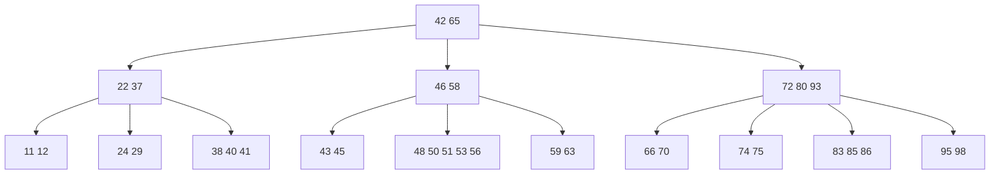

# External searching: (a,b) trees and B-trees

A database index with a billion keys does not fit in main memory. It lives on disk (or SSD), and
every access to a new disk block costs something like a hundred thousand times more than a memory
access. In that world, counting comparisons is pointless — what matters is the number of **block
transfers**. This final lesson develops the **external-memory model**, shows why balanced binary
trees are a poor fit for it, and builds the structure that every database and file system uses
instead: the **B-tree**. It ends with **external-memory sorting**.

## 1. The external-memory model

Assume the data set is too large for internal memory and is stored on an external device divided
into **blocks** (pages) of size $B$ — each block holds $B$ items/references. Reading or writing one
block is one **disk transfer** (I/O). We measure an algorithm's **I/O complexity**: the number of
disk transfers it performs. Computation on blocks already in memory is treated as free.

For a sense of scale: with a 4 KB or 16 KB page and 16-byte entries, $B$ is in the hundreds or
thousands.

### 1.1 How do our existing structures fare?

Consider a map with $n$ items stored externally.

- **Unsorted or sorted linked list:** a search may follow $n$ links, each to a different block:
  $O(n)$ transfers. (An array-based sorted table with a sequential scan needs $O(n/B)$ transfers,
  since $B$ consecutive items share a block; binary search on it needs
  $O(\log(n/B)) = O(\log n - \log B)$ transfers.)
- **Balanced binary search trees** (AVL, red-black) and **skip lists:** a search visits
  $O(\log_2 n)$ nodes. But the nodes on a root-to-leaf path are, in general, scattered over
  **different blocks**, so each step costs a transfer: $O(\log_2 n)$ I/Os. For $n = 10^9$ that is
  about 30 disk transfers per search — at 5–10 ms each for a spinning disk, a quarter of a second
  per lookup.

Can we do better than $\log_2 n$? Yes: make the tree **much shallower** by giving each node **many
children**, sized so that one node fills exactly one block. Reading a node is then one transfer,
and the search inside the node — in memory — is free in this model. A tree in which every node has
about $B$ children has height about $\log_B n$:

$$\log_B n = \frac{\log_2 n}{\log_2 B}.$$

For $n = 10^9$ and $B = 1000$ that is **3** transfers instead of 30.

```python-run
import math
n = 10**9
print(f"{'fan-out B':>10} {'height ~ log_B n':>18}")
for B in [2, 4, 16, 100, 256, 1000, 4096]:
    print(f"{B:>10} {math.ceil(math.log(n, B)):>18}")
```

## 2. (a,b) trees

An **(a,b) tree** is a multiway search tree (see the (2,4)-tree lesson for the definition of
multiway search and $d$-nodes) with integer parameters $2 \le a \le (b+1)/2$, such that:

- **Size property:** each internal node has at least $a$ children — unless it is the root, which
  may have as few as 2 — and at most $b$ children.
- **Depth property:** all the external nodes have the same depth.

A (2,4) tree is the special case $a = 2$, $b = 4$.

> **Proposition.** The height of an (a,b) tree storing $n$ entries is $\Omega(\log n / \log b)$ and
> $O(\log n / \log a)$.

*Justification.* Let $h$ be the height and $n'' = n + 1$ the number of external nodes. By the size
property, level 1 has at least 2 nodes (the root has ≥ 2 children), level 2 at least $2a$, and level
$h$ at least $2a^{h-1}$; and at most $b^h$. So

$$2a^{h-1} \le n + 1 \le b^h,$$

and taking logarithms gives
$\frac{1}{\log b}\log(n+1) \le h \le \frac{1}{\log a}\log\frac{n+1}{2} + 1$. ∎

### 2.1 Search

Exactly as in any multiway search tree: at each node, find the child whose key range contains $k$
(binary search among up to $b - 1$ keys), and descend. Visiting a node costs $O(\log b)$ time in
memory with a sorted array of keys, so the total time is $O(\log b \cdot \log n / \log a)$ — which
is $O(\log n)$ when $a$ and $b$ are constants — and, with one node per block, the number of
**transfers** is $O(\log n / \log a) = O(\log_a n)$.

### 2.2 Insertion: overflow and split

As in a (2,4) tree: insert the new entry into the appropriate node $w$ at the lowest level. If $w$
now has $b + 1$ children (an **overflow**), **split** it into two nodes with
$\lceil (b+1)/2 \rceil$ and $\lfloor (b+1)/2 \rfloor$ children and move the median key up into the
parent — which may overflow in turn, up to the root (where a new root is created and the height
grows by one).

The condition $a \le (b+1)/2$ is precisely what guarantees the two halves are **legal** nodes: each
has at least $\lfloor (b+1)/2 \rfloor \ge a$ children.

### 2.3 Deletion: underflow, transfer, fusion

Remove the entry (after swapping it down to a bottom-level node if necessary). If a non-root node
$w$ is left with $a - 1$ children (an **underflow**):

- **Transfer:** if an adjacent sibling has **more than $a$** children, move one child (and rotate
  one key through the parent) to $w$.
- **Fusion:** otherwise the sibling has exactly $a$ children; merge $w$ and the sibling with the
  separating key from the parent into a single node with $2a - 1$ children. Since $a \le (b+1)/2$,
  $2a - 1 \le b$: the merged node is legal. The parent loses a child and may underflow in turn.

Each of these operations touches $O(1)$ nodes; an update performs them along one root-to-leaf path.

## 3. B-trees

> A **B-tree of order $d$** is an (a,b) tree with $a = \lceil d/2 \rceil$ and $b = d$.

So every internal node other than the root has between $\lceil d/2 \rceil$ and $d$ children — it is
always **at least half full** — and all leaves are at the same depth. The (2,4) tree is the B-tree
of order 4.



(A B-tree of order 6: internal nodes have 3 to 6 children — 2 to 5 keys; the root may have fewer.)

**Choosing $d$.** Pick the order so that the $d$ child references and $d - 1$ keys of a node **just
fit in one disk block**: $d$ is $\Theta(B)$. Then $a = \lceil d/2 \rceil$ and $b = d$ are both
$\Theta(B)$, and the height is

$$O\!\left(\frac{\log n}{\log \lceil d/2 \rceil}\right) = O(\log_B n).$$

> **Proposition.** A B-tree with $n$ entries has I/O complexity $O(\log_B n)$ for search or update
> operations, and uses $O(n/B)$ blocks, where $B$ is the size of a block.

*Why updates too:* a search reads one node per level; an insertion may split one node per level, and
a deletion may fuse one node per level — each a constant number of block reads and writes. The space
bound follows because every node except the root is at least half full.

### 3.1 Searching within a node

Within a block, keys are kept sorted, so the child to follow is found by binary search — in the
external-memory model this is free; in reality it is a few dozen nanoseconds against milliseconds for
the transfer. The total *comparison* count is still about $\log_2 n$
($\log_B n$ levels × $\log_2 B$ comparisons each) — a B-tree does not reduce comparisons, it
**packs them into fewer blocks**.

### 3.2 A working B-tree (insert and search)

The implementation below follows the standard "split full children on the way down" formulation
with **minimum degree** $t$ (each non-root node has between $t - 1$ and $2t - 1$ keys, i.e. between
$t$ and $2t$ children — a B-tree of order $d = 2t$). It counts node visits as a stand-in for disk
transfers.

```python-run
import bisect, math, random

class BTreeNode:
    __slots__ = "keys", "children"
    def __init__(self):
        self.keys, self.children = [], []
    @property
    def leaf(self): return not self.children

class BTree:
    def __init__(self, t=3):
        self.t, self.root, self.transfers = t, BTreeNode(), 0

    def search(self, k):
        """Return True if k is present; counts one transfer per node visited."""
        node = self.root
        while True:
            self.transfers += 1
            i = bisect.bisect_left(node.keys, k)          # binary search inside the block
            if i < len(node.keys) and node.keys[i] == k: return True
            if node.leaf: return False
            node = node.children[i]

    def _split_child(self, parent, i):
        """Split the full child parent.children[i]; its median key moves up into parent."""
        t, full = self.t, parent.children[i]
        right = BTreeNode()
        median = full.keys[t - 1]
        right.keys, full.keys = full.keys[t:], full.keys[:t - 1]
        if not full.leaf:
            right.children, full.children = full.children[t:], full.children[:t]
        parent.keys.insert(i, median)
        parent.children.insert(i + 1, right)

    def insert(self, k):
        if len(self.root.keys) == 2 * self.t - 1:         # full root: the tree grows at the top
            new_root = BTreeNode()
            new_root.children.append(self.root)
            self._split_child(new_root, 0)
            self.root = new_root
        node = self.root
        while not node.leaf:
            i = bisect.bisect_left(node.keys, k)
            if i < len(node.keys) and node.keys[i] == k: return
            if len(node.children[i].keys) == 2 * self.t - 1:
                self._split_child(node, i)                # split before descending
                if k == node.keys[i]: return
                if k > node.keys[i]: i += 1
            node = node.children[i]
        i = bisect.bisect_left(node.keys, k)
        if i == len(node.keys) or node.keys[i] != k:
            node.keys.insert(i, k)

    def height(self):
        h, node = 1, self.root
        while not node.leaf: node = node.children[0]; h += 1
        return h
    def show(self, node=None, depth=0):
        node = node or self.root
        print("    " * depth + str(node.keys))
        for c in node.children: self.show(c, depth + 1)

T = BTree(t=2)                                            # order 4: a (2,4) tree
for k in [4, 6, 12, 15, 3, 5, 10, 8, 1, 20, 17, 9]:
    T.insert(k)
T.show()

big = BTree(t=50)                                         # up to 99 keys / 100 children per node
keys = random.sample(range(10**7), 200000)
for k in keys: big.insert(k)
big.transfers = 0
for k in keys[:1000]: big.search(k)
print(f"n = 200,000, order 100: height {big.height()}, avg nodes read per search "
      f"{big.transfers / 1000:.2f}  (a balanced binary tree: ~{math.log2(200000):.0f})")
```

### 3.3 Dry run: inserting into a small B-tree

Take a B-tree of order 4 (a (2,4) tree: at most 3 keys per node, split when a 4th arrives), and
insert 10, 20, 30, 40, 50, 60, 70 using the overflow-then-split rule of section 2.2:

| insert | event | tree (root → children) |
|---|---|---|
| 10, 20, 30 | fit in the root | `[10 20 30]` |
| 40 | overflow `[10 20 30 40]` → split, 30 moves up | `[30]` → `[10 20]`, `[40]` |
| 50, 60 | fit in the right leaf | `[30]` → `[10 20]`, `[40 50 60]` |
| 70 | overflow `[40 50 60 70]` → split, 60 moves up | `[30 60]` → `[10 20]`, `[40 50]`, `[70]` |

Sorted insertions — the worst case for a plain BST — produce a perfectly balanced tree here: B-trees
grow **upward from the root**, so all leaves always remain at the same depth.

### 3.4 B+ trees and practice

Production systems almost always use the **B+ tree** variant: all records (or record pointers) live
in the **leaves**, internal nodes hold only separator keys (so their fan-out is even larger), and
leaves are chained in a linked list — making **range scans** a walk along the leaf level. Indexes in
PostgreSQL, MySQL/InnoDB, SQLite and Oracle, and file systems such as NTFS, HFS+, ext4 and Btrfs are
built this way. Because nodes are at least half full (about 69% on average under random insertions),
space overhead is modest. Write-heavy systems (LevelDB, RocksDB, Cassandra) often prefer **LSM
trees**, which turn random writes into sequential ones via the external merge-sort idea below.

> [!INTERVIEW]
> "Why do databases use B-trees instead of binary search trees or hash tables?" — (1) **fan-out**:
> a node per disk page gives height $\log_B n$, i.e. 3–4 page reads for billions of rows, versus
> ~30 for a binary tree; (2) **ordered**: range queries, prefix matches and ORDER BY come for free,
> which hash indexes cannot do; (3) **guaranteed balance** with at least half-full nodes. Mention
> B+ trees with linked leaves for range scans.

## 4. External-memory sorting

Sorting $n$ items that do not fit in memory, with internal memory of size $M$ and block size $B$.
Internal sorts such as quick-sort or heap-sort access memory in patterns that would cause a
transfer for nearly every step. **Merge-sort**, which reads and writes sequentially, adapts
perfectly.

A standard 2-way merge-sort would make $\log_2(n/M)$ passes over the data, each costing $O(n/B)$
transfers. We can cut the number of passes by merging **many runs at once**.

### 4.1 Multiway merge-sort

Let $d = M/B - 1$ — the number of input blocks that fit in memory while leaving room for one output
block.

1. **Run formation.** Read the input in chunks of $M$ items, sort each in memory, and write it out
   as a sorted **run**: $n/M$ runs, $O(n/B)$ transfers.
2. **$d$-way merging.** Repeatedly merge $d$ runs into one. Keep one block of each run in memory;
   output the smallest remaining item (found with a small priority queue of size $d$ — the book
   describes it as a *tournament*); when an input block is exhausted, read that run's next block;
   when the output block is full, write it. Each merge pass costs $O(n/B)$ transfers.

The number of merge passes is $\log_d(n/M)$, so the total I/O complexity is

$$O\!\left(\frac{n}{B}\,\log_{M/B}\frac{n}{B}\right)$$

— the "sorting bound" of external-memory computation, which is provably optimal.

### 4.2 Multiway merging with a heap

```python-run
import heapq, random
def k_way_merge(runs):
    """Merge sorted runs using a heap of (value, run index, position): O(n log k)."""
    heap = [(run[0], i, 0) for i, run in enumerate(runs) if run]
    heapq.heapify(heap)
    out = []
    while heap:
        value, i, j = heapq.heappop(heap)
        out.append(value)
        if j + 1 < len(runs[i]):                              # refill from the same run
            heapq.heappush(heap, (runs[i][j + 1], i, j + 1))
    return out

def external_sort(data, M=1000, d=8):
    """Simulated external merge-sort: memory holds M items; merges d runs per pass."""
    runs = [sorted(data[i:i + M]) for i in range(0, len(data), M)]     # run formation
    passes = 0
    while len(runs) > 1:
        runs = [k_way_merge(runs[i:i + d]) for i in range(0, len(runs), d)]
        passes += 1
    return (runs[0] if runs else []), passes

data = [random.randrange(10**6) for _ in range(100000)]
for d in [2, 8, 64]:
    out, passes = external_sort(data, M=1000, d=d)
    print(f"d = {d:2d}-way merging: {passes} merge passes over the data, correct = {out == sorted(data)}")
```

With 100 initial runs, 2-way merging needs 7 passes, 8-way needs 3, and 64-way needs 2 — each pass
being a full read and write of the entire data set. Python's `heapq.merge` implements the same
$k$-way merge lazily, over iterators, and is what you would use to merge sorted files.

## 5. Putting it together

| Structure / algorithm | Internal cost | External cost (transfers) |
|---|---|---|
| Sorted array, binary search | $O(\log n)$ | $O(\log(n/B))$ |
| Balanced BST / skip list | $O(\log n)$ | $O(\log_2 n)$ |
| **B-tree** search / insert / delete | $O(\log n)$ | $O(\log_B n)$ |
| Linear scan | $O(n)$ | $O(n/B)$ |
| 2-way merge-sort | $O(n\log n)$ | $O((n/B)\log_2(n/B))$ |
| **Multiway merge-sort** | $O(n \log n)$ | $O((n/B)\log_{M/B}(n/B))$ |

The lesson of the chapter generalises well beyond disks: the same reasoning applies between CPU
cache and RAM, which is why cache-conscious in-memory structures (B-trees with node size equal to a
few cache lines, sorted arrays, radix trees) often outperform pointer-heavy binary trees.

## 6. Pitfalls

- Analysing an external algorithm by counting comparisons instead of block transfers.
- Believing a B-tree performs fewer comparisons than a binary tree — it performs about the same
  number, but in far fewer blocks.
- Forgetting the root's exemption from the minimum-children rule (the root may have as few as 2
  children).
- Splitting unevenly: both halves must have at least $a$ children, which is why $a \le (b+1)/2$.
- Using 2-way merging for external sorting when memory could hold hundreds of input buffers.

## 7. Summary

- External-memory model: cost = number of block transfers; block size $B$.
- (a,b) trees generalise (2,4) trees; height between $\log_b n$ and $\log_a n$; overflow → split,
  underflow → transfer or fusion.
- B-tree of order $d$ = $(\lceil d/2\rceil, d)$ tree with one node per block: $O(\log_B n)$
  transfers per search or update, $O(n/B)$ blocks.
- External sorting: form memory-sized runs, then $d$-way merge with $d \approx M/B$:
  $O((n/B)\log_{M/B}(n/B))$ transfers.

> **Source:** Goodrich, Tamassia & Goldwasser, *Data Structures and Algorithms in Python*, ch. 15.3–15.4.

## Check yourself

```quiz
[
  {"q": "In the external-memory model, the cost of an algorithm is measured by...",
   "options": ["the number of comparisons", "the number of disk block transfers", "the recursion depth", "the number of rotations"], "answer": 1,
   "explain": "A block transfer is so much slower than in-memory work that it dominates everything else."},
  {"q": "Why is a red-black tree a poor external index?",
   "options": ["It is not balanced", "Each of its about log2 n levels may lie in a different block, costing one transfer per level", "It cannot store a billion keys", "It needs sorted input"], "answer": 1,
   "explain": "Height log2 n means roughly 30 transfers for a billion keys, versus 3 or 4 for a B-tree."},
  {"q": "A B-tree of order d is an (a,b) tree with...",
   "options": ["a = 2, b = d", "a = ceil(d/2), b = d", "a = d, b = 2d", "a = 1, b = d"], "answer": 1,
   "explain": "Every non-root internal node is at least half full."},
  {"q": "If one node holds about B keys, the height of a B-tree with n entries is...",
   "options": ["O(log_2 n)", "O(log_B n)", "O(n / B)", "O(B log n)"], "answer": 1,
   "explain": "Fan-out Theta(B) gives log_B n = log2 n / log2 B levels."},
  {"q": "An insertion makes a B-tree node overflow. What happens?",
   "options": ["The node is deleted", "It is split in two and its median key moves up to the parent", "It borrows a key from a sibling", "The whole tree is rebuilt"], "answer": 1,
   "explain": "Splits may cascade upward; if the root splits, a new root is created and the height grows by one."},
  {"q": "The constraint a <= (b + 1) / 2 in an (a,b) tree guarantees that...",
   "options": ["the tree is binary", "the two halves of a split node each have at least a children (and a fusion fits within b)", "keys are distinct", "the root has b children"], "answer": 1,
   "explain": "Splitting b + 1 children yields halves of at least floor((b+1)/2) >= a; fusing gives 2a - 1 <= b."},
  {"q": "Multiway external merge-sort merges about how many runs at a time?",
   "options": ["2", "M/B, as many input blocks as fit in memory", "n", "log n"], "answer": 1,
   "explain": "One block per run is kept in memory, giving log_(M/B) passes instead of log_2."}
]
```
