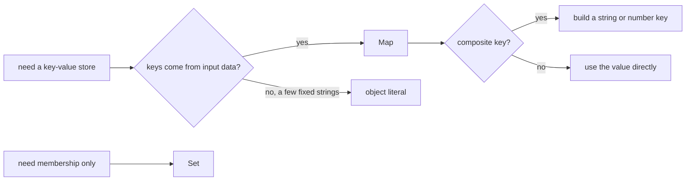

# JavaScript for coding interviews: arrays, strings, Map and Set

## Before this lesson

- You can write a JavaScript function, use `let` and `const`, write `for` loops and `if` statements, and call
  `console.log`. If any of that is new, start with [Values, types and operators](#/lesson/javascript/values-types-operators)
  and [Objects and arrays](#/lesson/javascript/objects-arrays) in the JavaScript track.
- You have met Big-O notation, the shorthand for "how does the running time grow with the input size". The
  lesson [Big-O, Big-Omega and Big-Theta](#/lesson/dsa-foundations/asymptotic-notation) explains it from zero.
- No data-structures background is assumed. When a pattern needs theory, this track links to the matching lesson
  in the Python pattern tracks instead of repeating it.

## In plain words

Imagine two carpenters with the same plan for a table. One knows every tool in the workshop: which saw cuts fast,
which one splinters the wood, which drawer holds the clamps. The other keeps grabbing the wrong tool. Both
understand the plan, but only one finishes on time.

Coding interviews work the same way. The **algorithm** (the plan) is the same in every language, but the
**language** decides which tools you have and where the hidden splinters are. JavaScript has excellent tools for
interviews, such as `Map`, `Set`, spread syntax and destructuring, and also a few traps that Python or Java
programmers do not expect: the default `sort` compares numbers as text, `shift` on an array is slow, object keys
silently become strings, and there is no built-in priority queue.

This lesson covers the everyday tools: **arrays**, **strings**, and the two ways to store key-value data,
**plain objects** and **`Map`/`Set`**. The next lesson covers numbers and sorting. After those two, every
pattern lesson in this track only has to show you the algorithm in JavaScript shape.

Why it matters for a job: interviewers judge both the idea and the code. Writing `nums.shift()` inside a loop, or
`arr.sort()` on numbers, is the kind of slip that turns a correct idea into a wrong or slow program, and they
notice.

## 1. Arrays: JavaScript's dynamic array

A **dynamic array** is a list stored in one block of memory that grows automatically when you add items. In
JavaScript, the array literal `[]` gives you one. You read and write by **index** (the position, starting at 0).

```js-run
const a = [10, 20, 30];      // an array literal with three elements
console.log(a[0]);           // 10  (index 0 is the first element)
console.log(a.length);       // 3
a.push(40);                  // add at the end
console.log(a);              // [ 10, 20, 30, 40 ]
console.log(a.pop());        // 40  (removes and returns the last element)
console.log(a[a.length - 1]);// 30  (the last element)
console.log(a.at(-1));       // 30  (same thing, newer syntax)
console.log(a[99]);          // undefined: reading past the end does not throw
```

Line by line: `push` appends, `pop` removes from the end and returns what it removed, `a.length - 1` is the last
index, and `at(-1)` counts from the end. The last line shows a JavaScript habit to remember: reading a missing
index gives `undefined` instead of an error. That is convenient, but it also lets bugs travel silently.

### What each operation costs

The cost of an array operation depends on **where** it touches the array. Changing the end is cheap; changing
the front means every other element has to move one slot.

| Operation | What it does | Cost |
|---|---|---|
| `a[i]`, `a[i] = x` | read / write by index | O(1) |
| `a.push(x)`, `a.pop()` | add / remove at the end | O(1) amortised |
| `a.shift()`, `a.unshift(x)` | remove / add at the **front** | O(n) |
| `a.splice(i, k, ...)` | remove or insert in the middle | O(n) |
| `a.indexOf(x)`, `a.includes(x)` | search by value | O(n) |
| `a.slice(i, j)`, `[...a]` | copy part or all | O(length copied) |
| `a.sort(cmp)` | sort in place | O(n log n) |

**Amortised** O(1) means "O(1) on average over many operations": once in a while the array has to grow into a
bigger block and copy everything, but that is rare enough that the average stays constant.

The row that bites JavaScript programmers is `shift`. It looks as innocent as `pop`, but it moves every remaining
element. Using it as a queue inside a loop turns an O(n) algorithm into O(n^2). The lesson
[Stacks, queues and deques](#/lesson/dsa-js/stacks-queues) shows the fix.

> [!WARNING]
> Some engines optimise `shift` for small arrays, so a quick test may look fast. Interviewers know the
> specification gives no such promise, and large inputs expose the quadratic cost. Treat `shift` and `unshift`
> as O(n).

### Creating arrays of a given size

Many algorithms start with "an array of n zeros" or "a grid of rows by columns".

```js-run
const zeros = new Array(5).fill(0);              // [0, 0, 0, 0, 0]
const squares = Array.from({ length: 5 }, (_, i) => i * i);
console.log(zeros, squares);

// A 3 x 4 grid of zeros: one NEW inner array per row
const grid = Array.from({ length: 3 }, () => new Array(4).fill(0));
grid[0][0] = 7;
console.log(grid);

// The trap: fill() puts the SAME inner array in every slot
const bad = new Array(3).fill(new Array(4).fill(0));
bad[0][0] = 7;
console.log(bad);       // every row shows 7, because there is only one row object
```

`Array.from({ length: n }, fn)` calls `fn` once per slot, so each row is a brand-new array. `fill(value)` copies
the **same reference** into every slot. For numbers that is harmless; for arrays and objects it means all slots
are one shared object. This is the single most common grid bug in JavaScript interviews.

A second trap is the **hole**: `new Array(5)` without `fill` creates an array with length 5 but no elements.
`map` and `forEach` skip holes, and converting to JSON shows them as `null`. Always `fill` or use `Array.from`.

### Copying and mutating

A **mutating** method changes the array it is called on; a **non-mutating** one returns a new array.

| Mutating | Non-mutating counterpart |
|---|---|
| `push`, `pop`, `shift`, `unshift`, `splice` | `concat`, `slice`, spread `[...a, x]` |
| `sort`, `reverse` | `toSorted`, `toReversed` (ES2023), or copy first: `[...a].sort(cmp)` |

Interview inputs belong to the caller. Sorting `nums` in place is usually allowed, but say so out loud, or copy
first with `[...nums]`. Copies made with spread or `slice` are **shallow**: the outer array is new, but inner
arrays are still shared.

```js-run
const pairs = [[1, 2], [3, 4]];
const shallow = [...pairs];
shallow[0][0] = 99;                  // changes the inner array both share
console.log(pairs[0][0]);            // 99
const deep = pairs.map((p) => [...p]);
deep[1][0] = -1;
console.log(pairs[1][0]);            // 3: the deep copy has its own inner arrays
```

### Comparing arrays

`===` on arrays compares **identity** (are these the same object?), never contents. `[1, 2] === [1, 2]` is
`false`. To compare contents, loop, or for small arrays compare `a.join(",") === b.join(",")`. This also explains
why arrays make poor `Map` keys, as section 4 shows.

## 2. Strings: immutable sequences of characters

A **string** in JavaScript is an **immutable** sequence of UTF-16 code units. **Immutable** means it can never be
changed after it is created: every "change" builds a new string. **UTF-16 code unit** is the 16-bit number used
to store a character; ordinary English letters, digits and symbols each take exactly one unit, so for interview
inputs "one character = one index" holds.

```js-run
const s = "hello";
console.log(s[1], s.length);          // "e" 5
s[0] = "J";                           // silently ignored (it would throw in strict-mode modules)
console.log(s);                       // still "hello"
const t = "J" + s.slice(1);           // build a NEW string instead
console.log(t);                       // "Jello"
console.log(s.charCodeAt(0));         // 104, the code of "h"
console.log("a".charCodeAt(0));       // 97
console.log(String.fromCharCode(97 + 2));   // "c"
```

`charCodeAt(i)` turns a character into a number, which is how you index a 26-slot count array:
`counts[s.charCodeAt(i) - 97]++` for lowercase letters (97 is the code of `"a"`).

### Building strings in a loop

Because strings are immutable, `result += piece` in a loop creates new strings repeatedly. Modern engines use
clever internal representations ("ropes") that make `+=` fast in practice, so for interview sizes it is usually
fine. The pattern that is always safe and reads clearly is: collect pieces in an array, then `join` once.

```js-run
const parts = [];
for (let i = 0; i < 5; i++) parts.push(String(i));
console.log(parts.join("-"));          // "0-1-2-3-4"

// Reversing a string: strings have no reverse(), arrays do
const word = "stressed";
console.log([...word].reverse().join(""));   // "desserts"

// Splitting and joining
console.log("a,b,,c".split(","));             // [ 'a', 'b', '', 'c' ]
console.log("  trim me ".trim());             // "trim me"
console.log("abc".repeat(3));                 // "abcabcabc"
console.log("x".padStart(4, "0"));            // "000x"
```

`[...word]` spreads the string into an array of characters. That also handles emoji correctly, because spread
iterates by **code points** (whole characters), while `split("")` cuts by code units.

### Comparing and slicing strings

`<` and `>` compare strings **lexicographically**, like a dictionary, by code unit: `"apple" < "banana"` is
`true`, but `"Zebra" < "apple"` is also `true` because uppercase letters have smaller codes than lowercase ones.
And `"10" < "9"` is `true`, because the first characters `"1"` and `"9"` decide. Keep that last example in mind:
it is exactly what goes wrong with the default sort in the next lesson.

`s.slice(i, j)` returns characters `i` up to but not including `j`, in O(j - i) time. Negative indices count from
the end. Prefer `slice` over the older `substring` and `substr`.

> [!TIP]
> Iterating with `for (const c of s)` is clean and handles any character. When you need speed and only ASCII,
> `for (let i = 0; i < s.length; i++)` with `s.charCodeAt(i)` avoids creating one-character strings.

## 3. Plain objects as maps, and why they surprise people

A **map** (also called dictionary or hash table) stores **key-value pairs** and finds a value by its key in O(1)
time on average. JavaScript programmers have long used plain objects for this:

```js-run
const age = {};
age["ann"] = 31;
age.bob = 27;
console.log(age.ann, age["bob"], age.carl);   // 31 27 undefined
console.log("ann" in age, Object.keys(age));  // true [ 'ann', 'bob' ]
```

It works, but objects were designed as records with named fields, not as general maps. Four surprises follow.

1. **Keys become strings.** `obj[1]` and `obj["1"]` are the same slot. Using an array as a key stores the key
   `"1,2"`; using an object stores `"[object Object]"`, so every object collides.
2. **Inherited names exist already.** Every object inherits from `Object.prototype`, so `"toString" in {}` and
   `"constructor" in {}` are `true`. A word-count program that sees the word "constructor" reads a function
   instead of a number. `Object.create(null)` makes an object with no inherited names.
3. **Falsy values fool shortcuts.** `if (seen[x])` fails when the stored value is `0`, and
   `count[x] = count[x] + 1` produces `NaN` for a missing key (`undefined + 1`).
4. **Order is not insertion order for numeric keys.** Integer-like keys are listed first in ascending numeric
   order, then the other keys in insertion order.

```js-run
const m = {};
m[[1, 2]] = "pair";            // the key is the string "1,2"
m[{ a: 1 }] = "obj1";
m[{ b: 2 }] = "obj2";          // overwrites! both objects become "[object Object]"
console.log(Object.keys(m));

const counts = {};
for (const w of ["to", "be", "constructor"]) counts[w] = (counts[w] || 0) + 1;
console.log(counts.constructor);   // a weird string, not 1: the inherited function got mixed in

const order = {};
order.b = 1; order[10] = 2; order.a = 3; order[2] = 4;
console.log(Object.keys(order));   // [ '2', '10', 'b', 'a' ]
```

Look at the third line of output: `counts.constructor` was `Object`'s constructor function, so `(fn || 0) + 1`
glued a function's source text to `"1"`. Objects are fine for small fixed sets of string keys, such as a lookup
table `{ ")": "(", "]": "[" }`. For anything driven by input data, use `Map`.

## 4. Map and Set: the right hash tables

`Map` and `Set` were added to the language precisely to fix the problems above.

- A **`Map`** stores key-value pairs. Keys can be any value (numbers stay numbers), there are no inherited keys,
  it remembers **insertion order**, and it knows its own `size`.
- A **`Set`** stores unique values with fast membership tests.

```js-run
const freq = new Map();
for (const x of [3, 1, 3, 2, 3, 1]) {
  freq.set(x, (freq.get(x) || 0) + 1);     // counting idiom
}
console.log(freq);                         // Map(3) { 3 => 3, 1 => 2, 2 => 1 }
console.log(freq.get(3), freq.has(7), freq.size);
for (const [value, count] of freq) console.log(value, count);   // insertion order
freq.delete(1);
console.log([...freq.keys()], [...freq.values()], [...freq.entries()]);

const seen = new Set([1, 2, 2, 3]);
console.log(seen.size, seen.has(2));       // 3 true
seen.add(4);
console.log([...seen]);                    // [ 1, 2, 3, 4 ]
```

The counting idiom `map.set(x, (map.get(x) || 0) + 1)` is the JavaScript version of Python's
`collections.Counter`. `|| 0` turns a missing key's `undefined` into `0`; here it is safe because a stored count is
never 0. Where 0 is a legitimate stored value, use `?? 0` instead: `??` (the **nullish coalescing** operator)
only replaces `null` and `undefined`, never `0` or `""`.

### How Map decides two keys are equal

`Map` and `Set` compare keys with an algorithm called **SameValueZero**: like `===`, except that `NaN` equals
`NaN`. For objects and arrays that means **identity**: two different arrays with equal contents are two
different keys.

```js-run
const m = new Map();
m.set([1, 2], "first");
console.log(m.get([1, 2]));        // undefined: a different array object
const key = [1, 2];
m.set(key, "second");
console.log(m.get(key));           // "second": same object

// Fix: turn composite keys into strings (or numbers) yourself
const grid = new Map();
const k = (r, c) => r + "," + c;   // "2,3"
grid.set(k(2, 3), "tree");
console.log(grid.get(k(2, 3)));    // "tree"
```

Composite keys (a row and a column, a sorted word, a pair of indices) therefore need a **canonical** string or
number: `r + "," + c`, `counts.join(",")`, or `r * cols + c` for grid cells. Numeric keys are faster than
strings, which matters in tight loops.

### Choosing between them

| Need | Use |
|---|---|
| "Have I seen x?" | `Set` |
| Count or index things by key | `Map` |
| Fixed table of a few string keys written in the code | object literal |
| Keys are small integers 0..n-1 | plain array, or a typed array such as `Int32Array` |
| Need sorted keys | sort `[...map.keys()]` when needed; JavaScript has no built-in sorted map |

Average cost: `get`, `set`, `has`, `add` and `delete` are O(1). Iterating is O(n). There is no ordered tree map
in the standard library, so "smallest key greater than x" style problems need a sorted array with binary search
or a heap.

## 5. Worked example: Two Sum and Group Anagrams in JavaScript shape

The theory of these problems lives in the Python lesson
[The Arrays and Hashing pattern](#/lesson/neet-arrays/arrays-hashing-pattern). Here is what the JavaScript
versions look like, and where the language details above show up.

```js-run
function twoSum(nums, target) {
  const indexOf = new Map();               // value -> index
  for (let i = 0; i < nums.length; i++) {
    const need = target - nums[i];
    if (indexOf.has(need)) return [indexOf.get(need), i];   // has(), not a truthy check
    indexOf.set(nums[i], i);
  }
  return [];
}
console.log(twoSum([3, 8, 11, 5], 13));    // [ 1, 3 ]
console.log(twoSum([0, 4, 3, 0], 0));      // [ 0, 3 ]: index 0 is stored and found

function groupAnagrams(words) {
  const groups = new Map();
  for (const w of words) {
    const counts = new Array(26).fill(0);
    for (let i = 0; i < w.length; i++) counts[w.charCodeAt(i) - 97]++;
    const key = counts.join(",");          // canonical string key
    if (!groups.has(key)) groups.set(key, []);
    groups.get(key).push(w);
  }
  return [...groups.values()];
}
console.log(groupAnagrams(["eat", "tea", "tan", "ate", "nat", "bat"]));
```

Three JavaScript-specific decisions appear here:

1. `indexOf.has(need)` instead of `if (indexOf.get(need))`, because a stored index can be `0`.
2. The anagram signature becomes a **string** so that equal signatures land on the same `Map` key.
3. `[...groups.values()]` converts the map's iterator into an array, because the caller expects an array.



## 6. Destructuring and spread: small tools you will use constantly

**Destructuring** pulls values out of arrays or objects into variables. **Spread** (`...`) expands an iterable
into separate elements. Both make interview code shorter and clearer.

```js-run
const [first, second, ...rest] = [5, 6, 7, 8];
console.log(first, second, rest);        // 5 6 [ 7, 8 ]

let a = 1, b = 2;
[a, b] = [b, a];                         // swap without a temporary
console.log(a, b);                       // 2 1

const intervals = [[1, 3], [2, 6]];
for (const [start, end] of intervals) console.log(start, end);

const nums = [4, 1, 9];
console.log(Math.max(...nums));          // 9: spread passes each element as an argument
```

> [!WARNING]
> `Math.max(...arr)` passes every element as a separate function argument. Engines limit the number of
> arguments (often somewhere between tens of thousands and a few hundred thousand), so on very large arrays
> it throws `RangeError`. Use a loop or `arr.reduce((m, x) => Math.max(m, x), -Infinity)` for big inputs.

Swapping with `[a, b] = [b, a]` creates a small temporary array. It is perfectly fine in interviews; in a
hot loop that runs millions of times, a plain temporary variable is a little faster.

## 7. Common pitfalls in this lesson

- Using `shift`/`unshift` in a loop: O(n) each, so the loop becomes O(n^2).
- `new Array(n).fill([])` or `fill({})`: one shared object in every slot.
- Plain objects as maps for input-driven keys: string conversion, inherited names, and `0` being falsy.
- Arrays or objects as `Map` keys: compared by identity, not contents. Build a string or numeric key.
- `if (map.get(k))` when the value can be `0` or `""`: use `map.has(k)`.
- Forgetting that `sort` and `reverse` change the original array.
- Expecting `[1,2] === [1,2]` to be `true`.

## 8. Summary

- Arrays are dynamic arrays: cheap at the end, expensive at the front. Build grids with `Array.from` so each row
  is its own array.
- Strings are immutable; build with arrays and `join`, read characters with `s[i]` or `charCodeAt`.
- Prefer `Map` and `Set` over plain objects whenever keys come from the input. They keep types, have no inherited
  keys, and remember insertion order.
- `Map` keys are compared by identity for objects, so composite keys must be turned into strings or numbers.
- The theory of hashing patterns is in the Python track; the JavaScript work is choosing the right container and
  avoiding the traps above.

## Glossary

- **Dynamic array**: a list in one contiguous block of memory that grows automatically; JavaScript's `[]`.
- **Amortised cost**: the average cost per operation over a long sequence, even if a few operations are slow.
- **Mutating method**: a method that changes the object it is called on, such as `sort` or `push`.
- **Shallow copy**: a new outer container whose elements are the same objects as the original's.
- **Immutable**: cannot be changed after creation; JavaScript strings are immutable.
- **UTF-16 code unit**: the 16-bit number JavaScript uses per string index.
- **Map / Set**: built-in hash-based collections of key-value pairs / unique values.
- **SameValueZero**: the equality used by `Map` and `Set`: like `===`, but `NaN` equals `NaN`.
- **Canonical key**: a single string or number that represents a composite key, so equal composites share a key.
- **Nullish coalescing (`??`)**: returns the right side only when the left side is `null` or `undefined`.

## Check yourself

```quiz
[
  {"q": "What is the time cost of `arr.shift()` on an array of n elements?", "options": ["O(1)", "O(log n)", "O(n)", "O(n log n)"], "answer": 2,
   "explain": "Removing the first element moves every remaining element one slot to the left, so it is linear. Using it as a queue inside a loop gives O(n^2) overall."},
  {"q": "After `const g = new Array(2).fill(new Array(2).fill(0)); g[0][0] = 5;`, what is `g[1][0]`?", "options": ["0", "5", "undefined", "It throws"], "answer": 1,
   "explain": "`fill` stores the same inner array in both slots, so changing row 0 also changes row 1. Use `Array.from({ length: 2 }, () => new Array(2).fill(0))`."},
  {"q": "Why does `const m = new Map(); m.set([1, 2], 'x'); m.get([1, 2])` return undefined?", "options": ["Maps cannot store arrays", "Array keys are compared by identity, and the second array is a different object", "The key was converted to the string 1,2", "get only works with string keys"], "answer": 1,
   "explain": "Map uses SameValueZero, which compares objects by identity. Build a canonical key such as `'1,2'` instead."},
  {"q": "Which check correctly tests whether key `k` is stored in Map `m` when stored values may be 0?", "options": ["`if (m.get(k))`", "`if (m.has(k))`", "`if (m[k])`", "`if (k in m)`"], "answer": 1,
   "explain": "`m.get(k)` returns 0 for a stored 0, which is falsy. `m[k]` and `in` look at object properties, not map entries."},
  {"q": "What does `Object.keys(o)` return after `o.b = 1; o[10] = 2; o.a = 3; o[2] = 4`?", "options": ["`['b', '10', 'a', '2']`", "`['2', '10', 'b', 'a']`", "`['a', 'b', '2', '10']`", "`['10', '2', 'b', 'a']`"], "answer": 1,
   "explain": "Integer-like keys come first in ascending numeric order, then string keys in insertion order. Map keeps pure insertion order."},
  {"q": "What is the safest general way to reverse a string `s` in JavaScript?", "options": ["`s.reverse()`", "`[...s].reverse().join('')`", "`s.split().reverse()`", "`s.sort().reverse()`"], "answer": 1,
   "explain": "Strings are immutable and have no reverse method. Spreading into an array, reversing and joining builds a new string, and spread keeps multi-unit characters intact."},
  {"q": "In a word-count object built with `counts[w] = (counts[w] || 0) + 1`, why can the word 'constructor' produce garbage?", "options": ["Objects cannot have keys longer than 8 characters", "`counts.constructor` already exists through Object.prototype, so the first read returns a function", "The key becomes a number", "It works fine"], "answer": 1,
   "explain": "Every plain object inherits `constructor`, `toString` and others. Use a Map, or `Object.create(null)`, for input-driven keys."}
]
```

> **Source:** ECMAScript Language Specification (Array, String, Map and Set objects); MDN Web Docs pages for
> Array, String, Map, Set and Object; NeetCode roadmap, Arrays and Hashing. Written in original words for this track.
