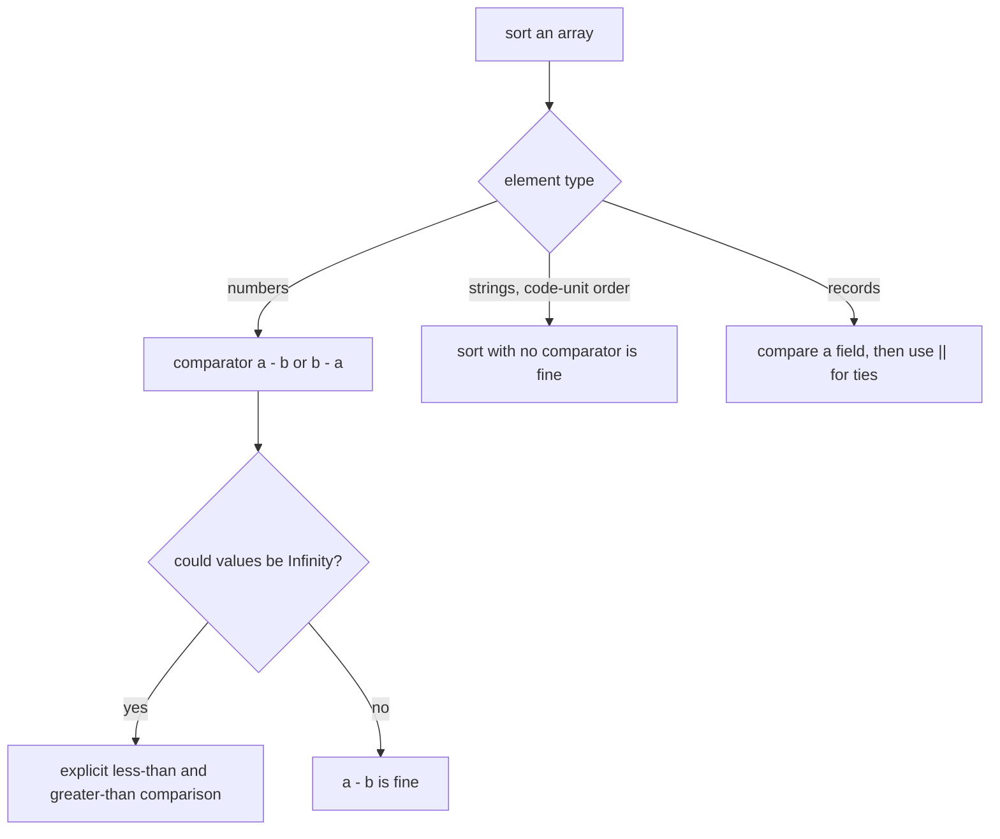

# Numbers and sorting without surprises

## Before this lesson

- The previous lesson, [JavaScript for coding interviews](#/lesson/dsa-js/js-toolkit): arrays, strings, `Map`.
- Comfort with arithmetic operators `+ - * / %` and with writing small functions, including arrow functions
  such as `(a, b) => a - b`. [Functions and scope](#/lesson/javascript/functions-scope) covers them.
- Optional background: [Integers, bits and bytes](#/lesson/csapp/bits-bytes) explains binary and two's complement
  in depth; this lesson only needs the basic idea that numbers are stored in a fixed number of bits.

## In plain words

Picture a calculator with a 16-digit display. It handles everyday sums perfectly, but type a 20-digit number and
the last digits quietly turn into zeros. Nothing flashes, nothing beeps: the answer is simply a little wrong.

JavaScript's ordinary numbers behave like that calculator. Every number, whether you write `7` or `7.5`, is stored
as a 64-bit **floating-point** value, a format that keeps about 15 to 17 significant decimal digits. Whole numbers
are exact up to about nine quadrillion; beyond that, JavaScript starts rounding without telling you. Interview
problems that multiply large values, or ask for an answer "modulo 1,000,000,007", walk straight into that limit.

The second half of the lesson is about **sorting**. JavaScript's `sort()` without arguments sorts everything as
**text**, so `[10, 9, 1]` becomes `[1, 10, 9]`. It is the most famous JavaScript interview trap, and it is easy to
avoid once you understand the **comparator**, the small function that tells `sort` which of two items comes first.

Why it matters for a job: wrong integer division, a negative remainder, or a text-sorted array produce answers
that look plausible and fail hidden tests. Knowing these rules lets you write the right line the first time and
explain why.

## 1. One number type: the 64-bit double

JavaScript has one everyday numeric type, `number`, which follows the IEEE-754 **double precision** standard. A
**double** stores a sign, an exponent and 52 bits of fraction, which together give 53 bits of precision.
Consequences:

- Every integer from `-(2^53 - 1)` to `2^53 - 1` is stored **exactly**. That bound is
  `Number.MAX_SAFE_INTEGER`, which equals `9007199254740991` (about 9 * 10^15).
- Past that, not every integer can be represented, so results get rounded to a nearby representable value.
- Decimal fractions like `0.1` cannot be stored exactly in binary, so tiny rounding errors appear.

```js-run
console.log(Number.MAX_SAFE_INTEGER);            // 9007199254740991
console.log(2 ** 53 === 2 ** 53 + 1);            // true: 2^53 + 1 is not representable
console.log(Number.isSafeInteger(2 ** 53));      // false
console.log(0.1 + 0.2);                          // 0.30000000000000004
console.log(0.1 + 0.2 === 0.3);                  // false
console.log(Math.abs(0.1 + 0.2 - 0.3) < 1e-9);   // true: compare floats with a tolerance
console.log(7 / 2);                              // 3.5: "/" never does integer division
```

The last line is the second big difference from Java or C: `/` always produces the exact fractional result.
There is no separate integer division operator. Section 3 shows how to get one.

**What fits safely?** Interview constraints usually say values are below `10^9` and arrays have at most `10^5`
elements. Sums of `10^5` values below `10^9` reach `10^14`: safe. Products of two values below `10^9` reach
`10^18`: **not** safe. That multiplication case is where you need care.

> [!NOTE]
> Integers inside the safe range behave exactly like mathematical integers for `+`, `-` and `*`, as long as
> every intermediate result also stays below `2^53`. You do not need special handling for typical counting,
> summing and indexing.

## 2. BigInt for integers of any size

A **BigInt** is a separate numeric type for whole numbers of arbitrary size. You write one with an `n` suffix
(`123n`) or convert with `BigInt(123)`. BigInt arithmetic is exact no matter how large the numbers get.

```js-run
console.log(2n ** 64n);                    // 18446744073709551616n
console.log(typeof 10n);                   // "bigint"
console.log(7n / 2n, -7n / 2n);            // 3n -3n: division truncates toward zero
console.log(BigInt(2 ** 40) * 3n);         // convert a safe Number first
console.log(Number(12345678901234567890n));// back to a (rounded) Number
try {
  console.log(1n + 1);                     // mixing types is an error
} catch (e) {
  console.log(String(e));
}
```

Rules worth remembering:

- You cannot mix BigInt and Number in one arithmetic expression; convert one side explicitly.
- `Math.max`, `Math.floor` and friends do not accept BigInts.
- `JSON.stringify` throws on a BigInt, so convert results with `Number(x)` or `String(x)` before returning them
  from a function whose result is serialised (the test harness in this track does that).
- BigInt is noticeably slower than Number. Use it for the specific large multiplications, not everywhere.

### The modulo 1,000,000,007 problem

Counting problems often say "return the answer modulo `10^9 + 7`". Additions stay below `2 * 10^9`, which is fine,
but multiplying two residues gives up to about `10^18`, which a Number cannot hold exactly.

```js-run
const MOD = 1_000_000_007;               // underscores are allowed in numeric literals
const a = MOD - 1, b = MOD - 1;
console.log((a * b) % MOD);              // wrong: the product was rounded first
console.log(Number((BigInt(a) * BigInt(b)) % BigInt(MOD)));   // 1, the true answer

function mulMod(x, y, m) {               // exact multiplication modulo m via BigInt
  return Number((BigInt(x) * BigInt(y)) % BigInt(m));
}
console.log(mulMod(a, b, MOD));          // 1
```

`(MOD - 1)^2 mod MOD` must be `1`, because `MOD - 1` behaves like `-1`. The plain Number version prints
`999999972`, an answer that looks reasonable and is wrong. Whenever two numbers below `10^9` get multiplied
before a modulo, route the multiplication through BigInt (or a helper like `mulMod`).

## 3. Integer division and rounding toward zero or down

Since `/` gives fractions, you choose how to round. The four common tools disagree on **negative** numbers:

| Expression | `7 / 2 = 3.5` | `-7 / 2 = -3.5` | Notes |
|---|---|---|---|
| `Math.floor(x)` | 3 | -4 | rounds down, toward minus infinity |
| `Math.trunc(x)` | 3 | -3 | rounds toward zero |
| `x \| 0` | 3 | -3 | toward zero, but converts to a **32-bit** integer first |
| `Math.ceil(x)` | 4 | -3 | rounds up |

```js-run
console.log(Math.floor(-7 / 2), Math.trunc(-7 / 2), (-7 / 2) | 0, Math.ceil(-7 / 2));
console.log((2 ** 31) | 0);         // -2147483648: wrapped around to a negative number
console.log((2 ** 32 + 5) | 0);     // 5: the high bits were thrown away
console.log(Math.trunc(2 ** 40 / 3));   // 366503875925: Math.trunc has no 32-bit limit
console.log(Math.ceil(10 / 3));     // 4: "how many hours to eat 10 bananas at 3 per hour"
```

Which one to use:

- **Midpoints of indices** (`(lo + hi) / 2` with non-negative indices): all agree. `(lo + hi) >> 1` and
  `Math.floor((lo + hi) / 2)` are both common.
- **Division that must truncate toward zero**, like Evaluate Reverse Polish Notation (`-7 / 2` must give `-3`):
  `Math.trunc`. `Math.floor` would give `-4`.
- **Ceiling of a positive ratio**, like Koko Eating Bananas: `Math.ceil(p / k)`, or the integer trick
  `Math.floor((p + k - 1) / k)`.
- `| 0` and `~~x` are fast truncation, but only for values that fit in 32 bits (about plus or minus 2.1 billion).
  Beyond that they silently wrap. Use them only when you know the range.

## 4. The remainder operator `%` and negative numbers

`%` returns the **remainder** of division, and its sign follows the **left** operand (the dividend). Many
mathematical uses expect the **modulo**, which is never negative for a positive divisor.

```js-run
console.log(7 % 3, -7 % 3, 7 % -3);      // 1 -1 1
const mod = (a, m) => ((a % m) + m) % m; // true modulo for positive m
console.log(mod(-7, 3), mod(7, 3));      // 2 1

// Typical uses: wrap around a circular array, and parity checks
const n = 5;
let i = 0;
i = mod(i - 1, n);                        // stepping left from index 0 lands on 4
console.log(i);
console.log(-3 % 2 === 1, Math.abs(-3 % 2) === 1);   // false true: be careful with odd checks
```

The last line is a classic bug: `x % 2 === 1` is **false** for negative odd numbers because `-3 % 2` is `-1`.
Test odd numbers with `x % 2 !== 0`, or `(x & 1) === 1` for values in 32-bit range.

## 5. Special values: NaN, Infinity and negative zero

- **`NaN`** ("not a number") results from invalid arithmetic like `0 / 0` or `undefined + 1`. It is not equal to
  anything, including itself. Test with `Number.isNaN(x)`.
- **`Infinity`** results from overflow or division by a non-zero number by zero. It is a handy sentinel:
  `let best = Infinity` before a minimum search, `-Infinity` before a maximum search. `Infinity + 1` is still
  `Infinity`, which makes "impossible" states in DP tables easy.
- **`-0`** (negative zero) appears from things like `-3 * 0`. It is `===` to `0` and prints as `0` in JSON, but
  `Object.is(-0, 0)` is `false` and `1 / -0` is `-Infinity`. It rarely matters in interviews.

```js-run
console.log(0 / 0, NaN === NaN, Number.isNaN(0 / 0));   // NaN false true
console.log(5 / 0, -5 / 0, 0 * Infinity);                // Infinity -Infinity NaN
let best = Infinity;
for (const x of [7, 3, 9]) best = Math.min(best, x);
console.log(best);                                       // 3
console.log(-3 * 0, Object.is(-3 * 0, 0), JSON.stringify(-0));
```

JavaScript does **not** throw on division by zero. A divide-by-total approach that hits a zero quietly produces
`Infinity` or `NaN`, which then spreads through every later calculation.

### Parsing numbers from strings

`Number("42")` converts a whole string and returns `NaN` if any part is not numeric. `parseInt(str, 10)` reads
digits from the start and stops at the first non-digit. Two traps:

```js-run
console.log(Number("12px"), parseInt("12px", 10));   // NaN 12
console.log(["1", "2", "3"].map(parseInt));          // [ 1, NaN, NaN ]
console.log(["1", "2", "3"].map(Number));            // [ 1, 2, 3 ]
console.log(parseInt(0.0000005));                    // 5, because String(0.0000005) is "5e-7"
```

`map` passes `(value, index)`, and `parseInt` treats its second argument as the **radix** (number base), so the
index becomes the base. Use `map(Number)` or `map((s) => parseInt(s, 10))`.

## 6. Sorting: the default sort compares text

`Array.prototype.sort` sorts an array **in place** and returns the same array. Without arguments, it converts
every element to a string and compares the strings by UTF-16 code units.

```js-run
console.log([10, 9, 1, 100].sort());        // [ 1, 10, 100, 9 ]
console.log([-1, -4, 2, -10].sort());       // [ -1, -10, -4, 2 ]
console.log(["b", "a", "B", "A"].sort());   // [ 'A', 'B', 'a', 'b' ]: uppercase codes are smaller
console.log([3, undefined, 1].sort());      // undefined always goes last
```

`"10"` comes before `"9"` because the first characters `"1"` and `"9"` decide. Negative numbers sort even more
strangely because `"-"` is compared as a character. **Never call `sort()` without a comparator on numbers.**

### The comparator contract

A **comparator** is a function `(a, b) => number`. Its sign tells `sort` the order:

- negative: `a` comes before `b`
- positive: `a` comes after `b`
- zero: keep their relative order (they are "equal" for sorting purposes)

```js-run
const nums = [10, 9, 1, 100, -5];
console.log([...nums].sort((a, b) => a - b));     // ascending  [ -5, 1, 9, 10, 100 ]
console.log([...nums].sort((a, b) => b - a));     // descending [ 100, 10, 9, 1, -5 ]

// A boolean comparator breaks the contract: true/false become 1/0, never negative
console.log([3, 1, 2].sort((a, b) => a > b));     // not sorted in V8
```

`a - b` is negative exactly when `a < b`, so it implements ascending order in one expression. The boolean version
`(a, b) => a > b` returns only `1` or `0`, never a negative number, so the engine is told "a is never before b"
and the result depends on the algorithm's internals. In Node it leaves `[3, 1, 2]` unchanged.

> [!WARNING]
> `a - b` misbehaves when both values are `Infinity` (or both `-Infinity`): `Infinity - Infinity` is `NaN`.
> If sentinels can appear, write the comparison out: `(a, b) => (a < b ? -1 : a > b ? 1 : 0)`.

### Sorting records: arrays of pairs and multiple keys

Interview data is often pairs or triples: intervals `[start, end]`, points `[x, y]`, words with counts. Sort by
one field, and break ties with a second field using `||`, which picks the right side only when the left side is
`0`:

```js-run
const intervals = [[5, 7], [1, 9], [1, 3], [10, 2]];
intervals.sort((a, b) => a[0] - b[0] || a[1] - b[1]);   // by start, then by end
console.log(JSON.stringify(intervals));                 // [[1,3],[1,9],[5,7],[10,2]]

const words = [["pear", 2], ["fig", 5], ["apple", 2], ["kiwi", 5]];
// count descending, then word ascending (alphabetical by code units)
words.sort((a, b) => b[1] - a[1] || (a[0] < b[0] ? -1 : a[0] > b[0] ? 1 : 0));
console.log(JSON.stringify(words));
```

Calling `intervals.sort()` with no comparator would convert each pair to a string like `"10,2"` and sort those, so
`[10, 2]` would come before `[5, 7]`. Same trap, harder to spot.

### Strings: `<` versus `localeCompare`

For strings, `a < b` compares code units (uppercase before lowercase, `"Z" < "a"`). `a.localeCompare(b)` uses
human language rules (`"a"` before `"B"`). Interview problems that say "lexicographic order" almost always mean
code-unit order, which is also what the default `sort()` does for strings. Use `localeCompare` only when the task
asks for dictionary order that ignores case or accents.

### Stability, cost and copies

- Since ES2019 the specification requires `sort` to be **stable**: items that compare equal keep their original
  order. You can sort by a secondary key first and the primary key second, and ties stay ordered.
- V8 (Chrome, Node) uses TimSort: O(n log n) time, O(n) extra space in the worst case.
- `sort` mutates. `[...a].sort(cmp)` or `a.toSorted(cmp)` (ES2023) leaves the original alone.
- **Typed arrays** such as `Int32Array` and `Float64Array` sort **numerically** by default:
  `Int32Array.from([10, 9, 1]).sort()` gives `1, 9, 10`. That is a handy fast path for large integer arrays.



## 7. Worked example: three bugs in one function

Here is a "median of the array" helper with three classic number and sort bugs, followed by the corrected
version.

```js-run
function medianBuggy(nums) {
  nums.sort();                                // bug 1: text sort, and mutates the input
  const mid = nums.length / 2;                // bug 2: fractional index for odd lengths
  return nums.length % 2 === 1 ? nums[mid] : (nums[mid - 1] + nums[mid]) / 2;
}
function median(nums) {
  const s = [...nums].sort((a, b) => a - b);  // numeric sort on a copy
  const mid = s.length >> 1;                  // integer midpoint
  return s.length % 2 !== 0 ? s[mid] : (s[mid - 1] + s[mid]) / 2;
}
console.log(medianBuggy([10, 9, 1]));        // undefined (index 1.5)
console.log(median([10, 9, 1]));             // 9
console.log(median([4, 10, 2, 8]));          // 6
console.log(median([-5, -1, -3]));           // -3
```

Bug 3 is quieter: `% 2 === 1` is a parity test that fails for negative numbers. It happens to be safe for a
length, which is never negative, but the habit breaks elsewhere, so the fixed version uses `!== 0`. It also sorts
a copy numerically and computes an integer midpoint.

## 8. Summary

- All ordinary numbers are doubles: integers are exact up to `Number.MAX_SAFE_INTEGER` (about 9 * 10^15).
  Products of two values near `10^9` exceed it; use BigInt for those multiplications.
- `/` gives fractions. Choose `Math.floor`, `Math.trunc`, `Math.ceil` deliberately; `| 0` truncates but only in
  32-bit range.
- `%` keeps the sign of the dividend; use `((a % m) + m) % m` for a true modulo.
- `NaN`, `Infinity` and `-0` exist and division by zero does not throw.
- `sort()` without a comparator sorts as text. Use `(a, b) => a - b`, never a boolean comparator, and remember
  `sort` mutates the array.

## Glossary

- **Floating point (double)**: the 64-bit number format JavaScript uses for every `number`.
- **`Number.MAX_SAFE_INTEGER`**: `2^53 - 1`, the largest integer below which every integer is exactly representable.
- **BigInt**: an arbitrary-precision integer type written with an `n` suffix.
- **Truncation**: rounding toward zero (`Math.trunc`).
- **Floor**: rounding toward minus infinity (`Math.floor`).
- **Remainder vs modulo**: `%` gives a remainder with the dividend's sign; modulo is always in `0..m-1`.
- **Comparator**: a function `(a, b)` returning a negative, zero or positive number to order two items.
- **Lexicographic order**: dictionary order, comparing position by position.
- **Stable sort**: a sort that keeps equal items in their original relative order.
- **Radix**: the number base, such as 10 or 2, used by `parseInt`.

## Check yourself

```quiz
[
  {"q": "What does `[10, 9, 1, 100].sort()` return?", "options": ["`[1, 9, 10, 100]`", "`[1, 10, 100, 9]`", "`[100, 10, 9, 1]`", "`[9, 10, 100, 1]`"], "answer": 1,
   "explain": "Without a comparator, sort converts elements to strings and compares them as text, so '10' and '100' come before '9'."},
  {"q": "Which expression evaluates `-7 / 2` with truncation toward zero, as Evaluate Reverse Polish Notation requires?", "options": ["`Math.floor(-7 / 2)`", "`Math.trunc(-7 / 2)`", "`Math.round(-7 / 2)`", "`-7 % 2`"], "answer": 1,
   "explain": "Math.trunc(-3.5) is -3. Math.floor gives -4, which rounds toward minus infinity."},
  {"q": "What does `-7 % 3` evaluate to in JavaScript?", "options": ["2", "-1", "1", "-2"], "answer": 1,
   "explain": "The remainder takes the sign of the dividend. For a value in 0..m-1 use `((a % m) + m) % m`, which gives 2."},
  {"q": "Why can `(a * b) % 1000000007` be wrong for a and b just below 10^9?", "options": ["The modulo operator does not work on large numbers", "The product exceeds Number.MAX_SAFE_INTEGER and is rounded before the modulo", "JavaScript integers overflow at 2^31", "It is always correct"], "answer": 1,
   "explain": "The product is about 10^18, beyond 2^53, so low digits are lost. Multiply as BigInts and convert back with Number()."},
  {"q": "What is wrong with `arr.sort((a, b) => a > b)`?", "options": ["Nothing, it sorts ascending", "The comparator returns booleans, which never signal 'a before b', so the order is unreliable", "It sorts descending", "It throws a TypeError"], "answer": 1,
   "explain": "true and false become 1 and 0; the contract needs a negative value for 'a first'. Use `(a, b) => a - b`."},
  {"q": "What is `(2 ** 31) | 0`?", "options": ["2147483648", "0", "-2147483648", "It throws"], "answer": 2,
   "explain": "The `|` operator converts its operands to signed 32-bit integers, so 2^31 wraps to the most negative 32-bit value."},
  {"q": "Which call parses an array of numeric strings correctly?", "options": ["`['1','2','3'].map(parseInt)`", "`['1','2','3'].map(Number)`", "Both", "Neither"], "answer": 1,
   "explain": "map passes the index as parseInt's second argument (the radix), giving [1, NaN, NaN]. Number takes one argument."},
  {"q": "You sort pairs by start, breaking ties by end. Which comparator is right?", "options": ["`(a, b) => a[0] - b[0] || a[1] - b[1]`", "`(a, b) => a[0] - b[0] && a[1] - b[1]`", "`(a, b) => a[0] > b[0]`", "`(a, b) => a - b`"], "answer": 0,
   "explain": "`||` falls through to the second comparison only when the first difference is 0, which is exactly a tie on start."}
]
```

> **Source:** ECMAScript Language Specification (Number type, BigInt, `Array.prototype.sort`, bitwise and
> multiplicative operators); MDN Web Docs pages for Number, BigInt, Math and Array.prototype.sort. Written in
> original words for this track.
