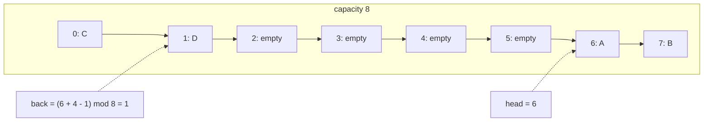

# Stacks, queues and deques in JavaScript

## Before this lesson

- [JavaScript for coding interviews](#/lesson/dsa-js/js-toolkit): arrays, `push`, `pop`, and the cost table that
  marks `shift` as O(n).
- Writing a small `class` with a `constructor` and methods. If classes are new, read
  [Prototypes and classes](#/lesson/javascript/prototypes-classes) first; the next lessons in this track also
  explain them as they go.
- Optional theory: [Stacks and their applications](#/lesson/dsa-foundations/stacks) and
  [Queues and deques](#/lesson/dsa-foundations/queues-deques) describe these structures language-independently.

## In plain words

Three everyday lines of things:

- A **stack** is a pile of plates. You add to the top and take from the top. The last plate added is the first
  one taken: **LIFO**, last in, first out.
- A **queue** is the line at a bakery. People join at the back and are served from the front: **FIFO**, first
  in, first out.
- A **deque** (pronounced "deck", short for **double-ended queue**) is a line where you may join or leave at
  either end, like a train you can board from the front or the back.

JavaScript gives you a stack for free: an array with `push` and `pop`. It does **not** give you a fast queue or
deque. The obvious tool, `shift()`, removes the first element by sliding every other element down one slot,
which costs O(n). Inside a breadth-first search that runs it once per node, the whole search becomes O(n^2), and
an interview test with 10^5 nodes times out.

This lesson shows three JavaScript-shaped fixes: an array with a **head index**, a reusable **Queue class**, and
a **ring buffer** deque. Every graph lesson and several pattern problems in this track rely on them.

Why it matters for a job: breadth-first search, sliding-window maximum, task scheduling and level-order tree
traversal all need a queue or deque. Interviewers who use JavaScript specifically watch for `shift` in a loop.

## 1. The stack: an array used at one end

A stack needs three operations: **push** (add on top), **pop** (remove the top) and **peek** (look at the top).
A JavaScript array does all three in O(1) as long as you only touch its end.

```js-run
const stack = [];
stack.push("a");
stack.push("b");
stack.push("c");
console.log(stack[stack.length - 1]);   // peek: "c"
console.log(stack.pop());               // "c"
console.log(stack.pop());               // "b"
console.log(stack.length);              // 1
console.log([].pop());                  // undefined: popping an empty array does not throw
```

The last line matters. In Python, `[].pop()` raises an error that reveals a bug immediately. In JavaScript it
quietly returns `undefined`, and the bug surfaces later as `NaN` or a wrong comparison. Either check
`stack.length` before popping, or rely on `undefined` deliberately (as Valid Parentheses does, where `undefined`
never matches an opening bracket).

### Classic stack uses

- **Matching and nesting**: brackets, HTML tags, nested lists. The most recent unmatched opener is on top.
- **Undo** and **backtracking**: the latest choice is the first one undone.
- **Expression evaluation**: Reverse Polish Notation pushes numbers and pops two per operator.
- **Monotonic stacks**: keep indices whose values are increasing or decreasing to answer "next greater element"
  questions in O(n). The lesson [The monotonic stack](#/lesson/neet-window-stack/monotonic-stack) teaches the
  idea; Daily Temperatures in this track is the JavaScript version.

```js-run
// Evaluate Reverse Polish Notation: a stack plus Math.trunc for integer division
function evalRPN(tokens) {
  const st = [];
  for (const t of tokens) {
    if (t === "+" || t === "-" || t === "*" || t === "/") {
      const b = st.pop(), a = st.pop();          // b is the right operand
      st.push(t === "+" ? a + b : t === "-" ? a - b : t === "*" ? a * b : Math.trunc(a / b));
    } else {
      st.push(Number(t));
    }
  }
  return st[0];
}
console.log(evalRPN(["4", "13", "5", "/", "+"]));   // 6
console.log(evalRPN(["7", "-2", "/"]));             // -3, not -4
```

## 2. The queue problem: why `shift` hurts

An array **can** act as a queue: `push` to join at the back and `shift` to leave from the front. The code is
short and correct. The problem is speed. Run this and compare the two timings:

```js-run
const n = 50000;

let q = Array.from({ length: n }, (_, i) => i);
let t = Date.now(), sum = 0;
while (q.length) sum += q.shift();          // O(n) per shift
console.log("shift:", Date.now() - t, "ms");

q = Array.from({ length: n }, (_, i) => i);
t = Date.now(); sum = 0;
let head = 0;
while (head < q.length) sum += q[head++];   // O(1) per dequeue
console.log("head index:", Date.now() - t, "ms");
```

Exact numbers depend on the engine and machine, and some engines special-case small arrays, but on large arrays
the `shift` loop takes thousands of times longer: it is quadratic. Doubling `n` roughly quadruples the `shift`
time while the head-index time stays near zero.

## 3. Fix 1: an array with a head index

Keep the array, but never remove anything from its front. Instead, a variable `head` remembers where the queue
currently starts. Dequeuing reads `q[head]` and moves `head` forward.

```js-run
function bfsOrder(adj, start) {
  const queue = [start];
  const seen = new Set([start]);
  const order = [];
  let head = 0;                              // queue[head..] is the live part
  while (head < queue.length) {
    const node = queue[head++];              // dequeue in O(1)
    order.push(node);
    for (const next of adj[node]) {
      if (!seen.has(next)) {
        seen.add(next);
        queue.push(next);                    // enqueue in O(1)
      }
    }
  }
  return order;
}
const adj = [[1, 2], [3], [3, 4], [], []];   // node -> neighbours
console.log(bfsOrder(adj, 0));               // [ 0, 1, 2, 3, 4 ]
```

**Trade-off**: dequeued items stay in the array, so memory grows to the total number of items ever enqueued.
For a BFS that visits each node once, that is O(n) anyway, so nothing is lost. This is the pattern to write in an
interview: it is three extra characters (`head++`) and no new class.

A **level-by-level** BFS (needed for tree level order, rotting oranges, word ladder) can either remember the
level size, or swap in a fresh array per level:

```js-run
function levels(adj, start) {
  let frontier = [start];
  const seen = new Set([start]);
  const out = [];
  while (frontier.length) {
    out.push(frontier);
    const next = [];                        // the following level
    for (const node of frontier)
      for (const nb of adj[node])
        if (!seen.has(nb)) { seen.add(nb); next.push(nb); }
    frontier = next;                        // no shift anywhere
  }
  return out;
}
console.log(levels([[1, 2], [3], [3, 4], [], []], 0));   // [ [ 0 ], [ 1, 2 ], [ 3, 4 ] ]
```

## 4. Fix 2: a reusable Queue class with compaction

When a queue lives for a long time and items keep flowing through it (a simulation, a stream of events), the
head-index array would grow forever. A small class can **compact** itself: when more than half of the array is
dead space in front of `head`, it slices off the dead part. Each item gets copied at most a constant number of
times on average, so operations stay amortised O(1).

```js-run
class Queue {
  constructor() {
    this.items = [];
    this.head = 0;
  }
  get size() {
    return this.items.length - this.head;
  }
  enqueue(x) {
    this.items.push(x);
  }
  dequeue() {
    if (this.size === 0) return undefined;
    const x = this.items[this.head++];
    if (this.head > 1024 && this.head * 2 > this.items.length) {
      this.items = this.items.slice(this.head);   // drop the dead prefix
      this.head = 0;
    }
    return x;
  }
  peek() {
    return this.items[this.head];
  }
}

const q = new Queue();
for (let i = 0; i < 5; i++) q.enqueue(i);
console.log(q.dequeue(), q.dequeue(), q.size, q.peek());   // 0 1 3 2
```

Line by line: `get size()` is a **getter**, a method that is read like a property (`q.size`, no parentheses).
`dequeue` returns `undefined` on an empty queue, mirroring `pop`. The compaction condition waits until at least
1024 items are dead **and** they make up more than half the array, so the copying cost is spread over many cheap
dequeues.

## 5. Fix 3: a ring-buffer deque

A deque needs O(1) operations at **both** ends: push and pop at the front as well as the back. The standard
solution is a **ring buffer** (also called a circular buffer): a fixed-size array whose ends wrap around. Two
numbers describe the content: `head`, the index of the first item, and `size`. The back is at
`(head + size - 1) % capacity`. When the buffer is full, copy everything into an array twice as large.



In the picture the deque holds A, B, C, D in order: it starts at slot 6, runs to slot 7, and wraps to slots 0 and
1. Pushing to the front writes slot 5; pushing to the back writes slot 2.

```js-run
class Deque {
  constructor(capacity = 8) {
    this.buf = new Array(capacity);
    this.head = 0;
    this.size = 0;
  }
  grow() {
    const old = this.buf, cap = old.length;
    this.buf = new Array(cap * 2);
    for (let i = 0; i < this.size; i++) this.buf[i] = old[(this.head + i) % cap];
    this.head = 0;
  }
  pushBack(x) {
    if (this.size === this.buf.length) this.grow();
    this.buf[(this.head + this.size) % this.buf.length] = x;
    this.size++;
  }
  pushFront(x) {
    if (this.size === this.buf.length) this.grow();
    this.head = (this.head - 1 + this.buf.length) % this.buf.length;   // step left with wrap
    this.buf[this.head] = x;
    this.size++;
  }
  popFront() {
    if (this.size === 0) return undefined;
    const x = this.buf[this.head];
    this.buf[this.head] = undefined;                 // let the garbage collector reclaim it
    this.head = (this.head + 1) % this.buf.length;
    this.size--;
    return x;
  }
  popBack() {
    if (this.size === 0) return undefined;
    const i = (this.head + this.size - 1) % this.buf.length;
    const x = this.buf[i];
    this.buf[i] = undefined;
    this.size--;
    return x;
  }
  front() { return this.size ? this.buf[this.head] : undefined; }
  back() { return this.size ? this.buf[(this.head + this.size - 1) % this.buf.length] : undefined; }
}

const d = new Deque(2);
d.pushBack(2); d.pushBack(3); d.pushFront(1); d.pushBack(4);   // grows twice along the way
console.log(d.front(), d.back(), d.size);                      // 1 4 4
console.log(d.popFront(), d.popBack(), d.popFront(), d.popBack(), d.popBack());   // 1 4 2 3 undefined
```

Notice `(this.head - 1 + this.buf.length) % this.buf.length`. Adding the capacity before taking `%` avoids a
negative index, because `%` in JavaScript keeps the sign of the left operand (`-1 % 8` is `-1`). That detail was
explained in [Numbers and sorting without surprises](#/lesson/dsa-js/numbers-sorting).

### When do you need a real deque?

Most interview problems only need **one** of the following, and each has a lighter solution:

| Need | Lightest JavaScript tool |
|---|---|
| Stack (one end) | array `push` / `pop` |
| Queue (back in, front out), items used once | array plus `head` index |
| Queue that lives long | `Queue` class with compaction |
| Push back, pop **both** ends (monotonic deque) | array plus `head` index: pops at the back use `length--` or a `tail` index |
| Push and pop at both ends | ring-buffer `Deque` |

The monotonic deque used by Sliding Window Maximum only ever pushes at the back, so the head-index array works:
pop from the back with a `tail` pointer, expire from the front by moving `head`.

```js-run
function maxSlidingWindow(nums, k) {
  const dq = new Array(nums.length);   // indices, values decreasing from head to tail
  let head = 0, tail = 0;
  const out = [];
  for (let i = 0; i < nums.length; i++) {
    while (tail > head && nums[dq[tail - 1]] <= nums[i]) tail--;   // pop back
    dq[tail++] = i;                                                // push back
    if (dq[head] <= i - k) head++;                                 // expire front
    if (i >= k - 1) out.push(nums[dq[head]]);
  }
  return out;
}
console.log(maxSlidingWindow([1, 3, -1, -3, 5, 3, 6, 7], 3));   // [ 3, 3, 5, 5, 6, 7 ]
```

The theory of why this deque stays decreasing, and why each index enters and leaves once, is in
[The monotonic deque](#/lesson/neet-window-stack/monotonic-deque).

## 6. A priority queue is a different thing

A **priority queue** serves the item with the smallest (or largest) **priority** first, not the oldest. It is not
a FIFO queue at all, and an array kept sorted with `splice` gives O(n) insertion. JavaScript has no built-in one;
the lesson [A binary heap and priority queue from scratch](#/lesson/dsa-js/heap) builds one in about thirty
lines.

## 7. Pitfalls

- `shift()` or `unshift()` in a loop: quadratic time. Use a head index.
- `[].pop()` returns `undefined` silently; guard or rely on it deliberately.
- Reading `stack[stack.length - 1]` on an empty stack also gives `undefined`.
- Ring-buffer index arithmetic with negative numbers: add the capacity before `%`.
- Storing **values** in a monotonic deque when you need to know whether the front has left the window: store
  **indices**.
- Mixing up "queue" and "priority queue".

## 8. Summary

- Arrays are perfect stacks: `push`, `pop`, and `arr[arr.length - 1]` to peek, all O(1).
- `shift` is O(n). For queues, keep a `head` index; for long-lived queues, add compaction; for true deques,
  use a ring buffer that doubles when full.
- Level-by-level BFS can swap in a fresh `next` array per level and avoid dequeuing entirely.
- Monotonic deques only push at the back, so an index array with `head` and `tail` pointers suffices.

## Glossary

- **Stack / LIFO**: last in, first out; add and remove at the same end.
- **Queue / FIFO**: first in, first out; add at the back, remove at the front.
- **Deque**: double-ended queue; add and remove at both ends.
- **Head index**: a variable marking where a queue starts inside an array, so dequeuing never moves elements.
- **Compaction**: copying the live part of a buffer to the front to reclaim dead space.
- **Ring buffer**: a fixed array used circularly, with indices wrapping around modulo its capacity.
- **Getter**: a class method declared with `get` and read like a property.
- **Monotonic deque**: a deque whose values stay sorted, used for sliding-window extremes.
- **Priority queue**: a collection that always serves the highest-priority item first.

## Check yourself

```quiz
[
  {"q": "A BFS dequeues with `queue.shift()` on a graph with n nodes. What is the overall time in the worst case?", "options": ["O(n)", "O(n log n)", "O(n^2)", "O(1)"], "answer": 2,
   "explain": "Each shift moves the remaining elements, costing O(n), and it runs once per node. A head index makes each dequeue O(1)."},
  {"q": "What does `[].pop()` return in JavaScript?", "options": ["It throws a RangeError", "`null`", "`undefined`", "0"], "answer": 2,
   "explain": "Popping an empty array returns undefined without an error, so bugs can travel silently."},
  {"q": "In a ring buffer of capacity 8 with head = 0, which expression moves head one step to the left correctly?", "options": ["`head - 1`", "`(head - 1) % 8`", "`(head - 1 + 8) % 8`", "`Math.abs(head - 1) % 8`"], "answer": 2,
   "explain": "`(0 - 1) % 8` is -1 in JavaScript. Adding the capacity first keeps the result in 0..7, giving 7."},
  {"q": "Why can Sliding Window Maximum use a plain array with head and tail indices instead of a full deque class?", "options": ["Because it never removes anything", "Because it only pushes at the back, pops at the back, and expires at the front", "Because arrays have a built-in deque mode", "Because k is small"], "answer": 1,
   "explain": "Front removal only moves head forward and back removal only moves tail backward, so no element ever has to shift."},
  {"q": "What is the drawback of the plain head-index queue?", "options": ["Dequeue becomes O(n)", "Dequeued items stay in the array, so memory grows with the total number of items ever enqueued", "It cannot store objects", "It reverses the order"], "answer": 1,
   "explain": "For one BFS pass that is fine; for long-lived queues add compaction or use a ring buffer."},
  {"q": "Which structure serves the smallest-priority item first?", "options": ["Queue", "Stack", "Priority queue", "Deque"], "answer": 2,
   "explain": "A priority queue orders by priority, not arrival. JavaScript has none built in; a binary heap implements it."}
]
```

> **Source:** ECMAScript Language Specification (`Array.prototype.shift`, `push`, `pop`); MDN Web Docs for Array;
> Goodrich, Tamassia and Goldwasser, Data Structures and Algorithms in Python, chapter 6 (stacks, queues and
> deques, including the circular array idea). Written in original words for this track.
