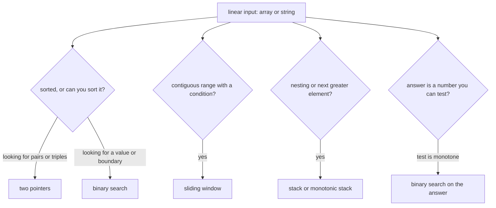

# Pattern map I: two pointers, sliding window, stack, binary search

## Before this lesson

- [JavaScript for coding interviews](#/lesson/dsa-js/js-toolkit) (arrays, strings, `Map`, `Set`) and
  [Numbers and sorting without surprises](#/lesson/dsa-js/numbers-sorting) (comparators, integer midpoints).
- [Stacks, queues and deques in JavaScript](#/lesson/dsa-js/stacks-queues) for the head-index deque.
- This lesson is a **map**, not a textbook chapter on each pattern. For the full theory, proofs and many more
  examples, it links to the Python pattern lessons. You can read those without knowing Python well: the ideas
  are the same, and this lesson shows the JavaScript shape.

## In plain words

A **pattern** is a reusable plan for a family of problems, like a recipe that works for many dishes. Once you
recognise "this is a sliding-window problem", most of the solution writes itself, and only the details change.

The four patterns here all walk through a **linear** structure (an array or a string) cleverly, so that an obvious
O(n^2) or O(n) solution becomes O(n) or O(log n):

| Pattern | Plain-words idea | Typical signal in the problem |
|---|---|---|
| Two pointers | two indices move through the array, often from both ends | sorted input; pairs; palindromes; in-place rewriting |
| Sliding window | a range `[left, right]` that grows on the right and shrinks on the left | "longest / shortest contiguous substring or subarray such that..." |
| Stack (and monotonic stack) | remember unfinished items, most recent first | nesting; "next greater / smaller element"; undo |
| Binary search | halve the search range each step | sorted input; "minimum value that works"; O(log n) required |

Why it matters for a job: these four patterns cover roughly a third of typical screening questions. Writing
them fluently in JavaScript, with the right integer arithmetic and no `shift`, is exactly what a timed interview
rewards.



## 1. Two pointers

Theory: [The Two Pointers pattern](#/lesson/neet-arrays/two-pointers-pattern) and
[k-Sum, greedy pointer moves and proofs](#/lesson/neet-arrays/k-sum-and-greedy).

Two shapes appear again and again.

**Opposite ends.** Start `i = 0` and `j = n - 1`; move one of them inward each step based on a comparison. Each
step discards one candidate for good, so the loop runs at most n times.

**Reader and writer.** A fast pointer `read` scans every element; a slow pointer `write` marks where the next
kept element goes. This rewrites an array in place without `splice` (which would be O(n) per call).

```js-run
// Opposite ends: pair with a given sum in a SORTED array (1-based answer like LeetCode 167)
function twoSumSorted(nums, target) {
  let i = 0, j = nums.length - 1;
  while (i < j) {
    const sum = nums[i] + nums[j];
    if (sum === target) return [i + 1, j + 1];
    if (sum < target) i++;        // need more: the smallest value cannot be in any pair
    else j--;                     // need less: the largest value cannot be in any pair
  }
  return [];
}
console.log(twoSumSorted([1, 3, 4, 8], 7));     // [ 2, 3 ]

// Reader / writer: remove duplicates from a sorted array in place, return the new length
function dedupe(nums) {
  let write = 0;
  for (let read = 0; read < nums.length; read++) {
    if (read === 0 || nums[read] !== nums[read - 1]) nums[write++] = nums[read];
  }
  nums.length = write;            // truncating length in place is O(removed)
  return write;
}
const arr = [1, 1, 2, 3, 3, 3, 4];
console.log(dedupe(arr), arr);  // 4 [ 1, 2, 3, 4 ]
```

**JavaScript notes for two pointers**

- Sorting first? Use `[...nums].sort((a, b) => a - b)`. A plain `sort()` silently breaks every pointer argument
  because the order is textual (3Sum is the usual victim).
- Assigning `nums.length = write` truncates the array in place: a JavaScript-specific shortcut that replaces a
  loop of `pop` calls.
- Palindrome checks on strings compare `s[i]` and `s[j]`. To skip punctuation without regular expressions, test
  character codes: digits are 48-57, uppercase 65-90, lowercase 97-122.

```js-run
// 3Sum skeleton: sort, fix one value, two pointers on the rest, skip duplicates
function threeSum(nums) {
  const a = [...nums].sort((x, y) => x - y), res = [];
  for (let i = 0; i < a.length - 2; i++) {
    if (i > 0 && a[i] === a[i - 1]) continue;
    let lo = i + 1, hi = a.length - 1;
    while (lo < hi) {
      const s = a[i] + a[lo] + a[hi];
      if (s < 0) lo++;
      else if (s > 0) hi--;
      else {
        res.push([a[i], a[lo++], a[hi--]]);
        while (lo < hi && a[lo] === a[lo - 1]) lo++;
      }
    }
  }
  return res;
}
console.log(JSON.stringify(threeSum([-1, 0, 1, 2, -1, -4])));   // [[-1,-1,2],[-1,0,1]]
```

## 2. Sliding window

Theory: [Sliding window fundamentals](#/lesson/neet-window-stack/window-fundamentals),
[Counting windows](#/lesson/neet-window-stack/window-counting) and
[The monotonic deque](#/lesson/neet-window-stack/monotonic-deque).

A **window** is the contiguous range `[left, right]`. The right edge moves forward every step; the left edge
moves forward only when the window breaks the rule. Because each index enters once and leaves once, the total
work is O(n), even though there is a loop inside a loop.

The variable-size template, in JavaScript:

```javascript
let left = 0, best = 0;
for (let right = 0; right < s.length; right++) {
  // 1. add s[right] to the window state
  while (/* window breaks the rule */ false) {
    // 2. remove s[left] from the window state
    left++;
  }
  // 3. the window [left, right] is valid: update the answer
  best = Math.max(best, right - left + 1);
}
```

**Window state** is whatever you need to check the rule quickly: a `Map` of counts, a 26-slot count array, a
running sum, or a counter like "how many required characters are still missing".

```js-run
// Longest substring with at most k distinct characters
function longestKDistinct(s, k) {
  const count = new Map();
  let left = 0, best = 0;
  for (let right = 0; right < s.length; right++) {
    count.set(s[right], (count.get(s[right]) || 0) + 1);
    while (count.size > k) {                       // rule broken: too many distinct
      const c = s[left++];
      count.set(c, count.get(c) - 1);
      if (count.get(c) === 0) count.delete(c);     // keep size meaningful
    }
    best = Math.max(best, right - left + 1);
  }
  return best;
}
console.log(longestKDistinct("eceba", 2));     // 3 ("ece")
console.log(longestKDistinct("aaabbbccc", 1)); // 3
```

The `delete` when a count hits zero is the JavaScript detail that matters: `Map.prototype.size` counts keys, and a
key with count 0 is still a key.

**Count arrays instead of Maps.** When the alphabet is known (lowercase letters, ASCII), a typed array indexed by
character code is faster than a `Map` and starts zero-filled:

```js-run
// Permutation in String: does s2 contain an anagram of s1? (fixed-size window)
function checkInclusion(s1, s2) {
  if (s1.length > s2.length) return false;
  const need = new Int32Array(26), win = new Int32Array(26);
  for (let i = 0; i < s1.length; i++) {
    need[s1.charCodeAt(i) - 97]++;
    win[s2.charCodeAt(i) - 97]++;
  }
  const same = () => need.every((v, i) => v === win[i]);
  if (same()) return true;
  for (let r = s1.length; r < s2.length; r++) {
    win[s2.charCodeAt(r) - 97]++;                   // enter on the right
    win[s2.charCodeAt(r - s1.length) - 97]--;       // leave on the left
    if (same()) return true;
  }
  return false;
}
console.log(checkInclusion("ab", "eidbaooo"));      // true
console.log(checkInclusion("ab", "eidboaoo"));      // false
```

`Int32Array` is a **typed array**: a fixed-length array of 32-bit integers, already filled with zeros, with no
holes and fast numeric access. Comparing two 26-slot arrays per step is O(26), so the whole scan is O(26n), which
counts as O(n).

**Sliding window JavaScript notes**

- Strings are indexed by UTF-16 units; for the ASCII inputs of interview problems that is one character per
  index.
- Track the best window as `bestStart` and `bestLen`, then `slice` once at the end. Slicing every candidate makes
  Minimum Window Substring quadratic.
- For window maximum or minimum, use the index deque from the previous lesson, never `Math.max(...window)`.

## 3. Stack and monotonic stack

Theory: [Stacks: the LIFO toolkit](#/lesson/neet-window-stack/stack-basics) and
[The monotonic stack](#/lesson/neet-window-stack/monotonic-stack).

A plain stack solves nesting problems (brackets, decoding `"3[a2[c]]"`, simplifying paths). A **monotonic stack**
keeps its values sorted (all increasing or all decreasing from bottom to top). When a new value would break the
order, you pop, and each pop is the moment a question gets its answer: "the next greater element of the popped
item is the current one".

```js-run
// Next greater element to the right for every index (-1 if none)
function nextGreater(nums) {
  const ans = new Array(nums.length).fill(-1);
  const stack = [];                                // indices with no answer yet; values decreasing
  for (let i = 0; i < nums.length; i++) {
    while (stack.length && nums[stack[stack.length - 1]] < nums[i]) {
      ans[stack.pop()] = nums[i];                  // nums[i] answers the popped index
    }
    stack.push(i);
  }
  return ans;
}
console.log(nextGreater([2, 1, 2, 4, 3]));         // [ 4, 2, 4, -1, -1 ]
```

**Stack JavaScript notes**

- Store **indices** on the stack when you need distances (Daily Temperatures) or widths (Largest Rectangle in
  Histogram); read values through `nums[index]`.
- `new Array(n).fill(-1)` or `.fill(0)` for the answer array; without `fill` the unanswered slots are holes.
- A design problem such as Min Stack is a class with two arrays; the tests in this track call it through a small
  driver function, described in each problem.

## 4. Binary search

Theory: [Binary search done right](#/lesson/neet-window-stack/binary-search-right),
[Binary search on the answer](#/lesson/neet-window-stack/search-on-answer) and
[Rotated arrays and partitions](#/lesson/neet-window-stack/rotated-and-partitions).

Binary search halves a range at each step, so it needs about log2(n) steps: 17 steps for 100,000 elements. The
subtle parts are the boundaries, and in JavaScript also the **midpoint**, because `/` returns fractions.

Two templates cover almost everything. Pick one and use it consistently.

```js-run
// Template A: find an exact target, inclusive range [lo, hi]
function search(nums, target) {
  let lo = 0, hi = nums.length - 1;
  while (lo <= hi) {
    const mid = lo + ((hi - lo) >> 1);          // integer midpoint, no fractions
    if (nums[mid] === target) return mid;
    if (nums[mid] < target) lo = mid + 1;
    else hi = mid - 1;
  }
  return -1;
}

// Template B: first index where pred(i) is true, half-open range [lo, hi)
function firstTrue(lo, hi, pred) {
  while (lo < hi) {
    const mid = Math.floor((lo + hi) / 2);
    if (pred(mid)) hi = mid;                    // mid might be the answer: keep it
    else lo = mid + 1;
  }
  return lo;                                    // hi if pred is never true
}

const a = [1, 3, 3, 3, 7, 9];
console.log(search(a, 7), search(a, 4));                    // 4 -1
console.log(firstTrue(0, a.length, (i) => a[i] >= 3));     // 1: lower bound of 3
console.log(firstTrue(0, a.length, (i) => a[i] > 3));      // 4: upper bound of 3
```

Template B is the general one. "Lower bound" (first index with value `>= x`) and "upper bound" (first index with
value `> x`) are both `firstTrue` with a different predicate, which replaces Python's `bisect_left` and
`bisect_right`; JavaScript has no built-in equivalent.

### Binary search on the answer

When a problem asks for the **smallest value that works** (minimum eating speed, minimum ship capacity), and
"works" stays true once it becomes true, binary-search the value itself:

```js-run
// Koko: smallest speed k such that all piles are eaten within h hours
function minEatingSpeed(piles, h) {
  const hoursAt = (k) => piles.reduce((sum, p) => sum + Math.ceil(p / k), 0);
  let lo = 1, hi = piles.reduce((m, p) => Math.max(m, p), 0);
  while (lo < hi) {
    const k = Math.floor((lo + hi) / 2);
    if (hoursAt(k) <= h) hi = k;
    else lo = k + 1;
  }
  return lo;
}
console.log(minEatingSpeed([3, 6, 7, 11], 8));   // 4
console.log(minEatingSpeed([30, 11, 23, 4, 20], 5));   // 30
```

**Binary search JavaScript notes**

- `(lo + hi) / 2` is fractional: `nums[2.5]` is `undefined`, which compares as false against everything and
  sends the search the wrong way without any error. Always floor or shift.
- `>> 1` converts to a 32-bit integer, safe for indices (arrays never exceed 2^32 elements) but not for answer
  ranges above about 2.1 billion. On answer ranges, use `Math.floor`.
- Use `Math.ceil(p / k)` for "number of rounds"; `Math.floor` under-counts.
- `piles.reduce(...)` for the maximum avoids the argument-count limit of `Math.max(...piles)` on huge arrays.

## 5. Recognising the pattern: worked triage

Here is how to triage three short prompts out loud, the way an interviewer likes to hear it.

1. "Given a sorted array, return the number of pairs with sum below a target." Sorted plus pairs: **two pointers**
   from both ends. When `a[i] + a[j] < target`, every index between `i` and `j` pairs with `i`, so add `j - i` and
   move `i`.
2. "Longest subarray whose sum is at most S, all values positive." Contiguous plus a condition that breaks when
   the window grows: **sliding window** with a running sum. (With negative values the window rule is no longer
   monotone; switch to prefix sums.)
3. "Find the minimum capacity so that packages ship within D days." A number you can test, and bigger capacities
   only help: **binary search on the answer**, with a greedy simulation as the test.

```js-run
function pairsBelow(sorted, target) {
  let i = 0, j = sorted.length - 1, count = 0;
  while (i < j) {
    if (sorted[i] + sorted[j] < target) { count += j - i; i++; }
    else j--;
  }
  return count;
}
console.log(pairsBelow([1, 2, 3, 4, 5], 6));   // 4: (1,2) (1,3) (1,4) (2,3)
```

## 6. Pitfalls across these patterns

- Text sort before two pointers (`sort()` without a comparator).
- Fractional midpoints in binary search.
- `while (lo < hi)` combined with `hi = mid - 1` (mixing the two templates) loses the answer.
- A `Map`-based window that never deletes zero counts, so `map.size` lies.
- `Math.max(...bigArray)` for the search range: argument-count limits.
- Slicing strings inside a window loop: hidden O(n) per step.
- `shift` for the window deque.

## 7. Summary

- Two pointers: opposite ends for sorted pairs, reader/writer for in-place rewriting. Sort numerically first.
- Sliding window: grow right, shrink left while invalid, update when valid. Keep state in a `Map` (delete zeros)
  or a typed count array.
- Stack: nesting and "next greater" questions; store indices; fill answer arrays.
- Binary search: integer midpoints; template A for exact matches, template B (`firstTrue`) for boundaries and
  answer searches.
- The proofs and many more examples are in the linked Python lessons; the code shape above is what changes in
  JavaScript.

## Glossary

- **Pattern**: a reusable solution plan for a family of problems.
- **Two pointers**: two indices that move through a sequence according to a rule.
- **Sliding window**: a contiguous range whose edges only move forward.
- **Window state**: the data kept about the current window (counts, sum, missing count).
- **Typed array**: a fixed-length array of one numeric type, such as `Int32Array`, zero-filled on creation.
- **Monotonic stack**: a stack whose values are kept in sorted order by popping violators.
- **Lower bound / upper bound**: the first index whose value is at least / greater than a key.
- **Binary search on the answer**: binary search over possible answer values using a monotone yes/no test.

## Check yourself

```quiz
[
  {"q": "In a variable-size sliding window counted with a Map, why must you delete keys whose count drops to 0?", "options": ["Maps cannot store 0", "Otherwise `map.size` still counts those characters as present in the window", "Deleting is faster than updating", "It is optional"], "answer": 1,
   "explain": "size counts keys, not positive counts. Leaving zero entries makes rules like 'at most k distinct' wrong."},
  {"q": "What does `nums[(0 + 5) / 2]` read?", "options": ["nums[2]", "nums[3]", "undefined, because the index 2.5 does not exist", "It throws"], "answer": 2,
   "explain": "Division gives 2.5, which is a property name that does not exist on the array. Use `>> 1` or Math.floor."},
  {"q": "Which binary search shape finds the first index i where `nums[i] >= x` (lower bound)?", "options": ["`while (lo <= hi)` returning -1 when not found", "`while (lo < hi)` with `hi = mid` when the predicate holds and `lo = mid + 1` otherwise", "A linear scan", "`indexOf(x)`"], "answer": 1,
   "explain": "The half-open firstTrue template keeps mid when it satisfies the predicate, converging on the first true index."},
  {"q": "Why is a reader/writer two-pointer loop preferred over `splice` for removing elements in place?", "options": ["splice does not exist", "Each splice shifts the rest of the array, so many removals cost O(n^2); the two-pointer pass is O(n)", "splice returns a copy", "Two pointers use more memory"], "answer": 1,
   "explain": "splice moves every element after the removed position. One pass with a write index moves each kept element once."},
  {"q": "A problem asks for the minimum ship capacity that delivers within D days. Which pattern fits best?", "options": ["Monotonic stack", "Binary search on the answer with a greedy feasibility test", "Sliding window", "Two pointers from both ends"], "answer": 1,
   "explain": "If capacity c works, any larger capacity works too, so the yes/no test is monotone and binary search finds the boundary."},
  {"q": "Why are indices, rather than values, stored on the stack in Daily Temperatures?", "options": ["Values cannot be compared", "The answer is a distance in days, which needs the index of the waiting day", "Indices use less memory", "Values might be negative"], "answer": 1,
   "explain": "With the index j you can write ans[j] = i - j and still read the temperature as temps[j]."}
]
```

> **Source:** NeetCode roadmap (Two Pointers, Sliding Window, Stack, Binary Search); the theory lessons of the
> neet-arrays and neet-window-stack tracks on this site; MDN Web Docs for typed arrays and Map. Written in
> original words for this track.
