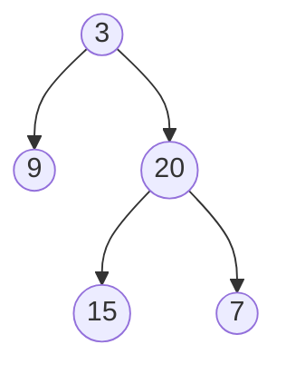

# Linked lists and trees with classes

## Before this lesson

- [JavaScript for coding interviews](#/lesson/dsa-js/js-toolkit) and
  [Stacks, queues and deques](#/lesson/dsa-js/stacks-queues) (the head-index queue is used for trees below).
- Functions that call themselves (recursion) at a basic level. [Closures and recursion](#/lesson/javascript/closures-recursion)
  introduces it.
- Optional theory: [Pointers and the dummy node](#/lesson/neet-linked-trees/ll-pointers) and
  [Tree basics](#/lesson/neet-linked-trees/tree-basics) explain linked lists and trees without any JavaScript.

## In plain words

Think of a treasure hunt. Each clue tells you something (its **value**) and where the next clue is hidden (its
**link**). You cannot jump to clue 7 directly; you follow the chain from the first clue. That chain is a **linked
list**.

Now imagine each clue can point to **two** next clues, a left one and a right one, and the hunt branches like a
family tree. That is a **binary tree**.

In Python or Java these structures are built from small **objects** ("nodes") holding a value and references to
other nodes. JavaScript works the same way, using **classes** to describe what a node looks like. This lesson
shows how to write node classes, how to build lists and trees from arrays (the format test cases use), how to turn
them back into arrays, and the JavaScript details that matter: `null` versus `undefined`, object identity, and
why reference variables behave the way they do.

Why it matters for a job: linked-list and tree questions are a staple of interviews because they test whether
you can manipulate references without losing data. In JavaScript you also need to set up the node classes
yourself; LeetCode provides them, but whiteboards and shared editors usually do not.

## 1. Classes in sixty seconds

A **class** is a template for creating objects that share the same shape and methods. The **constructor** is the
special method that runs when you write `new ClassName(...)`; inside it, `this` refers to the new object being
built.

```js-run
class Point {
  constructor(x, y) {        // runs on "new Point(...)"
    this.x = x;              // a field (property) on the new object
    this.y = y;
  }
  dist2() {                  // a method shared by all Points
    return this.x * this.x + this.y * this.y;
  }
}
const p = new Point(3, 4);
console.log(p.x, p.y, p.dist2());     // 3 4 25
console.log(p instanceof Point);       // true
```

That is all the class syntax interview code needs: a constructor that stores fields, and sometimes a few
methods. Default parameter values (`constructor(val = 0, next = null)`) let callers omit arguments.

## 2. A linked list node

```js-run
class ListNode {
  constructor(val = 0, next = null) {
    this.val = val;     // the data
    this.next = next;   // reference to the next node, or null at the end
  }
}

// Build 1 -> 2 -> 3 by hand, from the back
const head = new ListNode(1, new ListNode(2, new ListNode(3)));
let cur = head;
while (cur !== null) {           // walk until the end marker
  console.log(cur.val);
  cur = cur.next;
}
```

Line by line: each node stores a value and a reference. `null` marks the end of the list; an **empty list** is
simply `null` (no head node at all). The walking loop is the heart of every linked-list algorithm: `cur = cur.next`
moves one step.

### References, not copies

A variable holding an object holds a **reference** (an arrow pointing to the object), not the object itself.
Assigning the variable copies the arrow. Two variables can point to the same node, and changing the node through
one is visible through the other.

```js-run
class ListNode { constructor(val = 0, next = null) { this.val = val; this.next = next; } }
const a = new ListNode(1);
const b = a;               // same node, two names
b.val = 99;
console.log(a.val);        // 99
console.log(a === b);      // true: identity comparison
const c = new ListNode(99);
console.log(a === c);      // false: equal contents, different objects
```

`===` on objects asks "same object?", which is exactly what cycle detection needs: the fast and slow pointers meet
when they reference the **same node**, regardless of the values stored.

### null versus undefined

JavaScript has two "nothing" values. `null` means "intentionally empty" and is the convention for "no next node"
or "no child". `undefined` means "never assigned", which is what you get from a missing property or a function
that returns nothing. Both are **falsy**, so `while (cur)` and `if (!node)` treat them the same. Using `null`
consistently in node classes keeps output and comparisons predictable.

## 3. The array conventions used by the tests in this track

Tests cannot pass live objects around, so lists and trees travel as JSON arrays, and every problem in this track
includes small **provided helpers** and a **driver**. You only write the algorithm, which receives and returns
real nodes.

**Linked lists**: the array `[1, 2, 3]` means `1 -> 2 -> 3`; `[]` means the empty list `null`.

```js-run
class ListNode { constructor(val = 0, next = null) { this.val = val; this.next = next; } }

function buildList(values) {           // array -> head node (or null)
  const dummy = new ListNode();         // placeholder in front of the real head
  let tail = dummy;
  for (const v of values) {
    tail.next = new ListNode(v);
    tail = tail.next;
  }
  return dummy.next;
}
function listToArray(head) {           // head node -> array
  const out = [];
  for (let n = head; n; n = n.next) out.push(n.val);
  return out;
}

// What a problem's driver looks like: your function sits in the middle
function reverseList(head) {
  let prev = null, cur = head;
  while (cur) {
    const next = cur.next;
    cur.next = prev;
    prev = cur;
    cur = next;
  }
  return prev;
}
function runReverseList(values) {
  return listToArray(reverseList(buildList(values)));
}
console.log(runReverseList([1, 2, 3, 4]));   // [ 4, 3, 2, 1 ]
console.log(runReverseList([]));             // []
```

`buildList` uses a **dummy node**: a throwaway node in front of the head, so the loop never needs an
"is this the first node?" special case. You will see the same trick in merge and removal problems.

For cycle problems, the driver receives `[values, pos]` and connects the last node to the node at index `pos`.
For design problems (LRU Cache, Min Stack), the driver receives LeetCode-style `[ops, args]` and calls your class
methods in order. Each problem statement spells out its driver.

**Binary trees**: the array is **level order** (row by row, left to right) with `null` for a missing child, the
same format LeetCode uses. `[3, 9, 20, null, null, 15, 7]` means:



The two `null`s are the missing children of 9. Children of missing nodes are not written at all, which keeps the
array short for lopsided trees.

```js-run
class TreeNode {
  constructor(val = 0, left = null, right = null) {
    this.val = val;
    this.left = left;
    this.right = right;
  }
}
function buildTree(values) {
  if (!values.length || values[0] === null) return null;
  const root = new TreeNode(values[0]);
  const queue = [root];
  let head = 0, i = 1;
  while (i < values.length) {
    const node = queue[head++];          // next parent waiting for children
    if (values[i] !== null) { node.left = new TreeNode(values[i]); queue.push(node.left); }
    i++;
    if (i < values.length && values[i] !== null) { node.right = new TreeNode(values[i]); queue.push(node.right); }
    i++;
  }
  return root;
}
function treeToArray(root) {
  const out = [], queue = [root];
  let head = 0;
  while (head < queue.length) {
    const node = queue[head++];
    if (node) { out.push(node.val); queue.push(node.left, node.right); }
    else out.push(null);
  }
  while (out.length && out[out.length - 1] === null) out.pop();   // trim trailing nulls
  return out;
}
const t = buildTree([3, 9, 20, null, null, 15, 7]);
console.log(t.right.left.val);                 // 15
console.log(JSON.stringify(treeToArray(t)));   // [3,9,20,null,null,15,7]
```

`buildTree` is a breadth-first walk: a queue of parents (with a head index, never `shift`) hands out the next two
array entries as children. `treeToArray` does the reverse, writing `null` for each missing child and trimming the
trailing ones.

> [!NOTE]
> The tests pass JSON, so Python's `None` arrives as JavaScript `null`. Inside your algorithm, check children
> with `if (node.left)` or `node.left !== null`; both work because missing children are always `null`.

## 4. Walking a tree: recursion and its iterative twin

Almost every tree algorithm is "do something at this node, and recurse into the children". **Depth-first search
(DFS)** goes deep along one branch before backing up; **breadth-first search (BFS)** visits the tree row by row.

```js-run
class TreeNode { constructor(val = 0, left = null, right = null) { this.val = val; this.left = left; this.right = right; } }
const root = new TreeNode(1, new TreeNode(2, new TreeNode(4), new TreeNode(5)), new TreeNode(3));

function preorder(node, out = []) {      // node, then left subtree, then right subtree
  if (!node) return out;
  out.push(node.val);
  preorder(node.left, out);
  preorder(node.right, out);
  return out;
}
function inorder(node, out = []) {       // left, node, right
  if (!node) return out;
  inorder(node.left, out);
  out.push(node.val);
  inorder(node.right, out);
  return out;
}
console.log(preorder(root), inorder(root));   // [ 1, 2, 4, 5, 3 ] [ 4, 2, 5, 1, 3 ]

// The same preorder without recursion: an explicit stack
function preorderIter(root) {
  const out = [], stack = root ? [root] : [];
  while (stack.length) {
    const node = stack.pop();
    out.push(node.val);
    if (node.right) stack.push(node.right);   // push right first so left is processed first
    if (node.left) stack.push(node.left);
  }
  return out;
}
console.log(preorderIter(root));              // [ 1, 2, 4, 5, 3 ]
```

Why learn the iterative version? Every recursive call uses a frame on the engine's **call stack**, and JavaScript
engines limit its size, typically to around ten thousand simple frames. A degenerate tree that is one long chain
of 50,000 nodes crashes a recursive traversal with `RangeError: Maximum call stack size exceeded`. Balanced trees
of a million nodes are only about 20 levels deep and are perfectly fine recursively. The lesson
[Recursion depth limits and backtracking](#/lesson/dsa-js/recursion-backtracking) measures the limit.

## 5. A doubly linked list with sentinels

Some designs need to remove a node from the **middle** in O(1) when you already hold a reference to it, which a
singly linked list cannot do (you would need the previous node). A **doubly linked list** stores both `prev` and
`next`. Two **sentinel** nodes, permanent dummy nodes at the head and tail, remove every null check from insert
and delete.

```js-run
class DNode {
  constructor(key, val) { this.key = key; this.val = val; this.prev = null; this.next = null; }
}
class DList {
  constructor() {
    this.head = new DNode(null, null);   // sentinel before the first real node
    this.tail = new DNode(null, null);   // sentinel after the last real node
    this.head.next = this.tail;
    this.tail.prev = this.head;
  }
  pushFront(node) {
    node.prev = this.head;
    node.next = this.head.next;
    this.head.next.prev = node;
    this.head.next = node;
  }
  remove(node) {                          // O(1): no search needed
    node.prev.next = node.next;
    node.next.prev = node.prev;
  }
  toArray() {
    const out = [];
    for (let n = this.head.next; n !== this.tail; n = n.next) out.push(n.key);
    return out;
  }
}
const list = new DList();
const x = new DNode("x", 1), y = new DNode("y", 2), z = new DNode("z", 3);
list.pushFront(x); list.pushFront(y); list.pushFront(z);
console.log(list.toArray());   // [ 'z', 'y', 'x' ]
list.remove(y);
console.log(list.toArray());   // [ 'z', 'x' ]
```

Pair this with a `Map` from key to node and you have the classic LRU cache: the map finds the node in O(1), the
list moves it to the front in O(1), and the node just before the tail sentinel is the least recently used. The
LRU Cache problem in this track asks you to build exactly that.

## 6. Garbage collection: why "deleting" a node is just unlinking it

JavaScript has automatic **garbage collection**: memory for an object is reclaimed once nothing references it any
more. So removing a node from a list is only a matter of changing the neighbours' references; there is no
`delete` or `free` to call. One consequence: if you keep an extra reference to a removed node somewhere (for
example in a `Map` you forgot to clean up), it stays alive and your data structure leaks memory and returns stale
answers. In the LRU cache, evicting means unlinking the node **and** deleting its key from the map.

## 7. Printing structures while debugging

`console.log` on a long list prints a nested object pyramid that is hard to read. Convert first:

```js-run
class ListNode { constructor(val = 0, next = null) { this.val = val; this.next = next; } }
const head = new ListNode(1, new ListNode(2, new ListNode(3)));
const show = (h) => { const parts = []; for (let n = h; n; n = n.next) parts.push(n.val); return parts.join(" -> ") || "(empty)"; };
console.log(show(head));          // 1 -> 2 -> 3
console.log(show(null));          // (empty)
```

Never print a list that might contain a cycle with a plain loop: it never ends. The `listToArray` helper in the
problem drivers stops after 100,000 nodes for that reason.

## 8. Pitfalls

- Losing the rest of a list: save `cur.next` before overwriting it.
- Returning the old head after reversing; the new head is the last node visited.
- Comparing nodes by value when identity is meant (cycle detection, LCA).
- Forgetting that an empty list or empty tree is `null`, so `head.next` throws `TypeError` on it.
- Building tree children from arrays without the parent queue: indices `2i + 1` and `2i + 2` only work for
  complete trees, not for LeetCode's compressed format.
- Recursion on very deep, chain-like structures: use an explicit stack.

## 9. Summary

- A class with a constructor is all you need for nodes: `ListNode(val, next)`, `TreeNode(val, left, right)`.
- Variables hold references; `===` compares identity; `null` marks absent nodes.
- Tests here pass lists as arrays and trees as LeetCode level-order arrays; provided `buildList`/`listToArray`
  and `buildTree`/`treeToArray` helpers and a driver connect them to your function.
- Dummy and sentinel nodes remove special cases; a doubly linked list plus a `Map` gives O(1) LRU operations.
- Prefer iterative traversals when depth can reach many thousands.

## Glossary

- **Node**: a small object holding a value and references to other nodes.
- **Linked list**: a chain of nodes, each pointing to the next; ends at `null`.
- **Binary tree**: nodes with up to two children, `left` and `right`.
- **Class / constructor / `this`**: a template for objects / the method run by `new` / the object being built.
- **Reference**: a value that points to an object; copying it does not copy the object.
- **Dummy node / sentinel**: a placeholder node that removes edge cases at the ends of a list.
- **Level order**: listing tree nodes row by row, left to right.
- **DFS / BFS**: depth-first and breadth-first search.
- **Call stack**: the engine's record of active function calls; it has a limited size.
- **Garbage collection**: automatic reclaiming of objects nothing refers to.

## Check yourself

```quiz
[
  {"q": "How is an empty linked list represented in the problems of this track?", "options": ["A node with val 0", "`null` (and the array [] in tests)", "`undefined`", "An empty object"], "answer": 1,
   "explain": "The head of an empty list is null; buildList([]) returns null and listToArray(null) returns []."},
  {"q": "After `const a = new ListNode(1); const b = a; b.val = 5;`, what is `a.val`?", "options": ["1", "5", "undefined", "It throws"], "answer": 1,
   "explain": "a and b reference the same node object, so the change is visible through both names."},
  {"q": "What tree does the level-order array `[1, null, 2, 3]` describe?", "options": ["1 with left child 2 and right child 3", "1 with right child 2, and 2 has left child 3", "1 with left child 3", "A list 1, 2, 3"], "answer": 1,
   "explain": "1's left is null and right is 2; the next entry, 3, is 2's left child. Missing nodes get no entries for their children."},
  {"q": "Why does an LRU cache use a doubly linked list rather than a singly linked one?", "options": ["Doubly linked lists use less memory", "Removing a node you already hold needs its previous node, which only a doubly linked list stores", "Singly linked lists cannot hold keys", "It makes get faster than O(1)"], "answer": 1,
   "explain": "With prev pointers, unlinking is two assignments. A singly linked list would need an O(n) search for the predecessor."},
  {"q": "A recursive inorder traversal crashes on a tree shaped like a 50,000-node chain. Why?", "options": ["Trees cannot have 50,000 nodes", "Each level uses a call-stack frame and the engine's stack limit is exceeded", "Inorder only works on BSTs", "JSON cannot represent it"], "answer": 1,
   "explain": "Recursion depth equals tree height. Use an explicit stack for very deep trees."},
  {"q": "In cycle detection, why compare `slow === fast` instead of `slow.val === fast.val`?", "options": ["Values are always unique", "Different nodes can hold equal values; only identity proves the pointers met at the same node", "=== is faster", "val may be undefined"], "answer": 1,
   "explain": "Identity comparison avoids false positives on lists with repeated values."}
]
```

> **Source:** ECMAScript Language Specification (class definitions, object references, equality); MDN Web Docs
> (Classes, null, Memory management); LeetCode's level-order serialisation of binary trees as used by NeetCode
> problems. Written in original words for this track.
