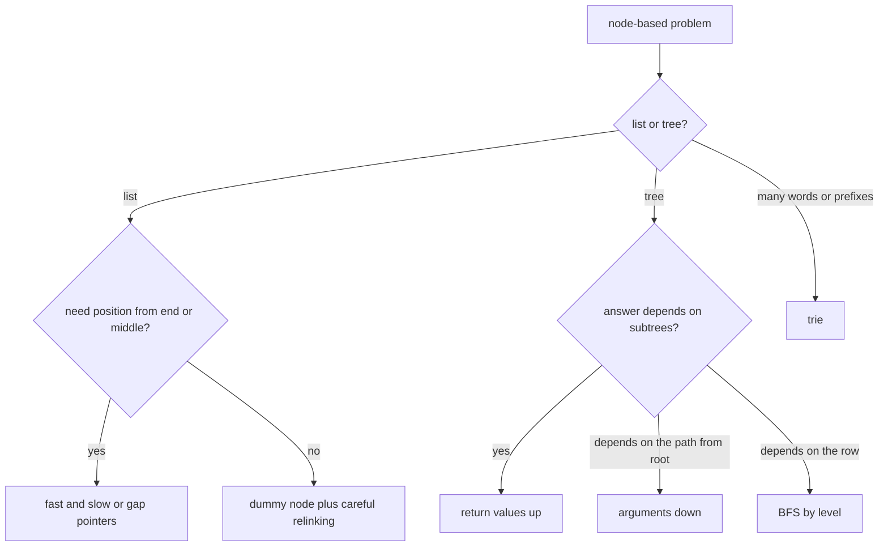

# Pattern map II: linked lists, trees and tries

## Before this lesson

- [Linked lists and trees with classes](#/lesson/dsa-js/linked-lists-trees): `ListNode`, `TreeNode`, the array
  conventions, dummy nodes, recursion versus explicit stacks.
- [Pattern map I](#/lesson/dsa-js/linear-patterns) for the idea of a pattern map: short JavaScript templates
  with links to the full theory.
- The theory for this lesson lives in the Python track [Patterns: linked lists, trees and tries](#/lesson/neet-linked-trees/ll-pointers)
  and its following lessons. Links appear in each section.

## In plain words

Linked lists, trees and tries are all built from **nodes connected by references**. Because you can only reach a
node by following arrows, the patterns are about **how to walk** the arrows without getting lost:

- In a list, walk with one pointer, two pointers at different speeds, or two pointers with a fixed gap.
- In a tree, decide whether information flows **down** (from parent to children, as arguments) or **up** (from
  children to parent, as return values), and whether to go depth-first or level by level.
- In a **trie** (a tree of characters used to store words), walk one character per level.

Think of exploring a cave system with a ball of string. You need to know which direction you came from, which
passages you still have to try, and what to report back at the exit. Each pattern below is a different rule for
unwinding and rewinding the string.

Why it matters for a job: these structures dominate the "medium" tier of interview questions, and the JavaScript
details (identity checks, `null` guards, closures that collect answers, `Map`-based children) are where code
breaks.

## 1. Linked-list patterns

Theory: [Pointers and the dummy node](#/lesson/neet-linked-trees/ll-pointers),
[Fast and slow pointers](#/lesson/neet-linked-trees/ll-fast-slow) and
[Reversal and merging](#/lesson/neet-linked-trees/ll-reversal).

### Dummy node

When the head itself might change (it gets removed, or a merged list starts with a different node), put a dummy
node in front and return `dummy.next` at the end. In JavaScript: `const dummy = new ListNode(0, head)`.

### Fast and slow pointers

`slow` moves one step, `fast` moves two. When `fast` reaches the end, `slow` is in the middle; if the list has a
cycle, they eventually point at the same node.

```js-run
class ListNode { constructor(val = 0, next = null) { this.val = val; this.next = next; } }
const build = (vals) => { const d = new ListNode(); let t = d; for (const v of vals) t = t.next = new ListNode(v); return d.next; };

function middle(head) {
  let slow = head, fast = head;
  while (fast && fast.next) {        // guard BOTH: fast.next.next must be readable
    slow = slow.next;
    fast = fast.next.next;
  }
  return slow;
}
console.log(middle(build([1, 2, 3, 4, 5])).val);   // 3
console.log(middle(build([1, 2, 3, 4])).val);      // 3 (the second middle)
```

The guard `fast && fast.next` is the JavaScript-critical line. Reading a property of `null` throws
`TypeError: Cannot read properties of null`, so both checks are needed before `fast.next.next`.

### Reversal

Three references, `prev`, `cur` and `next`, and one rule: save `next` before you overwrite `cur.next`. Reversing
the second half of a list is a building block of Palindrome Linked List and Reorder List.

```js-run
class ListNode { constructor(val = 0, next = null) { this.val = val; this.next = next; } }
const build = (vals) => { const d = new ListNode(); let t = d; for (const v of vals) t = t.next = new ListNode(v); return d.next; };
const toArr = (h) => { const a = []; for (let n = h; n; n = n.next) a.push(n.val); return a; };

function reverse(head) {
  let prev = null, cur = head;
  while (cur) [cur.next, prev, cur] = [prev, cur, cur.next];   // destructuring: right side evaluated first
  return prev;
}
console.log(toArr(reverse(build([1, 2, 3]))));   // [ 3, 2, 1 ]

// Reorder List: L0 Ln L1 Ln-1 ... using middle + reverse + merge
function reorderList(head) {
  if (!head || !head.next) return;
  let slow = head, fast = head;
  while (fast.next && fast.next.next) { slow = slow.next; fast = fast.next.next; }
  let second = reverse(slow.next);
  slow.next = null;                                  // cut the list in two
  let first = head;
  while (second) {
    const n1 = first.next, n2 = second.next;
    first.next = second;
    second.next = n1;
    first = n1;
    second = n2;
  }
}
const h = build([1, 2, 3, 4, 5]);
reorderList(h);
console.log(toArr(h));                             // [ 1, 5, 2, 4, 3 ]
```

The one-line reversal uses **destructuring assignment**: all three right-hand values are read first, then
assigned left to right. It is compact, but the three-line version with a `next` variable is easier to explain
aloud; prefer that in interviews unless you are sure of the evaluation order.

### Two pointers with a gap

Move `lead` `n` steps ahead, then move both until `lead` hits the end: `trail` is `n` nodes from the end. Remove
Nth Node From End of List uses this with a dummy node.

## 2. Tree patterns

Theory: [Tree basics](#/lesson/neet-linked-trees/tree-basics),
[Traversals](#/lesson/neet-linked-trees/tree-traversals),
[Returning values up the tree](#/lesson/neet-linked-trees/tree-return-up) and
[Binary search trees](#/lesson/neet-linked-trees/tree-bst).

### Information flowing up: return values

Many questions are answered by combining the answers of the two subtrees: height, size, balance, diameter, path
sums. Write a function that returns the subtree's answer, and let the parent combine.

```js-run
class TreeNode { constructor(val = 0, left = null, right = null) { this.val = val; this.left = left; this.right = right; } }
const root = new TreeNode(1, new TreeNode(2, new TreeNode(4), new TreeNode(5)), new TreeNode(3));

const height = (node) => (node ? 1 + Math.max(height(node.left), height(node.right)) : 0);
console.log(height(root));                            // 3

// Diameter: longest path in EDGES between any two nodes.
// Each call returns its height, and updates an outer variable through the closure.
function diameter(root) {
  let best = 0;
  function h(node) {
    if (!node) return 0;
    const l = h(node.left), r = h(node.right);
    best = Math.max(best, l + r);      // path that bends at this node
    return 1 + Math.max(l, r);         // what the parent may extend
  }
  h(root);
  return best;
}
console.log(diameter(root));                          // 3 (4 -> 2 -> 1 -> 3)
```

The inner function `h` can read and change `best` because it is a **closure**: a function that remembers the
variables of the scope where it was created. This replaces Python's `nonlocal` and Java's instance fields, and it
is the idiomatic JavaScript shape for "return one thing up, track another thing globally". Binary Tree Maximum
Path Sum is the same shape with sums instead of heights.

### Information flowing down: arguments

Some answers depend on the path from the root: the allowed range of values in a binary search tree, the running
sum on the way to a leaf, the current depth. Pass them as arguments.

```js-run
class TreeNode { constructor(val = 0, left = null, right = null) { this.val = val; this.left = left; this.right = right; } }

function isValidBST(node, lo = -Infinity, hi = Infinity) {
  if (!node) return true;
  if (node.val <= lo || node.val >= hi) return false;
  return isValidBST(node.left, lo, node.val) && isValidBST(node.right, node.val, hi);
}
const good = new TreeNode(5, new TreeNode(3, new TreeNode(1), new TreeNode(4)), new TreeNode(8));
const bad = new TreeNode(5, new TreeNode(3, new TreeNode(1), new TreeNode(6)), new TreeNode(8));   // 6 > 5 in left subtree
console.log(isValidBST(good), isValidBST(bad));      // true false
```

Default parameter values (`lo = -Infinity`) let the caller write `isValidBST(root)`. `-Infinity` and `Infinity`
are always smaller and larger than any number, so there are no special cases for the root.

### Level by level: BFS

Rows of the tree (level order, right side view, zigzag, minimum depth) call for BFS with a level-size snapshot,
using the head-index queue from [Stacks, queues and deques](#/lesson/dsa-js/stacks-queues):

```js-run
class TreeNode { constructor(val = 0, left = null, right = null) { this.val = val; this.left = left; this.right = right; } }
const root = new TreeNode(1, new TreeNode(2, null, new TreeNode(5)), new TreeNode(3, null, new TreeNode(4)));

function rightSideView(root) {
  const out = [];
  if (!root) return out;
  const q = [root];
  let head = 0;
  while (head < q.length) {
    const size = q.length - head;                 // nodes in this level
    for (let i = 0; i < size; i++) {
      const node = q[head++];
      if (i === size - 1) out.push(node.val);     // last node of the level
      if (node.left) q.push(node.left);
      if (node.right) q.push(node.right);
    }
  }
  return out;
}
console.log(rightSideView(root));                 // [ 1, 3, 4 ]
```

### In-order traversal for BSTs, iteratively

An in-order walk of a **binary search tree** (every left value smaller, every right value larger) visits values in
sorted order. The iterative version, with a stack, lets you stop early, which Kth Smallest Element in a BST
exploits:

```js-run
class TreeNode { constructor(val = 0, left = null, right = null) { this.val = val; this.left = left; this.right = right; } }
const bst = new TreeNode(5, new TreeNode(3, new TreeNode(2, new TreeNode(1)), new TreeNode(4)), new TreeNode(6));

function kthSmallest(root, k) {
  const stack = [];
  let node = root;
  while (node || stack.length) {
    while (node) { stack.push(node); node = node.left; }   // go as far left as possible
    node = stack.pop();
    if (--k === 0) return node.val;                         // visit
    node = node.right;
  }
  return null;
}
console.log(kthSmallest(bst, 1), kthSmallest(bst, 3), kthSmallest(bst, 6));   // 1 3 6
```

`--k === 0` decrements first and then compares, so the first visited node is the 1st smallest.

## 3. Trie patterns

Theory: [Tries: prefix trees](#/lesson/neet-linked-trees/trie-basics) and
[Searching with tries](#/lesson/neet-linked-trees/trie-search).

A **trie** stores strings by sharing prefixes: the root has one child per possible first letter, each of those
has one child per second letter, and so on. A flag marks nodes where a whole word ends.

In JavaScript there are three reasonable ways to store a node's children:

| Children stored as | Pros | Cons |
|---|---|---|
| `new Map()` | any characters, no inherited keys, readable | slightly slower than arrays |
| `new Array(26).fill(null)` | fastest for `a`-`z` | fixed alphabet; 26 slots per node even if unused |
| plain object `{}` | short syntax | safe for single-character keys, but inherited names lurk if keys are ever longer |

```js-run
class TrieNode {
  constructor() {
    this.children = new Map();
    this.end = false;
  }
}
class Trie {
  constructor() { this.root = new TrieNode(); }
  insert(word) {
    let node = this.root;
    for (const c of word) {
      if (!node.children.has(c)) node.children.set(c, new TrieNode());
      node = node.children.get(c);
    }
    node.end = true;
  }
  // collect every stored word that starts with prefix (autocomplete)
  withPrefix(prefix) {
    let node = this.root;
    for (const c of prefix) {
      node = node.children.get(c);
      if (!node) return [];
    }
    const out = [];
    const dfs = (n, path) => {
      if (n.end) out.push(path);
      for (const [c, child] of n.children) dfs(child, path + c);
    };
    dfs(node, prefix);
    return out;
  }
}
const t = new Trie();
for (const w of ["car", "card", "care", "cat", "dog"]) t.insert(w);
console.log(t.withPrefix("car"));   // [ 'car', 'card', 'care' ]
console.log(t.withPrefix("x"));     // []
```

The arrow function `dfs` is defined inside `withPrefix`, so it can push into `out` directly: another closure. For
wildcard search (Design Add and Search Words), the same DFS tries every child when it meets a `.` and follows one
child otherwise.

## 4. Choosing among them: a quick triage

| The question mentions... | Reach for |
|---|---|
| middle of a list, cycle, "k-th from the end" | fast/slow or gap pointers |
| reversing part of a list, reordering, palindrome list | reversal (+ middle + merge) |
| height, balance, diameter, maximum path | return values up, closure for the global best |
| ranges, sums along a root-to-leaf path | arguments flowing down |
| levels, "rightmost", "minimum depth" | BFS with level size |
| sorted order in a BST, k-th smallest | in-order traversal (iterative to stop early) |
| prefixes, autocomplete, many words against a grid | trie |



## 5. Pitfalls

- Missing `fast.next` in the fast/slow guard: `TypeError` on even-length lists.
- Forgetting to cut the list (`slow.next = null`) before merging halves, which creates a cycle.
- Using a global variable outside the function for a "best so far" value: it survives between test calls. Keep it
  inside the outer function so each call starts fresh.
- Comparing nodes with `==` or by value when identity is required.
- Recursing on very deep chains; use the iterative forms shown above.
- A trie without the `end` flag cannot tell a stored word from a prefix.

## 6. Summary

- Lists: dummy node, fast/slow, gap pointers, reversal. Guard every `.next` you read.
- Trees: return values up (with a closure for global answers), pass constraints down, BFS by level, in-order for
  BSTs.
- Tries: a `Map` (or 26-slot array) of children plus an `end` flag; DFS for autocomplete and wildcards.
- The full proofs and dozens of variants are in the neet-linked-trees lessons linked above; the JavaScript shape
  is what you practise here.

## Glossary

- **Fast and slow pointers**: two references moving at different speeds through a list.
- **Closure**: a function that keeps access to variables from the scope where it was defined.
- **Default parameter**: a value used when the caller omits an argument, as in `(node, lo = -Infinity)`.
- **Binary search tree (BST)**: a binary tree where left values are smaller and right values larger than the node.
- **In-order traversal**: left subtree, node, right subtree; sorted order for a BST.
- **Trie**: a tree storing strings one character per level, sharing common prefixes.
- **Diameter**: the number of edges on the longest path between any two nodes of a tree.

## Check yourself

```quiz
[
  {"q": "Why does the fast/slow loop guard need both `fast` and `fast.next`?", "options": ["For style only", "The loop reads `fast.next.next`; if `fast.next` is null that read throws a TypeError", "To make it O(log n)", "Because slow could be null"], "answer": 1,
   "explain": "Reading a property of null throws. Checking fast.next first makes fast.next.next safe."},
  {"q": "In the diameter function, how does the inner function update `best`?", "options": ["Through a global variable", "Through a closure over the outer function's local variable", "By returning it", "It cannot; diameter needs a class"], "answer": 1,
   "explain": "The inner function was created inside diameter, so it can read and assign diameter's local `best`."},
  {"q": "Which traversal of a binary search tree visits values in ascending order?", "options": ["Preorder", "Inorder", "Postorder", "Level order"], "answer": 1,
   "explain": "Left subtree values are smaller and right subtree values larger, so left-node-right yields sorted order."},
  {"q": "Validate BST passes `(lo, hi)` bounds down the recursion. Which pattern is that?", "options": ["Information flowing up as return values", "Information flowing down as arguments", "Level-order BFS", "Trie DFS"], "answer": 1,
   "explain": "The constraint for each node depends on its ancestors, so it travels down as parameters."},
  {"q": "In Reorder List, what goes wrong if you forget `slow.next = null` before merging?", "options": ["Nothing", "The first half still links into the reversed second half, creating a cycle", "The list becomes empty", "It throws immediately"], "answer": 1,
   "explain": "Without the cut, the end of the first half keeps pointing into nodes that the merge also relinks, forming a loop."},
  {"q": "Which children container is fastest for a trie over only lowercase a-z?", "options": ["A Map", "An array of 26 slots indexed by charCodeAt minus 97", "A Set", "A string"], "answer": 1,
   "explain": "Direct indexing avoids hashing. A Map is more flexible and still O(1), so both are acceptable in interviews."}
]
```

> **Source:** NeetCode roadmap (Linked List, Trees, Tries); the theory lessons of the neet-linked-trees track on
> this site; MDN Web Docs (Closures, Default parameters, Destructuring assignment). Written in original words for
> this track.
