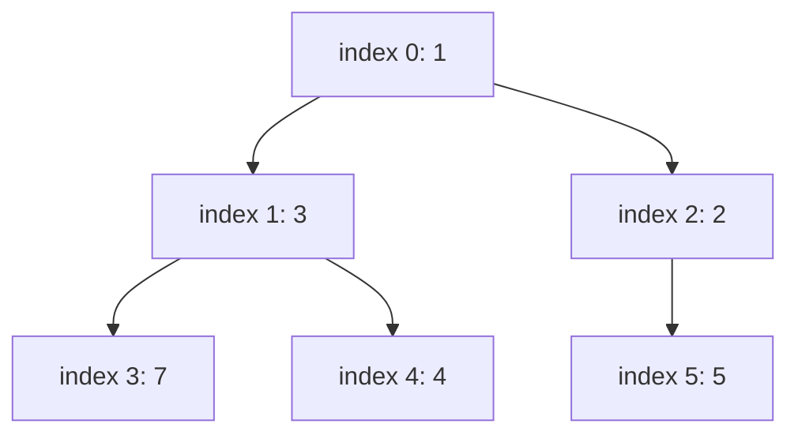

# A binary heap and priority queue from scratch

## Before this lesson

- Arrays, integer division with `>> 1`, and comparators from
  [Numbers and sorting without surprises](#/lesson/dsa-js/numbers-sorting).
- Classes and getters from [Stacks, queues and deques](#/lesson/dsa-js/stacks-queues).
- Optional theory with proofs and diagrams: [Binary heaps](#/lesson/neet-heap-graphs/binary-heaps) and
  [Heap patterns](#/lesson/neet-heap-graphs/heap-patterns) in the Python track.

## In plain words

A hospital emergency room does not serve patients in arrival order. A nurse looks at everyone waiting and calls the
most urgent case next, even if that person arrived last. New patients keep arriving, and each time the nurse must
be able to find the most urgent one quickly.

That waiting room is a **priority queue**: a collection where you can add items and always remove the item with
the highest priority (or, equivalently, the smallest "priority number"). A **binary heap** is the classic way to
build one: adding and removing take O(log n) time, and peeking at the best item takes O(1).

Python ships `heapq`, Java ships `PriorityQueue`, C++ ships `priority_queue`. **JavaScript ships nothing.** In an
interview you either write a heap yourself (about thirty lines, which you should be able to produce from memory)
or explain that you would import a library and agree with the interviewer to assume one. This lesson builds the
heap step by step, tests it, and shows the four patterns that use it most.

Why it matters for a job: "top k", "k-th largest", "merge k sorted lists", "median of a stream", task schedulers
and shortest paths (Dijkstra) all need a priority queue. In JavaScript the heap is the price of entry for that
whole family of questions.

## 1. The shape: a complete binary tree stored in an array

A binary heap is a **complete binary tree**: every level is full except possibly the last, which fills from the
left. That shape lets us store the tree in a plain array with no pointers at all:

- the root is at index `0`
- the children of index `i` are at `2 * i + 1` (left) and `2 * i + 2` (right)
- the parent of index `i` is at `(i - 1) >> 1`

The **heap property** for a min-heap says: every parent is less than or equal to its children. So the smallest
item is always at index 0. (A max-heap flips the comparison.)



The array for that tree is `[1, 3, 2, 7, 4, 5]`. Note that it is **not sorted**: the heap property only orders
each parent with its own children, which is much cheaper to maintain than full sorted order.

```js-run
const heap = [1, 3, 2, 7, 4, 5];
const left = (i) => 2 * i + 1, right = (i) => 2 * i + 2, parent = (i) => (i - 1) >> 1;
console.log(heap[left(1)], heap[right(1)]);   // 7 4: children of the 3
console.log(heap[parent(5)]);                 // 2: parent of the 5
// check the heap property everywhere
console.log(heap.every((v, i) => i === 0 || heap[parent(i)] <= v));   // true
```

`(i - 1) >> 1` is integer division by 2 for non-negative numbers; `Math.floor((i - 1) / 2)` is equivalent. For
`i = 0` it gives `-1`, which the code never uses because the root has no parent.

## 2. Push: add at the end, sift up

To insert, put the new item in the next free slot (the end of the array, keeping the tree complete), then
**sift up**: while it is smaller than its parent, swap them. Each swap moves it one level up, and the tree has
about log2(n) levels, so push is O(log n).

## 3. Pop: move the last item to the root, sift down

To remove the minimum, save `heap[0]`, move the **last** item into the root (keeping the tree complete), and
**sift down**: while it is larger than its smaller child, swap with that child. Again O(log n).

Why the smaller child? Swapping with it guarantees the new parent is less than or equal to both children. Swapping
with the larger child would put a larger value above a smaller one.

## 4. The complete class, with a comparator

Hard-coding `<` gives a min-heap of numbers. Real problems need max-heaps, heaps of pairs (`[distance, node]`),
heaps of objects. A **comparator** argument handles all of them: `less(a, b)` returns `true` when `a` should come
out before `b`.

```js-run
class Heap {
  constructor(less = (a, b) => a < b) {   // default: min-heap of numbers
    this.a = [];
    this.less = less;
  }
  get size() { return this.a.length; }
  peek() { return this.a[0]; }             // undefined when empty
  push(x) {
    const a = this.a;
    a.push(x);
    let i = a.length - 1;
    while (i > 0) {                        // sift up
      const p = (i - 1) >> 1;
      if (!this.less(a[i], a[p])) break;   // parent already comes first
      [a[i], a[p]] = [a[p], a[i]];
      i = p;
    }
  }
  pop() {
    const a = this.a;
    if (a.length === 0) return undefined;
    const top = a[0];
    const last = a.pop();                  // remove the last slot
    if (a.length > 0) {
      a[0] = last;                         // move it to the root...
      let i = 0;
      for (;;) {                           // ...and sift down
        const l = 2 * i + 1, r = l + 1;
        let best = i;
        if (l < a.length && this.less(a[l], a[best])) best = l;
        if (r < a.length && this.less(a[r], a[best])) best = r;
        if (best === i) break;
        [a[i], a[best]] = [a[best], a[i]];
        i = best;
      }
    }
    return top;
  }
}

const h = new Heap();
for (const x of [5, 1, 4, 2, 3]) h.push(x);
const out = [];
while (h.size) out.push(h.pop());
console.log(out);                              // [ 1, 2, 3, 4, 5 ]

const maxHeap = new Heap((a, b) => a > b);     // flip the comparator for a max-heap
for (const x of [5, 1, 4]) maxHeap.push(x);
console.log(maxHeap.pop(), maxHeap.peek());    // 5 4
```

Walk through `pop` once with the earlier array `[1, 3, 2, 7, 4, 5]`: save 1; remove the last item 5 and put it at
the root, giving `[5, 3, 2, 7, 4]`; children of index 0 are 3 and 2, the smaller is 2 at index 2, swap:
`[2, 3, 5, 7, 4]`; index 2 has no children, stop. The minimum 2 is at the root again.

The `for (;;)` loop is an infinite loop that exits through `break`; it reads well for sift-down, where the stop
condition is found in the middle of the body.

> [!TIP]
> Practise writing this class until you can do it in five minutes without looking. In interviews, write it once
> at the top of your solution, say "a standard binary heap with a comparator", and move on to the actual problem.

## 5. Testing your heap against sort

A heap bug often only shows on particular orders of input, so test it the way professionals do: compare against a
simple, obviously-correct reference on many random inputs.

```js-run
class Heap {
  constructor(less = (a, b) => a < b) { this.a = []; this.less = less; }
  get size() { return this.a.length; }
  push(x) { const a = this.a; a.push(x); let i = a.length - 1; while (i > 0) { const p = (i - 1) >> 1; if (!this.less(a[i], a[p])) break; [a[i], a[p]] = [a[p], a[i]]; i = p; } }
  pop() { const a = this.a, top = a[0], last = a.pop(); if (a.length) { a[0] = last; let i = 0; for (;;) { const l = 2 * i + 1, r = l + 1; let b = i; if (l < a.length && this.less(a[l], a[b])) b = l; if (r < a.length && this.less(a[r], a[b])) b = r; if (b === i) break; [a[i], a[b]] = [a[b], a[i]]; i = b; } } return top; }
}

let failures = 0;
for (let trial = 0; trial < 200; trial++) {
  const n = Math.floor(Math.random() * 50);
  const data = Array.from({ length: n }, () => Math.floor(Math.random() * 20) - 10);
  const h = new Heap();
  data.forEach((x) => h.push(x));
  const got = [];
  while (h.size) got.push(h.pop());
  const want = [...data].sort((a, b) => a - b);
  if (got.join() !== want.join()) failures++;
}
console.log("failures:", failures);   // failures: 0
```

The small random values (-10 to 9) produce many duplicates, which is where off-by-one comparisons (`<` versus
`<=`) usually hide.

## 6. Building a heap from an array in O(n)

Pushing n items one by one costs O(n log n). If you already have all the items, **heapify** them in place: sift
down every non-leaf node, starting from the last one and moving to the root. Most nodes are near the bottom and
sift down only a little, and the total work adds up to O(n).

```js-run
function heapify(a, less = (x, y) => x < y) {
  const siftDown = (i) => {
    for (;;) {
      const l = 2 * i + 1, r = l + 1;
      let b = i;
      if (l < a.length && less(a[l], a[b])) b = l;
      if (r < a.length && less(a[r], a[b])) b = r;
      if (b === i) return;
      [a[i], a[b]] = [a[b], a[i]];
      i = b;
    }
  };
  for (let i = (a.length >> 1) - 1; i >= 0; i--) siftDown(i);   // last parent down to the root
  return a;
}
console.log(heapify([9, 4, 7, 1, 8, 2]));   // a valid min-heap with 1 at index 0
```

Index `(n >> 1) - 1` is the last node with a child. Everything after it is a leaf, and a single leaf is already a
valid heap.

## 7. Four patterns that use a heap

### Pattern 1: top k with a size-k heap

To keep the k **largest** values, keep a **min**-heap of size k. Its root is the smallest of the k largest, the
first to be evicted when something bigger arrives. Cost O(n log k) instead of O(n log n) for a full sort.

```js-run
class Heap { constructor(less = (a, b) => a < b) { this.a = []; this.less = less; } get size() { return this.a.length; } peek() { return this.a[0]; } push(x) { const a = this.a; a.push(x); let i = a.length - 1; while (i > 0) { const p = (i - 1) >> 1; if (!this.less(a[i], a[p])) break; [a[i], a[p]] = [a[p], a[i]]; i = p; } } pop() { const a = this.a, top = a[0], last = a.pop(); if (a.length) { a[0] = last; let i = 0; for (;;) { const l = 2 * i + 1, r = l + 1; let b = i; if (l < a.length && this.less(a[l], a[b])) b = l; if (r < a.length && this.less(a[r], a[b])) b = r; if (b === i) break; [a[i], a[b]] = [a[b], a[i]]; i = b; } } return top; } }

function kthLargest(nums, k) {
  const h = new Heap();                    // min-heap holding the k largest so far
  for (const x of nums) {
    h.push(x);
    if (h.size > k) h.pop();               // evict the smallest of them
  }
  return h.peek();
}
console.log(kthLargest([3, 2, 1, 5, 6, 4], 2));   // 5
```

### Pattern 2: k-way merge

To merge k sorted lists, keep one "front" item per list in a min-heap of `[value, listIndex, position]` triples.
Pop the smallest, then push the next item from the same list.

```js-run
class Heap { constructor(less = (a, b) => a < b) { this.a = []; this.less = less; } get size() { return this.a.length; } push(x) { const a = this.a; a.push(x); let i = a.length - 1; while (i > 0) { const p = (i - 1) >> 1; if (!this.less(a[i], a[p])) break; [a[i], a[p]] = [a[p], a[i]]; i = p; } } pop() { const a = this.a, top = a[0], last = a.pop(); if (a.length) { a[0] = last; let i = 0; for (;;) { const l = 2 * i + 1, r = l + 1; let b = i; if (l < a.length && this.less(a[l], a[b])) b = l; if (r < a.length && this.less(a[r], a[b])) b = r; if (b === i) break; [a[i], a[b]] = [a[b], a[i]]; i = b; } } return top; } }

function mergeK(lists) {
  const h = new Heap((x, y) => x[0] < y[0]);       // compare by value only
  lists.forEach((lst, li) => { if (lst.length) h.push([lst[0], li, 0]); });
  const out = [];
  while (h.size) {
    const [v, li, pos] = h.pop();
    out.push(v);
    if (pos + 1 < lists[li].length) h.push([lists[li][pos + 1], li, pos + 1]);
  }
  return out;
}
console.log(mergeK([[1, 4, 5], [1, 3, 4], [2, 6]]));   // [ 1, 1, 2, 3, 4, 4, 5, 6 ]
```

The comparator `(x, y) => x[0] < y[0]` compares tuples by their first field. Python's `heapq` compares whole
tuples automatically; in JavaScript you say exactly which field decides, and you can add tie-breakers with `||`
style logic, for example `x[0] < y[0] || (x[0] === y[0] && x[1] < y[1])`.

### Pattern 3: two heaps for the median

Keep the lower half in a max-heap and the upper half in a min-heap, with sizes differing by at most one. The
median is on top of one or both heaps. Find Median from Data Stream in this track asks for exactly this.

### Pattern 4: best-first search (Dijkstra)

Shortest paths with non-negative edge weights repeatedly expand the closest unfinished node. A heap of
`[distance, node]` pairs supplies it. JavaScript heaps have no "decrease key" operation, so push a new pair when a
distance improves and **skip stale pairs** when they come out (check whether the node is already finished). The
lesson [Graphs in JavaScript](#/lesson/dsa-js/graphs) shows the full code.

## 8. Lazy deletion

Sometimes you must remove an item that is not at the top (the window moved past it, a task was cancelled).
Searching the heap array is O(n). Instead, record the item in a `Map` of pending deletions and discard it when it
reaches the top:

```javascript
// pending: Map value -> how many copies are logically deleted
function cleanTop(heap, pending) {
  while (heap.size && (pending.get(heap.peek()) || 0) > 0) {
    const x = heap.pop();
    pending.set(x, pending.get(x) - 1);
  }
}
```

Call `cleanTop` before every `peek` or `pop`. Each deleted item is popped once eventually, so the amortised cost
stays O(log n).

## 9. Complexity summary

| Operation | Binary heap | Sorted array | Unsorted array |
|---|---|---|---|
| push | O(log n) | O(n) (`splice` to insert) | O(1) |
| peek min | O(1) | O(1) | O(n) |
| pop min | O(log n) | O(1) from the end if sorted descending | O(n) |
| build from n items | O(n) heapify | O(n log n) | O(1) |

A sorted array is a fine choice when all items arrive first and then you only read. The heap wins whenever pushes
and pops are interleaved.

## 10. Pitfalls

- A max-heap where a min-heap was needed (or the reverse): flip the comparator, and check with a tiny example.
- Comparing pairs with `<` directly: `[2, 5] < [10, 1]` compares the **strings** `"2,5"` and `"10,1"`, which says
  `false`. Always index into the field.
- Sifting down toward the **larger** child.
- Forgetting the `a.length > 0` check after removing the last element in `pop`.
- Using `sort` after every insertion "to keep it simple": O(n log n) per operation.
- Expecting `heap.a` to be sorted; only `a[0]` is guaranteed to be the minimum.

## 11. Summary

- A binary heap is a complete tree in an array: children at `2i + 1` and `2i + 2`, parent at `(i - 1) >> 1`.
- Push appends and sifts up; pop moves the last item to the root and sifts down toward the smaller child. Both
  are O(log n); peek is O(1).
- A comparator turns one class into min-heaps, max-heaps and heaps of tuples.
- Heapify builds a heap in O(n).
- Patterns: size-k heaps for top k, k-way merge, two heaps for medians, best-first search with stale-entry skips,
  and lazy deletion.

## Glossary

- **Priority queue**: a collection that always removes the highest-priority item first.
- **Binary heap**: a complete binary tree stored in an array that satisfies the heap property.
- **Complete binary tree**: every level full except the last, which fills from the left.
- **Heap property**: each parent comes before (min-heap: is less than or equal to) its children.
- **Sift up / sift down**: moving an item up or down the tree by swaps until the heap property holds.
- **Heapify**: turning an arbitrary array into a heap in O(n).
- **Comparator `less(a, b)`**: returns true when `a` should leave the heap before `b`.
- **Lazy deletion**: marking items as deleted and discarding them when they reach the top.

## Check yourself

```quiz
[
  {"q": "In the array representation of a binary heap, where are the children of index 4?", "options": ["5 and 6", "8 and 9", "9 and 10", "2 and 3"], "answer": 2,
   "explain": "Children of i are at 2i + 1 and 2i + 2, so 9 and 10."},
  {"q": "To keep the k largest values of a stream, which heap should you maintain?", "options": ["A max-heap of all values", "A min-heap of size k", "A max-heap of size k", "A sorted array of all values"], "answer": 1,
   "explain": "The min-heap's root is the smallest of the k largest, which is exactly the one to evict when a bigger value arrives."},
  {"q": "During sift-down in a min-heap, which child do you swap with?", "options": ["The left child always", "The larger child", "The smaller child", "Either child"], "answer": 2,
   "explain": "Swapping with the smaller child makes the new parent no larger than both children, restoring the property locally."},
  {"q": "What does `[2, 5] < [10, 1]` evaluate to in JavaScript?", "options": ["true, because 2 is less than 10", "false, because the arrays are compared as the strings '2,5' and '10,1'", "It throws a TypeError", "undefined"], "answer": 1,
   "explain": "Relational operators convert arrays to strings. Compare a specific field, such as `a[0] < b[0]`, in heap comparators."},
  {"q": "What is the time complexity of building a heap from n items with bottom-up heapify?", "options": ["O(n log n)", "O(n)", "O(log n)", "O(n^2)"], "answer": 1,
   "explain": "Most nodes are near the bottom and sift down only a few levels; the total sums to O(n)."},
  {"q": "JavaScript heaps lack decrease-key. How does Dijkstra cope?", "options": ["It cannot be implemented", "Push a new [distance, node] pair and skip popped pairs for nodes already finalised", "Sort the heap array after each change", "Use a queue instead"], "answer": 1,
   "explain": "Stale entries cost a little extra space and are discarded cheaply when popped."}
]
```

> **Source:** Goodrich, Tamassia and Goldwasser, Data Structures and Algorithms in Python, chapter 9 (priority
> queues and heaps, array representation, bottom-up construction); NeetCode roadmap, Heap / Priority Queue; MDN Web
> Docs for classes and getters. Written in original words for this track.
