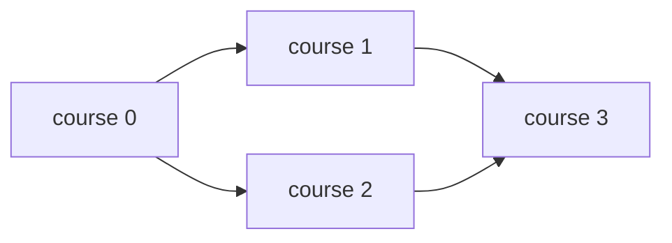

# Graphs in JavaScript: adjacency maps, BFS and DFS

## Before this lesson

- `Map`, `Set` and canonical keys from [JavaScript for coding interviews](#/lesson/dsa-js/js-toolkit).
- The head-index queue from [Stacks, queues and deques](#/lesson/dsa-js/stacks-queues).
- The `Heap` class from [A binary heap and priority queue from scratch](#/lesson/dsa-js/heap) (only for section 7).
- Theory with proofs: [Graph representations](#/lesson/neet-heap-graphs/graph-representations),
  [DFS and BFS](#/lesson/neet-heap-graphs/dfs-bfs), [Cycles and topological sort](#/lesson/neet-heap-graphs/cycles-toposort),
  [Union-find](#/lesson/neet-heap-graphs/union-find) and [Shortest paths](#/lesson/neet-heap-graphs/shortest-paths).

## In plain words

A **graph** is a set of things (called **vertices** or **nodes**) and connections between them (called
**edges**). A road map is a graph: towns are nodes, roads are edges. So is a social network (people and
friendships), a course catalogue (courses and "must take before" rules), and a maze drawn on squared paper (cells
and the openings between neighbours).

Edges can be **directed** (one-way, like "course A must come before course B") or **undirected** (two-way, like a
friendship). They can carry a **weight**, a number such as distance or travel time.

Graph problems in interviews nearly always come down to a few moves: build the graph from the input, then explore
it with **breadth-first search** (BFS, ripple outward one layer at a time) or **depth-first search** (DFS, follow
one path as deep as possible, then back up), maybe with a twist such as counting components, ordering tasks, or
finding shortest routes.

JavaScript adds three practical questions: how to store neighbours (arrays versus `Map`), how to mark visited
cells in a grid (string keys versus numbers), and how to avoid recursion when the graph is deep. This lesson
answers them with runnable templates.

Why it matters for a job: graph questions are common at medium and hard levels, and the JavaScript code for them
is long enough that a clean, memorised template saves real minutes.

## 1. Representing a graph

Interview inputs arrive in a few shapes; you convert them to an **adjacency list**, a structure that answers
"what are the neighbours of node u?" quickly.

| Input shape | Example | Build |
|---|---|---|
| `n` plus edge list, nodes `0..n-1` | `n = 4, edges = [[0,1],[1,2]]` | array of arrays: `Array.from({ length: n }, () => [])` |
| edge list with arbitrary labels | `[["JFK","SFO"],["SFO","ATL"]]` | `Map` from label to array |
| grid | `[["1","0"],["1","1"]]` | implicit: neighbours computed from `(r, c)` |
| already an adjacency list | `adj = [[1,2],[3],[3],[]]` | use as is |

```js-run
// Numbered nodes: array of arrays (fastest)
function buildAdj(n, edges, directed = false) {
  const adj = Array.from({ length: n }, () => []);   // a NEW array per node
  for (const [u, v] of edges) {
    adj[u].push(v);
    if (!directed) adj[v].push(u);
  }
  return adj;
}
console.log(buildAdj(4, [[0, 1], [1, 2], [2, 0], [2, 3]]));

// Labelled nodes: Map from label to neighbours
function buildMap(edges) {
  const g = new Map();
  for (const [u, v] of edges) {
    if (!g.has(u)) g.set(u, []);
    if (!g.has(v)) g.set(v, []);       // make sure sinks exist too
    g.get(u).push(v);
  }
  return g;
}
console.log(buildMap([["JFK", "SFO"], ["SFO", "ATL"], ["JFK", "ATL"]]));
```

Two JavaScript reminders from earlier lessons apply directly: `new Array(n).fill([])` would give every node the
**same** neighbour array, and a plain object `{}` as a graph turns numeric labels into strings and inherits names
like `"constructor"`. Use `Array.from` or `Map`.

For **weighted** graphs store pairs: `adj[u].push([v, w])`.

## 2. Breadth-first search

BFS visits nodes in order of their distance (number of edges) from the start. That makes it the tool for
**shortest paths in unweighted graphs**, for level-by-level processing, and for "spreading" simulations (rotting
oranges, fire, infection).

```js-run
function bfsDistances(adj, start) {
  const dist = new Array(adj.length).fill(-1);   // -1 means "not reached yet"
  dist[start] = 0;
  const queue = [start];
  let head = 0;
  while (head < queue.length) {
    const u = queue[head++];
    for (const v of adj[u]) {
      if (dist[v] === -1) {                       // first visit is the shortest
        dist[v] = dist[u] + 1;
        queue.push(v);
      }
    }
  }
  return dist;
}
const adj = [[1, 2], [0, 3], [0, 3], [1, 2, 4], [3], []];
console.log(bfsDistances(adj, 0));   // [ 0, 1, 1, 2, 3, -1 ]: node 5 is unreachable
```

The `dist` array doubles as the **visited** marker. Marking a node when it is **enqueued** (not when it is
dequeued) guarantees each node enters the queue once, keeping BFS at O(V + E), where V is the number of nodes
and E the number of edges.

## 3. Depth-first search, recursive and iterative

DFS dives along one path. It is the natural tool for **connected components**, **cycle detection**, **topological
order**, and exhaustive exploration.

```js-run
const adj = [[1], [0, 2], [1], [4], [3], []];   // components: {0,1,2}, {3,4}, {5}

// Recursive DFS: short, but each call uses a stack frame
function countComponentsRec(adj) {
  const seen = new Array(adj.length).fill(false);
  const dfs = (u) => {
    seen[u] = true;
    for (const v of adj[u]) if (!seen[v]) dfs(v);
  };
  let count = 0;
  for (let u = 0; u < adj.length; u++) if (!seen[u]) { count++; dfs(u); }
  return count;
}

// Iterative DFS: an explicit stack, no recursion limit
function countComponents(adj) {
  const seen = new Array(adj.length).fill(false);
  let count = 0;
  for (let s = 0; s < adj.length; s++) {
    if (seen[s]) continue;
    count++;
    const stack = [s];
    seen[s] = true;
    while (stack.length) {
      const u = stack.pop();
      for (const v of adj[u]) if (!seen[v]) { seen[v] = true; stack.push(v); }
    }
  }
  return count;
}
console.log(countComponentsRec(adj), countComponents(adj));   // 3 3
```

**When to avoid recursion.** The recursive version uses one call frame per node on the current path. A path graph
or a large all-land grid can be tens of thousands of nodes deep, past what JavaScript engines allow (often around
ten thousand frames). The iterative version only grows an array. In this track, prefer iterative DFS for grids and
for any graph with more than a few thousand nodes; the lesson
[Recursion depth limits and backtracking](#/lesson/dsa-js/recursion-backtracking) measures the limit.

The iterative version visits nodes in a slightly different order than the recursive one (it explores the last
neighbour first). For counting, flooding and reachability that never matters. For algorithms that rely on
**finishing order** (Tarjan's algorithm, some topological sorts), write the iterative version with an explicit
"next neighbour index" per frame, or use Kahn's algorithm (section 5).

## 4. Grids are graphs

A grid problem never builds an adjacency list: neighbours are computed from the coordinates. Keep a list of
direction offsets and check bounds.

```js-run
const DIRS = [[1, 0], [-1, 0], [0, 1], [0, -1]];   // down, up, right, left

function maxAreaOfIsland(grid) {
  const rows = grid.length, cols = grid[0].length;
  const seen = new Uint8Array(rows * cols);          // one flag per cell, id = r * cols + c
  let best = 0;
  for (let r = 0; r < rows; r++) {
    for (let c = 0; c < cols; c++) {
      if (grid[r][c] !== 1 || seen[r * cols + c]) continue;
      let area = 0;
      const stack = [[r, c]];
      seen[r * cols + c] = 1;
      while (stack.length) {
        const [i, j] = stack.pop();
        area++;
        for (const [di, dj] of DIRS) {
          const a = i + di, b = j + dj;
          if (a >= 0 && a < rows && b >= 0 && b < cols && grid[a][b] === 1 && !seen[a * cols + b]) {
            seen[a * cols + b] = 1;
            stack.push([a, b]);
          }
        }
      }
      best = Math.max(best, area);
    }
  }
  return best;
}
console.log(maxAreaOfIsland([
  [1, 1, 0, 0],
  [1, 0, 0, 1],
  [0, 0, 1, 1],
]));   // 3
```

Visited cells can be tracked three ways:

| Method | Example | Notes |
|---|---|---|
| numeric id in a typed array | `seen[r * cols + c] = 1` | fastest; `Uint8Array` starts zeroed |
| 2-D boolean array | `seen[r][c] = true` | readable; build with `Array.from` |
| `Set` of string keys | `seen.add(r + "," + c)` | flexible for unbounded or sparse coordinates, but slower |
| overwrite the input | `grid[r][c] = 0` | no extra memory, but mutates the caller's data: ask first |

Never use `seen.add([r, c])`: a `Set` compares arrays by identity, so `seen.has([r, c])` is always `false`.

## 5. Directed graphs: cycles and topological order

A **topological order** lists the nodes of a directed graph so that every edge points forward, like an order in
which to take courses so that prerequisites come first. It exists exactly when the graph has no directed cycle.

**Kahn's algorithm** builds the order with in-degrees (the number of incoming edges) and a queue, with no
recursion:

```js-run
function topoOrder(n, edges) {             // edge [a, b] means a must come before b
  const adj = Array.from({ length: n }, () => []);
  const indeg = new Array(n).fill(0);
  for (const [a, b] of edges) { adj[a].push(b); indeg[b]++; }
  const order = [];
  for (let u = 0; u < n; u++) if (indeg[u] === 0) order.push(u);
  for (let head = 0; head < order.length; head++) {   // order doubles as the queue
    for (const v of adj[order[head]]) if (--indeg[v] === 0) order.push(v);
  }
  return order.length === n ? order : [];             // [] means a cycle blocked some nodes
}
console.log(topoOrder(4, [[0, 1], [0, 2], [1, 3], [2, 3]]));   // [ 0, 1, 2, 3 ]
console.log(topoOrder(3, [[0, 1], [1, 2], [2, 0]]));           // [] (cycle)
```

A neat JavaScript trick appears here: `order` is both the output and the queue, consumed with a moving `head`
index, so nothing is ever shifted or copied. `--indeg[v] === 0` decrements first and then compares.



## 6. Union-find for undirected connectivity

**Union-find** (also called a **disjoint set union**) keeps track of which nodes are in the same component while
edges are added one at a time. `find(x)` returns a representative of x's component; `union(a, b)` merges two
components. With **path compression** and **union by rank** (or size), each operation is close to O(1).

```js-run
class DSU {
  constructor(n) {
    this.parent = Array.from({ length: n }, (_, i) => i);   // everyone is their own root
    this.size = new Array(n).fill(1);
  }
  find(x) {
    while (this.parent[x] !== x) {
      this.parent[x] = this.parent[this.parent[x]];        // path halving: skip a level
      x = this.parent[x];
    }
    return x;
  }
  union(a, b) {
    let ra = this.find(a), rb = this.find(b);
    if (ra === rb) return false;                           // already connected
    if (this.size[ra] < this.size[rb]) [ra, rb] = [rb, ra];
    this.parent[rb] = ra;                                  // attach smaller under larger
    this.size[ra] += this.size[rb];
    return true;
  }
}
const d = new DSU(5);
console.log(d.union(0, 1), d.union(1, 2), d.union(0, 2));   // true true false: 0-2 closes a cycle
console.log(d.find(2) === d.find(0), d.find(3) === d.find(4));   // true false
```

The loop-based `find` matters in JavaScript: a recursive `find` without compression can recurse as deep as a long
chain of parents. Redundant Connection and Number of Connected Components in this track are union-find problems.

## 7. Weighted shortest paths: Dijkstra with a heap

When edges have non-negative weights, BFS order is no longer distance order. **Dijkstra's algorithm** repeatedly
finalises the closest unfinished node, using a min-heap of `[distance, node]` pairs. JavaScript heaps have no
decrease-key, so you push duplicates and skip stale ones.

```js-run
class Heap { constructor(less) { this.a = []; this.less = less; } get size() { return this.a.length; } push(x) { const a = this.a; a.push(x); let i = a.length - 1; while (i > 0) { const p = (i - 1) >> 1; if (!this.less(a[i], a[p])) break; [a[i], a[p]] = [a[p], a[i]]; i = p; } } pop() { const a = this.a, top = a[0], last = a.pop(); if (a.length) { a[0] = last; let i = 0; for (;;) { const l = 2 * i + 1, r = l + 1; let b = i; if (l < a.length && this.less(a[l], a[b])) b = l; if (r < a.length && this.less(a[r], a[b])) b = r; if (b === i) break; [a[i], a[b]] = [a[b], a[i]]; i = b; } } return top; } }

function dijkstra(n, edges, src) {          // edges: [u, v, w], directed
  const adj = Array.from({ length: n }, () => []);
  for (const [u, v, w] of edges) adj[u].push([v, w]);
  const dist = new Array(n).fill(Infinity);
  const done = new Uint8Array(n);
  const heap = new Heap((x, y) => x[0] < y[0]);
  dist[src] = 0;
  heap.push([0, src]);
  while (heap.size) {
    const [d, u] = heap.pop();
    if (done[u]) continue;                   // stale entry
    done[u] = 1;
    for (const [v, w] of adj[u]) {
      if (d + w < dist[v]) {
        dist[v] = d + w;
        heap.push([dist[v], v]);
      }
    }
  }
  return dist;
}
console.log(dijkstra(4, [[0, 1, 4], [0, 2, 1], [2, 1, 2], [1, 3, 1]], 0));   // [ 0, 3, 1, 4 ]
```

`Infinity` is the natural "unreached" value: any real distance is smaller, and `Infinity + w` stays `Infinity`.
Network Delay Time in this track is this algorithm plus "take the maximum distance".

## 8. Choosing the tool

| Question | Tool |
|---|---|
| fewest edges from A to B, unweighted | BFS |
| spread from many sources at once | multi-source BFS (all sources in the first level) |
| count regions / components, flood fill | iterative DFS or BFS, or union-find |
| order tasks with prerequisites, detect a cycle in a directed graph | Kahn's topological sort |
| edges arrive one by one; "already connected?" | union-find |
| cheapest path with non-negative weights | Dijkstra with a heap |
| cheapest path with at most k edges, or negative weights | Bellman-Ford (relax all edges k times) |

## 9. Pitfalls

- `new Array(n).fill([])` for adjacency lists: one shared array.
- Marking visited on dequeue instead of enqueue: nodes enter the queue many times.
- `Set` of `[r, c]` arrays: never finds anything. Use numeric ids or string keys.
- Recursive DFS on large grids: `RangeError: Maximum call stack size exceeded`.
- Forgetting isolated nodes (no edges) when counting components or checking that all nodes were reached.
- Plain BFS on a weighted graph.
- 1-based node labels (`1..n`) with arrays sized `n`: size them `n + 1`.

## 10. Summary

- Build adjacency lists with `Array.from` (numbered nodes) or a `Map` (labels); weighted edges as `[v, w]`.
- BFS with a head-index queue gives unweighted distances; mark visited on enqueue.
- Prefer iterative DFS with an explicit stack for deep graphs and grids.
- Grids are implicit graphs: direction offsets, bounds checks, numeric visited ids in a typed array.
- Kahn's algorithm, union-find and Dijkstra cover ordering, connectivity and weighted paths.

## Glossary

- **Graph / vertex / edge**: a set of nodes and the connections between them.
- **Directed / undirected**: one-way / two-way edges.
- **Weight**: a number attached to an edge, such as a distance.
- **Adjacency list**: for each node, the list of its neighbours.
- **BFS / DFS**: breadth-first (layer by layer) / depth-first (path by path) exploration.
- **Connected component**: a maximal group of nodes that can all reach each other.
- **In-degree**: the number of edges entering a node.
- **Topological order**: an ordering of a directed acyclic graph where every edge points forward.
- **Union-find (DSU)**: a structure that merges sets and finds a set's representative almost in O(1).
- **Dijkstra's algorithm**: shortest paths with non-negative weights using a priority queue.

## Check yourself

```quiz
[
  {"q": "Why should BFS mark a node as visited when it is enqueued rather than when it is dequeued?", "options": ["It is required for DFS", "Otherwise the same node can be enqueued several times before it is processed", "Dequeue is O(n)", "It changes the distances"], "answer": 1,
   "explain": "Marking on enqueue guarantees each node enters the queue once, keeping BFS at O(V + E)."},
  {"q": "What does `const s = new Set(); s.add([1, 2]); s.has([1, 2])` return?", "options": ["true", "false", "undefined", "It throws"], "answer": 1,
   "explain": "Sets compare arrays by identity; the second [1, 2] is a new object. Use a numeric id or a string key like '1,2'."},
  {"q": "A flood fill over a 300 by 300 all-land grid throws `RangeError: Maximum call stack size exceeded`. What is the fix?", "options": ["Use BFS or DFS with an explicit array as the stack or queue", "Use a Map instead of an array", "Sort the grid first", "Catch the error and continue"], "answer": 0,
   "explain": "Recursion depth can reach 90,000 frames. An explicit stack or queue only grows an array on the heap."},
  {"q": "In Kahn's algorithm, how do you know the graph had a cycle?", "options": ["The queue becomes empty immediately", "Fewer than n nodes were output, because nodes on a cycle never reach in-degree 0", "A node is visited twice", "The order is not sorted"], "answer": 1,
   "explain": "Each node on a cycle always keeps an incoming edge from another cycle node, so it is never released."},
  {"q": "Which tool answers 'is this new edge connecting two nodes that are already connected?' fastest as edges stream in?", "options": ["BFS from scratch each time", "Union-find", "Dijkstra", "Topological sort"], "answer": 1,
   "explain": "find(a) === find(b) tells you in near-constant time; union merges the components."},
  {"q": "Why is `Infinity` a good initial distance in Dijkstra?", "options": ["It is faster to compare", "Every real distance is smaller, and Infinity plus a weight stays Infinity", "JSON prints it as 0", "It avoids using a heap"], "answer": 1,
   "explain": "It needs no special case for unreached nodes; check `dist[v] === Infinity` at the end to detect unreachable ones."}
]
```

> **Source:** Goodrich, Tamassia and Goldwasser, Data Structures and Algorithms in Python, chapter 14 (graph
> representations, traversals, topological ordering, shortest paths, union-find); NeetCode roadmap, Graphs and
> Advanced Graphs; MDN Web Docs for typed arrays and Map. Written in original words for this track.
