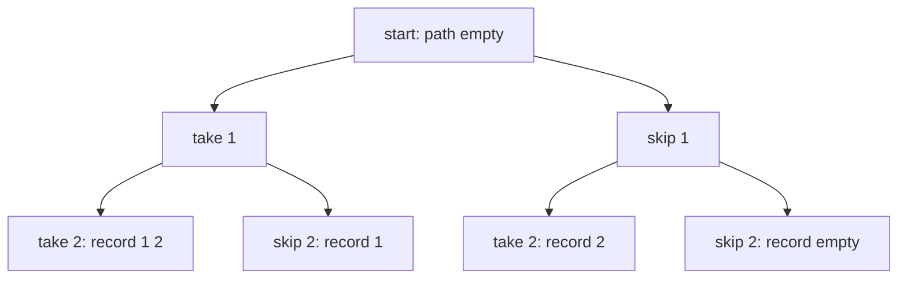

# Recursion depth limits and backtracking

## Before this lesson

- Functions, closures and arrays from the earlier lessons of this track, especially
  [Linked lists and trees with classes](#/lesson/dsa-js/linked-lists-trees), which introduced recursive tree walks.
- [Closures and recursion](#/lesson/javascript/closures-recursion) in the JavaScript track if recursion itself is
  new to you.
- Theory for backtracking: [The backtracking template](#/lesson/neet-heap-graphs/backtracking-template) and
  [Pruning the search](#/lesson/neet-heap-graphs/backtracking-pruning).

## In plain words

**Recursion** means a function solving a problem by calling itself on a smaller piece of the same problem, like
Russian nesting dolls: to count the dolls, open the outer one and count the dolls inside, which is the same task on
a smaller set.

Each call that has started but not finished waits on the **call stack**, a pile of bookmarks the engine keeps so
it knows where to return. That pile has a fixed maximum height. Go too deep and JavaScript stops your program with
`RangeError: Maximum call stack size exceeded`. Python has a similar limit (about 1000 by default), but
programmers coming from Python often assume JavaScript has none, or that it optimises tail calls; neither is true in
practice.

**Backtracking** is recursion used to explore choices: pick an option, explore everything that follows from it,
then **undo** the choice and try the next option. It is how you generate all subsets, all permutations, all
combinations that sum to a target, or search a word in a grid. The recursion depth is small (the number of choices
in one solution), but the code has a JavaScript-specific trap: recording a solution array that you keep mutating.

Why it matters for a job: interviewers like recursive solutions because they are short and clear, and they ask
follow-up questions such as "what happens with a million nodes?". Knowing the stack limit, and how to rewrite
recursion with an explicit stack, is the expected answer.

## 1. How deep can JavaScript recurse?

The engine does not count calls; it measures the **memory** the frames use. A **frame** holds a call's parameters,
local variables and return address, so functions with more locals use bigger frames and hit the limit sooner.
Measure it yourself:

```js-run
let depth = 0;
function dive() {
  depth++;
  dive();
}
try {
  dive();
} catch (e) {
  console.log(e.name, "after", depth, "calls");
}

let depth2 = 0;
function diveFat(a, b, c, d) {             // more parameters and locals: bigger frames
  depth2++;
  const x = a + b, y = c + d, z = x * y;
  diveFat(x, y, z, a);
}
try {
  diveFat(1, 2, 3, 4);
} catch (e) {
  console.log(e.name, "after", depth2, "calls");
}
```

In Node and Chrome the first number is usually around ten to twelve thousand and the second noticeably smaller;
Firefox and Safari differ. The practical rule for interviews:

- Depth up to about **1,000**: always safe.
- Depth around **10,000**: risky; depends on engine and frame size.
- Depth of **100,000 or more** (a linked list of 10^5 nodes, a skewed tree, a path graph, a large flood fill):
  will crash. Use iteration.

> [!NOTE]
> The ECMAScript 2015 specification describes **proper tail calls**: a call in "tail position" (the very last
> action, as in `return f(n - 1)`) could reuse the current frame. Only Safari's engine implements it. V8 (Chrome,
> Node) and SpiderMonkey (Firefox) do not, so do not rely on tail recursion to save stack in JavaScript.

## 2. Where recursion depth comes from

The depth of a recursion is the length of the longest chain of nested calls, not the total number of calls.

| Recursion | Total calls | Depth |
|---|---|---|
| DFS on a balanced tree of n nodes | n | about log2(n) |
| DFS on a skewed tree / linked list of n nodes | n | n |
| Flood fill of an R x C grid | R * C | up to R * C |
| Subsets of n items (backtracking) | 2^n | n |
| Fibonacci with memo | n | n |
| Merge sort on n items | about 2n | log2(n) |

So "is recursion safe here?" is a question about the **shape** of the input. A recursive merge sort on ten million
items is fine (depth 24). A recursive "reverse a linked list" on 100,000 nodes is not.

## 3. Turning recursion into iteration

Any recursion can be rewritten with an explicit **stack** (an array) holding what the call frames would have held.
The array lives in the general heap memory, which is far larger than the call stack.

**Simple case: pre-order work.** If a call does its work and then recurses, push the children and loop:

```js-run
// Sum of all values in a deep nested array, without recursion
function deepSum(arr) {
  let total = 0;
  const stack = [arr];
  while (stack.length) {
    const item = stack.pop();
    if (Array.isArray(item)) for (const x of item) stack.push(x);
    else total += item;
  }
  return total;
}
let nested = [1];
for (let i = 0; i < 100000; i++) nested = [nested, 1];   // 100,000 levels deep
console.log(deepSum(nested));                             // 100001, no RangeError
```

**Harder case: work after the children return** (post-order, such as tree height or path sums). Store a small
state per frame: the node and whether its children are done.

```js-run
class TreeNode { constructor(val = 0, left = null, right = null) { this.val = val; this.left = left; this.right = right; } }

// Height of a tree without recursion: post-order with an explicit stack
function height(root) {
  const h = new Map();                       // node -> height, filled after its children
  const stack = root ? [[root, false]] : [];
  while (stack.length) {
    const [node, childrenDone] = stack.pop();
    if (childrenDone) {
      const l = node.left ? h.get(node.left) : 0;
      const r = node.right ? h.get(node.right) : 0;
      h.set(node, 1 + Math.max(l, r));
    } else {
      stack.push([node, true]);              // come back after the children
      if (node.left) stack.push([node.left, false]);
      if (node.right) stack.push([node.right, false]);
    }
  }
  return root ? h.get(root) : 0;
}

// A 50,000-node chain: recursion would overflow, this does not
let chain = null;
for (let i = 0; i < 50000; i++) chain = new TreeNode(i, chain);
console.log(height(chain));                  // 50000
```

Each node is pushed twice: once to schedule its children, once (with `childrenDone = true`) to combine their
results. Notice the `Map` keyed by **node objects**: identity keys are exactly what we want here.

Often an even simpler alternative exists: tree height is the number of BFS levels, flood fill works with BFS, and
linked lists are walked with a loop. Reach for the two-phase stack only when the computation truly needs
post-order.

## 4. Backtracking: choose, explore, un-choose

Backtracking explores a **decision tree**. Each level makes one choice; a leaf is a complete candidate. The
template has three steps around the recursive call:

1. **Choose**: modify the shared state (push onto `path`, mark `used[i]`, write `"#"` into a grid cell).
2. **Explore**: recurse.
3. **Un-choose**: undo exactly what step 1 did.



That tree is "subsets of `[1, 2]`": two levels, two choices per level, four leaves.

```js-run
function subsets(nums) {
  const result = [];
  const path = [];                       // ONE array shared by every call
  function backtrack(i) {
    if (i === nums.length) {
      result.push([...path]);            // record a COPY of the current state
      return;
    }
    path.push(nums[i]);                  // choose
    backtrack(i + 1);                    // explore
    path.pop();                          // un-choose
    backtrack(i + 1);                    // explore the other branch
  }
  backtrack(0);
  return result;
}
console.log(JSON.stringify(subsets([1, 2, 3])));
```

### The copy trap

`result.push(path)` instead of `result.push([...path])` is the most common JavaScript backtracking bug. Arrays are
references: every recorded entry would be the **same** array object, and after all the pops it is empty.

```js-run
function subsetsBuggy(nums) {
  const result = [], path = [];
  (function bt(i) {
    if (i === nums.length) { result.push(path); return; }   // no copy!
    path.push(nums[i]); bt(i + 1); path.pop(); bt(i + 1);
  })(0);
  return result;
}
console.log(JSON.stringify(subsetsBuggy([1, 2])));   // [[],[],[],[]]
```

The function is an **IIFE** (immediately invoked function expression): it is defined and called in one expression,
`(function bt(i) { ... })(0)`. You will see this compact style in solutions; a named inner function plus a separate
call is clearer for interviews.

Copying costs O(length) per recorded solution, which is unavoidable: the output itself has that size.

### Why share one path array at all?

The alternative, passing a fresh array to every call (`backtrack(i + 1, [...path, nums[i]])`), is correct and
sometimes simpler, but it allocates a new array at **every node** of the decision tree, not only at the leaves.
Sharing one array and undoing changes allocates only when recording. Both are acceptable in interviews; the shared
version is the standard template.

## 5. Three backtracking shapes

**Subsets / combinations**: each element is taken or skipped, or you loop over the remaining elements starting at
a `start` index so that each combination is generated once in increasing index order.

**Permutations**: at each level, loop over all elements not yet `used`.

```js-run
function permute(nums) {
  const result = [], path = [], used = new Array(nums.length).fill(false);
  function backtrack() {
    if (path.length === nums.length) { result.push([...path]); return; }
    for (let i = 0; i < nums.length; i++) {
      if (used[i]) continue;
      used[i] = true; path.push(nums[i]);       // choose
      backtrack();                              // explore
      path.pop(); used[i] = false;              // un-choose
    }
  }
  backtrack();
  return result;
}
console.log(permute([1, 2, 3]).length, JSON.stringify(permute([1, 2])));   // 6 [[1,2],[2,1]]
```

**Grid paths** (Word Search): mark the cell as used by overwriting it, recurse into neighbours, restore it.

```js-run
function exist(board, word) {
  const R = board.length, C = board[0].length;
  function dfs(r, c, i) {
    if (i === word.length) return true;
    if (r < 0 || c < 0 || r >= R || c >= C || board[r][c] !== word[i]) return false;
    const saved = board[r][c];
    board[r][c] = "#";                                   // choose: mark used
    const found = dfs(r + 1, c, i + 1) || dfs(r - 1, c, i + 1) ||
                  dfs(r, c + 1, i + 1) || dfs(r, c - 1, i + 1);
    board[r][c] = saved;                                 // un-choose: restore
    return found;
  }
  for (let r = 0; r < R; r++) for (let c = 0; c < C; c++) if (dfs(r, c, 0)) return true;
  return false;
}
const board = [["A", "B", "C", "E"], ["S", "F", "C", "S"], ["A", "D", "E", "E"]];
console.log(exist(board, "ABCCED"), exist(board, "ABCB"));   // true false
```

The `||` chain **short-circuits**: as soon as one direction returns `true`, the others are not explored. The
restore line still runs because it comes after the whole expression.

## 6. Pruning: cutting dead branches early

Backtracking is exponential, so the practical speed comes from **pruning**: stopping a branch as soon as it cannot
lead to a valid answer.

- Sort the candidates first (numerically!), then `break` out of the loop when a candidate exceeds the remaining
  target: every later one is bigger too.
- Skip duplicates at the same level: after sorting, `if (i > start && nums[i] === nums[i - 1]) continue`.
- Check feasibility before recursing (enough letters left, enough remaining sum, board counts).

```js-run
function combinationSum2(cands, target) {          // each number used once, input has duplicates
  const nums = [...cands].sort((a, b) => a - b), result = [], path = [];
  function backtrack(start, remaining) {
    if (remaining === 0) { result.push([...path]); return; }
    for (let i = start; i < nums.length; i++) {
      if (i > start && nums[i] === nums[i - 1]) continue;   // same value at the same level
      if (nums[i] > remaining) break;                        // sorted: nothing later fits
      path.push(nums[i]);
      backtrack(i + 1, remaining - nums[i]);
      path.pop();
    }
  }
  backtrack(0, target);
  return result;
}
console.log(JSON.stringify(combinationSum2([10, 1, 2, 7, 6, 1, 5], 8)));   // [[1,1,6],[1,2,5],[1,7],[2,6]]
```

## 7. Pitfalls

- Recording `path` without copying.
- Forgetting the un-choose step (or undoing something different from what you did).
- Recursing on inputs whose **depth** can reach tens of thousands; switch to an explicit stack or BFS.
- Relying on tail-call optimisation: V8 and SpiderMonkey do not perform it.
- `sort()` without a comparator before numeric pruning.
- Global variables for `result` declared outside the function: they leak between test calls. Declare them inside.
- Catching `RangeError` to "fix" deep recursion: the work is lost; restructure instead.

## 8. Summary

- JavaScript's call stack holds roughly ten thousand simple frames in V8; the exact limit depends on engine and
  frame size, and tail calls are not optimised outside Safari.
- Depth, not total calls, decides safety: balanced trees and backtracking are shallow; chains, skewed trees and big
  grids are deep.
- Convert deep recursion with an explicit stack; use a two-phase entry `[node, childrenDone]` for post-order work.
- Backtracking: choose, explore, un-choose on one shared state; copy `path` when recording.
- Prune with sorting, `break`, and duplicate skipping.

## Glossary

- **Recursion**: a function calling itself on a smaller version of the problem.
- **Call stack / frame**: the engine's stack of active calls / one call's saved state on it.
- **Stack overflow (`RangeError`)**: the error thrown when the call stack exceeds its size limit.
- **Tail call**: a call that is the last action of a function; JavaScript engines mostly do not optimise it.
- **Explicit stack**: an array used to simulate recursion iteratively.
- **Backtracking**: exploring choices recursively and undoing each choice after exploring it.
- **Decision tree**: the tree of choices a backtracking search walks.
- **Pruning**: abandoning a branch that cannot produce a valid answer.
- **IIFE**: a function expression that is called immediately where it is defined.
- **Short-circuit**: `||` and `&&` stop evaluating as soon as the result is known.

## Check yourself

```quiz
[
  {"q": "Roughly how deep can simple recursion go in Node or Chrome before a RangeError?", "options": ["About 100", "About 1,000", "About 10,000", "Unlimited"], "answer": 2,
   "explain": "V8's default stack fits roughly ten thousand small frames; larger frames lower the count. Python's default limit is about 1,000."},
  {"q": "Which recursion is safe on an input of one million elements?", "options": ["Recursive linked-list reversal", "Recursive merge sort", "Recursive DFS on a path graph", "Recursive flood fill of a 1000 by 1000 grid"], "answer": 1,
   "explain": "Merge sort's depth is about log2(n), around 20. The others can be as deep as the input is long."},
  {"q": "A subsets function returns `[[],[],[],[]]` for input `[1, 2]`. What is the most likely bug?", "options": ["The base case is wrong", "It records `path` itself instead of a copy, so every entry is the same emptied array", "It forgot to sort", "It uses a Set"], "answer": 1,
   "explain": "Arrays are references; `result.push([...path])` records a snapshot."},
  {"q": "Does V8 (Chrome, Node) perform proper tail calls for `return f(n - 1)`?", "options": ["Yes, always", "Only in strict mode", "No; only Safari's engine implements them", "Only for arrow functions"], "answer": 2,
   "explain": "The feature is specified but not implemented in V8 or SpiderMonkey, so deep tail recursion still overflows."},
  {"q": "In Combination Sum II, why `break` (not `continue`) when `nums[i] > remaining`?", "options": ["break is faster to type", "The array is sorted, so every later number is at least as large and also too big", "continue would cause infinite recursion", "To skip duplicates"], "answer": 1,
   "explain": "Sorting numerically turns the check into a cut-off for the whole rest of the loop."},
  {"q": "What does the explicit-stack entry `[node, true]` mean in the iterative tree-height code?", "options": ["The node is a leaf", "The node's children have been processed, so its own result can now be computed", "The node was visited twice by mistake", "The node is the root"], "answer": 1,
   "explain": "Each node is pushed once to schedule children and once more to combine their results, imitating post-order recursion."}
]
```

> **Source:** ECMAScript Language Specification (tail position calls); MDN Web Docs (Recursion, "Maximum call stack
> size exceeded" error reference); NeetCode roadmap, Backtracking; the backtracking lessons of the neet-heap-graphs
> track on this site. Written in original words for this track.
