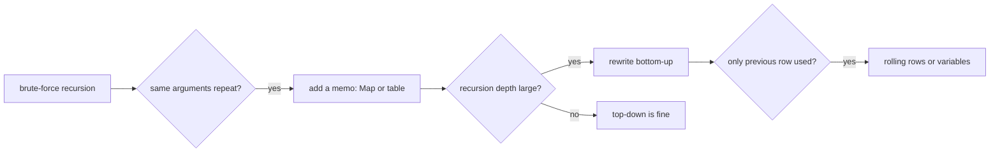

# Memoisation and DP tables in JavaScript

## Before this lesson

- [Recursion depth limits and backtracking](#/lesson/dsa-js/recursion-backtracking): recursion, the call stack
  limit, closures.
- `Map` keys and `Array.from` grids from [JavaScript for coding interviews](#/lesson/dsa-js/js-toolkit), and
  BigInt from [Numbers and sorting without surprises](#/lesson/dsa-js/numbers-sorting).
- Theory: [From recursion to DP](#/lesson/neet-dp/dp-from-recursion), [A framework for DP](#/lesson/neet-dp/dp-framework)
  and [DP families](#/lesson/neet-dp/dp-families). This lesson focuses on the JavaScript mechanics.

## In plain words

Suppose a friend asks you "what is 37 times 41?" and you work it out on paper. Five minutes later they ask again.
You do not redo the multiplication: you look at your note. **Memoisation** is exactly that note-taking for a
function: the first time the function computes an answer for some input, store it; next time, look it up.

**Dynamic programming (DP)** is the broader idea behind it: solve a big problem by combining answers to smaller,
**overlapping** subproblems, and compute each subproblem only once. There are two ways to organise the work:

- **Top-down**: write the natural recursion, then add a memo (a `Map` or array of saved answers).
- **Bottom-up**: fill a **table** (an array) from the smallest subproblems to the largest with loops, no recursion
  at all.

In JavaScript, three details decide whether your DP is correct and fast: how you build **memo keys** for several
parameters, how you create **tables** without the shared-row trap, and how deep the top-down recursion goes. This
lesson covers each, with runnable examples.

Why it matters for a job: DP questions are common in interviews for mid-level and senior roles, and they are where
an exponential "correct but slow" answer most often appears. Turning it into a memoised or tabulated solution, and
explaining the subproblem clearly, is what interviewers grade.

## 1. Why plain recursion explodes

The Fibonacci numbers are 0, 1, 1, 2, 3, 5, 8, and so on: each is the sum of the previous two. The textbook
recursion recomputes the same values again and again.

```js-run
let calls = 0;
function fib(n) {
  calls++;
  return n < 2 ? n : fib(n - 1) + fib(n - 2);
}
console.log(fib(25), "calls:", calls);   // 75025 calls: 242785
```

`fib(25)` makes almost a quarter of a million calls, and the count roughly multiplies by 1.6 for each extra `n`.
Most of those calls repeat work: `fib(20)` alone is computed eight times. That repetition is the signal for DP:
**overlapping subproblems**.

## 2. Top-down: memoise with a Map or an array

```js-run
function fibMemo(n, memo = new Map()) {
  if (n < 2) return n;
  if (memo.has(n)) return memo.get(n);       // already computed
  const v = fibMemo(n - 1, memo) + fibMemo(n - 2, memo);
  memo.set(n, v);                            // store before returning
  return v;
}
console.log(fibMemo(90));                    // 2880067194370816000: rounded, the true value ends in ...120
console.log(Number.isSafeInteger(fibMemo(78)), Number.isSafeInteger(fibMemo(79)));   // true false
```

Each `n` is now computed once: O(n) time. Two JavaScript notes:

- `memo.has(n)` rather than `if (memo.get(n))`, because a stored answer can be `0` (here `fib(0)`).
- Fibonacci numbers pass `Number.MAX_SAFE_INTEGER` after `fib(78)`. From there on, plain numbers lose precision.
  If the problem wants exact huge values, switch to BigInt (`0n`, `1n`); if it wants them modulo `10^9 + 7`, reduce
  after every addition.

A **closure-based memo** keeps the cache private and the signature clean:

```js-run
function makeClimb() {
  const memo = new Map();
  function ways(n) {                          // ways to climb n stairs with steps of 1 or 2
    if (n <= 1) return 1;
    if (memo.has(n)) return memo.get(n);
    const v = ways(n - 1) + ways(n - 2);
    memo.set(n, v);
    return v;
  }
  return ways;
}
const climb = makeClimb();
console.log(climb(10), climb(45));            // 89 1836311903
```

### Keys for several parameters

Many DP states have two or three parameters: `(i, j)` positions in two strings, `(index, remaining)` in a knapsack.
A `Map` compares array keys by identity, so `memo.get([i, j])` never hits. Encode the state yourself:

| Encoding | Example | Notes |
|---|---|---|
| string | `` `${i},${j}` `` or `i + "," + j` | always works; slower (string building and hashing) |
| number | `i * (n + 1) + j` | fast; needs known upper bounds |
| nested arrays | `memo[i][j]` | fastest; a 2-D table filled with a sentinel like `-1` or `undefined` |

```js-run
// Unique paths in an m x n grid, top-down, three key styles
function pathsString(m, n) {
  const memo = new Map();
  const go = (r, c) => {
    if (r === 0 || c === 0) return 1;
    const key = r + "," + c;
    if (memo.has(key)) return memo.get(key);
    const v = go(r - 1, c) + go(r, c - 1);
    memo.set(key, v);
    return v;
  };
  return go(m - 1, n - 1);
}
function pathsNumeric(m, n) {
  const memo = new Map();
  const go = (r, c) => {
    if (r === 0 || c === 0) return 1;
    const key = r * n + c;                       // unique because c < n
    if (memo.has(key)) return memo.get(key);
    const v = go(r - 1, c) + go(r, c - 1);
    memo.set(key, v);
    return v;
  };
  return go(m - 1, n - 1);
}
function pathsTable(m, n) {
  const memo = Array.from({ length: m }, () => new Array(n).fill(-1));   // -1 = not computed
  const go = (r, c) => {
    if (r === 0 || c === 0) return 1;
    if (memo[r][c] !== -1) return memo[r][c];
    return (memo[r][c] = go(r - 1, c) + go(r, c - 1));
  };
  return go(m - 1, n - 1);
}
console.log(pathsString(3, 7), pathsNumeric(3, 7), pathsTable(3, 7));   // 28 28 28
```

`return (memo[r][c] = ...)` assigns and returns in one expression, a common compact idiom.

### The depth risk of top-down DP

Top-down recursion goes as deep as the longest chain of subproblems. `ways(n)` recurses to `ways(n - 1)` first, so
its depth is `n`. For `n = 45` that is nothing; for `n = 100000` it overflows the call stack (see the previous
lesson). Grid DP with a 1000 x 1000 table can recurse about 2000 deep: usually fine. Edit distance on two strings
of length 5000 can go 10,000 deep: risky. When the depth can reach thousands, prefer bottom-up.

## 3. Bottom-up: fill a table with loops

Bottom-up DP computes subproblems in an order where everything a cell needs is already filled. No recursion, no
depth limit, and usually faster because there are no function calls or hash lookups.

```js-run
// Coin Change: fewest coins to make each amount
function coinChange(coins, amount) {
  const dp = new Array(amount + 1).fill(Infinity);   // Infinity = impossible so far
  dp[0] = 0;
  for (let a = 1; a <= amount; a++) {
    for (const c of coins) {
      if (c <= a && dp[a - c] + 1 < dp[a]) dp[a] = dp[a - c] + 1;
    }
  }
  return dp[amount] === Infinity ? -1 : dp[amount];
}
console.log(coinChange([1, 3, 4], 6));   // 2 (3 + 3); greedy would answer 3
console.log(coinChange([2], 3));         // -1
```

`Infinity` is the JavaScript-friendly "impossible" marker: `Infinity + 1` is still `Infinity` and loses every
`Math.min`, so no special cases are needed. Remember to translate it to the problem's answer (`-1`) at the end.

### Building 2-D tables correctly

```js-run
const rows = 3, cols = 4;
const good = Array.from({ length: rows }, () => new Array(cols).fill(0));
const bad = new Array(rows).fill(new Array(cols).fill(0));
good[0][0] = 1;
bad[0][0] = 1;
console.log(good[1][0], bad[1][0]);   // 0 1: every row of "bad" is the same array
```

The same shared-row trap from the first lesson is the most common DP bug in JavaScript. A second subtle one: a
table built with `new Array(n)` and no `fill` contains holes, and `holes + 1` is `NaN`.

### Typed arrays for numeric tables

**Typed arrays** (`Int32Array`, `Float64Array`, `Uint8Array`, ...) are fixed-length, zero-filled, and store raw
numbers compactly. They are excellent DP rows:

- `new Int32Array(n + 1)`: integers in the 32-bit range, zero-filled. Fast and memory-light. It cannot hold
  `Infinity` or `-1`-style sentinels beyond its range (writing `Infinity` stores `0`), and values wrap past
  about 2.1 billion.
- `new Float64Array(n + 1).fill(Infinity)`: holds any number, including `Infinity`.
- `new Uint8Array(n)`: booleans as 0/1, ideal for "reachable" tables.

```js-run
const i32 = new Int32Array(3);
i32[0] = Infinity; i32[1] = 2 ** 31; i32[2] = -1;
console.log(Array.from(i32));                 // [ 0, -2147483648, -1 ]: silent conversion
const f64 = new Float64Array(3).fill(Infinity);
f64[1] = 5;
console.log(Array.from(f64));                 // [ Infinity, 5, Infinity ]
```

Use `Int32Array` for counts and lengths you know are small (LCS lengths, edit distances), `Float64Array` when you
need `Infinity` or large values, and plain arrays when cells hold objects or strings.

## 4. Space optimisation: rolling rows

Many tables only look one row back. Keep two rows (or one, updated carefully) instead of the full grid.

```js-run
// Longest Common Subsequence with two rolling rows
function lcs(a, b) {
  let prev = new Int32Array(b.length + 1), cur = new Int32Array(b.length + 1);
  for (let i = 1; i <= a.length; i++) {
    for (let j = 1; j <= b.length; j++) {
      cur[j] = a[i - 1] === b[j - 1] ? prev[j - 1] + 1 : Math.max(prev[j], cur[j - 1]);
    }
    [prev, cur] = [cur, prev];      // swap references: no copying
  }
  return prev[b.length];
}
console.log(lcs("abcde", "ace"), lcs("abc", "def"));   // 3 0
```

The swap `[prev, cur] = [cur, prev]` exchanges which array plays which role. The old `prev` becomes scratch space
for the next row; its stale values are overwritten before being read (every `cur[j]` for `j >= 1` is assigned, and
`cur[0]` stays 0 because it is never written).

For 1-D recurrences that only need the last two values (Fibonacci, Climbing Stairs, House Robber), two variables
are enough:

```js-run
function rob(nums) {
  let skip = 0, take = 0;     // best total if the previous house was skipped / robbed
  for (const x of nums) [skip, take] = [Math.max(skip, take), skip + x];
  return Math.max(skip, take);
}
console.log(rob([2, 7, 9, 3, 1]), rob([2, 1, 1, 2]));   // 12 4
```

## 5. Large counts and modular arithmetic

Counting DP ("number of ways") overflows quickly. Problems then ask for the count modulo `10^9 + 7`.

- **Addition** of two values below `10^9 + 7` stays below `2.1 * 10^9`: safe as a plain number. Reduce after each
  addition: `dp[i] = (dp[i - 1] + dp[i - 2]) % MOD`.
- **Multiplication** of two such values reaches `10^18`: unsafe. Use BigInt for that one product.

```js-run
const MOD = 1_000_000_007;
function climbMod(n) {                       // ways to climb n stairs, modulo MOD
  let a = 1, b = 1;
  for (let i = 2; i <= n; i++) [a, b] = [b, (a + b) % MOD];
  return b;
}
console.log(climbMod(1000));                 // stays exact because every value is below MOD

const mulMod = (x, y) => Number((BigInt(x) * BigInt(y)) % BigInt(MOD));
console.log(mulMod(999999999, 999999999));   // exact product modulo MOD
```

## 6. A DP recipe in five questions

The neet-dp lessons develop this framework in depth ([A framework for DP](#/lesson/neet-dp/dp-framework)). In short:

1. **State**: what parameters identify a subproblem? (index, remaining capacity, positions in two strings)
2. **Meaning**: one sentence: "`dp[i]` is the fewest coins for amount `i`".
3. **Transition**: how does a state combine smaller states?
4. **Base cases**: the smallest states, filled directly.
5. **Order and answer**: loop so that dependencies come first; which cell is the answer?



Family map, with the matching theory lessons:

| Family | Example problems in this track | Theory |
|---|---|---|
| Linear 1-D | Climbing Stairs, House Robber | [Linear DP](#/lesson/neet-dp/dp-linear) |
| Unbounded / 0-1 knapsack | Coin Change | [Knapsack](#/lesson/neet-dp/dp-knapsack) |
| Prefix / segmentation | Word Break | [Linear DP](#/lesson/neet-dp/dp-linear) |
| Subsequences | LIS | [Longest increasing subsequence](#/lesson/neet-dp/dp-lis) |
| Grids | Unique Paths | [Grid DP](#/lesson/neet-dp/dp-grids) |
| Two strings | LCS, Edit Distance | [String DP](#/lesson/neet-dp/dp-strings) |

## 7. Pitfalls

- `new Array(n).fill(new Array(m).fill(0))`: shared rows.
- Holes from `new Array(n)` without `fill`: arithmetic gives `NaN`.
- `if (memo.get(key))` when 0 is a valid answer: use `has`, or a sentinel like `-1` in a table.
- Array keys in a `Map`: build a string or numeric key.
- A memo declared outside the solution function: answers leak between test cases with different inputs.
- `Int32Array` silently turning `Infinity` into 0 and wrapping large values.
- Top-down recursion that is thousands of levels deep.
- Products of residues computed with plain numbers.

## 8. Summary

- Overlapping subproblems plus exponential recursion signal DP.
- Top-down: memo in a `Map` (with string or numeric keys) or a sentinel-filled table; watch recursion depth.
- Bottom-up: fill arrays in dependency order; `Infinity` marks impossible states.
- Build 2-D tables with `Array.from`; use typed arrays for compact numeric rows, knowing their limits.
- Roll rows or variables when only the previous row is needed; reduce modulo after additions and use BigInt for
  products.

## Glossary

- **Memoisation**: caching a function's results by input so each input is computed once.
- **Dynamic programming (DP)**: solving a problem by combining solutions of overlapping subproblems, each computed once.
- **Overlapping subproblems**: the same smaller problem is needed many times.
- **Top-down / bottom-up**: recursion with a memo / loops that fill a table in dependency order.
- **State**: the set of parameters that identifies one subproblem.
- **Transition**: the rule that computes a state from smaller states.
- **Sentinel**: a special value (such as `-1` or `Infinity`) meaning "not computed" or "impossible".
- **Typed array**: a fixed-length array of one numeric type, such as `Int32Array`.
- **Rolling array**: keeping only the rows of a table that later rows still need.

## Check yourself

```quiz
[
  {"q": "Why does `memo.get([i, j])` never find a value stored with `memo.set([i, j], v)` in a new call?", "options": ["Maps cannot hold numbers", "Each `[i, j]` literal is a new array, and Map compares object keys by identity", "Map keys must be strings", "The memo was cleared"], "answer": 1,
   "explain": "Encode the state as `i + ',' + j` or as a number such as `i * cols + j`."},
  {"q": "What value is stored after `const t = new Int32Array(1); t[0] = Infinity;`?", "options": ["Infinity", "0", "-1", "2147483647"], "answer": 1,
   "explain": "Int32Array converts values to 32-bit integers; Infinity becomes 0. Use Float64Array or a plain array for Infinity sentinels."},
  {"q": "Why prefer bottom-up DP for Climbing Stairs with n = 100000?", "options": ["Top-down gives wrong answers", "Top-down recursion would be about 100000 calls deep and overflow the call stack", "Bottom-up uses a Map", "Memoisation is not allowed"], "answer": 1,
   "explain": "The recursion depth equals n; JavaScript stacks hold roughly ten thousand frames."},
  {"q": "In a counting DP modulo 10^9 + 7, which operation needs BigInt (or another exact method)?", "options": ["Adding two residues", "Multiplying two residues", "Comparing two residues", "Taking % of a residue"], "answer": 1,
   "explain": "A sum of two residues is below about 2.1 * 10^9, safe. A product can reach 10^18, beyond Number.MAX_SAFE_INTEGER."},
  {"q": "Why is `Infinity` convenient as the initial value in Coin Change's table?", "options": ["It prints nicely", "Infinity + 1 stays Infinity and loses every Math.min, so impossible states need no special case", "It is faster than 0", "Typed arrays require it"], "answer": 1,
   "explain": "At the end, translate dp[amount] === Infinity into the required -1."},
  {"q": "What is wrong with `const dp = new Array(3).fill(new Array(3).fill(0))`?", "options": ["Nothing", "All three rows are the same array object, so writing one row writes them all", "It creates holes", "It creates a 1-D array"], "answer": 1,
   "explain": "fill copies one reference into every slot. Use Array.from({ length: 3 }, () => new Array(3).fill(0))."}
]
```

> **Source:** NeetCode roadmap, 1-D and 2-D Dynamic Programming; the theory lessons of the neet-dp track on this
> site; MDN Web Docs (Map, typed arrays, BigInt). Written in original words for this track.
