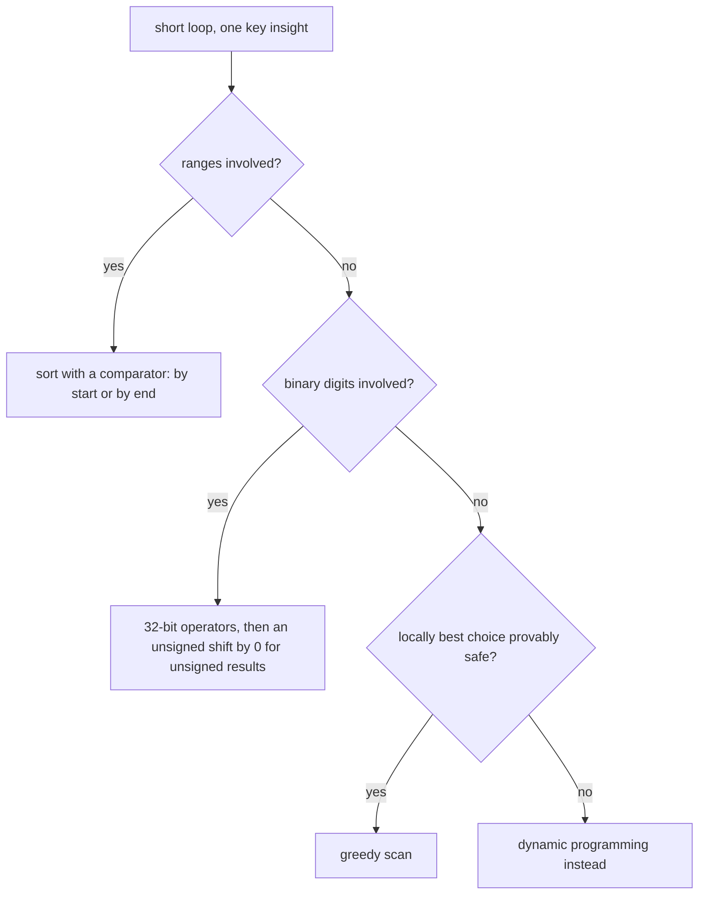

# Pattern map III: greedy, intervals, math and bits

## Before this lesson

- Comparators and integer arithmetic from [Numbers and sorting without surprises](#/lesson/dsa-js/numbers-sorting).
- The idea of a pattern map from [Pattern map I](#/lesson/dsa-js/linear-patterns).
- Theory lessons in the Python track: [The greedy method](#/lesson/neet-greedy-math/greedy-method),
  [Greedy patterns](#/lesson/neet-greedy-math/greedy-patterns), [Interval basics](#/lesson/neet-greedy-math/interval-basics),
  [Interval sweeps](#/lesson/neet-greedy-math/interval-sweep), [Matrix tricks](#/lesson/neet-greedy-math/matrix-tricks),
  [Number theory](#/lesson/neet-greedy-math/number-theory), [Bits in Python](#/lesson/neet-greedy-math/bits-python)
  and [Bit tricks](#/lesson/neet-greedy-math/bit-tricks).
- For binary numbers and two's complement from first principles, see [Integers, bits and bytes](#/lesson/csapp/bits-bytes).

## In plain words

This lesson groups four smaller families that share one trait: the code is short, and the difficulty lies in a
single key insight or a single language detail.

- **Greedy** algorithms make the choice that looks best right now and never reconsider it, like always grabbing
  the coin of largest value when making change. Sometimes that is provably optimal; sometimes it is wrong. The
  skill is knowing which.
- **Interval** problems deal with ranges `[start, end]`: meetings, bookings, ranges on a number line. Nearly all
  of them start by **sorting** the intervals, and in JavaScript that sort is exactly where bugs creep in.
- **Math** problems use arithmetic facts: greatest common divisors, fast powers, matrix rotations.
- **Bit manipulation** works directly on the binary digits of integers. JavaScript's bitwise operators have a
  personality of their own: they convert numbers to **32-bit signed integers** first. That makes some tricks easier
  than in Python and others surprisingly treacherous.

Why it matters for a job: these questions are short enough to appear in phone screens, and the JavaScript-specific
traps (`sort()` on pairs, `1 << 31` being negative, forgetting `>>> 0`) are exactly what a screen is designed to
catch.

## 1. Greedy

Theory and proofs: [The greedy method](#/lesson/neet-greedy-math/greedy-method) and
[Greedy patterns](#/lesson/neet-greedy-math/greedy-patterns).

A greedy algorithm is usually one loop with a running quantity: the farthest reachable index, the current best
sum, the fuel in the tank. What makes it correct is an **exchange argument**: any optimal solution can be changed,
step by step, into the greedy one without getting worse. In an interview, state the greedy rule and give that
argument in one or two sentences.

```js-run
// Kadane: the best subarray ending here either extends the previous one or starts fresh
function maxSubArray(nums) {
  let best = nums[0], cur = 0;
  for (const x of nums) {
    cur = Math.max(x, cur + x);
    best = Math.max(best, cur);
  }
  return best;
}
console.log(maxSubArray([-2, 1, -3, 4, -1, 2, 1, -5, 4]));   // 6

// Jump Game: track the farthest reachable index
function canJump(nums) {
  let reach = 0;
  for (let i = 0; i < nums.length && i <= reach; i++) reach = Math.max(reach, i + nums[i]);
  return reach >= nums.length - 1;
}
console.log(canJump([2, 3, 1, 1, 4]), canJump([3, 2, 1, 0, 4]));   // true false
```

**Greedy JavaScript notes**

- Start maxima at `nums[0]` or `-Infinity`, never at `0`, when all values may be negative.
- Many greedy solutions begin with a sort; always pass a comparator.
- When a greedy idea fails on a small counterexample (Coin Change with coins `[1, 3, 4]` and amount 6), switch to
  DP. Trying three tiny inputs by hand before coding catches most wrong greedy ideas.

## 2. Intervals

Theory: [Interval basics](#/lesson/neet-greedy-math/interval-basics) and
[Interval sweeps](#/lesson/neet-greedy-math/interval-sweep).

Two intervals `[a, b]` and `[c, d]` **overlap** when `a <= d && c <= b` (if touching endpoints count) or
`a < d && c < b` (if they do not). Read the problem carefully: Merge Intervals treats `[1, 4]` and `[4, 5]` as
overlapping, Non-overlapping Intervals does not.

### Sorting pairs: the trap

```js-run
const iv = [[10, 12], [9, 11], [2, 3]];
console.log(JSON.stringify([...iv].sort()));                      // [[10,12],[2,3],[9,11]]  text order!
console.log(JSON.stringify([...iv].sort((a, b) => a[0] - b[0])));  // [[2,3],[9,11],[10,12]]
```

Without a comparator, each pair becomes the string `"10,12"`, and strings starting with `"1"` sort before `"2"`.
The bug is invisible on small single-digit test data and fatal on real inputs.

### Merge: sort by start, extend or push

```js-run
function merge(intervals) {
  const out = [];
  for (const [s, e] of [...intervals].sort((a, b) => a[0] - b[0])) {
    const last = out[out.length - 1];
    if (last && s <= last[1]) last[1] = Math.max(last[1], e);
    else out.push([s, e]);
  }
  return out;
}
console.log(JSON.stringify(merge([[1, 3], [2, 6], [8, 10], [15, 18], [17, 20]])));   // [[1,6],[8,10],[15,20]]
```

`last` is a **reference** to the array inside `out`, so `last[1] = ...` updates the stored interval directly.

### Scheduling: sort by end

To keep the maximum number of non-overlapping intervals (or remove the minimum), sort by **end** and keep each
interval that starts after the last kept one ends. The earliest-finishing interval leaves the most room.

### Sweep line: events

"How many meetings overlap at the busiest moment?" Turn each interval into two **events**, `+1` at the start and
`-1` at the end, sort the events, and keep a running count. Ties need a rule: if a meeting ending at 10 and one
starting at 10 do not overlap, process the `-1` first.

```js-run
function minMeetingRooms(intervals) {
  const events = [];
  for (const [s, e] of intervals) events.push([s, 1], [e, -1]);
  events.sort((a, b) => a[0] - b[0] || a[1] - b[1]);   // by time, then -1 before +1
  let cur = 0, best = 0;
  for (const [, delta] of events) {                    // skip the time with an empty slot
    cur += delta;
    best = Math.max(best, cur);
  }
  return best;
}
console.log(minMeetingRooms([[0, 30], [5, 10], [15, 20]]));   // 2
console.log(minMeetingRooms([[5, 10], [10, 20]]));             // 1: touching is not overlapping here
```

The destructuring `const [, delta]` skips the first element with an empty slot before the comma.

## 3. Math essentials

Theory: [Number theory](#/lesson/neet-greedy-math/number-theory) and [Matrix tricks](#/lesson/neet-greedy-math/matrix-tricks).

```js-run
const gcd = (a, b) => { while (b) [a, b] = [b, a % b]; return Math.abs(a); };
const lcm = (a, b) => (a / gcd(a, b)) * b;               // divide first to keep numbers small
console.log(gcd(84, 36), lcm(4, 6));                     // 12 12

// Fast exponentiation by squaring, modulo m, with BigInt for exact products
function powMod(base, exp, m) {
  let result = 1n, b = BigInt(base) % BigInt(m), e = BigInt(exp);
  const M = BigInt(m);
  while (e > 0n) {
    if (e & 1n) result = (result * b) % M;   // BigInt supports &, but both sides must be BigInt
    b = (b * b) % M;
    e >>= 1n;
  }
  return Number(result);
}
console.log(powMod(2, 100, 1_000_000_007));              // 976371285

// Rotate an n x n matrix 90 degrees clockwise in place: transpose, then reverse each row
function rotate(m) {
  const n = m.length;
  for (let i = 0; i < n; i++)
    for (let j = i + 1; j < n; j++) [m[i][j], m[j][i]] = [m[j][i], m[i][j]];
  for (const row of m) row.reverse();
  return m;
}
console.log(JSON.stringify(rotate([[1, 2, 3], [4, 5, 6], [7, 8, 9]])));   // [[7,4,1],[8,5,2],[9,6,3]]
```

`powMod` shows BigInt's bit operators: `&`, `>>`, `<<` all work on BigInts, but you cannot mix in plain numbers
(`e & 1` would throw), so every literal carries the `n` suffix. `Math.pow(2, 100) % m` would be wrong because
`2^100` is far beyond exact double precision.

## 4. Bits in JavaScript: the 32-bit rule

Theory: [Bits in Python](#/lesson/neet-greedy-math/bits-python) and [Bit tricks](#/lesson/neet-greedy-math/bit-tricks).
Python integers are unbounded; JavaScript's bitwise operators are not. Before applying `&`, `|`, `^`, `~`, `<<` or
`>>`, the engine converts each operand to a **32-bit signed integer** (the ToInt32 conversion): fractions are cut
off, and the number is wrapped into the range `-2^31 .. 2^31 - 1`. The result is also a 32-bit signed integer.
The only exception is `>>>`, whose result is **unsigned** (`0 .. 2^32 - 1`).

| Operator | Meaning | Example | Result |
|---|---|---|---|
| `a & b` | AND: 1 where both are 1 | `12 & 10` | `8` |
| `a \| b` | OR: 1 where either is 1 | `12 \| 10` | `14` |
| `a ^ b` | XOR: 1 where they differ | `12 ^ 10` | `6` |
| `~a` | NOT: flip every bit | `~5` | `-6` |
| `a << k` | shift left (multiply by 2^k, within 32 bits) | `1 << 4` | `16` |
| `a >> k` | arithmetic shift right: copies the sign bit | `-16 >> 2` | `-4` |
| `a >>> k` | logical shift right: fills with zeros, unsigned result | `-16 >>> 28` | `15` |

```js-run
console.log(1 << 30, 1 << 31, 1 << 32);   // 1073741824 -2147483648 1
console.log((1 << 31) >>> 0);             // 2147483648: reinterpret as unsigned
console.log(-1 >>> 0);                    // 4294967295: all 32 bits set
console.log(~5, -5 >>> 0);                // -6 4294967291
console.log(2 ** 31 | 0, 2 ** 32 | 0);    // -2147483648 0
console.log(3.9 | 0, -3.9 | 0);           // 3 -3: fractions truncated toward zero
```

Read those lines carefully:

- `1 << 31` sets the top bit, which in a signed 32-bit integer is the **sign bit**, so the value is negative.
- `1 << 32` is `1`, not `0`: the shift count is taken modulo 32.
- `x >>> 0` is the idiom for "read these 32 bits as an unsigned number". Problems like Reverse Bits that return an
  unsigned 32-bit value end with `return result >>> 0`.

### Everyday bit tricks

```js-run
const x = 44;                                 // binary 101100
console.log(x.toString(2));                   // "101100": inspect bits while debugging
console.log((x >> 3) & 1);                    // 1: is bit 3 set?
console.log(x | (1 << 0));                    // 45: set bit 0
console.log(x & ~(1 << 2));                   // 40: clear bit 2
console.log(x ^ (1 << 5));                    // 12: toggle bit 5
console.log(x & (x - 1));                     // 40: clear the lowest set bit
console.log(x & -x);                          // 4: isolate the lowest set bit
console.log(Math.clz32(x));                   // 26: leading zero bits in 32-bit form
console.log((x & (x - 1)) === 0);             // false: power of two test (x > 0)

function popcount(n) {                        // count set bits; works for 0..2^32-1
  let c = 0;
  while (n !== 0) { n &= n - 1; c++; }
  return c;
}
console.log(popcount(4294967295), popcount(11));   // 32 3
```

`x.toString(2)` is the quickest way to see what is going on. For negative numbers it prints a minus sign and the
magnitude (`(-5).toString(2)` is `"-101"`), not the two's-complement bits; use `(x >>> 0).toString(2)` to see the
raw 32 bits.

### XOR tricks

XOR has three properties that solve several classic problems in one line each: `a ^ a = 0`, `a ^ 0 = a`, and
order does not matter.

```js-run
const single = (nums) => nums.reduce((acc, x) => acc ^ x, 0);    // every value twice except one
console.log(single([4, 1, 2, 1, 2]));                             // 4

function getSum(a, b) {                       // add without + or -
  while (b !== 0) {
    const carry = (a & b) << 1;
    a ^= b;
    b = carry;
  }
  return a;
}
console.log(getSum(-5, 7), getSum(-8, -9));   // 2 -17
```

`getSum` terminates for negative numbers in JavaScript because every result is cut to 32 bits, so the carry
eventually shifts out of the top. In Python the same loop runs forever on negatives without a mask: a rare case
where JavaScript's 32-bit rule helps.

### Bitmasks for subsets

A **bitmask** uses the bits of an integer as a set: bit `i` set means "item `i` is in the set". Masks enumerate all
subsets of `n` items as the numbers `0 .. 2^n - 1`.

```js-run
const items = ["a", "b", "c"];
const n = items.length;
for (let mask = 0; mask < (1 << n); mask++) {
  const subset = items.filter((_, i) => (mask >> i) & 1);
  console.log(mask.toString(2).padStart(n, "0"), subset.join(""));
}
```

This only works while `1 << n` is positive: `n <= 30`. For 31 or 32 items use `2 ** n` as the bound and `>>>` to
read bits; beyond 32 items, use BigInt masks (`1n << 40n`) or a different representation. In practice, masks over
more than about 20 items mean 2^20 (a million) subsets or more, so the size limit rarely matters.

## 5. Choosing among them

| Signal in the problem | Try |
|---|---|
| "maximum number of non-overlapping", "minimum to remove" | sort by end, greedy keep |
| "merge", "insert", "union of ranges" | sort by start, sweep |
| "maximum simultaneous" | events with +1 / -1, sorted with a tie rule |
| "can you reach", "minimum jumps", running best | greedy scan |
| "modulo 10^9 + 7", huge powers | BigInt for products, fast exponentiation |
| "without + or -", "single number", "count bits" | XOR, AND, shifts; watch 32-bit limits |
| "unsigned 32-bit" in the statement | finish with `>>> 0` |



## 6. Pitfalls

- `intervals.sort()` without a comparator: text order.
- Mixing up "touching counts as overlapping" between problems.
- Greedy maxima initialised at `0`.
- `1 << 31` is negative; `1 << 32` is `1`.
- Returning a signed result where the problem wants unsigned: add `>>> 0`.
- `>>` on values at or above `2^31` keeps a sign bit; use `>>>` to shift in zeros.
- Bitwise operators on numbers beyond 32 bits silently drop the high bits; use BigInt.
- `Math.pow` or `**` with large exponents before a modulo: precision is gone.

## 7. Summary

- Greedy: one pass with a running quantity, justified by an exchange argument; test tiny counterexamples first.
- Intervals: sort with an explicit comparator (by start to merge, by end to schedule), events for sweeps.
- Math: loop-based `gcd`, `lcm` dividing first, BigInt fast exponentiation, transpose-and-reverse rotation.
- Bits: operands become signed 32-bit integers; `>>>` is the only unsigned operator; `x >>> 0` reads bits as
  unsigned; masks work up to 30 items with `1 << n`.

## Glossary

- **Greedy algorithm**: makes the locally best choice at each step without revisiting it.
- **Exchange argument**: a proof that swapping parts of an optimal solution toward the greedy choice never hurts.
- **Interval / overlap**: a range `[start, end]` / sharing at least one point (or more, per the problem).
- **Sweep line**: processing sorted start and end events with a running count.
- **GCD / LCM**: greatest common divisor / least common multiple.
- **ToInt32**: the conversion of a number to a signed 32-bit integer before bitwise operations.
- **Sign bit**: the top bit of a signed integer; 1 means negative in two's complement.
- **Logical vs arithmetic shift**: `>>>` fills with zeros; `>>` copies the sign bit.
- **Bitmask**: an integer whose bits represent membership of items in a set.
- **XOR**: exclusive or; 1 where the two bits differ.

## Check yourself

```quiz
[
  {"q": "What does `1 << 31` evaluate to in JavaScript?", "options": ["2147483648", "-2147483648", "0", "1"], "answer": 1,
   "explain": "Bitwise results are signed 32-bit integers, and bit 31 is the sign bit. `(1 << 31) >>> 0` gives 2147483648."},
  {"q": "Why does Reverse Bits end with `return res >>> 0`?", "options": ["To round the result", "To reinterpret the 32-bit pattern as an unsigned number, since `<<` produces signed results", "To divide by 2", "It is optional"], "answer": 1,
   "explain": "Without it, results with the top bit set come out negative."},
  {"q": "What does `[[10, 12], [9, 11], [2, 3]].sort()` produce?", "options": ["`[[2,3],[9,11],[10,12]]`", "`[[10,12],[2,3],[9,11]]`", "`[[9,11],[10,12],[2,3]]`", "It throws"], "answer": 1,
   "explain": "Each pair is converted to a string like '10,12', and '1' sorts before '2' and '9'."},
  {"q": "To keep the maximum number of non-overlapping intervals, sort by...", "options": ["start ascending", "end ascending", "length descending", "start descending"], "answer": 1,
   "explain": "Choosing the interval that finishes first leaves the most room for the rest (the exchange argument)."},
  {"q": "What does `x & (x - 1)` do?", "options": ["Doubles x", "Clears the lowest set bit of x", "Sets the lowest bit", "Counts the bits"], "answer": 1,
   "explain": "Subtracting 1 flips the lowest 1 and the zeros below it; AND keeps everything above. Repeating it counts set bits."},
  {"q": "Why does the XOR-and-carry addition loop terminate for negative numbers in JavaScript but not in plain Python?", "options": ["JavaScript is faster", "JavaScript bitwise results are cut to 32 bits, so the carry eventually shifts out", "Python lacks XOR", "It does not terminate in JavaScript either"], "answer": 1,
   "explain": "Python integers are unbounded, so a negative carry keeps growing unless you mask it."},
  {"q": "In the meeting-rooms sweep, why sort `-1` events before `+1` events at the same time?", "options": ["It is required by sort", "So a meeting ending at t frees its room before one starting at t takes a room, when touching does not count as overlap", "To make the count negative", "It makes no difference"], "answer": 1,
   "explain": "The tie rule encodes the problem's definition of overlap."}
]
```

> **Source:** ECMAScript Language Specification (ToInt32, ToUint32, bitwise shift operators, BigInt operators);
> MDN Web Docs (bitwise operators, `Math.clz32`); NeetCode roadmap (Greedy, Intervals, Math and Geometry, Bit
> Manipulation); the neet-greedy-math lessons on this site. Written in original words for this track.
