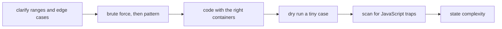

# Common JavaScript interview pitfalls and a final checklist

## Before this lesson

- The earlier lessons of this track. This lesson gathers the traps they introduced into one place, adds a few
  that did not fit elsewhere, and ends with a checklist for the interview itself.
- Optional: [Type coercion and equality](#/lesson/javascript/coercion-equality) in the JavaScript track explains
  `==` in depth, and [TypeScript basics](#/lesson/javascript/typescript-basics) introduces types.

## In plain words

Pilots run through a printed checklist before every take-off, even after ten thousand flights. Not because they
forget how to fly, but because under time pressure the small things slip: a switch left off, a setting not
changed. The checklist catches the slips.

Coding interviews are a take-off under time pressure. You know the algorithm; the danger is a small JavaScript
slip that silently changes the answer: a `0` treated as "missing", an array sorted as text, a `shift` hidden in a
loop. This lesson is that checklist. Each item shows the slip, what it does, and the fix, with a runnable demo
where the behaviour is surprising.

Why it matters for a job: interviewers rarely fail candidates for not knowing an algorithm instantly; they often
fail them for code that does not work. A quick, deliberate pass over this list before saying "done" turns a
nearly-right solution into a right one, and mentioning the traps aloud shows real JavaScript experience.

## 1. Equality and truthiness

**Use `===` and `!==`.** The loose `==` converts types first: `0 == ""` is `true`, `null == 0` is `false`, and
`"1" == 1` is `true`. Interview code has no reason to use it.

**Falsy values** are the values that act like `false` in an `if`: `false`, `0`, `-0`, `0n`, `""`, `null`,
`undefined` and `NaN`. Everything else is **truthy**, including `[]`, `{}` and `"0"`.

```js-run
const index = new Map([["a", 0]]);
if (index.get("a")) console.log("found");        // never prints: 0 is falsy
if (index.has("a")) console.log("found with has");

const count = 0;
console.log(count || 10, count ?? 10);           // 10 0: || replaces 0, ?? does not
console.log(Boolean([]), Boolean("0"), Boolean(""));   // true true false
```

Rules of thumb:

- Test presence with `map.has(k)`, `k in obj`, `x !== undefined`, or `x !== null`, not with truthiness.
- Default values: `x ?? fallback` when `0` or `""` are legitimate; `x || fallback` only when they are not.
- Empty array check: `arr.length === 0`, because `if ([])` is always true.

## 2. Loops over arrays

`for...in` iterates over **property names** as strings, including any inherited enumerable ones; it was designed
for objects. `for...of` iterates over **values**. Use `for...of` or an index loop for arrays.

```js-run
const nums = [10, 20, 30];
for (const i in nums) console.log(typeof i, i);         // string "0", "1", "2"
for (const x of nums) console.log(x);                    // 10 20 30
for (const [i, x] of nums.entries()) console.log(i, x);  // index and value together

// Index arithmetic with string indices goes wrong silently
for (const i in nums) { console.log(i + 1); break; }     // "01", not 1
```

Also avoid `forEach` when you need to stop early: `return` inside the callback only ends that one callback, and
`break` is a syntax error there. Use `for...of`, or `some`/`every` if a boolean result is wanted.

## 3. Sorting

- `sort()` with no comparator sorts as text: `[10, 9, 1]` becomes `[1, 10, 9]`. Always pass `(a, b) => a - b`
  for numbers and an explicit field comparison for pairs.
- A boolean comparator `(a, b) => a > b` breaks the contract; return a negative, zero or positive number.
- `sort` and `reverse` mutate the array. Copy first (`[...a]`) when the caller's data must not change.

Details: [Numbers and sorting without surprises](#/lesson/dsa-js/numbers-sorting).

## 4. Arrays as shared references

```js-run
const grid = new Array(2).fill(new Array(2).fill(0));
grid[0][0] = 1;
console.log(JSON.stringify(grid));          // [[1,0],[1,0]]: one row object in both slots

const a = [1, 2, 3];
const b = a;                                // not a copy
b.push(4);
console.log(a.length);                      // 4

function addOne(list) { list.push(1); }     // functions receive references too
const mine = [];
addOne(mine);
console.log(mine);                          // [ 1 ]
```

- Build grids with `Array.from({ length: r }, () => new Array(c).fill(0))`.
- Copy with `[...a]` or `a.slice()` (shallow) or `a.map((row) => [...row])` (one level deeper).
- Backtracking: record `[...path]`, never `path`.
- Two arrays are `===` only if they are the same object; compare contents with a loop or `join`.

## 5. Map, Set and object keys

- Plain objects convert keys to strings and inherit names like `"constructor"`. Use `Map` for input-driven keys.
- `Map` and `Set` compare objects and arrays by identity: `new Set([[1, 2]]).has([1, 2])` is `false`. Build string
  or numeric keys.
- Delete zero counts from a `Map` when its `size` matters.
- `JSON.stringify(new Map([[1, 2]]))` prints `"{}"`: convert with `[...map]` or `Object.fromEntries(map)` before
  returning or printing.

```js-run
const m = new Map([[1, "one"]]);
console.log(JSON.stringify(m), JSON.stringify([...m]));   // {} [[1,"one"]]
console.log(new Set([[1, 2]]).has([1, 2]));               // false
```

## 6. Numbers

- Integers are exact only up to `Number.MAX_SAFE_INTEGER` (about 9 * 10^15); multiply residues as BigInt.
- `/` gives fractions; pick `Math.floor`, `Math.trunc` or `Math.ceil` on purpose. `| 0` truncates only within
  32 bits.
- `%` keeps the dividend's sign; use `((a % m) + m) % m`. Test odd numbers with `x % 2 !== 0`.
- Division by zero gives `Infinity` or `NaN`, never an error.
- `"1" + 1` is `"11"`, while `"3" * 2` is `6`. Convert input strings with `Number(s)` before arithmetic.
- Grid inputs given as strings (`"1"` and `"0"`) must be compared as strings: `grid[r][c] === "1"`.

```js-run
console.log("1" + 1, "3" * 2, Number("7") + 1);   // 11 6 8
console.log(0.1 * 3 === 0.3, Math.abs(0.1 * 3 - 0.3) < 1e-9);   // false true
console.log([1, 2, 3].map((s) => s % 2 !== 0));    // [ true, false, true ]
```

## 7. Performance traps

| Looks O(1) or harmless | Actually | Use instead |
|---|---|---|
| `arr.shift()`, `arr.unshift(x)` | O(n) | head index, ring buffer |
| `arr.includes(x)`, `arr.indexOf(x)` in a loop | O(n) each | a `Set` or `Map` |
| `arr.splice(i, 1)` in a loop | O(n) each | reader/writer pointers, or a filter pass |
| `s.slice(...)` or `[...s]` inside a hot loop | O(length) each | indices, `charCodeAt` |
| `Math.max(...arr)` on 10^5+ elements | argument-limit `RangeError` | a loop or `reduce` |
| `str += piece` in a huge loop | usually fine, engine-dependent | collect and `join` |
| `JSON.parse(JSON.stringify(x))` to copy | slow, drops `Map`, `Set`, `undefined` | spread or `structuredClone` |

```js-run
const big = Array.from({ length: 300000 }, (_, i) => i);
try {
  console.log(Math.max(...big));
} catch (e) {
  console.log("spread failed:", e.name);
}
console.log(big.reduce((m, x) => (x > m ? x : m), -Infinity));   // 299999
```

Whether the spread line fails depends on the engine's argument limit; the `reduce` line never does.

## 8. Recursion

- JavaScript engines allow roughly ten thousand nested calls (less with big frames), and V8 does not optimise
  tail calls. Depth of 10^5 crashes with `RangeError`.
- Deep inputs (linked lists, skewed trees, big grids, long chains in DP) need iteration: an explicit stack, BFS,
  or bottom-up tables.
- Memo caches and result arrays declared **outside** your solution function survive between test cases. Declare
  them inside.

Details: [Recursion depth limits and backtracking](#/lesson/dsa-js/recursion-backtracking).

## 9. Functions and return values

- A function that ends without `return` returns `undefined`. Arrow functions with braces need an explicit
  `return`; without braces they return the expression.
- `map` passes `(value, index, array)`, which trips up functions with optional parameters: `["1", "2"].map(parseInt)`
  is `[1, NaN]`.
- `this` inside a regular nested `function` is not your object; use arrow functions inside methods.

```js-run
const sq1 = (x) => { x * x; };           // braces: statement block, no return
const sq2 = (x) => x * x;                // expression body: returns
console.log(sq1(3), sq2(3));             // undefined 9

class Counter {
  constructor() { this.n = 0; }
  addAll(xs) {
    xs.forEach((x) => { this.n += x; }); // arrow keeps the method's this
    return this.n;
  }
}
console.log(new Counter().addAll([1, 2, 3]));   // 6
```

## 10. Type checks

- `typeof null` is `"object"` (a historical quirk). Check `x === null` directly.
- `typeof []` is also `"object"`. Use `Array.isArray(x)`.
- `NaN !== NaN`. Use `Number.isNaN(x)`.
- `Number.isInteger(2.0)` is `true`: JavaScript has no separate integer type.

## 11. Strings

- Strings are immutable: `s[0] = "x"` does nothing. Build a new string.
- `split("")` splits by UTF-16 units; `[...s]` splits by whole characters. For ASCII inputs they agree.
- `"Z" < "a"` is `true` (code-unit order); `localeCompare` follows language rules instead.
- `s.slice(a, b)` excludes index `b`. Negative indices count from the end.

## 12. Escaping nested loops

A plain `break` leaves only the innermost loop. A **label** names an outer loop so that `break label` or
`continue label` targets it:

```js-run
let found = null;
outer: for (let r = 0; r < 3; r++) {
  for (let c = 0; c < 3; c++) {
    if (r * 3 + c === 5) { found = [r, c]; break outer; }   // leaves both loops
  }
}
console.log(found);   // [ 1, 2 ]
```

Wrapping the loops in a helper function and using `return` is often clearer; both are acceptable.

## 13. If the interview is in TypeScript

TypeScript is JavaScript with **type annotations** checked before the code runs. The algorithms and runtime
behaviour are identical (every pitfall above still applies); the types add a few habits.

```typescript
function topKFrequent(nums: number[], k: number): number[] {
  const freq = new Map<number, number>();            // generic parameters: key and value types
  for (const x of nums) freq.set(x, (freq.get(x) ?? 0) + 1);
  return [...freq.entries()].sort((a, b) => b[1] - a[1]).slice(0, k).map(([v]) => v);
}

class ListNode {
  val: number;
  next: ListNode | null;                             // union type: a node or null
  constructor(val = 0, next: ListNode | null = null) {
    this.val = val;
    this.next = next;
  }
}

class Heap<T> {                                      // a generic heap works for any element type
  private a: T[] = [];
  constructor(private less: (x: T, y: T) => boolean) {}
  get size(): number { return this.a.length; }
  peek(): T | undefined { return this.a[0]; }
  // push and pop exactly as in the heap lesson
}
```

Habits worth having:

- Annotate function signatures; let TypeScript infer local variables.
- With strict null checks, `map.get(k)` has type `V | undefined`. Write `map.get(k) ?? 0`, or check `has` first and
  use the non-null assertion `map.get(k)!` only when you are sure.
- `ListNode | null` forces you to handle the empty case, which is exactly where linked-list bugs hide.
- Tuples: `[number, number]` for pairs such as intervals or heap entries.
- Typed arrays and BigInt have types too: `Int32Array`, `bigint`.

## 14. The interview-day checklist

**Before coding**

1. Restate the problem and confirm input ranges: sizes, negative numbers, duplicates, empty input, value limits
   (anything near `10^9` multiplied? anything above `2^31` in bit problems?).
2. Say the brute force and its complexity, then the better pattern.
3. Agree on the function signature and whether you may mutate the input.

**While coding**

4. Containers: `Map`/`Set` for lookups, `Array.from` for grids, head index for queues, a `Heap` class if needed.
5. Comparators on every `sort`; integer midpoints; `Math.trunc` versus `Math.floor` chosen on purpose.
6. `has` instead of truthiness checks; `??` instead of `||` when `0` is valid.
7. Copy arrays when recording results.

**Before saying "done"**

8. Run a tiny example by hand, including the empty or single-element case.
9. Scan for the traps: `shift`, `sort()`, `fill([])`, `for...in`, missing `return`, recursion depth, unsigned results
   needing `>>> 0`.
10. State time and space complexity, and mention one JavaScript-specific choice you made and why.



## 15. Summary

- Most JavaScript interview bugs come from a short list: loose equality and falsy checks, text sorting, shared
  references, object keys, number edge cases, hidden O(n) methods, and recursion depth.
- Each has a one-line fix: `===`, `has`/`??`, a comparator, `Array.from`, `Map` with canonical keys, the right
  rounding function, a head index, an explicit stack.
- TypeScript adds annotations, not new runtime behaviour.
- A short checklist before, during and after coding catches the slips that time pressure creates.

## Glossary

- **Falsy / truthy**: values treated as false / true in a condition; `0`, `""`, `null`, `undefined`, `NaN` and
  `false` are falsy.
- **Nullish coalescing (`??`)**: falls back only for `null` or `undefined`.
- **`for...in` / `for...of`**: loop over property names / over values of an iterable.
- **Label**: a name on a loop that `break` and `continue` can target.
- **TypeScript**: JavaScript with static type annotations, checked before running.
- **Generic**: a type parameter such as `T` in `Heap<T>` or `Map<K, V>`.
- **Union type**: a type that is one of several, such as `ListNode | null`.
- **Non-null assertion (`!`)**: tells TypeScript a value is not null or undefined.

## Check yourself

```quiz
[
  {"q": "A Map stores index 0 for key 'a'. Which check correctly reports that 'a' is present?", "options": ["`if (m.get('a'))`", "`if (m.has('a'))`", "`if (m['a'])`", "`if (m.get('a') || false)`"], "answer": 1,
   "explain": "0 is falsy, so any truthiness check fails. has() tests presence directly."},
  {"q": "What does `for (const i in [10, 20])` give you for i?", "options": ["The numbers 10 and 20", "The strings '0' and '1'", "The numbers 0 and 1", "Nothing; it is a syntax error"], "answer": 1,
   "explain": "for...in yields property names as strings. Use for...of for values or an index loop for numbers."},
  {"q": "What is the value of `count || 10` when count is 0, compared with `count ?? 10`?", "options": ["10 and 10", "0 and 0", "10 and 0", "0 and 10"], "answer": 2,
   "explain": "|| replaces any falsy value; ?? replaces only null and undefined."},
  {"q": "Why might `Math.max(...arr)` throw on an array of several hundred thousand numbers?", "options": ["Math.max only accepts integers", "Spread passes each element as a separate argument and engines limit argument counts", "Arrays that large are not allowed", "It never throws"], "answer": 1,
   "explain": "Use a loop or reduce for large arrays."},
  {"q": "What does `const sq = (x) => { x * x; }; sq(3)` return?", "options": ["9", "undefined", "NaN", "It throws"], "answer": 1,
   "explain": "Braces make a statement body, which needs an explicit return. `(x) => x * x` returns 9."},
  {"q": "What does `JSON.stringify(new Map([[1, 2]]))` produce?", "options": ["`[[1,2]]`", "`{\"1\":2}`", "`{}`", "It throws"], "answer": 2,
   "explain": "Maps have no enumerable own properties for JSON. Convert with [...map] or Object.fromEntries(map) first."},
  {"q": "In TypeScript with strict null checks, what is the type of `freq.get(x)` for `freq: Map<number, number>`?", "options": ["number", "number | undefined", "any", "number | null"], "answer": 1,
   "explain": "A missing key gives undefined, so handle it with `?? 0` or check has() first."}
]
```

> **Source:** ECMAScript Language Specification (equality, ToBoolean, iteration statements, labelled statements);
> MDN Web Docs (Falsy, Nullish coalescing, for...in, for...of, Array, JSON); TypeScript Handbook (everyday types,
> generics, narrowing). Written in original words for this track.
