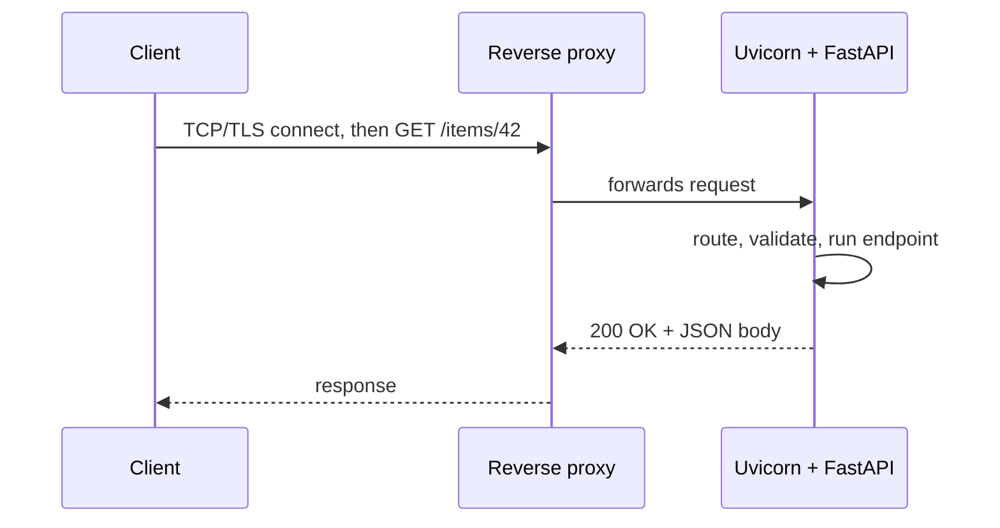

# HTTP: methods, status codes and headers

Every FastAPI endpoint you will ever write is, underneath the decorators and type hints, a function that
receives an **HTTP request** and produces an **HTTP response**. FastAPI is excellent at hiding the
plumbing, but the moment something goes wrong — a browser refuses a response because of CORS, a load
balancer retries a request twice, a cache serves stale data, a client gets a mysterious `422` — you need
to understand the protocol itself. This lesson builds that foundation.

## Why HTTP won

Lubanovic opens his book by describing the web as a giant collection of *services* talking through
*APIs*. Many protocols have been used for that conversation — RPC systems, SOAP, message queues, gRPC —
but HTTP dominates because it is:

- **Text-based and human-readable** (at least HTTP/1.1): you can debug it with `curl` and your eyes.
- **Stateless**: each request carries everything the server needs. That makes horizontal scaling easy —
  any server behind a load balancer can answer any request.
- **Universally supported**: every language, proxy, firewall, CDN and browser speaks it.

HTTP/2 and HTTP/3 change the *wire format* (binary frames, multiplexing, QUIC over UDP), but the
*semantics* — methods, paths, headers, status codes, bodies — are the same. Everything below applies to
all versions.

## The request/response cycle

A single HTTP exchange looks like this:



A raw HTTP/1.1 request is just lines of text:

```text
GET /items/42?verbose=true HTTP/1.1
Host: api.example.com
Accept: application/json
Authorization: Bearer eyJhbGciOi...
User-Agent: curl/8.5.0

```

The **request line** has a *method* (`GET`), a *target* (path plus optional query string) and a
*version*. Then come **headers** (`Name: value`, case-insensitive names), a blank line, and an optional
**body**. The response mirrors it:

```text
HTTP/1.1 200 OK
Content-Type: application/json
Content-Length: 27
Cache-Control: max-age=60

{"id": 42, "name": "wrench"}
```

The **status line** carries a three-digit **status code** and a reason phrase (which clients should
ignore). Let us take each part in turn.

## Methods (verbs)

The method states the *intent* of the request. The important ones for APIs:

| Method | Meaning | Safe? | Idempotent? | Has body? |
|---|---|---|---|---|
| `GET` | Read a resource | yes | yes | no (in practice) |
| `HEAD` | Like GET, headers only | yes | yes | no |
| `POST` | Create / process / "do something" | no | **no** | yes |
| `PUT` | Replace a resource completely | no | yes | yes |
| `PATCH` | Partially modify a resource | no | not necessarily | yes |
| `DELETE` | Remove a resource | no | yes | rarely |
| `OPTIONS` | Ask what is allowed (CORS preflight) | yes | yes | no |

Two properties matter enormously in distributed systems:

- **Safe** means the request does not change server state. Crawlers, prefetchers and caches assume `GET`
  is safe. If your `GET /delete-account` endpoint deletes things, a link previewer will eventually do it
  for you.
- **Idempotent** means doing it *N* times has the same effect as doing it once. `PUT /users/7` with the
  same body twice leaves the same state. `DELETE /users/7` twice: the user is gone either way (the second
  call may return `404`, but the *state* is the same). `POST /orders` twice creates *two* orders.

Why care? Networks fail *after* the server did the work but *before* the client saw the response. A
client (or proxy) can safely retry idempotent methods automatically. For `POST`, retrying is only safe if
you add an **idempotency key** (see the problem *Idempotency-Key Store*).

> [!INTERVIEW]
> "What's the difference between PUT and PATCH?" — `PUT` sends the *complete* new representation and
> replaces the resource (fields you omit are reset); it is idempotent. `PATCH` sends only the changes.
> Lubanovic notes that if your app never needs to distinguish partial from full updates, you may not need
> both. In FastAPI, a PATCH handler typically uses `model.model_dump(exclude_unset=True)` to apply only the
> fields the client actually sent.

## Status codes

The status code is a machine-readable summary of the outcome, grouped by first digit:

| Class | Meaning | Codes you will actually use |
|---|---|---|
| 1xx | Informational | `101 Switching Protocols` (WebSocket upgrade) |
| 2xx | Success | `200 OK`, `201 Created`, `202 Accepted`, `204 No Content` |
| 3xx | Redirection | `301`/`308` permanent, `302`/`307` temporary, `304 Not Modified` |
| 4xx | Client error | `400`, `401`, `403`, `404`, `405`, `409`, `412`, `415`, `422`, `429` |
| 5xx | Server error | `500`, `502`, `503`, `504` |

A few distinctions that interviewers love and that FastAPI makes visible:

- **401 Unauthorized** really means *unauthenticated*: "I don't know who you are". It should come with a
  `WWW-Authenticate` header (FastAPI's OAuth2 helpers add `WWW-Authenticate: Bearer`).
- **403 Forbidden** means "I know who you are, and you may not do this".
- **404 Not Found** is also used deliberately to *hide* the existence of resources from users who may not
  see them.
- **422 Unprocessable Content** is what FastAPI returns when the request is syntactically fine JSON but fails
  validation (wrong types, missing fields). `400 Bad Request` is the more general "malformed request".
- **409 Conflict**: the request conflicts with current state (duplicate username, version mismatch).
- **429 Too Many Requests**: rate limited; often with a `Retry-After` header.
- **502 Bad Gateway / 504 Gateway Timeout** come from a *proxy* when your app crashed or was too slow — so
  if you see them, look at the app *behind* the proxy.
- **201 Created** should accompany a `Location` header pointing at the new resource; **204** must have no body.

```python-run
from http import HTTPStatus

# The stdlib knows every registered status code.
for code in (200, 201, 204, 304, 401, 403, 404, 409, 422, 429, 500, 503):
    s = HTTPStatus(code)
    kind = {1: "info", 2: "success", 3: "redirect", 4: "client error", 5: "server error"}[code // 100]
    print(f"{code} {s.phrase:<24} {kind}")
```

FastAPI re-exports the same constants as `fastapi.status` (`status.HTTP_201_CREATED`), which reads better
than magic numbers in code.

## Headers

Headers carry **metadata** about the message. Names are case-insensitive (`content-type` equals
`Content-Type`; HTTP/2 lowercases them on the wire). Some families you must know:

**Content negotiation and description**

- `Content-Type: application/json; charset=utf-8` — the media type of *this* body. A request body sent
  with the wrong content type is a classic source of `415`/`422` errors.
- `Accept: application/json` — what the client wants back.
- `Content-Length` / `Transfer-Encoding: chunked` — how the receiver knows where the body ends. Streaming
  responses (later in this track) use chunked encoding because the length is not known up front.

**Authentication**

- `Authorization: Bearer <token>` — the standard way to send an access token (OAuth2/JWT).
- `WWW-Authenticate` — the server's challenge on a `401`.
- `Cookie` / `Set-Cookie` — browser session state.

**Caching**

- `Cache-Control: max-age=60`, `no-store`, `private` — who may cache and for how long.
- `ETag: "abc123"` — a fingerprint of a representation. The client later sends
  `If-None-Match: "abc123"`; if it still matches, the server answers `304 Not Modified` with no body.
- `Last-Modified` / `If-Modified-Since` — the time-based equivalent.
- `Vary: Origin, Accept-Encoding` — tells caches which request headers change the response.

**Cross-origin and proxies**

- `Origin`, `Access-Control-Allow-*` — CORS (lesson in the security module).
- `X-Forwarded-For`, `X-Forwarded-Proto` — added by reverse proxies so your app knows the real client IP
  and scheme. Uvicorn's `--proxy-headers` flag trusts them.

**Tracing and identity**

- `X-Request-ID` or the W3C `traceparent` header — correlate log lines across services.

Here is the ETag logic in miniature — exactly what the *ETag and If-None-Match* problem asks you to
generalise:

```python-run
import hashlib, json

def etag_for(obj) -> str:
    body = json.dumps(obj, sort_keys=True).encode()
    return '"' + hashlib.sha256(body).hexdigest()[:16] + '"'

item = {"id": 42, "name": "wrench", "price": 9.5}
tag = etag_for(item)
print("first response: 200, ETag:", tag)

# Client revalidates later with If-None-Match
client_header = tag
print("revalidate unchanged:", 304 if client_header == etag_for(item) else 200)

item["price"] = 11.0
print("revalidate after change:", 304 if client_header == etag_for(item) else 200)
```

> [!TIP]
> In FastAPI you read request headers with a `Header()` parameter (`if_none_match: Annotated[str | None,
> Header()] = None` — underscores become hyphens automatically) and set response headers through a
> `Response` parameter or by returning a `Response` object directly.

## URLs: path versus query

A URL like `https://api.example.com/v1/items/42?verbose=true&fields=name,price` breaks into scheme,
host, **path** (`/v1/items/42`) and **query string** (`verbose=true&fields=name,price`).

- The **path** identifies *which resource*. Parts of it are often variables — **path parameters** — like
  `42`.
- The **query string** modifies *how* you want it: filtering, sorting, pagination, verbosity. Values are
  percent-encoded (`space` → `%20` or `+`), keys can repeat (`?tag=a&tag=b`).
- The **body** carries large or structured input (JSON for `POST`/`PUT`/`PATCH`). URLs have practical
  length limits (a few KB), and they end up in logs and browser history — so never put secrets or
  personal data in them.

Lubanovic's chapter 3 walks through sending the *same* value via path, query, body and header and asks
"which method is best?". His answer is the convention above: identify with the path, modify with the
query, send data in the body, and keep metadata (auth, content type) in headers.

```python-run
from urllib.parse import urlsplit, parse_qs, quote, unquote_plus

url = "https://api.example.com/v1/items/42?verbose=true&tag=new&tag=sale&q=red+shoes"
parts = urlsplit(url)
print("scheme:", parts.scheme)
print("host:  ", parts.netloc)
print("path:  ", parts.path)
print("query: ", parse_qs(parts.query))   # repeated keys become lists
print("decode:", unquote_plus("red+shoes%21"))
print("encode:", quote("a b/c?d", safe=""))
```

## Statelessness, connections and keep-alive

HTTP is stateless at the *application* level, but not at the *connection* level: HTTP/1.1 reuses TCP
connections (`keep-alive`) for many requests, HTTP/2 multiplexes many concurrent requests on one
connection. This matters for performance: setting up TLS costs round trips, so clients like `httpx`
use **connection pools**. A common bug is creating a new `httpx.Client()` per request inside your
endpoint; create one per application (in the lifespan) and reuse it.

Statelessness also explains why authentication is per-request: the server does not "remember" you
between requests unless you send a cookie or token every time.

## Pitfalls

- Using `GET` for actions with side effects (prefetchers and crawlers will trigger them).
- Returning `200` with `{"error": "..."}` in the body. Monitoring, clients and retries all key off the
  status code — use the right one.
- Treating every 5xx as retryable. `501 Not Implemented` will never succeed.
- Confusing `401` and `403`.
- Putting tokens in query strings — they leak into access logs and `Referer` headers.
- Forgetting that header *names* are case-insensitive but *values* usually are not.

## Summary

- An HTTP exchange is method + target + headers + optional body → status + headers + optional body.
- Methods carry semantics: safe (no state change) and idempotent (repeat-safe) properties drive caching
  and retry behaviour.
- Status codes are grouped by class; use precise ones (`201`, `204`, `401` vs `403`, `409`, `422`, `429`).
- Headers carry metadata: content type, auth, caching (`ETag`, `Cache-Control`), CORS, tracing.
- Path identifies, query modifies, body carries data, headers carry metadata.

```quiz
[
  {"q": "Which method is idempotent but NOT safe?", "options": ["GET", "PUT", "POST", "OPTIONS"], "answer": 1,
   "explain": "PUT changes state (not safe), but repeating the same PUT leaves the same final state (idempotent). GET and OPTIONS are safe; POST is neither."},
  {"q": "A client calls an endpoint without any credentials and the server refuses. Which status is most appropriate?", "options": ["403 Forbidden", "401 Unauthorized", "404 Not Found", "400 Bad Request"], "answer": 1,
   "explain": "401 means the request lacks valid authentication (and should include WWW-Authenticate). 403 is for an authenticated caller who lacks permission."},
  {"q": "FastAPI receives well-formed JSON whose 'age' field is the string 'abc' where an int is declared. What does it return by default?", "options": ["400", "415", "422", "500"], "answer": 2,
   "explain": "Validation failures produce 422 Unprocessable Content with a detail list describing each error."},
  {"q": "What does a 304 Not Modified response contain?", "options": ["The full updated body", "No body; the client reuses its cached copy", "A redirect Location", "An error message"], "answer": 1,
   "explain": "304 answers a conditional request (If-None-Match / If-Modified-Since) whose validator still matches; the body is omitted."},
  {"q": "Your users see 502 Bad Gateway errors. Where should you look first?", "options": ["The client's browser", "The DNS configuration", "The application process behind the reverse proxy", "The CORS settings"], "answer": 2,
   "explain": "502/504 are generated by a proxy or gateway when the upstream app crashed, refused the connection or answered invalidly/too slowly."},
  {"q": "Where should a filter like 'only items under $10' normally go in a REST API?", "options": ["In the path", "In a query parameter", "In a custom header", "In a cookie"], "answer": 1,
   "explain": "The path identifies the resource collection; query parameters modify how it is returned (filtering, sorting, pagination)."},
  {"q": "Why is retrying a timed-out POST dangerous without extra precautions?", "options": ["POST bodies are lost on retry", "POST is not idempotent, so the action may happen twice", "Servers reject repeated POSTs", "POST cannot be sent over HTTPS twice"], "answer": 1,
   "explain": "The first request may have succeeded before the timeout. Idempotency keys let the server detect and replay instead of repeating the action."}
]
```

> **Source:** Lubanovic, *FastAPI*, ch. 1 "The Modern Web" (Services and APIs, HTTP, REST) and ch. 3 "FastAPI Tour" (HTTP Requests, HTTP Responses, Which Method Is Best?); MDN HTTP reference; https://fastapi.tiangolo.com/tutorial/first-steps/
