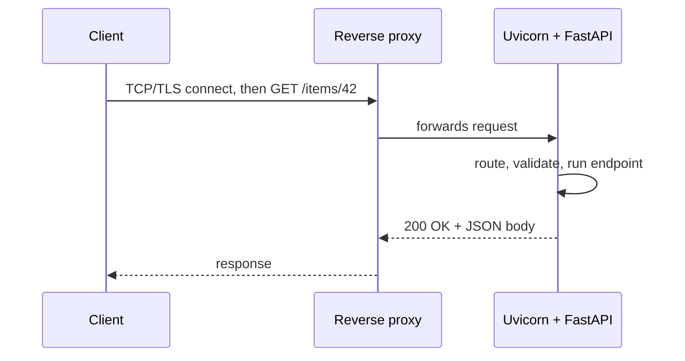

# HTTP: methods, status codes and headers

> **Before this lesson:** nothing is assumed beyond basic Python: variables, functions, dictionaries
> and `print`. This is the first lesson of the track. Every technical word is explained where it first
> appears and collected again in the glossary at the end.

## In plain words

When you open a web page or tap a button in a phone app, your device sends a short written message to
another computer, and that computer sends a written message back. **HTTP** (HyperText Transfer
Protocol) is the agreed layout of those two messages. A **protocol** is a set of rules that both sides
follow so they can understand each other, in the same way that post only arrives because everyone
writes the address in the same place on the envelope.

An everyday picture: ordering at a restaurant counter. You hand over an order slip. The kitchen reads
it, does the work, and hands back a tray with a receipt. The slip has a fixed layout (what you want
done, which dish, a few notes such as "no onions") and so does the receipt (a number saying how it
went, a few notes, then the food). In HTTP terms:

- The **client** is the program that asks: a browser, a phone app, or a Python script.
- The **server** is the program that answers. It runs on a machine that waits for messages all day.
- The **request** is the message the client sends (the order slip).
- The **response** is the message the server sends back (the tray and receipt).

Why this matters for a job: FastAPI, the tool this whole track teaches, is a way of writing the kitchen
side in Python. FastAPI hides most of the message handling, but when something breaks (a browser
refuses a response, a request is carried out twice, a client receives a mysterious `422`) the
explanation is always found in the messages themselves. Questions such as "what is the difference
between PUT and PATCH?" or "401 or 403?" appear in almost every backend interview.

## A few words you will meet in every lesson

Four more terms come up constantly, so here they are once, in plain language:

- An **API** (Application Programming Interface) is the list of things one program lets other programs
  ask it to do. A weather service's API might offer "give me the forecast for this city".
- A **web API** is an API that is reached by sending HTTP requests over a network.
- An **endpoint** is one entry in that list: one address plus one kind of action, for example "read
  item number 42". Each endpoint is handled by one Python function in a FastAPI program.
- A **web framework** is a library that does the repetitive parts of writing a server (reading the
  request text, finding the right function, building the response text) so that you write only the
  part that is special to your program. FastAPI is a web framework.

## Why HTTP won

Programs have talked to each other over networks in many ways. Some systems make a network call look
like an ordinary function call (this style is named RPC, Remote Procedure Call); some wrap every
message in a verbose document format called SOAP; some pass messages through a waiting line called a
message queue. HTTP became the default for web APIs for three reasons:

- **It is readable text** (in version 1.1, the one shown below). You can look at a request with your
  own eyes and send one by hand with a command-line tool such as `curl`.
- **It is stateless.** *Stateless* means the server keeps no memory of earlier requests from the same
  client: each request carries everything needed to answer it. The payoff is that you can run ten
  copies of your server and let any copy answer any request. The device that spreads requests across
  those copies is a **load balancer**.
- **Everything speaks it.** Every programming language, browser, firewall and piece of network
  equipment already understands HTTP.

Newer versions, HTTP/2 and HTTP/3, change how the bytes travel (a compact binary layout, several
requests sharing one connection). The *meaning* of the messages (methods, paths, headers, status
codes, bodies) is identical in every version, so everything below applies to all of them.

## The request/response cycle

One HTTP exchange is one request followed by one response. The diagram below adds two pieces you will
meet in real systems. A **reverse proxy** is a server that stands in front of your application,
receives requests from the internet and passes them on (it often also handles encryption).
**Uvicorn** is the program that listens on the network and hands each request to your FastAPI code;
lesson 3 explains it.



Read the diagram from top to bottom. First the client opens a connection. **TCP** (Transmission
Control Protocol) is the lower-level protocol that delivers bytes reliably between two machines, and
**TLS** (Transport Layer Security) encrypts them; TLS is the "S" in `https`. Then the request travels
in, your code runs, and the response travels back along the same path.

Here is a complete HTTP/1.1 request exactly as it travels over the wire. It is plain lines of text:

```text
GET /items/42?verbose=true HTTP/1.1
Host: api.example.com
Accept: application/json
Authorization: Bearer eyJhbGciOi...
User-Agent: curl/8.5.0

```

Line by line:

- `GET /items/42?verbose=true HTTP/1.1` is the **request line**. It has three parts separated by
  spaces: the **method** (`GET`, meaning "read"), the **target** (what to read: a path, optionally
  followed by `?` and extra settings) and the protocol version.
- The next four lines are **headers**. A header is one `Name: value` pair that describes the message
  or the sender. `Host` says which website is wanted, `Accept` says which format the client would like
  back, `Authorization` carries proof of who the client is, and `User-Agent` names the client program.
  Header names ignore upper and lower case.
- The empty line marks the end of the headers. After it an optional **body** may follow: the main
  content of the message. A `GET` request normally has none.

The response has the same shape:

```text
HTTP/1.1 200 OK
Content-Type: application/json
Content-Length: 27
Cache-Control: max-age=60

{"id": 42, "name": "wrench"}
```

- `HTTP/1.1 200 OK` is the **status line**. `200` is the **status code**, a three-digit number that
  summarises the outcome; `OK` is a human-readable label that programs should ignore.
- Three headers follow. `Content-Type` says the body is in a format called JSON, `Content-Length` says
  the body is 27 bytes long, and `Cache-Control` says the client may reuse this answer for 60 seconds.
- After the empty line comes the body. `{"id": 42, "name": "wrench"}` is **JSON** (JavaScript Object
  Notation), a text format for structured data that looks very much like a Python dictionary. Lesson 2
  covers JSON properly.

The rest of the lesson takes these parts one at a time: methods, status codes, headers, and the
address.

## Methods (verbs)

The method tells the server what the client *intends* to do. Servers manage **resources**: the
"things" an API exposes, such as an item, a user or an order. A method is a verb applied to a
resource.

| Method | Meaning | Safe? | Idempotent? | Has body? |
|---|---|---|---|---|
| `GET` | Read a resource | yes | yes | no (in practice) |
| `HEAD` | Like GET, headers only | yes | yes | no |
| `POST` | Create / process / "do something" | no | **no** | yes |
| `PUT` | Replace a resource completely | no | yes | yes |
| `PATCH` | Partially modify a resource | no | not necessarily | yes |
| `DELETE` | Remove a resource | no | yes | rarely |
| `OPTIONS` | Ask what is allowed (CORS preflight) | yes | yes | no |

The two middle columns use words that need defining, because they decide how the rest of the internet
treats your endpoint.

- **Safe** means the request only reads; it changes nothing on the server. Many programs assume `GET`
  is safe and send `GET` requests without asking a person first: search-engine crawlers, chat apps that
  show a preview of a pasted link, browsers that load pages in advance. If you write an endpoint
  `GET /delete-account` that deletes things, one of those programs will eventually delete an account
  for you.
- **Idempotent** (pronounced "eye-dem-POH-tent") means that sending the request five times leaves the
  server in the same condition as sending it once. `PUT /users/7` with the same body twice: user 7
  ends up identical both times. `DELETE /users/7` twice: the user is gone either way (the second call
  may answer `404`, but what is stored is the same). `POST /orders` twice: two orders now exist.

Why should a beginner care about a property with such an awkward name? Because networks fail at the
worst moment: *after* the server did the work but *before* the reply reached the client. The client
cannot tell whether the request arrived. If the method is idempotent it can send the request again
without harm. For `POST`, sending again might charge a customer twice. The standard cure is an
**idempotency key**: a unique label the client attaches so the server can recognise a repeat (you will
build one in the problem *Idempotency-Key Store*).

> [!INTERVIEW]
> "What's the difference between PUT and PATCH?" — `PUT` sends the *complete* new version and
> replaces the resource (fields you leave out are reset); it is idempotent. `PATCH` sends only the
> fields that change. Lubanovic notes that an app which never needs to tell partial from full updates
> may not need both. In FastAPI, a PATCH handler typically uses `model.model_dump(exclude_unset=True)`
> to apply only the fields the client actually sent; lesson 5 shows that in action.

## Status codes

The status code is the server's one-number summary of what happened. Programs read the number, not
the text beside it. The first digit gives the family:

| Class | Meaning | Codes you will actually use |
|---|---|---|
| 1xx | Informational | `101 Switching Protocols` (WebSocket upgrade) |
| 2xx | Success | `200 OK`, `201 Created`, `202 Accepted`, `204 No Content` |
| 3xx | Redirection | `301`/`308` permanent, `302`/`307` temporary, `304 Not Modified` |
| 4xx | Client error | `400`, `401`, `403`, `404`, `405`, `409`, `412`, `415`, `422`, `429` |
| 5xx | Server error | `500`, `502`, `503`, `504` |

A helpful way to remember the two error families: **4xx means "you, the client, sent something I
cannot accept; change the request before trying again"**, and **5xx means "the request may have been
fine; something broke on my side"**.

Several pairs are easy to confuse, are favourites of interviewers, and show up as soon as you write
FastAPI code:

- **401 Unauthorized** really means *unauthenticated*: "I do not know who you are". **Authentication**
  is the act of proving identity. A 401 should arrive with a `WWW-Authenticate` header that says how
  to log in (FastAPI's login helpers add `WWW-Authenticate: Bearer`).
- **403 Forbidden** means "I know who you are, and you are not allowed to do this".
- **404 Not Found** means nothing lives at that address. It is also used on purpose to *hide* things:
  answering 404 instead of 403 avoids confirming that a private resource exists.
- **422 Unprocessable Content** is what FastAPI sends when the body is readable JSON but its contents
  break the rules (a word where a number is required, a missing field). **400 Bad Request** is the
  general "this request is malformed".
- **409 Conflict**: the request clashes with what is already stored, such as a username that is
  already taken.
- **429 Too Many Requests**: the client is sending requests faster than allowed (this limit is called
  **rate limiting**); often paired with a `Retry-After` header.
- **502 Bad Gateway / 504 Gateway Timeout** are produced by a *proxy*, not by your code, when your app
  crashed or answered too slowly. When you see them, examine the app *behind* the proxy.
- **201 Created** should come with a `Location` header holding the new resource's address, and
  **204 No Content** must have an empty body.

Python's standard library already knows every registered code. Run this:

```python-run
from http import HTTPStatus

# The stdlib knows every registered status code.
for code in (200, 201, 204, 304, 401, 403, 404, 409, 422, 429, 500, 503):
    s = HTTPStatus(code)
    kind = {1: "info", 2: "success", 3: "redirect", 4: "client error", 5: "server error"}[code // 100]
    print(f"{code} {s.phrase:<24} {kind}")
```

What each line does:

- `from http import HTTPStatus` loads a ready-made catalogue of status codes.
- The `for` loop walks through twelve codes. `HTTPStatus(code)` looks one up, and `s.phrase` is its
  official label.
- `code // 100` is whole-number division, so `404 // 100` is `4`. That first digit picks the family
  name out of the small dictionary.
- The `print` line uses an f-string; `:<24` pads the label to 24 characters so the columns line up.

The output begins `200 OK                       success` and ends
`503 Service Unavailable      server error`: the family follows from the first digit alone.

FastAPI offers the same constants under `fastapi.status` (for example `status.HTTP_201_CREATED`),
which reads better in code than a bare number.

## Headers

Headers carry **metadata**: information *about* the message, as opposed to the message's main content.
Names ignore case (`content-type` equals `Content-Type`; HTTP/2 sends them in lower case). You do not
need to memorise the list below today. Read it once so the names are familiar; each group returns in a
later lesson.

**Describing the body**

- `Content-Type: application/json; charset=utf-8` states the **media type** of *this* body, a standard
  label for a data format. Sending a body with the wrong label is a classic cause of `415` and `422`
  errors.
- `Accept: application/json` is what the client would like to receive.
- `Content-Length` or `Transfer-Encoding: chunked` tells the receiver where the body ends. Responses
  that are produced piece by piece (streaming, later in this track) use chunked encoding because the
  total length is unknown at the start.

**Proving identity**

- `Authorization: Bearer <token>` is the standard way to send an access **token**: a string, issued at
  login, that stands for "this request comes from user so-and-so".
- `WWW-Authenticate` is the server's hint on a `401` about how to log in.
- `Cookie` / `Set-Cookie`: a **cookie** is a small value the server asks the browser to store and send
  back with each later request.

**Caching**

A **cache** is a stored copy of an answer, kept so the same question need not be answered from
scratch again.

- `Cache-Control: max-age=60`, `no-store`, `private`: who may keep a copy and for how long.
- `ETag: "abc123"` is a fingerprint of the response content. Later the client sends
  `If-None-Match: "abc123"`; if the fingerprint still matches, the server answers
  `304 Not Modified` with no body, and the client reuses its copy.
- `Last-Modified` / `If-Modified-Since`: the same idea with a timestamp.
- `Vary: Origin, Accept-Encoding` tells caches which request headers change the answer.

**Browsers and proxies**

- `Origin` and the `Access-Control-Allow-*` family belong to CORS, the browser rule about which web
  pages may call which APIs (covered in the security module).
- `X-Forwarded-For` and `X-Forwarded-Proto` are added by reverse proxies so your app can learn the
  real client address and whether the original request used `https`. Uvicorn trusts them when started
  with `--proxy-headers`.

**Following a request through the system**

- `X-Request-ID`, or the standard `traceparent` header, carries one identifier through every service
  that touches a request, so their log lines can be matched up afterwards.

The fingerprint idea is small enough to try. This is the logic that the problem
*ETag and If-None-Match* asks you to generalise:

```python-run
import hashlib, json

def etag_for(obj) -> str:
    body = json.dumps(obj, sort_keys=True).encode()
    return '"' + hashlib.sha256(body).hexdigest()[:16] + '"'

item = {"id": 42, "name": "wrench", "price": 9.5}
tag = etag_for(item)
print("first response: 200, ETag:", tag)

# Client revalidates later with If-None-Match
client_header = tag
print("revalidate unchanged:", 304 if client_header == etag_for(item) else 200)

item["price"] = 11.0
print("revalidate after change:", 304 if client_header == etag_for(item) else 200)
```

Reading it step by step:

- `etag_for` turns an object into JSON text (`json.dumps`; `sort_keys=True` makes the text identical
  no matter what order the keys were added in), converts the text to bytes, and computes a **hash**:
  a short fixed-length fingerprint that changes when the input changes. It keeps the first 16
  characters and wraps them in double quotes, because the HTTP rules say an ETag is a quoted string.
- The first `print` shows the tag the server would send with a normal `200` response.
- The client later sends that tag back. Nothing has changed, so the recomputed tag is equal and the
  server can answer `304`.
- After `item["price"] = 11.0` the fingerprint differs, so the comparison fails and the server sends
  a full `200` with the new body.

You should see a tag, then `revalidate unchanged: 304`, then `revalidate after change: 200`.

> [!TIP]
> In FastAPI you read request headers with a `Header()` parameter (`if_none_match: Annotated[str | None,
> Header()] = None`; underscores become hyphens automatically) and set response headers through a
> `Response` parameter or by returning a `Response` object directly. Lesson 6 covers both.

## URLs: path versus query

A **URL** (Uniform Resource Locator) is the full address of a resource. Take
`https://api.example.com/v1/items/42?verbose=true&fields=name,price`. It splits into a *scheme*
(`https`), a *host* (`api.example.com`, the server's name), a **path** (`/v1/items/42`) and a
**query string** (everything after the `?`).

- The **path** says *which resource*. Parts of it are often variable (the `42`); those parts are
  called **path parameters**.
- The **query string** adjusts *how* you want it: filtering, sorting, how many results per page.
  It is a list of `key=value` pairs joined by `&`. Characters that are not allowed in an address are
  **percent-encoded** (a space becomes `%20` or `+`), and a key may repeat (`?tag=a&tag=b`).
- The **body** carries large or structured input, normally JSON, for `POST`, `PUT` and `PATCH`.
  Addresses have practical length limits of a few thousand characters, and they are written into
  server logs and browser history, so never put passwords or personal data in them.

Lubanovic's chapter 3 sends the *same* value four ways (path, query, body and header) and asks which
is best. The convention that answers it: identify with the path, adjust with the query, send data in
the body, and keep metadata such as identity and content type in headers.

```python-run
from urllib.parse import urlsplit, parse_qs, quote, unquote_plus

url = "https://api.example.com/v1/items/42?verbose=true&tag=new&tag=sale&q=red+shoes"
parts = urlsplit(url)
print("scheme:", parts.scheme)
print("host:  ", parts.netloc)
print("path:  ", parts.path)
print("query: ", parse_qs(parts.query))   # repeated keys become lists
print("decode:", unquote_plus("red+shoes%21"))
print("encode:", quote("a b/c?d", safe=""))
```

`urlsplit` cuts the address into its named parts. `parse_qs` turns the query string into a
dictionary; notice that every value is a *list*, and `tag` holds two entries because the key appeared
twice. `unquote_plus` decodes `red+shoes%21` into `red shoes!`, and `quote` goes the other way,
producing `a%20b%2Fc%3Fd`. FastAPI performs this decoding for you; the point of running it by hand is
to see that there is no magic involved.

## Statelessness, connections and keep-alive

HTTP is stateless in the sense defined earlier: the server does not remember one request when
handling the next. The *connection* underneath is a different matter. Opening a TCP connection and
setting up TLS costs several network round trips, so HTTP/1.1 keeps a connection open and reuses it
for many requests (**keep-alive**), and HTTP/2 sends many requests at once over a single connection.

Client libraries such as `httpx` (a Python library for *sending* HTTP requests) therefore keep a
**connection pool**: a set of open connections ready for reuse. A common beginner bug is creating a
new `httpx.Client()` inside an endpoint on every request, which throws that saving away. Create one
client when the application starts and reuse it (lesson 3 shows where start-up code lives).

Statelessness also explains why identity is sent with every request. The server does not "remember"
that you logged in; your browser or app presents a cookie or token each time.

## Pitfalls

- Using `GET` for actions that change something (crawlers and link previewers will trigger them).
- Returning `200` with `{"error": "..."}` in the body. Monitoring tools, client libraries and retry
  logic all look at the status code, so use the right one.
- Treating every 5xx as worth retrying. `501 Not Implemented` will never succeed.
- Confusing `401` (who are you?) with `403` (you may not).
- Putting tokens in query strings: they leak into access logs and into the `Referer` header that
  browsers send to the next site.
- Forgetting that header *names* ignore case but header *values* usually do not.

## Summary

- An HTTP exchange is method + target + headers + optional body, answered by status + headers +
  optional body.
- Methods carry meaning: the safe (read-only) and idempotent (repeatable) properties decide what
  caches, crawlers and retries may do.
- Status codes are grouped by first digit; choose precise ones (`201`, `204`, `401` versus `403`,
  `409`, `422`, `429`).
- Headers carry metadata: content type, identity, caching (`ETag`, `Cache-Control`), CORS, tracing.
- Path identifies, query adjusts, body carries data, headers carry metadata.

## Glossary

- **HTTP** — HyperText Transfer Protocol, the message format used between web clients and servers.
- **Protocol** — a set of rules two programs follow so they can understand each other.
- **Client / server** — the program that sends a request / the program that answers it.
- **Request / response** — the message sent by the client / the message sent back by the server.
- **API** — the list of operations one program offers to other programs.
- **Endpoint** — one address-plus-method combination in an API, handled by one function.
- **Web framework** — a library that handles the routine parts of writing a server.
- **Method** — the verb of a request (`GET`, `POST`, `PUT`, `PATCH`, `DELETE`).
- **Resource** — a thing an API exposes, such as an item or a user.
- **Safe** — a method that only reads and changes nothing.
- **Idempotent** — repeating the request leaves the server as it was after the first time.
- **Status code** — the three-digit outcome number in a response.
- **Header** — a `Name: value` line carrying metadata about a message.
- **Body** — the main content of a request or response.
- **JSON** — a text format for structured data, similar to Python dictionaries and lists.
- **URL, path, query string** — the full address; the part naming the resource; the `key=value`
  settings after the `?`.
- **Stateless** — the server keeps no memory of earlier requests.
- **Reverse proxy / load balancer** — a server in front of your app that forwards requests / one that
  spreads them across several copies of the app.
- **TCP / TLS** — the protocol that delivers bytes reliably / the layer that encrypts them.
- **Token** — a string that proves who is making a request.
- **Cache / ETag** — a stored copy of an answer / a fingerprint used to check whether the copy is
  still current.

```quiz
[
  {"q": "Which method is idempotent but NOT safe?", "options": ["GET", "PUT", "POST", "OPTIONS"], "answer": 1,
   "explain": "PUT changes state (not safe), but repeating the same PUT leaves the same final state (idempotent). GET and OPTIONS are safe; POST is neither."},
  {"q": "A client calls an endpoint without any credentials and the server refuses. Which status is most appropriate?", "options": ["403 Forbidden", "401 Unauthorized", "404 Not Found", "400 Bad Request"], "answer": 1,
   "explain": "401 means the request lacks valid authentication (and should include WWW-Authenticate). 403 is for an authenticated caller who lacks permission."},
  {"q": "FastAPI receives well-formed JSON whose 'age' field is the string 'abc' where an int is declared. What does it return by default?", "options": ["400", "415", "422", "500"], "answer": 2,
   "explain": "Validation failures produce 422 Unprocessable Content with a detail list describing each error."},
  {"q": "What does a 304 Not Modified response contain?", "options": ["The full updated body", "No body; the client reuses its cached copy", "A redirect Location", "An error message"], "answer": 1,
   "explain": "304 answers a conditional request (If-None-Match / If-Modified-Since) whose validator still matches; the body is omitted."},
  {"q": "Your users see 502 Bad Gateway errors. Where should you look first?", "options": ["The client's browser", "The DNS configuration", "The application process behind the reverse proxy", "The CORS settings"], "answer": 2,
   "explain": "502/504 are generated by a proxy or gateway when the upstream app crashed, refused the connection or answered invalidly/too slowly."},
  {"q": "Where should a filter like 'only items cheaper than 10 dollars' normally go in a REST API?", "options": ["In the path", "In a query parameter", "In a custom header", "In a cookie"], "answer": 1,
   "explain": "The path identifies the resource collection; query parameters modify how it is returned (filtering, sorting, pagination)."},
  {"q": "Why is retrying a timed-out POST dangerous without extra precautions?", "options": ["POST bodies are lost on retry", "POST is not idempotent, so the action may happen twice", "Servers reject repeated POSTs", "POST cannot be sent over HTTPS twice"], "answer": 1,
   "explain": "The first request may have succeeded before the timeout. Idempotency keys let the server detect and replay instead of repeating the action."}
]
```

> **Source:** Lubanovic, *FastAPI*, ch. 1 "The Modern Web" (Services and APIs, HTTP, REST) and ch. 3 "FastAPI Tour" (HTTP Requests, HTTP Responses, Which Method Is Best?); MDN HTTP reference; https://fastapi.tiangolo.com/tutorial/first-steps/
