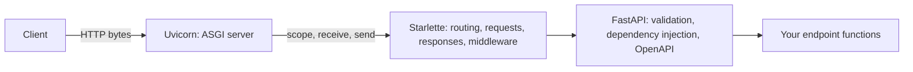

# WSGI vs ASGI, Starlette and Uvicorn

When you run `fastapi dev main.py` or `uvicorn main:app`, three separate pieces of software cooperate:



- **Uvicorn** is the *server*: it owns the sockets, parses HTTP bytes, and speaks the **ASGI** protocol
  to the application.
- **Starlette** is the *toolkit*: routing, `Request`/`Response` classes, middleware, WebSockets, background
  tasks, test client. Lubanovic describes FastAPI as being built on Starlette for the web parts and Pydantic
  for the data parts.
- **FastAPI** adds the features you came for: type-hint-driven validation and conversion, dependency
  injection, and automatic OpenAPI documentation. A `FastAPI` instance *is* a Starlette application
  (it subclasses `Starlette`).

Understanding the interface between these layers — ASGI — explains why `async` matters, how middleware
works, and what "the event loop" is doing during your request.

## The old world: WSGI

Python web frameworks before ~2018 (Django, Flask, Pyramid) spoke **WSGI** (Web Server Gateway Interface,
PEP 3333). A WSGI app is a plain, **synchronous** callable:

```python
def app(environ, start_response):
    # environ: dict with REQUEST_METHOD, PATH_INFO, headers as HTTP_*, wsgi.input stream...
    body = b"Hello, WSGI"
    start_response("200 OK", [("Content-Type", "text/plain"),
                              ("Content-Length", str(len(body)))])
    return [body]
```

The server (Gunicorn, uWSGI, mod_wsgi) calls it once per request and waits for it to return. One worker
thread or process is *occupied for the entire request*, including all time spent waiting on the database
or another HTTP API. To handle 1,000 concurrent slow requests you need ~1,000 threads or processes.

WSGI also cannot naturally express **long-lived connections**: WebSockets, Server-Sent Events, HTTP/2
server push. The request-in, response-out function signature has no place for "keep talking".

## The new world: ASGI

**ASGI** (Asynchronous Server Gateway Interface) replaces the callable with a coroutine that communicates
through *messages*:

```python
async def app(scope, receive, send):
    ...
```

- `scope` — a dict describing the connection: `type` (`"http"`, `"websocket"` or `"lifespan"`), method,
  path, query string (bytes), headers (list of `(bytes, bytes)` pairs), client address, etc.
- `receive` — an awaitable that yields incoming events, e.g. `{"type": "http.request", "body": b"...",
  "more_body": False}`.
- `send` — an awaitable to emit events, e.g. `{"type": "http.response.start", "status": 200, "headers":
  [...]}` then one or more `{"type": "http.response.body", "body": b"...", "more_body": ...}`.

Because everything is `await`ed, while one request waits for I/O the server's **event loop** runs other
requests on the same thread. Because it is message-based, the same interface handles streaming bodies,
WebSockets (`websocket.receive` / `websocket.send`) and application startup/shutdown (`lifespan.startup`,
`lifespan.shutdown`).

Here is a complete, framework-free ASGI application, driven by a tiny fake server so you can run it in
the browser:

```python-run
import json

async def app(scope, receive, send):
    assert scope["type"] == "http"
    # Read the full request body (it may arrive in several chunks)
    body = b""
    while True:
        event = await receive()
        body += event.get("body", b"")
        if not event.get("more_body", False):
            break
    if scope["path"] == "/echo" and scope["method"] == "POST":
        status, payload = 200, {"you_sent": json.loads(body or b"null")}
    elif scope["path"] == "/":
        status, payload = 200, {"hello": "asgi"}
    else:
        status, payload = 404, {"detail": "Not Found"}
    data = json.dumps(payload).encode()
    await send({"type": "http.response.start", "status": status,
                "headers": [(b"content-type", b"application/json"),
                            (b"content-length", str(len(data)).encode())]})
    await send({"type": "http.response.body", "body": data})

# --- a toy "server": builds scope, feeds receive(), collects send() ---
async def call(method, path, body=b""):
    chunks = [{"type": "http.request", "body": body[:5], "more_body": len(body) > 5},
              {"type": "http.request", "body": body[5:], "more_body": False}]
    async def receive():
        return chunks.pop(0)
    sent = []
    async def send(message):
        sent.append(message)
    scope = {"type": "http", "method": method, "path": path, "query_string": b"", "headers": []}
    await app(scope, receive, send)
    start, bodymsg = sent
    print(method, path, "->", start["status"], bodymsg["body"].decode())

await call("GET", "/")
await call("POST", "/echo", b'{"x": [1, 2, 3]}')
await call("GET", "/missing")
```

> [!NOTE]
> This browser runner already runs an event loop, so these snippets use top-level `await`. In a normal
> script you would wrap the calls in `async def main(): ...` and run `asyncio.run(main())`.

Everything Starlette and FastAPI do is a (very) elaborate version of that function: parse the scope into a
`Request`, find the matching route, run middleware, call your endpoint, and turn its return value into
`send` messages.

## Starlette: the toolkit

Starlette provides, among other things:

- `Request` / `Response`, `JSONResponse`, `HTMLResponse`, `RedirectResponse`, `StreamingResponse`,
  `FileResponse`.
- Routing with path converters (`{id:int}`, `{path:path}`) — the exercise *Match a Route Template* builds
  a simplified version.
- Middleware (`CORSMiddleware`, `GZipMiddleware`, `TrustedHostMiddleware`, sessions).
- WebSockets, background tasks, static files, templates, the `TestClient`.
- Lifespan events.

Lubanovic shows that you can use Starlette directly, without FastAPI:

```python
from starlette.applications import Starlette
from starlette.responses import JSONResponse
from starlette.routing import Route

async def greeting(request):
    return JSONResponse({"msg": "Hello? World?"})

app = Starlette(debug=True, routes=[Route("/hi", greeting)])
```

Note what is missing compared with FastAPI: no type hints driving validation, no automatic docs, and you
pull parameters out of `request.path_params` / `request.query_params` yourself. FastAPI's job is to
eliminate exactly that boilerplate.

## Uvicorn: the server

Uvicorn is a fast ASGI server built on `uvloop` (a libuv-based event loop) and `httptools` when installed
with `uvicorn[standard]`. Responsibilities:

- Accept TCP connections, handle HTTP/1.1 keep-alive and WebSocket upgrades.
- Translate bytes ↔ ASGI messages.
- Run the **lifespan** protocol: call your startup code once before serving and your shutdown code on exit.
- Optionally manage **multiple worker processes** (`--workers 4`) so you use all CPU cores.

Typical commands:

```bash
fastapi dev main.py                 # development: auto-reload, binds 127.0.0.1:8000
fastapi run main.py                 # production defaults: binds 0.0.0.0:8000, no reload
uvicorn main:app --reload           # the same thing, calling Uvicorn directly
uvicorn main:app --host 0.0.0.0 --port 8000 --workers 4
```

`main:app` means "import module `main`, use the variable `app`". The `fastapi` command (the FastAPI CLI)
is a thin wrapper around Uvicorn that discovers the app for you.

Other ASGI servers exist — **Hypercorn** (HTTP/2 and HTTP/3), **Granian** (Rust), **Daphne** (from Django
Channels) — and your FastAPI app runs on any of them, because ASGI is a standard.

> [!INTERVIEW]
> "Why is FastAPI fast?" — Three honest reasons: (1) it runs on ASGI with an event loop, so I/O-bound
> endpoints don't tie up a thread while waiting; (2) the heavy lifting of validation and serialisation is
> done by **pydantic-core**, written in Rust; (3) Uvicorn with uvloop/httptools is efficient at the protocol
> level. It is *not* faster at CPU-bound Python code — a loop in your endpoint runs at normal Python speed,
> and if it's in an `async def` it blocks every other request on that worker.

## Concurrency models compared

Lubanovic's chapter 4 lists the ways a server can do several things at once. Summarised:

| Model | How | Good for | Cost |
|---|---|---|---|
| Processes | OS processes, separate memory | CPU-bound work, isolation | memory per process |
| Threads | OS threads, shared memory, GIL | blocking I/O libraries | context switches, ~MBs of stack each, races |
| Green threads | gevent/eventlet monkey-patching | legacy sync code | magic, surprising behaviour |
| Callbacks | Twisted, Node.js style | I/O | "callback hell" |
| async/await | coroutines on an event loop | massive I/O concurrency | must never block the loop |

A production FastAPI deployment usually **combines** two: several *processes* (workers, one per core) each
running an *event loop* that interleaves thousands of I/O-bound requests. Plus a **thread pool** for
synchronous `def` endpoints — FastAPI automatically runs those in a thread so they don't block the loop.
The async module of this track explores this in depth.

## How a request flows through FastAPI

Putting it all together for `GET /items/42?verbose=true`:

1. Uvicorn reads bytes from the socket, parses them, builds `scope` and calls `app(scope, receive, send)`.
2. The middleware stack runs outermost-first (e.g. CORS, GZip, your logging middleware).
3. Starlette's router matches `/items/{item_id}` and picks the endpoint.
4. FastAPI's handler extracts `item_id` from the path, `verbose` from the query, reads/validates the body,
   resolves dependencies (DB session, current user), converting and validating each with Pydantic.
   Errors → `422` before your code runs.
5. Your function runs — awaited directly if `async def`, sent to the thread pool if plain `def`.
6. The return value is validated/filtered through `response_model` and serialised to JSON.
7. A `Response` sends `http.response.start` and `http.response.body` messages back through the
   middleware and Uvicorn to the socket.
8. Background tasks and the exit code of `yield` dependencies run after the response is sent.

## Pitfalls

- Running a FastAPI app with a WSGI server like plain Gunicorn sync workers — it won't work; you need an
  ASGI server (or Gunicorn with Uvicorn's worker class).
- Using `--reload` in production (it watches files and restarts; slow and unnecessary).
- Thinking `async` makes CPU-bound code faster. It makes *waiting* cheaper, nothing more.
- Binding to `127.0.0.1` inside a Docker container — nothing outside the container can connect. Use
  `0.0.0.0` (which `fastapi run` does by default).

## Summary

- WSGI: synchronous callable, one worker per in-flight request, no native long-lived connections.
- ASGI: `async def app(scope, receive, send)` exchanging messages; supports HTTP, WebSockets and lifespan.
- Uvicorn is the server, Starlette the web toolkit, FastAPI the validation/DI/docs layer, Pydantic the data
  engine.
- Production = multiple processes × an event loop each × a thread pool for sync code.

```quiz
[
  {"q": "What are the three arguments of an ASGI application?", "options": ["request, response, next", "environ, start_response, body", "scope, receive, send", "app, host, port"], "answer": 2,
   "explain": "ASGI apps are async callables taking a connection scope dict plus receive and send awaitables for message exchange. environ/start_response is WSGI."},
  {"q": "Which component parses raw HTTP bytes from the socket in a typical FastAPI deployment?", "options": ["Pydantic", "Starlette", "Uvicorn", "FastAPI's router"], "answer": 2,
   "explain": "Uvicorn is the ASGI server: it handles sockets and HTTP parsing, then calls the ASGI app."},
  {"q": "Why can't classic WSGI easily support WebSockets?", "options": ["WSGI only supports GET", "Its synchronous call-and-return signature has no way to keep exchanging messages on a connection", "WebSockets require JSON", "WSGI servers don't support TLS"], "answer": 1,
   "explain": "WSGI models a request as one function call returning one response; long-lived bidirectional connections don't fit that shape. ASGI's receive/send messages do."},
  {"q": "What does the ASGI 'lifespan' scope type let an application do?", "options": ["Measure request latency", "Run startup and shutdown logic once per process", "Keep WebSockets alive", "Limit request body size"], "answer": 1,
   "explain": "The server sends lifespan.startup and lifespan.shutdown events; FastAPI exposes them through the lifespan context manager, e.g. for loading ML models."},
  {"q": "A FastAPI endpoint performs a 2-second pure-Python computation inside 'async def'. What happens to other requests on that worker?", "options": ["They run in parallel on other cores", "They are blocked until the computation finishes", "FastAPI moves the computation to a thread automatically", "Uvicorn cancels the slow request"], "answer": 1,
   "explain": "async def runs directly on the event loop thread. CPU work without await points blocks the loop and every other request served by it."},
  {"q": "What does 'uvicorn main:app' refer to?", "options": ["A file called main:app", "The variable app inside module main", "The app() function in main", "An environment variable"], "answer": 1,
   "explain": "The import string is module:attribute; Uvicorn imports main and uses its app object."}
]
```

> **Source:** Lubanovic, *FastAPI*, ch. 4 "Async, Concurrency, and Starlette Tour" (Starlette, Types of Concurrency, Using Starlette Directly) and ch. 2 "Modern Python" (Web Frameworks); ASGI specification https://asgi.readthedocs.io/; https://fastapi.tiangolo.com/deployment/manually/ and https://fastapi.tiangolo.com/fastapi-cli/
