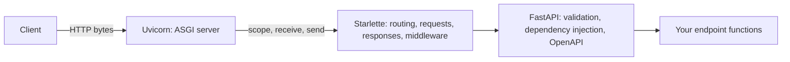

# WSGI vs ASGI, Starlette and Uvicorn

> **Before this lesson:** you should know what an HTTP request and response look like
> ([lesson 1](#/lesson/fastapi/http-basics)) and be able to read a Python function and a class. The
> keywords `async` and `await` appear here for the first time; they are introduced from zero below and
> studied properly in [lesson 12](#/lesson/fastapi/async-fundamentals).

## In plain words

A FastAPI program is not one piece of software. When it runs, three separate layers cooperate, each
written by different people, and your own functions sit on top as a fourth.

An everyday picture: a restaurant. The **front door staff** greet every arriving guest, take the
coat, and pass the order to the kitchen in the kitchen's own shorthand. The **kitchen equipment and
routines** (stations, order rail, plating) are the same in any restaurant. The **head chef's system**
checks every order for mistakes before cooking starts and keeps the printed menu up to date. Your
**recipes** are the only part that is special to your restaurant.

- **Uvicorn** is the front door. It is the program that listens on the network and turns raw HTTP
  text into Python data.
- **Starlette** is the kitchen equipment: a toolkit of general web-building parts.
- **FastAPI** is the head chef's system: it checks incoming data and writes the documentation.
- Your endpoint functions are the recipes.

The shorthand spoken between the front door and the kitchen is called **ASGI**. This lesson is about
that shorthand: what it replaced, what it looks like, and why it lets one Python program serve
thousands of clients at once.

Why this matters for a job: "why is FastAPI fast?", "what is the difference between WSGI and ASGI?"
and "what happens between the network and my function?" are standard interview questions. And when a
deployed app misbehaves, knowing which layer is responsible is how you find the fault quickly.

## The three layers



Read the diagram left to right. A client sends bytes. Uvicorn receives them and calls the application
with three objects named `scope`, `receive` and `send` (explained below). Starlette finds which
function should handle the request. FastAPI checks the data and then calls your function.

- **Uvicorn** is the *server* in the narrow sense. It owns the **sockets** (a socket is the operating
  system's handle for one network connection), parses the HTTP bytes, and speaks ASGI to the
  application.
- **Starlette** is the *toolkit*: **routing** (matching a request's path to a function), `Request` and
  `Response` classes, middleware, WebSockets, background tasks and a test client. Lubanovic describes
  FastAPI as built on Starlette for the web parts and Pydantic for the data parts.
- **FastAPI** adds the features people choose it for: checking and converting data based on Python
  type hints, a system for supplying shared resources to functions (dependency injection, lesson 10),
  and automatic documentation in a standard format called OpenAPI (lesson 6). A `FastAPI` object *is*
  a Starlette application; the class is a subclass of `Starlette`.

To see why ASGI exists, start with what came before it.

## The old world: WSGI

Until about 2018, Python web frameworks such as Django and Flask all used **WSGI** (Web Server Gateway
Interface). It is defined in PEP 3333; a **PEP** (Python Enhancement Proposal) is a numbered design
document for the Python language. WSGI is an agreement between servers and frameworks: "the server
will call a function with these two arguments, and the function will return the response". A complete
WSGI application is this:

```python
def app(environ, start_response):
    # environ: dict with REQUEST_METHOD, PATH_INFO, headers as HTTP_*, wsgi.input stream...
    body = b"Hello, WSGI"
    start_response("200 OK", [("Content-Type", "text/plain"),
                              ("Content-Length", str(len(body)))])
    return [body]
```

Line by line:

- `def app(environ, start_response):` is an ordinary function. The server calls it once per request.
  `environ` is a dictionary holding the request (method, path, headers). `start_response` is a function
  the server passes in for announcing the status and headers.
- `body = b"Hello, WSGI"` is the response body. The `b` prefix makes it a *bytes* value: raw data as it
  travels on a network, as opposed to text.
- `start_response("200 OK", [...])` announces the status line and two headers.
- `return [body]` hands the body back to the server, which sends it.

This function is **synchronous**: the server calls it and then waits, doing nothing else on that
worker, until it returns. A *worker* here is one **thread** (an independent line of execution inside a
program) or one **process** (a whole separate running copy of the program). The worker is occupied
for the entire request, including all the time the function spends waiting for a database or another
web service to answer. Most of a web request's life is waiting of that kind, called **I/O**
(input/output). So to handle 1,000 slow requests at the same moment, a WSGI server needs roughly 1,000
threads or processes, and each one costs memory.

WSGI has a second limit. The shape "one call in, one response out" has no place for conversations
that stay open: WebSockets (two-way connections, lesson 24) or a response that is sent a piece at a
time over minutes.

## The new world: ASGI

**ASGI** (Asynchronous Server Gateway Interface) keeps the idea of a standard agreement but changes
the function's shape:

```python
async def app(scope, receive, send):
    ...
```

Two things are new. First, the definition starts with `async def`. A function defined that way is a
**coroutine function**: a function that can *pause* at marked points and let other work run, then
continue where it stopped. The pause points are marked with the keyword `await`. Second, instead of
returning the response, the application exchanges small dictionaries called *messages* with the
server.

- `scope` is a dictionary describing the connection: its `type` (`"http"`, `"websocket"` or
  `"lifespan"`), the method, the path, the query string, the headers (as a list of pairs of bytes),
  the client's address, and so on.
- `receive` is a function you `await` to get the next incoming message, for example
  `{"type": "http.request", "body": b"...", "more_body": False}`.
- `send` is a function you `await` to send a message out: first
  `{"type": "http.response.start", "status": 200, "headers": [...]}`, then one or more
  `{"type": "http.response.body", "body": b"...", "more_body": ...}`.

Why does this help? The server runs an **event loop**: a small scheduler that keeps a list of paused
coroutines and runs whichever one is ready. When one request reaches an `await` and has to wait for
I/O, the event loop switches to another request *on the same thread*. A thousand waiting requests cost
a thousand small paused functions, not a thousand threads. And because the conversation is made of
messages, the same interface covers bodies that arrive in pieces, WebSockets (`websocket.receive` /
`websocket.send`) and application start-up and shut-down (`lifespan.startup`, `lifespan.shutdown`).

Here is a complete ASGI application with no framework at all, driven by a tiny pretend server so that
it runs in your browser:

```python-run
import json

async def app(scope, receive, send):
    assert scope["type"] == "http"
    # Read the full request body (it may arrive in several chunks)
    body = b""
    while True:
        event = await receive()
        body += event.get("body", b"")
        if not event.get("more_body", False):
            break
    if scope["path"] == "/echo" and scope["method"] == "POST":
        status, payload = 200, {"you_sent": json.loads(body or b"null")}
    elif scope["path"] == "/":
        status, payload = 200, {"hello": "asgi"}
    else:
        status, payload = 404, {"detail": "Not Found"}
    data = json.dumps(payload).encode()
    await send({"type": "http.response.start", "status": status,
                "headers": [(b"content-type", b"application/json"),
                            (b"content-length", str(len(data)).encode())]})
    await send({"type": "http.response.body", "body": data})

# --- a toy "server": builds scope, feeds receive(), collects send() ---
async def call(method, path, body=b""):
    chunks = [{"type": "http.request", "body": body[:5], "more_body": len(body) > 5},
              {"type": "http.request", "body": body[5:], "more_body": False}]
    async def receive():
        return chunks.pop(0)
    sent = []
    async def send(message):
        sent.append(message)
    scope = {"type": "http", "method": method, "path": path, "query_string": b"", "headers": []}
    await app(scope, receive, send)
    start, bodymsg = sent
    print(method, path, "->", start["status"], bodymsg["body"].decode())

await call("GET", "/")
await call("POST", "/echo", b'{"x": [1, 2, 3]}')
await call("GET", "/missing")
```

> [!NOTE]
> This browser runner already has an event loop running, so these snippets may use `await` at the top
> level of the code. In a normal script you would wrap the calls in `async def main(): ...` and start
> it with `asyncio.run(main())`.

Reading the application (the first function):

- `assert scope["type"] == "http"` states that this app only handles ordinary HTTP requests.
- The `while True` loop collects the request body. A body may arrive in several chunks, so the loop
  keeps calling `await receive()` and appending, and stops when a message says `more_body` is false.
- The `if / elif / else` is the routing: it looks at the path and method and chooses a status and a
  Python dictionary to send back. An unknown path gets `404`.
- `json.dumps(payload).encode()` turns the dictionary into JSON text and then into bytes.
- The two `await send(...)` calls send the response: first the status and headers, then the body.

Reading the pretend server (`call`): it builds two request chunks (the first five bytes of the body,
then the rest) to prove the app copes with a body arriving in pieces; it defines a `receive` that
hands out those chunks and a `send` that stores what the app emits in a list; it builds a `scope`;
it runs the app; and it prints what came back.

The three printed lines are `GET / -> 200 {"hello": "asgi"}`, then the echo of the posted JSON, then
`GET /missing -> 404 {"detail": "Not Found"}`.

Everything Starlette and FastAPI do is a much more elaborate version of that one function: turn the
scope into a `Request` object, find the matching route, run the middleware, call your endpoint, and
convert its return value into `send` messages.

## Starlette: the toolkit

Starlette supplies, among other things:

- `Request` and `Response` classes, with ready-made variants: `JSONResponse`, `HTMLResponse`,
  `RedirectResponse`, `StreamingResponse`, `FileResponse`.
- Routing with typed path slots (`{id:int}`, `{path:path}`). The exercise *Match a Route Template*
  has you build a small version.
- **Middleware**: code that wraps every request and response (`CORSMiddleware`, `GZipMiddleware`,
  `TrustedHostMiddleware`, sessions). An example is built below.
- WebSockets, background tasks, serving static files, HTML templates, and the `TestClient` used for
  testing (lesson 22).
- Lifespan events (code that runs once at start-up and once at shut-down).

Lubanovic shows that Starlette can be used directly, without FastAPI:

```python
from starlette.applications import Starlette
from starlette.responses import JSONResponse
from starlette.routing import Route

async def greeting(request):
    return JSONResponse({"msg": "Hello? World?"})

app = Starlette(debug=True, routes=[Route("/hi", greeting)])
```

The three imports bring in the application class, a response type and a route type. `greeting` is a
coroutine function that receives the request and returns a JSON response. The last line creates the
application and tells it that the path `/hi` is handled by `greeting`.

Notice what is missing compared with the FastAPI code in the next lesson: no type hints that check the
input, no automatic documentation, and any parameters must be dug out by hand from
`request.path_params` or `request.query_params`. Repetitive code of that kind is called
**boilerplate**, and removing it is FastAPI's job.

## Uvicorn: the server

Uvicorn is an ASGI server. Installed as `uvicorn[standard]` it uses two fast components written in
lower-level languages: `uvloop` (an event loop) and `httptools` (an HTTP parser). Its duties:

- Accept TCP connections; handle HTTP/1.1 keep-alive and the upgrade to WebSocket.
- Translate between bytes and ASGI messages, in both directions.
- Run the **lifespan** protocol: call your start-up code once before serving and your shut-down code
  on exit.
- Optionally run **several worker processes** (`--workers 4`), each a full copy of your app, so that
  all processor cores are used.

The commands you will type:

```bash
fastapi dev main.py                 # development: auto-reload, binds 127.0.0.1:8000
fastapi run main.py                 # production defaults: binds 0.0.0.0:8000, no reload
uvicorn main:app --reload           # the same thing, calling Uvicorn directly
uvicorn main:app --host 0.0.0.0 --port 8000 --workers 4
```

`main:app` means "import the module `main` (the file `main.py`) and use the variable named `app`
inside it". `--reload` restarts the server whenever you save a file, which is convenient while
developing. `--host` and `--port` choose the network address: `127.0.0.1` accepts connections only
from the same machine, `0.0.0.0` accepts them from anywhere, and `8000` is the **port**, a number
that tells the operating system which program a connection is meant for. The `fastapi` command is a
thin wrapper (a **CLI**, command-line interface) around Uvicorn that finds the app for you.

Other ASGI servers exist: **Hypercorn** (supports HTTP/2 and HTTP/3), **Granian** (written in Rust)
and **Daphne** (from the Django Channels project). A FastAPI app runs on any of them, because ASGI is
a standard and not a private arrangement between two products.

> [!INTERVIEW]
> "Why is FastAPI fast?" — Three honest reasons: (1) it runs on ASGI with an event loop, so endpoints
> that mostly wait for I/O do not hold a thread while waiting; (2) the heavy work of checking and
> converting data is done by **pydantic-core**, written in Rust; (3) Uvicorn with uvloop and httptools
> is efficient at the protocol level. It is *not* faster at **CPU-bound** work (work that keeps the
> processor busy computing, as opposed to waiting). A long loop in your endpoint runs at normal Python
> speed, and if it sits in an `async def` it blocks every other request on that worker.

## Concurrency models compared

**Concurrency** means making progress on several tasks during the same period of time. Lubanovic's
chapter 4 lists the ways a server can achieve it. In summary:

| Model | How | Good for | Cost |
|---|---|---|---|
| Processes | separate running programs, separate memory | CPU-bound work, isolation | memory per process |
| Threads | lines of execution sharing one program's memory | libraries that block while waiting | switching overhead, megabytes of memory each, shared-data bugs |
| Green threads | gevent/eventlet rewrite library internals at run time | old synchronous code | hidden behaviour that surprises |
| Callbacks | "call this function when the data arrives" (Twisted, early Node.js) | I/O | code nested many levels deep |
| async/await | coroutines on an event loop | very many simultaneous I/O waits | nothing may block the loop |

One Python detail belongs with the threads row: the **GIL** (Global Interpreter Lock) allows only one
thread at a time to execute Python code in a process, so threads help with waiting but not with
computing.

A production FastAPI deployment usually **combines** models: several *processes* (one worker per
core), each running an *event loop* that interleaves thousands of waiting requests, plus a **thread
pool** (a fixed set of reusable threads). FastAPI automatically runs endpoints written with plain
`def` in that pool so they cannot block the loop. The async module of this track explores all of this.

## How a request flows through FastAPI

Putting the layers together for `GET /items/42?verbose=true`:

1. Uvicorn reads bytes from the socket, parses them, builds `scope` and calls
   `app(scope, receive, send)`.
2. The middleware stack runs, outermost first (for example CORS, compression, your logging).
3. Starlette's router matches the path to the pattern `/items/{item_id}` and picks the endpoint.
4. FastAPI takes `item_id` from the path and `verbose` from the query, reads and checks the body, and
   prepares anything the endpoint declared it needs (a database session, the current user). Each
   value is converted and checked with Pydantic. Any failure produces a `422` response *before your
   code runs*.
5. Your function runs: awaited directly if it is `async def`, sent to the thread pool if it is `def`.
6. The return value is checked and filtered through the declared response model and turned into JSON.
7. A `Response` object emits `http.response.start` and `http.response.body` messages, which travel
   back out through the middleware and Uvicorn to the socket.
8. Background tasks and clean-up code run after the response has been sent.

Do not worry if steps 4, 6 and 8 mention things you have not met; each has its own lesson. The point
for now is the order.

## Middleware is ASGI wrapping ASGI

An ASGI app is "something callable with `scope, receive, send`". A **middleware** is an app that holds
another app and calls it, optionally swapping `send` or `receive` for its own versions so that it can
observe or change the messages passing through. Picture layers of an onion: a request passes inward
through each layer and the response passes outward through the same layers in reverse. Every built-in
middleware (CORS, GZip, sessions) is written this way, and seeing one removes the mystery:

```python-run
import time

async def hello_app(scope, receive, send):
    await send({"type": "http.response.start", "status": 200,
                "headers": [(b"content-type", b"text/plain")]})
    await send({"type": "http.response.body", "body": b"hello"})

class TimingMiddleware:
    """Pure ASGI middleware: adds a header by intercepting the response.start message."""
    def __init__(self, app):
        self.app = app

    async def __call__(self, scope, receive, send):
        if scope["type"] != "http":                 # pass websockets / lifespan through untouched
            return await self.app(scope, receive, send)
        start = time.perf_counter()

        async def send_wrapper(message):
            if message["type"] == "http.response.start":
                elapsed = f"{(time.perf_counter() - start) * 1000:.2f}ms".encode()
                message = {**message, "headers": [*message["headers"], (b"x-process-time", elapsed)]}
            await send(message)                     # forward (possibly modified) message outward

        await self.app(scope, receive, send_wrapper)

class RejectLargeBodies:
    """Short-circuits: answers by itself without ever calling the inner app."""
    def __init__(self, app, limit):
        self.app, self.limit = app, limit

    async def __call__(self, scope, receive, send):
        length = int(dict(scope["headers"]).get(b"content-length", b"0"))
        if length > self.limit:
            await send({"type": "http.response.start", "status": 413, "headers": []})
            await send({"type": "http.response.body", "body": b"Payload Too Large"})
            return
        await self.app(scope, receive, send)

app = RejectLargeBodies(TimingMiddleware(hello_app), limit=1000)     # outermost first

async def call(headers):
    sent = []
    async def receive(): return {"type": "http.request", "body": b"", "more_body": False}
    async def send(m): sent.append(m)
    await app({"type": "http", "method": "POST", "path": "/", "headers": headers}, receive, send)
    start = sent[0]
    print(start["status"], [k.decode() for k, _ in start["headers"]], sent[1]["body"])

await call([(b"content-length", b"10")])
await call([(b"content-length", b"999999")])
```

Reading it:

- `hello_app` is the innermost app. It ignores the request and sends `200` with the body `hello`.
- `TimingMiddleware` stores the inner app in `__init__`. Defining `__call__` makes an object of the
  class callable like a function, so the object itself is an ASGI app. Inside, it records the start
  time, defines `send_wrapper`, and calls the inner app with `send_wrapper` in place of the real
  `send`. When the inner app sends its `http.response.start` message, the wrapper adds an
  `x-process-time` header before passing the message on.
- `RejectLargeBodies` reads the `content-length` header from the scope. If the announced body is over
  the limit, it sends a `413` response itself and returns *without calling the inner app at all*.
- `app = RejectLargeBodies(TimingMiddleware(hello_app), limit=1000)` nests them. The one written first
  is the outermost.

The first call prints `200 ['content-type', 'x-process-time'] b'hello'`; the second prints
`413 [] b'Payload Too Large'`. Two patterns are on show: **wrapping `send`** to change the response on
its way out, and **short-circuiting**, which means answering without calling the inner app. Note that
the timing header is missing from the 413: the rejecting layer is *outside* the timing layer, so the
timing layer never ran. Order decides everything with middleware, a point lesson 21 returns to.

## Lifespan at the protocol level

The third scope type explains a FastAPI feature you will use for loading settings, database
connections and machine-learning models: the `lifespan=` parameter. Before serving any request, the
server calls the app once with `scope["type"] == "lifespan"` and exchanges four messages:

```text
server -> app : {"type": "lifespan.startup"}
app -> server : {"type": "lifespan.startup.complete"}     (or lifespan.startup.failed)
                ... the server now accepts connections ...
server -> app : {"type": "lifespan.shutdown"}             (on SIGTERM / Ctrl-C)
app -> server : {"type": "lifespan.shutdown.complete"}
```

In FastAPI you write one function with a `yield` in the middle. The code before `yield` is the
start-up half and the code after it is the shut-down half. Two practical consequences follow. If
start-up raises an error, Uvicorn logs it and exits, so a half-prepared app never serves traffic. And
with several workers, the lifespan runs **once in each worker process**, not once overall, so four
workers load four copies of whatever you load there. (`SIGTERM` in the listing is the signal an
operating system sends to ask a program to stop.)

## Debugging at the boundary

When behaviour is confusing, first work out which layer is responsible:

| Observation | Layer to suspect | How to check |
|---|---|---|
| Connection refused / reset | Uvicorn not listening where you think (host, port, container binding) | `curl -v http://127.0.0.1:8000/` from the same host or container |
| 404 for a path you declared | Starlette routing (prefix, trailing slash, route order) | print `[r.path for r in app.routes]` |
| 422 before your code runs | FastAPI/Pydantic validation | read `detail[].loc` in the response |
| 500 with a traceback in logs | your endpoint or dependency | the traceback |
| 502/504 from the proxy | app crashed, hung or exceeded proxy timeouts | app logs, proxy logs, blocked event loop |
| Works with `curl`, fails in browser | CORS (a browser-only rule) | browser dev-tools network tab, the `OPTIONS` request |

`curl -v` (or the `httpx` library in an interactive Python session) prints the raw request and
response lines. That is the fastest way to see what actually crossed the wire, free of whatever a
browser or client library does on its own.

## Pitfalls

- Running a FastAPI app with a WSGI server such as Gunicorn's default synchronous workers. It will not
  work; an ASGI server is required (or Gunicorn configured with Uvicorn's worker class).
- Using `--reload` in production. It watches files and restarts; that is slow and unnecessary there.
- Believing `async` makes CPU-bound code faster. It makes *waiting* cheaper and nothing else.
- Binding to `127.0.0.1` inside a Docker container (a packaged, isolated environment, lesson 25).
  Nothing outside the container can connect. Use `0.0.0.0`, which `fastapi run` does by default.

## Summary

- WSGI: a synchronous function, one worker per request in progress, no natural support for
  connections that stay open.
- ASGI: `async def app(scope, receive, send)` exchanging messages; it covers HTTP, WebSockets and
  lifespan.
- Uvicorn is the server, Starlette the web toolkit, FastAPI the checking, dependency and
  documentation layer, Pydantic the data engine.
- Production = several processes × an event loop in each × a thread pool for synchronous code.

## Glossary

- **WSGI** — the older, synchronous standard interface between Python web servers and frameworks.
- **ASGI** — the newer, asynchronous standard: an `async` callable taking `scope`, `receive`, `send`.
- **Uvicorn** — an ASGI server: listens on the network, parses HTTP, calls the app.
- **Starlette** — the web toolkit FastAPI is built on (routing, requests, responses, middleware).
- **Socket** — the operating system's handle for one network connection.
- **Bytes** — raw data as it travels on a network, written `b"..."` in Python.
- **Synchronous** — the caller waits, doing nothing else, until the call returns.
- **Coroutine** — a function defined with `async def` that can pause at each `await`.
- **Event loop** — the scheduler that runs whichever paused coroutine is ready.
- **I/O** — input/output: waiting on a network, disk or database.
- **CPU-bound** — work limited by computing speed, not by waiting.
- **Thread / process** — a line of execution inside a program / a separate running program.
- **Worker** — one process (or thread) that handles requests.
- **Thread pool** — a fixed set of threads reused for many jobs.
- **GIL** — the lock that lets only one thread run Python code at a time.
- **Routing** — choosing the function that handles a request from its path and method.
- **Middleware** — a layer that wraps the app and sees every request and response.
- **Short-circuit** — a middleware answering by itself without calling the inner app.
- **Lifespan** — start-up and shut-down code that runs once per worker process.
- **Port** — a number identifying which program on a machine a connection is for.
- **Boilerplate** — repetitive code that has to be written but carries no ideas of its own.

```quiz
[
  {"q": "What are the three arguments of an ASGI application?", "options": ["request, response, next", "environ, start_response, body", "scope, receive, send", "app, host, port"], "answer": 2,
   "explain": "ASGI apps are async callables taking a connection scope dict plus receive and send awaitables for message exchange. environ/start_response is WSGI."},
  {"q": "Which component parses raw HTTP bytes from the socket in a typical FastAPI deployment?", "options": ["Pydantic", "Starlette", "Uvicorn", "FastAPI's router"], "answer": 2,
   "explain": "Uvicorn is the ASGI server: it handles sockets and HTTP parsing, then calls the ASGI app."},
  {"q": "Why can't classic WSGI easily support WebSockets?", "options": ["WSGI only supports GET", "Its synchronous call-and-return signature has no way to keep exchanging messages on a connection", "WebSockets require JSON", "WSGI servers don't support TLS"], "answer": 1,
   "explain": "WSGI models a request as one function call returning one response; long-lived bidirectional connections don't fit that shape. ASGI's receive/send messages do."},
  {"q": "What does the ASGI 'lifespan' scope type let an application do?", "options": ["Measure request latency", "Run startup and shutdown logic once per process", "Keep WebSockets alive", "Limit request body size"], "answer": 1,
   "explain": "The server sends lifespan.startup and lifespan.shutdown events; FastAPI exposes them through the lifespan context manager, e.g. for loading ML models."},
  {"q": "A FastAPI endpoint performs a 2-second pure-Python computation inside 'async def'. What happens to other requests on that worker?", "options": ["They run in parallel on other cores", "They are blocked until the computation finishes", "FastAPI moves the computation to a thread automatically", "Uvicorn cancels the slow request"], "answer": 1,
   "explain": "async def runs directly on the event loop thread. CPU work without await points blocks the loop and every other request served by it."},
  {"q": "What does 'uvicorn main:app' refer to?", "options": ["A file called main:app", "The variable app inside module main", "The app() function in main", "An environment variable"], "answer": 1,
   "explain": "The import string is module:attribute; Uvicorn imports main and uses its app object."}
]
```

> **Source:** Lubanovic, *FastAPI*, ch. 4 "Async, Concurrency, and Starlette Tour" (Starlette, Types of Concurrency, Using Starlette Directly) and ch. 2 "Modern Python" (Web Frameworks); ASGI specification https://asgi.readthedocs.io/; https://fastapi.tiangolo.com/deployment/manually/ and https://fastapi.tiangolo.com/fastapi-cli/
