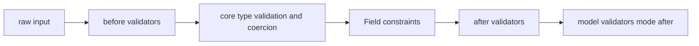

# Validators and serialization

> **Before this lesson:** you should be able to define a Pydantic model with typed fields and `Field`
> constraints and read a `ValidationError` ([lesson 7](#/lesson/fastapi/pydantic-models)), and know
> what PATCH means ([lesson 1](#/lesson/fastapi/http-basics)). In Python you need functions, classes
> with methods, and `raise`.

## In plain words

Types and `Field` constraints express simple rules: "a number", "at least 18", "at most 50
characters". Real applications also have rules that no ready-made constraint can state: "the end date
must come after the start date", "the password must contain a digit", "phone numbers are stored as
digits only". For these you write a small function of your own and attach it to the model. Such a
function is called a **validator**.

The opposite direction needs the same kind of control. When a model is turned back into JSON you may
want money printed with two decimals, or a field left out. A function that controls how a value is
written out is a **serializer**.

An everyday picture: a factory's inspection line. Each item passes several stations in a fixed order:
a cleaning station first, then the standard gauge, then a specialist who checks things the gauge
cannot. At the end of the building another station packs finished items in the form the customer
ordered. Validators are the inspection stations you add; serializers are the packing station.

Why this matters for a job: rules of this kind are in every real codebase, and one question is asked
in interviews again and again: "how do you implement PATCH correctly?" Its answer, `exclude_unset`,
is in this lesson.

## The validation pipeline

A **pipeline** is a series of steps where the output of one is the input of the next. For each field
Pydantic runs these steps, in this order:



1. **Before validators** receive the raw input, whatever type it has.
2. **Core validation** converts the value to the declared type (lesson 7's coercion).
3. **Field constraints** such as `ge=0` are applied.
4. **After validators** receive the converted, typed value.
5. When all fields are done, **model validators** in `after` mode see the complete object.

Two further kinds complete the picture. A **wrap** validator surrounds the core step and decides
whether and how to run it. A model validator with `mode="before"` sees the entire raw input before
any field is processed. Each kind is demonstrated below, starting with the most common.

## Field validators

A field validator is a method on the model, marked with `@field_validator("field_name")`:

```python-run
import re
from pydantic import BaseModel, field_validator, ValidationError

class SignUp(BaseModel):
    username: str
    password: str
    phone: str

    @field_validator("username")
    @classmethod
    def username_alnum(cls, v: str) -> str:
        if not v.isalnum():
            raise ValueError("must be alphanumeric")
        return v.lower()                         # validators may also TRANSFORM the value

    @field_validator("password")
    @classmethod
    def strong_password(cls, v: str) -> str:
        if len(v) < 8 or not re.search(r"\d", v):
            raise ValueError("must be 8+ chars and contain a digit")
        return v

    @field_validator("phone", mode="before")
    @classmethod
    def digits_only(cls, v):
        # 'before' runs on the raw input - e.g. accept ints or formatted strings
        return re.sub(r"\D", "", str(v))

print(SignUp(username="AnnLee", password="hunter22x", phone="(555) 010-9999"))
try:
    SignUp(username="ann lee", password="short", phone=5550109999)
except ValidationError as e:
    for err in e.errors():
        print(err["loc"], err["type"], err["msg"])
```

Take the first validator slowly, because the others follow the same pattern:

- `@field_validator("username")` says the method below checks the field `username`.
- `@classmethod` is required directly under it. A class method receives the class itself (by
  convention named `cls`) as its first argument, because at the moment the validator runs the model
  object does not exist yet.
- `def username_alnum(cls, v: str) -> str:` receives the value as `v`.
- `raise ValueError("must be alphanumeric")` is how a validator rejects a value. Pydantic catches the
  `ValueError` and turns it into an error entry.
- `return v.lower()` hands back the value to store. A validator may also *change* the value; here it
  lower-cases it.

The second validator rejects passwords shorter than 8 characters or without a digit (`\d` in a
regular expression means "a digit"). The third uses `mode="before"`, so it runs on the raw input: it
turns whatever arrives into text and deletes every character that is not a digit (`\D`).

Output: the valid sign-up prints `username='annlee' password='hunter22x' phone='5550109999'`. The
name was lower-cased and the phone number stripped of brackets, spaces and dashes. The invalid one
produces two errors of type `value_error`, one for the username (it contains a space) and one for the
password. The phone number, given as an integer, passed, because the before-validator converted it.

Rules of thumb:

- Raise `ValueError` (or `AssertionError`) with a clear message. Pydantic turns it into a
  `value_error` entry, and FastAPI turns that into a 422 response.
- **Always return** the value, changed or not. A validator with no `return` sets the field to `None`.
- `mode="after"` (the default) receives the value already converted to the right type. It is the
  easiest and safest kind.
- `mode="before"` receives raw input of *any* type. Use it to tidy input or to accept alternative
  formats.
- One validator can cover several fields: `@field_validator("a", "b")`, or `"*"` for all of them.

### Annotated validators: reusable rules

The second style attaches the validator to a *type* instead of to one model, so the rule travels
wherever the type is used:

```python-run
from typing import Annotated
from pydantic import AfterValidator, BeforeValidator, BaseModel, ValidationError

def _check_slug(v: str) -> str:
    if not v.replace("-", "").isalnum() or v != v.lower():
        raise ValueError("slug must be lowercase letters, digits and dashes")
    return v

Slug = Annotated[str, BeforeValidator(lambda v: str(v).strip()), AfterValidator(_check_slug)]

class Article(BaseModel):
    slug: Slug
    related: list[Slug] = []

print(Article(slug="  fastapi-intro ", related=["pydantic-v2"]))
try:
    Article(slug="Bad Slug!")
except ValidationError as e:
    print(e.errors()[0]["msg"])
```

`_check_slug` is an ordinary function that raises `ValueError` or returns the value. (A *slug* is the
readable part of a web address, such as `fastapi-intro`.) `Slug` is then defined as text that is
first stripped of surrounding spaces by a `BeforeValidator` and afterwards checked by an
`AfterValidator`. The small `lambda v: ...` is a one-line unnamed function. `Article` uses `Slug`
twice, once directly and once inside a list, and the rule applies in both places.

The first article prints `slug='fastapi-intro' related=['pydantic-v2']` with the spaces removed. The
second fails with the message from `_check_slug`.

## Model validators: cross-field rules

Some rules involve more than one field. A **model validator** sees the whole model:

```python-run
from datetime import date
from typing import Any
from pydantic import BaseModel, model_validator, ValidationError

class Booking(BaseModel):
    start: date
    end: date
    guests: int = 1

    @model_validator(mode="after")
    def check_dates(self):
        if self.end <= self.start:
            raise ValueError("end must be after start")
        return self                      # after-mode model validators return self

    @model_validator(mode="before")
    @classmethod
    def accept_legacy_keys(cls, data: Any) -> Any:
        # old clients send 'from'/'to'; translate before field validation
        if isinstance(data, dict) and "from" in data:
            data = {**data, "start": data.pop("from"), "end": data.pop("to")}
        return data

print(Booking(start="2025-03-01", end="2025-03-05"))
print(Booking.model_validate({"from": "2025-03-01", "to": "2025-03-02", "guests": 2}))
try:
    Booking(start="2025-03-05", end="2025-03-01")
except ValidationError as e:
    print(e.errors()[0]["type"], "-", e.errors()[0]["msg"])
```

- `check_dates` uses `mode="after"`. It runs when every field has been validated, so it is a normal
  method with `self`, and `self.start` and `self.end` are real dates that can be compared. It must
  return `self`.
- `accept_legacy_keys` uses `mode="before"` and is a class method. It receives the raw input before
  any field is looked at. Here it helps old clients that still send `from` and `to` by renaming those
  keys to `start` and `end`. Reshaping input like this keeps old clients working while the model
  itself stays clean.

The output shows a normal booking, a booking built from the old key names, and then
`value_error - Value error, end must be after start` for the booking whose dates are reversed.

> [!WARNING]
> Validators should be **pure and fast**. A *pure* function depends only on its inputs: it makes no
> database queries and no network calls. "Is this username already taken?" is not a rule about the
> shape of the data. It depends on what is stored, so it belongs in the application's own logic
> (lesson 15), where a database is available. Keep Pydantic for rules about shape and values.

## Computed fields

Sometimes the output should contain a value that is *calculated* from other fields and never sent by
the client:

```python-run
from pydantic import BaseModel, computed_field

class Rect(BaseModel):
    w: float
    h: float

    @computed_field
    @property
    def area(self) -> float:
        return self.w * self.h

print(Rect(w=3, h=4).model_dump())
```

`@property` makes a method readable like an attribute (`rect.area`, no brackets). Adding
`@computed_field` above it tells Pydantic to include the result in the output. The demo prints
`{'w': 3.0, 'h': 4.0, 'area': 12.0}`. Computed fields appear in `model_dump`, in JSON output and in
the output version of the JSON Schema.

## Serialization: controlling the output

`model_dump()` produces a Python dictionary and `model_dump_json()` produces JSON text directly.
Both accept the same options:

| Option | Effect |
|---|---|
| `mode="json"` | (dump only) convert to JSON-compatible types: datetime → str, UUID → str, set → list |
| `include={...}` / `exclude={...}` | select fields, nested via dicts: `exclude={"user": {"password"}}` |
| `exclude_unset=True` | only fields explicitly provided — the key to correct PATCH handling |
| `exclude_defaults=True` | drop fields equal to their default |
| `exclude_none=True` | drop `None` values |
| `by_alias=True` | use aliases as keys |

The option that matters most is `exclude_unset`. Run this:

```python-run
from pydantic import BaseModel

class ItemUpdate(BaseModel):
    name: str | None = None
    price: float | None = None
    tags: list[str] | None = None

stored = {"name": "Hammer", "price": 9.5, "tags": ["tools"]}
patch = ItemUpdate.model_validate({"price": 11.0})     # client sent only price

print("exclude_unset:", patch.model_dump(exclude_unset=True))
print("WRONG merge  :", {**stored, **patch.model_dump()})          # wipes name and tags!
print("RIGHT merge  :", {**stored, **patch.model_dump(exclude_unset=True)})

explicit_null = ItemUpdate.model_validate({"tags": None})       # client explicitly clears tags
print("explicit None is 'set':", explicit_null.model_dump(exclude_unset=True))
```

`ItemUpdate` is a model for PATCH requests: every field is optional. The client sends only
`{"price": 11.0}`.

- `patch.model_dump(exclude_unset=True)` gives `{'price': 11.0}`: only what the client sent.
- The **wrong** merge uses plain `model_dump()`, which is
  `{'name': None, 'price': 11.0, 'tags': None}`. Laying that over the stored item erases the name
  and the tags.
- The **right** merge lays only the sent fields over the stored item, so the name and tags survive.
- The last line shows a client that sends `{"tags": null}` on purpose. That field counts as "set", so
  it is kept in the dump and the tags are cleared, as the client asked.

This difference between *not sent* and *sent as null* is exactly what PATCH needs. Pydantic records
which fields were provided in an attribute named `model_fields_set`, and `exclude_unset` reads it.

### Custom serializers

```python-run
from datetime import datetime, timezone
from decimal import Decimal
from pydantic import BaseModel, field_serializer, PlainSerializer
from typing import Annotated

Money = Annotated[Decimal, PlainSerializer(lambda d: f"{d:.2f}", return_type=str)]

class Invoice(BaseModel):
    total: Money
    issued: datetime

    @field_serializer("issued")
    def as_epoch(self, dt: datetime) -> int:
        return int(dt.timestamp())

inv = Invoice(total=Decimal("19.5"), issued=datetime(2025, 1, 1, tzinfo=timezone.utc))
print(inv.model_dump_json())
```

Two techniques appear. `Money` is a reusable type: a `Decimal` with a `PlainSerializer` that writes
it as text with exactly two decimals. `@field_serializer("issued")` is a method that controls how one
field of this model is written; here the date becomes an *epoch timestamp*, the number of seconds
since 1 January 1970, a common machine format for times. The output is
`{"total":"19.50","issued":1735689600}`.

## Errors in detail

A `ValidationError` has a method `.errors()` that returns a list of dictionaries. Each has `type`,
`loc`, `msg` and `input`, and sometimes `ctx` (the broken rule, such as `{"ge": 18}`) and `url`.
FastAPI's 422 response is this very list, with the source of the input (`"body"`, `"query"`,
`"path"`) placed at the front of `loc`. The `type` codes are **stable** and documented, so a client
program can map them to messages in the user's language.

```python-run
from pydantic import BaseModel, Field, ValidationError

class Q(BaseModel):
    age: int = Field(ge=18)
    email: str

try:
    Q.model_validate({"age": 12})
except ValidationError as e:
    print(e.error_count(), "errors")
    for err in e.errors(include_url=False):
        print(err)
```

The input has an age of 12 and no email. The output reports `2 errors`: a `greater_than_equal` entry
for `age` whose `ctx` is `{'ge': 18}`, and a `missing` entry for `email`.

The problem *Validate a Request Body like a 422* asks you to build this kind of error reporting
yourself.

## Discriminated unions

An API often accepts one of several shapes in the same place, for example a text input or an image
input. Give every shape a field holding a fixed label (a "tag"), and Pydantic can go straight to the
right model:

```python-run
from typing import Annotated, Literal, Union
from pydantic import BaseModel, Field, TypeAdapter

class TextInput(BaseModel):
    kind: Literal["text"]
    text: str

class ImageInput(BaseModel):
    kind: Literal["image"]
    url: str
    width: int

Input = Annotated[Union[TextInput, ImageInput], Field(discriminator="kind")]
ta = TypeAdapter(list[Input])
print(ta.validate_python([{"kind": "text", "text": "hi"},
                          {"kind": "image", "url": "http://x/y.png", "width": 64}]))
```

Each model has a `kind` field that can hold only one value. `Field(discriminator="kind")` tells
Pydantic to read `kind` first and choose the model from it. The demo validates a list holding one of
each and prints a `TextInput` followed by an `ImageInput`. Without the discriminator Pydantic would
try each model in turn, and on failure the error message would mix complaints from all of them. With
it, the choice is immediate and errors mention only the model that was meant.

> [!INTERVIEW]
> "How would you implement PATCH correctly with Pydantic?" — Define an update model with all fields
> optional (default `None`), validate the body, then apply `update.model_dump(exclude_unset=True)`
> onto the stored object. That distinguishes "field omitted" (keep the old value) from "field
> explicitly null" (clear it). Using a plain `model_dump()` would overwrite every omitted field with
> `None`.

## Watching the pipeline run

The order of the stages is easiest to learn by making each one announce itself. Here is one field
with every kind of validator attached:

```python-run
from typing import Annotated, Any
from pydantic import (BaseModel, Field, BeforeValidator, AfterValidator, WrapValidator,
                      ValidationError, field_validator, model_validator)

def before(v: Any):
    print(f"  1 before      got {v!r} ({type(v).__name__})")
    return str(v).strip()

def wrap(v: Any, handler):
    print(f"  2 wrap-enter  got {v!r}")
    try:
        result = handler(v)                 # run the inner steps: core int parsing + constraints
    except ValidationError:
        print("    wrap: inner validation failed, falling back to 0")
        return 0
    print(f"  4 wrap-exit   inner produced {result!r} ({type(result).__name__})")
    return result

def after(v: int):
    print(f"  5 after       got {v!r}")
    return v * 10

# before/wrap validators run in REVERSE order of declaration, after validators in order
Qty = Annotated[int, WrapValidator(wrap), BeforeValidator(before), Field(ge=0), AfterValidator(after)]

class Line(BaseModel):
    quantity: Qty

    @model_validator(mode="before")
    @classmethod
    def raw(cls, data):
        print(f"  0 model-before raw input {data!r}")
        return data

    @field_validator("quantity")
    @classmethod
    def decorator_after(cls, v):
        print(f"  6 @field_validator (after) got {v!r}")
        return v

    @model_validator(mode="after")
    def whole(self):
        print(f"  7 model-after  instance {self!r}")
        return self

print("valid input:");   print("result:", Line(quantity="  7 "))
print("invalid input:"); print("result:", Line(quantity="seven"))
```

For the valid input `"  7 "` the numbered lines appear in order: the model-level before step sees
the raw dictionary (0); the before-validator strips the spaces (1); the wrap validator starts (2),
calls `handler`, which runs the core conversion of `"7"` to `7` (step 3, which prints nothing), and
finishes (4); the after-validator multiplies by ten (5); the decorator-style validator sees `70` (6);
and the model-level after step sees the finished object (7). The result is `quantity=70`.

For the invalid input `"seven"` the core step fails inside the wrap validator. The wrap validator
catches the failure and substitutes `0`, so the model is still created, with `quantity=0`.

What to take from this:

- Before-validators see raw input and may change its type; the **core** step then turns `"7"` into
  `7`, and the constraint `ge=0` is checked.
- A **wrap** validator surrounds the core step. It can look at the input, call the inner `handler`,
  catch its failure and supply a value of its own. It is the only kind of validator that can
  *recover* from an error. Use it sparingly (tolerant reading of old data, timing, logging); a
  fallback that hides bad input is dangerous in an API.
- The ordering rule inside `Annotated`: **before and wrap validators run right to left** (the one
  written last sees the input first) and **after validators run left to right**, followed by the
  decorator-style ones. Swap `WrapValidator` and `BeforeValidator` in the example and the wrap step
  runs first.
- The model-level `before` step runs first of all, and the model-level `after` step last, with a
  fully built instance.

## Validators that need another field or outside context

A field validator can read **fields validated earlier** through `info.data` (fields are processed in
the order they are declared). The caller can also pass a `context` dictionary to `model_validate`,
for values that are not part of the data: today's date, a customer's limits, a feature switch.

```python-run
from datetime import date
from pydantic import BaseModel, ValidationError, ValidationInfo, field_validator

class Discount(BaseModel):
    price: float
    discount: float
    valid_until: date

    @field_validator("discount")
    @classmethod
    def not_more_than_price(cls, v: float, info: ValidationInfo) -> float:
        price = info.data.get("price")           # absent if 'price' itself failed validation
        if price is not None and v > price:
            raise ValueError("discount exceeds price")
        return v

    @field_validator("valid_until")
    @classmethod
    def in_future(cls, v: date, info: ValidationInfo) -> date:
        today = (info.context or {}).get("today", date.today())
        if v < today:
            raise ValueError("already expired")
        return v

ctx = {"today": date(2025, 6, 1)}                # injected -> deterministic tests, no hidden clock
print(Discount.model_validate({"price": 20, "discount": 5, "valid_until": "2025-12-31"}, context=ctx))
try:
    Discount.model_validate({"price": 20, "discount": 25, "valid_until": "2025-01-01"}, context=ctx)
except ValidationError as e:
    for err in e.errors():
        print(err["loc"], "-", err["msg"])
```

- `not_more_than_price` takes a second parameter, `info`. `info.data.get("price")` is the price that
  was validated a moment earlier. If the price itself was invalid it is missing from `info.data`,
  which is why the code checks for `None`.
- `in_future` reads "today" from `info.context`, falling back to the real date when no context was
  given.
- `ctx = {"today": date(2025, 6, 1)}` fixes "today" for the demo.

The first discount is valid and prints. The second has a discount larger than the price and an
expiry date in the past, so two messages appear: `discount exceeds price` and `already expired`.

Choose a `model_validator(mode="after")` when a rule treats several fields as equals; use
`info.data` when one field depends on an earlier one. Passing the date in through the context keeps
the validator pure: it reads no hidden clock, so a test can supply any date it likes and always get
the same result.

## Machine-readable custom errors

`ValueError("...")` always produces the general type `value_error`. When client programs need to
tell different failures apart (or translate the messages), raise `PydanticCustomError` with a stable
code of your own:

```python-run
from pydantic import BaseModel, ValidationError, field_validator
from pydantic_core import PydanticCustomError

class SignUp(BaseModel):
    password: str

    @field_validator("password")
    @classmethod
    def strength(cls, v: str) -> str:
        if len(v) < 12:
            raise PydanticCustomError("password_too_short",
                                      "Password must have at least {min_length} characters",
                                      {"min_length": 12})
        return v

try:
    SignUp(password="hunter2")
except ValidationError as e:
    err = e.errors(include_url=False)[0]
    print(err["type"], "|", err["msg"], "|", err["ctx"])
```

Its three arguments are the code, a message template and the values to fill into the template. The
output is `password_too_short | Password must have at least 12 characters | {'min_length': 12}`. The
code `password_too_short` becomes part of your API's contract; the wording of the message can change
freely.

## Round-tripping and serialization modes

Whatever you write out should read back in as an equal object. This property, called a **round
trip**, is what makes models safe to put on message queues and into caches:

```python-run
from datetime import datetime, timezone
from decimal import Decimal
from uuid import UUID
from pydantic import BaseModel

class Event(BaseModel):
    id: UUID
    at: datetime
    amount: Decimal
    tags: set[str]

e = Event(id=UUID(int=1), at=datetime(2025, 1, 15, 9, 30, tzinfo=timezone.utc),
          amount=Decimal("19.90"), tags={"b", "a"})
python_dict = e.model_dump()                      # Python types preserved (set, Decimal, datetime)
json_text = e.model_dump_json()                   # str
print({k: type(v).__name__ for k, v in python_dict.items()})
print(json_text)
print("round trip equal:", Event.model_validate_json(json_text) == e)
print("Decimal kept exact as a string in JSON:", '"19.90"' in json_text)
```

The first line of output shows that `model_dump()` keeps Python types: `UUID`, `datetime`,
`Decimal`, `set`. The second shows the JSON text, in which all four have become JSON values. The
third confirms that reading the JSON back gives an object equal to the original, and the fourth that
the amount was written as the string `"19.90"`.

`Decimal` is written as a JSON string by default precisely so that it survives the trip without
floating-point rounding. Decide on purpose whether money leaves your API as a string, as a whole
number of cents, or as a number.

## Debugging validators

| Symptom | Usual cause |
|---|---|
| Field is `None` after validation | validator has no `return` |
| `info.data` lacks a field | that field is declared *later*, or it failed its own validation |
| Validator never runs | wrong field name in `@field_validator("...")` (v2 raises at class creation unless `check_fields=False`), or the default was used — defaults aren't validated unless `validate_default=True` |
| Runs on input but not on `obj.field = x` | `validate_assignment` is off |
| `TypeError` instead of a clean 422 | the validator raised something other than `ValueError`/`AssertionError`; other exceptions propagate as server errors |
| Output differs from stored value | a `field_serializer` or alias is applied; compare `model_dump()` with `model_dump(mode="json", by_alias=True)` |

## Pitfalls

- Forgetting `return v` in a validator (the field silently becomes `None`).
- Forgetting `@classmethod` under `@field_validator` (required in version 2 for the decorator style).
- Input/output inside validators. It is slow and hard to test, and it runs on *every* parse,
  including in tests and when building responses.
- Using plain `model_dump()` for PATCH merges.
- Expecting `mode="before"` validators to receive typed values. They receive raw input.

## Summary

- `@field_validator` for rules on one field (`before` to tidy raw input, `after` to check typed
  values); `Annotated[..., AfterValidator(...)]` for reusable types that carry their rule.
- `@model_validator` for rules across fields; `before` mode can reshape raw input.
- `@computed_field` adds calculated fields to the output.
- `model_dump` / `model_dump_json` options control output; `exclude_unset` is essential for PATCH.
- Custom serializers format outgoing values; discriminated unions choose between shapes directly.

## Glossary

- **Validator** — a function you attach to a model to check or transform a value.
- **Serializer** — a function that controls how a value is written out.
- **Pipeline** — a fixed series of steps, each feeding the next.
- **Field validator** — a validator for one field (`@field_validator`).
- **Before / after mode** — runs on the raw input / on the converted, typed value.
- **Wrap validator** — surrounds the core step and can catch its failure.
- **Model validator** — a validator that sees the whole model, for rules across fields.
- **Class method (`cls`)** — a method that receives the class, not an instance.
- **Pure function** — one that depends only on its inputs, with no database or network access.
- **Computed field** — an output field calculated from other fields.
- **`exclude_unset`** — dump only the fields the client actually sent.
- **`model_fields_set`** — the record of which fields were provided.
- **Discriminated union** — a choice between models decided by a tag field.
- **Validation context** — extra values passed to `model_validate(..., context=...)`.
- **`PydanticCustomError`** — an error with your own stable `type` code.
- **Round trip** — writing a value out and reading it back to an equal value.
- **Epoch timestamp** — a time expressed as seconds since 1 January 1970.

```quiz
[
  {"q": "What happens if a field validator forgets to return the value?", "options": ["Validation error", "The original value is kept", "The field becomes None", "Pydantic raises at class creation"], "answer": 2,
   "explain": "The validator's return value replaces the field value; an implicit return is None."},
  {"q": "Which validator mode receives the raw, unconverted input?", "options": ["after", "before", "plain-after", "serialize"], "answer": 1,
   "explain": "Before-validators run prior to Pydantic's type coercion, so they see whatever the client sent."},
  {"q": "Where should 'username must not already exist in the DB' be checked?", "options": ["In a field_validator", "In a model_validator", "In the service layer / a dependency with DB access", "In the JSON Schema"], "answer": 2,
   "explain": "Validators should be pure shape/value rules. Uniqueness depends on database state and belongs in business logic."},
  {"q": "A PATCH body {\"price\": 11} is parsed into ItemUpdate with all-optional fields. Which dict should you merge onto the stored item?", "options": ["update.model_dump()", "update.model_dump(exclude_unset=True)", "update.model_dump(exclude_none=False)", "update.model_json_schema()"], "answer": 1,
   "explain": "exclude_unset keeps only fields the client actually sent; model_dump() would overwrite other fields with None."},
  {"q": "What does model_dump(mode='json') do that model_dump() doesn't?", "options": ["Returns a string", "Converts values to JSON-compatible types like ISO strings for datetimes", "Sorts keys", "Excludes None values"], "answer": 1,
   "explain": "mode='json' produces a dict of JSON-safe primitives; model_dump_json returns the serialised string."},
  {"q": "Why use a discriminated union with a Literal 'kind' field?", "options": ["It is required for all unions", "Pydantic picks the right model directly from the tag, giving faster validation and precise errors", "It enables strict mode", "It hides fields in docs"], "answer": 1,
   "explain": "Without a discriminator Pydantic tries members in turn and error messages mix all alternatives."}
]
```

> **Source:** Lubanovic, *FastAPI*, ch. 5 "Pydantic, Type Hints, and Models Tour" (Validate Values); https://docs.pydantic.dev/latest/concepts/validators/, /concepts/serialization/, /concepts/unions/, /errors/validation_errors/; https://fastapi.tiangolo.com/tutorial/body-updates/
