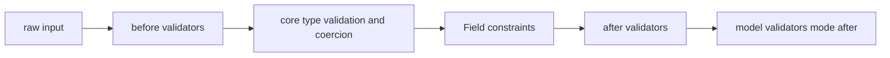

# Validators and serialization

Types and `Field` constraints cover most rules. Real APIs also need *custom* rules — "end date after start
date", "password must contain a digit", "normalise phone numbers" — and precise control over the outgoing
JSON. Pydantic v2 provides **validators** for the first and **serializers** plus `model_dump` options for
the second.

## The validation pipeline

For each field Pydantic runs, in order:



A **wrap** validator surrounds the core step and decides whether/how to call it. **Model validators**
with `mode="before"` see the raw input dict before any field is processed.

## Field validators

```python-run
import re
from pydantic import BaseModel, field_validator, ValidationError

class SignUp(BaseModel):
    username: str
    password: str
    phone: str

    @field_validator("username")
    @classmethod
    def username_alnum(cls, v: str) -> str:
        if not v.isalnum():
            raise ValueError("must be alphanumeric")
        return v.lower()                         # validators may also TRANSFORM the value

    @field_validator("password")
    @classmethod
    def strong_password(cls, v: str) -> str:
        if len(v) < 8 or not re.search(r"\d", v):
            raise ValueError("must be 8+ chars and contain a digit")
        return v

    @field_validator("phone", mode="before")
    @classmethod
    def digits_only(cls, v):
        # 'before' runs on the raw input - e.g. accept ints or formatted strings
        return re.sub(r"\D", "", str(v))

print(SignUp(username="AnnLee", password="hunter22x", phone="(555) 010-9999"))
try:
    SignUp(username="ann lee", password="short", phone=5550109999)
except ValidationError as e:
    for err in e.errors():
        print(err["loc"], err["type"], err["msg"])
```

Rules of thumb:

- Raise `ValueError` (or `AssertionError`) with a clear message — Pydantic turns it into a
  `value_error` entry, and FastAPI into a 422.
- **Always return** the value (possibly transformed). Forgetting `return` sets the field to `None`.
- `mode="after"` (default) receives the already-typed value — simplest and safest.
- `mode="before"` receives raw input of *any* type — use for normalisation or accepting alternate formats.
- One validator can cover several fields: `@field_validator("a", "b")`, or `"*"` for all.

### Annotated validators — reusable rules

The functional style attaches validators to a *type*, so the rule travels wherever the type is used:

```python-run
from typing import Annotated
from pydantic import AfterValidator, BeforeValidator, BaseModel, ValidationError

def _check_slug(v: str) -> str:
    if not v.replace("-", "").isalnum() or v != v.lower():
        raise ValueError("slug must be lowercase letters, digits and dashes")
    return v

Slug = Annotated[str, BeforeValidator(lambda v: str(v).strip()), AfterValidator(_check_slug)]

class Article(BaseModel):
    slug: Slug
    related: list[Slug] = []

print(Article(slug="  fastapi-intro ", related=["pydantic-v2"]))
try:
    Article(slug="Bad Slug!")
except ValidationError as e:
    print(e.errors()[0]["msg"])
```

## Model validators: cross-field rules

```python-run
from datetime import date
from typing import Any
from pydantic import BaseModel, model_validator, ValidationError

class Booking(BaseModel):
    start: date
    end: date
    guests: int = 1

    @model_validator(mode="after")
    def check_dates(self):
        if self.end <= self.start:
            raise ValueError("end must be after start")
        return self                      # after-mode model validators return self

    @model_validator(mode="before")
    @classmethod
    def accept_legacy_keys(cls, data: Any) -> Any:
        # old clients send 'from'/'to'; translate before field validation
        if isinstance(data, dict) and "from" in data:
            data = {**data, "start": data.pop("from"), "end": data.pop("to")}
        return data

print(Booking(start="2025-03-01", end="2025-03-05"))
print(Booking.model_validate({"from": "2025-03-01", "to": "2025-03-02", "guests": 2}))
try:
    Booking(start="2025-03-05", end="2025-03-01")
except ValidationError as e:
    print(e.errors()[0]["type"], "-", e.errors()[0]["msg"])
```

> [!WARNING]
> Validators should be **pure and fast**: no database queries, no HTTP calls. "Is this username already
> taken?" is not a schema rule — it's business logic that belongs in the service layer (and needs the DB).
> Keep Pydantic for shape and value rules; do stateful checks in dependencies or services.

## Computed fields

Derived values that should appear in the output:

```python-run
from pydantic import BaseModel, computed_field

class Rect(BaseModel):
    w: float
    h: float

    @computed_field
    @property
    def area(self) -> float:
        return self.w * self.h

print(Rect(w=3, h=4).model_dump())
```

`@computed_field` properties are included in `model_dump`, JSON output and the (serialization) JSON Schema.

## Serialization: controlling the output

`model_dump()` → Python dict; `model_dump_json()` → JSON string (fast, Rust-implemented). Both accept the
same knobs:

| Option | Effect |
|---|---|
| `mode="json"` | (dump only) convert to JSON-compatible types: datetime → str, UUID → str, set → list |
| `include={...}` / `exclude={...}` | select fields, nested via dicts: `exclude={"user": {"password"}}` |
| `exclude_unset=True` | only fields explicitly provided — the key to correct PATCH handling |
| `exclude_defaults=True` | drop fields equal to their default |
| `exclude_none=True` | drop `None` values |
| `by_alias=True` | use aliases as keys |

```python-run
from pydantic import BaseModel

class ItemUpdate(BaseModel):
    name: str | None = None
    price: float | None = None
    tags: list[str] | None = None

stored = {"name": "Hammer", "price": 9.5, "tags": ["tools"]}
patch = ItemUpdate.model_validate({"price": 11.0})     # client sent only price

print("exclude_unset:", patch.model_dump(exclude_unset=True))
print("WRONG merge  :", {**stored, **patch.model_dump()})          # wipes name and tags!
print("RIGHT merge  :", {**stored, **patch.model_dump(exclude_unset=True)})

explicit_null = ItemUpdate.model_validate({"tags": None})       # client explicitly clears tags
print("explicit None is 'set':", explicit_null.model_dump(exclude_unset=True))
```

This distinction — *not sent* versus *sent as null* — is exactly what PATCH semantics need, and
`exclude_unset` tracks it via `model_fields_set`.

### Custom serializers

```python-run
from datetime import datetime, timezone
from decimal import Decimal
from pydantic import BaseModel, field_serializer, PlainSerializer
from typing import Annotated

Money = Annotated[Decimal, PlainSerializer(lambda d: f"{d:.2f}", return_type=str)]

class Invoice(BaseModel):
    total: Money
    issued: datetime

    @field_serializer("issued")
    def as_epoch(self, dt: datetime) -> int:
        return int(dt.timestamp())

inv = Invoice(total=Decimal("19.5"), issued=datetime(2025, 1, 1, tzinfo=timezone.utc))
print(inv.model_dump_json())
```

## Errors in detail

A `ValidationError` exposes `.errors()` — a list of dicts with `type`, `loc`, `msg`, `input`, and
sometimes `ctx` (e.g. `{"ge": 18}`) and `url`. FastAPI's 422 response is literally this list with `loc`
prefixed by the input source (`"body"`, `"query"`, `"path"`...). The `type` codes are **stable** and
documented, so clients can map them to localised messages:

```python-run
from pydantic import BaseModel, Field, ValidationError

class Q(BaseModel):
    age: int = Field(ge=18)
    email: str

try:
    Q.model_validate({"age": 12})
except ValidationError as e:
    print(e.error_count(), "errors")
    for err in e.errors(include_url=False):
        print(err)
```

The problem *Validate a Request Body like a 422* asks you to implement this kind of error reporting from
scratch.

## Discriminated unions

APIs often accept one of several shapes — e.g. different model input types. A `Literal` "tag" field lets
Pydantic pick the right model in O(1) and give precise errors:

```python-run
from typing import Annotated, Literal, Union
from pydantic import BaseModel, Field, TypeAdapter

class TextInput(BaseModel):
    kind: Literal["text"]
    text: str

class ImageInput(BaseModel):
    kind: Literal["image"]
    url: str
    width: int

Input = Annotated[Union[TextInput, ImageInput], Field(discriminator="kind")]
ta = TypeAdapter(list[Input])
print(ta.validate_python([{"kind": "text", "text": "hi"},
                          {"kind": "image", "url": "http://x/y.png", "width": 64}]))
```

> [!INTERVIEW]
> "How would you implement PATCH correctly with Pydantic?" — Define an update model with all fields
> optional (default `None`), validate the body, then apply `update.model_dump(exclude_unset=True)` onto the
> stored object. That distinguishes "field omitted" (keep the old value) from "field explicitly null"
> (clear it). Using a plain `model_dump()` would overwrite every omitted field with `None`.

## Watching the pipeline run

The order of validators is easiest to learn by making each stage announce itself. One field with every
kind of validator attached:

```python-run
from typing import Annotated, Any
from pydantic import (BaseModel, Field, BeforeValidator, AfterValidator, WrapValidator,
                      ValidationError, field_validator, model_validator)

def before(v: Any):
    print(f"  1 before      got {v!r} ({type(v).__name__})")
    return str(v).strip()

def wrap(v: Any, handler):
    print(f"  2 wrap-enter  got {v!r}")
    try:
        result = handler(v)                 # run the inner steps: core int parsing + constraints
    except ValidationError:
        print("    wrap: inner validation failed, falling back to 0")
        return 0
    print(f"  4 wrap-exit   inner produced {result!r} ({type(result).__name__})")
    return result

def after(v: int):
    print(f"  5 after       got {v!r}")
    return v * 10

# before/wrap validators run in REVERSE order of declaration, after validators in order
Qty = Annotated[int, WrapValidator(wrap), BeforeValidator(before), Field(ge=0), AfterValidator(after)]

class Line(BaseModel):
    quantity: Qty

    @model_validator(mode="before")
    @classmethod
    def raw(cls, data):
        print(f"  0 model-before raw input {data!r}")
        return data

    @field_validator("quantity")
    @classmethod
    def decorator_after(cls, v):
        print(f"  6 @field_validator (after) got {v!r}")
        return v

    @model_validator(mode="after")
    def whole(self):
        print(f"  7 model-after  instance {self!r}")
        return self

print("valid input:");   print("result:", Line(quantity="  7 "))
print("invalid input:"); print("result:", Line(quantity="seven"))
```

Things to take from the output:

- Before-validators see raw input and may change its type; the **core** step (3, not printed) turns
  `"7"` into `7` and applies `ge=0`.
- A **wrap** validator surrounds the core step. It can inspect the input, call the inner handler, catch
  its failure and substitute a value — the only validator kind that can *recover* from an error. Use it
  sparingly (lenient parsing of legacy data, timing, logging); a fallback that hides bad input is
  dangerous in an API.
- Ordering rule for `Annotated` metadata: **before and wrap validators run right-to-left** (the last one
  declared sees the input first), **after validators run left-to-right**, then decorator-style ones. Swap
  `WrapValidator` and `BeforeValidator` in the example and the wrap step will run first.
- Model-level `before` runs first of all and `after` last, with a fully built instance.

## Validators that need another field or outside context

A field validator can see **previously validated fields** through `ValidationInfo.data` (fields are
processed in declaration order), and callers can pass a `context` dict to `model_validate` for values
that aren't part of the data — the current date, the tenant's limits, a feature flag:

```python-run
from datetime import date
from pydantic import BaseModel, ValidationError, ValidationInfo, field_validator

class Discount(BaseModel):
    price: float
    discount: float
    valid_until: date

    @field_validator("discount")
    @classmethod
    def not_more_than_price(cls, v: float, info: ValidationInfo) -> float:
        price = info.data.get("price")           # absent if 'price' itself failed validation
        if price is not None and v > price:
            raise ValueError("discount exceeds price")
        return v

    @field_validator("valid_until")
    @classmethod
    def in_future(cls, v: date, info: ValidationInfo) -> date:
        today = (info.context or {}).get("today", date.today())
        if v < today:
            raise ValueError("already expired")
        return v

ctx = {"today": date(2025, 6, 1)}                # injected -> deterministic tests, no hidden clock
print(Discount.model_validate({"price": 20, "discount": 5, "valid_until": "2025-12-31"}, context=ctx))
try:
    Discount.model_validate({"price": 20, "discount": 25, "valid_until": "2025-01-01"}, context=ctx)
except ValidationError as e:
    for err in e.errors():
        print(err["loc"], "-", err["msg"])
```

Prefer a `model_validator(mode="after")` when a rule involves several fields symmetrically; use
`info.data` when one field's validity simply depends on an earlier one. Context keeps validators pure:
no global clock, no hidden lookups, trivially testable.

## Machine-readable custom errors

`ValueError("...")` always produces the generic type `value_error`. When clients need to branch on the
kind of failure (or translate messages), raise `PydanticCustomError` with your own stable code:

```python-run
from pydantic import BaseModel, ValidationError, field_validator
from pydantic_core import PydanticCustomError

class SignUp(BaseModel):
    password: str

    @field_validator("password")
    @classmethod
    def strength(cls, v: str) -> str:
        if len(v) < 12:
            raise PydanticCustomError("password_too_short",
                                      "Password must have at least {min_length} characters",
                                      {"min_length": 12})
        return v

try:
    SignUp(password="hunter2")
except ValidationError as e:
    err = e.errors(include_url=False)[0]
    print(err["type"], "|", err["msg"], "|", err["ctx"])
```

The `type` (`password_too_short`) becomes part of your API contract; the message can change freely.

## Round-tripping and serialization modes

Whatever you serialise should validate back to an equal object — the property that makes models safe to
put on queues and into caches:

```python-run
from datetime import datetime, timezone
from decimal import Decimal
from uuid import UUID
from pydantic import BaseModel

class Event(BaseModel):
    id: UUID
    at: datetime
    amount: Decimal
    tags: set[str]

e = Event(id=UUID(int=1), at=datetime(2025, 1, 15, 9, 30, tzinfo=timezone.utc),
          amount=Decimal("19.90"), tags={"b", "a"})
python_dict = e.model_dump()                      # Python types preserved (set, Decimal, datetime)
json_text = e.model_dump_json()                   # str
print({k: type(v).__name__ for k, v in python_dict.items()})
print(json_text)
print("round trip equal:", Event.model_validate_json(json_text) == e)
print("Decimal kept exact as a string in JSON:", '"19.90"' in json_text)
```

`Decimal` is emitted as a JSON string by default precisely to survive the trip without floating-point
rounding — decide deliberately whether money leaves your API as a string, as integer cents, or as a
number.

## Debugging validators

| Symptom | Usual cause |
|---|---|
| Field is `None` after validation | validator has no `return` |
| `info.data` lacks a field | that field is declared *later*, or it failed its own validation |
| Validator never runs | wrong field name in `@field_validator("...")` (v2 raises at class creation unless `check_fields=False`), or the default was used — defaults aren't validated unless `validate_default=True` |
| Runs on input but not on `obj.field = x` | `validate_assignment` is off |
| `TypeError` instead of a clean 422 | the validator raised something other than `ValueError`/`AssertionError`; other exceptions propagate as server errors |
| Output differs from stored value | a `field_serializer` or alias is applied; compare `model_dump()` with `model_dump(mode="json", by_alias=True)` |

## Pitfalls

- Forgetting `return v` in a validator (field silently becomes `None`).
- Forgetting `@classmethod` under `@field_validator` (required in v2 for the classic style).
- I/O inside validators — slow, hard to test, and runs on *every* parse including tests and responses.
- Using `model_dump()` for PATCH merges.
- Expecting `mode="before"` validators to receive typed values (they receive raw input).

## Summary

- `@field_validator` for single-field rules (`before` for raw normalisation, `after` for typed checks);
  `Annotated[..., AfterValidator(...)]` for reusable rule-carrying types.
- `@model_validator` for cross-field rules; `before` mode can reshape raw input.
- `@computed_field` adds derived output fields.
- `model_dump`/`model_dump_json` options control output; `exclude_unset` is essential for PATCH.
- Custom serializers format outgoing values; discriminated unions choose between shapes efficiently.

```quiz
[
  {"q": "What happens if a field validator forgets to return the value?", "options": ["Validation error", "The original value is kept", "The field becomes None", "Pydantic raises at class creation"], "answer": 2,
   "explain": "The validator's return value replaces the field value; an implicit return is None."},
  {"q": "Which validator mode receives the raw, unconverted input?", "options": ["after", "before", "plain-after", "serialize"], "answer": 1,
   "explain": "Before-validators run prior to Pydantic's type coercion, so they see whatever the client sent."},
  {"q": "Where should 'username must not already exist in the DB' be checked?", "options": ["In a field_validator", "In a model_validator", "In the service layer / a dependency with DB access", "In the JSON Schema"], "answer": 2,
   "explain": "Validators should be pure shape/value rules. Uniqueness depends on database state and belongs in business logic."},
  {"q": "A PATCH body {\"price\": 11} is parsed into ItemUpdate with all-optional fields. Which dict should you merge onto the stored item?", "options": ["update.model_dump()", "update.model_dump(exclude_unset=True)", "update.model_dump(exclude_none=False)", "update.model_json_schema()"], "answer": 1,
   "explain": "exclude_unset keeps only fields the client actually sent; model_dump() would overwrite other fields with None."},
  {"q": "What does model_dump(mode='json') do that model_dump() doesn't?", "options": ["Returns a string", "Converts values to JSON-compatible types like ISO strings for datetimes", "Sorts keys", "Excludes None values"], "answer": 1,
   "explain": "mode='json' produces a dict of JSON-safe primitives; model_dump_json returns the serialised string."},
  {"q": "Why use a discriminated union with a Literal 'kind' field?", "options": ["It is required for all unions", "Pydantic picks the right model directly from the tag, giving faster validation and precise errors", "It enables strict mode", "It hides fields in docs"], "answer": 1,
   "explain": "Without a discriminator Pydantic tries members in turn and error messages mix all alternatives."}
]
```

> **Source:** Lubanovic, *FastAPI*, ch. 5 "Pydantic, Type Hints, and Models Tour" (Validate Values); https://docs.pydantic.dev/latest/concepts/validators/, /concepts/serialization/, /concepts/unions/, /errors/validation_errors/; https://fastapi.tiangolo.com/tutorial/body-updates/
