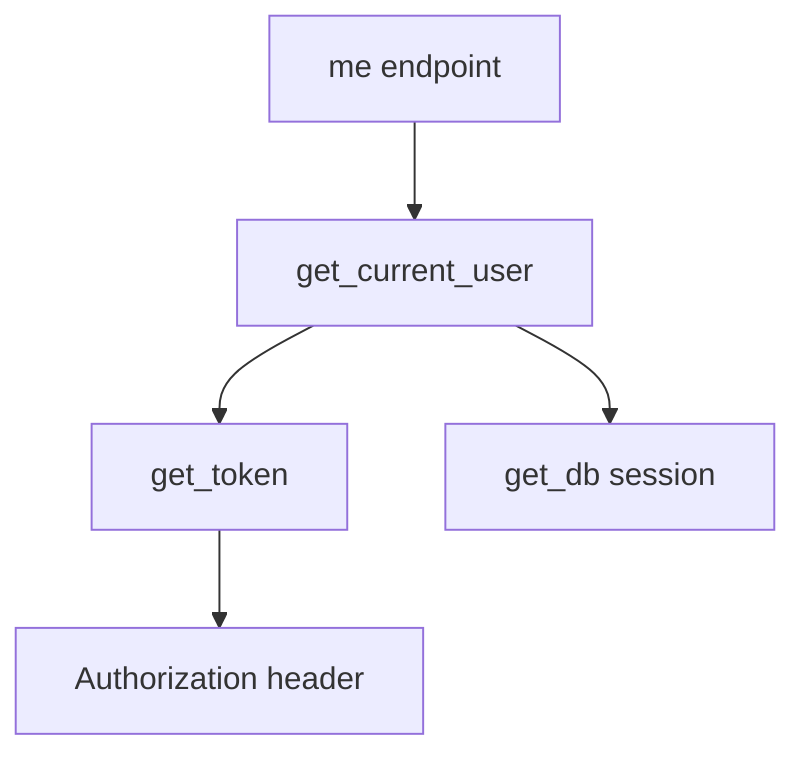

# Depends, Annotated and sub-dependencies

> **Before this lesson:** you should be able to write endpoints with path, query and header
> parameters ([lesson 4](#/lesson/fastapi/first-app), [lesson 6](#/lesson/fastapi/openapi-docs)),
> raise `HTTPException` ([lesson 5](#/lesson/fastapi/body-responses)) and know what `Annotated` does.
> In Python you need functions that take other functions as arguments, and classes with `__init__`.

## In plain words

Most endpoints need a few things before they can do their real work: a connection to the database,
the identity of the person calling, the application's settings, the page number being asked for.
Anything a piece of code needs in order to run is called a **dependency** of that code.

The direct way to get those things is for each endpoint to fetch them itself. With thirty endpoints
that is thirty copies of the same fetching code, and thirty places to make a mistake.

**Dependency injection** (often shortened to DI) turns this around. Each endpoint only *declares*
what it needs, in its parameter list, and FastAPI fetches those things and passes them in.

An everyday picture: a surgeon does not walk to the store room to collect instruments before each
operation. The surgeon's list says "scalpel, clamps, sutures", and the theatre staff lay them out,
sterilised, before the operation begins, and clear them away afterwards. The surgeon concentrates on
the operation, and the hospital can change supplier without retraining any surgeon. Your endpoint is
the surgeon; FastAPI is the theatre staff; the list is the function signature.

Why this matters for a job: dependencies are how real FastAPI projects share database sessions,
login checks and settings, and how they swap real resources for fake ones in tests. "What are
dependencies good for and how are they resolved?" is one of the most common FastAPI interview
questions.

## What is a dependency?

Lubanovic's chapter 6 gives a short definition: a dependency is specific information that your code
needs at some point. The traditional way to obtain it is to write the fetching code *inside* the
function: open a database connection, pick apart a header, read a configuration file. He lists the
problems with that:

- **Testing.** When a function fetches its own resources, a test cannot easily hand it a fake one.
- **Hidden coupling.** *Coupling* means how much one piece of code relies on the details of another.
  A function that reaches out for things on its own relies on them invisibly: nothing in its
  signature says what it needs.
- **Duplication.** The same fetching code appears in many endpoints.

With dependency injection the function *declares* what it needs and something else, the **injector**,
supplies it. In FastAPI the declaration is a parameter marked with `Depends(...)`:

```python
from typing import Annotated
from fastapi import Depends, FastAPI

app = FastAPI()

def common_parameters(q: str | None = None, skip: int = 0, limit: int = 100):
    return {"q": q, "skip": skip, "limit": limit}

@app.get("/items/")
def read_items(commons: Annotated[dict, Depends(common_parameters)]):
    return commons

@app.get("/users/")
def read_users(commons: Annotated[dict, Depends(common_parameters)]):
    return commons
```

Reading it:

- `common_parameters` is an ordinary function. It takes three values and returns them in a
  dictionary.
- In `read_items`, the parameter `commons` is annotated
  `Annotated[dict, Depends(common_parameters)]`. Read that as "a `dict`, which FastAPI obtains by
  calling `common_parameters`".
- `read_users` declares exactly the same need.

What happens for a request such as `GET /items/?skip=20`: FastAPI sees that `read_items` depends on
`common_parameters`, calls it, and passes the result to the endpoint, which returns
`{"q": null, "skip": 20, "limit": 100}`.

Four things to notice:

- **The dependency's own parameters are treated exactly like an endpoint's.** `q`, `skip` and `limit`
  become query parameters, validated and documented. A dependency may declare path, query, header,
  cookie and body parameters, the raw `Request`, and other dependencies.
- You pass the function itself, `Depends(common_parameters)`, with no brackets after its name. You
  are handing FastAPI the function to call later, not calling it now.
- FastAPI calls it once for every request and passes in ("injects") the result.
- The documentation for both endpoints shows `q`, `skip` and `limit`. The dependency's parameters are
  merged into the endpoint's.

## `Annotated` and reusable aliases

Older code writes `commons: dict = Depends(common_parameters)`, putting `Depends` where a default
value would go. The current recommended style puts `Depends` inside `Annotated`. That has two
advantages: the default-value position stays free for real defaults, and the whole annotation can be
given a name and reused:

```python
CommonsDep = Annotated[dict, Depends(common_parameters)]

@app.get("/items/")
def read_items(commons: CommonsDep): ...

@app.get("/users/")
def read_users(commons: CommonsDep): ...
```

`CommonsDep` is called a *type alias*: a short name for a longer type expression. You will see this
pattern throughout modern FastAPI code: `SessionDep`, `CurrentUser`, `SettingsDep`. The first part of
the `Annotated` (`dict`, `Session`, `User`) is there for your editor and type checker; FastAPI acts
on the `Depends(...)` part.

## Classes as dependencies

`Depends` accepts any **callable**, meaning anything that can be called with brackets. A function is
callable. So is a class: calling a class creates an instance. FastAPI looks at the parameters of the
class's `__init__` method, the method that sets up a new instance:

```python
class CommonQueryParams:
    def __init__(self, q: str | None = None, skip: int = 0, limit: int = 100):
        self.q, self.skip, self.limit = q, skip, limit

@app.get("/items/")
def read_items(commons: Annotated[CommonQueryParams, Depends()]):
    # Depends() with no argument means "use the annotated type": Depends(CommonQueryParams)
    return {"q": commons.q, "items": fake_db[commons.skip : commons.skip + commons.limit]}
```

`CommonQueryParams.__init__` takes the same three query parameters and stores them as attributes.
In the endpoint, `Depends()` with empty brackets is shorthand for "use the class named in the
annotation", that is, `Depends(CommonQueryParams)`. The advantage over a dictionary is that the
endpoint writes `commons.skip`, and the editor knows which attributes exist.

*Instances* can be callable too, when their class defines the special method `__call__`. This is
useful for dependencies that take a setting, known as **parameterised** dependencies:

```python
class RequireRole:
    def __init__(self, role: str):
        self.role = role

    def __call__(self, user: CurrentUser) -> User:     # FastAPI inspects __call__'s parameters
        if self.role not in user.roles:
            raise HTTPException(status_code=403, detail="Forbidden")
        return user

@app.delete("/items/{item_id}")
def delete_item(item_id: int, admin: Annotated[User, Depends(RequireRole("admin"))]): ...
```

`RequireRole("admin")` creates an object that remembers the role. Because the class defines
`__call__`, that object can be called like a function, and FastAPI inspects the parameters of
`__call__` (here a `CurrentUser`, a dependency defined below). If the user lacks the role, the
dependency raises `403`. One class thus yields a different check for every role name you give it.

## Sub-dependencies

A dependency can have dependencies of its own. These are **sub-dependencies**:

```python
def get_token(authorization: Annotated[str | None, Header()] = None) -> str:
    if not authorization or not authorization.startswith("Bearer "):
        raise HTTPException(401, "Not authenticated", headers={"WWW-Authenticate": "Bearer"})
    return authorization.removeprefix("Bearer ")

def get_current_user(token: Annotated[str, Depends(get_token)], db: SessionDep) -> User:
    user = db.get_user_by_token(token)
    if not user:
        raise HTTPException(401, "Invalid token")
    return user

CurrentUser = Annotated[User, Depends(get_current_user)]

@app.get("/me")
def me(user: CurrentUser):
    return user
```

- `get_token` reads the `Authorization` header. If it is missing or does not begin with `Bearer `,
  it raises `401`; otherwise it returns the token with that prefix removed.
- `get_current_user` depends on `get_token` and on a database session (`SessionDep`, defined
  elsewhere as another alias). It looks the user up and raises `401` if there is none.
- `CurrentUser` names that dependency, and the `/me` endpoint asks for it.

The endpoint asks for one thing and FastAPI works out the rest:



The arrows read "needs". The shape is a tree, or more exactly a **DAG** (directed acyclic graph):
arrows have a direction and never lead back round in a circle, though two branches may share a node.

### Caching within a request

Suppose two dependencies used in the same request both need the database session. FastAPI calls the
session dependency **once** and gives the same result to both, so the endpoint and
`get_current_user` use the *same* session. A stored result that is reused in this way is a **cache**;
this one lasts for a single request. To switch it off for one use (rarely needed), write
`Depends(dep, use_cache=False)`. The problem *Dependency Injection Resolver* asks you to implement
this ordering and caching yourself.

## How FastAPI resolves dependencies: a working model

The mechanism is less mysterious than it looks. When a route is registered, FastAPI inspects the
function's signature. For each request it then works through the graph, going as deep as possible
along each branch before backing up (this is called *depth-first*), and remembers results. Here is a
toy version that reads `Annotated` hints in the same way:

```python-run
import inspect
from typing import Annotated, get_type_hints, get_args, get_origin

class Depends:
    def __init__(self, dependency=None, use_cache=True):
        self.dependency, self.use_cache = dependency, use_cache

def solve(func, request, cache, depth=0):
    kwargs = {}
    hints = get_type_hints(func, include_extras=True)
    for name, param in inspect.signature(func).parameters.items():
        ann = hints.get(name)
        dep = None
        if get_origin(ann) is Annotated:
            base, *meta = get_args(ann)
            dep = next((m for m in meta if isinstance(m, Depends)), None)
            if dep and dep.dependency is None:      # Depends() -> use the annotated class
                dep = Depends(base, dep.use_cache)
        if dep:
            fn = dep.dependency
            if dep.use_cache and fn in cache:
                print("  " * depth + f"(cached) {fn.__name__}")
                kwargs[name] = cache[fn]
                continue
            value = solve(fn, request, cache, depth + 1)
            print("  " * depth + f"called {fn.__name__}")
            if dep.use_cache:
                cache[fn] = value
            kwargs[name] = value
        else:  # plain parameter: read it from the 'request' (query params here)
            raw = request.get(name, param.default)
            kwargs[name] = ann(raw) if ann in (int, float, str) and raw is not None else raw
    return func(**kwargs)

# --- dependencies ---
def get_settings():
    return {"db_url": "sqlite://"}

def get_db(settings: Annotated[dict, Depends(get_settings)]):
    return f"Session({settings['db_url']})"

def get_user(db: Annotated[str, Depends(get_db)], token: str = None):
    return {"name": "ann", "via": db, "token": token}

class Pagination:
    def __init__(self, skip: int = 0, limit: int = 10):
        self.skip, self.limit = skip, limit

def endpoint(user: Annotated[dict, Depends(get_user)],
             db: Annotated[str, Depends(get_db)],
             page: Annotated[Pagination, Depends()]):
    return {"user": user["name"], "same_session": user["via"] == db, "skip": page.skip, "limit": page.limit}

print(solve(endpoint, {"token": "abc", "skip": "20"}, cache={}))
```

How to read the toy:

- `Depends` is a small class holding the function to call and the cache switch.
- `solve(func, request, cache)` produces the arguments for `func` and then calls it. For each
  parameter it reads the hint. If the hint is `Annotated[..., Depends(...)]`, the parameter is a
  dependency; otherwise it is a plain value read from the `request` dictionary (playing the query
  string) and converted to the hinted type.
- For a dependency, `solve` first checks the cache. If the function has already run during this
  request it prints `(cached)` and reuses the result. Otherwise it calls `solve` *on the dependency
  itself*, which is how sub-dependencies get resolved, and stores the result.
- At the bottom are three dependency functions, a class dependency and an endpoint that needs a
  user, a database session and pagination.

The printed trace shows the order of work. To build `user`, `solve` needs `get_user`, which needs
`get_db`, which needs `get_settings`. The deepest is called first, so the lines read
`called get_settings`, `called get_db`, `called get_user`, indented by depth. Next the endpoint's own
`db` parameter is resolved, and the line `(cached) get_db` appears: the function is not run again.
Finally `Pagination` is called. The result is
`{'user': 'ann', 'same_session': True, 'skip': 20, 'limit': 10}`: `same_session` is true because of
the cache, and `skip` arrived as the number 20 from the text `"20"`.

Real FastAPI does the signature analysis once at start-up, validates with Pydantic, supports `async`
dependencies, and handles dependencies with clean-up code (next lesson).

## Dependency scope: where dependencies apply

The book's "Dependency Scope" section shows three levels at which a dependency can be attached.

**One path.** As a parameter, as above. Or, when you want the dependency to run but have no use for
its return value, list it in the decorator:

```python
async def verify_key(x_key: Annotated[str, Header()]):
    if x_key != "fake-super-secret-key":
        raise HTTPException(status_code=400, detail="X-Key header invalid")

@app.get("/items/", dependencies=[Depends(verify_key)])
def read_items(): ...
```

`verify_key` checks a header and raises an error if it is wrong; it returns nothing useful.
`dependencies=[Depends(verify_key)]` makes it run before `read_items` anyway.

**A group of paths.** On a router (a group of routes, lesson 14), where it applies to every route in
the group:

```python
router = APIRouter(prefix="/admin", dependencies=[Depends(require_admin)])
```

**Every path.** On the app itself:

```python
app = FastAPI(dependencies=[Depends(verify_key)])
```

Dependencies listed in `dependencies=[...]` run for their **side effects**, meaning what they *do*
as opposed to what they return: checking input, raising 401 or 403, logging, counting requests. Their
return values are thrown away.

## `async def` or `def` dependencies?

The rule is the same as for endpoints (lesson 4): `async def` dependencies run on the event loop and
`def` dependencies run in the thread pool. They can be mixed freely; a `def` endpoint may depend on
an `async def` dependency and the reverse. Use `async def` only when you `await` something inside, or
when the work is trivial and does no blocking input/output. Otherwise a blocking call would stall the
loop for every request.

> [!INTERVIEW]
> "What are FastAPI dependencies good for, and how are they resolved?" — Sharing logic (login checks,
> database sessions, pagination, settings), enforcing preconditions (raising 401/403 before the
> endpoint runs), managing resources (set-up and clean-up with `yield`), and testability
> (`app.dependency_overrides`). FastAPI builds a graph from the `Depends` declarations at start-up;
> for each request it resolves the graph depth-first, calls each dependency at most once (cached per
> request unless `use_cache=False`), merges their parameters into the endpoint's validation and
> documentation, and passes the results in as arguments.

## Worked example: the dependency stack of a real endpoint

Here is the kind of dependency module that almost every production FastAPI service ends up with.
Several pieces belong to later lessons (database sessions in lessons 11 and 16, tokens in lesson
19); read it for the *structure*. Each numbered block builds on the ones above it.

```python
# app/deps.py
from typing import Annotated
from fastapi import Depends, Header, HTTPException, Query, Request, status

# --- 1. configuration ------------------------------------------------------------
SettingsDep = Annotated[Settings, Depends(get_settings)]

# --- 2. per-request resources ----------------------------------------------------
def get_session(request: Request):
    with Session(request.app.state.engine) as session:
        yield session

SessionDep = Annotated[Session, Depends(get_session)]

# --- 3. identity -----------------------------------------------------------------
def get_token(authorization: Annotated[str | None, Header()] = None) -> str:
    scheme, _, token = (authorization or "").partition(" ")
    if scheme.lower() != "bearer" or not token:
        raise HTTPException(status.HTTP_401_UNAUTHORIZED, "Not authenticated",
                            headers={"WWW-Authenticate": "Bearer"})
    return token

def get_current_user(token: Annotated[str, Depends(get_token)],
                     session: SessionDep, settings: SettingsDep) -> User:
    user_id = decode_token(token, settings.secret_key)            # raises 401 on bad token
    user = session.get(User, user_id)
    if user is None or not user.is_active:
        raise HTTPException(status.HTTP_401_UNAUTHORIZED, "Invalid credentials")
    return user

CurrentUser = Annotated[User, Depends(get_current_user)]

# --- 4. authorization, parameterised --------------------------------------------
def require_role(role: str):
    def checker(user: CurrentUser) -> User:
        if role not in user.roles:
            raise HTTPException(status.HTTP_403_FORBIDDEN, "Not enough permissions")
        return user
    return checker

AdminUser = Annotated[User, Depends(require_role("admin"))]

# --- 5. reusable request shapes --------------------------------------------------
class Page:
    def __init__(self, limit: Annotated[int, Query(ge=1, le=100)] = 20,
                 offset: Annotated[int, Query(ge=0)] = 0):
        self.limit, self.offset = limit, offset

PageDep = Annotated[Page, Depends()]

# --- 6. loading a resource or 404 ------------------------------------------------
def get_order_or_404(order_id: int, session: SessionDep, user: CurrentUser) -> Order:
    order = session.get(Order, order_id)
    if order is None or order.owner_id != user.id:
        raise HTTPException(status.HTTP_404_NOT_FOUND, "Order not found")
    return order

OrderDep = Annotated[Order, Depends(get_order_or_404)]
```

Block by block:

1. **Configuration.** `SettingsDep` is the settings dependency from lesson 9.
2. **Per-request resources.** `get_session` opens a database session and hands it over with `yield`
   (a form explained in the next lesson; for now, "provides the session, then closes it afterwards").
3. **Identity.** `get_token` extracts the token from the `Authorization` header or raises 401.
   `get_current_user` turns the token into a user, using the session and the settings.
4. **Authorization** (what the user may do). `require_role("admin")` returns a dependency that checks
   for a role and raises 403.
5. **Reusable request shapes.** `Page` bundles `limit` and `offset` with their limits.
6. **Load or 404.** `get_order_or_404` fetches an order and raises 404 if it does not exist *or*
   belongs to another user.

With that module in place, endpoints become short statements of intent:

```python
@router.get("/orders", response_model=list[OrderPublic])
def list_orders(user: CurrentUser, page: PageDep, session: SessionDep): ...

@router.get("/orders/{order_id}", response_model=OrderPublic)
def read_order(order: OrderDep):
    return order                                   # existence AND ownership already verified

@router.delete("/orders/{order_id}", status_code=204)
def delete_order(order: OrderDep, session: SessionDep):
    session.delete(order); session.commit()

@router.get("/admin/stats")
def stats(admin: AdminUser, session: SessionDep): ...
```

Trace `GET /orders/9` with a valid token belonging to user 7:

1. FastAPI sees that `read_order` needs `get_order_or_404`, which needs `order_id` (from the path),
   `get_session` and `get_current_user`. The latter needs `get_token`, `get_session` and
   `get_settings`.
2. Each is resolved depth-first and called once: `get_session`, `get_token`, `get_settings`,
   `get_current_user`, `get_order_or_404`, and then the endpoint. One session serves both the user
   lookup and the order lookup, thanks to the per-request cache.
3. If the `Authorization` header is missing, `get_token` raises 401 and **nothing further runs**: no
   database query for the order, no endpoint code.
4. If order 9 belongs to someone else, the dependency raises 404 (not 403, so that the order's
   existence is not revealed).
5. After the response, the clean-up part of `get_session` closes the session.

Notice that `get_order_or_404` declares the path parameter `order_id` itself. A dependency may
declare a path parameter of the route it is used on. This "load it or answer 404, and check the
owner" dependency removes the five most-repeated lines in CRUD code, and makes it much harder to
forget the ownership check.

### Two styles of parameterised dependency

`require_role("admin")` above is a **closure**: an outer function receives the argument and returns
an inner function that remembers it. The class version shown earlier (`RequireRole("admin")` with
`__call__`) does the same job. One subtlety: every call to `require_role("admin")` creates a *new*
function object, and both the per-request cache and `dependency_overrides` identify a dependency by
the function object. So create each variant once and reuse it, which is exactly what the `AdminUser`
alias does.

## Dependency or something else?

| Mechanism | Lifetime | Typical contents |
|---|---|---|
| Module-level constant | process, created at import | pure configuration-free helpers |
| **Lifespan + `app.state`** | process, created at startup | engine/pool, HTTP client, ML model |
| **Dependency** | one request | session, current user, parsed parameters, permission checks |
| Middleware | every request, untyped | request IDs, timing, CORS |
| Plain function call | wherever you call it | logic that needs no request data |

A helpful test: *does it need something from the request, or need clean-up after each request, or
need to be replaced in tests?* If yes, make it a dependency. If it is a calculation on values you
already hold, call an ordinary function. Not everything needs to be injected.

## Debugging dependency problems

| Symptom | Cause |
|---|---|
| Unexpected `422` naming a field you never declared on the endpoint | a dependency declares that parameter; look at `loc` and search your dependencies |
| A dependency parameter is treated as a query parameter instead of being injected | missing `Depends` — a bare `session: Session` is not a dependency |
| The dependency runs twice per request | two *different* callables (e.g. `require_role("admin")` created twice), or `use_cache=False` |
| `dependency_overrides` has no effect | the key isn't the same object the route references (a re-created closure, a `functools.partial`, an import of a different function) |
| `RuntimeError` about generators or "no response returned" | a `yield` dependency swallowing an exception or yielding twice |
| Startup error "Invalid args for response field" | the dependency's *return* type isn't the issue — a route return annotation is; use `response_model=None` |
| Slow health checks | an expensive global dependency also applies to `/health` |

To see what a route will resolve, look at `route.dependant.dependencies` on any `APIRoute` in
`app.routes`. It lists the callables FastAPI discovered, and each entry has its own list in turn.

## Pitfalls

- `Depends(get_db())`: calling the function instead of passing it.
- Heavy work in a dependency that is attached globally. It runs for *every* request, health checks
  included.
- Blocking input/output in an `async def` dependency.
- Expecting a dependency's result to survive *between* requests. It exists for one request. Objects
  that should live for the whole run of the program (a model, an HTTP client, a pool of database
  connections) belong in the lifespan and `app.state`.
- Circular dependencies (A needs B, B needs A). FastAPI fails with a recursion error.

## Summary

- `Depends(callable)` declares a dependency; FastAPI calls it for each request and injects the result.
- Dependencies declare their own parameters (query, headers, other dependencies), which are merged
  into validation and documentation.
- `Annotated[T, Depends(f)]` aliases (`SessionDep`, `CurrentUser`) keep signatures short and consistent.
- Classes and callable instances work as dependencies (the `Depends()` shorthand, parameterised
  checks).
- Sub-dependency results are cached per request; attach dependencies to one path, a router or the
  whole app.

## Glossary

- **Dependency** — something a piece of code needs in order to run.
- **Dependency injection (DI)** — code declares what it needs and a framework supplies it.
- **Injector** — the part that supplies dependencies; here, FastAPI.
- **`Depends`** — the marker that declares a parameter to be a dependency.
- **Callable** — anything that can be called with brackets: a function, a class, an object with
  `__call__`.
- **Coupling** — how much one piece of code relies on the details of another.
- **Type alias** — a short name for a longer type, such as `SessionDep`.
- **Sub-dependency** — a dependency of a dependency.
- **DAG** — a directed acyclic graph: arrows with direction and no cycles.
- **Depth-first** — following one branch to its end before starting the next.
- **Per-request cache** — a dependency runs at most once per request and its result is shared.
- **Parameterised dependency** — a dependency built from an argument, such as `require_role("admin")`.
- **Closure** — an inner function that remembers values from the function that created it.
- **Side effect** — something a function does beyond returning a value.
- **Scope** — where a dependency applies: one path, a router, or the whole app.

```quiz
[
  {"q": "What is wrong with 'db: Session = Depends(get_db())'?", "options": ["Nothing", "It calls get_db at import time instead of passing the callable to FastAPI", "Depends must be in a decorator", "Session is not a valid type"], "answer": 1,
   "explain": "Depends expects the callable itself; FastAPI calls it per request."},
  {"q": "A dependency function declares 'limit: int = 10'. Where does limit come from?", "options": ["It is always 10", "A query parameter of the request, validated and documented", "An environment variable", "The response"], "answer": 1,
   "explain": "Dependencies' parameters are resolved like endpoint parameters and appear in the endpoint's OpenAPI docs."},
  {"q": "Both get_current_user and the endpoint depend on get_db. How many times is get_db called per request by default?", "options": ["Twice", "Once - the result is cached and shared", "Zero", "Once per worker process"], "answer": 1,
   "explain": "FastAPI caches dependency results per request unless use_cache=False."},
  {"q": "What does 'commons: Annotated[CommonQueryParams, Depends()]' mean?", "options": ["No dependency", "Use the annotated class CommonQueryParams as the dependency", "Inject the request", "Depend on all classes"], "answer": 1,
   "explain": "Depends() without arguments uses the type in Annotated as the callable."},
  {"q": "You need an API-key check on every route under /admin but don't need its return value. Best option?", "options": ["Copy the check into every endpoint", "APIRouter(prefix='/admin', dependencies=[Depends(check_key)])", "A Pydantic validator", "A global variable"], "answer": 1,
   "explain": "Router-level dependencies run for every route in the router, for their side effects."},
  {"q": "Which object should NOT be created in a per-request dependency?", "options": ["A DB session", "The current user", "A large ML model loaded from disk", "Pagination parameters"], "answer": 2,
   "explain": "Dependencies run per request; expensive long-lived resources belong in the lifespan and app.state."}
]
```

> **Source:** Lubanovic, *FastAPI*, ch. 6 "Dependencies" (What's a Dependency?, Problems with Dependencies, Dependency Injection, FastAPI Dependencies, Dependency Scope); https://fastapi.tiangolo.com/tutorial/dependencies/, /tutorial/dependencies/classes-as-dependencies/, /tutorial/dependencies/sub-dependencies/, /tutorial/dependencies/dependencies-in-path-operation-decorators/, /tutorial/dependencies/global-dependencies/, /advanced/advanced-dependencies/
