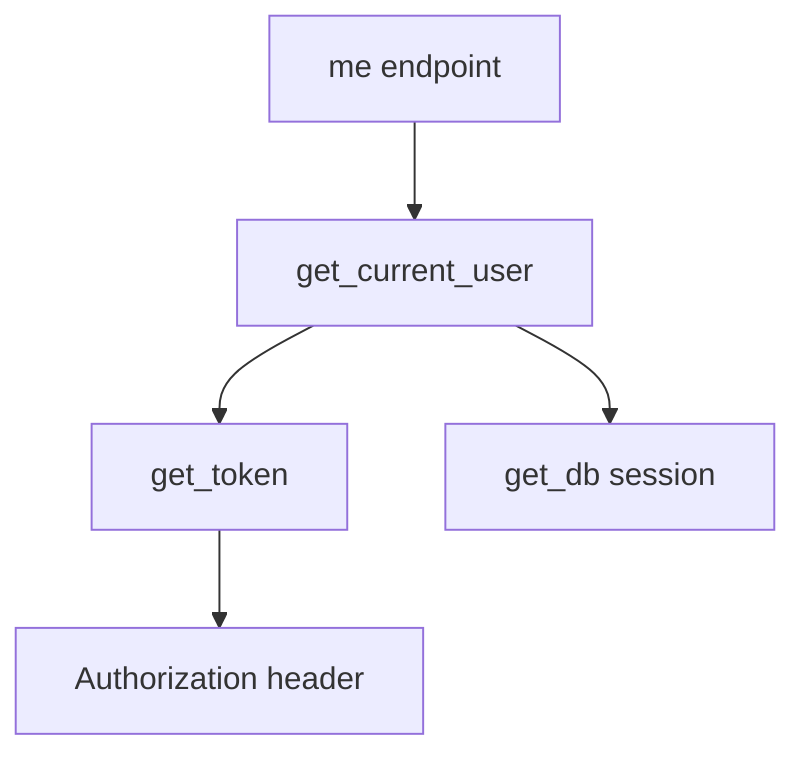

# Depends, Annotated and sub-dependencies

FastAPI's **dependency injection** (DI) system is the feature that scales your app from a toy to a real
service. Database sessions, the current user, settings, pagination parameters, rate limits, feature flags —
anything that several endpoints need, that you want to test in isolation, or that needs setup and teardown,
becomes a dependency.

## What is a dependency?

Lubanovic's chapter 6 defines it simply: a dependency is specific information you need at some point in
your code. The traditional way to get it is to write code that fetches it *inside* the function — open a
DB connection, parse a header, read a config file. The problems he lists:

- **Testing**: you can't easily substitute a fake when the function fetches its own resources.
- **Hidden coupling**: the function's signature doesn't reveal what it needs.
- **Duplication**: the same fetching code appears in many endpoints.

**Dependency injection** inverts this: the function *declares* what it needs, and something else (the
"injector") supplies it. In FastAPI, the declaration is a parameter with `Depends(...)`:

```python
from typing import Annotated
from fastapi import Depends, FastAPI

app = FastAPI()

def common_parameters(q: str | None = None, skip: int = 0, limit: int = 100):
    return {"q": q, "skip": skip, "limit": limit}

@app.get("/items/")
def read_items(commons: Annotated[dict, Depends(common_parameters)]):
    return commons

@app.get("/users/")
def read_users(commons: Annotated[dict, Depends(common_parameters)]):
    return commons
```

Things to notice:

- `common_parameters` is an ordinary function. **Its own parameters are resolved exactly like an
  endpoint's**: `q`, `skip`, `limit` become query parameters, validated and documented. A dependency can
  declare path, query, header, cookie and body parameters, `Request`, and other dependencies.
- You pass the function itself (`Depends(common_parameters)`), not a call.
- FastAPI calls it per request and injects the result.
- Both endpoints' OpenAPI docs show `q`, `skip`, `limit` — the dependency's parameters are merged into the
  endpoint's signature.

## `Annotated` and reusable aliases

Older code writes `commons: dict = Depends(common_parameters)`. The modern, recommended style puts
`Depends` inside `Annotated`, which has two advantages: the default slot stays free, and you can name the
whole thing once:

```python
CommonsDep = Annotated[dict, Depends(common_parameters)]

@app.get("/items/")
def read_items(commons: CommonsDep): ...

@app.get("/users/")
def read_users(commons: CommonsDep): ...
```

You'll see this pattern everywhere in modern FastAPI codebases: `SessionDep`, `CurrentUser`,
`SettingsDep`. The type part (`dict`, `Session`, `User`) is just for your editor and type checker —
FastAPI uses the `Depends(...)` part.

## Classes as dependencies

`Depends` accepts any **callable**. A class is callable (calling it creates an instance), and FastAPI
inspects its `__init__` parameters:

```python
class CommonQueryParams:
    def __init__(self, q: str | None = None, skip: int = 0, limit: int = 100):
        self.q, self.skip, self.limit = q, skip, limit

@app.get("/items/")
def read_items(commons: Annotated[CommonQueryParams, Depends()]):
    # Depends() with no argument means "use the annotated type": Depends(CommonQueryParams)
    return {"q": commons.q, "items": fake_db[commons.skip : commons.skip + commons.limit]}
```

Benefits over a dict: attribute access and editor completion. Callable *instances* also work — useful for
**parameterised** dependencies:

```python
class RequireRole:
    def __init__(self, role: str):
        self.role = role

    def __call__(self, user: CurrentUser) -> User:     # FastAPI inspects __call__'s parameters
        if self.role not in user.roles:
            raise HTTPException(status_code=403, detail="Forbidden")
        return user

@app.delete("/items/{item_id}")
def delete_item(item_id: int, admin: Annotated[User, Depends(RequireRole("admin"))]): ...
```

## Sub-dependencies

Dependencies can depend on other dependencies, forming a tree (more precisely a DAG):

```python
def get_token(authorization: Annotated[str | None, Header()] = None) -> str:
    if not authorization or not authorization.startswith("Bearer "):
        raise HTTPException(401, "Not authenticated", headers={"WWW-Authenticate": "Bearer"})
    return authorization.removeprefix("Bearer ")

def get_current_user(token: Annotated[str, Depends(get_token)], db: SessionDep) -> User:
    user = db.get_user_by_token(token)
    if not user:
        raise HTTPException(401, "Invalid token")
    return user

CurrentUser = Annotated[User, Depends(get_current_user)]

@app.get("/me")
def me(user: CurrentUser):
    return user
```



### Caching within a request

If several dependencies in the same request depend on the same sub-dependency (say, `get_db`), FastAPI
calls it **once** and shares the result — so the endpoint and `get_current_user` use the *same* DB session.
To opt out (rare), use `Depends(dep, use_cache=False)`. The problem *Dependency Injection Resolver* asks you
to implement exactly this ordering and caching.

## How FastAPI resolves dependencies: a working model

The mechanism is less magical than it looks. At route registration, FastAPI inspects the signature; for
each request, it resolves the graph depth-first, caching results. Here is a toy implementation using
`Annotated` metadata:

```python-run
import inspect
from typing import Annotated, get_type_hints, get_args, get_origin

class Depends:
    def __init__(self, dependency=None, use_cache=True):
        self.dependency, self.use_cache = dependency, use_cache

def solve(func, request, cache, depth=0):
    kwargs = {}
    hints = get_type_hints(func, include_extras=True)
    for name, param in inspect.signature(func).parameters.items():
        ann = hints.get(name)
        dep = None
        if get_origin(ann) is Annotated:
            base, *meta = get_args(ann)
            dep = next((m for m in meta if isinstance(m, Depends)), None)
            if dep and dep.dependency is None:      # Depends() -> use the annotated class
                dep = Depends(base, dep.use_cache)
        if dep:
            fn = dep.dependency
            if dep.use_cache and fn in cache:
                print("  " * depth + f"(cached) {fn.__name__}")
                kwargs[name] = cache[fn]
                continue
            value = solve(fn, request, cache, depth + 1)
            print("  " * depth + f"called {fn.__name__}")
            if dep.use_cache:
                cache[fn] = value
            kwargs[name] = value
        else:  # plain parameter: read it from the 'request' (query params here)
            raw = request.get(name, param.default)
            kwargs[name] = ann(raw) if ann in (int, float, str) and raw is not None else raw
    return func(**kwargs)

# --- dependencies ---
def get_settings():
    return {"db_url": "sqlite://"}

def get_db(settings: Annotated[dict, Depends(get_settings)]):
    return f"Session({settings['db_url']})"

def get_user(db: Annotated[str, Depends(get_db)], token: str = None):
    return {"name": "ann", "via": db, "token": token}

class Pagination:
    def __init__(self, skip: int = 0, limit: int = 10):
        self.skip, self.limit = skip, limit

def endpoint(user: Annotated[dict, Depends(get_user)],
             db: Annotated[str, Depends(get_db)],
             page: Annotated[Pagination, Depends()]):
    return {"user": user["name"], "same_session": user["via"] == db, "skip": page.skip, "limit": page.limit}

print(solve(endpoint, {"token": "abc", "skip": "20"}, cache={}))
```

`get_db` runs once even though both `get_user` and the endpoint ask for it, and the class `Pagination`
pulls `skip`/`limit` from the "query". Real FastAPI does the analysis once at startup, validates with
Pydantic, supports async dependencies, and handles `yield` (next lesson).

## Dependency scope: where dependencies apply

The book's "Dependency Scope" section shows three levels:

**Single path** — a parameter, as above. Or, when you need the side effect but not the value, the decorator:

```python
async def verify_key(x_key: Annotated[str, Header()]):
    if x_key != "fake-super-secret-key":
        raise HTTPException(status_code=400, detail="X-Key header invalid")

@app.get("/items/", dependencies=[Depends(verify_key)])
def read_items(): ...
```

**Multiple paths** — on a router, applying to every route in it:

```python
router = APIRouter(prefix="/admin", dependencies=[Depends(require_admin)])
```

**Global** — on the app, applying to every route:

```python
app = FastAPI(dependencies=[Depends(verify_key)])
```

Dependencies in `dependencies=[...]` run for their side effects (validation, raising 401/403, logging,
rate-limiting); their return values are discarded.

## `async def` or `def` dependencies?

Same rule as endpoints: `async def` dependencies run on the event loop; `def` dependencies run in the
thread pool. You can mix them freely — a `def` endpoint can depend on an `async def` dependency and vice
versa. Use `async def` only if you `await` something inside, or if the work is trivial (no blocking I/O);
otherwise a blocking call would stall the loop.

> [!INTERVIEW]
> "What are FastAPI dependencies good for, and how are they resolved?" — Sharing logic (auth, DB sessions,
> pagination, settings), enforcing preconditions (raising 401/403 before the endpoint runs), managing
> resources (setup/teardown with `yield`), and testability (`app.dependency_overrides`). FastAPI builds a
> graph from `Depends` declarations at startup; per request it resolves it depth-first, calls each
> dependency at most once (cached per request unless `use_cache=False`), merges their parameters into the
> endpoint's validation and OpenAPI docs, and injects results as arguments.

## Worked example: the dependency stack of a real endpoint

Here is the kind of dependency module almost every production FastAPI service ends up with. Read it
bottom-up: each alias builds on the ones above it.

```python
# app/deps.py
from typing import Annotated
from fastapi import Depends, Header, HTTPException, Query, Request, status

# --- 1. configuration ------------------------------------------------------------
SettingsDep = Annotated[Settings, Depends(get_settings)]

# --- 2. per-request resources ----------------------------------------------------
def get_session(request: Request):
    with Session(request.app.state.engine) as session:
        yield session

SessionDep = Annotated[Session, Depends(get_session)]

# --- 3. identity -----------------------------------------------------------------
def get_token(authorization: Annotated[str | None, Header()] = None) -> str:
    scheme, _, token = (authorization or "").partition(" ")
    if scheme.lower() != "bearer" or not token:
        raise HTTPException(status.HTTP_401_UNAUTHORIZED, "Not authenticated",
                            headers={"WWW-Authenticate": "Bearer"})
    return token

def get_current_user(token: Annotated[str, Depends(get_token)],
                     session: SessionDep, settings: SettingsDep) -> User:
    user_id = decode_token(token, settings.secret_key)            # raises 401 on bad token
    user = session.get(User, user_id)
    if user is None or not user.is_active:
        raise HTTPException(status.HTTP_401_UNAUTHORIZED, "Invalid credentials")
    return user

CurrentUser = Annotated[User, Depends(get_current_user)]

# --- 4. authorization, parameterised --------------------------------------------
def require_role(role: str):
    def checker(user: CurrentUser) -> User:
        if role not in user.roles:
            raise HTTPException(status.HTTP_403_FORBIDDEN, "Not enough permissions")
        return user
    return checker

AdminUser = Annotated[User, Depends(require_role("admin"))]

# --- 5. reusable request shapes --------------------------------------------------
class Page:
    def __init__(self, limit: Annotated[int, Query(ge=1, le=100)] = 20,
                 offset: Annotated[int, Query(ge=0)] = 0):
        self.limit, self.offset = limit, offset

PageDep = Annotated[Page, Depends()]

# --- 6. loading a resource or 404 ------------------------------------------------
def get_order_or_404(order_id: int, session: SessionDep, user: CurrentUser) -> Order:
    order = session.get(Order, order_id)
    if order is None or order.owner_id != user.id:
        raise HTTPException(status.HTTP_404_NOT_FOUND, "Order not found")
    return order

OrderDep = Annotated[Order, Depends(get_order_or_404)]
```

With that in place endpoints become declarations of intent:

```python
@router.get("/orders", response_model=list[OrderPublic])
def list_orders(user: CurrentUser, page: PageDep, session: SessionDep): ...

@router.get("/orders/{order_id}", response_model=OrderPublic)
def read_order(order: OrderDep):
    return order                                   # existence AND ownership already verified

@router.delete("/orders/{order_id}", status_code=204)
def delete_order(order: OrderDep, session: SessionDep):
    session.delete(order); session.commit()

@router.get("/admin/stats")
def stats(admin: AdminUser, session: SessionDep): ...
```

Trace `GET /orders/9` with a valid token belonging to user 7:

1. FastAPI sees `read_order` needs `get_order_or_404`, which needs `order_id` (path), `get_session` and
   `get_current_user`; the latter needs `get_token`, `get_session` and `get_settings`.
2. Resolution order (depth-first, each once): `get_session` → `get_token` → `get_settings` →
   `get_current_user` → `get_order_or_404` → endpoint. The single session is shared by the user lookup
   and the order lookup because of per-request caching.
3. If the `Authorization` header is missing, `get_token` raises 401 and **nothing further runs** — no
   database query for the order, no endpoint code.
4. If order 9 belongs to someone else, the dependency raises 404 (not 403, so its existence isn't
   revealed).
5. After the response, `get_session`'s cleanup closes the session.

Notice `get_order_or_404` uses the path parameter `order_id` itself: a dependency may declare a path
parameter of the route it is used on. This "load or 404, with ownership check" dependency removes the
most-duplicated five lines in CRUD code and makes forgetting the ownership check structurally harder.

### Two styles of parameterised dependency

`require_role("admin")` above is a **closure**: an outer function captures the argument and returns the
real dependency. The class version from earlier (`RequireRole("admin")` with `__call__`) is equivalent.
A subtlety: every call to `require_role("admin")` creates a *new* function object, and the per-request
cache and `dependency_overrides` are keyed by the callable. So create each variant once and reuse it —
which is exactly what the `AdminUser` alias does.

## Dependency or something else?

| Mechanism | Lifetime | Typical contents |
|---|---|---|
| Module-level constant | process, created at import | pure configuration-free helpers |
| **Lifespan + `app.state`** | process, created at startup | engine/pool, HTTP client, ML model |
| **Dependency** | one request | session, current user, parsed parameters, permission checks |
| Middleware | every request, untyped | request IDs, timing, CORS |
| Plain function call | wherever you call it | logic that needs no request data |

A helpful test: *does it need something from the request, or need cleanup per request, or need to be
swapped in tests?* If yes, make it a dependency. If it is just a computation on values you already have,
call a normal function — not everything needs to be injected.

## Debugging dependency problems

| Symptom | Cause |
|---|---|
| Unexpected `422` naming a field you never declared on the endpoint | a dependency declares that parameter; look at `loc` and search your dependencies |
| A dependency parameter is treated as a query parameter instead of being injected | missing `Depends` — a bare `session: Session` is not a dependency |
| The dependency runs twice per request | two *different* callables (e.g. `require_role("admin")` created twice), or `use_cache=False` |
| `dependency_overrides` has no effect | the key isn't the same object the route references (a re-created closure, a `functools.partial`, an import of a different function) |
| `RuntimeError` about generators or "no response returned" | a `yield` dependency swallowing an exception or yielding twice |
| Startup error "Invalid args for response field" | the dependency's *return* type isn't the issue — a route return annotation is; use `response_model=None` |
| Slow health checks | an expensive global dependency also applies to `/health` |

To see what a route will resolve, inspect its dependant tree: `route.dependant.dependencies` on any
`APIRoute` in `app.routes` lists the callables FastAPI discovered, recursively.

## Pitfalls

- `Depends(get_db())` — calling the function instead of passing it.
- Heavy work in a dependency used globally (it runs for *every* request, including health checks).
- Blocking I/O in an `async def` dependency.
- Expecting a dependency result to persist *across* requests — it's per request. Long-lived objects
  (model, HTTP client, connection pool) belong in the lifespan / `app.state`.
- Circular dependencies (A depends on B depends on A) — FastAPI fails with a recursion error.

## Summary

- `Depends(callable)` declares a dependency; FastAPI calls it per request and injects the result.
- Dependencies declare their own parameters (query, headers, other dependencies) — they're merged into
  validation and docs.
- `Annotated[T, Depends(f)]` aliases (`SessionDep`, `CurrentUser`) keep signatures short and consistent.
- Classes and callable instances work as dependencies (`Depends()` shorthand, parameterised checks).
- Sub-dependency results are cached per request; scope dependencies to a path, router or the whole app.

```quiz
[
  {"q": "What is wrong with 'db: Session = Depends(get_db())'?", "options": ["Nothing", "It calls get_db at import time instead of passing the callable to FastAPI", "Depends must be in a decorator", "Session is not a valid type"], "answer": 1,
   "explain": "Depends expects the callable itself; FastAPI calls it per request."},
  {"q": "A dependency function declares 'limit: int = 10'. Where does limit come from?", "options": ["It is always 10", "A query parameter of the request, validated and documented", "An environment variable", "The response"], "answer": 1,
   "explain": "Dependencies' parameters are resolved like endpoint parameters and appear in the endpoint's OpenAPI docs."},
  {"q": "Both get_current_user and the endpoint depend on get_db. How many times is get_db called per request by default?", "options": ["Twice", "Once - the result is cached and shared", "Zero", "Once per worker process"], "answer": 1,
   "explain": "FastAPI caches dependency results per request unless use_cache=False."},
  {"q": "What does 'commons: Annotated[CommonQueryParams, Depends()]' mean?", "options": ["No dependency", "Use the annotated class CommonQueryParams as the dependency", "Inject the request", "Depend on all classes"], "answer": 1,
   "explain": "Depends() without arguments uses the type in Annotated as the callable."},
  {"q": "You need an API-key check on every route under /admin but don't need its return value. Best option?", "options": ["Copy the check into every endpoint", "APIRouter(prefix='/admin', dependencies=[Depends(check_key)])", "A Pydantic validator", "A global variable"], "answer": 1,
   "explain": "Router-level dependencies run for every route in the router, for their side effects."},
  {"q": "Which object should NOT be created in a per-request dependency?", "options": ["A DB session", "The current user", "A large ML model loaded from disk", "Pagination parameters"], "answer": 2,
   "explain": "Dependencies run per request; expensive long-lived resources belong in the lifespan and app.state."}
]
```

> **Source:** Lubanovic, *FastAPI*, ch. 6 "Dependencies" (What's a Dependency?, Problems with Dependencies, Dependency Injection, FastAPI Dependencies, Dependency Scope); https://fastapi.tiangolo.com/tutorial/dependencies/, /tutorial/dependencies/classes-as-dependencies/, /tutorial/dependencies/sub-dependencies/, /tutorial/dependencies/dependencies-in-path-operation-decorators/, /tutorial/dependencies/global-dependencies/, /advanced/advanced-dependencies/
