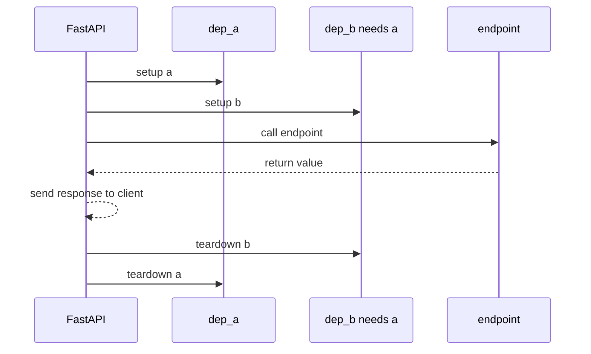

# Yield dependencies, scopes and test overrides

> **Before this lesson:** you should be able to declare a dependency with `Depends`, build an alias
> such as `SessionDep`, and explain per-request caching, all from
> [lesson 10](#/lesson/fastapi/depends-basics). In Python you need `try` / `except` / `finally`. The
> keywords `yield` and `with` are explained here from the beginning.

## In plain words

Some of the things an endpoint needs are plain values: a page number, the current user's name.
Others are **resources**: things that must be opened before use and closed after it. A database
connection is the standard example. Others are a file, a lock, or a temporary folder. If your program
borrows such a thing and forgets to give it back, it eventually runs out, and the server stops
answering.

An everyday picture: borrowing a book from a library. There is a step before reading (check it out)
and a step after reading (bring it back), and the second step must happen *even if* you gave up
half-way through the book. The risk is always the forgotten return.

FastAPI lets one dependency function contain both steps. The part before a special keyword, `yield`,
is the checking-out; the part after it is the bringing-back; and FastAPI guarantees the second part
runs. This lesson covers exactly how that works (a favourite area for interviewers), and then the
other great benefit of dependency injection: **swapping a dependency for a fake one in tests**.

Why this matters for a job: every database-backed FastAPI service uses this pattern for its sessions,
and misunderstanding *when* the clean-up runs causes real bugs, such as telling a client "saved"
before the save has actually succeeded.

## Three pieces of Python first

**`try` / `finally`.** Code in a `finally` block runs whether the `try` block finished normally or
raised an error. It is Python's "no matter what" clause.

**`with`.** A `with` block is a shorter way to write "set up, use, always clean up". An object that
can be used this way is called a **context manager**. `with open("f.txt") as f:` opens the file, lets
you use it, and closes it at the end of the block, error or not.

**`yield`.** A function containing `yield` is a **generator**: a function that can pause. When it
reaches `yield x` it hands `x` to whoever is using it and stops right there, keeping its place. Later
it can be resumed and continues from the line after the `yield`.

Put together: a generator that yields exactly once splits naturally into "before the pause" and
"after the pause", which is the shape of set-up and clean-up.

## A dependency with `yield`

```python
def get_db():
    db = SessionLocal()        # setup: runs before the endpoint
    try:
        yield db               # the yielded value is injected
    finally:
        db.close()             # teardown: runs after the endpoint, even if it raised
```

- `db = SessionLocal()` opens a database session. A **session** is your working connection to the
  database for a series of operations. This line is the set-up and runs before the endpoint.
- `yield db` hands the session to FastAPI, which passes it to the endpoint. The function is now
  paused at this line while the endpoint runs.
- When the endpoint has finished, the function is resumed. The `finally` block closes the session,
  and because it is a `finally`, it runs even if the endpoint raised an error. The clean-up half is
  commonly called the **teardown**.

Use `yield` exactly **once**. Internally FastAPI converts the generator into a context manager (the
standard library offers the same conversion as `@contextlib.contextmanager`), which is why this very
common alternative spelling is equivalent:

```python
def get_session():
    with Session(engine) as session:
        yield session

SessionDep = Annotated[Session, Depends(get_session)]
```

Here the `with` block performs the opening and closing, and `yield` sits inside it. The last line
defines the alias `SessionDep` that endpoints use. `async def` generators work the same way, with
`async with`.

## Order of execution

When one yield-dependency needs another, set-up runs in dependency order and teardown in **reverse**
order, like nested `with` blocks. The reverse order means that the later dependency can still use
the earlier one while it cleans up.



Read the diagram from top to bottom: `a` is set up, then `b`, then the endpoint runs and returns,
then the response goes to the client, and only then are `b` and `a` torn down, in that order.

That last detail matters. By default **the code after `yield` runs after the response has been sent**
to the client. This is good for speed, since closing a session does not delay the reply. The
consequence: by the time the teardown runs, it is too late to change the response.

The simulation below reproduces these mechanics with plain generators, so that you can watch the
order, including what happens when the endpoint fails:

```python-run
from contextlib import ExitStack, contextmanager

log = []

def dep_a():
    log.append("a: setup (open connection)")
    try:
        yield "conn"
    finally:
        log.append("a: teardown (close connection)")

def dep_b(conn):
    log.append("b: setup (begin transaction)")
    try:
        yield f"tx on {conn}"
        log.append("b: commit")
    except Exception as e:
        log.append(f"b: rollback because {type(e).__name__}")
        raise                                  # ALWAYS re-raise
    finally:
        log.append("b: teardown")

def handle_request(endpoint):
    with ExitStack() as stack:                 # FastAPI keeps an (Async)ExitStack per request
        a = stack.enter_context(contextmanager(dep_a)())
        b = stack.enter_context(contextmanager(dep_b)(a))
        result = endpoint(b)
        log.append(f"response sent: {result}")
    return result

handle_request(lambda tx: "200 OK")
print("\n".join(log)); log.clear(); print("---")

def failing(tx):
    raise ValueError("boom")

try:
    handle_request(failing)
except ValueError:
    log.append("server error handler -> 500")
print("\n".join(log))
```

Reading the code:

- `dep_a` and `dep_b` are generator functions shaped like the dependency above. Each records what it
  does in the list `log`. `dep_b` also has an `except` branch: if an error arrives while it is
  paused at `yield`, it records a rollback and then re-raises the error with a bare `raise`.
- `handle_request` plays FastAPI. An `ExitStack` is a standard-library object that remembers several
  context managers and closes them in reverse order; FastAPI keeps one for each request.
  `contextmanager(dep_a)()` turns the generator into a context manager, and `enter_context` runs it
  up to its `yield` and returns the yielded value.

The first request succeeds. Its log reads: `a: setup`, `b: setup`, `response sent: 200 OK`,
`b: commit`, `b: teardown`, `a: teardown`. Commit and teardown come *after* the response line.

The second request's endpoint raises `ValueError`. Its log reads: `a: setup`, `b: setup`,
`b: rollback because ValueError`, `b: teardown`, `a: teardown`, and finally
`server error handler -> 500`. The error travelled into `dep_b` at its `yield`, the `except` branch
ran, both teardowns still ran, and the error carried on to the server's error handler.

## Exceptions and yield dependencies

When the endpoint, or a later dependency, raises an error, FastAPI **raises that same error inside
the generator at the `yield` line**. That is what makes the rollback pattern above possible. The
FastAPI documentation gives three rules:

1. **`try` / `finally`** guarantees clean-up whatever the outcome.
2. If you **catch** an exception with `except`, you must **re-raise** it (or raise an
   `HTTPException`). Catching it and carrying on is called *swallowing* the exception. FastAPI then
   never learns that something went wrong: the client gets a 500 and the server log shows *nothing*,
   which is very hard to debug.
3. You may raise `HTTPException` in the code after `yield`, for example to turn a database
   uniqueness error into a 409. This only has an effect if the response has not been sent yet; see
   scopes below.

```python
def get_username():
    try:
        yield "Rick"
    except InternalError:
        log.warning("internal error while handling request")
        raise                   # re-raise so FastAPI can respond/log properly
```

The dependency logs a warning when a particular error passes through it, then re-raises with a bare
`raise` so that FastAPI can respond and log properly.

## Dependency scope: `request` vs `function`

Newer FastAPI versions let you choose *when* the code after `yield` runs:

```python
@app.get("/users/me")
def get_user_me(username: Annotated[str, Depends(get_username, scope="function")]):
    return username
```

- `scope="request"` (the default for yield dependencies): the exit code runs **after the response
  has been sent**.
- `scope="function"`: the exit code runs **after the endpoint function returns, but before the
  response is sent**.

Why this matters. Two database words are needed: a **transaction** is a group of changes that
succeed or fail together; to **commit** is to make them permanent, and to **roll back** is to discard
them. Suppose a dependency commits in its teardown, under the default request scope. The client can
then receive `201 Created` *before* the commit happens. If the commit then fails, the client has been
told something untrue. There are two cures: commit explicitly inside the endpoint (the most common
and the clearest), or give transactional dependencies function scope. One restriction applies: a
request-scoped dependency may only depend on other request-scoped ones, while a function-scoped one
may depend on both kinds.

> [!WARNING]
> With **streaming responses** (responses sent piece by piece, lesson 24), request-scoped teardown
> runs after the *whole stream* has finished. A database session provided by a dependency therefore
> stays open for the entire stream. For long streams, such as text generated by a language model,
> fetch what you need first and release the session, or open a short-lived session inside the
> streaming code.

## Background tasks and yield dependencies

A background task (lesson 13) is work that runs after the response has been sent. Do not hand a
session that came from a dependency to a background task and assume it is still usable; create a
fresh session inside the task. One rule of thumb covers every case: *resources from a dependency
belong to the request; anything that outlives the request must acquire its own.*

## Request-lifetime vs application-lifetime resources

| Lifetime | Mechanism | Examples |
|---|---|---|
| Per request | dependency (`yield`) | DB session, transaction, current user, request-scoped cache |
| Per application | **lifespan** | DB engine/connection pool, ML model, `httpx.AsyncClient`, Redis pool |

The **lifespan** (met in lesson 3) is an async context manager passed to `FastAPI(lifespan=...)`. It
has the same `yield` shape, but it runs once for each server process instead of once for each
request:

```python
from contextlib import asynccontextmanager

@asynccontextmanager
async def lifespan(app: FastAPI):
    app.state.http = httpx.AsyncClient(timeout=10)     # startup
    yield
    await app.state.http.aclose()                      # shutdown

app = FastAPI(lifespan=lifespan)

def get_http(request: Request) -> httpx.AsyncClient:   # dependency exposes the app-level resource
    return request.app.state.http
```

Before the `yield`, at start-up, the function creates one HTTP client and stores it on `app.state`,
a general-purpose storage object attached to the application. After the `yield`, at shut-down, it
closes the client. The small dependency `get_http` at the bottom lets endpoints ask for the client
in the usual way, by reading it from `request.app.state`.

The older decorators `@app.on_event("startup")` and `("shutdown")`, used when the book was written,
are deprecated in favour of lifespan.

## Overriding dependencies in tests

This is the reward for declaring dependencies instead of wiring resources in by hand.
`app.dependency_overrides` is a dictionary on the app. Its keys are original dependency functions,
and its values are the replacements to call instead:

```python
from fastapi.testclient import TestClient
from app.main import app
from app.deps import get_session, get_current_user

def override_get_session():
    with Session(test_engine) as session:      # in-memory SQLite, or a transaction that rolls back
        yield session

def override_current_user():
    return User(id=1, username="tester", roles=["admin"])

app.dependency_overrides[get_session] = override_get_session
app.dependency_overrides[get_current_user] = override_current_user

client = TestClient(app)

def test_read_me():
    r = client.get("/me")
    assert r.status_code == 200
    assert r.json()["username"] == "tester"

# cleanup so other tests see the real dependencies
app.dependency_overrides.clear()
```

- `override_get_session` yields a session connected to a test database.
- `override_current_user` returns a ready-made user, so no login is needed.
- The two assignment lines register the replacements.
- `TestClient(app)` is a tool that sends requests to the app without a network (lesson 22). The test
  requests `/me` and checks that the fake user came back.
- The last line empties the dictionary so that other tests see the real dependencies again.

Properties worth knowing:

- The key is the **original function object**, wherever in the graph it is used. Override
  `get_session` once and every dependency and endpoint that uses it receives the replacement.
- The replacement may declare its *own* parameters and dependencies; the original's are ignored.
- Overrides also apply to dependencies listed in decorators and on routers.
- With pytest, wrap the override in a **fixture**: a function that prepares something for a test and
  tidies up afterwards.

```python
@pytest.fixture
def client(session):
    app.dependency_overrides[get_session] = lambda: session
    with TestClient(app) as c:       # 'with' also runs lifespan startup/shutdown
        yield c
    app.dependency_overrides.clear()
```

A pytest fixture is itself a `yield` function: everything before `yield c` is preparation, and
everything after it is tidying up. The `with TestClient(app)` block also runs the app's lifespan
start-up and shut-down.

Lubanovic's testing chapter makes a matching point about his layered design: because each layer talks
to the next through a narrow interface, you can substitute **fakes** (stand-in implementations, such
as the `fake/` data modules in his examples) or mocks at any boundary. `dependency_overrides` is
FastAPI's built-in place for doing that at the web layer, with no need to patch module attributes
while tests run.

A pared-down model of how the override lookup works:

```python-run
def get_db():
    return "REAL postgres session"

def get_user(db):
    return f"user loaded via {db}"

overrides = {}

def resolve(dep, *args):
    actual = overrides.get(dep, dep)       # one dict lookup before calling
    return actual(*args)

def endpoint():
    db = resolve(get_db)
    return resolve(get_user, db)

print(endpoint())
overrides[get_db] = lambda: "FAKE in-memory session"
print(endpoint())
overrides[get_user] = lambda db: "tester (no DB touched)"
print(endpoint())
overrides.clear()
print(endpoint())
```

`resolve` is the whole mechanism: one dictionary lookup, `overrides.get(dep, dep)`, which returns the
replacement if there is one and the original otherwise. The four printed lines show the real
session, then a fake session once `get_db` is overridden, then `tester (no DB touched)` once
`get_user` is overridden too, and the real behaviour again after `overrides.clear()`.

> [!INTERVIEW]
> "When does the code after `yield` in a dependency run, and what happens on errors?" — Set-up runs
> before the endpoint; teardown runs in reverse dependency order after the endpoint. By default
> (request scope) it runs after the response has been sent; with `scope="function"` it runs before
> the response. If the endpoint raises, the exception is raised inside the generator at `yield`, so
> `except` / `finally` blocks can roll back and clean up. A caught exception must be re-raised,
> otherwise the client gets a 500 with nothing logged. Teardown cannot modify a response that has
> already gone.

## Worked example: a unit of work

The most valuable yield-dependency in a database-backed service wraps each request in a transaction:
commit if the endpoint succeeds, roll back if it raises. This is the **unit of work** pattern: all
the changes of one request are treated as a single unit.

```python
def get_uow(request: Request):
    session = Session(request.app.state.engine)
    try:
        yield session
        session.commit()                 # reached only if the endpoint returned normally
    except Exception:
        session.rollback()               # endpoint (or commit) raised
        raise                            # never swallow
    finally:
        session.close()                  # always return the connection to the pool

# function scope: the commit happens BEFORE the response is sent, so a failed commit becomes a 500
UnitOfWork = Annotated[Session, Depends(get_uow, scope="function")]

@router.post("/transfers", status_code=201)
def transfer(req: TransferRequest, uow: UnitOfWork) -> TransferPublic:
    debit(uow, req.source, req.amount)
    credit(uow, req.target, req.amount)       # if this raises, the debit is rolled back too
    return record_transfer(uow, req)
```

`get_uow` yields the session. If the endpoint returns normally, execution continues after the
`yield` and reaches `session.commit()`. If the endpoint raises, the `except` branch rolls back and
re-raises. Either way `finally` closes the session. The alias uses `scope="function"`.

The endpoint itself contains no `commit` or `rollback` at all, so it is impossible to forget one. In
`transfer`, if `credit` raises, the earlier `debit` is rolled back with it: money cannot leave one
account without arriving in the other. The choice of scope is what makes this safe; with the default
request scope the client could receive `201` and *then* the commit could fail.

A runnable model, showing what a client observes in each case and the difference the scope makes:

```python-run
from contextlib import contextmanager

class FakeSession:
    def __init__(self, fail_commit=False):
        self.pending, self.committed, self.fail_commit, self.events = [], [], fail_commit, []
    def add(self, x): self.pending.append(x)
    def commit(self):
        if self.fail_commit:
            raise RuntimeError("unique constraint violated at commit")
        self.committed += self.pending; self.pending = []; self.events.append("commit")
    def rollback(self): self.pending = []; self.events.append("rollback")
    def close(self): self.events.append("close")

@contextmanager
def unit_of_work(session):
    try:
        yield session
        session.commit()
    except Exception:
        session.rollback()
        raise
    finally:
        session.close()

def run_request(endpoint, session, scope):
    """Returns what the CLIENT sees. scope decides whether teardown precedes the response."""
    try:
        if scope == "function":
            with unit_of_work(session) as s:
                body = endpoint(s)
            return f"201 {body}"                     # response built after commit succeeded
        else:  # "request": response is sent first, teardown afterwards
            cm = unit_of_work(session); s = cm.__enter__()
            body = endpoint(s)
            client_sees = f"201 {body}"              # <- already on the wire
            try:
                cm.__exit__(None, None, None)
            except Exception as e:
                print(f"     [server log] error AFTER response: {e}")
            return client_sees
    except Exception as e:
        return f"500 ({e})"

def ok(s): s.add("transfer#1"); return "created"
def boom(s): s.add("debit"); raise ValueError("insufficient funds")

for title, endpoint, fail_commit in [("success", ok, False), ("endpoint raises", boom, False),
                                     ("commit fails", ok, True)]:
    for scope in ("function", "request"):
        if endpoint is boom and scope == "request":
            continue
        s = FakeSession(fail_commit)
        print(f"{title:16} scope={scope:8} -> client: {run_request(endpoint, s, scope):45} "
              f"committed={s.committed} events={s.events}")
```

`FakeSession` imitates a session: `add` queues a change, `commit` makes queued changes permanent
(or fails on demand), and every action is recorded in `events`. `run_request` plays FastAPI under
each scope and returns what the *client* sees. The output has five lines:

- **success**, either scope: the client sees `201 created`, and `transfer#1` is committed.
- **endpoint raises**, function scope: the client sees `500 (insufficient funds)`; nothing is
  committed and the events are `rollback`, `close`.
- **commit fails**, function scope: the client sees `500`, which is truthful.
- **commit fails**, request scope: a server log line reports an error *after* the response, yet the
  client line reads `201 created` with `committed=[]`.

That last line is the bug to remember. Under request scope the client was told `201 created`
although nothing was saved.

## Step-by-step timeline of one request

For an endpoint with a function-scoped unit of work, a request-scoped tracing dependency and a
background task, the complete order is:

```text
 1. middleware (before part)
 2. request-scoped dependency: setup        (e.g. start a trace span)
 3. function-scoped dependency: setup       (open session, begin transaction)
 4. endpoint function runs, returns a value
 5. function-scoped dependency: teardown    (commit / rollback, close session)
 6. response model validation + serialisation
 7. middleware (after part) -> response sent to the client
 8. request-scoped dependency: teardown     (end the span)
 9. background tasks run
```

Two consequences. A function-scoped session is already closed during step 6, so the endpoint must
return data that is completely loaded; nothing may be fetched from the database on demand at that
point. And background tasks (step 9) run after *all* dependency teardown, which is why they must
open their own resources.

## Testing with overrides: a complete fixture set

The following is a realistic set of pytest fixtures. It uses SQLAlchemy, the database library of
lesson 16; read it for its shape.

```python
# tests/conftest.py
@pytest.fixture(scope="session")
def engine():
    engine = create_engine("sqlite://", connect_args={"check_same_thread": False}, poolclass=StaticPool)
    SQLModel.metadata.create_all(engine)
    return engine

@pytest.fixture
def session(engine):
    connection = engine.connect()
    transaction = connection.begin()                 # outer transaction for the whole test
    session = Session(bind=connection, join_transaction_mode="create_savepoint")
    yield session
    session.close()
    transaction.rollback()                           # undo everything the test wrote
    connection.close()

@pytest.fixture
def user(session):
    user = User(email="tester@example.com", roles=["user"])
    session.add(user); session.commit(); session.refresh(user)
    return user

@pytest.fixture
def client(session, user):
    app.dependency_overrides[get_uow] = lambda: session          # endpoint commits become savepoints
    app.dependency_overrides[get_current_user] = lambda: user
    with TestClient(app) as c:
        yield c
    app.dependency_overrides.clear()

@pytest.fixture
def anonymous_client(session):
    app.dependency_overrides[get_uow] = lambda: session          # real auth, fake DB
    with TestClient(app) as c:
        yield c
    app.dependency_overrides.clear()
```

- `engine` creates an in-memory test database once for the whole test run.
- `session` opens a connection, begins an outer transaction, yields a session to the test, and
  afterwards rolls the outer transaction back. Whatever the test wrote disappears. Inside it, the
  endpoint's own commits become **savepoints**: markers within a transaction that can be undone
  together with it.
- `user` inserts one test user.
- `client` overrides the unit of work and the current user, giving a client that is already "logged
  in".
- `anonymous_client` overrides only the database, so the real login check is exercised.

Why this shape works well: each test runs inside a transaction that is rolled back, so tests cannot
affect each other and no clean-up code is needed. The *same* session is visible to the test and to
the endpoint, so a test can check rows that the endpoint wrote. And having two clients, one logged
in and one anonymous, makes it natural to test both behaviour and access control:

```python
def test_create_order(client, session, user):
    r = client.post("/orders", json={"total": 19.9})
    assert r.status_code == 201
    assert session.get(Order, r.json()["id"]).owner_id == user.id

def test_orders_require_auth(anonymous_client):
    assert anonymous_client.get("/orders").status_code == 401
```

## Pitfalls

- Two `yield`s in one dependency (an error).
- Catching exceptions around `yield` without re-raising.
- Relying on commit-in-teardown under request scope: the response may go out before the commit.
- Holding a database session for the whole of a long streaming response.
- Forgetting `app.dependency_overrides.clear()`, so that one test's fakes leak into the next.
- Overriding the wrong object. The key must be the *same function object* that the route refers to;
  watch out for wrappers and `functools.partial` objects.

## Summary

- `yield` dependencies give set-up and teardown around a request; teardown order is the reverse of
  set-up order.
- Exceptions are raised inside the generator at `yield`; clean up in `finally`, re-raise in `except`.
- The default request scope runs teardown after the response; `scope="function"` runs it before.
- Resources for one request belong in dependencies; resources for the whole process belong in the
  lifespan and `app.state`.
- `app.dependency_overrides[original] = fake` swaps dependencies in tests without patching.

## Glossary

- **Resource** — something that must be opened before use and closed after it.
- **Set-up / teardown** — the code that prepares a resource / the code that cleans it up.
- **Generator** — a function containing `yield`; it can pause and later resume.
- **`yield`** — hands a value out and pauses the function at that line.
- **Context manager** — an object usable in a `with` block, with built-in set-up and clean-up.
- **`finally`** — a block that runs whether or not an error occurred.
- **Session** — a working connection to the database for a series of operations.
- **Transaction** — a group of database changes that succeed or fail together.
- **Commit / rollback** — make a transaction's changes permanent / discard them.
- **Swallowing an exception** — catching an error and not re-raising it.
- **Scope (`request` / `function`)** — whether teardown runs after the response is sent or before.
- **Lifespan** — start-up and shut-down code that runs once per server process.
- **`app.state`** — an object on the app for storing process-wide resources.
- **`dependency_overrides`** — the app's dictionary mapping a dependency to its replacement.
- **Fixture** — a pytest function that prepares something for a test and tidies up afterwards.
- **Fake** — a simplified stand-in implementation used in tests.
- **Unit of work** — treating all the changes of one request as one transaction.
- **Savepoint** — a marker inside a transaction that can be rolled back to.

```quiz
[
  {"q": "In a yield dependency, when does the code after yield run by default?", "options": ["Before the endpoint", "After the response is sent", "Only on errors", "At application shutdown"], "answer": 1,
   "explain": "Default request scope runs exit code after the response is sent; scope='function' moves it before the response."},
  {"q": "dep_b depends on dep_a (both yield). In what order do teardowns run?", "options": ["a then b", "b then a", "Simultaneously", "Undefined"], "answer": 1,
   "explain": "Teardown is the reverse of setup, like nested with-blocks, so b can still use a during its cleanup."},
  {"q": "A yield dependency catches an exception from the endpoint and does not re-raise. Result?", "options": ["Client gets 200", "Client gets 500 and the server logs nothing useful", "FastAPI retries the endpoint", "The dependency runs twice"], "answer": 1,
   "explain": "FastAPI can't see the swallowed error; the response is a 500 without a traceback in logs. Always re-raise."},
  {"q": "Where should an ML model that takes 20 seconds to load be created?", "options": ["In a yield dependency", "In the lifespan, stored on app.state", "Inside each endpoint", "In a Pydantic validator"], "answer": 1,
   "explain": "Application-lifetime resources are created once per process in the lifespan; dependencies run per request."},
  {"q": "What is the key of app.dependency_overrides?", "options": ["The dependency's name as a string", "The original dependency callable", "The route path", "The return type"], "answer": 1,
   "explain": "FastAPI looks up the original function object and calls the replacement instead."},
  {"q": "Why is holding a dependency-provided DB session during a long streaming response problematic?", "options": ["Streaming disables dependencies", "Request-scoped teardown runs only after the stream ends, tying up a pooled connection the whole time", "Sessions cannot be yielded", "It causes a 422"], "answer": 1,
   "explain": "The connection isn't returned to the pool until the stream completes, which can exhaust the pool under load."},
  {"q": "Which API replaces the deprecated @app.on_event('startup')?", "options": ["app.add_middleware", "The lifespan async context manager", "BackgroundTasks", "Depends(scope='app')"], "answer": 1,
   "explain": "FastAPI(lifespan=...) takes an async context manager: code before yield is startup, after is shutdown."}
]
```

> **Source:** Lubanovic, *FastAPI*, ch. 6 "Dependencies" and ch. 12 "Testing" (Mocking, Test Doubles and Fakes); https://fastapi.tiangolo.com/tutorial/dependencies/dependencies-with-yield/, /advanced/testing-dependencies/, /advanced/events/
