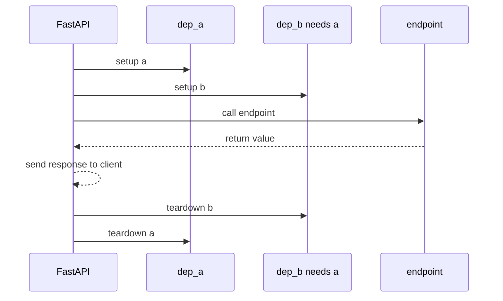

# Yield dependencies, scopes and test overrides

Some dependencies aren't just values — they're **resources** with a lifecycle: a database session that must
be closed, a transaction that must be committed or rolled back, a lock that must be released, a temp
directory that must be deleted. FastAPI handles these with dependencies that `yield`. This lesson covers
their exact semantics (a favourite interview area) and then the other superpower of DI:
**replacing dependencies in tests**.

## A dependency with `yield`

```python
def get_db():
    db = SessionLocal()        # setup: runs before the endpoint
    try:
        yield db               # the yielded value is injected
    finally:
        db.close()             # teardown: runs after the endpoint, even if it raised
```

Use `yield` exactly **once**. Everything before it is setup; everything after is teardown. FastAPI turns
the generator into a context manager internally (the same idea as `@contextlib.contextmanager`), which is
why this very common alternative spelling is equivalent:

```python
def get_session():
    with Session(engine) as session:
        yield session

SessionDep = Annotated[Session, Depends(get_session)]
```

`async def` generators (`async def get_db(): ... yield ...`) work the same way with `async with`.

## Order of execution

With nested yield-dependencies, setup runs in dependency order and teardown in **reverse** (like nested
`with` blocks):



By default, the **exit code runs after the response has been sent** to the client. That is good for
latency (closing a session doesn't delay the response) but has a consequence: by the time teardown runs,
it's too late to change the response.

The simulation below reproduces these mechanics with plain generators so you can see the ordering,
including what happens on an error:

```python-run
from contextlib import ExitStack, contextmanager

log = []

def dep_a():
    log.append("a: setup (open connection)")
    try:
        yield "conn"
    finally:
        log.append("a: teardown (close connection)")

def dep_b(conn):
    log.append("b: setup (begin transaction)")
    try:
        yield f"tx on {conn}"
        log.append("b: commit")
    except Exception as e:
        log.append(f"b: rollback because {type(e).__name__}")
        raise                                  # ALWAYS re-raise
    finally:
        log.append("b: teardown")

def handle_request(endpoint):
    with ExitStack() as stack:                 # FastAPI keeps an (Async)ExitStack per request
        a = stack.enter_context(contextmanager(dep_a)())
        b = stack.enter_context(contextmanager(dep_b)(a))
        result = endpoint(b)
        log.append(f"response sent: {result}")
    return result

handle_request(lambda tx: "200 OK")
print("\n".join(log)); log.clear(); print("---")

def failing(tx):
    raise ValueError("boom")

try:
    handle_request(failing)
except ValueError:
    log.append("server error handler -> 500")
print("\n".join(log))
```

## Exceptions and yield dependencies

When the endpoint (or a later dependency) raises, the exception is **thrown into** the generator at the
`yield` point. That gives you the rollback pattern above. Three rules from the docs:

1. **`try/finally`** guarantees cleanup regardless of outcome.
2. If you **catch** an exception with `except`, you must **re-raise** it (or raise an `HTTPException`).
   Swallowing it means FastAPI never learns something went wrong: the client gets a 500 with *no* log entry
   on the server — very hard to debug.
3. You may raise `HTTPException` in the exit code (e.g. translate a DB integrity error to 409) — but only
   meaningfully if the response hasn't been sent yet; see scopes below.

```python
def get_username():
    try:
        yield "Rick"
    except InternalError:
        log.warning("internal error while handling request")
        raise                   # re-raise so FastAPI can respond/log properly
```

## Dependency scope: `request` vs `function`

Newer FastAPI versions let you choose *when* the exit code runs:

```python
@app.get("/users/me")
def get_user_me(username: Annotated[str, Depends(get_username, scope="function")]):
    return username
```

- `scope="request"` (the default for yield dependencies): exit code runs **after the response is sent**.
- `scope="function"`: exit code runs **after the endpoint function returns but before the response is
  sent**.

Why it matters: with a commit-in-teardown pattern under request scope, the client can receive `201 Created`
before the commit happens — and if the commit then fails, the client was told a lie. Either commit
explicitly inside the endpoint/service (the most common and clearest approach) or use function scope for
transactional dependencies. A request-scoped dependency may only depend on other request-scoped ones; a
function-scoped one can depend on both.

> [!WARNING]
> With **streaming responses**, request-scoped teardown runs after the *whole stream* finishes, so a DB
> session yielded by a dependency stays open for the entire stream. For long LLM streams, fetch what you
> need first and release the session (or open a short-lived session inside the generator).

## Background tasks and yield dependencies

Background tasks run after the response is sent. Don't hand a dependency-provided session to a background
task and assume it's still usable — create a fresh session inside the task. This rule of thumb never fails:
*resources from a dependency belong to the request; anything outliving the request acquires its own.*

## Request-lifetime vs application-lifetime resources

| Lifetime | Mechanism | Examples |
|---|---|---|
| Per request | dependency (`yield`) | DB session, transaction, current user, request-scoped cache |
| Per application | **lifespan** | DB engine/connection pool, ML model, `httpx.AsyncClient`, Redis pool |

The lifespan is an async context manager passed to `FastAPI(lifespan=...)` — the same `yield` shape, but
executed once per process:

```python
from contextlib import asynccontextmanager

@asynccontextmanager
async def lifespan(app: FastAPI):
    app.state.http = httpx.AsyncClient(timeout=10)     # startup
    yield
    await app.state.http.aclose()                      # shutdown

app = FastAPI(lifespan=lifespan)

def get_http(request: Request) -> httpx.AsyncClient:   # dependency exposes the app-level resource
    return request.app.state.http
```

The older `@app.on_event("startup")` / `("shutdown")` decorators (used in the book's era) are deprecated in
favour of lifespan.

## Overriding dependencies in tests

Here's the payoff of declaring dependencies instead of hard-wiring them. `app.dependency_overrides` is a
dict mapping an original dependency callable to a replacement:

```python
from fastapi.testclient import TestClient
from app.main import app
from app.deps import get_session, get_current_user

def override_get_session():
    with Session(test_engine) as session:      # in-memory SQLite, or a transaction that rolls back
        yield session

def override_current_user():
    return User(id=1, username="tester", roles=["admin"])

app.dependency_overrides[get_session] = override_get_session
app.dependency_overrides[get_current_user] = override_current_user

client = TestClient(app)

def test_read_me():
    r = client.get("/me")
    assert r.status_code == 200
    assert r.json()["username"] == "tester"

# cleanup so other tests see the real dependencies
app.dependency_overrides.clear()
```

Properties worth knowing:

- The key is the **original function object**, wherever in the graph it's used — override `get_session`
  once and every dependency/endpoint that uses it gets the fake.
- The override may declare its *own* parameters/dependencies; the original's are ignored.
- Overrides apply to dependencies in decorators and routers too.
- With pytest, wrap it in a fixture that sets the override, `yield`s the client, and clears afterwards.

```python
@pytest.fixture
def client(session):
    app.dependency_overrides[get_session] = lambda: session
    with TestClient(app) as c:       # 'with' also runs lifespan startup/shutdown
        yield c
    app.dependency_overrides.clear()
```

Lubanovic's testing chapter makes the complementary point for his layered design: because each layer talks
to the next through a narrow interface, you can substitute **fakes** (his `fake/` data modules) or mocks at
any boundary. `dependency_overrides` is FastAPI's built-in seam for doing that at the web layer without
monkeypatching.

A stripped-down model of how the override lookup works:

```python-run
def get_db():
    return "REAL postgres session"

def get_user(db):
    return f"user loaded via {db}"

overrides = {}

def resolve(dep, *args):
    actual = overrides.get(dep, dep)       # one dict lookup before calling
    return actual(*args)

def endpoint():
    db = resolve(get_db)
    return resolve(get_user, db)

print(endpoint())
overrides[get_db] = lambda: "FAKE in-memory session"
print(endpoint())
overrides[get_user] = lambda db: "tester (no DB touched)"
print(endpoint())
overrides.clear()
print(endpoint())
```

> [!INTERVIEW]
> "When does the code after `yield` in a dependency run, and what happens on errors?" — Setup runs before
> the endpoint; teardown runs in reverse dependency order after the endpoint. By default (request scope)
> it runs after the response has been sent; with `scope="function"` it runs before the response. If the
> endpoint raises, the exception is thrown into the generator at `yield`, so `except`/`finally` blocks can
> roll back and clean up — but a caught exception must be re-raised, otherwise the client gets a 500 with
> nothing logged. Teardown can't modify a response that's already gone.

## Worked example: a unit of work

The most valuable yield-dependency in a database-backed service wraps a request in a transaction:
commit if the endpoint succeeds, roll back if it raises. This is the **unit of work** pattern.

```python
def get_uow(request: Request):
    session = Session(request.app.state.engine)
    try:
        yield session
        session.commit()                 # reached only if the endpoint returned normally
    except Exception:
        session.rollback()               # endpoint (or commit) raised
        raise                            # never swallow
    finally:
        session.close()                  # always return the connection to the pool

# function scope: the commit happens BEFORE the response is sent, so a failed commit becomes a 500
UnitOfWork = Annotated[Session, Depends(get_uow, scope="function")]

@router.post("/transfers", status_code=201)
def transfer(req: TransferRequest, uow: UnitOfWork) -> TransferPublic:
    debit(uow, req.source, req.amount)
    credit(uow, req.target, req.amount)       # if this raises, the debit is rolled back too
    return record_transfer(uow, req)
```

The endpoint contains no `commit`/`rollback` at all, and it's impossible to forget one. The scope choice
is what makes this safe: with the default request scope the client could receive `201` and *then* the
commit could fail.

A runnable model, including what a client observes in each case and the difference the scope makes:

```python-run
from contextlib import contextmanager

class FakeSession:
    def __init__(self, fail_commit=False):
        self.pending, self.committed, self.fail_commit, self.events = [], [], fail_commit, []
    def add(self, x): self.pending.append(x)
    def commit(self):
        if self.fail_commit:
            raise RuntimeError("unique constraint violated at commit")
        self.committed += self.pending; self.pending = []; self.events.append("commit")
    def rollback(self): self.pending = []; self.events.append("rollback")
    def close(self): self.events.append("close")

@contextmanager
def unit_of_work(session):
    try:
        yield session
        session.commit()
    except Exception:
        session.rollback()
        raise
    finally:
        session.close()

def run_request(endpoint, session, scope):
    """Returns what the CLIENT sees. scope decides whether teardown precedes the response."""
    try:
        if scope == "function":
            with unit_of_work(session) as s:
                body = endpoint(s)
            return f"201 {body}"                     # response built after commit succeeded
        else:  # "request": response is sent first, teardown afterwards
            cm = unit_of_work(session); s = cm.__enter__()
            body = endpoint(s)
            client_sees = f"201 {body}"              # <- already on the wire
            try:
                cm.__exit__(None, None, None)
            except Exception as e:
                print(f"     [server log] error AFTER response: {e}")
            return client_sees
    except Exception as e:
        return f"500 ({e})"

def ok(s): s.add("transfer#1"); return "created"
def boom(s): s.add("debit"); raise ValueError("insufficient funds")

for title, endpoint, fail_commit in [("success", ok, False), ("endpoint raises", boom, False),
                                     ("commit fails", ok, True)]:
    for scope in ("function", "request"):
        if endpoint is boom and scope == "request":
            continue
        s = FakeSession(fail_commit)
        print(f"{title:16} scope={scope:8} -> client: {run_request(endpoint, s, scope):45} "
              f"committed={s.committed} events={s.events}")
```

The last line is the bug worth remembering: under request scope the client was told `201 created`
although nothing was committed.

## Step-by-step timeline of one request

For an endpoint with a function-scoped unit of work, a request-scoped tracing dependency and a background
task, the full order is:

```text
 1. middleware (before part)
 2. request-scoped dependency: setup        (e.g. start a trace span)
 3. function-scoped dependency: setup       (open session, begin transaction)
 4. endpoint function runs, returns a value
 5. function-scoped dependency: teardown    (commit / rollback, close session)
 6. response model validation + serialisation
 7. middleware (after part) -> response sent to the client
 8. request-scoped dependency: teardown     (end the span)
 9. background tasks run
```

Two consequences: a function-scoped session is already closed during step 6, so the endpoint must return
data that is fully loaded (no lazy relationships); and background tasks (step 9) run after *all*
dependency teardown, which is why they must open their own resources.

## Testing with overrides: a complete fixture set

```python
# tests/conftest.py
@pytest.fixture(scope="session")
def engine():
    engine = create_engine("sqlite://", connect_args={"check_same_thread": False}, poolclass=StaticPool)
    SQLModel.metadata.create_all(engine)
    return engine

@pytest.fixture
def session(engine):
    connection = engine.connect()
    transaction = connection.begin()                 # outer transaction for the whole test
    session = Session(bind=connection, join_transaction_mode="create_savepoint")
    yield session
    session.close()
    transaction.rollback()                           # undo everything the test wrote
    connection.close()

@pytest.fixture
def user(session):
    user = User(email="tester@example.com", roles=["user"])
    session.add(user); session.commit(); session.refresh(user)
    return user

@pytest.fixture
def client(session, user):
    app.dependency_overrides[get_uow] = lambda: session          # endpoint commits become savepoints
    app.dependency_overrides[get_current_user] = lambda: user
    with TestClient(app) as c:
        yield c
    app.dependency_overrides.clear()

@pytest.fixture
def anonymous_client(session):
    app.dependency_overrides[get_uow] = lambda: session          # real auth, fake DB
    with TestClient(app) as c:
        yield c
    app.dependency_overrides.clear()
```

Why this shape works well: each test runs inside a transaction that is rolled back, so tests are isolated
and fast with no cleanup code; the *same* session is visible to the test and to the endpoint, so a test
can assert on rows the endpoint wrote; and two clients — one pre-authenticated, one anonymous — make it
natural to test both behaviour and access control:

```python
def test_create_order(client, session, user):
    r = client.post("/orders", json={"total": 19.9})
    assert r.status_code == 201
    assert session.get(Order, r.json()["id"]).owner_id == user.id

def test_orders_require_auth(anonymous_client):
    assert anonymous_client.get("/orders").status_code == 401
```

## Pitfalls

- Two `yield`s in one dependency (error).
- Catching exceptions around `yield` without re-raising.
- Relying on commit-in-teardown under request scope — the response may precede the commit.
- Holding a DB session across a long streaming response.
- Forgetting `app.dependency_overrides.clear()` → tests leak into each other.
- Overriding the wrong object: the key must be the *same function object* the route references (watch for
  wrappers/partials).

## Summary

- `yield` dependencies give setup/teardown around a request; teardown order is reverse of setup.
- Exceptions propagate into the generator; clean up in `finally`, re-raise in `except`.
- Default request scope runs teardown after the response; `scope="function"` runs it before.
- Per-request resources → dependencies; per-process resources → lifespan + `app.state`.
- `app.dependency_overrides[original] = fake` swaps dependencies in tests without patching.

```quiz
[
  {"q": "In a yield dependency, when does the code after yield run by default?", "options": ["Before the endpoint", "After the response is sent", "Only on errors", "At application shutdown"], "answer": 1,
   "explain": "Default request scope runs exit code after the response is sent; scope='function' moves it before the response."},
  {"q": "dep_b depends on dep_a (both yield). In what order do teardowns run?", "options": ["a then b", "b then a", "Simultaneously", "Undefined"], "answer": 1,
   "explain": "Teardown is the reverse of setup, like nested with-blocks, so b can still use a during its cleanup."},
  {"q": "A yield dependency catches an exception from the endpoint and does not re-raise. Result?", "options": ["Client gets 200", "Client gets 500 and the server logs nothing useful", "FastAPI retries the endpoint", "The dependency runs twice"], "answer": 1,
   "explain": "FastAPI can't see the swallowed error; the response is a 500 without a traceback in logs. Always re-raise."},
  {"q": "Where should an ML model that takes 20 seconds to load be created?", "options": ["In a yield dependency", "In the lifespan, stored on app.state", "Inside each endpoint", "In a Pydantic validator"], "answer": 1,
   "explain": "Application-lifetime resources are created once per process in the lifespan; dependencies run per request."},
  {"q": "What is the key of app.dependency_overrides?", "options": ["The dependency's name as a string", "The original dependency callable", "The route path", "The return type"], "answer": 1,
   "explain": "FastAPI looks up the original function object and calls the replacement instead."},
  {"q": "Why is holding a dependency-provided DB session during a long streaming response problematic?", "options": ["Streaming disables dependencies", "Request-scoped teardown runs only after the stream ends, tying up a pooled connection the whole time", "Sessions cannot be yielded", "It causes a 422"], "answer": 1,
   "explain": "The connection isn't returned to the pool until the stream completes, which can exhaust the pool under load."},
  {"q": "Which API replaces the deprecated @app.on_event('startup')?", "options": ["app.add_middleware", "The lifespan async context manager", "BackgroundTasks", "Depends(scope='app')"], "answer": 1,
   "explain": "FastAPI(lifespan=...) takes an async context manager: code before yield is startup, after is shutdown."}
]
```

> **Source:** Lubanovic, *FastAPI*, ch. 6 "Dependencies" and ch. 12 "Testing" (Mocking, Test Doubles and Fakes); https://fastapi.tiangolo.com/tutorial/dependencies/dependencies-with-yield/, /advanced/testing-dependencies/, /advanced/events/
