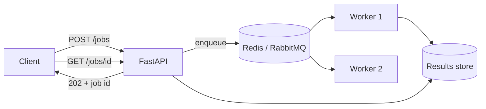

# Background tasks and concurrency limits

Two practical questions follow from the event-loop model. First: *how do I do work after responding* —
send the confirmation email, write an audit log, kick off a model retrain — without making the client wait?
Second: *how do I stop my service from overwhelming itself or its dependencies* when a thousand requests
arrive at once? This lesson covers FastAPI's `BackgroundTasks`, when you need a real task queue instead,
and the standard tools for bounding concurrency: semaphores, timeouts, queues and backpressure.

## BackgroundTasks

```python
from fastapi import BackgroundTasks, FastAPI

app = FastAPI()

def write_notification(email: str, message: str = ""):
    with open("log.txt", mode="a") as f:
        f.write(f"notification for {email}: {message}\n")

@app.post("/send-notification/{email}", status_code=202)
async def send_notification(email: str, background_tasks: BackgroundTasks):
    background_tasks.add_task(write_notification, email, message="some notification")
    return {"message": "Notification sent in the background"}
```

- Declare a `BackgroundTasks` parameter (in an endpoint *or* a dependency — FastAPI merges them into one
  list).
- `add_task(func, *args, **kwargs)` queues work. The function may be `def` (run in the thread pool) or
  `async def` (run on the loop).
- Tasks run **after the response has been sent**, sequentially in the order added, **in the same process**.

What they are good for: small, non-critical follow-ups — emails, cache invalidation, metrics, webhooks.

What they are **not**:

| Limitation | Consequence |
|---|---|
| In-process, in-memory | If the worker crashes or is redeployed mid-task, the task is **lost** — no retry |
| No persistence/queue | No visibility, no rate control, no scheduling |
| Shares the worker's resources | A CPU-heavy task (in `async def`) blocks the loop; a long task holds up shutdown |
| Runs after response | Errors can't reach the client; they just get logged |

For anything that must not be lost, is heavy, or needs retries, use a **task queue**: Celery, RQ, Dramatiq,
Arq or a cloud queue (SQS, Pub/Sub) with separate worker processes. The endpoint enqueues a job and returns
`202 Accepted` with a job ID; a `GET /jobs/{id}` endpoint reports progress. Lubanovic's production chapter
lists queues among the standard performance tools for exactly this reason: they move slow work off the
request path.



## Why you need limits

An async server will happily accept 10,000 concurrent requests. If each one opens a DB connection, calls a
rate-limited upstream API, or sends a tensor to one GPU, something downstream collapses: the pool is
exhausted, the upstream bans you, memory runs out. **Unbounded concurrency is a bug.** The tools:

### Semaphore — "at most N at once"

```python-run
import asyncio, time

sem = asyncio.Semaphore(3)          # at most 3 concurrent calls to the fragile upstream
active = peak = 0

async def call_upstream(i):
    global active, peak
    async with sem:                 # waits here (FIFO) if 3 are already inside
        active += 1; peak = max(peak, active)
        await asyncio.sleep(0.1)    # the actual call
        active -= 1
        return i

t = time.perf_counter()
results = await asyncio.gather(*(call_upstream(i) for i in range(10)))
print("results:", results)
print("peak concurrency:", peak)
print("elapsed:", round(time.perf_counter() - t, 2), "s  (10 calls / 3 at a time x 0.1s = ~0.4s)")
```

The problem *Simulate a Concurrency Limit* asks you to predict exactly this timing. A semaphore created in
the lifespan and stored on `app.state` is a simple way to protect a model or upstream:

```python
@asynccontextmanager
async def lifespan(app):
    app.state.gpu_sem = asyncio.Semaphore(2)
    yield

@app.post("/predict")
async def predict(req: Req, request: Request):
    async with request.app.state.gpu_sem:
        return await run_in_threadpool(model.predict, req.features)
```

### Timeouts — "don't wait forever"

A semaphore queue without a timeout just moves the pile-up. Combine them and **shed load** when the wait
is too long — a fast `503` is better than a slow timeout for everyone:

```python-run
import asyncio

sem = asyncio.Semaphore(1)

async def handle(i):
    try:
        async with asyncio.timeout(0.15):       # total budget for waiting + working
            async with sem:
                await asyncio.sleep(0.1)
                return f"req {i}: 200"
    except TimeoutError:
        return f"req {i}: 503 busy, Retry-After: 1"

print(*await asyncio.gather(*(handle(i) for i in range(4))), sep="\n")
```

### Bounded queues — backpressure

A producer/consumer queue with `maxsize` makes producers wait (or fail fast with `put_nowait` →
`QueueFull`) when consumers can't keep up. This is the backbone of the micro-batching pattern in the ML
module:

```python-run
import asyncio

async def worker(name, q, out):
    while True:
        item = await q.get()
        await asyncio.sleep(0.05)            # process
        out.append((name, item))
        q.task_done()

q, out = asyncio.Queue(maxsize=2), []
workers = [asyncio.create_task(worker(f"w{i}", q, out)) for i in range(2)]

accepted, rejected = [], []
for i in range(8):
    try:
        q.put_nowait(i)                      # fail fast when the queue is full -> 429/503
        accepted.append(i)
    except asyncio.QueueFull:
        rejected.append(i)
    await asyncio.sleep(0.01)

await q.join()                               # wait until accepted items are processed
for w in workers:
    w.cancel()
print("accepted:", accepted)
print("rejected (shed):", rejected)
print("processed:", sorted(i for _, i in out))
```

### Other limits in the stack

- **Thread pool size**: sync endpoints share AnyIO's 40-thread limiter. You can change it in the lifespan
  (`anyio.to_thread.current_default_thread_limiter().total_tokens = 100`), but more threads isn't always
  better — match it to what downstream can take.
- **DB connection pool**: SQLAlchemy defaults to `pool_size=5`, `max_overflow=10` per process. With 40
  threads and 15 connections, requests queue for connections; with `pool_timeout` they fail after 30 s.
  Size the pool with `workers × (pool_size + max_overflow) ≤ database max connections`.
- **HTTP client pool**: `httpx.Limits(max_connections=100, max_keepalive_connections=20)`.
- **Server-level**: Uvicorn's `--limit-concurrency N` returns 503 beyond N in-flight connections;
  `--backlog`, `--timeout-keep-alive`.
- **Per-client rate limits**: token buckets (security module) protect against a single noisy client.

## Gathering safely

`asyncio.gather(*many)` over an unbounded list is itself a concurrency bug — 10,000 simultaneous upstream
calls. Bound it with a semaphore (above) or process in chunks. Also decide what a single failure means:

```python-run
import asyncio

async def job(i):
    await asyncio.sleep(0.01)
    if i == 2:
        raise ValueError("job 2 failed")
    return i * i

# return_exceptions=True: collect failures instead of losing all results
results = await asyncio.gather(*(job(i) for i in range(4)), return_exceptions=True)
print(results)

# TaskGroup: first failure cancels the siblings and raises an ExceptionGroup
try:
    async with asyncio.TaskGroup() as tg:
        tasks = [tg.create_task(job(i)) for i in range(4)]
except* ValueError as eg:
    print("task group failed:", [str(e) for e in eg.exceptions])
```

## Fire-and-forget, done properly

If you spawn your own long-running task (a batch-collector loop, a periodic refresh), start it in the
lifespan, keep a reference, and cancel it on shutdown:

```python
@asynccontextmanager
async def lifespan(app):
    task = asyncio.create_task(refresh_cache_forever())
    yield
    task.cancel()
    with contextlib.suppress(asyncio.CancelledError):
        await task
```

Remember that with several worker processes, **each worker runs its own copy** — a "run every hour" loop
runs N times. Scheduled jobs belong in a dedicated scheduler/worker, not in the web processes.

> [!INTERVIEW]
> "When would you use FastAPI's BackgroundTasks versus Celery (or another queue)?" — `BackgroundTasks` for
> light, best-effort work after the response where losing the task on a crash is acceptable (notification,
> log, cache warm). A real queue when the work is heavy or long, must survive restarts, needs retries,
> scheduling, rate limiting, or should scale independently of the web tier. With a queue the API returns
> 202 and a job ID for polling or a webhook.

## Worked example: the 202 job pattern end to end

Here is the complete shape of an API for work that is too slow for a request: submit, poll, fetch the
result. The queue and worker are in-process here so the cell can run; in production the queue would be
Redis/SQS and the worker a separate process, but the HTTP contract is identical.

```python
@router.post("/reports", status_code=status.HTTP_202_ACCEPTED, response_model=JobStatus)
async def submit_report(req: ReportRequest, response: Response, jobs: JobsDep, user: CurrentUser):
    job = await jobs.enqueue("build_report", req.model_dump(), owner=user.id)
    response.headers["Location"] = f"/v1/jobs/{job.id}"
    response.headers["Retry-After"] = "2"            # a hint for how soon to poll
    return job

@router.get("/jobs/{job_id}", response_model=JobStatus)
async def job_status(job_id: str, jobs: JobsDep, user: CurrentUser):
    job = await jobs.get(job_id)
    if job is None or job.owner != user.id:
        raise HTTPException(status_code=404, detail="Job not found")
    return job                                        # status: queued | running | succeeded | failed
```

```python-run
import asyncio, itertools

class JobStore:
    """In-memory stand-in for a durable queue + results table."""
    def __init__(self, max_queue=3):
        self.queue = asyncio.Queue(maxsize=max_queue)
        self.jobs, self.ids = {}, itertools.count(1)

    def enqueue(self, payload):
        if self.queue.full():
            return None                                    # -> 503 + Retry-After (load shedding)
        job_id = f"job-{next(self.ids)}"
        self.jobs[job_id] = {"id": job_id, "status": "queued", "attempts": 0, "result": None}
        self.queue.put_nowait((job_id, payload))
        return self.jobs[job_id]

async def worker(store, handler, max_attempts=3):
    while True:
        job_id, payload = await store.queue.get()
        job = store.jobs[job_id]
        job["status"] = "running"
        for attempt in range(1, max_attempts + 1):
            job["attempts"] = attempt
            try:
                job["result"] = await handler(payload)
                job["status"] = "succeeded"
                break
            except Exception as exc:
                job["status"] = "failed" if attempt == max_attempts else "retrying"
                job["error"] = str(exc)
                await asyncio.sleep(0.01 * 2 ** attempt)   # exponential backoff between attempts
        store.queue.task_done()

flaky_calls = 0
async def build_report(payload):
    global flaky_calls
    await asyncio.sleep(0.02)
    if payload.get("flaky"):
        flaky_calls += 1
        if flaky_calls < 3:
            raise RuntimeError("upstream timeout")
    if payload.get("poison"):
        raise ValueError("malformed input")
    return f"report for {payload['month']}"

store = JobStore()
w = asyncio.create_task(worker(store, build_report))

# --- client: submit ---
submitted = [store.enqueue(p) for p in ({"month": "jan"}, {"month": "feb", "flaky": True},
                                        {"month": "mar", "poison": True}, {"month": "apr"})]
print("POST /reports ->", ["202 " + j["id"] if j else "503 queue full" for j in submitted])

# --- client: poll until every accepted job is terminal ---
while any(j["status"] in ("queued", "running", "retrying") for j in store.jobs.values()):
    await asyncio.sleep(0.03)
    print("GET /jobs    ->", {j["id"]: j["status"] for j in store.jobs.values()})
w.cancel()
for j in store.jobs.values():
    print(j["id"], j["status"], "attempts:", j["attempts"], "|", j["result"] or j.get("error"))
```

What the run demonstrates: the fourth submission is **shed** because the bounded queue is full; the
flaky job succeeds on its third attempt thanks to retry with backoff; the poison job fails permanently
after the attempt limit instead of blocking the queue forever. A real system sends such jobs to a
**dead-letter queue** for inspection.

Requirements a production version adds:

- **Durability**: the queue and job records live outside the process, so a deploy loses nothing.
- **Idempotent handlers**: most queues deliver *at least once* — a worker can crash after doing the work
  but before acknowledging it, and the job runs again. Handlers must tolerate repeats (upserts, dedup keys).
- **Visibility timeouts / heartbeats**: a job whose worker died becomes available again.
- **Completion signals** beyond polling: a webhook callback, or SSE/WebSocket progress events.
- **Ownership checks** on the status endpoint (job IDs must not be guessable or cross-tenant readable).

## Choosing where work runs

| Work | Mechanism | Why |
|---|---|---|
| < 50 ms, must be in the response | inline in the endpoint | simplest |
| I/O fan-out to several services | `asyncio.gather`/`TaskGroup` with a semaphore | overlap the waiting |
| Blocking library call | `def` endpoint or `run_in_threadpool` | keep the loop free |
| Small follow-up, loss acceptable | `BackgroundTasks` | no infrastructure |
| CPU-heavy, seconds | process pool or separate worker | bypass the GIL, protect latency |
| Minutes, must not be lost, retries | task queue + 202 pattern | durability and isolation |
| Periodic / scheduled | dedicated scheduler (cron, Celery beat, platform jobs) | exactly one runner, not one per worker |

## Sizing limits: worked arithmetic

Suppose each worker process has a thread pool of 40, a DB pool of 10 (+5 overflow), and an upstream API
that allows your service 50 concurrent calls in total. You run 4 workers.

- Sync endpoints that use the DB: up to 40 threads want a connection but only 15 exist per worker → up to
  25 requests per worker wait for the pool (and fail after `pool_timeout`). Either raise the pool —
  checking `4 × 15 = 60` against the database's connection limit — or lower the thread limiter so
  queueing happens in one visible place.
- Upstream calls: a per-process `Semaphore(12)` gives `4 × 12 = 48 ≤ 50`. A semaphore of 50 per process
  would allow 200 and get you throttled. When the worker count autoscales, a per-process semaphore is no
  longer a reliable global limit — use a Redis-based distributed limiter instead.
- Queue length: with service time 100 ms and 12 slots, a worker completes ~120 calls/s. If you are willing
  to let a request wait at most 500 ms, the queue should hold about `0.5 × 120 = 60` items; beyond that,
  reject. **Bounded wait = queue length ÷ service rate** is the calculation behind every `maxsize`.

Requests that arrive faster than the service rate for a sustained period cannot be saved by any queue;
the queue only absorbs bursts. Deciding *what to refuse, and how politely* (429/503 with `Retry-After`) is
the real design decision.

## Pitfalls

- Treating `BackgroundTasks` as durable.
- Passing request-scoped resources (DB session) into a background task — open a new one inside.
- Unbounded `gather` / unbounded queues: memory grows until the process dies.
- Limits per process forgotten: 4 workers × semaphore(10) = 40 concurrent calls upstream.
- Timers/schedulers in the web app running once per worker.

## Summary

- `BackgroundTasks` runs small jobs after the response, in-process, with no durability.
- Durable/heavy/retriable work needs a task queue and the 202 + job-status pattern.
- Bound concurrency everywhere: semaphores, pools, bounded queues; add timeouts and shed load early.
- Remember limits multiply by the number of worker processes.

```quiz
[
  {"q": "When do FastAPI BackgroundTasks run?", "options": ["Before the endpoint", "After the response is sent, in the same process", "In a separate worker service", "At shutdown"], "answer": 1,
   "explain": "They execute in-process once the response has gone out, in the order added."},
  {"q": "The worker process is killed while a BackgroundTasks job is running. What happens to the job?", "options": ["It is retried automatically", "It is lost", "It moves to another worker", "It is persisted to disk"], "answer": 1,
   "explain": "There is no persistence or retry; durable work needs a real task queue."},
  {"q": "What does asyncio.Semaphore(5) guarantee?", "options": ["Five threads exist", "At most five coroutines are inside the guarded section at once", "Five requests per second", "Tasks finish in five seconds"], "answer": 1,
   "explain": "A semaphore bounds concurrency, not rate. Extra tasks wait until a slot is released."},
  {"q": "You run 4 Uvicorn workers, each with Semaphore(10) around an upstream call. Maximum concurrent upstream calls?", "options": ["10", "14", "40", "Unlimited"], "answer": 2,
   "explain": "Each process has its own semaphore, so limits multiply by the worker count."},
  {"q": "Why prefer returning 503 quickly when a queue is full rather than letting requests wait indefinitely?", "options": ["503 is cached", "Load shedding keeps latency bounded and lets clients back off instead of piling up until everything times out", "It is required by HTTP", "It saves disk space"], "answer": 1,
   "explain": "Unbounded waiting increases memory and latency for everyone; fast failure plus Retry-After preserves service for the requests you accept."},
  {"q": "A long CPU-heavy report must be generated on request and must not be lost. Best design?", "options": ["Do it in the endpoint", "BackgroundTasks", "Enqueue to a task queue, return 202 with a job id, poll a status endpoint", "asyncio.create_task without a reference"], "answer": 2,
   "explain": "A queue with separate workers provides durability, retries and isolation from the web tier."}
]
```

> **Source:** Lubanovic, *FastAPI*, ch. 4 "Async, Concurrency, and Starlette Tour" and ch. 13 "Production" (Performance: Async, Queues); https://fastapi.tiangolo.com/tutorial/background-tasks/, /async/; Python docs, asyncio synchronization primitives and queues
