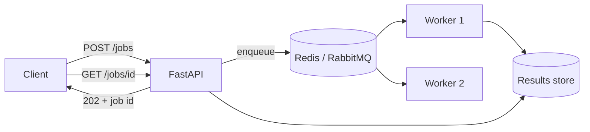

# Background tasks and concurrency limits

> **Before this lesson:** you should understand coroutines, `await`, `asyncio.gather` and why a
> blocking call freezes the event loop ([lesson 12](#/lesson/fastapi/async-fundamentals)), and know
> the lifespan and `app.state` from [lesson 11](#/lesson/fastapi/yield-deps).

## In plain words

Two practical questions follow from the way an async server works.

The first: **how do I do work after I have answered?** A client who signs up should get the reply
"done" at once. Sending the welcome email, writing an audit record or starting a long calculation
can happen afterwards. Work of that kind is called a **background task**.

The second: **how do I stop my server from taking on more than it can handle?** An async server
will cheerfully accept ten thousand requests at once. If every one of them then asks the database
for a connection, the database falls over. Accepting work you cannot finish helps nobody.

An everyday picture: a restaurant. The waiter takes your order and says "thank you" straight away;
the kitchen cooks after that. That is background work. The restaurant also has a fixed number of
tables, a short bench by the door for people waiting, and a host who says "sorry, we are full, try
in half an hour" when the bench is occupied. Those three things have technical names that this lesson
teaches: a **semaphore** (the tables), a **bounded queue** (the bench) and **load shedding** (the
polite refusal).

Why this matters for a job: "when would you use FastAPI's `BackgroundTasks` and when a real task
queue?" is a standard interview question, and the limits in the second half are what keep a
production service standing during a rush.

## BackgroundTasks

FastAPI has a small built-in tool for running a function after the response has gone out:

```python
from fastapi import BackgroundTasks, FastAPI

app = FastAPI()

def write_notification(email: str, message: str = ""):
    with open("log.txt", mode="a") as f:
        f.write(f"notification for {email}: {message}\n")

@app.post("/send-notification/{email}", status_code=202)
async def send_notification(email: str, background_tasks: BackgroundTasks):
    background_tasks.add_task(write_notification, email, message="some notification")
    return {"message": "Notification sent in the background"}
```

- `write_notification` is an ordinary function that appends a line to a file. It stands in for
  sending an email.
- The endpoint declares a parameter of type `BackgroundTasks`. As with `Request` and `Response`,
  FastAPI recognises the type and passes in an object.
- `background_tasks.add_task(write_notification, email, message="...")` does not call the function.
  It notes "call this, with these arguments, later".
- The endpoint returns immediately with status `202 Accepted`, the code for "received, not yet
  done".

The rules:

- The `BackgroundTasks` parameter may be declared in an endpoint *or* in a dependency; FastAPI
  merges them into one list.
- The function may be a plain `def` (run in the thread pool) or an `async def` (run on the loop).
- Tasks run **after the response has been sent**, one after another in the order they were added,
  **inside the same server process**.

They are good for small follow-up work that is not critical: emails, clearing a cache entry,
recording a metric, notifying another system.

What they are **not**:

| Limitation | Consequence |
|---|---|
| Held only in the process's memory | If the worker crashes or is restarted during a task, the task is **lost**; nothing retries it |
| No stored queue | You cannot see what is waiting, control the rate, or schedule for later |
| Shares the worker's resources | A CPU-heavy `async def` task blocks the loop; a long task delays shut-down |
| Runs after the response | An error cannot reach the client; it only appears in the log |

For anything that must not be lost, is heavy, or needs retries, use a **task queue**: a separate
piece of software that stores jobs safely and hands them to separate **worker** programs. Common
ones are Celery, RQ, Dramatiq and Arq, or a cloud queue such as SQS or Pub/Sub. A job stored that
way is **durable**: it survives a crash or restart of your web server. The endpoint puts a job on
the queue and returns `202 Accepted` with a job ID; a `GET /jobs/{id}` endpoint reports progress.
Lubanovic's production chapter lists queues among the standard performance tools for this reason:
they take slow work out of the path of the request.



Follow the arrows: the client posts a job; FastAPI stores it in a queue (kept in Redis or RabbitMQ)
and answers at once with a job id; workers take jobs from the queue and write results to a store;
the client later asks FastAPI for the status, which FastAPI reads from that store.

## Why you need limits

Suppose 10,000 requests arrive together and each one opens a database connection, or calls another
company's API that allows you 50 calls at a time, or sends data to the single graphics card running
your model. Something further down the line collapses: the connections run out, the other company
blocks you, memory is exhausted. **Unlimited concurrency is a bug.** Here are the tools for limiting
it.

### Semaphore: "at most N at once"

A **semaphore** is a counter of free slots. Entering takes a slot; leaving gives it back; when no
slot is free, newcomers wait their turn.

```python-run
import asyncio, time

sem = asyncio.Semaphore(3)          # at most 3 concurrent calls to the fragile upstream
active = peak = 0

async def call_upstream(i):
    global active, peak
    async with sem:                 # waits here (FIFO) if 3 are already inside
        active += 1; peak = max(peak, active)
        await asyncio.sleep(0.1)    # the actual call
        active -= 1
        return i

t = time.perf_counter()
results = await asyncio.gather(*(call_upstream(i) for i in range(10)))
print("results:", results)
print("peak concurrency:", peak)
print("elapsed:", round(time.perf_counter() - t, 2), "s  (10 calls / 3 at a time x 0.1s = ~0.4s)")
```

- `sem = asyncio.Semaphore(3)` creates three slots.
- `async with sem:` takes a slot on the way in and returns it on the way out, even if an error
  occurs inside. With three coroutines already inside, a fourth pauses at this line until one leaves.
- `active` counts how many are inside at this moment, and `peak` records the highest value seen.
- `asyncio.gather` starts ten calls at once.

The output shows all ten results, `peak concurrency: 3`, and an elapsed time of about 0.4 seconds:
the calls went through in groups of three, three, three and one, each group taking 0.1 seconds.
Without the semaphore the peak would be 10 and the time 0.1 seconds, and the fragile service on the
other side would have received all ten at once.

The problem *Simulate a Concurrency Limit* asks you to predict timings of exactly this kind. A
semaphore created in the lifespan and kept on `app.state` is a straightforward way to protect a
model or an outside service:

```python
@asynccontextmanager
async def lifespan(app):
    app.state.gpu_sem = asyncio.Semaphore(2)
    yield

@app.post("/predict")
async def predict(req: Req, request: Request):
    async with request.app.state.gpu_sem:
        return await run_in_threadpool(model.predict, req.features)
```

One semaphore with two slots is created at start-up. Every `/predict` request must take a slot
before running the model, so at most two predictions run at a time and the rest wait in line.

### Timeouts: "don't wait forever"

A semaphore alone only moves the pile-up from the outside service to your own waiting line. Combine
it with a timeout, and refuse requests whose wait would be too long. Refusing work on purpose to
protect the rest is called **load shedding**. A quick `503` is better for everyone than a slow
failure:

```python-run
import asyncio

sem = asyncio.Semaphore(1)

async def handle(i):
    try:
        async with asyncio.timeout(0.15):       # total budget for waiting + working
            async with sem:
                await asyncio.sleep(0.1)
                return f"req {i}: 200"
    except TimeoutError:
        return f"req {i}: 503 busy, Retry-After: 1"

print(*await asyncio.gather(*(handle(i) for i in range(4))), sep="\n")
```

There is one slot. Each request allows itself 0.15 seconds in total for waiting plus working, and
the work takes 0.1 seconds. Request 0 gets the slot and finishes: `req 0: 200`. Request 1 waits 0.1
seconds for the slot, which leaves too little time to do its own work, so it times out. Requests 2
and 3 never get the slot at all. All three print `503 busy, Retry-After: 1`. Each client learns
within 0.15 seconds that it should come back later, instead of hanging.

### Bounded queues: backpressure

A **queue** is a waiting line between code that produces items and code that consumes them. A
**bounded** queue has a maximum length. When it is full, the producer must wait, or is refused
immediately. This pushing back against the source of the work is called **backpressure**. It is the
basis of the batching pattern in the machine-learning module.

```python-run
import asyncio

async def worker(name, q, out):
    while True:
        item = await q.get()
        await asyncio.sleep(0.05)            # process
        out.append((name, item))
        q.task_done()

q, out = asyncio.Queue(maxsize=2), []
workers = [asyncio.create_task(worker(f"w{i}", q, out)) for i in range(2)]

accepted, rejected = [], []
for i in range(8):
    try:
        q.put_nowait(i)                      # fail fast when the queue is full -> 429/503
        accepted.append(i)
    except asyncio.QueueFull:
        rejected.append(i)
    await asyncio.sleep(0.01)

await q.join()                               # wait until accepted items are processed
for w in workers:
    w.cancel()
print("accepted:", accepted)
print("rejected (shed):", rejected)
print("processed:", sorted(i for _, i in out))
```

- `asyncio.Queue(maxsize=2)` holds at most two waiting items.
- Two `worker` tasks run for ever: take an item with `await q.get()`, spend 0.05 seconds on it,
  record it, and report it finished with `q.task_done()`.
- The main loop tries to add eight items, one every 0.01 seconds, with `put_nowait`, which raises
  `QueueFull` instead of waiting when there is no room.
- `await q.join()` waits until every accepted item has been processed, and then the workers are
  cancelled.

Items arrive five times faster than two workers can process them, so the queue fills. The first few
items are accepted, the next ones are rejected while both workers are busy and the queue is full,
and later ones are accepted again as the workers catch up. (The exact numbers can vary slightly with
timing.) The `processed` line always matches the `accepted` line: nothing that was accepted is lost,
and nothing that was rejected is silently dropped, because the producer was told.

### Other limits in the stack

- **Thread pool size.** Synchronous endpoints share the 40-thread limit from lesson 12. It can be
  changed in the lifespan
  (`anyio.to_thread.current_default_thread_limiter().total_tokens = 100`), but more threads are not
  automatically better; match the number to what the systems behind you can take.
- **Database connection pool.** A *pool* is a set of open connections that are reused. SQLAlchemy's
  defaults are `pool_size=5` and `max_overflow=10` for each process. With 40 threads and 15
  connections, requests wait in line for a connection, and with `pool_timeout` they fail after 30
  seconds. Size the pool so that `workers × (pool_size + max_overflow)` stays within the database's
  own connection limit.
- **HTTP client pool.** `httpx.Limits(max_connections=100, max_keepalive_connections=20)`.
- **The server itself.** Uvicorn's `--limit-concurrency N` answers 503 when more than N connections
  are in progress; see also `--backlog` and `--timeout-keep-alive`.
- **Limits per client.** Token buckets (security module) protect against one noisy client.

## Gathering safely

`asyncio.gather(*many)` over a list of unlimited length is itself a concurrency bug: 10,000 calls
launched together. Limit it with a semaphore, as above, or work through the list in chunks. You must
also decide what one failure should mean for the rest:

```python-run
import asyncio

async def job(i):
    await asyncio.sleep(0.01)
    if i == 2:
        raise ValueError("job 2 failed")
    return i * i

# return_exceptions=True: collect failures instead of losing all results
results = await asyncio.gather(*(job(i) for i in range(4)), return_exceptions=True)
print(results)

# TaskGroup: first failure cancels the siblings and raises an ExceptionGroup
try:
    async with asyncio.TaskGroup() as tg:
        tasks = [tg.create_task(job(i)) for i in range(4)]
except* ValueError as eg:
    print("task group failed:", [str(e) for e in eg.exceptions])
```

`job(2)` raises an error; the other three succeed.

- With `return_exceptions=True`, `gather` puts the error object into the result list in place of a
  value: `[0, 1, ValueError('job 2 failed'), 9]`. You keep the three good results and can inspect the
  failure.
- With a `TaskGroup`, the first failure cancels the remaining tasks and the group raises. The
  `except*` form (note the star) catches errors from a group, and the demo prints
  `task group failed: ['job 2 failed']`.

Choose the first when partial results are useful, and the second when the results only make sense
all together.

## Fire-and-forget, done properly

If you start a long-running task of your own (a loop that collects batches, a periodic refresh),
start it in the lifespan, keep a reference to it, and cancel it at shut-down:

```python
@asynccontextmanager
async def lifespan(app):
    task = asyncio.create_task(refresh_cache_forever())
    yield
    task.cancel()
    with contextlib.suppress(asyncio.CancelledError):
        await task
```

`asyncio.create_task` starts the coroutine running alongside everything else. After the `yield`,
at shut-down, the task is cancelled and then awaited so that it can finish cleaning up;
`contextlib.suppress` ignores the expected `CancelledError`.

Remember that with several worker processes, **each worker runs its own copy**. A loop meant to
"run every hour" runs once in each of them. Scheduled jobs belong in one dedicated scheduler or
worker, not in the web processes.

> [!INTERVIEW]
> "When would you use FastAPI's BackgroundTasks versus Celery (or another queue)?" —
> `BackgroundTasks` for light, best-effort work after the response, where losing the task in a crash
> is acceptable (a notification, a log entry, warming a cache). A real queue when the work is heavy
> or long, must survive restarts, needs retries, scheduling or rate limiting, or should scale
> separately from the web servers. With a queue the API returns 202 and a job ID, which the client
> polls or is told about through a webhook.

## Worked example: the 202 job pattern end to end

Here is the full shape of an API for work that is too slow to finish inside a request: submit, poll,
fetch the result. First the two endpoints as they would look in a real application:

```python
@router.post("/reports", status_code=status.HTTP_202_ACCEPTED, response_model=JobStatus)
async def submit_report(req: ReportRequest, response: Response, jobs: JobsDep, user: CurrentUser):
    job = await jobs.enqueue("build_report", req.model_dump(), owner=user.id)
    response.headers["Location"] = f"/v1/jobs/{job.id}"
    response.headers["Retry-After"] = "2"            # a hint for how soon to poll
    return job

@router.get("/jobs/{job_id}", response_model=JobStatus)
async def job_status(job_id: str, jobs: JobsDep, user: CurrentUser):
    job = await jobs.get(job_id)
    if job is None or job.owner != user.id:
        raise HTTPException(status_code=404, detail="Job not found")
    return job                                        # status: queued | running | succeeded | failed
```

`submit_report` puts a job on the queue and answers `202` with two helpful headers: `Location` (the
address at which to ask about this job) and `Retry-After` (how many seconds to wait before asking).
`job_status` returns the job's current state, and answers 404 if the job does not exist or belongs
to someone else.

Now a runnable model. The queue and the worker live inside the same process here so that the cell
can run; in production the queue would be Redis or SQS and the worker a separate program, but what
the client sees over HTTP is identical.

```python-run
import asyncio, itertools

class JobStore:
    """In-memory stand-in for a durable queue + results table."""
    def __init__(self, max_queue=3):
        self.queue = asyncio.Queue(maxsize=max_queue)
        self.jobs, self.ids = {}, itertools.count(1)

    def enqueue(self, payload):
        if self.queue.full():
            return None                                    # -> 503 + Retry-After (load shedding)
        job_id = f"job-{next(self.ids)}"
        self.jobs[job_id] = {"id": job_id, "status": "queued", "attempts": 0, "result": None}
        self.queue.put_nowait((job_id, payload))
        return self.jobs[job_id]

async def worker(store, handler, max_attempts=3):
    while True:
        job_id, payload = await store.queue.get()
        job = store.jobs[job_id]
        job["status"] = "running"
        for attempt in range(1, max_attempts + 1):
            job["attempts"] = attempt
            try:
                job["result"] = await handler(payload)
                job["status"] = "succeeded"
                break
            except Exception as exc:
                job["status"] = "failed" if attempt == max_attempts else "retrying"
                job["error"] = str(exc)
                await asyncio.sleep(0.01 * 2 ** attempt)   # exponential backoff between attempts
        store.queue.task_done()

flaky_calls = 0
async def build_report(payload):
    global flaky_calls
    await asyncio.sleep(0.02)
    if payload.get("flaky"):
        flaky_calls += 1
        if flaky_calls < 3:
            raise RuntimeError("upstream timeout")
    if payload.get("poison"):
        raise ValueError("malformed input")
    return f"report for {payload['month']}"

store = JobStore()
w = asyncio.create_task(worker(store, build_report))

# --- client: submit ---
submitted = [store.enqueue(p) for p in ({"month": "jan"}, {"month": "feb", "flaky": True},
                                        {"month": "mar", "poison": True}, {"month": "apr"})]
print("POST /reports ->", ["202 " + j["id"] if j else "503 queue full" for j in submitted])

# --- client: poll until every accepted job is terminal ---
while any(j["status"] in ("queued", "running", "retrying") for j in store.jobs.values()):
    await asyncio.sleep(0.03)
    print("GET /jobs    ->", {j["id"]: j["status"] for j in store.jobs.values()})
w.cancel()
for j in store.jobs.values():
    print(j["id"], j["status"], "attempts:", j["attempts"], "|", j["result"] or j.get("error"))
```

Reading the model:

- `JobStore` holds a bounded queue (three places) and a dictionary of job records. `enqueue`
  returns `None` when the queue is full, which the API would turn into a 503.
- `worker` takes jobs one at a time and tries each up to three times. After a failure it waits
  before trying again, and the wait doubles each time (`0.01 * 2 ** attempt`). Waiting longer after
  each failure is called **exponential backoff**; it gives a struggling service time to recover.
- `build_report` is the actual work. A payload marked `flaky` fails twice and then succeeds, like a
  service with a temporary problem. A payload marked `poison` always fails, like input that is
  wrong in itself.

What the run shows:

- The submit line prints `202 job-1`, `202 job-2`, `202 job-3` and `503 queue full`. The fourth
  submission is **shed** because the queue is full.
- The polling lines show the statuses moving through `queued`, `running`, `retrying` and finally
  `succeeded` or `failed`.
- In the summary, job 1 succeeded at the first attempt; job 2 (flaky) succeeded on its third attempt
  thanks to the retries; job 3 (poison) is `failed` after three attempts with the error
  `malformed input`. It did not block the queue for ever.

A real system moves jobs like job 3 to a **dead-letter queue**: a separate holding area for failed
jobs, where a person can inspect them.

What a production version adds:

- **Durability.** The queue and the job records live outside the process, so a new release loses
  nothing.
- **Idempotent handlers.** Most queues promise delivery *at least once*. A worker can crash after
  doing the work but before reporting it done, and the job is then run a second time. A handler must
  tolerate repeats, which is the idempotency of lesson 1 applied to jobs.
- **Visibility timeouts or heartbeats**, so that a job whose worker died becomes available to
  another worker.
- **Completion signals** other than polling: a webhook call, or progress events pushed to the client
  (lesson 24).
- **Ownership checks** on the status endpoint. Job IDs must not be guessable, and one customer must
  not be able to read another's job.

## Choosing where work runs

| Work | Mechanism | Why |
|---|---|---|
| < 50 ms, must be in the response | inline in the endpoint | simplest |
| I/O fan-out to several services | `asyncio.gather`/`TaskGroup` with a semaphore | overlap the waiting |
| Blocking library call | `def` endpoint or `run_in_threadpool` | keep the loop free |
| Small follow-up, loss acceptable | `BackgroundTasks` | no infrastructure |
| CPU-heavy, seconds | process pool or separate worker | bypass the GIL, protect latency |
| Minutes, must not be lost, retries | task queue + 202 pattern | durability and isolation |
| Periodic / scheduled | dedicated scheduler (cron, Celery beat, platform jobs) | exactly one runner, not one per worker |

## Sizing limits: worked arithmetic

Suppose each worker process has a thread pool of 40 and a database pool of 10 connections (plus 5
overflow), and an outside API allows your whole service 50 calls at a time. You run 4 workers.

- **Synchronous endpoints that use the database.** Up to 40 threads want a connection, but only 15
  exist in each worker, so up to 25 requests per worker wait for the pool (and fail after
  `pool_timeout`). Either enlarge the pool, checking `4 × 15 = 60` against the database's connection
  limit, or lower the thread limit so that the waiting happens in one visible place.
- **Calls to the outside API.** A semaphore of 12 in each process gives `4 × 12 = 48`, which is
  within 50. A semaphore of 50 in each process would allow 200 and get you blocked. If the number of
  workers changes automatically with load, a semaphore per process is no longer a reliable overall
  limit; use a limiter shared through Redis.
- **Queue length.** If one call takes 100 milliseconds and there are 12 slots, a worker completes
  about 120 calls a second. If you are willing to let a request wait at most 500 milliseconds, the
  queue should hold about `0.5 × 120 = 60` items, and anything beyond that should be refused.
  **Longest wait = queue length ÷ completion rate** is the calculation behind every `maxsize`.

No queue can rescue a service when requests keep arriving faster than they can be completed. A queue
only smooths out short bursts. The real design decision is *what to refuse, and how politely* (429 or
503 with `Retry-After`).

## Pitfalls

- Treating `BackgroundTasks` as durable.
- Passing a resource that belongs to the request (a database session) into a background task. Open
  a new one inside the task.
- `gather` over unlimited lists, and queues with no maximum: memory grows until the process dies.
- Forgetting that limits are per process: 4 workers × a semaphore of 10 = 40 simultaneous calls.
- Timers and schedulers inside the web app, which then run once in every worker.

## Summary

- `BackgroundTasks` runs small jobs after the response, inside the same process, with no durability.
- Work that is heavy, must not be lost or needs retries calls for a task queue and the 202 plus
  job-status pattern.
- Limit concurrency everywhere: semaphores, pools, bounded queues. Add timeouts and shed load early.
- Remember that limits multiply by the number of worker processes.

## Glossary

- **Background task** — work that runs after the response has been sent.
- **`BackgroundTasks`** — FastAPI's built-in, in-process way to run such work.
- **Task queue** — separate software that stores jobs and hands them to worker programs.
- **Worker** — a program (or process) that takes jobs from a queue and runs them.
- **Durable** — stored so that it survives a crash or restart.
- **Semaphore** — a counter of free slots that limits how many tasks run a section at once.
- **Timeout** — a maximum time to wait.
- **Load shedding** — refusing some requests quickly to protect the rest.
- **Queue / bounded queue** — a waiting line / one with a maximum length.
- **Backpressure** — a full queue pushing back on whatever is producing work.
- **Connection pool** — a set of open connections kept for reuse.
- **Retry** — attempting failed work again.
- **Exponential backoff** — waiting twice as long after each failed attempt.
- **Dead-letter queue** — a holding area for jobs that failed permanently.
- **At-least-once delivery** — a job is never lost but may run more than once.
- **Polling** — the client asking repeatedly whether a job is finished.

```quiz
[
  {"q": "When do FastAPI BackgroundTasks run?", "options": ["Before the endpoint", "After the response is sent, in the same process", "In a separate worker service", "At shutdown"], "answer": 1,
   "explain": "They execute in-process once the response has gone out, in the order added."},
  {"q": "The worker process is killed while a BackgroundTasks job is running. What happens to the job?", "options": ["It is retried automatically", "It is lost", "It moves to another worker", "It is persisted to disk"], "answer": 1,
   "explain": "There is no persistence or retry; durable work needs a real task queue."},
  {"q": "What does asyncio.Semaphore(5) guarantee?", "options": ["Five threads exist", "At most five coroutines are inside the guarded section at once", "Five requests per second", "Tasks finish in five seconds"], "answer": 1,
   "explain": "A semaphore bounds concurrency, not rate. Extra tasks wait until a slot is released."},
  {"q": "You run 4 Uvicorn workers, each with Semaphore(10) around an upstream call. Maximum concurrent upstream calls?", "options": ["10", "14", "40", "Unlimited"], "answer": 2,
   "explain": "Each process has its own semaphore, so limits multiply by the worker count."},
  {"q": "Why prefer returning 503 quickly when a queue is full rather than letting requests wait indefinitely?", "options": ["503 is cached", "Load shedding keeps latency bounded and lets clients back off instead of piling up until everything times out", "It is required by HTTP", "It saves disk space"], "answer": 1,
   "explain": "Unbounded waiting increases memory and latency for everyone; fast failure plus Retry-After preserves service for the requests you accept."},
  {"q": "A long CPU-heavy report must be generated on request and must not be lost. Best design?", "options": ["Do it in the endpoint", "BackgroundTasks", "Enqueue to a task queue, return 202 with a job id, poll a status endpoint", "asyncio.create_task without a reference"], "answer": 2,
   "explain": "A queue with separate workers provides durability, retries and isolation from the web tier."}
]
```

> **Source:** Lubanovic, *FastAPI*, ch. 4 "Async, Concurrency, and Starlette Tour" and ch. 13 "Production" (Performance: Async, Queues); https://fastapi.tiangolo.com/tutorial/background-tasks/, /async/; Python docs, asyncio synchronization primitives and queues
