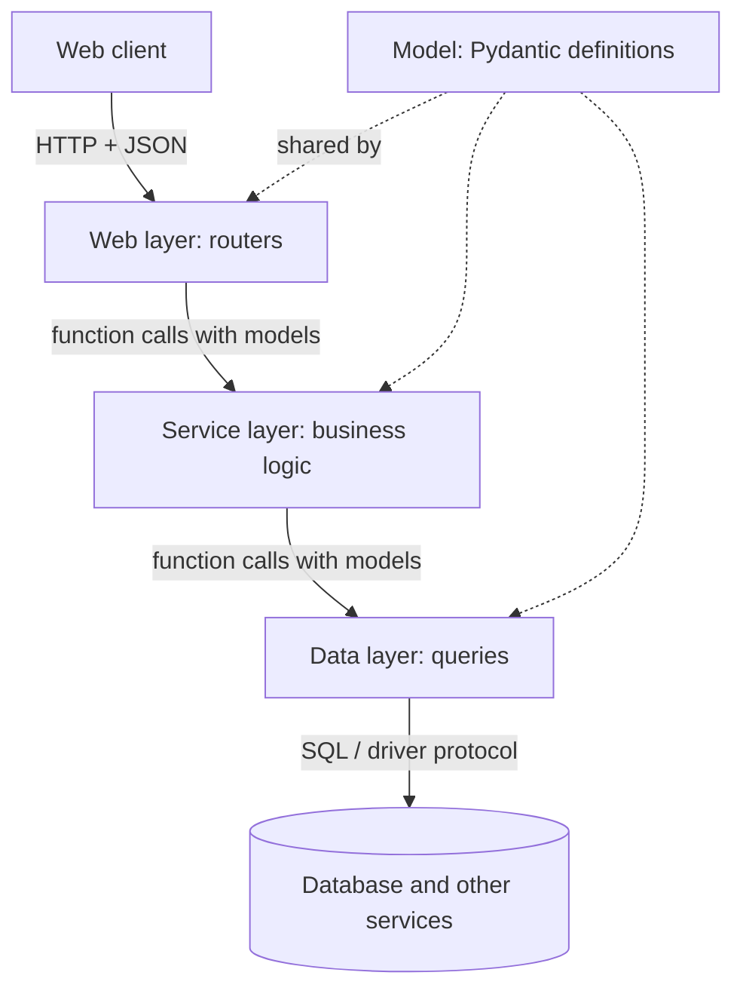
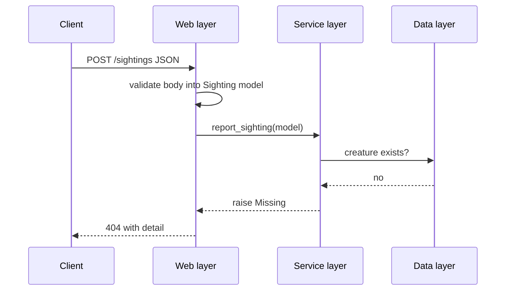

# Layered architecture: web, service, data

Part III of Lubanovic's book ("Making a Website") is organised around one idea: split the application
into **layers** with clear responsibilities and narrow interfaces. It's the difference between an API you
can test, change and reason about, and a pile of endpoint functions that each talk to the database,
enforce business rules, and format HTTP responses all at once.

## The layers



In the book's terms:

- **Web** — the input/output layer over HTTP. It gathers client requests, calls the service layer, and
  returns responses. It knows about paths, status codes, headers, auth tokens.
- **Service** — the business logic: what the site actually *does*. It looks like a library, and calls the
  data layer when it needs something stored or fetched.
- **Data** — access to data stores and other services. It knows SQL, drivers, connection details.
- **Model** — not a layer but the data definitions (Pydantic models) shared by all three.

And the rule, borrowed from Ghostbusters: **don't cross the streams**. Web details must not leak out of
the web layer (no `HTTPException` in services, no `Request` objects passed down). Database details must
not leak out of the data layer (no SQL strings, cursors or ORM sessions in routers). The web layer may
import service modules but should not import data modules.

Why bother? The book's reasons:

- Each layer can be written and understood by specialists.
- Each can be **tested in isolation** (with fakes for the layer below).
- Each can be **replaced or supplemented**: add a CLI or gRPC interface beside the web layer; swap SQLite
  for PostgreSQL in the data layer; neither change touches the business logic.
- Once layers are mixed, separating them later is very hard.

## The book's layout

```text
src/
├── main.py            # creates app, includes routers
├── web/               # FastAPI routers          (explorer.py, creature.py, user.py)
├── service/           # business logic           (explorer.py, creature.py, user.py)
├── data/              # DB access                (init.py, explorer.py, creature.py)
├── model/             # Pydantic models          (explorer.py, creature.py, user.py)
├── fake/              # stub data for early dev  (explorer.py, creature.py)
├── errors.py          # Missing, Duplicate
└── test/              # unit/, full/
```

The running example is a site about cryptids (**creatures**) and the people who seek them
(**explorers**). Lubanovic builds it "middle-out": define the models first, build the web layer against
**fake** data so the API shape can be tried immediately, then add the service layer, then the real data
layer — testing each step.

## One feature through all layers

**Model** (shared definitions):

```python
# model/creature.py
from pydantic import BaseModel

class Creature(BaseModel):
    name: str
    country: str
    area: str
    description: str
    aka: str
```

**Errors** — domain exceptions that carry no HTTP knowledge:

```python
# errors.py
class Missing(Exception):
    def __init__(self, msg: str):
        self.msg = msg

class Duplicate(Exception):
    def __init__(self, msg: str):
        self.msg = msg
```

**Data layer** — the only place that knows SQL (the book uses the stdlib `sqlite3` DB-API directly;
converting rows to models and back is the data layer's job):

```python
# data/creature.py
from .init import curs, IntegrityError
from model.creature import Creature
from errors import Missing, Duplicate

curs.execute("""create table if not exists creature(
                name text primary key, country text, area text, description text, aka text)""")

def row_to_model(row: tuple) -> Creature:
    name, country, area, description, aka = row
    return Creature(name=name, country=country, area=area, description=description, aka=aka)

def get_one(name: str) -> Creature:
    curs.execute("select * from creature where name=:name", {"name": name})
    row = curs.fetchone()
    if row is None:
        raise Missing(msg=f"Creature {name} not found")
    return row_to_model(row)

def create(creature: Creature) -> Creature:
    try:
        curs.execute("insert into creature values (:name, :country, :area, :description, :aka)",
                     creature.model_dump())
    except IntegrityError:
        raise Duplicate(msg=f"Creature {creature.name} already exists")
    return get_one(creature.name)
```

Note the **named parameters** (`:name`) — values are passed separately from the SQL text, which is what
prevents SQL injection.

**Service layer** — business rules. In the early chapters it mostly passes calls through (and that's
fine: the seam exists for when rules arrive):

```python
# service/creature.py
import data.creature as data
from model.creature import Creature

def get_one(name: str) -> Creature:
    return data.get_one(name)

def create(creature: Creature) -> Creature:
    # business rules live here: normalisation, permission checks, cross-entity invariants...
    return data.create(creature)
```

**Web layer** — HTTP in, HTTP out; translates domain errors to status codes:

```python
# web/creature.py
from fastapi import APIRouter, HTTPException
from model.creature import Creature
import service.creature as service
from errors import Missing, Duplicate

router = APIRouter(prefix="/creature")

@router.get("/{name}")
def get_one(name: str) -> Creature:
    try:
        return service.get_one(name)
    except Missing as exc:
        raise HTTPException(status_code=404, detail=exc.msg)

@router.post("", status_code=201)
def create(creature: Creature) -> Creature:
    try:
        return service.create(creature)
    except Duplicate as exc:
        raise HTTPException(status_code=409, detail=exc.msg)
```

Instead of repeating `try/except` in every endpoint, you can register **exception handlers** once
(`@app.exception_handler(Missing)` → 404) — shown in the errors lesson.

## Run it: three layers in one cell

A compressed but faithful version, with an in-memory "database" and a fake swapped in for testing:

```python-run
from pydantic import BaseModel

# ---- model ----
class Creature(BaseModel):
    name: str
    country: str
    description: str = ""

class Missing(Exception): ...
class Duplicate(Exception): ...

# ---- data layer: knows about storage only ----
class CreatureData:
    def __init__(self):
        self._rows = {}                       # pretend this is a SQL table
    def get_one(self, name):
        if name not in self._rows:
            raise Missing(f"Creature {name} not found")
        return Creature(**self._rows[name])
    def create(self, c: Creature):
        if c.name in self._rows:
            raise Duplicate(f"Creature {c.name} already exists")
        self._rows[c.name] = c.model_dump()
        return c

# ---- service layer: business rules, no HTTP, no SQL ----
class CreatureService:
    def __init__(self, data):
        self.data = data
    def get_one(self, name):
        return self.data.get_one(name.strip().lower())
    def create(self, c: Creature):
        c = c.model_copy(update={"name": c.name.strip().lower(), "country": c.country.upper()})
        if len(c.country) != 2:
            raise ValueError("country must be a 2-letter code")       # a business rule
        return self.data.create(c)

# ---- web layer: HTTP in/out, translates errors ----
def web_get(service, name):
    try:
        return 200, service.get_one(name).model_dump()
    except Missing as e:
        return 404, {"detail": str(e)}

def web_create(service, body: dict):
    try:
        return 201, service.create(Creature(**body)).model_dump()
    except Duplicate as e:
        return 409, {"detail": str(e)}
    except ValueError as e:
        return 422, {"detail": str(e)}

svc = CreatureService(CreatureData())
print(web_create(svc, {"name": " Yeti ", "country": "cn", "description": "Hirsute Himalayan"}))
print(web_create(svc, {"name": "yeti", "country": "CN"}))
print(web_get(svc, "YETI"))
print(web_get(svc, "bigfoot"))
print(web_create(svc, {"name": "nessie", "country": "Scotland"}))

# ---- testing the service in isolation with a fake data layer ----
class FakeData:
    def get_one(self, name): return Creature(name=name, country="XX")
    def create(self, c): return c
assert CreatureService(FakeData()).create(Creature(name=" A ", country="us")).country == "US"
print("service unit test passed without any database")
```

Each layer could be rewritten without the others noticing: replace `CreatureData` with PostgreSQL, or add
a CLI that calls `CreatureService` directly.

## Wiring layers with dependencies

The book wires layers with plain module imports (and uses an environment variable to swap in the `fake`
modules for unit tests). In idiomatic modern FastAPI, the same structure is usually wired with
`Depends`, which makes substitution explicit:

```python
def get_creature_service(session: SessionDep) -> CreatureService:
    return CreatureService(CreatureRepository(session))

ServiceDep = Annotated[CreatureService, Depends(get_creature_service)]

@router.get("/{name}")
def get_one(name: str, service: ServiceDep) -> Creature:
    return service.get_one(name)
```

A data-layer class like `CreatureRepository` is the **Repository pattern**, which Lubanovic mentions in
the testing chapter: an abstraction over storage that presents a collection-like interface, so tests can
substitute an in-memory implementation.

## Where does each concern go?

| Concern | Layer |
|---|---|
| Parsing path/query/body, status codes, headers, cookies | Web |
| Authentication (who are you?) — extracting/validating the token | Web (dependencies) |
| Authorization rules that are business rules ("only the owner may edit") | Service |
| Validation of shape and value ranges | Model (Pydantic) |
| Cross-entity rules, workflows, calling several repositories, transactions' *intent* | Service |
| SQL/ORM queries, row ↔ model mapping, connection handling | Data |
| Calling external services (payment, email, model server) | Data (as "gateways"/clients) |
| Logging, metrics, tracing | All layers; the book places these discussions with the service layer |
| Pagination & sorting parameters | Web parses them; data applies them (`LIMIT/OFFSET`, `ORDER BY`) |

Lubanovic's "Pagination and Sorting" section recommends doing the heavy lifting at the lowest layer: let
the database sort and slice, rather than fetching everything and trimming in Python.

> [!INTERVIEW]
> "Why separate web, service and data layers — isn't it boilerplate for CRUD?" — For trivial CRUD the
> service layer may be a pass-through, but the separation buys testability (unit-test rules without HTTP
> or a DB), replaceability (swap databases, add a CLI/worker/gRPC front end that reuses the services), and
> containment of change (schema changes stay in the data layer; API changes stay in the web layer). The
> key discipline is direction: web → service → data, with models shared, domain exceptions instead of
> HTTP exceptions below the web layer, and no SQL above the data layer.

## A rule that needs a service layer

The pass-through services of early chapters make the layer look ceremonial. It earns its place the moment
a use case spans more than one entity. Suppose "an explorer reports a sighting": the creature must exist,
an explorer may log at most three sightings per day, the sighting is stored, and the creature's
`last_seen` is updated — all or nothing.

```python-run
from datetime import date
from pydantic import BaseModel

class Missing(Exception): ...
class RuleViolation(Exception): ...

class Sighting(BaseModel):
    explorer: str
    creature: str
    day: date
    place: str

# ---------- data layer: two repositories sharing one "transaction" ----------
class Db:
    def __init__(self):
        self.creatures = {"yeti": {"name": "yeti", "last_seen": None}}
        self.sightings = []
        self._snapshot = None
    def begin(self):    self._snapshot = ({k: dict(v) for k, v in self.creatures.items()}, list(self.sightings))
    def rollback(self): self.creatures, self.sightings = self._snapshot
    def commit(self):   self._snapshot = None

class CreatureRepo:
    def __init__(self, db): self.db = db
    def exists(self, name): return name in self.db.creatures
    def touch_last_seen(self, name, day): self.db.creatures[name]["last_seen"] = day

class SightingRepo:
    def __init__(self, db, fail_on_insert=False): self.db, self.fail = db, fail_on_insert
    def count_for(self, explorer, day):
        return sum(s.explorer == explorer and s.day == day for s in self.db.sightings)
    def add(self, s):
        if self.fail: raise ConnectionError("database went away")
        self.db.sightings.append(s)

# ---------- service layer: the use case ----------
MAX_PER_DAY = 3

def report_sighting(db, creatures, sightings, s: Sighting) -> Sighting:
    if not creatures.exists(s.creature):
        raise Missing(f"creature {s.creature!r} not found")
    if sightings.count_for(s.explorer, s.day) >= MAX_PER_DAY:
        raise RuleViolation(f"{s.explorer} already reported {MAX_PER_DAY} sightings on {s.day}")
    db.begin()
    try:
        creatures.touch_last_seen(s.creature, s.day)       # write 1
        sightings.add(s)                                   # write 2
        db.commit()
    except Exception:
        db.rollback()                                      # neither write survives
        raise
    return s

# ---------- web layer: translation only ----------
def post_sighting(db, body, **kw):
    try:
        s = report_sighting(db, CreatureRepo(db), SightingRepo(db, **kw), Sighting(**body))
        return 201, s.model_dump(mode="json")
    except Missing as e:        return 404, {"detail": str(e)}
    except RuleViolation as e:  return 409, {"detail": str(e)}
    except ConnectionError:     return 503, {"detail": "storage unavailable"}

db = Db()
body = {"explorer": "ann", "creature": "yeti", "day": "2025-03-01", "place": "Himalayas"}
for _ in range(4):
    print(post_sighting(db, body))
print(post_sighting(db, {**body, "creature": "bigfoot"}))
print(post_sighting(db, {**body, "explorer": "bob", "day": "2025-03-02"}, fail_on_insert=True))
print("last_seen NOT advanced to 03-02 (rolled back with the failed insert):",
      db.creatures["yeti"]["last_seen"], "| stored:", len(db.sightings))
```

Read what each layer contributed. The **data layer** offered small, dumb operations. The **service**
decided what the use case means: the order of checks, the daily limit, and — crucially — the
**transaction boundary** around the two writes. The **web layer** mapped three kinds of failure to three
status codes. None of that logic would be reusable from a CLI or a queue worker if it lived in the
endpoint, and the daily-limit rule can be unit-tested with fake repositories in microseconds.

This also answers a question that comes up in every design review: *who owns the transaction?* Not the
repositories (each sees only its own table) and not the router (it shouldn't know there are two writes).
The service — or a unit-of-work object handed to it — defines the atomic unit.

## Tracing a request and an error through the layers



What crosses each arrow is deliberate: JSON and status codes only on the outside; **models** and **domain
exceptions** on the inside; SQL only beyond the data layer. If you ever see a `Request`, a
`JSONResponse`, a cursor or an ORM session being passed along an inner arrow, a stream has been crossed.

## Smells and their refactorings

| Smell | Why it hurts | Refactoring |
|---|---|---|
| Endpoint longer than a screen | untestable without HTTP, logic not reusable | extract a service function taking and returning models |
| `HTTPException` raised in a service | couples rules to HTTP; breaks workers and CLIs | raise a domain exception; map it with an exception handler |
| Service receives `Request` or `Response` | hidden dependency on web details | pass the specific values (user id, locale) as arguments |
| Router builds a query | storage knowledge leaks upward | move it to a repository method with a meaningful name |
| Data layer returns ORM rows or tuples | callers depend on table layout | convert to models at the boundary |
| Service imports another feature's repository | features become entangled | call that feature's service instead |
| A "utils" module everything imports | becomes a second, unstructured layer | move each function to the layer whose knowledge it uses |
| Every service is a one-line pass-through, forever | the layer adds no value here | for pure CRUD, routing straight to a repository is acceptable — add the service when rules appear |

That final row matters: layering is a tool for managing complexity, and the book is explicit that these
divisions are guidelines. A three-endpoint internal service does not need four packages. The skill is
recognising the moment a rule appears and giving it a proper home.

## Pitfalls

- "Fat routers": SQL and business rules in endpoint functions.
- Raising `HTTPException` from the service or data layer (couples them to HTTP; breaks reuse in workers).
- Returning ORM rows or cursors from the data layer (leaks storage details upward) — return models.
- Over-engineering: five abstract base classes for a three-endpoint service. Layers are, in the author's
  words, guidelines rather than laws of physics.
- Service functions that accept a `Request` object.

## Summary

- Web = HTTP; Service = business logic; Data = storage; Model = shared Pydantic definitions.
- Dependencies point one way: web → service → data. Don't cross the streams.
- Domain exceptions (`Missing`, `Duplicate`) cross layer boundaries; the web layer maps them to 404/409.
- Fakes at layer boundaries make each layer testable alone; FastAPI's `Depends` formalises the wiring.

```quiz
[
  {"q": "In the book's layering, which layer may contain SQL?", "options": ["Web", "Service", "Data", "Model"], "answer": 2,
   "explain": "Database details must not leak out of the data layer."},
  {"q": "The data layer can't find a record. What should it do in this architecture?", "options": ["raise HTTPException(404)", "Raise a domain exception such as Missing; the web layer translates it to 404", "Return a JSONResponse", "Return an empty string"], "answer": 1,
   "explain": "HTTP concepts belong to the web layer only; lower layers signal with domain exceptions."},
  {"q": "Which import direction violates the layering?", "options": ["web imports service", "service imports data", "web imports data directly", "data imports model"], "answer": 2,
   "explain": "The web layer should call the service layer, not reach around it to the data layer."},
  {"q": "What is the role of the 'model' package?", "options": ["A fourth layer below data", "Shared Pydantic data definitions used by all layers", "The ML model weights", "Database migrations"], "answer": 1,
   "explain": "Models are the data shapes passed along the arrows between layers."},
  {"q": "Main testing benefit of the service layer depending on a data interface rather than a concrete DB?", "options": ["Faster SQL", "Business rules can be unit-tested with a fake/in-memory data layer", "No need for Pydantic", "Automatic migrations"], "answer": 1,
   "explain": "Substituting a fake at the boundary isolates the unit under test from the database."},
  {"q": "Where should sorting and pagination of a large table actually be executed?", "options": ["In the browser", "In the web layer after fetching all rows", "In the database via the data layer (ORDER BY / LIMIT)", "In a Pydantic validator"], "answer": 2,
   "explain": "Pushing the work down avoids loading everything into memory; the web layer only parses the parameters."}
]
```

> **Source:** Lubanovic, *FastAPI*, ch. 1 "The Modern Web" (Layers), ch. 8 "Web Layer", ch. 9 "Service Layer", ch. 10 "Data Layer", ch. 12 "Testing" (The Repository Pattern); https://fastapi.tiangolo.com/tutorial/bigger-applications/
