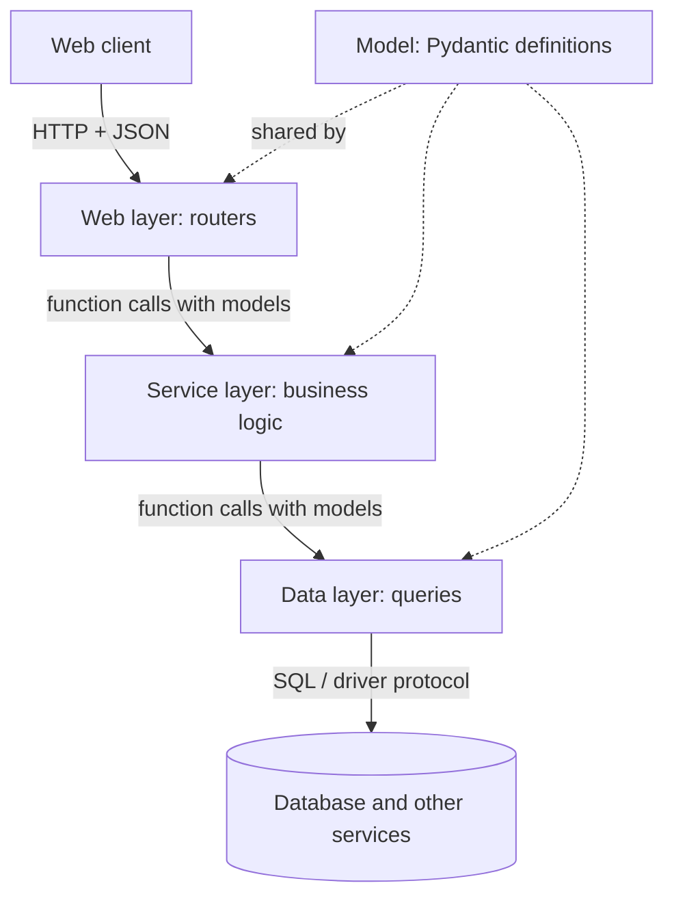
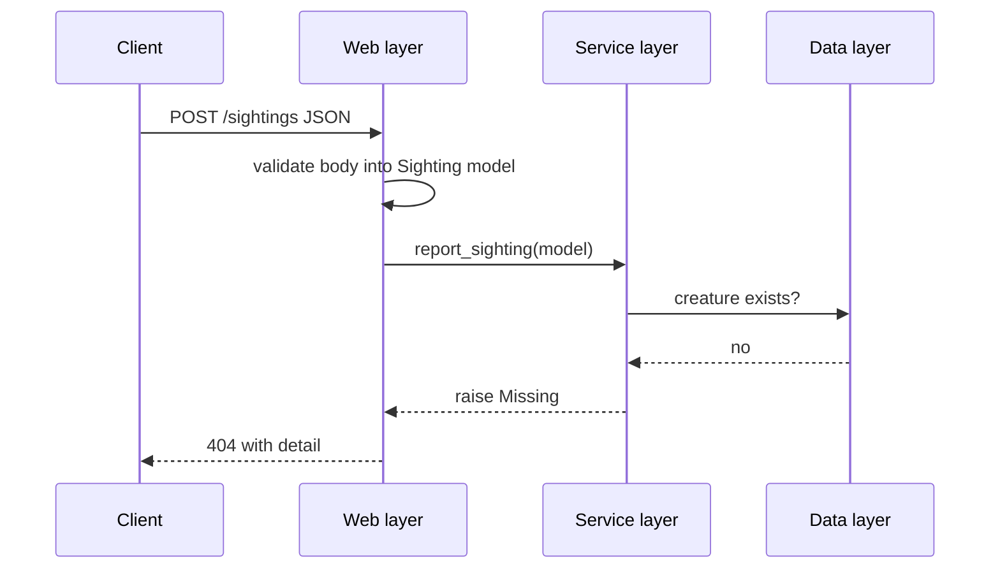

# Layered architecture: web, service, data

> **Before this lesson:** you should be able to split endpoints into routers
> ([lesson 14](#/lesson/fastapi/routers)), raise `HTTPException` and use response models
> ([lesson 5](#/lesson/fastapi/body-responses)) and declare dependencies
> ([lesson 10](#/lesson/fastapi/depends-basics)). No database knowledge is assumed; the little SQL
> that appears is explained in place.

## In plain words

Routers divide a project by *topic*: users here, items there. This lesson divides it a second way,
by *kind of work*. Handling one request involves three quite different jobs:

1. speaking HTTP (reading the request, choosing a status code);
2. applying the rules of your application ("a customer may place at most three orders a day");
3. storing and fetching data.

When one function does all three, it cannot be tested without a running web server and a real
database, its rules cannot be reused anywhere else, and every change risks breaking something
unrelated. A **layered architecture** gives each job its own section of the code, called a
**layer**, and lets the layers talk only through small, well-defined openings.

An everyday picture: a restaurant again. The waiter talks to the customers and knows the menu and
the prices. The chef knows the recipes and decides how a dish is made. The storekeeper knows where
every ingredient is kept. The waiter never walks into the cold store, and the storekeeper never
takes an order. Each can be replaced, trained or inspected without disturbing the other two. In this
lesson the waiter is the **web layer**, the chef is the **service layer** and the storekeeper is the
**data layer**.

Why this matters for a job: this structure, under one name or another, is used by almost every
backend codebase of any size, and interviewers ask "why separate web, service and data layers?" to
find out whether you have worked on one.

## The layers

Part III of Lubanovic's book ("Making a Website") is built around this one idea.



Read the diagram from the top: the client talks HTTP and JSON to the web layer; the web layer calls
functions in the service layer; the service layer calls functions in the data layer; the data layer
talks to the database. The dotted lines show that the model definitions are used by all three.

In the book's terms:

- **Web** is the input/output layer for HTTP. It collects client requests, calls the service layer
  and returns responses. It knows about paths, status codes, headers and login tokens.
- **Service** holds the **business logic**: the rules and procedures that make the application what
  it is, independent of how it is reached or where its data is kept. It reads like an ordinary
  library, and it calls the data layer when something must be stored or fetched.
- **Data** provides access to databases and other outside services. It knows the query language,
  the connection details and the format of stored rows.
- **Model** is not a layer. It is the set of data definitions (Pydantic models) shared by all three.

The rule that holds this together is borrowed from the film *Ghostbusters*: **don't cross the
streams**. Details of the web must not leak out of the web layer: no `HTTPException` in services, no
`Request` objects passed downwards. Details of the database must not leak out of the data layer: no
query text or database connection objects in routers. The web layer may import service modules and
should not import data modules.

Why go to the trouble? The book's reasons:

- Each layer can be written and understood by a specialist.
- Each can be **tested alone**, with a fake standing in for the layer beneath it.
- Each can be **replaced or added to**. Put a command-line tool or another kind of interface beside
  the web layer; exchange one database for another in the data layer. Neither change touches the
  business logic.
- Once the layers have been mixed together, separating them later is very hard.

## The book's layout

```text
src/
├── main.py            # creates app, includes routers
├── web/               # FastAPI routers          (explorer.py, creature.py, user.py)
├── service/           # business logic           (explorer.py, creature.py, user.py)
├── data/              # DB access                (init.py, explorer.py, creature.py)
├── model/             # Pydantic models          (explorer.py, creature.py, user.py)
├── fake/              # stub data for early dev  (explorer.py, creature.py)
├── errors.py          # Missing, Duplicate
└── test/              # unit/, full/
```

Each layer is a folder, and each resource has one file in each folder. The running example is a
site about legendary **creatures** and the **explorers** who look for them. Lubanovic builds it from
the middle outwards: define the models first; build the web layer on top of **fake** data, so that
the shape of the API can be tried out at once; then add the service layer; then the real data layer.
Each step is tested before the next begins.

## One feature through all layers

Follow one resource, the creature, through every layer.

**Model.** The shared definition:

```python
# model/creature.py
from pydantic import BaseModel

class Creature(BaseModel):
    name: str
    country: str
    area: str
    description: str
    aka: str
```

**Errors.** Two exception classes of the application's own. They say what went wrong in the
application's vocabulary and carry no knowledge of HTTP. Exceptions of this kind are called **domain
exceptions** ("domain" meaning the subject area the program deals with):

```python
# errors.py
class Missing(Exception):
    def __init__(self, msg: str):
        self.msg = msg

class Duplicate(Exception):
    def __init__(self, msg: str):
        self.msg = msg
```

**Data layer.** The only place that knows **SQL** (Structured Query Language, the language used to
talk to relational databases; lesson 16 covers it). The book uses Python's built-in `sqlite3` module
directly. Turning database rows into models and back is the data layer's job:

```python
# data/creature.py
from .init import curs, IntegrityError
from model.creature import Creature
from errors import Missing, Duplicate

curs.execute("""create table if not exists creature(
                name text primary key, country text, area text, description text, aka text)""")

def row_to_model(row: tuple) -> Creature:
    name, country, area, description, aka = row
    return Creature(name=name, country=country, area=area, description=description, aka=aka)

def get_one(name: str) -> Creature:
    curs.execute("select * from creature where name=:name", {"name": name})
    row = curs.fetchone()
    if row is None:
        raise Missing(msg=f"Creature {name} not found")
    return row_to_model(row)

def create(creature: Creature) -> Creature:
    try:
        curs.execute("insert into creature values (:name, :country, :area, :description, :aka)",
                     creature.model_dump())
    except IntegrityError:
        raise Duplicate(msg=f"Creature {creature.name} already exists")
    return get_one(creature.name)
```

Reading it:

- `curs` is a **cursor**, the object through which SQL statements are sent to the database. It is
  created in `data/init.py`.
- The `create table if not exists` statement makes sure a table with five columns exists.
- `row_to_model` converts one row (a tuple of five values) into a `Creature` model.
- `get_one` runs a `select` to find a creature by name. If no row comes back it raises `Missing`;
  otherwise it returns a model.
- `create` runs an `insert`. If the database reports that the name already exists
  (`IntegrityError`), the function raises `Duplicate` instead.

Notice the **named parameters** such as `:name`. The value is passed separately from the SQL text,
never pasted into it. That separation is what prevents **SQL injection**, an attack in which a user
supplies input that the database would otherwise run as part of the command.

**Service layer.** The business rules. In the early chapters it mostly passes calls straight
through, and that is acceptable: the layer is in place for the day rules arrive.

```python
# service/creature.py
import data.creature as data
from model.creature import Creature

def get_one(name: str) -> Creature:
    return data.get_one(name)

def create(creature: Creature) -> Creature:
    # business rules live here: normalisation, permission checks, cross-entity invariants...
    return data.create(creature)
```

**Web layer.** HTTP in, HTTP out. It translates domain exceptions into status codes:

```python
# web/creature.py
from fastapi import APIRouter, HTTPException
from model.creature import Creature
import service.creature as service
from errors import Missing, Duplicate

router = APIRouter(prefix="/creature")

@router.get("/{name}")
def get_one(name: str) -> Creature:
    try:
        return service.get_one(name)
    except Missing as exc:
        raise HTTPException(status_code=404, detail=exc.msg)

@router.post("", status_code=201)
def create(creature: Creature) -> Creature:
    try:
        return service.create(creature)
    except Duplicate as exc:
        raise HTTPException(status_code=409, detail=exc.msg)
```

Each endpoint calls the service and catches the domain exception that might come back: `Missing`
becomes a 404, and `Duplicate` becomes a 409. The web layer is the only place where those numbers
appear.

Repeating `try` / `except` in every endpoint gets tedious. You can instead register an **exception
handler** once for the whole app (`@app.exception_handler(Missing)` returning a 404), which lesson
21 shows.

## Run it: three layers in one cell

A compressed but faithful version, with a dictionary playing the database:

```python-run
from pydantic import BaseModel

# ---- model ----
class Creature(BaseModel):
    name: str
    country: str
    description: str = ""

class Missing(Exception): ...
class Duplicate(Exception): ...

# ---- data layer: knows about storage only ----
class CreatureData:
    def __init__(self):
        self._rows = {}                       # pretend this is a SQL table
    def get_one(self, name):
        if name not in self._rows:
            raise Missing(f"Creature {name} not found")
        return Creature(**self._rows[name])
    def create(self, c: Creature):
        if c.name in self._rows:
            raise Duplicate(f"Creature {c.name} already exists")
        self._rows[c.name] = c.model_dump()
        return c

# ---- service layer: business rules, no HTTP, no SQL ----
class CreatureService:
    def __init__(self, data):
        self.data = data
    def get_one(self, name):
        return self.data.get_one(name.strip().lower())
    def create(self, c: Creature):
        c = c.model_copy(update={"name": c.name.strip().lower(), "country": c.country.upper()})
        if len(c.country) != 2:
            raise ValueError("country must be a 2-letter code")       # a business rule
        return self.data.create(c)

# ---- web layer: HTTP in/out, translates errors ----
def web_get(service, name):
    try:
        return 200, service.get_one(name).model_dump()
    except Missing as e:
        return 404, {"detail": str(e)}

def web_create(service, body: dict):
    try:
        return 201, service.create(Creature(**body)).model_dump()
    except Duplicate as e:
        return 409, {"detail": str(e)}
    except ValueError as e:
        return 422, {"detail": str(e)}

svc = CreatureService(CreatureData())
print(web_create(svc, {"name": " Yeti ", "country": "cn", "description": "Hirsute Himalayan"}))
print(web_create(svc, {"name": "yeti", "country": "CN"}))
print(web_get(svc, "YETI"))
print(web_get(svc, "bigfoot"))
print(web_create(svc, {"name": "nessie", "country": "Scotland"}))

# ---- testing the service in isolation with a fake data layer ----
class FakeData:
    def get_one(self, name): return Creature(name=name, country="XX")
    def create(self, c): return c
assert CreatureService(FakeData()).create(Creature(name=" A ", country="us")).country == "US"
print("service unit test passed without any database")
```

Reading it layer by layer:

- **Data** (`CreatureData`) only stores and fetches. It raises `Missing` or `Duplicate` and knows no
  rules.
- **Service** (`CreatureService`) is handed a data object when it is created and applies the rules:
  names are trimmed and lower-cased, country codes are upper-cased, and a country must be two
  letters long. It knows nothing of HTTP and nothing of storage.
- **Web** (`web_get`, `web_create`) turns results into (status, body) pairs and maps each kind of
  exception to a status code.

The five requests print:

- `201` with the name tidied to `yeti` and the country to `CN`;
- `409` for a second yeti (`Creature yeti already exists`);
- `200` for `YETI`, because the service normalised the name before looking it up;
- `404` for `bigfoot`;
- `422` for the country `Scotland`, which breaks the two-letter rule.

The final lines are the benefit in miniature. `FakeData` is a stand-in data layer that stores
nothing. The service is created with it, and its upper-casing rule is checked with no database of
any kind.

Each layer could be rewritten without the others noticing: replace `CreatureData` with a real
PostgreSQL database, or add a command-line tool that calls `CreatureService` directly.

## Wiring layers with dependencies

The book connects its layers with ordinary module imports, and uses an environment variable to swap
in the `fake` modules for unit tests. In current FastAPI style the same structure is usually wired
with `Depends`, which makes the substitution explicit:

```python
def get_creature_service(session: SessionDep) -> CreatureService:
    return CreatureService(CreatureRepository(session))

ServiceDep = Annotated[CreatureService, Depends(get_creature_service)]

@router.get("/{name}")
def get_one(name: str, service: ServiceDep) -> Creature:
    return service.get_one(name)
```

`get_creature_service` builds a service around a data object that uses the request's database
session. The endpoint asks for a `ServiceDep` and never learns how the service was put together. A
test can override `get_creature_service` (lesson 11) to supply a service built on a fake.

A data-layer class such as `CreatureRepository` is an example of the **Repository pattern**, which
Lubanovic mentions in his testing chapter: an object that hides the storage behind a
collection-like set of methods (`get`, `add`, `list`), so that tests can substitute an
implementation held in memory.

## Where does each concern go?

| Concern | Layer |
|---|---|
| Parsing path/query/body, status codes, headers, cookies | Web |
| Authentication (who are you?) — extracting/validating the token | Web (dependencies) |
| Authorization rules that are business rules ("only the owner may edit") | Service |
| Validation of shape and value ranges | Model (Pydantic) |
| Cross-entity rules, workflows, calling several repositories, transactions' *intent* | Service |
| SQL/ORM queries, row ↔ model mapping, connection handling | Data |
| Calling external services (payment, email, model server) | Data (as "gateways"/clients) |
| Logging, metrics, tracing | All layers; the book places these discussions with the service layer |
| Pagination & sorting parameters | Web parses them; data applies them (`LIMIT/OFFSET`, `ORDER BY`) |


Lubanovic's "Pagination and Sorting" section recommends doing the heavy work at the lowest layer:
let the database sort and slice, instead of fetching everything and trimming it in Python.

> [!INTERVIEW]
> "Why separate web, service and data layers — isn't it boilerplate for CRUD?" — For trivial CRUD the
> service layer may be a pass-through, but the separation buys testability (unit-test the rules
> without HTTP or a database), replaceability (swap databases; add a command-line tool, a queue
> worker or a gRPC front end that reuses the services) and containment of change (changes to tables
> stay in the data layer; changes to the API stay in the web layer). The key discipline is direction:
> web → service → data, with models shared, domain exceptions instead of HTTP exceptions below the
> web layer, and no SQL above the data layer.

## A rule that needs a service layer

Pass-through services make the layer look like ceremony. It earns its place the moment one action
involves more than one kind of record. Suppose "an explorer reports a sighting". The creature must
exist. An explorer may log at most three sightings a day. The sighting is stored, and the creature's
`last_seen` date is updated, with both changes happening or neither.

```python-run
from datetime import date
from pydantic import BaseModel

class Missing(Exception): ...
class RuleViolation(Exception): ...

class Sighting(BaseModel):
    explorer: str
    creature: str
    day: date
    place: str

# ---------- data layer: two repositories sharing one "transaction" ----------
class Db:
    def __init__(self):
        self.creatures = {"yeti": {"name": "yeti", "last_seen": None}}
        self.sightings = []
        self._snapshot = None
    def begin(self):    self._snapshot = ({k: dict(v) for k, v in self.creatures.items()}, list(self.sightings))
    def rollback(self): self.creatures, self.sightings = self._snapshot
    def commit(self):   self._snapshot = None

class CreatureRepo:
    def __init__(self, db): self.db = db
    def exists(self, name): return name in self.db.creatures
    def touch_last_seen(self, name, day): self.db.creatures[name]["last_seen"] = day

class SightingRepo:
    def __init__(self, db, fail_on_insert=False): self.db, self.fail = db, fail_on_insert
    def count_for(self, explorer, day):
        return sum(s.explorer == explorer and s.day == day for s in self.db.sightings)
    def add(self, s):
        if self.fail: raise ConnectionError("database went away")
        self.db.sightings.append(s)

# ---------- service layer: the use case ----------
MAX_PER_DAY = 3

def report_sighting(db, creatures, sightings, s: Sighting) -> Sighting:
    if not creatures.exists(s.creature):
        raise Missing(f"creature {s.creature!r} not found")
    if sightings.count_for(s.explorer, s.day) >= MAX_PER_DAY:
        raise RuleViolation(f"{s.explorer} already reported {MAX_PER_DAY} sightings on {s.day}")
    db.begin()
    try:
        creatures.touch_last_seen(s.creature, s.day)       # write 1
        sightings.add(s)                                   # write 2
        db.commit()
    except Exception:
        db.rollback()                                      # neither write survives
        raise
    return s

# ---------- web layer: translation only ----------
def post_sighting(db, body, **kw):
    try:
        s = report_sighting(db, CreatureRepo(db), SightingRepo(db, **kw), Sighting(**body))
        return 201, s.model_dump(mode="json")
    except Missing as e:        return 404, {"detail": str(e)}
    except RuleViolation as e:  return 409, {"detail": str(e)}
    except ConnectionError:     return 503, {"detail": "storage unavailable"}

db = Db()
body = {"explorer": "ann", "creature": "yeti", "day": "2025-03-01", "place": "Himalayas"}
for _ in range(4):
    print(post_sighting(db, body))
print(post_sighting(db, {**body, "creature": "bigfoot"}))
print(post_sighting(db, {**body, "explorer": "bob", "day": "2025-03-02"}, fail_on_insert=True))
print("last_seen NOT advanced to 03-02 (rolled back with the failed insert):",
      db.creatures["yeti"]["last_seen"], "| stored:", len(db.sightings))
```

What each part does:

- `Db` is a toy database with two tables and a crude transaction: `begin` takes a copy of the data,
  `rollback` restores the copy, and `commit` discards it.
- `CreatureRepo` and `SightingRepo` are repositories, one per table, each offering a few small
  operations. `SightingRepo` can be told to fail, to imitate a database that has gone away.
- `report_sighting` is the service function, the **use case**. It checks that the creature exists,
  checks the daily limit, and then performs the two writes between `begin` and `commit`. If either
  write raises, it rolls back and re-raises.
- `post_sighting` is the web layer. It maps `Missing` to 404, `RuleViolation` to 409 and a
  connection failure to 503.

The output: three `201` lines for Ann's first three sightings; a `409` for the fourth
(`ann already reported 3 sightings on 2025-03-01`); a `404` for the unknown creature `bigfoot`; and
a `503` when the insert fails for Bob. The last line is the important one. `last_seen` is still
`2025-03-01` and three sightings are stored. Write 1 (updating `last_seen` to 2 March) had already
been made when write 2 failed, and the rollback undid it.

Now look at what each layer contributed. The **data layer** offered small operations with no
judgement of their own. The **service** decided what the use case means: the order of the checks,
the daily limit, and above all the **transaction boundary**, the points where the all-or-nothing
unit begins and ends. The **web layer** mapped three kinds of failure to three status codes. If that
logic lived in the endpoint, none of it could be reused from a command-line tool or a queue worker.
And the daily-limit rule can be unit-tested with fake repositories in microseconds.

This also answers a question raised in every design review: *who owns the transaction?* Not the
repositories, since each sees only its own table. Not the router, which should not even know that
there are two writes. The service, or a unit-of-work object handed to it (lesson 11), defines the
unit that must succeed or fail as a whole.

## Tracing a request and an error through the layers



What travels along each arrow is deliberate. On the outside, only JSON and status codes. On the
inside, **models** and **domain exceptions**. Beyond the data layer, SQL. If you ever see a
`Request`, a `JSONResponse`, a cursor or a database session being passed along one of the inner
arrows, a stream has been crossed.

## Smells and their refactorings

A "code smell" is a visible sign that the structure of some code is going wrong. These are the
common ones for layering, each with its cure:

| Smell | Why it hurts | Refactoring |
|---|---|---|
| Endpoint longer than a screen | untestable without HTTP, logic not reusable | extract a service function taking and returning models |
| `HTTPException` raised in a service | couples rules to HTTP; breaks workers and CLIs | raise a domain exception; map it with an exception handler |
| Service receives `Request` or `Response` | hidden dependency on web details | pass the specific values (user id, locale) as arguments |
| Router builds a query | storage knowledge leaks upward | move it to a repository method with a meaningful name |
| Data layer returns ORM rows or tuples | callers depend on table layout | convert to models at the boundary |
| Service imports another feature's repository | features become entangled | call that feature's service instead |
| A "utils" module everything imports | becomes a second, unstructured layer | move each function to the layer whose knowledge it uses |
| Every service is a one-line pass-through, forever | the layer adds no value here | for pure CRUD, routing straight to a repository is acceptable — add the service when rules appear |

The final row matters. Layering is a tool for managing complexity, and the book says plainly that
these divisions are guidelines. An internal service with three endpoints does not need four
packages. The skill is noticing the moment a rule appears and giving it a proper home.

## Pitfalls

- "Fat routers": SQL and business rules inside endpoint functions.
- Raising `HTTPException` from the service or data layer. That ties them to HTTP and prevents their
  reuse in workers.
- Returning raw database rows or cursors from the data layer, which leaks storage details upwards.
  Return models.
- Over-engineering: five abstract base classes for a service with three endpoints. Layers are, in
  the author's words, guidelines and not laws of physics.
- Service functions that accept a `Request` object.

## Summary

- Web = HTTP; Service = business logic; Data = storage; Model = shared Pydantic definitions.
- Dependencies point one way: web → service → data. Don't cross the streams.
- Domain exceptions (`Missing`, `Duplicate`) cross the layer boundaries; the web layer maps them to
  404 and 409.
- Fakes at the layer boundaries make each layer testable alone; FastAPI's `Depends` makes the wiring
  explicit.

## Glossary

- **Layer** — a section of the code responsible for one kind of work.
- **Layered architecture** — organising a program as layers that call each other in one direction.
- **Web layer** — the code that speaks HTTP: routers, status codes, headers.
- **Service layer** — the code that holds the application's rules and procedures.
- **Data layer** — the code that stores and fetches data.
- **Business logic** — the rules that make the application what it is.
- **Domain exception** — an error class in the application's own vocabulary (`Missing`, `Duplicate`).
- **SQL** — the language for querying relational databases.
- **Cursor** — the object through which SQL statements are sent and results read.
- **SQL injection** — an attack that smuggles commands into a query through user input.
- **Repository pattern** — hiding storage behind an object with collection-like methods.
- **Fake** — a simplified stand-in for a layer, used in tests.
- **Use case** — one complete action of the application, such as "report a sighting".
- **Transaction boundary** — where an all-or-nothing group of writes begins and ends.
- **Pass-through** — a function that only forwards its call to the next layer.
- **Code smell** — a visible sign of a structural problem in code.

```quiz
[
  {"q": "In the book's layering, which layer may contain SQL?", "options": ["Web", "Service", "Data", "Model"], "answer": 2,
   "explain": "Database details must not leak out of the data layer."},
  {"q": "The data layer can't find a record. What should it do in this architecture?", "options": ["raise HTTPException(404)", "Raise a domain exception such as Missing; the web layer translates it to 404", "Return a JSONResponse", "Return an empty string"], "answer": 1,
   "explain": "HTTP concepts belong to the web layer only; lower layers signal with domain exceptions."},
  {"q": "Which import direction violates the layering?", "options": ["web imports service", "service imports data", "web imports data directly", "data imports model"], "answer": 2,
   "explain": "The web layer should call the service layer, not reach around it to the data layer."},
  {"q": "What is the role of the 'model' package?", "options": ["A fourth layer below data", "Shared Pydantic data definitions used by all layers", "The ML model weights", "Database migrations"], "answer": 1,
   "explain": "Models are the data shapes passed along the arrows between layers."},
  {"q": "Main testing benefit of the service layer depending on a data interface rather than a concrete DB?", "options": ["Faster SQL", "Business rules can be unit-tested with a fake/in-memory data layer", "No need for Pydantic", "Automatic migrations"], "answer": 1,
   "explain": "Substituting a fake at the boundary isolates the unit under test from the database."},
  {"q": "Where should sorting and pagination of a large table actually be executed?", "options": ["In the browser", "In the web layer after fetching all rows", "In the database via the data layer (ORDER BY / LIMIT)", "In a Pydantic validator"], "answer": 2,
   "explain": "Pushing the work down avoids loading everything into memory; the web layer only parses the parameters."}
]
```

> **Source:** Lubanovic, *FastAPI*, ch. 1 "The Modern Web" (Layers), ch. 8 "Web Layer", ch. 9 "Service Layer", ch. 10 "Data Layer", ch. 12 "Testing" (The Repository Pattern); https://fastapi.tiangolo.com/tutorial/bigger-applications/
