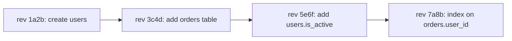

# Migrations, pooling and async drivers

> **Before this lesson:** you should know tables, columns, sessions, the engine and its connection
> pool from [lesson 16](#/lesson/fastapi/sql-sqlmodel), and coroutines, `await` and the thread pool
> from [lesson 12](#/lesson/fastapi/async-fundamentals). Deployment terms such as "replica" are
> explained when they appear.

## In plain words

In the last lesson a single line, `SQLModel.metadata.create_all(engine)`, created the database
tables. That is fine for a tutorial, because it creates tables that are missing. It does **not**
change tables that already exist. On the day you add a field to a model, the real database, full of
real customer data, still has the old table. Your new code asks for a column that is not there, and
every request fails with "column does not exist".

The arrangement of tables and columns in a database is called its **schema**. A program's schema
has to change as the program grows, without losing the data and, ideally, without switching the
service off. A **migration** is a small script that makes one such change. The scripts are numbered
and kept with the code, so that any copy of the database can be brought up to date step by step.

An everyday picture: renovating a shop while it stays open. You cannot knock down the wall while
customers are standing next to it. You build the new doorway first, then direct people through it,
and only when nobody uses the old one do you brick it up. Each step is small, planned, written
down, and done in the right order.

This lesson covers migrations with the standard tool, Alembic, and then two more topics that matter
once a service is live: how many database connections you may open (pooling), and what changes when
the database code is written with `async`.

Why this matters for a job: "how do you change a database schema without downtime?" is a classic
interview question, and connection-pool arithmetic is another. Both are also the cause of real
outages.

## Migrations with Alembic

**Alembic** is the migration tool that goes with SQLAlchemy. Each migration is a file with an
identifier, called a **revision**, and a pointer to the revision that comes before it, so the files
form a chain:



The database itself records which revision it has reached, in a small table named
`alembic_version`. Releasing a new version of the program then means "bring the database to the
newest revision, from whichever one it is on now".

Set-up:

```bash
pip install alembic
alembic init migrations            # creates alembic.ini and migrations/ (env.py, versions/)
```

The second command creates a configuration file and a `migrations/` folder containing `env.py`
(Alembic's start-up script) and `versions/` (where the migration files will go).

In `migrations/env.py`, tell Alembic where your table definitions are, and take the database address
from your settings (lesson 9) and not from a value written into `alembic.ini`:

```python
from app.config import get_settings
from app.models import Base            # or: from sqlmodel import SQLModel; import app.models

config.set_main_option("sqlalchemy.url", str(get_settings().database_url))
target_metadata = Base.metadata        # or SQLModel.metadata
```

`metadata` is SQLAlchemy's catalogue of all the tables your model classes describe. Alembic compares
that catalogue with the real database.

The daily routine:

```bash
alembic revision --autogenerate -m "add is_active to users"   # diff models vs DB -> new script
# ... REVIEW the generated file ...
alembic upgrade head                 # apply all pending migrations
alembic downgrade -1                 # undo the last one
alembic current                      # which revision is the DB at?
alembic history                      # the chain
```

`revision --autogenerate` compares your models with the database and writes a new migration file
containing the difference. `upgrade head` applies every migration not yet applied (`head` means "the
newest"). `downgrade -1` undoes the latest one. `current` and `history` show where the database is
and what the chain looks like.

A generated migration looks like this:

```python
"""add is_active to users"""
revision = "5e6f7a8b9c0d"
down_revision = "3c4d5e6f7a8b"

from alembic import op
import sqlalchemy as sa

def upgrade() -> None:
    op.add_column("users", sa.Column("is_active", sa.Boolean(), nullable=False,
                                     server_default=sa.true()))

def downgrade() -> None:
    op.drop_column("users", "is_active")
```

- `revision` is this file's identifier, and `down_revision` is its predecessor's.
- `upgrade()` makes the change: add a column `is_active` to `users`. `nullable=False` forbids empty
  values, so `server_default=sa.true()` supplies a value for the rows that already exist.
- `downgrade()` reverses the change by dropping the column.

**Autogenerate produces a draft, not a verdict.** It compares the catalogue with the live schema and
notices added and removed tables and columns, but it cannot see your intention. A *rename* looks to
it like "drop one column and add another", which would destroy the data in that column. It also
misses some changes of type and of constraints. Always read the generated file before applying it.

Here is the essence of what a migration runner does, a version table plus an ordered list of
scripts, in a form you can run:

```python-run
import sqlite3

MIGRATIONS = [   # (revision, upgrade SQL)
    ("001_create_users", "create table users(id integer primary key, email text unique not null)"),
    ("002_add_is_active", "alter table users add column is_active integer not null default 1"),
    ("003_create_orders", "create table orders(id integer primary key, user_id integer references users(id), total real)"),
]

def upgrade(conn, target=None):
    conn.execute("create table if not exists schema_version(rev text)")
    row = conn.execute("select rev from schema_version").fetchone()
    current = row[0] if row else None
    revs = [r for r, _ in MIGRATIONS]
    start = revs.index(current) + 1 if current else 0
    for rev, sql in MIGRATIONS[start:]:
        conn.execute(sql)
        conn.execute("delete from schema_version")
        conn.execute("insert into schema_version values (?)", (rev,))
        conn.commit()
        print("applied", rev)
        if rev == target:
            break

conn = sqlite3.connect(":memory:")
upgrade(conn, target="001_create_users")       # an "old" production database
conn.execute("insert into users(email) values ('ann@example.com')")
print("-- deploy new version --")
upgrade(conn)                                   # only the missing migrations run; data is preserved
print(conn.execute("select * from users").fetchall())
upgrade(conn)                                   # idempotent: nothing left to do
print("at:", conn.execute("select rev from schema_version").fetchone()[0])
```

- `MIGRATIONS` is the ordered list: a name and the SQL for each step.
- `upgrade` makes sure a one-row table `schema_version` exists, reads the current revision from it,
  finds that revision's position in the list, and runs every later migration, recording each new
  revision as it goes.
- The demo first upgrades an empty database only as far as step 001, as if it were an old
  production database, and inserts a user.

The output shows `applied 001_create_users`; then, after "deploy new version", `applied 002...` and
`applied 003...` and nothing else. Step 001 was not run again. The user row is still there, now
with a third value `1` for the new `is_active` column: `[(1, 'ann@example.com', 1)]`. A third call
to `upgrade` prints nothing, because nothing is left to do. Running it any number of times is safe.

### Zero-downtime changes: expand, migrate, contract

A new version of a service is usually released gradually. Several copies of the program, called
**replicas**, run side by side, and they are replaced one at a time so that the service never goes
dark. This is a **rolling deploy**. Its consequence: for a while, **old code and new code run at the
same time** against one database. A migration that the old code cannot live with causes an outage.

The safe sequence for a breaking change, such as renaming `fullname` to `full_name`:

1. **Expand.** Add the new column, allowing it to be empty. Old code ignores it.
2. Release code that **writes both** columns, and reads the new one with the old one as a fallback.
3. **Backfill.** Copy the old column into the new one for the rows that already exist, in batches.
   One giant `UPDATE` would **lock** the table (reserve it so that others must wait) for too long.
4. Release code that uses only the new column.
5. **Contract.** Drop the old column in a later migration.

Other rules: adding a column that forbids empty values requires a default, or a backfill first;
building an index on a large PostgreSQL table should use `CREATE INDEX CONCURRENTLY`, which does not
block writes; and set a `lock_timeout`, so that a migration fails quickly instead of waiting behind
long transactions and blocking all traffic while it waits.

### Where to run migrations

Not in the application's start-up code when there are several replicas: they would all try to
migrate at once. Run `alembic upgrade head` as a **separate, single step** of the release: a job in
the deployment pipeline, a Kubernetes Job, or a release command on your hosting platform. The
automated tests should also build their schema through the migrations at least once, so that the
migration files themselves are tested.

## Connection pools

Opening a PostgreSQL connection involves a network handshake, encryption set-up, a login and a new
server process. It costs several milliseconds and several megabytes. A **pool** keeps a number of
connections open and lends them out (lesson 16). SQLAlchemy's engine has one built in, with these
controls:

```python
engine = create_engine(
    url,
    pool_size=10,          # connections kept open
    max_overflow=5,        # extra allowed under burst (closed when returned)
    pool_timeout=10,       # seconds to wait for a free connection before raising
    pool_recycle=1800,     # replace connections older than 30 min (firewalls/idle timeouts)
    pool_pre_ping=True,    # test a connection before use; transparently replace dead ones
)
```

A piece of arithmetic that interviewers like:

$$\text{max DB connections used} = \text{workers} \times (\text{pool\_size} + \text{max\_overflow}) \times \text{replicas}$$

Each worker process has its own engine and so its own pool. Four workers × (10 + 5) × 3 replicas is
180 connections, which is more than PostgreSQL's default limit of 100. Either make the pools
smaller or put **PgBouncer**, a separate program that shares a few real connections among many
clients, in front of the database. More connections do not mean more work done: the database
server has a limited number of processor cores, and beyond a certain point additional connections
only compete with each other.

A request holds a connection from its first query until its session is closed. Therefore: keep
transactions short, do not call slow outside services while holding a session, and do not hold one
for the length of a streamed response.

## Async database access

With a synchronous driver, every query in progress occupies one thread from FastAPI's pool of 40
(lesson 12). An **async driver** lets the event loop wait on thousands of queries with no threads at
all. SQLAlchemy supports this through `create_async_engine` and `AsyncSession`, on top of async
drivers such as **asyncpg** or **psycopg 3** (PostgreSQL), **aiosqlite** (SQLite) and **asyncmy** or
**aiomysql** (MySQL).

```python
from sqlalchemy.ext.asyncio import AsyncSession, async_sessionmaker, create_async_engine
from sqlalchemy import select

engine = create_async_engine("postgresql+asyncpg://app:app@db/app", pool_pre_ping=True)
SessionLocal = async_sessionmaker(engine, expire_on_commit=False)

async def get_session():
    async with SessionLocal() as session:
        yield session

SessionDep = Annotated[AsyncSession, Depends(get_session)]

@app.get("/users/{user_id}", response_model=UserPublic)
async def read_user(user_id: int, session: SessionDep):
    user = await session.get(User, user_id)
    if user is None:
        raise HTTPException(404, "User not found")
    return user

@app.get("/users", response_model=list[UserPublic])
async def list_users(session: SessionDep, limit: int = 50):
    result = await session.execute(select(User).limit(limit))
    return result.scalars().all()

@asynccontextmanager
async def lifespan(app: FastAPI):
    yield
    await engine.dispose()            # close the pool on shutdown
```

Compare this with the synchronous version in lesson 16:

- `create_async_engine` and a `postgresql+asyncpg://` address select the async driver.
- `async_sessionmaker` produces a function that makes sessions.
- The session dependency is an `async def` generator using `async with`.
- Endpoints are `async def`, and every call that talks to the database is awaited:
  `await session.get(...)`, `await session.execute(...)`.
- The lifespan closes the pool at shut-down with `await engine.dispose()`.

The differences from synchronous code that catch people out:

- Every operation that performs I/O needs `await`: `execute`, `get`, `commit`, `refresh`, `flush`.
- **No automatic lazy loading.** Touching a related attribute that has not been loaded would require
  a query in the middle of an ordinary attribute access, which cannot be awaited. The result is a
  `MissingGreenlet` error. Eager-load what you need with `selectinload`.
- `expire_on_commit=False` keeps attributes readable after a commit. Otherwise reading one would
  trigger a hidden re-fetch, with the same problem.
- One `AsyncSession` must not be used by several tasks at once. Do not `asyncio.gather` several
  queries on the same session; use separate sessions or run the queries in turn.
- Alembic works with an async engine through its async template (`alembic init -t async`).

### Is async DB worth it?

| | Sync driver + `def` endpoints | Async driver + `async def` |
|---|---|---|
| Simplicity | simpler, lazy loading works | more rules |
| Concurrency ceiling per worker | thread pool (40) | thousands of waiting coroutines |
| Wins when | CRUD with fast queries | many slow/concurrent I/O waits, streaming, WebSockets alongside DB |
| Bottleneck either way | the **database** and pool size | the **database** and pool size |

Async does not make queries faster. It makes *waiting* cheaper. If your pool has 10 connections,
only 10 queries run at once under either model. Choose async when the rest of the application is
already async (streaming text from a language model, WebSockets, many outgoing HTTP calls) and you
want one consistent style. A synchronous stack remains a perfectly good choice, and it is the one
the official SQL tutorial uses.

> [!INTERVIEW]
> "How do you change a database schema without downtime?" — Version every change as an Alembic
> migration that goes through code review and is applied by a single release step (not by each
> replica at start-up). Keep each change compatible with the code currently running: expand (add a
> nullable column or a table), release code that handles both shapes, backfill in batches, switch
> reads, then contract (drop the old column) in a later release. Avoid long locks (concurrent index
> builds, lock timeouts), and always have a tested downgrade or a plan to fix forward.

## Worked example: a zero-downtime rename, release by release

Advice in the abstract ("expand, then contract") is easier to trust after watching it survive a
rolling deploy. The simulation below renames `users.fullname` to `users.full_name`. At each release,
**two versions of the application run at once** against the same table, which is what happens
while replicas are being replaced, and the code checks that each version can still read and write.

```python-run
import sqlite3

conn = sqlite3.connect(":memory:")
conn.execute("create table users(id integer primary key, fullname text)")
conn.execute("insert into users(fullname) values ('Ann Lee')")

# --- application versions (what each release's code does) ---
def v1_write(name):  conn.execute("insert into users(fullname) values (?)", (name,))
def v1_read():       return [r[0] for r in conn.execute("select fullname from users order by id")]

def v2_write(name):  conn.execute("insert into users(fullname, full_name) values (?, ?)", (name, name))  # dual write
def v2_read():       return [r[0] for r in conn.execute("select coalesce(full_name, fullname) from users order by id")]

def v3_write(name):  conn.execute("insert into users(full_name) values (?)", (name,))
def v3_read():       return [r[0] for r in conn.execute("select full_name from users order by id")]

def check(title, *ops):
    try:
        results = [op() for op in ops]
        print(f"OK    {title}: {results[-1]}")
    except sqlite3.Error as e:
        print(f"BREAK {title}: {e}")

print("--- naive approach: rename in place while v1 is still running ---")
conn.execute("savepoint naive")
conn.execute("alter table users rename column fullname to full_name")
check("v1 code after in-place rename", v1_read)
conn.execute("rollback to naive")

print("--- expand / migrate / contract ---")
conn.execute("alter table users add column full_name text")                    # migration 1: EXPAND
check("release A: v1 + v2 running", lambda: v1_write("Bob Ray"), lambda: v2_write("Cy Day"), v1_read, v2_read)

conn.execute("update users set full_name = fullname where full_name is null")  # migration 2: BACKFILL
check("release B: v2 + v3 running", lambda: v2_write("Di Fox"), lambda: v3_write("Ed Gil"), v2_read, v3_read)

# only v3 remains -> safe to CONTRACT
conn.execute("alter table users drop column fullname")                        # migration 3: CONTRACT
check("release C: only v3 running ", lambda: v3_write("Flo Hay"), v3_read)
```

The three application versions are small functions. Version 1 knows only the old column. Version 2
writes *both* columns and reads with `coalesce(full_name, fullname)`, a SQL function that returns
its first argument unless that is empty, in which case it returns the second. Version 3 knows only
the new column. `check` runs a list of operations and prints `OK` with the last result, or `BREAK`
with the database error.

The output has four lines:

- **Naive rename:** `BREAK v1 code after in-place rename: no such column: fullname`. The old code
  failed the instant the column was renamed. (The change is then undone, to try the careful way.)
- **Release A** (v1 and v2 running): `OK`, and three names are listed.
- **Release B** (v2 and v3 running, after the backfill): `OK`, five names.
- **Release C** (only v3, after the old column is dropped): `OK`, six names.

Each step is dull, and that is the design. The in-place rename breaks old code immediately; the
three-migration route never has a moment at which a running version meets a schema it cannot
handle. Look at what makes release B safe. Version 2 reads with `coalesce`, so rows written by
version 1 before the backfill still display. And version 2 writes both columns, so the rows it
creates are valid for older and newer code alike. The price is three releases instead of one, which
is why renames are planned and not done casually.

In Alembic these are three separate revision files, shipped in three releases:

```python
# 1) expand
def upgrade():
    op.add_column("users", sa.Column("full_name", sa.String(200), nullable=True))

# 2) backfill, in batches so no single statement locks the table for long
def upgrade():
    conn = op.get_bind()
    while True:
        result = conn.execute(sa.text("""
            update users set full_name = fullname
            where id in (select id from users where full_name is null limit 5000)"""))
        if result.rowcount == 0:
            break

# 3) contract (a later release, after no running code reads `fullname`)
def upgrade():
    op.alter_column("users", "full_name", nullable=False)
    op.drop_column("users", "fullname")
```

The second one is worth reading closely: it updates at most 5,000 rows per statement and repeats
until a statement changes nothing, so no single statement holds a lock for long.

## Which schema changes are safe?

| Change | Safe with old code running? | Notes |
|---|---|---|
| Add a table | yes | |
| Add a nullable column / column with a default | yes | on modern PostgreSQL a constant default doesn't rewrite the table |
| Add a `NOT NULL` column without default | **no** | old code's inserts fail; add nullable → backfill → set `NOT NULL` |
| Add an index | yes, if built concurrently | plain `CREATE INDEX` blocks writes on big tables |
| Add a foreign key / check constraint | careful | validation scans the table; in PostgreSQL add `NOT VALID`, then `VALIDATE` separately |
| Rename a column or table | **no** | expand/contract as above |
| Change a column type | usually **no** | new column + dual write + backfill |
| Drop a column | only after no deployed code references it | ORM `SELECT`s list columns explicitly, so old code breaks immediately |
| Drop a table | same | keep it one release longer than you think |

## Migration hygiene in a team

- **One line of history.** Two developers who each create a migration from the same parent produce
  two *heads*, and `alembic upgrade head` then refuses to run. Detect this automatically
  (`alembic heads` must print one line) and repair it with `alembic merge`, or by changing one
  migration's parent.
- **Never edit a migration that has been applied.** Environments that have already run it will not
  run it again. Write a new one.
- **Test the migrations themselves.** An automated job that runs `upgrade head`, then
  `downgrade base`, then `upgrade head` on an empty database catches most broken scripts. Running
  `upgrade` against a copy of production data catches the rest: how long it takes, what it locks,
  and data that does not fit.
- **Check for drift.** `alembic check` fails the build when the models have changed and no migration
  has been written for the change.
- **Data migrations** that take minutes belong in batch jobs, not in the release path.

## Pool exhaustion: recognising and reproducing it

The error message `QueuePool limit of size 5 overflow 10 reached, connection timed out` nearly
always means that connections are being *held* too long, not that the pool is too small:

```python-run
import asyncio

async def handler(pool, hold, results, timeout=0.15):
    try:
        async with asyncio.timeout(timeout):            # pool_timeout
            await pool.acquire()
    except TimeoutError:
        results.append("pool timeout")
        return
    try:
        await asyncio.sleep(hold)                        # time the session is checked out
        results.append("ok")
    finally:
        pool.release()

async def scenario(hold):
    pool, results = asyncio.Semaphore(3), []             # pool_size = 3
    await asyncio.gather(*(handler(pool, hold, results) for _ in range(12)))
    return {k: results.count(k) for k in ("ok", "pool timeout")}

print("fast queries only (20 ms held)            :", await scenario(0.02))
print("session held during a slow upstream call  :", await scenario(0.20))
```

A semaphore with three slots (lesson 13) plays a pool of three connections. Each of twelve
simultaneous handlers waits at most 0.15 seconds for a connection and then holds it for `hold`
seconds.

- With connections held for 20 milliseconds, the output is `{'ok': 12, 'pool timeout': 0}`. The
  twelve requests pass through in four quick groups.
- With connections held for 200 milliseconds (as when a request calls a slow outside service while
  its session is open), the output is `{'ok': 3, 'pool timeout': 9}`. Only the first three ever get
  a connection.

The pool is the same and the traffic is the same. The only difference is how long each request
keeps its connection. The usual culprits: calling an outside API or doing heavy computation between
getting the session and the end of the request; streaming a response while the session is open;
sessions created outside the dependency (in background tasks or scripts) and never closed; and long
transactions waiting for locks. Shorten the holding time first. Raise `pool_size` only when the
database has capacity to spare.

## Pitfalls

- Relying on `create_all` in production.
- Trusting autogenerate for renames.
- Running migrations from every replica at start-up.
- Pool sizes that multiply past the database's connection limit.
- Lazy loading with `AsyncSession`; sharing one `AsyncSession` among tasks running at once.
- Holding a pooled connection while awaiting a slow outside call.

## Summary

- Migrations are ordered, versioned schema changes; Alembic records the current revision in the
  database.
- Review autogenerated scripts; use expand → migrate → contract for changes without downtime.
- The engine's pool belongs to one process; total connections = workers × pool × replicas.
- Async engines and sessions need explicit `await` and eager loading; they make waiting cheaper and
  do not make queries faster.

## Glossary

- **Schema** — the arrangement of tables, columns and constraints in a database.
- **Migration** — a versioned script that changes the schema by one step.
- **Alembic** — the migration tool for SQLAlchemy.
- **Revision** — the identifier of one migration; each points at its predecessor.
- **Head** — the newest revision in the chain.
- **Autogenerate** — Alembic's drafting of a migration by comparing models with the database.
- **Upgrade / downgrade** — applying a migration / reversing it.
- **Replica** — one of several identical running copies of a service.
- **Rolling deploy** — replacing replicas one at a time, so old and new code overlap.
- **Expand / contract** — add the new structure first / remove the old structure last.
- **Backfill** — filling a new column for the rows that already exist.
- **Lock** — a reservation on a table or row that makes other operations wait.
- **Nullable** — a column that is allowed to be empty.
- **Connection pool** — a set of open database connections lent to requests.
- **PgBouncer** — a program that shares a few real connections among many clients.
- **Async driver** — a database library whose calls are awaited instead of blocking a thread.
- **Pool exhaustion** — every connection is in use and new requests time out waiting.
- **Drift** — models and migrations disagreeing about the schema.

```quiz
[
  {"q": "Why isn't metadata.create_all() enough for production schema management?", "options": ["It is too slow", "It only creates missing tables; it never alters existing ones or tracks versions", "It deletes data", "It requires SQLite"], "answer": 1,
   "explain": "Changing columns, constraints or indexes on existing tables needs versioned migrations."},
  {"q": "How does Alembic know which migrations still need to run?", "options": ["It diffs all tables every time", "The database stores the current revision in the alembic_version table", "A file on the developer's laptop", "It reruns everything"], "answer": 1,
   "explain": "Each migration has a revision id and a down_revision; the DB records its current head."},
  {"q": "You rename a model attribute and run autogenerate. What is the risk?", "options": ["Nothing", "It may emit drop column + add column, losing data", "It deletes the table", "It refuses to run"], "answer": 1,
   "explain": "Autogenerate cannot infer renames; edit the script to use op.alter_column(..., new_column_name=...)."},
  {"q": "3 replicas x 4 workers, pool_size=10, max_overflow=10. Worst-case connections?", "options": ["20", "80", "120", "240"], "answer": 3,
   "explain": "3 x 4 x (10 + 10) = 240, likely above the database limit; shrink pools or add PgBouncer."},
  {"q": "With AsyncSession, accessing an unloaded relationship attribute typically:", "options": ["Loads it lazily as usual", "Raises an error because implicit I/O can't be awaited; eager-load instead", "Returns None", "Blocks the thread pool"], "answer": 1,
   "explain": "Lazy loading needs I/O during attribute access; with async you must load explicitly (selectinload, awaitable attrs)."},
  {"q": "What is the first step of a zero-downtime column rename?", "options": ["Drop the old column", "Add the new column (expand) while old code keeps working", "Stop all traffic", "Rename in place"], "answer": 1,
   "explain": "Expand first so both old and new code can run during the rollout; contract last."},
  {"q": "Where should 'alembic upgrade head' run in a multi-replica deployment?", "options": ["In every app instance's startup", "As a single dedicated deploy step/job before new code takes traffic", "In a request handler", "Never"], "answer": 1,
   "explain": "Running it once avoids races between replicas and separates schema change from app start."}
]
```

> **Source:** Lubanovic, *FastAPI*, ch. 10 "Data Layer" and ch. 14 "Databases, Data Science, and a Little AI" (SQLAlchemy, PostgreSQL, Database Load Testing), ch. 13 "Production" (Databases, Files, and Memory); https://alembic.sqlalchemy.org/en/latest/tutorial.html; https://docs.sqlalchemy.org/en/20/orm/extensions/asyncio.html; https://docs.sqlalchemy.org/en/20/core/pooling.html; https://fastapi.tiangolo.com/tutorial/sql-databases/
