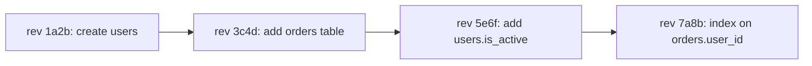

# Migrations, pooling and async drivers

`SQLModel.metadata.create_all(engine)` is fine for a tutorial: it creates missing tables. It does **not**
alter existing ones. The day you add a column to a model, production still has the old table, and your
app starts throwing "column does not exist". Evolving a live schema safely is the job of **migrations**.
This lesson covers Alembic, then two more production topics: connection pools and asynchronous database
access.

## Migrations with Alembic

A **migration** is a small versioned script that changes the schema from one state to the next (and
usually back). The database itself records which version it is at, in a table called `alembic_version`.
Deploying then means: "bring the database to the latest version", whatever version it's currently on.



Setup:

```bash
pip install alembic
alembic init migrations            # creates alembic.ini and migrations/ (env.py, versions/)
```

In `migrations/env.py`, point Alembic at your models' metadata (and take the DB URL from your settings,
not from a hard-coded `alembic.ini` value):

```python
from app.config import get_settings
from app.models import Base            # or: from sqlmodel import SQLModel; import app.models

config.set_main_option("sqlalchemy.url", str(get_settings().database_url))
target_metadata = Base.metadata        # or SQLModel.metadata
```

The daily workflow:

```bash
alembic revision --autogenerate -m "add is_active to users"   # diff models vs DB -> new script
# ... REVIEW the generated file ...
alembic upgrade head                 # apply all pending migrations
alembic downgrade -1                 # undo the last one
alembic current                      # which revision is the DB at?
alembic history                      # the chain
```

A generated migration:

```python
"""add is_active to users"""
revision = "5e6f7a8b9c0d"
down_revision = "3c4d5e6f7a8b"

from alembic import op
import sqlalchemy as sa

def upgrade() -> None:
    op.add_column("users", sa.Column("is_active", sa.Boolean(), nullable=False,
                                     server_default=sa.true()))

def downgrade() -> None:
    op.drop_column("users", "is_active")
```

**Autogenerate is a draft, not an oracle.** It compares metadata with the live schema and catches added/
removed tables and columns, but it can't see intent: a *rename* looks like drop + add (data loss!), and it
misses some type and constraint changes. Always read the script.

Here is the essence of what a migration runner does — a version table plus ordered scripts — in runnable
form:

```python-run
import sqlite3

MIGRATIONS = [   # (revision, upgrade SQL)
    ("001_create_users", "create table users(id integer primary key, email text unique not null)"),
    ("002_add_is_active", "alter table users add column is_active integer not null default 1"),
    ("003_create_orders", "create table orders(id integer primary key, user_id integer references users(id), total real)"),
]

def upgrade(conn, target=None):
    conn.execute("create table if not exists schema_version(rev text)")
    row = conn.execute("select rev from schema_version").fetchone()
    current = row[0] if row else None
    revs = [r for r, _ in MIGRATIONS]
    start = revs.index(current) + 1 if current else 0
    for rev, sql in MIGRATIONS[start:]:
        conn.execute(sql)
        conn.execute("delete from schema_version")
        conn.execute("insert into schema_version values (?)", (rev,))
        conn.commit()
        print("applied", rev)
        if rev == target:
            break

conn = sqlite3.connect(":memory:")
upgrade(conn, target="001_create_users")       # an "old" production database
conn.execute("insert into users(email) values ('ann@example.com')")
print("-- deploy new version --")
upgrade(conn)                                   # only the missing migrations run; data is preserved
print(conn.execute("select * from users").fetchall())
upgrade(conn)                                   # idempotent: nothing left to do
print("at:", conn.execute("select rev from schema_version").fetchone()[0])
```

### Zero-downtime changes: expand, migrate, contract

During a rolling deploy, **old and new code run at the same time** against one database. A migration that
the old code can't tolerate causes an outage. The safe sequence for a breaking change (say, renaming
`fullname` to `full_name`):

1. **Expand**: add the new nullable column. Old code ignores it.
2. Deploy code that **writes both** columns and reads the new one with a fallback.
3. **Backfill** existing rows (in batches, not one giant `UPDATE` that locks the table).
4. Deploy code that uses only the new column.
5. **Contract**: drop the old column in a later migration.

Other rules: adding a `NOT NULL` column requires a default or a backfill first; creating an index on a big
PostgreSQL table should use `CREATE INDEX CONCURRENTLY`; set a `lock_timeout` so a migration fails fast
instead of queueing behind long transactions and blocking all traffic.

### Where to run migrations

Not in the app's startup code when you have multiple replicas — several instances would race. Run
`alembic upgrade head` as a **separate, single step** of the deploy: a CI/CD job, a Kubernetes Job or
init container, or a release-phase command. Tests should also create their schema through migrations at
least once in CI, so the migration scripts themselves are tested.

## Connection pools

Opening a PostgreSQL connection costs a TCP handshake, TLS, authentication and a server process — several
milliseconds and megabytes. A **pool** keeps connections open and lends them out. SQLAlchemy's engine has
one built in:

```python
engine = create_engine(
    url,
    pool_size=10,          # connections kept open
    max_overflow=5,        # extra allowed under burst (closed when returned)
    pool_timeout=10,       # seconds to wait for a free connection before raising
    pool_recycle=1800,     # replace connections older than 30 min (firewalls/idle timeouts)
    pool_pre_ping=True,    # test a connection before use; transparently replace dead ones
)
```

Sizing arithmetic interviewers like:

$$\text{max DB connections used} = \text{workers} \times (\text{pool\_size} + \text{max\_overflow}) \times \text{replicas}$$

Four workers × (10 + 5) × 3 pods = 180 connections — more than PostgreSQL's default `max_connections=100`.
Either shrink the pools or put **PgBouncer** (a connection pooler) in front of the database. More
connections is not more throughput: the database has a limited number of cores, and beyond a point extra
connections just contend.

A request holds a connection from its first query until the session closes. So: keep transactions short,
don't call slow external APIs while holding a session, and don't hold one across a streaming response.

## Async database access

With a sync driver, each in-flight query occupies a thread (from FastAPI's pool of 40). An **async
driver** lets the event loop wait on thousands of queries without threads. SQLAlchemy supports this with
`create_async_engine` and `AsyncSession`, on top of async drivers such as **asyncpg** or **psycopg 3**
(PostgreSQL), **aiosqlite** (SQLite), **asyncmy/aiomysql** (MySQL).

```python
from sqlalchemy.ext.asyncio import AsyncSession, async_sessionmaker, create_async_engine
from sqlalchemy import select

engine = create_async_engine("postgresql+asyncpg://app:app@db/app", pool_pre_ping=True)
SessionLocal = async_sessionmaker(engine, expire_on_commit=False)

async def get_session():
    async with SessionLocal() as session:
        yield session

SessionDep = Annotated[AsyncSession, Depends(get_session)]

@app.get("/users/{user_id}", response_model=UserPublic)
async def read_user(user_id: int, session: SessionDep):
    user = await session.get(User, user_id)
    if user is None:
        raise HTTPException(404, "User not found")
    return user

@app.get("/users", response_model=list[UserPublic])
async def list_users(session: SessionDep, limit: int = 50):
    result = await session.execute(select(User).limit(limit))
    return result.scalars().all()

@asynccontextmanager
async def lifespan(app: FastAPI):
    yield
    await engine.dispose()            # close the pool on shutdown
```

Differences from sync code that bite people:

- Every I/O call needs `await`: `execute`, `get`, `commit`, `refresh`, `flush`.
- **No implicit lazy loading**: touching an unloaded relationship would need I/O in attribute access,
  which can't be awaited → `MissingGreenlet` error. Eager-load (`selectinload`) what you need.
- `expire_on_commit=False` keeps attributes usable after commit (otherwise accessing them triggers a
  refresh, i.e. implicit I/O).
- One `AsyncSession` must not be used by several tasks concurrently — don't `asyncio.gather` multiple
  queries on the same session; use separate sessions or run sequentially.
- Alembic runs migrations fine with an async engine via its `async` template (`alembic init -t async`).

### Is async DB worth it?

| | Sync driver + `def` endpoints | Async driver + `async def` |
|---|---|---|
| Simplicity | simpler, lazy loading works | more rules |
| Concurrency ceiling per worker | thread pool (40) | thousands of waiting coroutines |
| Wins when | CRUD with fast queries | many slow/concurrent I/O waits, streaming, WebSockets alongside DB |
| Bottleneck either way | the **database** and pool size | the **database** and pool size |

Async doesn't make queries faster; it makes *waiting* cheaper. If your pool has 10 connections, only 10
queries run at once in either model. Choose async when the rest of the app is async (LLM streaming,
WebSockets, many outbound HTTP calls) and you want one consistent model; a sync stack remains a perfectly
good choice — and it's the one the official SQL tutorial uses.

> [!INTERVIEW]
> "How do you change a database schema without downtime?" — Version every change as an Alembic migration
> reviewed in code review, applied by a single deploy step (not by each app replica at startup). Make
> changes backward-compatible with the code currently running: expand (add nullable column/table), deploy
> code that handles both shapes, backfill in batches, switch reads, then contract (drop old column) in a
> later release. Avoid long locks (concurrent index builds, lock timeouts) and always have a tested
> downgrade or a forward-fix plan.

## Pitfalls

- Relying on `create_all` in production.
- Trusting autogenerate for renames.
- Running migrations from every replica at startup.
- Pool sizes that multiply past the database's connection limit.
- Lazy loading with `AsyncSession`; sharing an `AsyncSession` across concurrent tasks.
- Holding a pooled connection while awaiting a slow upstream call.

## Summary

- Migrations are ordered, versioned schema changes; Alembic tracks the current revision in the database.
- Review autogenerated scripts; use expand → migrate → contract for zero-downtime changes.
- The engine's pool is per process; total connections = workers × pool × replicas.
- Async engines/sessions need explicit `await` and eager loading; they improve concurrency of waiting, not
  query speed.

```quiz
[
  {"q": "Why isn't metadata.create_all() enough for production schema management?", "options": ["It is too slow", "It only creates missing tables; it never alters existing ones or tracks versions", "It deletes data", "It requires SQLite"], "answer": 1,
   "explain": "Changing columns, constraints or indexes on existing tables needs versioned migrations."},
  {"q": "How does Alembic know which migrations still need to run?", "options": ["It diffs all tables every time", "The database stores the current revision in the alembic_version table", "A file on the developer's laptop", "It reruns everything"], "answer": 1,
   "explain": "Each migration has a revision id and a down_revision; the DB records its current head."},
  {"q": "You rename a model attribute and run autogenerate. What is the risk?", "options": ["Nothing", "It may emit drop column + add column, losing data", "It deletes the table", "It refuses to run"], "answer": 1,
   "explain": "Autogenerate cannot infer renames; edit the script to use op.alter_column(..., new_column_name=...)."},
  {"q": "3 replicas x 4 workers, pool_size=10, max_overflow=10. Worst-case connections?", "options": ["20", "80", "120", "240"], "answer": 3,
   "explain": "3 x 4 x (10 + 10) = 240, likely above the database limit; shrink pools or add PgBouncer."},
  {"q": "With AsyncSession, accessing an unloaded relationship attribute typically:", "options": ["Loads it lazily as usual", "Raises an error because implicit I/O can't be awaited; eager-load instead", "Returns None", "Blocks the thread pool"], "answer": 1,
   "explain": "Lazy loading needs I/O during attribute access; with async you must load explicitly (selectinload, awaitable attrs)."},
  {"q": "What is the first step of a zero-downtime column rename?", "options": ["Drop the old column", "Add the new column (expand) while old code keeps working", "Stop all traffic", "Rename in place"], "answer": 1,
   "explain": "Expand first so both old and new code can run during the rollout; contract last."},
  {"q": "Where should 'alembic upgrade head' run in a multi-replica deployment?", "options": ["In every app instance's startup", "As a single dedicated deploy step/job before new code takes traffic", "In a request handler", "Never"], "answer": 1,
   "explain": "Running it once avoids races between replicas and separates schema change from app start."}
]
```

> **Source:** Lubanovic, *FastAPI*, ch. 10 "Data Layer" and ch. 14 "Databases, Data Science, and a Little AI" (SQLAlchemy, PostgreSQL, Database Load Testing), ch. 13 "Production" (Databases, Files, and Memory); https://alembic.sqlalchemy.org/en/latest/tutorial.html; https://docs.sqlalchemy.org/en/20/orm/extensions/asyncio.html; https://docs.sqlalchemy.org/en/20/core/pooling.html; https://fastapi.tiangolo.com/tutorial/sql-databases/
