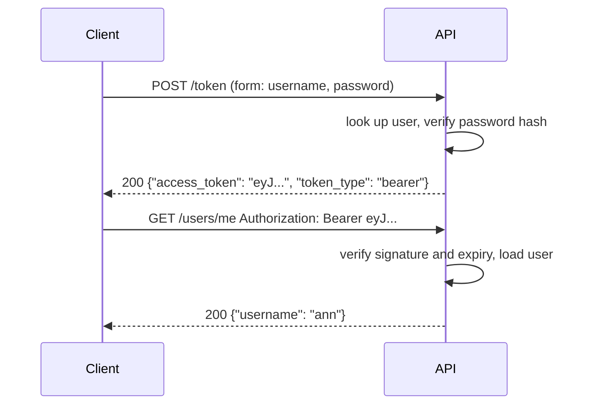

# OAuth2 password flow, hashing and JWT

> **Before this lesson:** you should know the `Authorization` header and the difference between 401
> and 403 ([lesson 1](#/lesson/fastapi/http-basics)), dependencies and sub-dependencies
> ([lesson 10](#/lesson/fastapi/depends-basics)), and settings with `SecretStr`
> ([lesson 9](#/lesson/fastapi/pydantic-settings)). No knowledge of cryptography is assumed; hashing,
> signatures and tokens are explained from the beginning.

## In plain words

Most APIs must know who is calling. A bank's API should show your balance to you and to nobody
else. Two separate questions are involved, and they have similar-sounding names:

- **Authentication** (often shortened to *authn*) asks *who are you?* It is the checking of
  identity.
- **Authorization** (*authz*) asks *what are you allowed to do?* It is the checking of permission.
  That is the next lesson.

An everyday picture: a hotel. At the front desk you show your passport once. The desk checks it and
hands you a key card. For the rest of your stay you show the card, not the passport, and the card
stops working at check-out time. Lose the card, and whoever finds it can open your door until it
expires.

A modern login works the same way. You send your password **once**; the server checks it and hands
back a **token** (the key card); every later request carries the token; and the token expires. This
lesson builds each piece: how the server stores passwords so that a stolen database does not reveal
them, what a token is made of, and how FastAPI ties these together.

Why this matters for a job: improvised security turns a tutorial project into a liability.
Interviewers reliably ask "how should passwords be stored?" and "walk me through JWT
authentication and its weaknesses", and both answers are below.

Lubanovic's authentication chapter begins by asking whether you need authentication at all, and then
climbs from one shared secret to per-user logins with tokens. This lesson follows the same climb,
using the libraries that the official FastAPI documentation uses today (PyJWT, and pwdlib with
Argon2; the book's `python-jose` and `passlib` are now poorly maintained).

## Step 0: the simplest schemes

**A shared secret, or API key.** One secret value sent in a header. Whoever has it has full access:

```python
from fastapi.security import APIKeyHeader

api_key_scheme = APIKeyHeader(name="X-API-Key")

def require_api_key(key: Annotated[str, Depends(api_key_scheme)], settings: SettingsDep):
    if not secrets.compare_digest(key, settings.api_key.get_secret_value()):
        raise HTTPException(status_code=401, detail="Invalid API key")
```

- `APIKeyHeader(name="X-API-Key")` is a ready-made dependency that reads that header, and makes the
  requirement appear in the docs.
- `require_api_key` receives the key and the settings and compares the key with the configured one.
  On a mismatch it raises 401.

This is acceptable for calls between your own services and for internal tools. Note the comparison
function. `secrets.compare_digest` always takes the same time whether the strings differ at the
first character or the last (a **constant-time** comparison). The ordinary `==` stops at the first
difference, so its duration reveals how much of a guess was right. An attack that measures such
durations is a *timing attack*.

**HTTP Basic.** The username and password are sent with every request, encoded in base64 (a
reversible encoding, not encryption). The book shows FastAPI's `HTTPBasic` as its "simple individual
authentication" step. It is acceptable only over HTTPS and for simple cases, since the password
travels with every call.

Neither scheme provides what an API with real users needs: an identity per user without re-sending
the password, expiry, and limited permissions. Tokens provide all three.

## The OAuth2 password flow

**OAuth2** is a standard framework for login and permission, with several variants called *flows*.
The **password flow** is the most direct. The user gives a username and password directly to *your*
application, which returns a **bearer token**. The client then sends that token with every request.



Read the diagram as two phases. First, the login: the client posts the username and password to
`/token`; the server looks the user up, checks the password, and returns a token. Second, every
later request: the client sends `Authorization: Bearer <token>`; the server checks the token and
finds the user.

"Bearer" means *whoever bears (carries) this token is treated as the user*. Tokens must therefore
travel only over HTTPS and should expire quickly. (For logins through another company, such as
"Sign in with Google", a different flow is used, the authorization-code flow with OpenID Connect,
usually through a provider or a library; the book lists options. The password flow is for clients
that you yourself wrote.)

FastAPI's building blocks:

```python
from fastapi.security import OAuth2PasswordBearer, OAuth2PasswordRequestForm

oauth2_scheme = OAuth2PasswordBearer(tokenUrl="token")
```

`OAuth2PasswordBearer` is a dependency that does two things. It takes the token out of the
`Authorization: Bearer ...` header, raising 401 if the header is missing. **And** it registers the
login scheme in the OpenAPI document, which is why `/docs` gains an "Authorize" button that performs
the login for you. `OAuth2PasswordRequestForm` reads the fields the standard requires: `username`,
`password` and an optional `scope`. They arrive as **form data** (the encoding HTML forms use), not
as JSON.

## Hashing passwords

Never store passwords, not even encrypted ones. Anything encrypted can be decrypted by whoever
steals the key. Store a **hash** instead. A hash function turns any input into a fixed-length
scramble that cannot be reversed. To check a login, hash what the user typed and compare the result
with the stored hash.

Not every hash function is suitable. One designed for passwords has three properties:

| Property | Why |
|---|---|
| One-way | a leaked database does not reveal the passwords |
| **Salted** (a random value, the *salt*, mixed into each password) | two users with the same password get different hashes; tables of precomputed hashes ("rainbow tables") become useless |
| **Slow, or memory-hungry**, by an adjustable amount | trying every possible password (a *brute-force* attack) becomes expensive; a fast hash such as SHA-256 allows billions of guesses per second |

Good algorithms: **Argon2id** (the current recommendation), bcrypt, scrypt and PBKDF2. The FastAPI
documentation now uses `pwdlib`:

```python
from pwdlib import PasswordHash

password_hash = PasswordHash.recommended()        # Argon2id
DUMMY_HASH = password_hash.hash("dummypassword")

def get_password_hash(password: str) -> str:
    return password_hash.hash(password)

def verify_password(plain: str, hashed: str) -> bool:
    return password_hash.verify(plain, hashed)
```

`PasswordHash.recommended()` selects Argon2id. `hash` produces the string to store, and `verify`
checks a typed password against it. `DUMMY_HASH` is used further down, to hide which usernames exist.

The standard library's PBKDF2 function shows the mechanics (and is what the problem *Verify a PBKDF2
Password Hash* uses):

```python-run
import hashlib, hmac, os

def hash_password(password: str, iterations: int = 100_000) -> str:
    salt = os.urandom(16)                                      # unique per password
    digest = hashlib.pbkdf2_hmac("sha256", password.encode(), salt, iterations)
    return f"pbkdf2_sha256${iterations}${salt.hex()}${digest.hex()}"   # self-describing

def verify_password(password: str, stored: str) -> bool:
    algo, iterations, salt_hex, digest_hex = stored.split("$")
    digest = hashlib.pbkdf2_hmac("sha256", password.encode(), bytes.fromhex(salt_hex), int(iterations))
    return hmac.compare_digest(digest, bytes.fromhex(digest_hex))      # constant-time

h1, h2 = hash_password("hunter2"), hash_password("hunter2")
print(h1)
print("same password, different hashes:", h1 != h2)
print(verify_password("hunter2", h1), verify_password("hunter3", h1))
```

Reading `hash_password`:

- `os.urandom(16)` produces 16 random bytes: the salt, new for every password.
- `hashlib.pbkdf2_hmac(...)` mixes the password and the salt 100,000 times. The repetition is what
  makes it slow.
- The return value joins four parts with `$`: the algorithm name, the iteration count, the salt and
  the result. The string describes itself; everything needed to check a password later is in it,
  except the password.

`verify_password` splits the stored string, repeats the calculation with the same salt and count,
and compares in constant time.

The output shows a stored hash; then `same password, different hashes: True`, because each call
drew a new salt; then `True False`: the right password verifies and a wrong one does not.

Keeping the algorithm and its settings inside the string lets you raise the cost later and re-hash
each user quietly at their next login.

## JSON Web Tokens

What should the token itself be? One popular answer is the **JWT** (JSON Web Token, pronounced
"jot"): a compact, signed container for a few facts about the user. As the book stresses, it is an
*encoding scheme* and not, in itself, a login method. It consists of three parts separated by dots:

```text
eyJhbGciOiJIUzI1NiIsInR5cCI6IkpXVCJ9 . eyJzdWIiOiJhbm4iLCJleHAiOjE3MzY5MzcwMDB9 . 3Jx...sig
        header (alg, typ)                    payload (claims)                       signature
```

- The **header** names the signing algorithm. `HS256` means HMAC with SHA-256, using one secret that
  the server keeps. `RS256` and `ES256` use a pair of keys, one private and one public.
- The **payload** holds the **claims**: statements about the token and its owner. Standard ones are
  `sub` (subject: the user's id), `exp` (expiry time), `iat` (issued at), `nbf` (not valid before),
  `iss` (issuer), `aud` (intended audience) and `jti` (the token's own id). You may add your own,
  such as `scopes` or `role`.
- The **signature** is a keyed fingerprint (an HMAC, lesson 6) of the first two parts. Only someone
  holding the secret can produce it, so it proves that the server issued the token and that nobody
  has altered it.

Each part is written in base64url, a text encoding that is safe inside URLs. **A JWT is signed, not
encrypted.** Anyone can decode and read the payload. Never put secrets or sensitive personal data in
one. Building a JWT by hand removes the mystery:

```python-run
import base64, hashlib, hmac, json, time

def b64url(b: bytes) -> str:
    return base64.urlsafe_b64encode(b).rstrip(b"=").decode()

def b64url_decode(s: str) -> bytes:
    return base64.urlsafe_b64decode(s + "=" * (-len(s) % 4))

SECRET = b"change-me-openssl-rand-hex-32"

def encode(payload: dict) -> str:
    header = b64url(json.dumps({"alg": "HS256", "typ": "JWT"}, separators=(",", ":")).encode())
    body = b64url(json.dumps(payload, separators=(",", ":")).encode())
    sig = hmac.new(SECRET, f"{header}.{body}".encode(), hashlib.sha256).digest()
    return f"{header}.{body}.{b64url(sig)}"

def decode(token: str) -> dict:
    header, body, sig = token.split(".")
    if json.loads(b64url_decode(header)).get("alg") != "HS256":       # pin the algorithm!
        raise ValueError("invalid algorithm")
    expected = b64url(hmac.new(SECRET, f"{header}.{body}".encode(), hashlib.sha256).digest())
    if not hmac.compare_digest(expected, sig):
        raise ValueError("invalid signature")
    payload = json.loads(b64url_decode(body))
    if payload.get("exp", float("inf")) <= time.time():
        raise ValueError("token expired")
    return payload

token = encode({"sub": "ann", "scopes": ["items:read"], "exp": int(time.time()) + 900})
print(token)
print("anyone can read the payload:", json.loads(b64url_decode(token.split(".")[1])))
print("verified:", decode(token))

# Tampering: promote ourselves to admin without knowing the secret
h, b, s = token.split(".")
forged = b64url(json.dumps({"sub": "ann", "scopes": ["admin"], "exp": 9999999999}).encode())
try:
    decode(f"{h}.{forged}.{s}")
except ValueError as e:
    print("forged token rejected:", e)
```

Reading the code:

- `b64url` and `b64url_decode` convert between bytes and URL-safe text.
- `encode` writes the header and the payload as compact JSON, encodes each, computes the HMAC of
  `header.body` with the secret, and joins the three parts with dots.
- `decode` splits the token and then makes three checks: the header must name the algorithm we
  expect; the signature, recomputed from the first two parts, must equal the one supplied; and the
  expiry time must lie in the future. Only then is the payload trusted.

The output shows the token; then the payload read *without* the secret (anyone can do this); then
the payload as verified by `decode`. Finally the demo forges a token: it keeps the header and the
signature and replaces the payload with one claiming the `admin` scope. `decode` prints
`forged token rejected: invalid signature`. The old signature does not fit the new payload, and
without the secret the forger cannot compute one that does.

The book highlights the central trade-off. A JWT lets the server authenticate a request **without a
database lookup**: any replica holding the key can check it. This is called being *stateless*. For
the same reason, a JWT **cannot be cancelled** before it expires unless you add machinery. Hence the
usual design: access tokens that live 5 to 30 minutes, plus either a long-lived **refresh token**
that can be cancelled and is used to obtain new access tokens, or a list of cancelled `jti` values
kept in Redis.

## Putting it together in FastAPI

Following the official tutorial:

```python
from datetime import UTC, datetime, timedelta
import jwt
from jwt.exceptions import InvalidTokenError

SECRET_KEY = settings.secret_key.get_secret_value()     # openssl rand -hex 32
ALGORITHM = "HS256"
ACCESS_TOKEN_EXPIRE_MINUTES = 30

class Token(BaseModel):
    access_token: str
    token_type: str

def create_access_token(data: dict, expires_delta: timedelta | None = None) -> str:
    to_encode = data.copy()
    expire = datetime.now(UTC) + (expires_delta or timedelta(minutes=15))
    to_encode.update({"exp": expire})
    return jwt.encode(to_encode, SECRET_KEY, algorithm=ALGORITHM)

def authenticate_user(db, username: str, password: str):
    user = get_user(db, username)
    if not user:
        verify_password(password, DUMMY_HASH)     # equalise timing: don't reveal which usernames exist
        return None
    if not verify_password(password, user.hashed_password):
        return None
    return user

@app.post("/token")
async def login(form_data: Annotated[OAuth2PasswordRequestForm, Depends()], db: SessionDep) -> Token:
    user = authenticate_user(db, form_data.username, form_data.password)
    if not user:
        raise HTTPException(status_code=status.HTTP_401_UNAUTHORIZED,
                            detail="Incorrect username or password",
                            headers={"WWW-Authenticate": "Bearer"})
    token = create_access_token({"sub": user.username},
                                timedelta(minutes=ACCESS_TOKEN_EXPIRE_MINUTES))
    return Token(access_token=token, token_type="bearer")

async def get_current_user(token: Annotated[str, Depends(oauth2_scheme)], db: SessionDep) -> User:
    credentials_exception = HTTPException(
        status_code=status.HTTP_401_UNAUTHORIZED,
        detail="Could not validate credentials",
        headers={"WWW-Authenticate": "Bearer"},
    )
    try:
        payload = jwt.decode(token, SECRET_KEY, algorithms=[ALGORITHM])   # a LIST of allowed algs
        username = payload.get("sub")
        if username is None:
            raise credentials_exception
    except InvalidTokenError:
        raise credentials_exception
    user = get_user(db, username)
    if user is None:
        raise credentials_exception
    return user

async def get_current_active_user(current_user: Annotated[User, Depends(get_current_user)]) -> User:
    if current_user.disabled:
        raise HTTPException(status_code=400, detail="Inactive user")
    return current_user

CurrentUser = Annotated[User, Depends(get_current_active_user)]

@app.get("/users/me", response_model=UserPublic)
async def read_users_me(current_user: CurrentUser):
    return current_user
```

It is long, but it is the lesson so far, assembled:

- **Settings.** The secret key comes from settings (lesson 9), the algorithm is fixed, and access
  tokens live for 30 minutes.
- **`create_access_token`** copies the claims, adds `exp` and signs them with `jwt.encode`.
- **`authenticate_user`** looks the user up and verifies the password. If the user does not exist,
  it still verifies against `DUMMY_HASH` and then returns `None`; the reason is given below.
- **`login`** is the `/token` endpoint. It reads the form, authenticates, and returns a `Token`
  model, or raises 401 with a `WWW-Authenticate` header.
- **`get_current_user`** is the dependency that protects everything else. It receives the token from
  `oauth2_scheme`, decodes and verifies it, reads `sub`, and loads the user. Any failure raises the
  same 401.
- **`get_current_active_user`** adds one more check on top (the account must not be disabled), and
  `CurrentUser` is the alias endpoints use.
- **`read_users_me`** shows the result: an endpoint is protected by declaring one parameter.

Details that matter:

- The login error is vague on purpose ("Incorrect username or password"), and the dummy hash makes a
  request for an unknown user take as long as one for a real user. Otherwise attackers could find
  out which usernames exist (this is called *enumeration*), either from the message or from the
  response time.
- `jwt.decode(..., algorithms=[ALGORITHM])` fixes which algorithms are acceptable. Trusting the
  algorithm named in the token's own header enables classic attacks, including a token that claims
  `alg: none` and carries no signature at all.
- PyJWT checks `exp` automatically and raises `ExpiredSignatureError`, a subclass of
  `InvalidTokenError`.
- Declaring `CurrentUser` is all an endpoint needs. The chain of dependencies does the rest, and the
  docs page shows a padlock beside the endpoint.

In the book this flow is spread over its layers (lesson 15): `web/user.py` holds the token endpoint
and the token dependency, `service/user.py` holds the hashing and JWT helpers and the function that
authenticates a user, and `data/user.py` stores the users.

## Where should the client keep the token?

- **A web page in a browser.** A cookie marked `HttpOnly; Secure; SameSite` cannot be read by
  JavaScript, so a cross-site scripting attack (lesson 6) cannot steal it; in exchange it needs a
  defence against cross-site request forgery (next lesson). Browser `localStorage` is easier to use,
  but any script running in the page can read the token.
- **Mobile apps, command-line tools, other services.** The platform's secure storage, with the token
  sent in the `Authorization` header.

> [!INTERVIEW]
> "Walk me through JWT authentication and its weaknesses." — The client posts credentials to
> `/token`; the server verifies the salted slow hash (Argon2 or bcrypt) and issues a signed JWT with
> `sub` and a short `exp`. The client sends it as a Bearer token; on each request the server verifies
> the signature (with a fixed algorithm) and the expiry, needing no session store. Weaknesses: it
> cannot be cancelled before expiry (reduce the risk with a short lifetime plus refresh tokens, or a
> `jti` deny-list); the payload is readable (no secrets in it); a stolen token is fully usable (HTTPS
> only, careful storage); the secret needs management and rotation; never accept `alg: none` or
> whatever algorithm the token claims.

## Worked example: access tokens, refresh tokens and rotation

Short-lived access tokens limit the damage of a leak, but nobody wants to log in every fifteen
minutes. The standard answer is a second, long-lived **refresh token** whose only power is to obtain
new access tokens. Unlike a JWT it is *stateful*: the server stores it (as a hash) and can cancel
it. **Rotation** means issuing a new refresh token at every use and retiring the old one. If a
retired one is ever presented again, somebody has stolen it, and every token descended from the same
login (the *family*) is cancelled.

```python-run
import hashlib, secrets

class AuthServer:
    ACCESS_TTL, REFRESH_TTL = 900, 30 * 24 * 3600

    def __init__(self):
        self.refresh = {}        # sha256(token) -> {"user", "family", "expires", "used"}
        self.revoked_families = set()

    def _issue(self, user, family, now):
        token = secrets.token_urlsafe(32)                       # opaque random string, not a JWT
        self.refresh[hashlib.sha256(token.encode()).hexdigest()] = {
            "user": user, "family": family, "expires": now + self.REFRESH_TTL, "used": False}
        access = {"sub": user, "exp": now + self.ACCESS_TTL}    # would be a signed JWT
        return access, token

    def login(self, user, now):
        return self._issue(user, family=secrets.token_hex(4), now=now)

    def refresh_tokens(self, token, now):
        rec = self.refresh.get(hashlib.sha256(token.encode()).hexdigest())
        if rec is None or rec["expires"] <= now or rec["family"] in self.revoked_families:
            return "401 invalid refresh token"
        if rec["used"]:                                         # reuse of a rotated token = theft signal
            self.revoked_families.add(rec["family"])
            return "401 token reuse detected: session family revoked"
        rec["used"] = True
        return self._issue(rec["user"], rec["family"], now)     # rotate

    def logout(self, token):
        rec = self.refresh.get(hashlib.sha256(token.encode()).hexdigest())
        if rec:
            self.revoked_families.add(rec["family"])

server = AuthServer()
access, r1 = server.login("ann", now=0)
print("login        -> access exp", access["exp"])

access, r2 = server.refresh_tokens(r1, now=900)                 # normal use: rotate r1 -> r2
print("refresh #1   -> access exp", access["exp"], "| new refresh token issued:", r2 != r1)

print("attacker replays stolen r1 ->", server.refresh_tokens(r1, now=1000))
print("legit client uses r2      ->", server.refresh_tokens(r2, now=1100), "(forced to log in again)")

access, r3 = server.login("ann", now=2000)
server.logout(r3)
print("after logout              ->", server.refresh_tokens(r3, now=2100))
```

`AuthServer` keeps a dictionary of refresh tokens, stored under their SHA-256 hashes, and a set of
cancelled families.

- `login` issues an access token and a random refresh token belonging to a new family.
- `refresh_tokens` looks the token up. An unknown, expired or cancelled token is refused. A token
  that has already been used once sets off the alarm: its whole family is cancelled. Otherwise the
  token is marked as used and a new pair is issued.
- `logout` cancels the family.

The run, line by line: login gives an access token expiring at second 900. The first refresh gives
one expiring at 1800, together with a new refresh token. An attacker then replays the stolen first
refresh token and receives `401 token reuse detected: session family revoked`. The legitimate client
now tries its newest token and also receives 401; it must log in again, which is a nuisance for the
real user but shuts the attacker out. After a fresh login and a logout, the refresh token is refused.

Design points. Refresh tokens are random strings with no readable content, stored only as hashes,
so a leaked database yields no usable tokens. The refresh endpoint is the only place where a
database lookup happens, so ordinary requests remain stateless. Logging out, and "sign out
everywhere", become possible. And reuse detection turns a silent theft into a visible event. The
remaining life of the access token (up to fifteen minutes here) is the exposure you accept; shorten
it, or add a `jti` deny-list in Redis, when that is too long.

## Debugging authentication failures

| Symptom | Things to check |
|---|---|
| `401` right after a successful login | client sends `Authorization: <token>` without the `Bearer ` prefix, or the header is stripped by a proxy |
| `422` from `/token` | credentials sent as JSON; the password flow requires form encoding |
| Works in `/docs`, fails from the frontend | CORS preflight for the `Authorization` header (see next lesson), or `tokenUrl` relative path differs behind a prefix |
| Tokens valid on one replica, invalid on another | replicas have different `SECRET_KEY`s (generated at startup instead of injected) |
| Every token is "expired" | server clock skew, or `exp` written in local time/milliseconds instead of UTC seconds |
| Valid tokens rejected after a deploy | the signing key was rotated without accepting the previous key during the overlap |
| Signature errors with tokens from another service | algorithm mismatch (HS256 vs RS256) or wrong audience/issuer |

Decode the token's payload (it is only base64url) to see `sub`, `exp` and `alg` before suspecting
anything more exotic. Never paste production tokens into third-party websites to do so.

## Pitfalls

- Hashing passwords with plain SHA-256 or MD5, or without a salt.
- Long-lived access tokens with no means of cancelling them.
- Sensitive data in JWT payloads.
- `jwt.decode` without an explicit `algorithms` list; secrets written into source code.
- Different error messages for "no such user" and "wrong password".
- Sending tokens in query strings (they end up in logs).

## Summary

- API keys and Basic authentication are the simple end; the OAuth2 password flow with bearer tokens
  suits logins for your own clients.
- Store only salted, slow password hashes (Argon2id through pwdlib); compare in constant time.
- A JWT is base64url(header).base64url(payload).signature: signed, not encrypted, stateless, and
  hard to cancel.
- `OAuth2PasswordBearer` plus a `get_current_user` dependency protects endpoints and documents the
  scheme.

## Glossary

- **Authentication / authorization** — checking who the caller is / checking what the caller may do.
- **Credentials** — what a user presents to prove identity, such as a username and password.
- **API key** — one shared secret value that grants access.
- **Constant-time comparison** — a comparison whose duration does not depend on where the inputs
  differ.
- **Hash** — a one-way, fixed-length scramble of some input.
- **Salt** — a random value mixed into a password before hashing.
- **Brute force** — trying every possible password.
- **Argon2id / bcrypt / PBKDF2** — hash functions designed to be slow, for passwords.
- **OAuth2** — the standard framework for login and permission; a *flow* is one of its variants.
- **Bearer token** — a token that grants access to whoever presents it.
- **JWT** — a signed token of three base64url parts: header, payload, signature.
- **Claim** — one statement in a JWT's payload, such as `sub` or `exp`.
- **Signature** — a keyed fingerprint proving who issued a token and that it is unaltered.
- **Stateless** — verifiable without looking anything up on the server.
- **Access token / refresh token** — the short-lived token sent with requests / the long-lived,
  cancellable token used to get new access tokens.
- **Rotation** — replacing a refresh token with a new one each time it is used.
- **Enumeration** — discovering which usernames exist from differences in responses.

```quiz
[
  {"q": "Why must password hashing be slow and salted?", "options": ["To save disk space", "Slowness makes brute force expensive; salts make identical passwords hash differently and defeat precomputed tables", "To allow decryption later", "Because JWT requires it"], "answer": 1,
   "explain": "Fast unsalted hashes can be attacked at billions of guesses per second or looked up in rainbow tables."},
  {"q": "What does the signature of a JWT guarantee?", "options": ["The payload is secret", "The token was produced by a holder of the key and hasn't been modified", "The user is online", "The token can't be copied"], "answer": 1,
   "explain": "JWTs are signed, not encrypted: integrity and authenticity, not confidentiality."},
  {"q": "Why pass algorithms=['HS256'] to jwt.decode?", "options": ["For speed", "To prevent attackers choosing the algorithm via the token header (e.g. alg none)", "To enable encryption", "It is optional decoration"], "answer": 1,
   "explain": "The verifier must pin the algorithms it accepts rather than trusting the attacker-controlled header."},
  {"q": "Main drawback of stateless JWT access tokens?", "options": ["They need a DB lookup per request", "They can't easily be revoked before expiry", "They can't carry a user id", "They only work over HTTP/2"], "answer": 1,
   "explain": "No server-side state means no built-in revocation; use short expiry, refresh tokens or a deny-list."},
  {"q": "In what format does the OAuth2 password flow send username and password to the token URL?", "options": ["JSON body", "Form data (application/x-www-form-urlencoded)", "Query string", "Authorization: Basic only"], "answer": 1,
   "explain": "The spec mandates form fields; OAuth2PasswordRequestForm parses them."},
  {"q": "What does OAuth2PasswordBearer(tokenUrl='token') do as a dependency?", "options": ["Logs the user in", "Extracts the bearer token from the Authorization header (401 if absent) and documents the scheme in OpenAPI", "Hashes passwords", "Creates JWTs"], "answer": 1,
   "explain": "It only extracts the token and declares the security scheme; verification is your get_current_user code."},
  {"q": "Why verify against a dummy hash when the username doesn't exist?", "options": ["To create the user", "To make response time similar for unknown users, preventing username enumeration via timing", "To warm the cache", "It is required by Argon2"], "answer": 1,
   "explain": "Skipping the slow hash for unknown users would make them distinguishable by response time."}
]
```

> **Source:** Lubanovic, *FastAPI*, ch. 11 "Authentication and Authorization" (Authentication Methods, Global Authentication: Shared Secret, Simple Individual Authentication, OAuth2, Authentication Steps, JWT, Third-Party Authentication: OIDC); https://fastapi.tiangolo.com/tutorial/security/first-steps/, /tutorial/security/simple-oauth2/, /tutorial/security/oauth2-jwt/; RFC 7519
