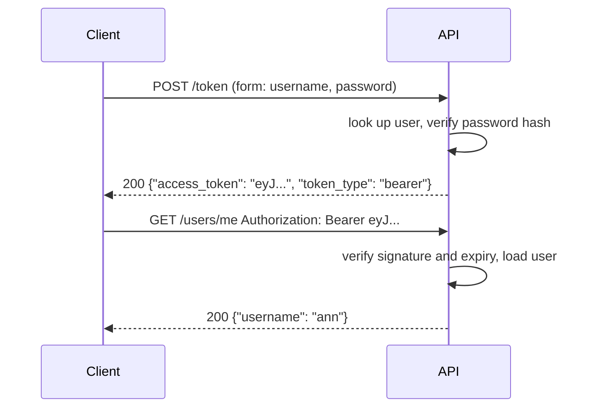

# OAuth2 password flow, hashing and JWT

Security is where a tutorial app becomes a liability if you improvise. Lubanovic's authentication chapter
opens by asking whether you need authentication at all, then climbs from a shared secret to per-user
OAuth2 with JWTs. This lesson follows that climb, updated to the libraries the official FastAPI docs use
today (PyJWT and pwdlib/Argon2 — the book's `python-jose` and `passlib` are now poorly maintained).

Two words first:

- **Authentication (authn)** — *who are you?* Verifying identity.
- **Authorization (authz)** — *what may you do?* Checking permissions. (Next lesson.)

## Step 0: the simplest schemes

**A shared secret / API key.** One key in a header; anyone with it has full access:

```python
from fastapi.security import APIKeyHeader

api_key_scheme = APIKeyHeader(name="X-API-Key")

def require_api_key(key: Annotated[str, Depends(api_key_scheme)], settings: SettingsDep):
    if not secrets.compare_digest(key, settings.api_key.get_secret_value()):
        raise HTTPException(status_code=401, detail="Invalid API key")
```

Fine for service-to-service calls and internal tools. Use `secrets.compare_digest` — a constant-time
comparison — because `==` returns faster the earlier the strings differ, leaking information.

**HTTP Basic.** Username and password, base64-encoded (not encrypted!) in every request. The book shows
`HTTPBasic` as the "simple individual authentication" step. Acceptable only over HTTPS and for simple
cases; the password travels with every call.

Both lack what real user-facing APIs need: per-user identity without resending the password, expiry,
and scoped permissions. That's where tokens come in.

## The OAuth2 password flow

OAuth2 is a framework with several "flows". The **password flow** is the simplest: the user gives their
username and password directly to *your* app, which returns a **bearer token**; the client then sends the
token on each request.



"Bearer" means *whoever bears this token is treated as the user* — so tokens must travel only over HTTPS
and expire quickly. (For third-party logins — "Sign in with Google" — you'd use the authorization-code
flow with PKCE and OpenID Connect via a provider or library; the book lists options. The password flow is
for first-party clients.)

FastAPI's building blocks:

```python
from fastapi.security import OAuth2PasswordBearer, OAuth2PasswordRequestForm

oauth2_scheme = OAuth2PasswordBearer(tokenUrl="token")
```

`OAuth2PasswordBearer` is a dependency that extracts the token from `Authorization: Bearer ...` (raising
401 if missing) **and** registers the security scheme in OpenAPI — which is why `/docs` grows an
"Authorize" button that performs the login for you. `OAuth2PasswordRequestForm` parses the spec-mandated
**form** fields `username`, `password` (and optional `scope`) — form-encoded, not JSON.

## Hashing passwords

Never store passwords, not even encrypted. Store a **hash** from a function designed for passwords:

| Property | Why |
|---|---|
| One-way | a DB leak doesn't reveal passwords |
| **Salted** (random per-password salt) | identical passwords get different hashes; defeats rainbow tables |
| **Slow / memory-hard** (tunable work factor) | makes brute force expensive; fast hashes like SHA-256 allow billions of guesses/second |

Good algorithms: **Argon2id** (current recommendation), bcrypt, scrypt, PBKDF2. The FastAPI docs now use
`pwdlib`:

```python
from pwdlib import PasswordHash

password_hash = PasswordHash.recommended()        # Argon2id
DUMMY_HASH = password_hash.hash("dummypassword")

def get_password_hash(password: str) -> str:
    return password_hash.hash(password)

def verify_password(plain: str, hashed: str) -> bool:
    return password_hash.verify(plain, hashed)
```

The standard library's PBKDF2 shows the mechanics (and is what the problem *Verify a PBKDF2 Password
Hash* uses):

```python-run
import hashlib, hmac, os

def hash_password(password: str, iterations: int = 100_000) -> str:
    salt = os.urandom(16)                                      # unique per password
    digest = hashlib.pbkdf2_hmac("sha256", password.encode(), salt, iterations)
    return f"pbkdf2_sha256${iterations}${salt.hex()}${digest.hex()}"   # self-describing

def verify_password(password: str, stored: str) -> bool:
    algo, iterations, salt_hex, digest_hex = stored.split("$")
    digest = hashlib.pbkdf2_hmac("sha256", password.encode(), bytes.fromhex(salt_hex), int(iterations))
    return hmac.compare_digest(digest, bytes.fromhex(digest_hex))      # constant-time

h1, h2 = hash_password("hunter2"), hash_password("hunter2")
print(h1)
print("same password, different hashes:", h1 != h2)
print(verify_password("hunter2", h1), verify_password("hunter3", h1))
```

Storing the algorithm and parameters inside the hash string lets you raise the work factor later and
re-hash users transparently at their next login.

## JSON Web Tokens

A **JWT** is a compact, signed container for claims. As the book stresses, it's an *encoding scheme*, not
an authentication method. Three base64url segments joined by dots:

```text
eyJhbGciOiJIUzI1NiIsInR5cCI6IkpXVCJ9 . eyJzdWIiOiJhbm4iLCJleHAiOjE3MzY5MzcwMDB9 . 3Jx...sig
        header (alg, typ)                    payload (claims)                       signature
```

- **Header**: algorithm (`HS256` = HMAC-SHA256 with a shared secret; `RS256`/`ES256` = asymmetric keys).
- **Payload**: claims. Registered ones: `sub` (subject — user id), `exp` (expiry), `iat` (issued at),
  `nbf`, `iss` (issuer), `aud` (audience), `jti` (token id). Plus your own (`scopes`, `role`).
- **Signature**: over `header.payload`. Proves integrity and origin.

**Signed, not encrypted** — anyone can decode the payload. Never put secrets or sensitive personal data
in a JWT. Build one by hand to remove the mystery:

```python-run
import base64, hashlib, hmac, json, time

def b64url(b: bytes) -> str:
    return base64.urlsafe_b64encode(b).rstrip(b"=").decode()

def b64url_decode(s: str) -> bytes:
    return base64.urlsafe_b64decode(s + "=" * (-len(s) % 4))

SECRET = b"change-me-openssl-rand-hex-32"

def encode(payload: dict) -> str:
    header = b64url(json.dumps({"alg": "HS256", "typ": "JWT"}, separators=(",", ":")).encode())
    body = b64url(json.dumps(payload, separators=(",", ":")).encode())
    sig = hmac.new(SECRET, f"{header}.{body}".encode(), hashlib.sha256).digest()
    return f"{header}.{body}.{b64url(sig)}"

def decode(token: str) -> dict:
    header, body, sig = token.split(".")
    if json.loads(b64url_decode(header)).get("alg") != "HS256":       # pin the algorithm!
        raise ValueError("invalid algorithm")
    expected = b64url(hmac.new(SECRET, f"{header}.{body}".encode(), hashlib.sha256).digest())
    if not hmac.compare_digest(expected, sig):
        raise ValueError("invalid signature")
    payload = json.loads(b64url_decode(body))
    if payload.get("exp", float("inf")) <= time.time():
        raise ValueError("token expired")
    return payload

token = encode({"sub": "ann", "scopes": ["items:read"], "exp": int(time.time()) + 900})
print(token)
print("anyone can read the payload:", json.loads(b64url_decode(token.split(".")[1])))
print("verified:", decode(token))

# Tampering: promote ourselves to admin without knowing the secret
h, b, s = token.split(".")
forged = b64url(json.dumps({"sub": "ann", "scopes": ["admin"], "exp": 9999999999}).encode())
try:
    decode(f"{h}.{forged}.{s}")
except ValueError as e:
    print("forged token rejected:", e)
```

The trade-off the book highlights: a JWT lets the server authenticate **without a database lookup**
(stateless — any replica can verify it), but for the same reason you **can't revoke** one before it
expires without extra machinery. Hence: short-lived access tokens (5–30 minutes) plus a **refresh token**
(long-lived, stored server-side or rotated, revocable) to obtain new ones, or a deny-list of `jti`s in
Redis.

## Putting it together in FastAPI

Following the official tutorial:

```python
from datetime import UTC, datetime, timedelta
import jwt
from jwt.exceptions import InvalidTokenError

SECRET_KEY = settings.secret_key.get_secret_value()     # openssl rand -hex 32
ALGORITHM = "HS256"
ACCESS_TOKEN_EXPIRE_MINUTES = 30

class Token(BaseModel):
    access_token: str
    token_type: str

def create_access_token(data: dict, expires_delta: timedelta | None = None) -> str:
    to_encode = data.copy()
    expire = datetime.now(UTC) + (expires_delta or timedelta(minutes=15))
    to_encode.update({"exp": expire})
    return jwt.encode(to_encode, SECRET_KEY, algorithm=ALGORITHM)

def authenticate_user(db, username: str, password: str):
    user = get_user(db, username)
    if not user:
        verify_password(password, DUMMY_HASH)     # equalise timing: don't reveal which usernames exist
        return None
    if not verify_password(password, user.hashed_password):
        return None
    return user

@app.post("/token")
async def login(form_data: Annotated[OAuth2PasswordRequestForm, Depends()], db: SessionDep) -> Token:
    user = authenticate_user(db, form_data.username, form_data.password)
    if not user:
        raise HTTPException(status_code=status.HTTP_401_UNAUTHORIZED,
                            detail="Incorrect username or password",
                            headers={"WWW-Authenticate": "Bearer"})
    token = create_access_token({"sub": user.username},
                                timedelta(minutes=ACCESS_TOKEN_EXPIRE_MINUTES))
    return Token(access_token=token, token_type="bearer")

async def get_current_user(token: Annotated[str, Depends(oauth2_scheme)], db: SessionDep) -> User:
    credentials_exception = HTTPException(
        status_code=status.HTTP_401_UNAUTHORIZED,
        detail="Could not validate credentials",
        headers={"WWW-Authenticate": "Bearer"},
    )
    try:
        payload = jwt.decode(token, SECRET_KEY, algorithms=[ALGORITHM])   # a LIST of allowed algs
        username = payload.get("sub")
        if username is None:
            raise credentials_exception
    except InvalidTokenError:
        raise credentials_exception
    user = get_user(db, username)
    if user is None:
        raise credentials_exception
    return user

async def get_current_active_user(current_user: Annotated[User, Depends(get_current_user)]) -> User:
    if current_user.disabled:
        raise HTTPException(status_code=400, detail="Inactive user")
    return current_user

CurrentUser = Annotated[User, Depends(get_current_active_user)]

@app.get("/users/me", response_model=UserPublic)
async def read_users_me(current_user: CurrentUser):
    return current_user
```

Details that matter:

- The login error is deliberately vague ("Incorrect username or password") and timing is equalised with a
  dummy hash, so attackers can't enumerate valid usernames.
- `jwt.decode(..., algorithms=[ALGORITHM])` pins acceptable algorithms. Trusting the token's own `alg`
  header enables the classic `alg: none` and key-confusion attacks.
- PyJWT validates `exp` automatically and raises `ExpiredSignatureError` (a subclass of
  `InvalidTokenError`).
- Protecting an endpoint is just declaring `CurrentUser` — the dependency chain does the rest, and the
  docs show a padlock on it.

The book's version of this flow lives across its layers: `web/user.py` holds the token endpoint and
`oauth2_dep`, `service/user.py` holds hashing/JWT helpers and `auth_user`, and `data/user.py` stores users.

## Where should the client keep the token?

- **Browser SPA**: an `HttpOnly; Secure; SameSite` cookie resists XSS token theft (JavaScript can't read
  it) but requires CSRF defences; `localStorage` is simpler but any XSS steals the token.
- **Mobile/CLI/services**: platform secure storage; send in the `Authorization` header.

> [!INTERVIEW]
> "Walk me through JWT authentication and its weaknesses." — Client posts credentials to `/token`; server
> verifies the salted slow hash (Argon2/bcrypt), issues a signed JWT with `sub` and a short `exp`. Client
> sends it as a Bearer token; each request the server verifies signature (pinned algorithm) and expiry —
> no session store needed. Weaknesses: can't be revoked before expiry (mitigate with short TTL + refresh
> tokens or a `jti` deny-list); payload is readable (no secrets in it); stolen tokens are fully usable
> (HTTPS only, careful storage); secret/key management and rotation; never accept `alg: none` or the
> token's claimed algorithm.

## Pitfalls

- Hashing passwords with plain SHA-256/MD5, or without a salt.
- Long-lived access tokens with no revocation story.
- Sensitive data in JWT payloads.
- `jwt.decode` without an explicit `algorithms` list; hard-coded secrets in source control.
- Different error messages for "no such user" vs "wrong password".
- Sending tokens in query strings (they end up in logs).

## Summary

- API keys and Basic auth are the simple end; OAuth2 password flow + bearer tokens suits first-party
  user logins.
- Store only salted, slow password hashes (Argon2id via pwdlib); verify in constant time.
- A JWT = base64url(header).base64url(payload).signature — signed, not encrypted, stateless,
  hard to revoke.
- `OAuth2PasswordBearer` + a `get_current_user` dependency protects endpoints and documents the scheme.

```quiz
[
  {"q": "Why must password hashing be slow and salted?", "options": ["To save disk space", "Slowness makes brute force expensive; salts make identical passwords hash differently and defeat precomputed tables", "To allow decryption later", "Because JWT requires it"], "answer": 1,
   "explain": "Fast unsalted hashes can be attacked at billions of guesses per second or looked up in rainbow tables."},
  {"q": "What does the signature of a JWT guarantee?", "options": ["The payload is secret", "The token was produced by a holder of the key and hasn't been modified", "The user is online", "The token can't be copied"], "answer": 1,
   "explain": "JWTs are signed, not encrypted: integrity and authenticity, not confidentiality."},
  {"q": "Why pass algorithms=['HS256'] to jwt.decode?", "options": ["For speed", "To prevent attackers choosing the algorithm via the token header (e.g. alg none)", "To enable encryption", "It is optional decoration"], "answer": 1,
   "explain": "The verifier must pin the algorithms it accepts rather than trusting the attacker-controlled header."},
  {"q": "Main drawback of stateless JWT access tokens?", "options": ["They need a DB lookup per request", "They can't easily be revoked before expiry", "They can't carry a user id", "They only work over HTTP/2"], "answer": 1,
   "explain": "No server-side state means no built-in revocation; use short expiry, refresh tokens or a deny-list."},
  {"q": "In what format does the OAuth2 password flow send username and password to the token URL?", "options": ["JSON body", "Form data (application/x-www-form-urlencoded)", "Query string", "Authorization: Basic only"], "answer": 1,
   "explain": "The spec mandates form fields; OAuth2PasswordRequestForm parses them."},
  {"q": "What does OAuth2PasswordBearer(tokenUrl='token') do as a dependency?", "options": ["Logs the user in", "Extracts the bearer token from the Authorization header (401 if absent) and documents the scheme in OpenAPI", "Hashes passwords", "Creates JWTs"], "answer": 1,
   "explain": "It only extracts the token and declares the security scheme; verification is your get_current_user code."},
  {"q": "Why verify against a dummy hash when the username doesn't exist?", "options": ["To create the user", "To make response time similar for unknown users, preventing username enumeration via timing", "To warm the cache", "It is required by Argon2"], "answer": 1,
   "explain": "Skipping the slow hash for unknown users would make them distinguishable by response time."}
]
```

> **Source:** Lubanovic, *FastAPI*, ch. 11 "Authentication and Authorization" (Authentication Methods, Global Authentication: Shared Secret, Simple Individual Authentication, OAuth2, Authentication Steps, JWT, Third-Party Authentication: OIDC); https://fastapi.tiangolo.com/tutorial/security/first-steps/, /tutorial/security/simple-oauth2/, /tutorial/security/oauth2-jwt/; RFC 7519
